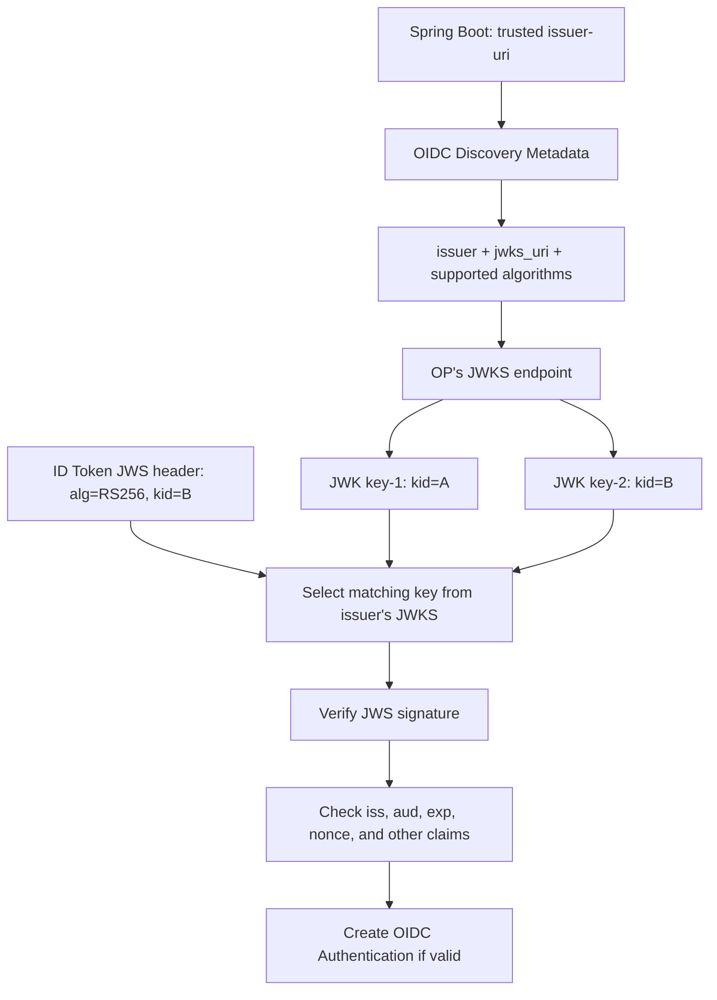

# 11.3. Fetching Keys via JWKS and Selecting Keys with `kid`

In a **Spring Security OAuth 2.0 / OpenID Connect (OIDC) Client** application, after the backend exchanges the authorization code at the token endpoint, the OpenID Provider (OP) typically returns an **ID Token** formatted as a JWT. Before creating `OidcUser`, `Authentication`, and a login session, the client must verify that the ID Token was genuinely issued by a **trusted OP**, intended for the right client, and does not violate any validation conditions.

A central part of verifying an ID Token's signature is **fetching public verification keys from JWKS** and **selecting the key matching the `kid` field in the JWT header**. When an OP uses multiple keys or rotates signing keys, this lets the client find the right public key without hardcoding a single key in the application.

However, one security boundary must be kept firmly in mind:

> **`kid` is a key-selection hint, not proof of trust.** Keys must only be selected from the JWKS of the configured issuer, and both the signature and required OIDC claims must be verified.

This lesson explains the relationship between ID Token, JWS, JWK, JWKS, OIDC Discovery, and Spring Security; describes the key-selection algorithm, caching and key rotation mechanisms, missing-`kid` scenarios, and safe troubleshooting techniques.

## 1. What Is an ID Token Signed For, and What Does the Client Check?

An OIDC ID Token represents information about an authentication event, issued by an OpenID Provider for a specific **Relying Party / OIDC Client**.

When using JWS Compact Serialization, an ID Token has three dot-separated parts:

```text
BASE64URL(JWS Header).BASE64URL(JWT Claims).BASE64URL(Signature)
```

Illustrative structure example:

```text
eyJhbGciOiJSUzI1NiIsImtpZCI6ImtleS0yMDI2LTAxIn0
.
eyJpc3MiOiJodHRwczovL2lkLmV4YW1wbGUub3JnIiwiYXVkIjoib3JkZXJzLXdlYiJ9
.
<signature-base64url>
```

The three parts normally appear on **a single line** with no whitespace; the line breaks above are purely for readability. The illustrative values are not a valid ID Token usable in a real system.

The first two parts are Base64URL-encoded JSON:

- **Header** contains signing metadata such as `alg` and, commonly, `kid`.
- **Payload/claims** contains `iss`, `sub`, `aud`, `exp`, `iat`, `nonce`, and other OIDC claims depending on the case.
- **Signature** is generated with the issuer's signing key over the data according to the JWS algorithm.

**Base64URL is representation encoding, not security encryption.** Anyone holding the JWT can decode the header/payload, yet must never **trust the contents** before verifying the signature and OIDC conditions.

### 1.1. Distinguishing Common Terms

| Term | Meaning | Relation to ID Token |
|---|---|---|
| **JWT** (*JSON Web Token*) | Format containing claims, protectable via JWS or JWE depending on the case. | An ID Token is usually a JWS-signed JWT. |
| **JWS** (*JSON Web Signature*) | Mechanism for protecting integrity and issuer authenticity via signature/MAC. | Header `alg`, signature, and verification flow belong to JWS. |
| **JWK** (*JSON Web Key*) | JSON representation of a cryptographic key. | Can represent a public key used to verify signatures. |
| **JWKS / JWK Set** | A JSON object containing a `keys` array of multiple JWKs. | The OP publishes a key set for clients to choose from when verifying tokens. |
| **`jwks_uri`** | URL published by the OP in metadata, pointing to the JWKS. | The client fetches the key set from a trusted source. |
| **`kid`** (*Key ID*) | Key identifier placed in the JWS header and usually present in the JWK. | The client filters candidate keys within the right OP's JWKS. |
| **`alg`** | JWS algorithm, e.g. `RS256` or `ES256`. | Must match client policy and key type. |
| **`kty`** | JWK key type, e.g. `RSA`, `EC`, or `OKP`. | Helps filter key types compatible with the algorithm. |

Having multiple public keys in a JWKS does not make every token valid. A token is valid only when **the key is right**, **the algorithm is allowed**, **the signature passes**, and **OIDC claims are valid**.

## 2. Where Is the JWKS Found?

An OIDC Client is typically configured with a **trusted issuer URI**. For example:

```text
https://id.example.org/realms/company
```

OpenID Connect Discovery lets the application retrieve the **provider metadata** corresponding to the issuer. Metadata includes the authorization, token, and (when available) UserInfo endpoints, along with the JWK Set URL.

Illustrative metadata excerpt:

```json
{
  "issuer": "https://id.example.org/realms/company",
  "authorization_endpoint": "https://id.example.org/realms/company/protocol/openid-connect/auth",
  "token_endpoint": "https://id.example.org/realms/company/protocol/openid-connect/token",
  "jwks_uri": "https://id.example.org/realms/company/protocol/openid-connect/certs",
  "id_token_signing_alg_values_supported": [
    "RS256",
    "PS256"
  ]
}
```

Actual metadata values and paths **depend on the provider**. This is not a universal endpoint layout for every OP.

Key points:

1. The client selects and trusts the **issuer from configuration**, never taking a random issuer from the JWT.
2. The client looks up the issuer's metadata via OIDC Discovery or controlled provider configuration.
3. The client verifies that the metadata belongs to the expected issuer.
4. The client obtains `jwks_uri` from trusted metadata/registration.
5. The client uses that JWKS to locate the **verification public key** for that issuer's ID Tokens.

Never take an arbitrary `jwks_uri` URL from a user request or untrusted header and use it as a verification key source.

### 2.1. Relationship Diagram Between Issuer, JWKS, and ID Token



The chain of trust starts from the **allowed issuer**, proceeds to **that issuer's JWKS**, and only then uses `kid` to select a key. Reversing the direction — trusting the token/header first and picking an issuer or key-download URL from it — is a dangerous design.

### 2.2. Is It Safe for a JWKS to Be Public?

A JWKS used for **asymmetric signature verification** normally contains public keys. Therefore, an OP's JWKS endpoint is usually publicly reachable over HTTPS; public keys do not need to be treated as secrets.

For example, public RSA JWK data typically contains `n` (modulus) and `e` (exponent). Those are **not the private key**. A JWKS used to verify an OP's signatures must never accidentally expose private key components such as `d` or other private-key parameters.

Signatures are created by the OP with its private key, while the client uses the matching public key to verify. If a signing key is compromised, rotation/revocation procedures are required; having a public JWKS endpoint is **not** a private-key leak.

## 3. What Does a JWKS Look Like?

Illustrative JSON response (**not real RSA key values usable for actual verification**):

```json
{
  "keys": [
    {
      "kty": "RSA",
      "use": "sig",
      "kid": "company-2026-key-a",
      "alg": "RS256",
      "n": "<base64url-rsa-modulus-a>",
      "e": "AQAB"
    },
    {
      "kty": "RSA",
      "use": "sig",
      "kid": "company-2026-key-b",
      "alg": "RS256",
      "n": "<base64url-rsa-modulus-b>",
      "e": "AQAB"
    }
  ]
}
```

This is a **JWK Set** because it has a `keys` array. Each element is **a JWK**. In a real system, `n` holds a valid Base64URL-encoded modulus; the angle-bracket strings here are explanatory placeholders.

| Property in JWK | Meaning |
|---|---|
| `kid` | Key identifier within the issuer's key set; assists key selection. |
| `kty` | Key type such as `RSA`, `EC`, or `OKP`. |
| `use` | Intended usage; `sig` typically indicates a signing/signature-verification key. |
| `key_ops` | Allowed operations, e.g., `verify`, if provided. |
| `alg` | Intended algorithm for the key, if published by the provider. |
| `n`, `e` | RSA public key components. |
| `crv`, `x`, `y` | Elliptic curve key components for `EC`-type JWKs. |
| `x5c` / `x5t` / `x5t#S256` | Certificate/thumbprint metadata that may be published, depending on the provider's mechanism. |

Not every JWK includes all of `use`, `alg`, or `key_ops`. When optional properties are omitted, the validator must apply the configured algorithm/key-type policy and necessary checks; never assume missing `alg` means the key may be used with **every** algorithm.

### 3.1. RSA and EC JWKs Differ

RSA keys are described by `kty=RSA`, `n`, and `e`. EC keys are usually described by `kty=EC`, `crv`, `x`, and `y`. For instance, `RS256` requires an appropriate RSA key; `ES256` requires an EC key with the matching curve.

A compact EC JWK example:

```json
{
  "kty": "EC",
  "kid": "company-ec-key-1",
  "use": "sig",
  "alg": "ES256",
  "crv": "P-256",
  "x": "<base64url-public-x>",
  "y": "<base64url-public-y>"
}
```

Never select a key solely because `kid` matches when `kty` or curve is incompatible with the allowed algorithm. Key type and algorithm policy are **additional** constraints alongside `kid` matching.

## 4. `kid` in the ID Token: Knowing Which Key Signed It

A typical JWS header:

```json
{
  "typ": "JWT",
  "alg": "RS256",
  "kid": "company-2026-key-b"
}
```

When receiving an ID Token, the client should understand:

- `alg=RS256`: the token claims to use the RS256 JWS algorithm.
- `kid=company-2026-key-b`: the token indicates the corresponding signing key identifier.
- `typ=JWT`: token type hint if published; does not make the token trustworthy by itself.

`kid` resides in the **unverified token header**. An attacker can craft an arbitrary JWT with any `kid`. Therefore `kid` must only be used as a **lookup hint within a trusted key set**, never as authorization to fetch keys from another endpoint.

### 4.1. Is `kid` Globally Unique?

No. `kid` is a key identifier scoped to a given JWK Set or issuer/provider. Two different OPs may use the exact same `kid`, for example:

```text
Issuer A -> JWKS A -> kid=key-1
Issuer B -> JWKS B -> kid=key-1
```

This **does not make keys from A and B interchangeable**. When an application has multiple OIDC client registrations, keep key selection scoped to the **provider/issuer selected and trusted for the authorization request**. Never build a global key store and look up by `kid` alone.

Within the same JWKS, a provider should assign distinct enough `kid` values to differentiate keys active at the same time. If multiple keys share the same `kid` and selection attributes such that a consistent key cannot be determined, the client must handle this safely per library/policy rather than arbitrarily picking the first key in the array.

### 4.2. Is `kid` Mandatory in Every ID Token?

Do not assume every JWS must contain `kid`. In practice, `kid` is very useful when an issuer has multiple keys or rotates keys, so it is widely used. Some cases can verify with a single matching key even when the header omits `kid`, depending on profile, algorithm, and how the library selects keys.

For a production system, behavior when **`kid` is absent** should be explicitly defined:

- Is there exactly one key matching the issuer, algorithm, key type, and intended use?
- Does the Spring Security / JWT decoder library support selecting that key?
- Does internal security policy require `kid`?

If no valid candidate key can be found under policy, reject the token. Never blindly fall back to "the first key" or skip signature verification.

## 5. Key Selection by `kid` and Signature Verification Flow

Conceptually, the algorithm can be described as:

```text
trustedRegistration = registration associated with the OIDC login
expectedIssuer = trustedRegistration.provider.issuer
trustedJwksUri = trustedRegistration.provider.jwksUri

header = parseJwsHeader(idToken)            # untrusted contents
alg = header.alg
kid = header.kid

require alg is in the allowed algorithms list
jwks = loadOrUseCachedJwks(trustedJwksUri)

candidates = jwks.keys
    .filter(k => kid matches if header has kid)
    .filter(k => kty and curve match alg)
    .filter(k => JWK use/key_ops/alg do not conflict)
    .filter(k => satisfies issuer key policy)

require at least one valid candidate per policy
require JWS signature verification succeeds with a matching key

claims = parseVerifiedClaims(idToken)
require iss, aud, timestamps, nonce, and OIDC conditions are valid

return verifiedOidcIdentity
```

This is **pseudocode illustrating validation boundaries**, not Java code for manually implementing ID Token verification. In production, use the standard Spring Security / Nimbus libraries rather than writing a custom key selector and JWS processor.

### 5.1. The Order of Checks Has Security Significance

1. **Determine the trusted OP** from the client registration configuration and the active login flow.
2. **Fetch JWKS only for that OP** from trusted configuration/discovery.
3. Read `alg` and `kid` as **untrusted input** to filter candidate keys.
4. Accept only signing algorithms agreed upon by the application/provider.
5. Select a JWK compatible in `kid`, `kty`, curve, and usage.
6. **Verify the signature** using the corresponding public key.
7. Verify **OIDC claims** such as `iss`, `aud`, `exp`, `nonce`, and any flow-specific requirements.
8. Only then build the principal and `Authentication` for the application session.

Avoid two types of mistakes:

- **Key matched but signature skipped:** forged tokens can still be accepted because `kid` is just a text string.
- **Signature valid but claims skipped:** a token signed by the issuer might not be intended for the current client, might be expired, or might not be bound to the authorization request.

### 5.2. Why Not Blindly Trust `alg` from the JWT?

A JWT header can be crafted by an attacker. If a validator lets the header dictate how verification works, the application can suffer **algorithm confusion** vulnerabilities, such as:

- Accepting `alg=none` as an unsigned token in a flow requiring a signed ID Token.
- Switching from RSA verification to HMAC simply because the token declares `HS256` without policy authorization.
- Misusing an RSA public key as a shared HMAC secret due to flawed implementation.
- Accepting a weak algorithm or one not permitted by the OP/client registration.

The right approach: **the application maintains an allowed-algorithm policy** based on the OIDC client/provider configuration, checks that the header is compatible with the policy, and then verifies using the proper key type.

Spring Security decodes and verifies ID Tokens per client registration. In some standard setups, the default supported signature algorithm may be `RS256`; if the OP uses another algorithm, configure support via the API of the **Spring Security version in use**, rather than opening all algorithms based on the token header.

### 5.3. Why Check `use`, `key_ops`, and `kty`?

A JWKS can contain keys for different purposes. A JWK with `use=enc` is meant for encryption, not signature verification. If `key_ops` is present, the `verify` operation must be permitted. An RSA JWK cannot be used as an EC key.

`kid` narrows the key set, but **does not override other attributes**. If a key has a matching `kid` yet is incompatible with the algorithm/policy, the proper outcome is no matching key or invalid signature — never fall back to an unrelated key to force the token to pass.

## 6. Fetching JWKS over HTTP: Trusted Source, TLS, and Caching

Suppose the OP publishes:

```text
jwks_uri = https://id.example.org/realms/company/protocol/openid-connect/certs
```

The client sends an HTTP(S) request through the decoding library:

```http
GET /realms/company/protocol/openid-connect/certs HTTP/1.1
Host: id.example.org
Accept: application/json
```

Illustrative response:

```http
HTTP/1.1 200 OK
Content-Type: application/json
Cache-Control: public, max-age=300

{"keys":[{"kty":"RSA","kid":"company-2026-key-b","use":"sig","n":"...","e":"AQAB"}]}
```

The abbreviated `n` values in this example are not real keys. `max-age=300` is only an example and does not mean every JWKS endpoint uses a 300-second TTL.

### 6.1. Why Is JWKS Caching Necessary?

If the application downloads JWKS from the OP on every ID Token received, it:

- Increases login latency.
- Becomes overly dependent on the network and the health of the JWKS endpoint.
- Generates unnecessary load on the OP.
- Risks request storms when many users log in concurrently.

JWT/JWK client libraries usually include **key caching and refresh policies**. Understand this behavior before deploying to production, especially around OP key rotation events.

Do not implement "fetch the URL on every token" or disable caching altogether just to handle key rotation faster. Conversely, do not cache forever without any refresh capability.

### 6.2. Requirements for the HTTP Client Fetching JWKS

- Fetch keys over **HTTPS** with proper server certificate validation.
- Only access the `jwks_uri` obtained from a **trusted issuer/configuration**.
- Set appropriate timeouts, response size limits, and retry policies.
- Do not follow uncontrolled redirects to other endpoints just because a remote server requests it.
- Protect DNS, proxy, egress, and network policies to reduce SSRF risks.
- Manage caching, key refresh, and resilience when the JWKS endpoint is temporarily unavailable.

A JWT may contain key-reference headers such as `jku` or `x5u`. **Never follow URLs from an unverified token** to download JWKS or certificates. If the application customizes the decoder, ensure the key source remains bound to the registered OP; this helps prevent forged tokens and SSRF.

### 6.3. What If the JWKS Endpoint Is Temporarily Unreachable?

The application may encounter one of two states:

- **The needed key is already in a usable cache:** token verification can continue depending on library policy and cache freshness.
- **The key is missing or a refresh is needed:** ID Token verification must fail closed; never skip signature verification just because JWKS is temporarily failing.

Monitor network, TLS, timeout, HTTP 404/5xx, and cache refresh errors separately from `kid`-not-found errors. A "cannot fetch keys" error does not prove an ID Token is forged, yet **without verification evidence**, the token cannot be treated as valid.

## 7. Key Rotation: Why Does One Issuer Have Multiple `kid`s?

An OP needs to rotate signing keys to satisfy security policies, perform periodic rotation, or replace keys after an incident. During a transition window, an OP may publish **both the old and new keys** in its JWKS.

Example timeline:

```text
Day A:
  OP signs ID Tokens with key-old
  JWKS publishes: key-old

Day B (preparing rotation):
  OP continues signing with key-old
  JWKS publishes: key-old, key-new

Day C (switching to new key):
  OP signs new ID Tokens with key-new
  JWKS publishes: key-old, key-new

Day D (after an appropriate transition period):
  OP retires and may remove key-old
  JWKS publishes: key-new
```

Publishing the new key **before starting to sign with it** gives clients caching the JWKS a chance to pick up the new key. Keeping the old key for a suitable transition window allows older tokens that are still valid under policy to be verified; retention time depends on token lifetimes, caching, and operational requirements.

### 7.1. What Happens When a New `kid` Appears?

Suppose a new ID Token contains:

```json
{
  "alg": "RS256",
  "kid": "key-new"
}
```

Yet the client's cache only has `key-old`. A JWK/JWT decoder library can **refresh the JWKS** according to its cache/refresh policy to locate the new key, then attempt signature verification.

Exact behavior depends on the library, version, and configuration. Recommended design:

1. Check the current JWKS cache.
2. If no matching key exists and policy permits, attempt a rate-limited refresh from the **same trusted JWKS URI**.
3. Select a compatible key from the refreshed set.
4. Verify the signature; if still no valid key exists, reject the token.

**Do not** fetch the JWKS without rate limits every time a random `kid` appears. An attacker could send many forged tokens with new `kid` values to generate load or cause denial of service.

### 7.2. Invalid Signature Even Though `kid` Exists

A token with `kid=key-new` where the JWKS already contains `key-new` yet signature verification fails is **not automatically a rotation bug**. The token may have been tampered with, the provider may have published the wrong key, the algorithm may not match, or there may be a signing bug.

Do not try all public keys from every provider or skip signature checks when a matching key was found and verification failed. Validate the signature per policy and **fail closed**.

### 7.3. Should You Pin a Single Fixed Public Key?

Pinning a fixed key may be a specialized policy in tightly controlled environments, but if the OP performs key rotation, hardcoding a single public key in source code can break login as soon as the OP rotates keys.

For typical OIDC Clients, configuring a **trusted issuer + discovery/JWKS URI** and relying on the library's key refresh mechanism adapts much better. If an organization mandates key pinning, operate strict update, transition, and incident procedures; never treat pinning as a replacement for issuer/audience/time/nonce validation.

## 8. How Does Spring Boot Configure JWKS for OIDC Login?

### 8.1. Dependencies

Gradle example for Spring Boot Servlet:

```gradle
dependencies {
    implementation("org.springframework.boot:spring-boot-starter-web")
    implementation("org.springframework.boot:spring-boot-starter-security")
    implementation("org.springframework.boot:spring-boot-starter-oauth2-client")
}
```

The OAuth2 Client starter integrates the OAuth2/OIDC Client components needed for login. Solely for verifying ID Tokens in the `oauth2Login()` flow, you do not need to enable Resource Server unless the application also exposes APIs accepting bearer tokens.

### 8.2. Prefer Configuring `issuer-uri`

```yaml
spring:
  security:
    oauth2:
      client:
        registration:
          company:
            provider: company-oidc
            client-id: ${OIDC_CLIENT_ID}
            client-secret: ${OIDC_CLIENT_SECRET}
            authorization-grant-type: authorization_code
            client-authentication-method: client_secret_basic
            redirect-uri: "{baseUrl}/login/oauth2/code/{registrationId}"
            scope:
              - openid
              - profile
              - email
        provider:
          company-oidc:
            issuer-uri: https://id.example.org/realms/company
```

In this example:

- `company` is the registration ID used at `/oauth2/authorization/company`.
- `company-oidc` is the provider configuration alias.
- `issuer-uri` is the OIDC issuer trusted by the application; Spring Security/Boot can use OIDC Discovery to locate metadata and `jwks_uri`.
- `client-id` corresponds to the expected audience of the ID Token.
- `scope` includes `openid` so this runs as OIDC login rather than plain OAuth2 login.
- `client-secret` exists only on the backend when using a confidential client; never expose it to the frontend or commit it to Git.

With a provider that supports accurate discovery, you usually **do not need to fetch JWKS manually with `RestClient` or hardcode a public key** for OIDC login. Spring Security handles ID Token validation via the relevant OIDC components.

### 8.3. Internal Spring Security Classes Involved

In Servlet OAuth2 Login with the `openid` scope, the involved components include:

| Component | Role |
|---|---|
| `ClientRegistration` / `ClientRegistrationRepository` | Holds client and provider details, including issuer and JWK Set URI when configured. |
| `OAuth2LoginAuthenticationFilter` | Handles the authorization code callback to complete login. |
| `OidcAuthorizationCodeAuthenticationProvider` | Processes OIDC Authorization Code authentication, including verifying the ID Token via the appropriate decoder. |
| `OidcIdTokenDecoderFactory` | Creates/configures the ID Token decoder per client registration in the corresponding Spring Security implementations. |
| `NimbusJwtDecoder` and the library's JOSE/JWK components | Performs parsing, key selection / signature verification, and JWT operations per configuration. |
| `OidcUser` / `OidcIdToken` | Represents the processed OIDC identity and ID Token within authentication. |

Class names and wiring can vary across Spring Security versions; refer to the API for your project's version when customizing. **Business applications do not need to manually decode headers, load JWKs, and invoke RSA algorithms just to perform standard OIDC login.**

### 8.4. Manually Configuring JWKS URI When a Provider Lacks Discovery

For providers where metadata discovery is unavailable or endpoints must be declared explicitly per integration contract, Spring Boot provides properties under `spring.security.oauth2.client.provider.<id>`, for example:

```yaml
spring:
  security:
    oauth2:
      client:
        registration:
          company:
            provider: manual-oidc
            client-id: ${OIDC_CLIENT_ID}
            client-secret: ${OIDC_CLIENT_SECRET}
            authorization-grant-type: authorization_code
            redirect-uri: "{baseUrl}/login/oauth2/code/{registrationId}"
            scope: [openid, profile]
        provider:
          manual-oidc:
            issuer-uri: https://id.example.org
            authorization-uri: https://id.example.org/oauth2/authorize
            token-uri: https://id.example.org/oauth2/token
            jwk-set-uri: https://id.example.org/oauth2/keys
```

**This example only illustrates property placement.** In some versions/configurations, declaring `issuer-uri` triggers Spring Boot discovery and may require valid discovery metadata. If the goal is **not to use discovery**, configure the provider with explicit endpoints and required OIDC settings according to your Spring Security API/version, ensuring issuer checks remain properly enforced. Do not treat an illustrative YAML combination as a complete replacement for all metadata.

Things to remember:

- `spring.security.oauth2.client.provider.<id>.jwk-set-uri` is a **provider property**.
- It does not belong under `registration.<id>.jwk-set-uri`.
- The JWKS URI must be a verified/allowed URL from trusted OP documentation and configuration.
- Specifying only the JWKS URI does not replace `iss`, `aud`, and timestamp checks.
- Never take the URI from the JWT header of an unverified token.

For OIDC providers supporting standard discovery, configuring the issuer is the most common, least error-prone choice and adapts more smoothly to key rotation.

### 8.5. Enabling `oauth2Login()`

```java
import org.springframework.context.annotation.Bean;
import org.springframework.context.annotation.Configuration;
import org.springframework.security.config.Customizer;
import org.springframework.security.config.annotation.web.builders.HttpSecurity;
import org.springframework.security.web.SecurityFilterChain;

@Configuration
public class SecurityConfiguration {

    @Bean
    SecurityFilterChain securityFilterChain(HttpSecurity http)
            throws Exception {
        http
            .authorizeHttpRequests(authorize -> authorize
                .requestMatchers("/", "/public/**").permitAll()
                .anyRequest().authenticated()
            )
            .oauth2Login(Customizer.withDefaults());

        return http.build();
    }
}
```

After the user logs in at the OP, Spring Security receives the callback, exchanges the code at the token endpoint, and verifies the OIDC result. If the ID Token has an invalid signature or fails validation rules, login must fail; the framework will not create a successful `Authentication` for that token.

To read the authenticated principal in a controller:

```java
import java.util.Map;

import org.springframework.security.core.annotation.AuthenticationPrincipal;
import org.springframework.security.oauth2.core.oidc.user.OidcUser;
import org.springframework.web.bind.annotation.GetMapping;
import org.springframework.web.bind.annotation.RestController;

@RestController
public class CurrentUserController {

    @GetMapping("/me")
    public Map<String, String> me(@AuthenticationPrincipal OidcUser user) {
        return Map.of(
            "issuer", user.getIdToken().getIssuer().toString(),
            "subject", user.getSubject()
        );
    }
}
```

This controller does not perform key selection and does not verify signatures itself. It consumes the principal already authenticated by the filter/login provider. Never process an unverified ID Token in a controller and treat its payload as trusted user data.

## 9. Why Are JWKS and `kid` Checks Not Enough to Accept an ID Token?

Suppose an ID Token has an RS256 signature verified with a public key from JWKS. That proves the token has a **signature matching that key**. The client still needs to verify that the token has the right purpose and OIDC context.

| Condition | Meaning |
|---|---|
| **`iss`** | Must equal the trusted issuer configured for the client registration. |
| **`aud`** | Must contain the `client_id` of the receiving OIDC Client; check `azp` when required by OIDC. |
| **`exp`** | Token must not be expired at verification time, within reasonable clock skew when applicable. |
| **`iat`** | Issued-at timestamp must be processed per OIDC rules and application policy. |
| **`nonce`** | If the authorization request sent a nonce, the ID Token must bind to that value. |
| **`auth_time`, `acr`, `amr`** | Verified when reauthentication or authentication-assurance policy is required. |
| **`sub`** | User identifier scoped to the issuer; usually the (`iss`, `sub`) pair serves as the internal linking identifier. |

Example:

```json
{
  "iss": "https://id.example.org/realms/company",
  "sub": "person-2841",
  "aud": "orders-web",
  "iat": 1760000000,
  "exp": 1760000300,
  "nonce": "nonce-from-original-request"
}
```

Timestamps in this example only illustrate structure and do not reflect current time.

Even when the signature is valid, an ID Token with an `aud` for another client or an `iss` for another provider **must not be used to log in** to the current client. This is why public-key selection must be tied to **the right issuer/registration**, rather than sharing one system-wide JWKS.

### 9.1. `nonce` Is Different from `kid`

- `kid`: identifies which **signing key** can be used to verify the JWS.
- `nonce`: verifies whether the **ID Token** is bound to the current OIDC authorization request when nonce is used.

An ID Token with the right `kid` and valid signature can still be rejected if `nonce` is wrong. Likewise, a matching `nonce` cannot rescue an invalid signature.

### 9.2. `state` and PKCE Occur at Different Stages

`state` binds the authorization response/callback to the request initiated by the browser. PKCE binds the authorization code exchange to `code_verifier`. ID Token/JWKS signature verification verifies the authenticity of the token issued by the OP.

Those three steps occur at different points in the flow and all may be required; never skip one step just because the other two succeeded.

## 10. Key Selection in Multi-Provider Applications

Suppose an application allows employees and partners to log in through two issuers:

```yaml
spring:
  security:
    oauth2:
      client:
        registration:
          employee:
            provider: employee-idp
            client-id: ${EMPLOYEE_CLIENT_ID}
            client-secret: ${EMPLOYEE_CLIENT_SECRET}
            authorization-grant-type: authorization_code
            redirect-uri: "{baseUrl}/login/oauth2/code/{registrationId}"
            scope: [openid, profile]
          partner:
            provider: partner-idp
            client-id: ${PARTNER_CLIENT_ID}
            client-secret: ${PARTNER_CLIENT_SECRET}
            authorization-grant-type: authorization_code
            redirect-uri: "{baseUrl}/login/oauth2/code/{registrationId}"
            scope: [openid, profile]
        provider:
          employee-idp:
            issuer-uri: https://employees.example.org
          partner-idp:
            issuer-uri: https://partners.example.org
```

Even if both OPs have a JWK with `kid=active-key`, the client must still select the right key:

```text
Registration employee
  -> Issuer https://employees.example.org
  -> JWKS employees
  -> kid active-key in JWKS employees

Registration partner
  -> Issuer https://partners.example.org
  -> JWKS partners
  -> kid active-key in JWKS partners
```

Do not do:

```text
Any ID Token -> read kid -> search across all JWKS -> try keys until signature passes
```

That approach can create **issuer confusion/mix-up** vulnerabilities if provider boundaries are not preserved. Rather, once an authorization request begins, the application already knows which registration/provider was used. The token response is processed within that context; JWKS and issuer/audience checks must match that context.

### 10.1. When Two Client Registrations Share the Same Issuer

One issuer may issue tokens for multiple client IDs. In that case they may share the **same JWKS** while having different `aud` values. A signature valid under the issuer's shared public key **does not prove a token for client A is valid for client B**. You must still verify the audience/client ID of the active registration.

### 10.2. `kid` Can Change While `sub` Stays the Same

Signing keys can rotate, causing `kid` in newer tokens to change. That **does not change the user's identity**. OIDC identity is usually based on issuer and subject, not on `kid` or the OP's public key. Never store `kid` as a user ID.

## 11. Common JWKS and `kid` Failure Scenarios

| Symptom | Possible Cause | Diagnostic Direction |
|---|---|---|
| Unable to fetch JWKS. | Wrong `jwks_uri`, DNS/TLS/firewall, 404/5xx, proxy, or incorrect metadata. | Check issuer/discovery, TLS, and backend connectivity to the OP endpoint. |
| JWT header has `kid` but JWKS has no matching key. | OP recently rotated keys, stale cache, client using wrong issuer, or forged token. | Check the JWKS of the **exact issuer**, cache/refresh, and key publication. |
| `kid` matches yet signature fails. | Token tampered with, wrong public key, provider signed with another key, or algorithm mismatch. | Verify actual key, `alg`, `kty`, and signing setup; never bypass signature checks. |
| Header `alg=ES256` yet JWKS only has RSA keys. | Algorithm and key type incompatible or provider misconfigured. | Check allowed signing algorithm and matching `EC`-type JWK. |
| Header has no `kid`. | OP did not include a key ID; selection depends on policy/library. | Check count of usable keys, decoder policy, and OP requirements. |
| Same `kid` appears multiple times with different keys. | Inconsistently published JWKS or ambiguous key selection. | Inspect provider/key rotation; do not randomly pick the first key. |
| Fails only while OP rotates keys. | Stale cache, new JWKS not yet published, or old key removed too early. | Coordinate rotation schedule, TTL, and refresh logic. |
| Fails on only one production node. | Node cached old keys, different egress, or different TLS trust store. | Compare provider config, cache/reload, proxy, and networking per node. |
| JWKS has the right key yet ID Token is rejected. | Wrong `iss`, `aud`, `exp`, `nonce`, or other OIDC claim. | Separate signature validation from claims validation. |
| OAuth2 Login succeeds yet API returns 401. | Access Token has wrong audience/scope or API validates a different token. | Check the Resource Server; do not confuse login ID Token/JWKS with API bearer tokens. |
| Login fails due to HMAC algorithm. | Provider uses `HS256` while client only configures asymmetric decoding. | Check OIDC provider metadata, client registration, secret, and algorithm support; do not try to use RSA JWKS for HMAC. |

### 11.1. Unknown `kid` After Key Rotation

Scenario:

```text
Cache in Spring Boot: kid=old-key
New ID Token:         kid=new-key
Current JWKS at OP:   old-key, new-key
```

A decoder with a proper refresh mechanism can update the JWKS and verify the new token. If refresh fails to happen or the JWKS endpoint is stale, login is rejected.

The right fix is to check cache/refresh behavior and whether the OP has published the new key. Do not change configuration to ignore `kid` or signatures.

### 11.2. OP Removes the Old Key Too Early

If an OP deletes its old public key immediately upon switching to signing with the new key, an otherwise still-valid ID Token signed with the old key may no longer verify against the newly refreshed JWKS.

Rotation operations must account for ID Token lifetimes, caching policies, and an appropriate overlap window. If an old key was compromised and must be revoked immediately due to an incident, older tokens failing verification may be an acceptable consequence of revocation policy; the application must still fail closed.

### 11.3. Key with `use=enc` Used for Signature Verification

For example, a JWKS contains:

```json
{
  "kid": "encryption-only",
  "kty": "RSA",
  "use": "enc",
  "n": "<modulus>",
  "e": "AQAB"
}
```

Even though `kid` matches the token header, the key's purpose is **encryption**, not signature verification. A proper key selector must not treat it as a valid signing key merely because `kid` matches.

### 11.4. Signature Verified Against Another OP's Key

A multi-IdP application might accidentally combine public keys into a single cache keyed by `kid`. If a token from OP B is processed as a token from OP A just because both chose the same `kid`, the system risks trusting the wrong issuer.

Partition caches/decoders by **issuer and client registration**; after verifying the signature, still validate `iss` and `aud` against the expected values.

### 11.5. Network Errors Are Not Signature Errors

Failing to connect to `jwks_uri` is a **key retrieval** issue. Fetching JWKS successfully without finding a key is a **key selection** issue. Finding a key yet failing verification is a **signature validation** issue. Passing the signature yet failing `exp` or `nonce` is a **claims validation** issue.

These four stages should have distinct messages/metrics to aid investigation without exposing tokens.

## 12. When an ID Token Uses a Symmetric Algorithm

Not every ID Token uses asymmetric `RS256` signatures. OIDC also includes cases with shared-secret algorithms such as `HS256`, depending on client registration and OP policy.

When an ID Token uses **HMAC**, the client verifies the MAC with the appropriate secret per OIDC rules and library configuration. **Do not use public RSA JWKS to verify HMAC.** This underscores that ID Token verification must rely on **the agreed algorithm and trusted configuration**, not merely on `kid`.

Points to remember:

- With asymmetric algorithms, the OP signs with a private key and publishes public keys via JWKS.
- With symmetric algorithms, verification relies on the matching shared secret; a public-key JWKS is not the key source for HMAC.
- Never let a JWT header dynamically switch between RSA and HMAC without explicit policy.
- Never put the client secret in the browser or logs to "debug" signatures.
- When an OP changes signing algorithms, configure support properly on both the provider and OIDC client, rather than just changing a `kid`.

In Spring Security, customizing ID Token algorithms must use APIs supported by the running version and ensure the client registration/provider accepts that algorithm.

## 13. Cache Control, Resource Limits, and Attack Prevention

A JWKS endpoint can become a disruption target if a client continuously receives tokens with random `kid` values. A sound design both allows key rotation and prevents unbounded JWKS fetching.

### 13.1. Do Not Fetch on Every Unknown `kid`

Do not implement logic like:

```text
for every received token:
    GET jwks_uri with no caching
    try any key
```

Instead, use a JWK cache with TTL/refresh, rate-limit retries/backoff, and only attempt refreshes under reasonable conditions. When an unknown `kid` repeats at high frequency, the system must avoid creating an HTTP storm against the OP.

If a key is missing, the client may attempt a policy-bounded refresh from the trusted URL and then **reject** the token if it still cannot be verified. Never accept tokens to "keep the system running" without a valid signature.

### 13.2. Do Not Fetch URLs Specified by the Token

A JWS header can contain `jku` or `x5u`. If a custom decoder trusts those URLs from an unverified token, an attacker can point it to an attacker-controlled endpoint or internal network resources.

Only use the JWKS URI of the **trusted issuer**. Supporting any alternative key-reference headers must rely on a strict allowlist policy and must never alter the issuer's trust anchor.

### 13.3. Limit Size and Data Types

JWKS is JSON data coming from an external system. The HTTP client/decoder should enforce timeouts, response size limits, reasonable key counts, and parse-error handling. Never allow an oversized `keys` array or malformed JWK fields to cause unbounded CPU/memory consumption.

An invalid or incompatible JWK must never cause the validator to fall into an "accept without signature" branch.

### 13.4. Safe Logging

You may log **length-limited and sanitized** details such as:

- Registration ID and expected issuer from trusted configuration.
- Configured JWKS URL/hostname if it contains no credentials.
- Failure stage name: discovery, fetch, cache, key selection, signature, claims validation.
- Number of candidate keys or whether a matching key was found.
- Configured algorithm and normalized error category.
- `kid` read from the token **only when length-limited, stripped of control characters, and treated as untrusted input**.
- An internal correlation ID generated specifically for observability.

**Do not log** full ID Tokens, Access Tokens, Refresh Tokens, authorization codes, client secrets, session cookies, or private keys. Even though JWKS is usually public, there is no need to log the entire JWKS on every login; doing so creates bloated logs and leaks unnecessary configuration details.

## 14. Step-by-Step Walkthrough of Interpreting a Token

Suppose the application registered:

```text
issuer-uri = https://id.example.org/realms/company
client-id  = orders-web
jwks_uri   = https://id.example.org/realms/company/keys
```

During login, the token endpoint returns an ID Token with header:

```json
{
  "alg": "RS256",
  "kid": "rotated-key-02"
}
```

The permitted issuer's JWKS contains:

```json
{
  "keys": [
    {
      "kty": "RSA",
      "use": "sig",
      "alg": "RS256",
      "kid": "rotated-key-01",
      "n": "<n-old>",
      "e": "AQAB"
    },
    {
      "kty": "RSA",
      "use": "sig",
      "alg": "RS256",
      "kid": "rotated-key-02",
      "n": "<n-new>",
      "e": "AQAB"
    }
  ]
}
```

The client then executes the logic:

1. Determine the expected issuer from the `company` registration.
2. Read the ID Token header (untrusted), seeing `alg=RS256` and `kid=rotated-key-02`.
3. Check `RS256` against allowed algorithms.
4. Search within the JWKS of **issuer `company`**, selecting the JWK with `rotated-key-02` having `kty=RSA`, `use=sig`, and matching attributes.
5. Construct the RSA public key from `n/e` via the JOSE/JWK library; verify the JWS signature.
6. Only when the signature is valid, verify `iss=https://id.example.org/realms/company`, `aud` containing `orders-web`, token expiration, and nonce if present.
7. If all OIDC conditions pass, Spring Security creates `OidcUser` / `Authentication` and applies the configured login session mechanism.

If step 4 finds no key, a **rate-limited** cache refresh may be needed. If step 5 fails, a matching `kid` is not enough. If step 6 fails, do not accept the token just because the public key matched.

### 14.1. Same Token, but `kid` Does Not Exist

Header:

```json
{"alg":"RS256","kid":"unknown-key"}
```

The refreshed JWKS still contains only `rotated-key-01` and `rotated-key-02`. The right outcome is **unable to verify the token with keys published by the provider**, so login must fail closed. Do not switch to a `jwks_uri` specified by the token, do not try arbitrary URLs, and do not skip signature verification.

### 14.2. Valid Signature, Wrong `aud`

The ID Token is signed with `rotated-key-02`, yet its payload has:

```json
{
  "iss": "https://id.example.org/realms/company",
  "sub": "person-2841",
  "aud": "some-other-client",
  "exp": 1760000300,
  "iat": 1760000000
}
```

Even with a valid signature, the token **is not intended for `orders-web`**. The client must reject it. This illustrates the distinction between **signature verification** and **OIDC identity/context verification**.

## 15. Troubleshooting Guide in Real Deployments

When encountering login errors related to ID Tokens and JWKS, isolate the failure by stage:

| Stage | Questions to Answer |
|---|---|
| **Client registration** | Was the right registration/issuer selected from the OIDC flow? |
| **Discovery** | Does provider metadata have the right issuer and a valid `jwks_uri`? |
| **Network/JWKS** | Can the backend fetch JWKS over HTTPS within timeouts and network policies? |
| **Cache/rotation** | Does the cache have the needed key? Did the OP just begin signing with a new `kid`? |
| **Key selection** | Does the header `kid` have a matching candidate key in the issuer's JWKS? Are `kty/use/alg` compatible? |
| **Signature** | Did the library verify the JWS signature successfully? |
| **Claims** | Are `iss`, `aud`, `exp`, `iat`, `nonce`, and OIDC policies valid? |
| **Session/login** | After the ID Token is accepted, is `Authentication`/`SecurityContext` saved/restored properly? |

### 15.1. Use the Right Issuer Instead of Copying Another Environment's JWKS URL

A system typically has:

```text
https://id-dev.example.org/realms/company
https://id-staging.example.org/realms/company
https://id.example.org/realms/company
```

Each environment can have a different issuer, signing keys, and client ID. Never validate a production token against staging's JWKS, and never pick an issuer from a user-supplied callback parameter.

When changing environments, update the entire **issuer + client registration + endpoints/JWKS** bundle and keep it consistent across all application instances.

### 15.2. Testing Key Rotation Scenarios Without Weakening Security

In a test environment with a mock OP or test OP, you can simulate:

- A token signed with key `kid=A` when JWKS contains A.
- JWKS contains A and B; new tokens signed with B.
- Stale cache does not yet see B; bounded refresh finds B.
- A token with a `kid` missing from JWKS.
- A token with a valid `kid` whose signature has been altered.
- A validly signed token with the wrong `iss` or `aud`.
- An expired token or mismatched nonce.
- A temporary JWKS endpoint failure/timeout.

The goal of these scenarios is to confirm the system responds according to policy: **login succeeds only when the token is fully verified**. Never insert a signature bypass into test environments just to make fake tokens pass.

## 16. Security Pitfalls to Avoid

| Pitfall | Why Is It Dangerous? | Proper Approach |
|---|---|---|
| Reading `kid` only and assuming the token is valid. | Unverified headers can be forged. | Locate the key in trusted JWKS, verify signature and claims. |
| Accepting `jwks_uri` from a header or query parameter. | Attackers control the key source, risking SSRF or token forgery. | Use trusted issuer/metadata/registration. |
| Allowing any `alg` requested by the token. | Risk of algorithm confusion or accepting disallowed algorithms. | Enforce an algorithm allowlist per provider/client config. |
| Looking up keys by `kid` across all providers. | `kid` is not globally unique, easily mixing issuers. | Scope keys to the exact issuer and client registration. |
| Using a `use=enc` key for signature verification. | Wrong key purpose. | Check `use`, `key_ops`, `kty`, and algorithm. |
| Falling back to the first key when `kid` is not found. | May pick the wrong key or mask errors/weaken security. | Handle per decoder/policy; fail closed if no valid candidate exists. |
| Skipping signature verification when JWKS fails. | Allows forged tokens to log in. | Use proper caching or reject when unable to verify. |
| Skipping `iss/aud/exp/nonce` when signature passes. | Token has a valid signature but wrong recipient/context. | Perform full OIDC claims validation. |
| Hardcoding a single public key without a rotation process. | Breaks login when OP rotates keys. | Use metadata/JWKS and policy-managed refresh. |
| Logging raw ID Tokens to inspect headers. | Leaks credentials and sensitive data. | Log only sanitized, bounded event details. |

### 16.1. Do Not Confuse the OP's JWKS with Client Keys Used to Sign Assertions

In some systems, the **client** authenticates at the token endpoint using `private_key_jwt`. There, the client uses its own private key to sign a **client assertion**, and the OP verifies the assertion using the public key/JWKS registered for the client.

That is a **different** flow from the **OP signing an ID Token** and the OIDC Client using the OP's JWKS to verify it. Do not substitute the client-assertion JWKS for the ID Token issuer's JWKS.

Similarly, an API Resource Server may have its own JWT decoder configuration to verify **Access Tokens**. Never assume ID Tokens and Access Tokens always share the same issuer/audience/keys/policy; configure each role appropriately.

### 16.2. Do Not Manually Decode a JWT in a Controller While Skipping Verification

A `/me` controller can receive `OidcUser` from Spring Security after login. That is completely different from having the frontend send a JWT string and the backend calling `Base64.getUrlDecoder()` to read `sub` and trust it.

If a token must be verified outside the default login flow, you need a decoder/validator configured with the appropriate issuer, JWKS, algorithm, audience, and claims; never treat Base64 decoding as signature verification.

## 17. Summary of the Key Verification Mindset

When receiving an asymmetrically signed ID Token, the OIDC Client must follow the trust boundaries:

```text
Trusted client registration
        |
        v
Expected issuer
        |
        v
OIDC Discovery / provider metadata
        |
        v
Trusted JWKS URI
        |
        v
JWKS public keys (with cache/rotation)
        |
        +---- JWS header: alg, kid (untrusted)
        |
        v
Select compatible JWK from the RIGHT issuer
        |
        v
Verify signature
        |
        v
Verify iss / aud / exp / nonce / OIDC conditions
        |
        v
Create Authentication if all steps succeed
```

Key takeaways:

- **JWKS** is the set of public keys published by the OP; **`jwks_uri`** is the URL to fetch that key set from a trusted issuer.
- **`kid`** identifies candidate keys within the JWKS, but is not proof of token validity.
- **`alg`, `kty`, `use`, `key_ops`**, and algorithm policy determine whether a key is suitable for signature verification.
- **Key rotation** means a JWKS may hold multiple keys and change over time; caches must refresh properly without being manipulated by random `kid` values.
- **A valid signature is still not enough**; `iss`, `aud`, timestamps, and nonce must be valid for the corresponding OIDC client registration and authorization request.
- In **Spring Security OAuth2/OIDC Client**, rely on built-in `oauth2Login()`, discovery/JWKS, and ID Token decoder mechanisms rather than writing a custom JWT verifier.

### References

- [OpenID Connect Core 1.0 — ID Token](https://openid.net/specs/openid-connect-core-1_0.html#IDToken)
- [OpenID Connect Core 1.0 — ID Token Validation](https://openid.net/specs/openid-connect-core-1_0.html#IDTokenValidation)
- [OpenID Connect Discovery 1.0 — Provider Metadata](https://openid.net/specs/openid-connect-discovery-1_0.html)
- [RFC 7517 — JSON Web Key (JWK)](https://www.rfc-editor.org/rfc/rfc7517)
- [RFC 7515 — JSON Web Signature (JWS)](https://www.rfc-editor.org/rfc/rfc7515)
- [RFC 7519 — JSON Web Token (JWT)](https://www.rfc-editor.org/rfc/rfc7519)
- [Spring Security Reference — OAuth 2.0 Login (Servlet)](https://docs.spring.io/spring-security/reference/servlet/oauth2/login/index.html)
- [Spring Security Reference — OAuth 2.0 Client Core](https://docs.spring.io/spring-security/reference/servlet/oauth2/client/core.html)

Conclusion: **Fetching JWKS from the right source and selecting keys by `kid` are necessary conditions when verifying asymmetrically signed ID Tokens, but they are meaningful only alongside algorithm policy, signature verification, and OIDC claims validation.** In a Spring Boot system, configuring a trusted issuer and letting Spring Security manage decoders/JWKS reduces the risk of flawed custom implementations while supporting provider key rotation without changing code for every new `kid`.
