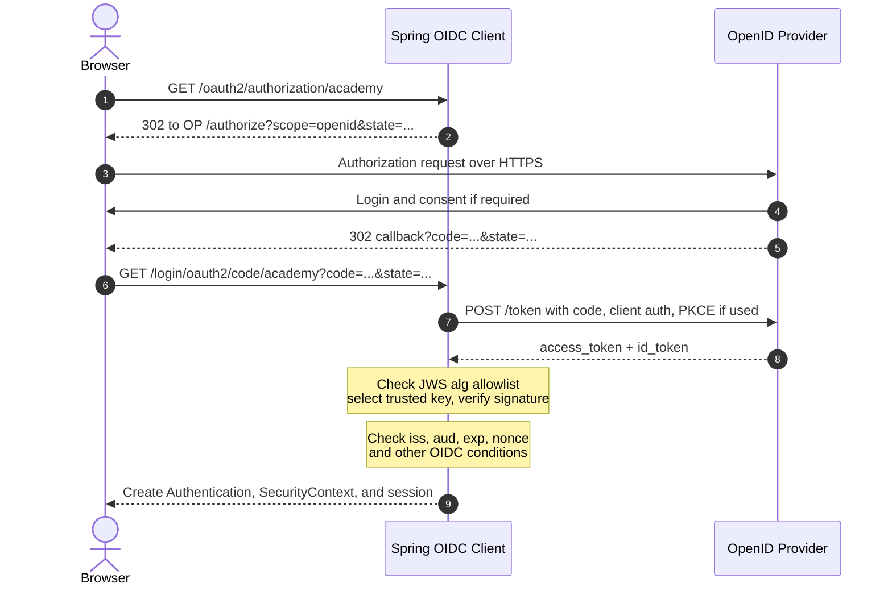

# 11.4. Configuring and Restricting Accepted Signature Algorithms

In **Spring Security OAuth 2.0 / OpenID Connect (OIDC) Client**, an ID Token is proof of a user authentication event issued by an OpenID Provider (OP) for a specific client. An ID Token is usually a **JWT signed using JSON Web Signature (JWS)**. Signature verification is not merely "which key to verify with," but also **deciding which algorithm is permitted for that exact client registration**.

An ID Token can self-declare headers such as `alg=RS256`, `alg=ES256`, `alg=HS256`, or another value. **Never trust an algorithm merely because the token declares it.** The application must rely on configuration and agreements with the identity provider to select the set of allowed algorithms, then use the right key type, verify the signature, and validate all OIDC claims.

This lesson focuses on practices in **Spring Boot 3.x / Spring Security 6.x, Servlet applications using `oauth2Login()`**:

- Understand JWS algorithms and the meanings of `alg`, `kid`, and JWKS.
- Distinguish algorithms an OP **supports** from the algorithm a client **is registered to use**.
- Use Spring Security's `RS256` default when appropriate.
- Configure `OidcIdTokenDecoderFactory` to accept only the determined algorithm per `ClientRegistration`.
- Avoid `alg=none`, algorithm confusion, fetching keys from untrusted sources, and overly broad allowlists.
- Distinguish the **OAuth2 Login ID Token decoder** from the **Resource Server `JwtDecoder`**.
- Preserve issuer, audience, timestamp, and nonce checks when customizing decoders.

Domains, client IDs, and secrets in the examples are illustrative only. This content does not replace establishing a security policy, registering clients, and testing against a real OP.

## 1. Context: Where Does the ID Token Appear?

When the browser opens a page requiring authentication, Spring Security executes the Authorization Code Flow:



The "`alg` check" step happens during **ID Token validation in the OIDC Client**, after the backend receives the token from the Token Endpoint. It is **not** algorithm selection when sending the authorization request, nor HTTP `client_secret_basic`/`client_secret_post`.

Three separate questions must be answered:

1. **Is this algorithm permitted?** For example, policy only permits `RS256`.
2. **Is the signature/MAC actually valid under a trusted key?** For example, the right OP's RSA public key or an authorized secret for HMAC.
3. **Are the token claims valid?** `iss`, `aud`, `exp`, `nonce`, and other constraints.

Only when all three groups of checks pass can the ID Token be accepted for login.

## 2. JWT/JWS Structure and the Role of `alg`

An ID Token is a three-part compact JWT when represented with JWS:

```text
BASE64URL(protected_header)
.
BASE64URL(claims_payload)
.
BASE64URL(signature)
```

Example **JOSE protected header** after Base64URL decoding:

```json
{
  "alg": "RS256",
  "kid": "signing-key-2026",
  "typ": "JWT"
}
```

Illustrative ID Token payload:

```json
{
  "iss": "https://idp.example.com/realms/academy",
  "sub": "user-413",
  "aud": "academy-web",
  "iat": 1794800000,
  "exp": 1794803600,
  "nonce": "random-nonce-value"
}
```

**Both header and payload are readable before verifying the signature.** Base64URL decoding does not prove the token was issued by the OP. An attacker can craft a JWT string declaring any `alg` and `kid`. Therefore, header fields must be treated as **untrusted data** until the algorithm and key have been checked against the application's policy and the signature has been verified.

| Field | Where It Lives | Role | Trust Rule |
| --- | --- | --- | --- |
| `alg` | JOSE header | Name of the JWS signature/MAC algorithm | Accept only if in the preconfigured allowlist for the client; never let the token choose policy. |
| `kid` | JOSE header | Lookup hint for the signing key in the JWK Set | Look up keys only in the configured trusted source; never treat `kid` as proof. |
| `kty` | JWK | Key type, e.g., `RSA`, `EC`, or `oct` | Must match the algorithm and key function. |
| `use` / `key_ops` | JWK | Key usage (e.g., signature/verify) | Never use a key for the wrong purpose. |
| `iss` | Claims | Issuer that issued the token | Must match the registration's expected issuer. |
| `aud` | Claims | Client targeted by the token | Must contain the application's `client_id`. |
| `nonce` | Claims | Binds the ID Token to the authorization request | If the request sent a nonce, verify against stored context. |

**`alg` in a JWS header is not `alg` for JWE encryption.** For encrypted ID Tokens (JWE), verification may require decrypting the outer layer and verifying the inner signature per separate configuration. This lesson focuses on **signed JWS** ID Tokens, the common form in the Authorization Code Flow.

## 3. Classification of Common Algorithms

JWS algorithm names are specific identifiers, not merely "RSA" or "SHA-256." Some options in the OIDC ecosystem:

| JWS Algorithm | Cryptographic Family | Verification Key at OIDC Client | Notes |
| --- | --- | --- | --- |
| **`RS256`** | RSA PKCS#1 v1.5 + SHA-256 | RSA public key from OP's JWKS | Common default for ID Tokens, also the Spring Security `OidcIdTokenDecoderFactory` default. |
| `RS384` / `RS512` | RSA + SHA-384/512 | Appropriate RSA public key | Enable only if agreed upon and properly supported. |
| **`PS256`** | RSA-PSS + SHA-256 | Appropriate RSA public key | Differs from `RS256` in signature scheme; do not treat as equivalent. |
| **`ES256`** | ECDSA P-256 + SHA-256 | EC public key on the matching curve from trusted JWKS | Requires matching curve/key and JWS support in decoder/OP. |
| `ES384` / `ES512` | ECDSA with corresponding curve/hash | Appropriate EC public key | Do not enable just because the OP publishes an arbitrary EC key. |
| **`HS256`** | HMAC + SHA-256 | Strong shared secret; in Spring OIDC usually the client secret | Symmetric MAC: both creator and verifier know the key. |
| `HS384` / `HS512` | HMAC + SHA-384/512 | Strong shared secret | Choose only when the client is registered for it and the secret meets requirements. |
| `none` | Unsigned | No signature verification key | Must not be accepted in OIDC login applications requiring signed ID Tokens. |

`RS256`, `PS256`, and `ES256` are all **asymmetric algorithms**: the OP holds the private signing key; the application only needs the public key to verify. `HS256` is **symmetric**: both sides possess the secret that can generate the MAC.

With HMAC algorithms, the secret must meet standard length and entropy requirements: for example, **HS256 requires a key of at least 256 bits** per JWA. If an issued client secret is a short or weak string, do not switch to HS256 to "fix" compatibility errors; coordinate with the OP to use a proper method/secret.

### 3.1. Why Not Simply Accept Every "Strong" Algorithm?

An OP may publish `RS256`, `PS256`, and `ES256` as algorithms **it supports**. Yet a **specific client** may have registered to use `RS256`. If the decoder accepts any algorithm listed in metadata, it exposes behavior the application does not actually need.

**A good policy is a narrow allowlist per client registration**, typically a single agreed-upon algorithm. This also helps detect unexpected provider signing changes or metadata/JWKS incidents rather than silently altering the application's verification behavior.

### 3.2. Is `alg=none` Allowed Under OIDC Core?

OIDC Core contains a very narrow exception involving the **Authorization Code Flow when the client explicitly requested `none` at registration**. That does not mean a typical Spring Security client should accept `none`.

In the practical design of this lesson, **require a validly signed ID Token and exclude `none` from the acceptance policy**. If a provider demands unsigned ID Tokens for special compatibility, evaluate the design and trust model separately; never switch the decoder to "skip signature verification" or accept arbitrary tokens for login.

## 4. Sources of Algorithm Policy: Registration, Metadata, and Header

These three sources are easily confused:

1. **Client registration / agreement with the OP:** the ID Token algorithm chosen for the **specific client**.
2. **OpenID Provider discovery metadata:** algorithms the OP **is capable of supporting**.
3. **JOSE header `alg` in the ID Token:** the algorithm the token **claims was used**.

The right order of trust is: **client registration policy decides what is allowed**, metadata confirms OP capabilities, and the token header is only checked against policy — never allowed to escalate privileges.

### 4.1. OP Discovery Metadata

Example metadata response:

```json
{
  "issuer": "https://idp.example.com/realms/academy",
  "jwks_uri": "https://idp.example.com/realms/academy/protocol/openid-connect/certs",
  "id_token_signing_alg_values_supported": [
    "RS256",
    "PS256",
    "ES256"
  ]
}
```

The **`id_token_signing_alg_values_supported`** field lists the JWS algorithms the OP supports for signing ID Tokens. It **does not mean ID Tokens issued to client `academy-web` will alternate among all three**, nor does it require the client to accept all three.

Actual client configuration is usually tied to **`id_token_signed_response_alg`** in OIDC client registration metadata. When no other algorithm is specified, the default value in OIDC Dynamic Client Registration is **`RS256`**. Check the OP's documentation or client configuration UI, as not every OP supports dynamic registration or exposes this setting via API.

### 4.2. `token_endpoint_auth_signing_alg` Is a Different Thing

Some providers expose parameters describing **the algorithm used by the client to sign JWTs authenticating at the Token Endpoint**, such as when using `private_key_jwt`:

```text
token_endpoint_auth_method
token_endpoint_auth_signing_alg
token_endpoint_auth_signing_alg_values_supported
```

Those fields belong to **client authentication at the Token Endpoint**, not the JWS algorithm of the ID Token.

Do not take `token_endpoint_auth_signing_alg` to configure `OidcIdTokenDecoderFactory`. Likewise, do not confuse `client_secret_basic`/`client_secret_post` with `HS256`: the first two describe how the client sends its secret to the token endpoint; `HS256` describes how the OP signs/MACs the ID Token.

### 4.3. `kid` Is Not an Algorithm Policy

`kid` only helps choose a key within the JWKS:

```json
{
  "keys": [
    {
      "kid": "key-2026",
      "kty": "RSA",
      "use": "sig",
      "alg": "RS256",
      "n": "<rsa-modulus>",
      "e": "AQAB"
    }
  ]
}
```

Given a token header with `alg=HS256` and `kid=key-2026`, you must never fetch an RSA public key from JWKS and use those public-key bytes as an HMAC secret. This is **algorithm confusion**, prevented by enforcing an algorithm allowlist and key-type/usage matching in a trusted cryptographic library.

## 5. Spring Security Defaults for OIDC Login

For Servlet applications using Spring Security OAuth2 Login, **`OidcIdTokenDecoderFactory`** supplies the `JwtDecoder` used to verify ID Token signatures. Spring Security documentation notes:

- The default JWS algorithm is **`RS256`**.
- **`setJwsAlgorithmResolver(Function<ClientRegistration, JwsAlgorithm>)`** can be configured to choose the expected algorithm per client registration.
- For the HMAC family (`HS256`, `HS384`, and `HS512`), the factory uses the **registration's `client-secret`** as the symmetric key per supported behavior.
- With multiple registrations, the resolver can return different algorithms per registration.

Importantly: the `RS256` default does not mean Spring Security merely checks the `alg` string. The decoder actually verifies the signature using an allowed key, and OIDC validators verify the claims.

### 5.1. Components Participating in the Flow

| Component | Role |
| --- | --- |
| `ClientRegistrationRepository` | Stores OAuth2/OIDC client registrations, including client ID, issuer, provider, and secret if any. |
| `OAuth2LoginAuthenticationFilter` | Receives callbacks with `code`/`state` and restores the authorization request. |
| `OidcAuthorizationCodeAuthenticationProvider` | Coordinates token exchange, ID Token validation, and building OIDC Authentication. |
| **`OidcIdTokenDecoderFactory`** | Builds a `JwtDecoder` for the ID Token per `ClientRegistration`, including JWS algorithm policy. |
| `JwtDecoder` | Verifies the JWT signature/MAC and converts claims to appropriate types. |
| `OidcIdTokenValidator` | Checks OIDC conditions such as issuer, audience, and client/nonce details per version and context. |
| `JwtTimestampValidator` | Checks JWT timestamp constraints. |
| `OidcUser` / `OAuth2AuthenticationToken` | Login result after authentication succeeds. |

When choosing an algorithm other than `RS256`, **do not write your own callback controller** and do not abandon `oauth2Login()`. Configure the decoder factory for OIDC login and let the framework handle the rest.

## 6. Initial OIDC Client Configuration in YAML

Before customizing algorithms, the application must have a valid registration:

```yaml
spring:
  security:
    oauth2:
      client:
        registration:
          academy:
            provider: academy-oidc
            client-id: ${OIDC_CLIENT_ID}
            client-secret: ${OIDC_CLIENT_SECRET}
            authorization-grant-type: authorization_code
            scope:
              - openid
              - profile
            redirect-uri: "{baseUrl}/login/oauth2/code/{registrationId}"
        provider:
          academy-oidc:
            issuer-uri: ${OIDC_ISSUER_URI}
```

Assume:

```text
OIDC_CLIENT_ID=academy-web
OIDC_CLIENT_SECRET=<real-client-secret>
OIDC_ISSUER_URI=https://idp.example.com/realms/academy
```

`academy` is the **registration ID** used in `/oauth2/authorization/academy` and `/login/oauth2/code/academy`. `academy-oidc` is the OP metadata alias. `issuer-uri` must match the real issuer published by the OP.

If the OP signs ID Tokens with `RS256`, **you typically do not need to configure an extra algorithm bean**. Spring Security uses the default, finds the matching key in the issuer's JWKS, and validates the token.

### 6.1. Equivalent Configuration in Properties

```properties
spring.security.oauth2.client.registration.academy.provider=academy-oidc
spring.security.oauth2.client.registration.academy.client-id=${OIDC_CLIENT_ID}
spring.security.oauth2.client.registration.academy.client-secret=${OIDC_CLIENT_SECRET}
spring.security.oauth2.client.registration.academy.authorization-grant-type=authorization_code
spring.security.oauth2.client.registration.academy.scope=openid,profile
spring.security.oauth2.client.registration.academy.redirect-uri={baseUrl}/login/oauth2/code/{registrationId}
spring.security.oauth2.client.provider.academy-oidc.issuer-uri=${OIDC_ISSUER_URI}
```

This is **client and provider configuration**, not a place documented by Spring Security OAuth2 Login for declaring a dedicated property like `id-token-accepted-algorithms`. To change the expected JWS algorithm for ID Tokens in this guide, add the decoder factory bean in the next section.

## 7. Configuring `OidcIdTokenDecoderFactory` to Accept HS256

Suppose the OP registered `academy`'s ID Token with `HS256` and issued a **sufficiently strong client secret** for HMAC. In that case the `RS256` default will not match; you must select `MacAlgorithm.HS256`.

A Java bean:

```java
import org.springframework.context.annotation.Bean;
import org.springframework.context.annotation.Configuration;
import org.springframework.security.oauth2.client.oidc.authentication.OidcIdTokenDecoderFactory;
import org.springframework.security.oauth2.client.registration.ClientRegistration;
import org.springframework.security.oauth2.jwt.JwtDecoderFactory;
import org.springframework.security.oauth2.jose.jws.MacAlgorithm;

@Configuration
public class OidcIdTokenAlgorithmConfig {

    @Bean
    JwtDecoderFactory<ClientRegistration> idTokenDecoderFactory() {
        OidcIdTokenDecoderFactory factory =
                new OidcIdTokenDecoderFactory();

        // Only use when the OP has registered ID Tokens signed with HS256.
        factory.setJwsAlgorithmResolver(
                clientRegistration -> MacAlgorithm.HS256);

        return factory;
    }
}
```

When using `MacAlgorithm.HS256`, the Spring Security OIDC decoder uses the `client-secret` matching the registration's `client-id` as the **symmetric key** to verify the ID Token MAC, as supported by the factory.

**Do not apply HS256 to every client if you also have providers signing with RS256 or ES256.** The bean above is intentionally written for a single-client HS256 scenario to demonstrate the API. With multiple providers, use a per-registration resolver without an unguarded fallback.

### 7.1. Why Not Use an RSA Public Key with HS256?

- `HS256` requires a strong **shared secret**.
- `RS256` requires an **RSA public key** to verify signatures created by the OP's matching private key.
- They **cannot share** the same byte sequence without creating severe security risks.

If an ID Token switches from `RS256` to `HS256` without the client registering/allowing HS256, the right behavior is to **reject the ID Token**. Never try logic like "if RSA doesn't match, try the secret" automatically at the token's request.

### 7.2. When the OP Uses ES256

If the OP has registered `ES256` for the client, configure the expected algorithm with `SignatureAlgorithm.ES256` instead of `MacAlgorithm.HS256`:

```java
import org.springframework.security.oauth2.jose.jws.SignatureAlgorithm;

factory.setJwsAlgorithmResolver(
        clientRegistration -> SignatureAlgorithm.ES256);
```

This snippet **replaces the resolver statement** in the full bean example rather than stacking alongside it. The OP must publish an EC public key on the matching curve in a JWKS trusted by Spring Security. Never attempt to use an RSA key to verify an ECDSA signature.

## 8. Multiple Providers: Selecting the Algorithm per `ClientRegistration`

An application may simultaneously support:

- `enterprise`: OP signs with `RS256`.
- `partner`: OP signs with `ES256`.
- `legacy`: OP signs with `HS256`, only when the client was registered that way and the secret meets requirements.

Each registration must have its own algorithm policy. Example:

```java
import org.springframework.context.annotation.Bean;
import org.springframework.context.annotation.Configuration;
import org.springframework.security.oauth2.client.oidc.authentication.OidcIdTokenDecoderFactory;
import org.springframework.security.oauth2.client.registration.ClientRegistration;
import org.springframework.security.oauth2.jwt.JwtDecoderFactory;
import org.springframework.security.oauth2.jose.jws.JwsAlgorithm;
import org.springframework.security.oauth2.jose.jws.MacAlgorithm;
import org.springframework.security.oauth2.jose.jws.SignatureAlgorithm;

@Configuration
public class MultiProviderIdTokenAlgorithms {

    @Bean
    JwtDecoderFactory<ClientRegistration> idTokenDecoderFactory() {
        OidcIdTokenDecoderFactory factory =
                new OidcIdTokenDecoderFactory();

        factory.setJwsAlgorithmResolver(registration -> {
            String id = registration.getRegistrationId();

            return switch (id) {
                case "enterprise" -> SignatureAlgorithm.RS256;
                case "partner" -> SignatureAlgorithm.ES256;
                case "legacy" -> MacAlgorithm.HS256;
                default -> throw new IllegalArgumentException(
                        "No approved ID Token JWS algorithm for: " + id);
            };
        });

        return factory;
    }
}
```

A resolver like this has three key properties:

1. **The algorithm comes from trusted internal configuration**, not from the `alg` of the token being verified.
2. **Selected by registration ID** bound by Spring to the authorization request, rather than accepting an arbitrary provider from a query string.
3. **Fail closed**: any registration without an explicit policy is rejected at configuration/lookup time rather than accepting every algorithm.

This is a Java 17+ example (due to the `switch` expression), fitting many Spring Boot 3.x projects. Registrations named `enterprise`, `partner`, and `legacy` must exist with corresponding issuers/credentials in application configuration.

### 8.1. Can We Avoid Hardcoding Algorithms in Code?

Hardcoding inside the resolver is an easy-to-follow illustration. In large systems, you can store the policy table in **managed, change-controlled application configuration**, and have the resolver look it up per registration. Regardless of where the config lives, the requirements remain:

- Only application administrators may change the policy.
- Never take arbitrary algorithms from JWT headers or user input.
- Every value must actually be supported by the library and the OP.
- Never allow `none` or out-of-policy algorithms via an open fallback.
- Maintain records confirming the registered algorithm for each OP.

Policies may change when an OP migrates signing algorithms, but it must be a **deliberate**, pre-tested change — never an automatic reaction to an incoming token.

## 9. What If You Want to Accept Multiple Algorithms for One Provider?

`OidcIdTokenDecoderFactory`'s `setJwsAlgorithmResolver` returns **a single expected `JwsAlgorithm` per `ClientRegistration`**. For most integrations, one value per client is desirable.

If an organization must support a migration window from `RS256` to `ES256`, explicitly decide:

- During what window can both be accepted?
- Do you control when the OP switches signing keys/algorithms?
- Is simultaneous acceptance of two algorithms truly required, or can configuration be rolled out synchronously?
- How do you distinguish tokens from other issuers or tokens not belonging to the active client?
- When must the old algorithm be removed from policy?

**Do not broaden the allowlist just because a token fails signature verification.** When possible, perform algorithm transitions in monitored phases and **keep each client's policy as narrow as possible**.

### 9.1. When a Custom `JwtDecoderFactory<ClientRegistration>` Is Needed

Spring Security documentation explains that `OidcIdTokenDecoderFactory` intentionally has a narrow customization surface; if you need deeper control over decoder creation, you can supply a custom **`JwtDecoderFactory<ClientRegistration>`** bean for OIDC Login. This is separate from configuring a `JwtDecoder` for an OAuth2 Resource Server.

Example of a custom factory building a decoder for **a registration using RS256** while preserving the default OIDC validator:

```java
import org.springframework.context.annotation.Bean;
import org.springframework.context.annotation.Configuration;
import org.springframework.security.oauth2.client.oidc.authentication.OidcIdTokenDecoderFactory;
import org.springframework.security.oauth2.client.registration.ClientRegistration;
import org.springframework.security.oauth2.client.oidc.authentication.OidcIdTokenValidator;
import org.springframework.security.oauth2.jwt.JwtDecoderFactory;
import org.springframework.security.oauth2.jwt.JwtValidators;
import org.springframework.security.oauth2.jwt.NimbusJwtDecoder;
import org.springframework.security.oauth2.jose.jws.SignatureAlgorithm;

@Configuration
public class AdvancedIdTokenDecoderConfig {

    @Bean
    JwtDecoderFactory<ClientRegistration> idTokenDecoderFactory() {
        return registration -> {
            String issuer = registration.getProviderDetails()
                    .getIssuerUri();

            NimbusJwtDecoder decoder = NimbusJwtDecoder
                    .withIssuerLocation(issuer)
                    .jwsAlgorithm(SignatureAlgorithm.RS256)
                    .build();

            decoder.setJwtValidator(
                    JwtValidators.createDefaultWithValidators(
                            new OidcIdTokenValidator(registration)));

            decoder.setClaimTypeConverter(
                    OidcIdTokenDecoderFactory
                            .createDefaultClaimTypeConverter());

            return decoder;
        };
    }
}
```

**This is an advanced customization option**, replacing the `OidcIdTokenDecoderFactory` bean from earlier sections. When manually constructing a decoder, preserve full **`OidcIdTokenValidator`**, JWT timestamp validation, and the appropriate claim converter; never just verify the signature and allow login. Builder options and APIs may differ by Spring Security version; consult the API docs for your version.

This sample code configures only **`RS256`**. It does not enable multiple algorithms and is not a copy-paste template for every provider. A factory handling multiple registrations should also **cache decoders per registration** where appropriate to avoid repeatedly building decoders or fetching metadata, while ensuring caches update if the issuer or policy changes.

### 9.2. Why Not Create One Global `JwtDecoder` Accepting Every Algorithm?

If you create a `JwtDecoder` bean for **Resource Server**, it is not necessarily used by `oauth2Login()` to validate **ID Tokens**. Spring Security separates:

```text
Servlet OAuth2/OIDC Login:
    OidcIdTokenDecoderFactory / JwtDecoderFactory<ClientRegistration>
            |
            v
    Verifies ID Token to create OidcUser

Servlet OAuth2 Resource Server:
    JwtDecoder bean / resource-server JWT configuration
            |
            v
    Verifies Bearer JWT on HTTP API requests
```

Do not configure ID Token algorithms by setting `spring.security.oauth2.resourceserver.jwt.*` properties and assuming `OAuth2LoginAuthenticationFilter` will use them.

Conversely, when an API receives an **access token**, it needs Resource Server JWT validation tailored to its own issuer/audience rather than reusing an ID Token decoder just because both are JWTs.

## 10. Signing Keys and JWKS Must Match the Algorithm

### 10.1. For RS256, PS256, ES256

Spring's OIDC decoder typically relies on the **JWKS URI** published by the OP via discovery or provider configuration. A JWK Set can contain multiple keys to support key rotation.

Compact JWKS example:

```json
{
  "keys": [
    {
      "kty": "RSA",
      "kid": "rsa-2026-01",
      "use": "sig",
      "alg": "RS256",
      "n": "<base64url-rsa-modulus>",
      "e": "AQAB"
    },
    {
      "kty": "EC",
      "kid": "ec-2026-02",
      "use": "sig",
      "alg": "ES256",
      "crv": "P-256",
      "x": "<base64url-x>",
      "y": "<base64url-y>"
    }
  ]
}
```

The values in the example are placeholders and cannot verify real tokens. It shows that **one JWKS may publish keys for multiple algorithms**, yet client policy must still specify the exact allowed algorithm.

Proper verification must bind:

- The trusted issuer/OP to the configured JWKS URI.
- `alg` to the allowed algorithm and the key's function.
- `kid` (if present) to a matching key within that exact JWKS.
- Key type, key curve, key usage, and key size per cryptographic requirements.
- Signature matching the selected key.

Never copy the OP's private key into the client application; an asymmetrically verifying client needs only the public key.

### 10.2. For HS256/HS384/HS512

HMAC does not use RSA/EC public JWKS for verification. As supported by `OidcIdTokenDecoderFactory`, Spring uses the **client secret** of the matching registration as the MAC key.

Consequences:

- The client secret must be strong and kept strictly on the trusted backend.
- The same secret can generate MACs; avoid sharing it outside the OP and client.
- If the OP rotates the secret, coordinate the rotation procedure and update client configuration.
- Never use a short client secret for HS256 merely because the code runs.
- `HS256` is unrelated to `client_secret_basic` or `client_secret_post` at the token endpoint.

### 10.3. Key Rotation Differs from Algorithm Migration

**Key rotation**: the OP replaces the signing key while **keeping the same algorithm**, e.g., switching from RSA key A to RSA key B both using `RS256`. The decoder can continue enforcing the `RS256` allowlist while refreshing JWKS/cache as supported.

**Algorithm migration**: the OP switches from `RS256` to `ES256`. This changes the **accepted-algorithm policy**, typically requiring updates to the resolver/decoder alongside compatible key types.

Do not confuse a new `kid` not yet in cache with needing to enable all algorithms to "fix" login.

## 11. Attack Types That Algorithm Policy Must Prevent

### 11.1. `alg=none` / Missing Signature

An attacker crafts a token header:

```json
{
  "alg": "none",
  "typ": "JWT"
}
```

If the application accepts this payload as an authenticated ID Token without a signature, the attacker can forge `sub`, `aud`, or roles to impersonate users.

**Required behavior in this system:** reject `alg=none` ID Tokens. Never enable unsigned-token compatibility just because an OP returned an error or a test fixture lacked a signature.

### 11.2. HS256/RS256 Algorithm Confusion

A dangerous design flaw occurs when one verifier accepts both `RS256` (RSA public key) and `HS256` (HMAC) based on the JWT's self-declared header, and mistakenly treats the RSA public key as an HMAC secret. An attacker who knows the public key can exploit weak verifiers that confuse key types.

Defenses:

1. Choose the expected algorithm from client configuration, **not from the self-declared header**.
2. Key type/usage must match the algorithm.
3. Never use an RSA public key as a symmetric secret.
4. Use maintained JWT/JWS libraries and APIs that enforce explicit algorithm restrictions.
5. Add tests verifying that tokens with out-of-policy `alg` fail.

### 11.3. Fetching Keys from a URL Specified by the Token

A token can carry headers such as `jku`, `x5u`, `jwk`, or path-like `kid` values. The application must never automatically fetch arbitrary URLs from those headers to retrieve verification keys.

Doing so can lead to:

- **SSRF**: the backend fetches metadata/keys from an externally controlled address.
- **Key substitution**: an attacker crafts a JWT, points the verifier to their own key, and signs the token themselves.
- **Cross-issuer confusion**: using another OP's key to accept a token.

OIDC relies on **key material pre-published via Discovery/Registration** of the trusted OP. Configure the issuer/JWKS URI from the proper source and restrict outbound network access where needed.

### 11.4. Accepting Algorithms Just Because "The Library Supports Them"

A JWT library may support dozens of algorithms. That does not mean every algorithm fits your client, OP, or system policy.

**Do not use "accept anything supported by Nimbus"** or auto-fallback code that tries other algorithms after verification fails. Accepted algorithms must come from an evaluated, agreed-upon list — usually a single value per registration.

### 11.5. Verifying Signature Only, Skipping Claims

An ID Token properly signed by a corporate OP yet carrying another application's `aud` **must not be accepted** for the current client. Likewise, tokens with a `nonce` from another flow or a different `iss` must be rejected under OIDC rules.

Therefore, **restricting `alg` is necessary but not sufficient**. When replacing a decoder, always keep OIDC validators and authorization-request correlation intact.

## 12. Which Settings Belong to the Authorization Server vs. the Client?

Sometimes the same phrase "JWT signing algorithm" refers to different tokens and systems:

| Location | Who Configures It? | Example | Effect |
| --- | --- | --- | --- |
| OP / Authorization Server | OP operations team | Client `academy-web` receives ID Tokens signed with `RS256` | Algorithm the OP actually uses to sign ID Tokens. |
| Spring OAuth2/OIDC Client | Application operations team | Resolver selects `SignatureAlgorithm.RS256` | ID Token algorithm the client **allows for verification**. |
| Spring OAuth2 Resource Server | API operations team | JWT decoder for Bearer access tokens | JWT algorithm accepted by the API; **does not change ID Token policy**. |
| Token Endpoint client authentication | OP + OAuth2 Client | `client_secret_basic`, `private_key_jwt` | Authenticates the **application** when exchanging codes/refresh tokens. |
| TLS server authentication | HTTP client/PKI | OP's HTTPS certificate | Authenticates the remote network peer; **does not replace JWS validation**. |

**A client cannot force the OP to sign with ES256 merely by changing `OidcIdTokenDecoderFactory` to ES256.** If the OP still signs with RS256, logins will be rejected. Switching algorithms requires updating the **client registration at the OP** and keeping the Spring decoder aligned.

## 13. Observing the ID Token Algorithm Without Leaking the Token

In development, once authentication succeeds, `OidcUser` holds an `OidcIdToken`. You can inspect the **ID Token header algorithm after Spring has verified it**, without returning the raw token to the browser.

Illustrative controller example:

```java
import java.util.Map;
import java.text.ParseException;

import com.nimbusds.jwt.SignedJWT;

import org.springframework.security.core.annotation.AuthenticationPrincipal;
import org.springframework.security.oauth2.core.oidc.user.OidcUser;
import org.springframework.web.bind.annotation.GetMapping;
import org.springframework.web.bind.annotation.RestController;

@RestController
public class LoginDiagnosticController {

    @GetMapping("/diagnostics/oidc")
    public Map<String, String> oidcDiagnostics(
            @AuthenticationPrincipal OidcUser user) throws ParseException {

        // Only inspect the ID Token header AFTER Spring has authenticated login.
        // Example applies to compact JWS, not JWE.
        SignedJWT signedJwt = SignedJWT.parse(
                user.getIdToken().getTokenValue());
        String algorithm = signedJwt.getHeader()
                .getAlgorithm().getName();

        return Map.of(
                "issuer", user.getIssuer().toString(),
                "algorithm", algorithm,
                "subject", user.getSubject());
    }
}
```

This snippet is strictly for **learning/testing in controlled environments**. It assumes the endpoint is only for authenticated OIDC users; if other `Authentication` types exist, handle the principal appropriately. **Do not expose issuer/identity details or token attributes via a public production endpoint** without clear need and strict access control.

Importantly: **`alg` read after login succeeds is purely observational**, not a way to enforce policy. Algorithm policy must already be enforced before and during token verification. A controller returning `alg` cannot replace a validator.

### 13.1. Observing Errors in Logs

When ID Token verification fails, Spring OAuth2 Login converts the exception into an authentication failure. Log at a sensible level:

```yaml
logging:
  level:
    org.springframework.security: INFO
```

When debugging, you can temporarily raise this to `DEBUG` in test environments and lower it afterward. Never log raw **ID Tokens**, access tokens, refresh tokens, client secrets, session cookies, authorization codes, or PKCE verifiers. To diagnose causes, log request ID, registration ID, **expected** algorithm, normalized error code, and non-sensitive provider info.

## 14. Failure Scenarios and Troubleshooting

| Symptom | Possible Cause | Isolation Steps |
| --- | --- | --- |
| OIDC login fails when OP switches from RS256 to ES256 | Decoder still accepts only RS256 | Check client registration at the OP; update the allowlist only per approved change. |
| `alg` not in policy | Token differs from config or is malicious | Reject token; check provider/issuer and registered algorithm. |
| `kid` missing from JWKS cache | OP rotated keys, stale JWKS cache, wrong issuer | Check the right OP's JWKS, cache refresh mechanism, network/TLS. |
| `alg=RS256` yet key has `kty=EC` | Key/algorithm mismatch | Pick the matching trusted RSA key or fix OP config; do not make the verifier accept every type. |
| `alg=HS256` yet client secret is too short | Shared secret fails MAC strength requirements | Ask OP for a strong secret or switch signing scheme; never skip strength checks. |
| Payload decodes yet signature verification fails | Wrong key/issuer/alg or tampered token | Never trust payload; verify token source, JWKS, and policy. |
| Signature valid yet `iss` or `aud` wrong | Token does not belong to current OP/client | Fix issuer/client registration and retain OIDC claim validators. |
| Signature valid yet nonce mismatches | Token belongs to another flow or correlation lost | Check authorization request repository, session, and custom resolvers. |
| Only one provider fails in a multi-OP setup | Resolver returns wrong algorithm for that registration | Check registration ID mapping and per-registration policy. |
| Added a `JwtDecoder` bean yet ID Token still uses RS256 | Bean is for Resource Server, not OAuth2 Login | Use OIDC login's `JwtDecoderFactory<ClientRegistration>`. |
| OP metadata lists multiple algorithms yet Spring accepts only one | Narrow client policy, not necessarily a bug | Confirm the exact algorithm assigned by OP to the client; do not broaden policy blindly. |
| Errors started after copying custom JwtDecoder code | Missing validators or claim converter | Ensure OIDC validators and claim conversion follow Spring's mechanisms. |
| Token Endpoint returns `invalid_client` | Client authentication issue before ID Token validation | Check client ID/secret/method; do not change ID Token JWS algorithm to fix this. |
| API returns `401` for access token while web login works | Resource Server validation issue | Investigate the API's JWT decoder config separately from OIDC login. |

### 14.1. Practical Diagnostic Order

When encountering an ID Token signature error, analyze in order:

1. **Right issuer/tenant?** Ensure the registration points to the trusted OP.
2. **Which algorithm is the client registered to receive from the OP?** Do not look only at OP-wide metadata.
3. **What algorithm does Spring's resolver return for that exact registration ID?**
4. **Does the JWT header match policy?** If not, stop and investigate the OP side; do not fall back.
5. **Are JWKS/secrets of the right type and source?** RSA/EC public keys per issuer; HMAC requires a sufficiently strong secret.
6. **Is key rotation or JWKS caching involved?**
7. **Are all OIDC claims verified?** `iss`, `aud`, `exp`, `nonce`, etc.
8. **Was a custom factory or JWT verifier introduced?** Confirm all validators are preserved.

In production, use redacted logs and access-controlled observability tools; never paste real tokens into public JWT-decoding websites.

## 15. Recommended Test Matrix When Restricting Algorithms

When deploying or changing configuration, use a test OP or ID Token fixtures **signed with test keys**. Expected test cases:

| Test Case | Client Config | Test Token | Expected Result |
| --- | --- | --- | --- |
| T1 | `RS256` only | RS256 ID Token, right OP key, valid claims | Accepted |
| T2 | `RS256` only | Validly signed ES256 ID Token with another key | **Rejected due to disallowed algorithm** |
| T3 | `RS256` only | Token declaring `alg=none` | **Rejected** |
| T4 | `RS256` only | HS256 token self-signed with public-key bytes or another secret | **Rejected** |
| T5 | `RS256` only | RS256 token with a different `iss` | **Rejected** |
| T6 | `RS256` only | RS256 token with another client's `aud` | **Rejected** |
| T7 | `RS256` only | Expired RS256 token | **Rejected** |
| T8 | `RS256` only | RS256 token with wrong nonce | **Rejected** |
| T9 | `partner` `ES256` only | ES256 ID Token from Partner OP, valid claims | Accepted |
| T10 | `enterprise` `RS256` only | ES256 ID Token from Partner OP submitted to Enterprise flow | **Rejected** |
| T11 | `RS256` only | RSA key rotated in JWKS, algorithm still RS256 | Accepted when JWKS/caching updates properly and claims are valid |
| T12 | `legacy` `HS256` only | MAC with mismatched secret | **Rejected** |

Tests must use **real tokens signed by appropriate test keys** if they aim to test cryptographic verification. Handcrafting JSON with `alg` and Base64URL-encoding it is not a reliable signature test.

### 15.1. Example of Unit Testing the Resolver at the Configuration Level

With a per-registration resolver, you can extract the algorithm selection logic into a pure function and unit-test the policy table:

```java
import org.springframework.security.oauth2.jose.jws.JwsAlgorithm;
import org.springframework.security.oauth2.jose.jws.SignatureAlgorithm;

final class ExpectedIdTokenAlgorithm {

    private ExpectedIdTokenAlgorithm() {}

    static JwsAlgorithm forRegistrationId(String id) {
        return switch (id) {
            case "enterprise" -> SignatureAlgorithm.RS256;
            case "partner" -> SignatureAlgorithm.ES256;
            default -> throw new IllegalArgumentException(
                    "Unapproved OIDC client: " + id);
        };
    }
}
```

Then configure the decoder factory:

```java
factory.setJwsAlgorithmResolver(
        registration -> ExpectedIdTokenAlgorithm
                .forRegistrationId(registration.getRegistrationId()));
```

A unit test should verify:

- `enterprise` returns `RS256`;
- `partner` returns `ES256`;
- unknown registrations are rejected.

**Unit testing the resolver is not enough:** it does not prove the decoder actually rejects forged tokens, so you still need integration tests with signed JWT fixtures, test JWKS, and invalid-claim cases. Avoid using production secrets in tests.

## 16. Distinguishing JWS Algorithm and Related OIDC Fields

Commonly confused keys/metadata fields side by side:

| Config/Metadata Field | Interacts With | Do Not Confuse With |
| --- | --- | --- |
| `id_token_signed_response_alg` | Algorithm the OP uses to sign ID Tokens for a client | Algorithm used to sign client assertions at the Token Endpoint |
| `id_token_signing_alg_values_supported` | List of algorithms the OP is capable of supporting | Client's default allowlist |
| `token_endpoint_auth_method` | How the client authenticates to the Token Endpoint | ID Token JWS `alg` |
| `token_endpoint_auth_signing_alg` | Client assertion signing algorithm (when using JWT client authentication) | ID Token algorithm |
| `jwks_uri` | Source of public signing keys from the OP | A parameter allowing keys to be fetched from JWT-proposed URLs |
| `client-secret` | Backend credential; may also serve as symmetric MAC key for HS256 | Access token or RSA public key |
| `spring.security.oauth2.resourceserver.jwt.*` | Bearer API request JWT verification | OIDC login decoder factory |
| `nonce` | Binds the ID Token to the authorization request | Signature algorithm or signing key identifier |

### 16.1. Should `alg` Be Trusted After Signature Verification Succeeds?

Once a token is accepted by a trusted verifier, the header can be read for observability/diagnostics. However, **algorithm policy must be established upfront**, because the verifier must never be capable of using an out-of-policy algorithm in the first place. A valid signature under an unapproved algorithm must still be considered invalid for the application.

### 16.2. When Should You Change the Algorithm?

Valid reasons:

- The OP announces a migration to another signing algorithm and updates the client registration.
- Organizational cryptographic policy mandates a specific algorithm/key.
- Different OPs have different confirmed policies.
- A migration period has been designed, tested, and monitored.

**Insufficient** reasons:

- "The JWT itself said `alg=HS256`, so let's try HS256."
- "Login is failing, enable every algorithm just in case."
- "Because JWKS has an EC key, allow all ECDSA."
- "Signature failed, temporarily skip validation so users can still log in."

## 17. End-to-End Example for a Two-Provider OIDC Website

Suppose an application allows:

- `enterprise`: issuer `https://sso.example.com/realms/staff`, ID Token uses RS256.
- `partner`: issuer `https://login.partner.example.com/oidc`, ID Token uses ES256.

**`application.yml`**:

```yaml
spring:
  security:
    oauth2:
      client:
        registration:
          enterprise:
            provider: enterprise-op
            client-id: ${ENTERPRISE_CLIENT_ID}
            client-secret: ${ENTERPRISE_CLIENT_SECRET}
            authorization-grant-type: authorization_code
            scope: [openid, profile]
            redirect-uri: "{baseUrl}/login/oauth2/code/{registrationId}"
          partner:
            provider: partner-op
            client-id: ${PARTNER_CLIENT_ID}
            client-secret: ${PARTNER_CLIENT_SECRET}
            authorization-grant-type: authorization_code
            scope: [openid, profile]
            redirect-uri: "{baseUrl}/login/oauth2/code/{registrationId}"
        provider:
          enterprise-op:
            issuer-uri: https://sso.example.com/realms/staff
          partner-op:
            issuer-uri: https://login.partner.example.com/oidc
```

**`SecurityFilterChain`**:

```java
import org.springframework.context.annotation.Bean;
import org.springframework.context.annotation.Configuration;
import org.springframework.security.config.Customizer;
import org.springframework.security.config.annotation.web.builders.HttpSecurity;
import org.springframework.security.web.SecurityFilterChain;

@Configuration
class SecurityConfig {

    @Bean
    SecurityFilterChain securityFilterChain(HttpSecurity http) throws Exception {
        http
            .authorizeHttpRequests(authorize -> authorize
                .requestMatchers("/", "/error", "/assets/**").permitAll()
                .anyRequest().authenticated()
            )
            .oauth2Login(Customizer.withDefaults());

        return http.build();
    }
}
```

**Decoder factory bean**: use the `MultiProviderIdTokenAlgorithms` pattern from section 8, declaring only the `enterprise` and `partner` cases without adding `legacy` when no corresponding provider exists.

Login URLs:

```text
GET /oauth2/authorization/enterprise
GET /oauth2/authorization/partner
```

Callbacks:

```text
GET /login/oauth2/code/enterprise?code=...&state=...
GET /login/oauth2/code/partner?code=...&state=...
```

The proper verification flow must:

1. Restore the authorization request matching `state` and identify the original `ClientRegistration`.
2. Exchange the code at the Token Endpoint of the **exact OP**, with client authentication and PKCE if applicable.
3. Select the expected JWS algorithm per the `enterprise` or `partner` registration.
4. Use trusted keys from the **corresponding issuer**, never another provider's keys.
5. Verify signature/MAC, OIDC claims, and nonce.
6. Only then construct `OidcUser`, `OAuth2AuthenticationToken`, and save the login session.

If an ID Token from the Partner OP is injected into the Enterprise flow, even though its ES256 signature is valid under Partner keys, it **fails Enterprise's issuer, audience, and algorithm policy checks**.

## 18. Questions and Exercises

**Q1 — Spring Security Default.** A new client's OP issues ID Tokens signed with `RS256`. Do you need to add an `OidcIdTokenDecoderFactory` bean just to select RS256?

> Usually no. `RS256` is the default algorithm of the decoder factory for OAuth2/OIDC login per Spring Security documentation; you still must properly configure the issuer, registration, JWKS, and OIDC conditions.

**Q2 — Provider Metadata.** An OP publishes `id_token_signing_alg_values_supported=[RS256,ES256]`. Must the client accept both?

> No. That reflects OP capabilities. The client must know which algorithm **was registered/assigned for this specific client** and enforce the matching policy.

**Q3 — Self-Declared Token Header.** A token has `alg=HS256`, while the client allows only `RS256`. May the client automatically try the client secret to verify HMAC?

> No. The algorithm must come from trusted policy, not a value declared by the token. Reject the token and investigate OP configuration.

**Q4 — Difference Between RS256 and HS256.** Both use SHA-256. Why aren't they interchangeable?

> `RS256` is an asymmetric RSA signature; `HS256` is a symmetric MAC based on a shared secret. Sharing SHA-256 does not give them the same key type or trust model.

**Q5 — Where Is the Algorithm Changed?** An OP switches ID Tokens from RS256 to ES256. Is changing the Spring resolver enough?

> No. You must confirm the OP actually signs ES256 for this client, publishes compatible EC public keys/metadata, and that application policy permits it. Both sides must align.

**Q6 — Resource Server.** The application has a `NimbusJwtDecoder` bean for API Bearer tokens with ES256 enabled. Does OIDC login automatically switch to ES256 because of that bean?

> You cannot assume that. OAuth2 Login uses a dedicated decoder factory for ID Tokens; the Resource Server `JwtDecoder` is a separate mechanism.

**Q7 — Valid Signature, Wrong Audience.** An ID Token is properly signed by the OP with RS256, yet `aud` does not contain the application's `client_id`. Can login succeed?

> No. Signature verification is only part of validation; the token must be intended for the right client and pass OIDC claim validators.

**Q8 — JWKS Rotation.** An OP adds a new RSA key while ID Tokens continue to be signed with `RS256`. Do you need to enable a new algorithm?

> No. That is **signing key rotation**, not changing the JWS algorithm. Ensure JWKS/caching refreshes and picks the right key.

**Q9 — Strange `jku` Header.** A JWT suggests fetching keys from `https://unknown.example.com/keyset`. Should the application follow it?

> No. Trusted key sources must come from approved issuer configuration/discovery, never an arbitrary URL inside a token.

**Q10 — Short HMAC Secret.** An OP wants HS256, yet the client secret is only a few characters long. Can we use it for testing and ship it to production?

> No. HS256 requires a shared secret of sufficient length and unpredictability. Request a strong secret from the OP or agree on a more suitable signing scheme.

## 19. Summary of Key Concepts

```text
Authorization Code Flow succeeds
               |
               v
Receive ID Token
               |
               v
Identify ClientRegistration that initiated flow
               |
               v
Obtain JWS algorithm policy from trusted config
               |
               v
Does JWT header alg match policy?
               |
          +----+----+
          |         |
         No        Yes
          |         |
          v         v
       Reject   Select right key from issuer/JWKS
                    |
                    v
                Verify signature/MAC
                    |
                    v
                Verify iss, aud, exp,
                nonce, and OIDC conditions
                    |
            +-------+-------+
            |               |
          Invalid         Valid
            |               |
            v               v
         Reject       Create Authentication
                      and app session
```

Key principles:

- With **Spring Security Servlet OAuth2 Login**, `OidcIdTokenDecoderFactory` is the primary component specifying the JWS algorithm when verifying ID Tokens; **default is `RS256`**.
- To change it, use **`setJwsAlgorithmResolver`** with the expected algorithm per `ClientRegistration`, such as `SignatureAlgorithm.ES256` or `MacAlgorithm.HS256` when authorized by the OP.
- **Never trust a token-chosen algorithm**; accept only algorithms defined by application/registration policy.
- `id_token_signing_alg_values_supported` metadata describes provider capability, not an automatic allowlist for every client.
- RSA/EC public keys and HMAC shared secrets **are not interchangeable**. Always verify key type, key use, and trusted JWKS/issuer source.
- **Never enable `none` or a "try every algorithm" fallback** in an OIDC login requiring signed tokens.
- When building a custom `JwtDecoderFactory`, retain **OIDC claims validation** and timestamp validation; signature verification alone is insufficient.
- **OAuth2 Login's ID Token decoder is distinct from Resource Server's `JwtDecoder`**; configure the right extension point for the right token type.

### References

- [Spring Security Reference — Advanced OAuth2 Login, ID Token Signature Verification](https://docs.spring.io/spring-security/reference/servlet/oauth2/login/advanced.html#oauth2login-advanced-oidc-id-token-signature-verification).
- [Spring Security API — OidcIdTokenDecoderFactory](https://docs.spring.io/spring-security/site/docs/6.5.11/api/org/springframework/security/oauth2/client/oidc/authentication/OidcIdTokenDecoderFactory.html).
- [Spring Security Reference — OAuth2 Login](https://docs.spring.io/spring-security/reference/servlet/oauth2/login/index.html).
- [OpenID Connect Core 1.0 — ID Token](https://openid.net/specs/openid-connect-core-1_0.html#IDToken).
- [OpenID Connect Core 1.0 — ID Token Validation](https://openid.net/specs/openid-connect-core-1_0.html#IDTokenValidation).
- [OpenID Connect Discovery 1.0](https://openid.net/specs/openid-connect-discovery-1_0.html).
- [OpenID Connect Dynamic Client Registration 1.0](https://openid.net/specs/openid-connect-registration-1_0.html).
- [RFC 7515 — JSON Web Signature (JWS)](https://www.rfc-editor.org/rfc/rfc7515).
- [RFC 7517 — JSON Web Key (JWK)](https://www.rfc-editor.org/rfc/rfc7517).
- [RFC 7518 — JSON Web Algorithms (JWA)](https://www.rfc-editor.org/rfc/rfc7518).
- [RFC 8725 — JSON Web Token Best Current Practices](https://www.rfc-editor.org/rfc/rfc8725).
