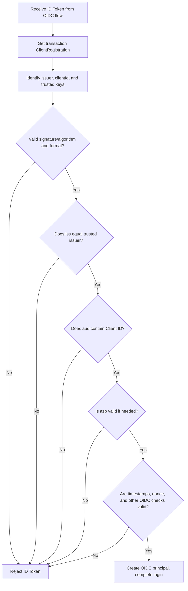

# 11.5. Verifying ID Token Issuer and Audience

## Lesson Objectives

After this lesson, you will be able to:

- Explain accurately the two claims **`iss` (issuer)** and **`aud` (audience)** in an OpenID Connect (OIDC) ID Token.
- Identify the **trusted issuer** and **expected Client ID** from Spring Security's `ClientRegistration`.
- Understand **exact** issuer matching rules, verifying that audience contains the Client ID, and handling `aud` as either a string or an array of strings.
- Explain the **`azp` (authorized party)** claim and the conditions to watch when an ID Token has multiple audiences.
- Distinguish **OIDC Client ID Token validation** from **Resource Server Access Token validation**.
- Use Spring Security Servlet `oauth2Login()` and OIDC Discovery configuration to protect the login flow while diagnosing issuer/audience errors.
- Avoid security pitfalls such as trusting unverified JWT payloads, accepting tokens from another provider, or skipping audience validation.

## 1. Context: Why Must an ID Token Have the Right Issuer and Audience?

Suppose **Learning Portal** is a Spring Boot web application. Users log in via **Campus Identity**, an OpenID Provider (OP). Portal is the **OIDC Client / Relying Party (RP)**.

Hypothetical registration data:

```text
Client registration ID (in Spring): campus
OAuth Client ID (at OP):            learning-portal-web
OIDC issuer:                        https://login.example.org/realms/campus
```

After the user completes the Authorization Code Flow, Portal exchanges the code at the Token Endpoint and receives an ID Token. Illustrative JSON payload:

```json
{
  "iss": "https://login.example.org/realms/campus",
  "sub": "student-9b71",
  "aud": "learning-portal-web",
  "exp": 1893456600,
  "iat": 1893456300,
  "nonce": "example-nonce"
}
```

These values are for learning only, not a usable token.

Three critical claims here:

| Claim | Question Answered | Meaning |
| --- | --- | --- |
| `iss` | **Who issued it?** | Issuer Identifier of the OpenID Provider |
| `aud` | **Who was it issued for?** | One or more intended recipients; for an ID Token, must include the RP's Client ID |
| `sub` | **Which user was authenticated?** | Subject Identifier assigned by the OP to the End-User |

Portal should trust the ID Token only when:

1. The token is protected/verified with a valid signature or appropriate cryptographic mechanism of a trusted OP.
2. **`iss` matches the configured issuer**.
3. **`aud` includes Portal's Client ID** and `azp` satisfies applicable rules.
4. Other OIDC checks such as timestamps, nonce, and transaction context are valid.

**An ID Token is not a JSON document that the client can trust simply by decoding it.** An attacker can craft JSON containing the right `iss` and `aud`. Cryptographic verification and binding to the trusted provider are essential.

### 1.1. Easily Confused URLs and Identifiers

| Item | Example | Used Directly as `iss` or `aud`? |
| --- | --- | --- |
| Registration ID | `campus` | Spring's internal key, **not** the audience |
| Client ID | `learning-portal-web` | **Yes:** must be in the ID Token's `aud` |
| Issuer | `https://login.example.org/realms/campus` | **Yes:** must equal `iss` |
| Authorization Endpoint | `https://login.example.org/realms/campus/protocol/openid-connect/auth` | Authorization endpoint, **not the issuer** |
| Token Endpoint | `https://login.example.org/realms/campus/protocol/openid-connect/token` | Code-exchange endpoint, **not the ID Token's `aud`** |
| Redirect URI | `https://portal.example.org/login/oauth2/code/campus` | Portal's callback, **neither `iss` nor `aud`** |
| Client display name | `Campus SSO` | For UI display, **not the audience** |
| `jwks_uri` | Address where OP publishes public keys | Key verification source, **not the issuer** |

The endpoints in the table are illustrative examples only. Actual paths must be taken from the corresponding OP's metadata.

## 2. `iss`: Verifying the Exact Issuer Identifier

The `iss` claim of an OIDC ID Token identifies the OpenID Provider that issued the token. Per OIDC Core, the issuer must be an Issuer Identifier conforming to OIDC URI rules; the value inside the ID Token must match the issuer of the OP trusted by the Client.

For our example:

```text
Expected issuer:
https://login.example.org/realms/campus

ID Token "iss":
https://login.example.org/realms/campus
```

This case **passes the issuer check**.

However, if the ID Token returns:

```json
{
  "iss": "https://login.example.org/realms/partners"
}
```

then even though it shares the hostname `login.example.org`, it is a **different issuer**. Portal initiated the flow for realm `campus`, so a token from realm `partners` must be rejected.

### 2.1. Issuer Comparison Is an Exact Identifier Comparison

Do not use:

```text
actualIssuer.contains("login.example.org")
actualIssuer.startsWith("https://login.example.org")
actualIssuer.endsWith("campus")
```

These checks can confuse realms, tenants, paths, or other values sharing a prefix.

Examples that are normally **not considered the same Issuer Identifier**:

```text
https://login.example.org/realms/campus
https://login.example.org/realms/campus/
http://login.example.org/realms/campus
https://login.example.org
https://login.example.org/realms/staff
```

Do not automatically strip a trailing `/`, strip paths, or rewrite `http` to `https` inside a token and treat it as valid. If a mismatch exists, verify the public issuer configuration and OP metadata.

### 2.2. Issuer Is Not Necessarily the Token Endpoint URL

In a hypothetical OP:

```text
Issuer:
https://login.example.org/realms/campus

Authorization Endpoint:
https://login.example.org/realms/campus/protocol/openid-connect/auth

Token Endpoint:
https://login.example.org/realms/campus/protocol/openid-connect/token

JWKS URI:
https://login.example.org/realms/campus/protocol/openid-connect/certs
```

The issuer identifies the issuing system; the remaining URLs are endpoints with specific roles.

Therefore, putting the `/token` path into `issuer-uri` just because it handles token requests is usually wrong. The client must use the **Issuer Identifier** published by the OP.

### 2.3. Trusted Source of the Issuer

During OIDC integration, the application usually knows the issuer in advance from administrator configuration. OpenID Connect Discovery supplies metadata such as:

```json
{
  "issuer": "https://login.example.org/realms/campus",
  "authorization_endpoint": "https://login.example.org/realms/campus/protocol/openid-connect/auth",
  "token_endpoint": "https://login.example.org/realms/campus/protocol/openid-connect/token",
  "jwks_uri": "https://login.example.org/realms/campus/protocol/openid-connect/certs"
}
```

This metadata tells the Client the endpoints and keys of the **selected OP**. The application must start from an allowed issuer in configuration and verify that the metadata belongs to that exact issuer.

Never build an algorithm like:

```text
1. Receive an unverified JWT
2. Read an arbitrary iss from the payload
3. Fetch metadata/JWKS for that iss
4. If the signature matches the newly fetched key, accept it
```

An attacker can stand up their own issuer and JWKS. If the client automatically trusts any newly encountered issuer, signature verification no longer proves the token came from an authorized OP.

## 3. `aud`: Verifying the ID Token Was Issued for the Right Client

`aud` stands for **Audience**. In an OIDC ID Token, this value must include the OAuth 2.0 `client_id` of the Relying Party validating the token.

Suppose Spring stores:

```text
registrationId = campus
clientId       = learning-portal-web
```

The expected value is:

```text
expectedAudience = learning-portal-web
```

ID Token:

```json
{
  "aud": "learning-portal-web"
}
```

passes audience validation.

ID Token:

```json
{
  "aud": "teacher-console-web"
}
```

must be rejected by Learning Portal, even if validly signed by Campus Identity. That token is intended for **another application**.

### 3.1. `aud` Has Two Valid Representations

Per JWT rules, the `aud` claim can be a **string**:

```json
{
  "aud": "learning-portal-web"
}
```

or an **array of strings**:

```json
{
  "aud": ["learning-portal-web", "shared-audience"]
}
```

For the current client, the baseline condition is:

```text
aud must contain the string "learning-portal-web" as a complete value
```

Partial string matches must not be accepted:

```text
"learning-portal-web" != "learning-portal-web-v2"
"learning-portal-web" != "dev-learning-portal-web"
```

If you write custom checking code that casts the entire `aud` claim to `String`, the application may fail when an OP returns an array. It is best to use the framework's OIDC ID Token validator, which is built to handle JWT structures.

### 3.2. `registrationId` Is Not `clientId`

Configuration:

```yaml
spring:
  security:
    oauth2:
      client:
        registration:
          campus:
            client-id: learning-portal-web
            client-name: "Campus SSO"
```

- `campus` is the **registration ID** used to select the configuration in Spring.
- `learning-portal-web` is the **OAuth Client ID** used as the expected audience.
- `Campus SSO` is the **display name**, not involved in audience checking.

If an ID Token has `aud = "campus"` while the actual Client ID is `learning-portal-web`, the ID Token **fails** audience validation.

### 3.3. ID Token Audience Differs from Access Token Audience

| Token | Target | Who Validates `aud`? |
| --- | --- | --- |
| **OIDC ID Token** | Authenticates End-User to the Relying Party | OIDC Client, checking its own Client ID |
| **OAuth Access Token** | Authorizes calling a Resource Server | Resource Server, checking the audience intended for that API if profile/policy requires |
| **JWT client assertion** | Authenticates the Client at the Token Endpoint | Authorization Server, checking the audience intended for itself |

Example:

```text
ID Token aud     = learning-portal-web
Access Token aud = course-api
```

A JWT with audience `course-api` may be a valid access token for the Course API, yet **does not thereby become a valid ID Token for Learning Portal**. Never send an ID Token instead of a Bearer access token to a business API.

## 4. `azp`: When an ID Token Has Multiple Audiences

OIDC defines the `azp` (*authorized party*) claim, identifying the authorized party to which the ID Token was issued.

Example ID Token:

```json
{
  "iss": "https://login.example.org/realms/campus",
  "sub": "student-9b71",
  "aud": ["learning-portal-web", "another-audience"],
  "azp": "learning-portal-web"
}
```

Learning Portal checks:

```text
Is Client ID in aud?  Yes.
Does azp equal Client ID?   Yes.
```

Per the validation procedure in **OpenID Connect Core**:

1. **MUST:** `aud` must include the Relying Party's Client ID.
2. **SHOULD:** If `aud` contains multiple values, the Client should verify that `azp` is present.
3. **SHOULD:** If `azp` is present, the Client should verify that `azp` equals its own Client ID.

"MUST" and "SHOULD" represent two different normative requirement levels. Under strict security policies, you may require `azp` to be present when multiple audiences exist and reject a mismatched `azp`. Do not treat `aud` containing the Client ID as sufficient to ignore an `azp` claim that differs from the Client ID.

| `aud` | `azp` | Evaluation When Client ID Is `learning-portal-web` |
| --- | --- | --- |
| `"learning-portal-web"` | Absent | Audience matches |
| `"teacher-console-web"` | Absent | **Reject:** Client audience missing |
| `["learning-portal-web", "another-audience"]` | `"learning-portal-web"` | Audience and authorized party match |
| `["learning-portal-web", "another-audience"]` | `"teacher-console-web"` | **Reject per `azp` validation policy** |
| `["learning-portal-web", "another-audience"]` | Absent | Requires strict review; OIDC recommends checking for `azp` presence |
| `["course-api", "teacher-console-web"]` | `"learning-portal-web"` | **Reject:** `aud` still lacks Client ID |

`azp` is **not** `sub`. `sub` identifies the End-User; `azp` identifies the authorized party in the token issuance context.

## 5. Issuer and Audience in the Overall ID Token Validation Flow

Spring Security should only construct an OIDC principal when all required conditions succeed.



The diagram illustrates the mental model and does not require every library to execute checks in this exact order.

Additional conditions include:

| Requirement | Meaning |
| --- | --- |
| JWS signature and algorithm | Proves the token was signed by the right OP key and prevents tampering; handle JWE if encrypted |
| `exp` | Token has not expired |
| `iat` | Issued-at timestamp satisfies protocol/policy constraints |
| `nonce` | When the request sent a nonce, the token must contain the matching transaction nonce |
| `auth_time` | Must be checked when `max_age` or recent-authentication policy is required |
| `acr` / `amr` | Authentication assurance level/methods if business logic requires specific values |
| OAuth `state` | Binds the callback to the initiated authorization request; not a mandatory ID Token claim |

A token with the right `iss` and `aud` yet an **invalid signature** must still be rejected. A token with a valid signature yet an expired `exp` or mismatched nonce is also invalid.

### 5.1. Why Not Simply Base64URL-Decode and Log In?

Anyone can craft a payload:

```json
{
  "iss": "https://login.example.org/realms/campus",
  "sub": "administrator",
  "aud": "learning-portal-web"
}
```

If an application just decodes the JSON and takes `sub` to create a session, an attacker can claim any identity. Therefore, **never use unverified JWT decoding code to create `Authentication`**. Use the library's OIDC Login mechanism configured with the right issuer, audience, and trusted keys.

## 6. Configuration in Spring Security OAuth2/OIDC Client

A Spring Boot Servlet application using OIDC Discovery can configure:

```yaml
spring:
  security:
    oauth2:
      client:
        registration:
          campus:
            provider: campus
            client-id: ${CAMPUS_CLIENT_ID}
            client-secret: ${CAMPUS_CLIENT_SECRET}
            client-authentication-method: client_secret_basic
            authorization-grant-type: authorization_code
            redirect-uri: "{baseUrl}/login/oauth2/code/{registrationId}"
            scope:
              - openid
              - profile
              - email

        provider:
          campus:
            issuer-uri: https://login.example.org/realms/campus
```

This example assumes a **confidential client** on the backend. The domain, issuer, and IDs are illustrative; a real provider must register the corresponding client and redirect URI. Actual client secrets are stored through secure mechanisms and never committed to Git.

Analyzing the expected values:

```text
ClientRegistration.registrationId = campus
ClientRegistration.clientId       = ${CAMPUS_CLIENT_ID}
ClientRegistration.providerDetails.issuerUri
       = https://login.example.org/realms/campus
```

If the environment value is:

```text
CAMPUS_CLIENT_ID = learning-portal-web
```

then:

```text
Expected iss = https://login.example.org/realms/campus
Expected aud = learning-portal-web
```

**`issuer-uri` is not the callback URL.** `{registrationId}` in the redirect URI is also not the ID Token's audience.

### 6.1. `SecurityFilterChain` in a Servlet Application

```java
@Configuration
class WebSecurityConfiguration {

    @Bean
    SecurityFilterChain webSecurity(HttpSecurity http) throws Exception {
        http
            .authorizeHttpRequests(auth -> auth
                .requestMatchers("/", "/error", "/assets/**").permitAll()
                .anyRequest().authenticated()
            )
            .oauth2Login(Customizer.withDefaults());

        return http.build();
    }
}
```

In an application with appropriate configuration and dependencies, Spring Security handles the Authorization Code Flow, OIDC ID Token validation, and establishing the principal after login. Imports and dependencies are omitted so the example focuses on the core setup.

Login typically starts at:

```text
/oauth2/authorization/campus
```

Default callback matching the URI template:

```text
/login/oauth2/code/campus
```

After exchanging the code and receiving the ID Token, the framework verifies the token against the corresponding registration/provider. **You do not need to write manual issuer and audience checks in a login controller.**

### 6.2. Reading the Expected Issuer/Client ID from `ClientRegistration`

In Java code:

```java
@Component
class OidcRegistrationInspector {

    private final ClientRegistrationRepository registrations;

    OidcRegistrationInspector(ClientRegistrationRepository registrations) {
        this.registrations = registrations;
    }

    void inspect() {
        ClientRegistration registration =
            registrations.findByRegistrationId("campus");

        if (registration == null) {
            throw new IllegalStateException("Unknown registration");
        }

        String expectedIssuer =
            registration.getProviderDetails().getIssuerUri();

        String expectedAudience = registration.getClientId();

        // These two values identify the expected issuer and Client ID.
        // Do not manually parse the ID Token to replace the OIDC validator.
    }
}
```

`ClientRegistrationRepository` looks up by **registration ID**, while `getClientId()` returns the **OAuth Client ID** of that registration.

### 6.3. Observing the ID Token After Spring Validates It

For the `OidcUser` principal created after login:

```java
@RestController
class OidcMetadataController {

    @GetMapping("/me/oidc")
    Map<String, Object> oidcMetadata(
            @AuthenticationPrincipal OidcUser user) {

        Map<String, Object> claims = user.getIdToken().getClaims();

        return Map.of(
            "issuer", claims.get("iss"),
            "audience", claims.get("aud")
        );
    }
}
```

This example only illustrates reading two claims already processed by Spring. The endpoint must be protected and return only necessary metadata per policy; never create a public endpoint returning raw ID Tokens, access tokens, refresh tokens, or full claims containing personal data.

An `OidcUser` coming from authenticated login is completely different from an unverified JWT received directly in an HTTP request.

### 6.4. Customizing the Decoder/Validator

Spring Security provides OIDC token decoder/validator components, such as `OidcIdTokenDecoderFactory` in applicable versions. When business requirements need extra policies such as `acr` or special issuer handling, use the official hook of the deployed version and **preserve** the built-in verification steps.

Never replace the default decoder with logic that merely reads `sub` and `email`. If an ID Token is rejected because `iss` or `aud` differs from configuration, inspect **`ClientRegistration` and provider metadata** before considering changing the validator.

## 7. Multiple Providers, Multiple Clients: Do Not Mix Trust Boundaries

Learning Portal might support:

```text
Registration "campus":
  issuer   = https://login.example.org/realms/campus
  clientId = learning-portal-web

Registration "partner":
  issuer   = https://accounts.partner.example.org
  clientId = partner-learning-web
```

A compact configuration:

```yaml
spring:
  security:
    oauth2:
      client:
        registration:
          campus:
            provider: campus
            client-id: ${CAMPUS_CLIENT_ID}
            client-secret: ${CAMPUS_CLIENT_SECRET}
            authorization-grant-type: authorization_code
            scope: [openid, profile]
            redirect-uri: "{baseUrl}/login/oauth2/code/{registrationId}"

          partner:
            provider: partner
            client-id: ${PARTNER_CLIENT_ID}
            client-secret: ${PARTNER_CLIENT_SECRET}
            authorization-grant-type: authorization_code
            scope: [openid, profile]
            redirect-uri: "{baseUrl}/login/oauth2/code/{registrationId}"

        provider:
          campus:
            issuer-uri: https://login.example.org/realms/campus
          partner:
            issuer-uri: https://accounts.partner.example.org
```

| Start URL | Selected Registration | Expected Issuer/Audience |
| --- | --- | --- |
| `/oauth2/authorization/campus` | `campus` | Campus issuer and Campus Client ID |
| `/oauth2/authorization/partner` | `partner` | Partner issuer and Partner Client ID |

When the callback returns, the framework correlates the authorization response with the initiated request via `state`/request repository and uses the **exact transaction's registration**. Never let a token self-declare an issuer to alter the list of OPs trusted by the application.

### 7.1. Same Client ID String at Two OPs Does Not Mean the Same Client

Two different providers might coincidentally issue the same string:

```text
clientId = portal-web
```

Yet:

```text
Issuer A = https://login-a.example.org
Issuer B = https://login-b.example.org
```

Checking audience without checking issuer causes issuer confusion. Checking a signature against a key set not bound to the issuer also risks crossing trust boundaries.

**Issuer, client ID, verification keys, and authorization request must all belong to the same trusted registration.**

### 7.2. Linking Accounts by `(iss, sub)`

Once an ID Token is valid, the pair:

```text
(issuer, subject)
```

can be used to link the OIDC identity to an internal account.

Two tuples:

```text
(https://login.example.org/realms/campus, student-123)
(https://accounts.partner.example.org, student-123)
```

**do not automatically represent the same user**, even though `sub` is identical. `sub` is meaningful within the verified issuer's scope. Never merge accounts automatically by email or `sub` without strict controls.

## 8. ID Token Classification Examples

Assume:

```text
Expected issuer:   https://login.example.org/realms/campus
Expected clientId: learning-portal-web
```

These examples examine only `iss`, `aud`, `azp`, without concluding signature/timestamp validity.

### 8.1. Matching Issuer and Audience

```json
{
  "iss": "https://login.example.org/realms/campus",
  "sub": "student-123",
  "aud": "learning-portal-web"
}
```

**Result:** passes both checks; proceed to verify the remaining conditions.

### 8.2. Issuer Is a Different Realm

```json
{
  "iss": "https://login.example.org/realms/partners",
  "sub": "student-123",
  "aud": "learning-portal-web"
}
```

**Result:** reject. Same host, but a different Issuer Identifier.

### 8.3. Right Issuer, Another Application's Audience

```json
{
  "iss": "https://login.example.org/realms/campus",
  "sub": "student-123",
  "aud": "teacher-console-web"
}
```

**Result:** reject. Token was not issued for Learning Portal.

### 8.4. Multi-Value Audience with Matching `azp`

```json
{
  "iss": "https://login.example.org/realms/campus",
  "sub": "student-123",
  "aud": ["learning-portal-web", "secondary-audience"],
  "azp": "learning-portal-web"
}
```

**Result:** satisfies issuer, audience, and authorized party conditions.

### 8.5. Audience Includes Client ID, Yet `azp` Is Wrong

```json
{
  "iss": "https://login.example.org/realms/campus",
  "sub": "student-123",
  "aud": ["learning-portal-web", "secondary-audience"],
  "azp": "other-client"
}
```

**Result:** reject per authorized-party validation policy. This token cannot unconditionally be treated as issued for the current RP.

### 8.6. Right Claims, Invalid Signature

Payload has the same `iss` and `aud` as example 8.1, yet the JWT was signed with an attacker's key instead of the registered OP's key.

**Result:** reject. Valid claims never substitute for cryptographic verification.

## 9. Diagnosing Issuer/Audience Errors During Integration

| Symptom | Possible Cause | Inspection Steps |
| --- | --- | --- |
| ID Token rejected for issuer | Configured `issuer-uri` missing realm path or OP emits different issuer | Compare `provider.<alias>.issuer-uri`, metadata `issuer`, and `iss` claim |
| Issuer differs in scheme/host in production | OP behind reverse proxy using internal URL | Fix public issuer/proxy configuration on the OP side |
| Issuer differs only by trailing `/` | Config and metadata/token not aligned identically | Align the exact Issuer Identifier |
| Audience does not contain Client ID | Wrong `client-id`, wrong environment, or token intended for another app | Check client registration at the OP and environment variables |
| Audience compared against registration ID | Confused `campus` with `learning-portal-web` | Use `ClientRegistration.getClientId()` |
| Audience is an array yet custom code expects a string | Custom parser/validator non-compliant with JWT | Use the library's OIDC validator |
| Multiple audiences yet `azp` mismatches | Token issued for another authorized party | Check Client ID/`azp`, registration, and OP policy |
| JWT fails signature verification | Wrong issuer/JWKS, key rotation, or algorithm | Check metadata, trusted public keys, `kid`, signing alg |
| Wrong callback or lost `state` | Wrong redirect URI, session, or proxy | Fix at the OAuth callback step; do not drop issuer checks |
| Token Endpoint returns `invalid_client` | Client authentication failed before issuing ID Token | Check client secret/private key and auth method |
| Token Endpoint returns `invalid_grant` | Expired/reused code, redirect URI or PKCE mismatch | Check authorization request and token exchange |
| Login succeeds yet API returns 403 | User lacks API permission/business role | Check access token/scope/authorization at Resource Server |

### 9.1. Distinguishing Errors Before vs. After ID Token Issuance

A `redirect_uri_mismatch` error at the Authorization Server occurs **before** the client receives an ID Token; it does not directly indicate an `iss` or `aud` bug.

An `invalid_client` error at the Token Endpoint can also prevent a token response from being issued. Meanwhile, **issuer mismatch** and **audience mismatch** on the OIDC Client happen once a token has arrived for verification.

Use the **transaction stage** and actual error message to diagnose accurately and avoid changing unrelated settings.

### 9.2. Issuer Error Caused by an OP Behind a Reverse Proxy

Suppose the expected public issuer is:

```text
https://login.example.org/realms/campus
```

Yet the received token contains:

```text
http://identity-service:8080/realms/campus
```

If the OP uses an internal address when emitting `iss`, configure the OP to recognize its external/public issuer and reverse proxy headers properly. Do not simply tell Spring to trust the internal HTTP issuer alongside the public HTTPS issuer just to silence errors.

### 9.3. Audience Error Between Dev and Production

```text
Dev Client ID:  learning-portal-dev
Prod Client ID: learning-portal-prod
```

If production accidentally uses dev configuration, the OP may issue ID Tokens with an unexpected audience or fail redirect URI matching. Separate client registrations by environment and update secrets, callbacks, and issuers properly. Never set a broad audience allowlist that silently accepts tokens intended for another environment.

### 9.4. Safe Logging Practices

For troubleshooting, log only non-sensitive metadata permitted by policy:

```text
registrationId=campus
expectedIssuer=https://login.example.org/realms/campus
expectedClientId=learning-portal-web
failureClass=audience_mismatch
correlationId=<non-sensitive-id>
```

Avoid logging raw `id_token`, access tokens, authorization codes, refresh tokens, client secrets, session cookies, or full personal claims. Any information decoded before verification must be treated as **untrusted data**.

## 10. Common Misconceptions to Avoid

### 10.1. "If the JWT signature is valid, login can succeed"

False. The signature must be verified using **keys from the right trusted OP**, and `iss`, `aud`, `azp`, and the remaining OIDC conditions must be valid. A token legitimately signed by the real OP yet issued for another client must still be rejected.

### 10.2. "Same domain means same issuer"

False. For multi-realm/multi-tenant OPs, issuers can differ in path. You must compare the full identifier.

### 10.3. "`registrationId` is the audience"

False. `registrationId` is Spring's local configuration key. The ID Token's audience must contain the **OAuth Client ID** assigned by the OP.

### 10.4. "ID Token `aud` must be the API URL"

False. The **ID Token**'s audience targets the OIDC Client, whereas an **Access Token**'s audience may target a Resource Server.

### 10.5. "If `aud` has multiple values, finding the client ID is enough"

Incomplete. You must consider OIDC rules regarding **`azp`**, and still verify signature, issuer, timestamps, and nonce.

### 10.6. "Read `iss` from the JWT and then trust that provider"

False. The issuer must come from trusted configuration and be bound to the authorization request; reading an unverified claim to dynamically add trust roots creates the risk of accepting tokens from an attacker-controlled issuer.

### 10.7. "Logging in with the right issuer and audience means admin rights"

False. OIDC authenticates identity. Application business permissions must still be checked independently. Access tokens used to call APIs must be validated by the Resource Server according to API rules.

## 11. Practice Exercises

### Exercise 1 — Find the Expected Issuer/Audience from YAML

Given:

```yaml
spring:
  security:
    oauth2:
      client:
        registration:
          university:
            provider: university-op
            client-id: student-portal-prod
            client-name: "University SSO"
            authorization-grant-type: authorization_code
            scope: [openid, profile]
        provider:
          university-op:
            issuer-uri: https://identity.example.edu/realms/students
```

**Question:** What conditions must `iss` and `aud` satisfy?

**Answer:**

```text
iss = https://identity.example.edu/realms/students
aud contains student-portal-prod
```

`university` is the registration ID, `university-op` is the provider alias, and `University SSO` is the client name; none of those three replace Client ID.

### Exercise 2 — Same Host, Different Path

```text
Expected issuer = https://identity.example.edu/realms/students
Actual issuer   = https://identity.example.edu/realms/staff
```

**Question:** Should it be accepted because the hostname matches?

**Answer:** No. Issuer matching must be exact.

### Exercise 3 — `aud` and `azp`

Client ID is `student-portal-prod`.

```json
{
  "aud": ["student-portal-prod", "other"],
  "azp": "student-portal-prod"
}
```

**Question:** Are these two claims valid?

**Answer:** Yes, considering audience/authorized party alone. You still must verify issuer, signature, expiration, and other OIDC constraints.

### Exercise 4 — Mismatched `azp`

```json
{
  "aud": ["student-portal-prod", "other"],
  "azp": "other"
}
```

**Question:** How should this be handled?

**Answer:** Reject per authorized-party validation policy; do not ignore an `azp` that differs from Client ID.

### Exercise 5 — Receiving an Access Token Instead of an ID Token

A JWT has:

```json
{
  "iss": "https://identity.example.edu/realms/students",
  "aud": "course-api",
  "scope": "courses.read"
}
```

**Question:** Can this serve as OIDC login proof for `student-portal-prod`?

**Answer:** No. Its audience targets an API and the JWT may be an access token. The client must verify an **ID Token issued by the OP for the RP** according to the OIDC flow.

### Exercise 6 — OP Emitting the Wrong Issuer

The OP has metadata:

```text
issuer = https://identity.example.edu/realms/students
```

Yet the returned ID Token has:

```text
iss = http://identity-internal:8080/realms/students
```

**Question:** Where should this be fixed?

**Answer:** Check the public issuer/hostname/proxy configuration at the OP and align metadata and tokens. Do not disable issuer validation in Spring to accept an internal URL.

## 12. Self-Check Questions

**1. What does `iss` say about an ID Token?**

> It identifies the OP that issued the token; the Client must verify it against the trusted Issuer Identifier and bind the token to that OP's keys/metadata.

**2. What value must `aud` contain?**

> The current Relying Party's OAuth Client ID, i.e., `ClientRegistration.getClientId()`, not the registration ID.

**3. Can an ID Token from a trusted OP issued for another client be used?**

> No. If audience does not contain the Client ID, it must be rejected even if signature and issuer are valid.

**4. If an ID Token has multiple audiences, do we need to inspect `azp`?**

> Yes. OIDC recommends verifying that `azp` is present when multiple audiences exist and matches the Client ID if present.

**5. Can we use a prefix check for the issuer?**

> No. The Issuer Identifier must be matched exactly; sharing a hostname does not distinguish tenants or realms.

**6. Do valid `iss` and `aud` alone prove the user logged in validly?**

> Not yet. You must still verify signature, expiration, nonce, authorization request context, and applicable OIDC conditions.

**7. In Spring Security, is `issuer-uri` the Token Endpoint URL?**

> No. It is the OP's identifier; other endpoints are configured or discovered from provider metadata.

**8. Why shouldn't we read the issuer from an unverified JWT to dynamically add a provider?**

> Because an attacker can create their own issuer and signing keys. The application must trust only preconfigured issuers/registrations bound to the login transaction.

**9. Does a valid ID Token audience grant permission to call the Course API?**

> No. The API requires an appropriate access token and must enforce business authorization. An ID Token is for End-User authentication at the Relying Party.

---

## Key Takeaways

For an **OpenID Connect ID Token**, the Spring Security Client must verify that **`iss` equals the exact trusted issuer** and **`aud` contains the Relying Party's OAuth Client ID**. When `aud` has multiple values, also evaluate **`azp`** per OIDC rules. Both checks must accompany verification of signature, algorithm, timestamps, nonce, and required transaction bindings. In Spring Security Servlet, **`ClientRegistration.getProviderDetails().getIssuerUri()`** and **`ClientRegistration.getClientId()`** are the two expected configuration sources; fix the issuer or client registration when a mismatch occurs rather than bypassing ID Token validation.
