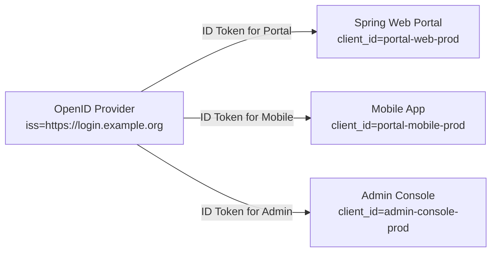

# 11.6. Checking Authorized Party When the azp Claim Is Present

In **OpenID Connect (OIDC)**, an **ID Token** is an authentication assertion issued by an OpenID Provider (OP) for a **Relying Party (RP)**. When a Spring Security application receives an ID Token during `oauth2Login()`, verifying the signature and expiration is necessary but insufficient: the application must also know that the token was issued for the **exact OAuth client** completing the login.

The two most important claims at this step are:

- **`aud` (audience)**: indicates the intended recipients of the ID Token. An OIDC ID Token must contain the **RP's `client_id`** in its audience.
- **`azp` (authorized party)**: when present, identifies the **party authorized to use the ID Token**. For the RP processing the token, the `azp` value must match the **RP's own `client_id`** according to OIDC validation rules.

The `azp` claim is especially meaningful when an ID Token lists **multiple audiences**. If an RP only checks that `aud` contains its client ID and ignores `azp`, it could accept a token inappropriate for the client context it is handling.

This lesson explains how to understand `azp`, the relationship between `aud` and `client_id`, OIDC Core rules, multi-audience scenarios, how to apply them in Spring Security OAuth 2.0/OIDC Client, and common security mistakes.

> **Short principle:** `aud` must contain the current client ID; if `azp` is present, the RP must match **`azp == client_id` of the active registration**. When an ID Token has multiple audiences, OIDC Core recommends checking for `azp`'s presence; applications may adopt a stricter policy rejecting multi-audience tokens that lack `azp`.

## 1. Placing azp in the Proper OIDC Context

### 1.1. RP, OP, and ClientRegistration

Suppose a system has:

- **OpenID Provider:** `https://login.example.org`.
- **Spring Boot Portal:** web application acting as RP, assigned OAuth client ID `portal-web-prod`.
- **Mobile App:** another application assigned client ID `portal-mobile-prod`.
- **Spring backend registration:** `registrationId=company`.

Spring's `ClientRegistration` may look like:

```yaml
spring:
  security:
    oauth2:
      client:
        registration:
          company:
            provider: company
            client-id: portal-web-prod
            client-secret: ${OIDC_CLIENT_SECRET}
            client-authentication-method: client_secret_basic
            authorization-grant-type: authorization_code
            redirect-uri: "{baseUrl}/login/oauth2/code/{registrationId}"
            scope:
              - openid
              - profile
              - email
        provider:
          company:
            issuer-uri: https://login.example.org
```

In this configuration:

| Component | Value | Meaning |
|---|---|---|
| `registrationId` | `company` | Local name used by Spring to look up the registration |
| `client_id` | `portal-web-prod` | ID issued by the OP to the RP; **the value compared against `aud`/`azp`** |
| `issuer` | `https://login.example.org` | Trusted OP, used to match `iss` |
| `client_secret` | Backend environment variable | Credential used at the token endpoint; **not `azp`** |
| `sub` | e.g., `user-782` | User identifier at the OP; **not `azp`** |

A very common mistake: **`registrationId` does not necessarily equal `clientId`**. Therefore, `azp` checks must use `ClientRegistration.getClientId()`, not the registration name `company`.

### 1.2. Why Must the Token Be Verified After Callback?

OIDC Authorization Code Flow on Spring Servlet:

```mermaid
sequenceDiagram
    autonumber
    participant Browser as Browser
    participant RP as Spring Security RP
    participant OP as OpenID Provider

    Browser->>RP: GET /account
    RP-->>Browser: Start OAuth2/OIDC Login
    Browser->>OP: /authorize?client_id=portal-web-prod&scope=openid...
    OP->>Browser: Authenticate End-User
    OP-->>Browser: Callback ?code=...&state=...
    Browser->>RP: GET /login/oauth2/code/company?code=...&state=...
    RP->>RP: Match state with authorization request
    RP->>OP: POST /token: authorization_code + client authentication (+ PKCE)
    OP-->>RP: ID Token + Access Token
    RP->>RP: Verify signature, iss, aud, azp, exp, nonce...
    RP->>RP: Create OidcUser and SecurityContext
    RP-->>Browser: Session cookie; login succeeded
```

`azp` belongs to **ID Token validation**, meaning after the RP receives the token response and **before** accepting the token as authentication proof. Do not wait until a business controller to check `azp`, because the principal may already have been created by then.

The OP issues an ID Token with claims identifying the **issuer**, **subject**, **audience**, **timestamps**, and other protocol conditions. `azp` adds an assertion about **the party authorized to use the token**, not business permissions of the End-User.

## 2. Exact Meaning of aud and azp

### 2.1. aud: Which Recipients Is the Token Intended For?

In OIDC Core, `aud` is a **required** ID Token claim. It contains the token's audience and **must contain the OAuth 2.0 client ID of the RP** receiving the ID Token.

Example ID Token for Portal:

```json
{
  "iss": "https://login.example.org",
  "sub": "user-782",
  "aud": "portal-web-prod",
  "exp": 1924999999,
  "iat": 1924996399
}
```

`aud` can appear in two JSON forms per JWT/OIDC:

**Single audience as a string:**

```json
"aud": "portal-web-prod"
```

**Multiple audiences as an array:**

```json
"aud": ["portal-web-prod", "trusted-companion-audience"]
```

Some JWT libraries normalize both forms into a `List<String>` for convenience. When reading a JWT manually, never assume `aud` is always a single string and perform raw string comparison.

### 2.2. azp: Which Party Is Authorized to Use the ID Token?

`azp` is an **optional** OIDC claim standing for **Authorized Party**. When present, its value is a **string identifying a client**, commonly used alongside `aud` when the token has multiple audiences.

Example:

```json
{
  "iss": "https://login.example.org",
  "sub": "user-782",
  "aud": [
    "portal-web-prod",
    "trusted-companion-audience"
  ],
  "azp": "portal-web-prod",
  "exp": 1924999999,
  "iat": 1924996399
}
```

How to read this:

- `aud` states that `portal-web-prod` is among the listed audiences.
- `azp` states that `portal-web-prod` is the party authorized to use the ID Token.
- The RP processing the token must be the client with ID `portal-web-prod`.
- The RP **still needs** to verify signature, issuer, expiration, nonce, and other OIDC conditions.

`azp` is not a username, not a tenant code, not a `ROLE_ADMIN` authority, and not a Resource Server URL.

### 2.3. Differences from Commonly Confused Claims

| Claim / Value | Question Answered | What Is It Used For? |
|---|---|---|
| `iss` | Which OP issued the token? | Match the trusted issuer |
| `sub` | Which End-User was authenticated? | Map user identity, typically by `(iss, sub)` |
| `aud` | Which audience is the token for? | Ensure the RP's client ID is listed |
| `azp` | Which party is authorized to use the token? | When present, must match the current client ID |
| `exp` | When does the token expire? | Reject expired tokens |
| `iat` | When was the token issued? | Check time and policy |
| `nonce` | Which authentication request does the ID Token belong to? | Match nonce when sent by the RP |
| `client_id` in config | What ID did the RP register with the OP? | Expected value for `aud` and `azp` |
| `registrationId` in Spring | What is the local name for the registration? | Look up configuration, not the value compared to `azp` |

When we say `azp == client_id`, we mean comparing against the **client ID of the RP actually making the token request**, not the client ID of another company app or another OAuth client sharing the same issuer.

## 3. azp Validation Rules According to OpenID Connect Core

OIDC Core 1.0 specifies ID Token validation across different flows, with the Authorization Code Flow being central to Spring Security `oauth2Login()`.

For audience and authorized party, pay attention to three rules:

1. **Mandatory audience check:** The ID Token must list the current `client_id` as an audience. If absent, the RP must reject it. If the token contains additional audiences the RP does not trust, the RP must also reject it.
2. **When multiple audiences are present:** the client **SHOULD** check that `azp` is present. This is a recommendation in OIDC Core; systems needing strict policies may treat a missing `azp` on a multi-audience token as an error.
3. **When `azp` is present:** the client **SHOULD** verify that the claim equals its own `client_id`. In real security implementations, reject on mismatch rather than merely logging a warning and continuing login.

**Important normative distinction:** OIDC Core uses **MUST** for the client appearing in `aud` and **SHOULD** for the `azp` checks above. This lesson recommends a **strict policy** for RPs: multi-audience tokens must have `azp`, and `azp` if present must match the client ID. That is a stronger defensive choice, not a claim that the spec turns every SHOULD into MUST.

### 3.1. Strict Policy Rules to Apply

For an RP with client ID `portal-web-prod`:

| Condition | Action |
|---|---|
| `aud` does not contain `portal-web-prod` | **Reject** |
| `aud` contains extra audiences the RP does not trust | **Reject** |
| `aud` contains only `portal-web-prod`, no `azp` | **Acceptable**, if all other checks pass |
| `aud` contains only `portal-web-prod`, `azp=portal-web-prod` | **Acceptable**, if all other checks pass |
| `aud` contains multiple audiences, no `azp` | **Reject per strict policy** |
| `aud` contains multiple audiences, `azp=portal-web-prod` | **Acceptable**, if additional audiences are trusted and all other checks pass |
| `azp` present with a different client ID | **Reject**, regardless of whether `aud` contains current client ID |
| `azp` empty or wrong data type | **Reject** |

"Acceptable" here applies strictly to **`aud`/`azp`**. It does **not** mean the entire ID Token is valid. The token still requires signature, issuer, timestamp, nonce, and related protocol checks.

### 3.2. azp Must Not Be Used in Place of aud

A common misconception:

> "The token has `azp=portal-web-prod`, so let it pass even though `aud` doesn't contain Portal."

This reasoning is flawed. `azp` does not replace `aud`. The ID Token must have a valid `aud`; if `aud` does not contain the RP's client ID, **the token is not intended for the RP**, even if `azp` looks right.

Example of a token that must be rejected:

```json
{
  "iss": "https://login.example.org",
  "sub": "user-782",
  "aud": ["some-other-client"],
  "azp": "portal-web-prod",
  "exp": 1924999999,
  "iat": 1924996399
}
```

In this situation, `azp` does not "save" a token with the wrong audience.

## 4. Concrete ID Token Examples and Validation Decisions

Suppose the RP has registered:

```text
issuer = https://login.example.org
client_id = portal-web-prod
registrationId = company
trusted extra audience = trusted-companion-audience
```

The `exp` and `iat` values in these examples are illustrative. The outcomes below assume signature, issuer, timestamps, and other conditions have all passed.

### 4.1. Case A: Single Audience, No azp

```json
{
  "iss": "https://login.example.org",
  "sub": "user-782",
  "aud": "portal-web-prod",
  "exp": 1924999999,
  "iat": 1924996399
}
```

**Conclusion for `aud`/`azp`:** valid. `aud` contains the exact client ID; `azp` is an optional claim and does not have to appear in a single-audience ID Token.

Do not enforce a policy that "every ID Token must have `azp`" if a compliant OP normally omits this claim on single-audience tokens; doing so can reject completely valid tokens.

### 4.2. Case B: Single Audience, Matching azp

```json
{
  "iss": "https://login.example.org",
  "sub": "user-782",
  "aud": ["portal-web-prod"],
  "azp": "portal-web-prod",
  "exp": 1924999999,
  "iat": 1924996399
}
```

**Conclusion:** valid for `aud`/`azp`. Even with a single audience, an OP may still include `azp`. When present, the application must verify it matches the client ID.

### 4.3. Case C: Single Audience, Wrong azp

```json
{
  "iss": "https://login.example.org",
  "sub": "user-782",
  "aud": "portal-web-prod",
  "azp": "portal-mobile-prod",
  "exp": 1924999999,
  "iat": 1924996399
}
```

**Conclusion:** reject per strict policy. `aud` contains Portal yet `azp` indicates the authorized party is Mobile. Do not ignore the mismatch just because the audience matches.

### 4.4. Case D: Multiple Audiences, Matching azp

```json
{
  "iss": "https://login.example.org",
  "sub": "user-782",
  "aud": [
    "portal-web-prod",
    "trusted-companion-audience"
  ],
  "azp": "portal-web-prod",
  "exp": 1924999999,
  "iat": 1924996399
}
```

**Conclusion:** acceptable for `aud`/`azp` if the RP genuinely trusts `trusted-companion-audience` and the token passes all other checks.

Do not assume a matching `azp` automatically permits arbitrary additional audiences. Per OIDC, additional audiences must also be evaluated for trust by the RP.

### 4.5. Case E: Multiple Audiences, Missing azp

```json
{
  "iss": "https://login.example.org",
  "sub": "user-782",
  "aud": [
    "portal-web-prod",
    "trusted-companion-audience"
  ],
  "exp": 1924999999,
  "iat": 1924996399
}
```

**Conclusion:** reject per strict policy. OIDC Core recommends checking `azp` when multiple audiences are present. If the OP omits this claim, coordinate with the provider or confirm explicit policy rather than silently ignoring it.

### 4.6. Case F: Multiple Audiences, Another Client's azp

```json
{
  "iss": "https://login.example.org",
  "sub": "user-782",
  "aud": [
    "portal-web-prod",
    "trusted-companion-audience"
  ],
  "azp": "portal-mobile-prod",
  "exp": 1924999999,
  "iat": 1924996399
}
```

**Conclusion:** reject. Portal is not the designated authorized party, even though Portal's client ID appears in the audience.

### 4.7. Case G: Matching azp, Untrusted Extra Audience

```json
{
  "iss": "https://login.example.org",
  "sub": "user-782",
  "aud": [
    "portal-web-prod",
    "unknown-third-party-client"
  ],
  "azp": "portal-web-prod",
  "exp": 1924999999,
  "iat": 1924996399
}
```

**Conclusion:** reject if `unknown-third-party-client` is not in the RP's trusted audience set. A matching `azp` does not eliminate the requirement to evaluate additional audiences.

## 5. Why Does azp Matter When One Issuer Serves Multiple Clients?

### 5.1. One OP, Multiple Applications

Company systems often share a common OP:



The same user may log in to all three applications. The ID Tokens may share `iss` and `sub`, yet **audience and authorized party differ by client registration**.

If Portal only verified "valid signature from the OP" and ignored audience, it could mistakenly accept an ID Token issued for Mobile. That is a form of **token substitution / cross-client confusion**. Checking `aud` and `azp` keeps client boundaries intact.

### 5.2. Why Can a Validly Signed Token Still Be Rejected?

A signature proves the token came from the OP (once verified with trusted keys), yet an OP can serve dozens of clients. An ID Token meant for client A **does not automatically become** valid authentication proof for client B.

Similarly:

- A valid `iss` only indicates the right issuing source.
- A valid `sub` only identifies the referenced user.
- An unexpired `exp` only indicates the token has not expired.
- **`aud` and `azp`** bind the token to the OAuth client the RP is handling.

### 5.3. azp Does Not Grant API Access Permissions

An ID Token containing:

```json
{
  "aud": ["portal-web-prod"],
  "azp": "portal-web-prod"
}
```

does not prove Portal may call an administrative API or access arbitrary data on behalf of the user. **An ID Token is for logging in at the RP**, whereas the **access token** and Resource Server policies govern API access.

Never send an ID Token as a Bearer access token to an API just because its `azp` matches the client ID.

## 6. Distinguishing azp in an ID Token vs. azp in an Access Token

The name `azp` can appear in JWTs from some providers, but you must identify **the token type and protocol profile** before applying rules.

| Context | Primary Token | What Must Be Checked |
|---|---|---|
| Spring OIDC Login | **ID Token** | Signature, issuer, `aud` containing RP client ID, `azp` if present, timestamps, nonce, and OIDC conditions |
| Spring Resource Server | **Access Token** | Issuer, signature/introspection, API audience, scopes/authorities, and API policy |
| Vendor-specific Authorization Server | Token may include an `azp` claim per custom profile | Read the AS contract; do not extrapolate OIDC ID Token semantics to every JWT |

In some products, an access token carries `azp` to describe the client calling the API. That is not a reason for a Resource Server to rely on `azp` as sole proof of access rights.

Example **access token** intended for an API:

```json
{
  "iss": "https://login.example.org",
  "sub": "user-782",
  "aud": ["orders-api"],
  "azp": "portal-web-prod",
  "scope": "orders.read",
  "exp": 1924999999
}
```

If the API is configured to expect audience `orders-api`, it must validate the API audience and relevant permissions. Do not misapply the rule "access token `aud` must contain `portal-web-prod`" just because that is the calling client. **OIDC `aud`/`azp` validation in this lesson applies to the RP's ID Token.**

## 7. Where Does Spring Security Process the ID Token?

### 7.1. Standard Login Flow

With Spring Security Servlet:

```java
import org.springframework.context.annotation.Bean;
import org.springframework.context.annotation.Configuration;
import org.springframework.security.config.Customizer;
import org.springframework.security.config.annotation.web.builders.HttpSecurity;
import org.springframework.security.web.SecurityFilterChain;

@Configuration
public class SecurityConfig {

    @Bean
    SecurityFilterChain securityFilterChain(HttpSecurity http) throws Exception {
        http
            .authorizeHttpRequests(auth -> auth
                .requestMatchers("/", "/error").permitAll()
                .anyRequest().authenticated())
            .oauth2Login(Customizer.withDefaults());

        return http.build();
    }
}
```

When a registration requests `openid` and the OP returns an ID Token, Spring Security uses its OIDC components to **decode and verify the ID Token** before creating an `OidcUser` principal.

Key components to know:

| Component / Concept | Role |
|---|---|
| `ClientRegistration` | Provides `clientId`, issuer, and trusted provider details |
| `OAuth2LoginAuthenticationFilter` | Handles login callbacks on Servlet |
| `OidcAuthorizationCodeAuthenticationProvider` | Handles OIDC authentication in the authorization code flow |
| `OidcIdTokenDecoderFactory` | Creates the ID Token decoder per client registration in applicable Spring Security versions |
| `OidcUserRequest` | Carries client registration, token response/ID Token for loading the OIDC user |
| `OidcUserService` | Builds/loads the OIDC principal, optionally querying UserInfo per configuration |
| `SecurityContext` | Holds the accepted authentication result |

Spring Security provides default OIDC checks. However, if a system requires a **custom strict policy** — such as mandating `azp` when an ID Token has multiple audiences and allowing only a specific set of additional audiences — verify the exact behavior of your **Spring Security version** and add a validator at the appropriate extension point.

Never manually read an ID Token with `Base64.getDecoder()` and decide login success. Keep the library's signature, issuer, audience, and mandatory checks intact.

### 7.2. Obtaining the Expected Client ID from the Right Registration

In an OAuth2 Login callback, what matters is **the registration that initiated that request**, not a globally hardcoded client ID.

Example:

```java
String expectedClientId =
    oidcUserRequest.getClientRegistration().getClientId();
```

If the same application has two registrations:

```yaml
spring:
  security:
    oauth2:
      client:
        registration:
          company:
            client-id: portal-web-prod
          partner:
            client-id: portal-partner-prod
```

then an ID Token for `company` must be checked against `portal-web-prod`; an ID Token for `partner` must be checked against `portal-partner-prod`.

**Do not use `registrationId` to compare against `azp`**, unless the two values happen to be identical by coincidence. `registrationId` is for Spring's internal lookup, whereas `client_id` is the RP's protocol identifier at the OP.

## 8. Writing a Strict-Policy aud and azp Validator Function

To clarify the logic, we can write a standalone function handling only **the `aud` and `azp` claims**. The function below does not replace signature/JWT/OIDC verification. It is an **additional validation layer** after the ID Token has been decoded and verified by trusted components, before the system accepts the principal.

### 8.1. Normalizing aud as a String or List

An ID Token JSON payload can contain one audience as a string or multiple audiences as an array. An illustrative helper:

```java
import java.util.List;

public final class IdTokenAudienceClaims {

    private IdTokenAudienceClaims() {}

    public static List<String> readAudiences(Object audClaim) {
        if (audClaim instanceof String audience && !audience.isBlank()) {
            return List.of(audience);
        }

        if (audClaim instanceof List<?> rawList && !rawList.isEmpty()) {
            if (!rawList.stream().allMatch(value ->
                    value instanceof String s && !s.isBlank())) {
                throw new IllegalArgumentException(
                    "Invalid aud claim: expected non-empty strings");
            }

            return rawList.stream()
                .map(value -> (String) value)
                .toList();
        }

        throw new IllegalArgumentException(
            "Missing or invalid aud claim");
    }
}
```

This function does not verify tokens on its own; it only normalizes the claim structure. When working with an `OidcIdToken` already parsed by Spring, standard accessors may already expose the audience as a collection. Nevertheless, handling both JSON shapes clarifies JWT/OIDC rules.

**Never coerce a wrong type to a string with `String.valueOf(...)`** and continue: a malformed `aud` claim must never be accepted as a valid audience.

### 8.2. Validator Function with Client ID and Trusted Audience Allowlist

Strict-policy example:

```java
import java.util.List;
import java.util.Set;

public final class StrictAzpPolicy {

    private StrictAzpPolicy() {}

    public static void validate(
            String expectedClientId,
            Object rawAud,
            Object rawAzp,
            Set<String> trustedExtraAudiences) {

        if (expectedClientId == null || expectedClientId.isBlank()) {
            throw new IllegalArgumentException("Missing client ID");
        }

        List<String> audiences =
            IdTokenAudienceClaims.readAudiences(rawAud);

        // 1. Current RP must appear in audience.
        if (!audiences.contains(expectedClientId)) {
            throw new IllegalArgumentException("ID Token audience mismatch");
        }

        // 2. Additional audiences must belong to the trusted allowlist.
        for (String audience : audiences) {
            if (!audience.equals(expectedClientId)
                    && !trustedExtraAudiences.contains(audience)) {
                throw new IllegalArgumentException(
                    "Untrusted additional ID Token audience");
            }
        }

        // 3. If present, azp must be a non-blank string.
        if (rawAzp != null) {
            if (!(rawAzp instanceof String authorizedParty)
                    || authorizedParty.isBlank()) {
                throw new IllegalArgumentException("Invalid azp claim");
            }

            // 4. Present azp must match the RP's client_id.
            if (!expectedClientId.equals(authorizedParty)) {
                throw new IllegalArgumentException(
                    "ID Token authorized party mismatch");
            }
        }

        // 5. Strict policy: multiple audiences require azp.
        if (audiences.size() > 1 && rawAzp == null) {
            throw new IllegalArgumentException(
                "Missing azp for multiple audiences");
        }
    }
}
```

In this example, `trustedExtraAudiences` is a **set of administrator-configured trusted values**, never a list copied from the token's `aud` and immediately trusted.

Example invocation:

```java
StrictAzpPolicy.validate(
    "portal-web-prod",
    List.of("portal-web-prod", "trusted-companion-audience"),
    "portal-web-prod",
    Set.of("trusted-companion-audience")
);
```

This function validates only **`aud`/`azp`**. It **does not verify** signature, `iss`, `exp`, `iat`, `nonce`, `auth_time`, or other OIDC constraints. In real applications, use it **to supplement** the library's OIDC verification, never to replace it.

If the system has no business or protocol reason to trust any additional audiences, pass `Set.of()` as the allowlist; any token containing extra audiences will then be rejected.

### 8.3. Why Use equals Instead of contains or startsWith?

`client_id` is an **identifier** and must be matched exactly:

```java
expectedClientId.equals(authorizedParty)
```

Do not use:

```java
// Unsafe example: do not use
authorizedParty.contains(expectedClientId)
authorizedParty.startsWith(expectedClientId)
```

Because an identifier such as `portal-web-prod-malicious` still starts with `portal-web-prod` while being a completely different client.

Do not arbitrarily lowercase/uppercase client IDs or trim whitespace to patch broken tokens; client identifiers are protocol data, and comparisons must follow the exact registered identification rules.

## 9. Adding azp Policy to OIDC User Loading

In Spring Security Servlet OAuth2 Login, an application can supply an `OAuth2UserService<OidcUserRequest, OidcUser>` for `oidcUserService`. This is an extension point for **enforcing additional policy before returning the OIDC principal**.

The example below **does not replace** Spring's decoder or token validator. It takes the ID Token already processed by the OIDC login flow, performs additional `aud`/`azp` checks per application policy, and delegates to the default `OidcUserService` to construct `OidcUser`.

### 9.1. OidcUserService with an Additional Validation Layer

```java
import java.util.Set;

import org.springframework.security.oauth2.client.oidc.userinfo.OidcUserRequest;
import org.springframework.security.oauth2.client.oidc.userinfo.OidcUserService;
import org.springframework.security.oauth2.client.userinfo.OAuth2UserService;
import org.springframework.security.oauth2.core.OAuth2AuthenticationException;
import org.springframework.security.oauth2.core.OAuth2Error;
import org.springframework.security.oauth2.core.oidc.user.OidcUser;

public final class StrictAzpOidcUserService
        implements OAuth2UserService<OidcUserRequest, OidcUser> {

    private final OidcUserService delegate = new OidcUserService();

    @Override
    public OidcUser loadUser(OidcUserRequest request)
            throws OAuth2AuthenticationException {

        String expectedClientId =
            request.getClientRegistration().getClientId();

        var claims = request.getIdToken().getClaims();

        try {
            StrictAzpPolicy.validate(
                expectedClientId,
                claims.get("aud"),
                claims.get("azp"),
                Set.of("trusted-companion-audience")
            );
        } catch (IllegalArgumentException ex) {
            throw new OAuth2AuthenticationException(
                new OAuth2Error(
                    "invalid_id_token",
                    "ID Token audience/authorized party validation failed",
                    null
                ),
                ex
            );
        }

        return delegate.loadUser(request);
    }
}
```

Explanation:

- `request.getClientRegistration().getClientId()` retrieves the **client ID belonging to this flow**, not a global constant.
- `request.getIdToken().getClaims()` reads claims from the ID Token already processed by Spring's token handling.
- `StrictAzpPolicy.validate(...)` applies application policy: current audience, trusted extras, and authorized party.
- If the policy fails, throw `OAuth2AuthenticationException` so login fails.
- If it passes, `delegate.loadUser(request)` proceeds to construct the OIDC principal normally.

In production, `trustedExtraAudiences` should be configured **per issuer and registration**, rather than hardcoding one shared audience across all OPs if the application supports multiple providers. `trusted-companion-audience` is solely an illustrative value.

### 9.2. Wiring the Service into SecurityFilterChain

```java
import org.springframework.context.annotation.Bean;
import org.springframework.context.annotation.Configuration;
import org.springframework.security.config.annotation.web.builders.HttpSecurity;
import org.springframework.security.web.SecurityFilterChain;

@Configuration
public class LoginSecurityConfig {

    @Bean
    SecurityFilterChain securityFilterChain(HttpSecurity http)
            throws Exception {

        http
            .authorizeHttpRequests(auth -> auth
                .requestMatchers("/", "/login", "/error").permitAll()
                .anyRequest().authenticated())
            .oauth2Login(oauth2 -> oauth2
                .userInfoEndpoint(userInfo -> userInfo
                    .oidcUserService(new StrictAzpOidcUserService())));

        return http.build();
    }
}
```

During OIDC Login, Spring Security uses the configured service to load the principal. This allows the application to reject login if the additional policy is not met.

**Important limitation:** `OidcUserService` runs **after the ID Token has already been verified by the decoder**. If you need to alter JWT checks at the **decoder/token-validator layer**, use the extension points supported by your running Spring Security version; never replace the default token decoder with an implementation that only parses JSON while skipping signature, issuer, audience, or timestamps.

### 9.3. Use Library APIs Instead of Manually Parsing JWTs in a Controller

Do not create an endpoint like:

```java
@GetMapping("/callback")
public String callback(@RequestParam String idToken) {
    // decode payload, read azp, then create session...
}
```

because that bypasses authorization-code exchange, `state`, PKCE, and many Spring OIDC checks. Standard OIDC callbacks should be handled by Spring Security; custom logic should only be added at designed extension points.

## 10. How Do Decoder-Level azp Checks Differ from User-Service-Level Policy?

There are two levels of checks:

| Level | Responsibility | Timing |
|---|---|---|
| **Protocol token validation** | Signature, algorithm, issuer, audience, expiration, nonce, and OIDC rules including azp per implementation | Before accepting the ID Token as authentication proof |
| **Application policy** | Stricter constraints such as requiring azp on multi-audience tokens, per-tenant trusted audiences | Before creating/admitting the application session principal |

Spring Security already handles many default OIDC rules; do not rewrite all of them just to add one condition. Additional checks must **never weaken** the default protocol checks.

Policies can vary across systems:

- **RP A:** accepts only ID Tokens with a single audience equal to its client ID. This is a strict, simple policy.
- **RP B:** accepts an extra audience committed by the OP as `trusted-companion-audience`, while requiring `azp` to be present and match the client ID.
- **RP C:** has multiple providers; each registration has its own client ID and extra-audience allowlist.

There is no default reason to loosen policy to accept arbitrary extra audiences. Whenever an OP sends a multi-audience ID Token, the RP should understand why the token is structured that way.

## 11. Multiple ClientRegistrations in Spring Security

Suppose a backend has two configurations:

```yaml
spring:
  security:
    oauth2:
      client:
        registration:
          company:
            provider: company
            client-id: portal-company-prod
            client-secret: ${COMPANY_CLIENT_SECRET}
            authorization-grant-type: authorization_code
            redirect-uri: "{baseUrl}/login/oauth2/code/{registrationId}"
            scope: openid,profile
          partner:
            provider: partner
            client-id: portal-partner-prod
            client-secret: ${PARTNER_CLIENT_SECRET}
            authorization-grant-type: authorization_code
            redirect-uri: "{baseUrl}/login/oauth2/code/{registrationId}"
            scope: openid,profile
        provider:
          company:
            issuer-uri: https://login.company.example
          partner:
            issuer-uri: https://login.partner.example
```

For a user selecting `/oauth2/authorization/company`:

- Expected Client ID is `portal-company-prod`.
- Expected Issuer is `https://login.company.example`.
- If the ID Token includes `azp`, it must match `portal-company-prod`.

For a user selecting `/oauth2/authorization/partner`:

- Expected Client ID is `portal-partner-prod`.
- Expected Issuer is `https://login.partner.example`.
- If `azp` is present, it must match `portal-partner-prod`.

Never use a single hardcoded `expectedClientId` across both flows. Picking the wrong registration to validate the token can reject legitimate users or weaken mix-up defenses.

### 11.1. azp Does Not Solve All Multi-Issuer Risks

Even when `azp` matches a client ID, the RP still must verify `iss` against the trusted OP. Two different issuers can issue tokens with identical `client_id` or `sub` values.

Complete validation must rely on the **initiated login context**, including registration, issuer, authorization request/callback, and token constraints.

Never read `iss` from an unverified ID Token and automatically connect to an arbitrary JWKS URL. Doing so risks selecting a forged trust anchor or SSRF.

### 11.2. azp and Internal Account Mapping

After the RP verifies the ID Token, the application can map internal users via:

```text
identity_key = (iss, sub)
```

Example:

```text
iss = https://login.company.example
sub = user-782
local_user_id = 3152
```

Never use `azp` as a user ID. `azp` describes the OAuth client/RP, not the individual logging in. Nor is it a role or permission deciding whether the user may access `/admin`.

If an application is multi-tenant, combine identity mapping with dedicated tenant/authorization data. A valid `azp` claim is only one condition for trusting the token in the client context, not proof that business permissions have been granted.

## 12. Common Implementation Mistakes

### 12.1. Ignoring azp Because aud Already Contains the Client ID

Example:

```java
if (audiences.contains(expectedClientId)) {
    acceptLogin();
}
```

This logic ignores `azp` when the token includes it, and fails to inspect additional audiences. In a multi-audience ID Token, skipping these checks can allow the RP to accept a token issued under another client's context.

Proper approach: keep default OIDC checks and enforce `aud`/`azp` policy per the spec and OP contract.

### 12.2. Comparing azp Against registrationId

A Spring registration:

```text
registrationId = company
clientId        = portal-web-prod
ID Token azp    = portal-web-prod
```

If code checks:

```java
"company".equals(azp)
```

it will reject a valid token because it compares against the local Spring name rather than the actual client ID. Use `request.getClientRegistration().getClientId()`.

### 12.3. Treating an Absent azp as Always an Error

A single-audience ID Token without `azp` can be fully spec-compliant. If an application demands `azp` on every token when the OP omits it, logins will fail unnecessarily.

Distinguish clearly:

- **Single audience:** `azp` may be absent; if present, verify it.
- **Multiple audiences:** OIDC recommends checking that `azp` is present; a strict policy may require it.

### 12.4. Using azp Instead of Signature and Issuer Verification

An unverified JWT payload can hold any `azp` value typed by an attacker. Thus:

```text
azp == client_id
```

is meaningful only once the token has been fully verified under the trusted issuer and signing keys. Never read an arbitrary token, see a matching `azp`, and build a `SecurityContext`.

### 12.5. Accepting Wrongly Typed azp Values

Example malformed payload:

```json
{
  "aud": "portal-web-prod",
  "azp": ["portal-web-prod"]
}
```

OIDC `azp` must be a **string**, not an array. Never coerce an array into a string and treat it as valid. Likewise, `azp=""` or `azp=null` must not be accepted as a valid client ID when the claim is present.

### 12.6. Using Approximate Comparisons

Do not check:

```java
azp.startsWith("portal-web")
```

because it could accept another client ID that merely shares a prefix. Comparisons must rely on the exact identifier assigned by the OP to the registration.

### 12.7. Mixing ID Tokens and Access Tokens

An access token with `azp=portal-web-prod` does not by itself prove the user completed OIDC Login with Portal. Access tokens are issued for Resource Servers and carry AS/API semantics and validation rules.

Never use an access token in place of an ID Token at the RP; never use an ID Token in place of an access token at an API.

### 12.8. Loosening Audience Validation to Avoid Login Errors

If an RP receives an ID Token whose `aud` lacks the client ID, do not fix it by allowing every audience or falling back solely to `sub`/`email`. Check the client registration, OP configuration, and the actual flow being executed.

An audience/`azp` mismatch often indicates an environment misconfiguration (staging vs. prod), the wrong registration, or an OP issuing tokens outside its contract.

## 13. When azp Mismatches: What Order to Diagnose?

A generic message like "ID token invalid" may not identify the exact failing claim. Separate failures by layer:

| Symptom | Possible Cause | Where to Investigate |
|---|---|---|
| `invalid_client` at Token Endpoint | Wrong client secret, client auth method, unregistered client | `ClientRegistration`, OP client settings |
| `invalid_grant` when exchanging code | Expired code, mismatched redirect URI, wrong PKCE verifier | Authorization request, callback, Token Endpoint |
| ID Token signature verification failed | Wrong issuer/JWKS/kid/algorithm | OP metadata and token decoder |
| ID Token `aud` lacks client ID | OP issued token for another client or misconfigured | Actual Client ID of the registration |
| `azp` present but different | Token designates another client as authorized party | `azp` claim, registration, and trusted issuer |
| Multi-audience missing `azp` | OP omits claim while application policy requires it | OP contract and strict policy |
| Untrusted extra audience | OP emits more audiences than RP is permitted to accept | Audience allowlist per issuer/client |
| Wrong `iss` | Token from another OP or misconfigured metadata | `issuer-uri` and trust configuration |
| Invalid `exp`/`iat`/`nonce` | Expired token, clock skew, or callback unrelated to original request | Token timestamps and state/nonce correlation |
| Login succeeds yet lacks business permissions | Roles/permissions/internal account | Application authorization, not `azp` |

### 13.1. Safe Logging

You can log **non-sensitive metadata** after identifying the relevant context:

```text
event=oidc_id_token_validation
registrationId=company
expectedClientId=portal-web-prod
issuer=https://login.example.org
audienceCount=2
authorizedPartyMatchesClient=false
result=rejected
reason=azp_mismatch
```

Do not print the full ID Token, authorization code, access token, refresh token, or client secret into logs. Claims inside an ID Token can contain personal data. In multi-tenant systems, even identifiers such as client ID or issuer should follow organizational logging policies.

**Distinction:** Logging an `azp` mismatch helps operators spot misconfigured client IDs; however, never display full token contents in error pages shown to end users.

### 13.2. Do Not "Fix" an ID Token on the RP Side

If a token has the wrong `azp`, never clone the JWT payload and overwrite `azp` to match the client ID. The signature would become invalid, and more importantly, the RP has no authority to alter the OP's assertion.

The solution is to fix the **client registration, authorization request, or ID Token issuance settings at the OP**, while accepting only tokens that pass verification rules.

## 14. Multi-Audience Tokens and Trusted Audience Lists

OIDC Core states that if a token contains additional audiences not trusted by the RP, the RP must reject it. Therefore, alongside checking `azp`, maintain a **trust policy** over the entire audience set.

Suppose:

```json
"aud": [
  "portal-web-prod",
  "analytics-client",
  "unknown-client"
]
```

Even if:

```json
"azp": "portal-web-prod"
```

the RP cannot safely accept the token if `unknown-client` is not among the parties agreed upon and trusted by the OP/RP.

A tight policy might:

- Allow only `aud=[client_id]`; reject whenever any extra audience appears.
- Or allow a fixed set of additional audiences from **server configuration** tied to the issuer/registration.
- Require `azp=client_id` whenever `azp` is present.
- Require `azp` to be present whenever multiple audiences appear under strict policy.

Never implement a policy like:

```java
// Incorrect example: automatically trusting every audience declared by the token
Set<String> trusted = new HashSet<>(audiences);
```

Doing so turns **data that must be verified** into **the allowance policy itself**. The trust policy must be preconfigured by the RP or loaded from verified, governed configuration — never derived from the token being validated.

### 14.1. Do Not Assume Every OP Emits Multi-Audience Tokens

Many OPs issue ID Tokens with only the RP's client ID in `aud`, in which case `azp` may be omitted. Certain OPs or specialized profiles may add other audiences. Never create multi-audience ID Tokens just to satisfy API calls: **an ID Token is not an access token**.

If an OP issues tokens with multiple audiences, understand the specific protocol reason, trust constraints, and token usage limits before configuring the RP to accept them.

## 15. Scenario Table for Applying the Rules

Assume:

```text
expected client_id = web-client
trusted extra audiences = {trusted-audience}
```

| `aud` | `azp` | Strict Policy Outcome | Reason |
|---|---|---|---|
| `"web-client"` | Absent | Pass aud/azp | Valid single audience |
| `["web-client"]` | `"web-client"` | Pass aud/azp | Authorized party matches |
| `["web-client"]` | `"other-client"` | Reject | azp mismatch |
| `["other-client"]` | `"web-client"` | Reject | aud does not contain web-client |
| `["web-client","trusted-audience"]` | Absent | Reject | Multi-audience missing azp per strict policy |
| `["web-client","trusted-audience"]` | `"web-client"` | Pass aud/azp | Matching azp and trusted extra audience |
| `["web-client","trusted-audience"]` | `"trusted-audience"` | Reject | azp is not current client ID |
| `["web-client","unknown-client"]` | `"web-client"` | Reject | Untrusted additional audience |
| `[]` | `"web-client"` | Reject | aud lacks valid audience |
| `"web-client"` | `""` | Reject | azp present yet blank |
| `"web-client"` | `["web-client"]` | Reject | azp has wrong type |

This table tests **`aud`/`azp` logic** and cannot substitute for signature and protocol checks. A token matching all `aud`/`azp` rules will still be rejected if expired, from the wrong issuer, or bearing an invalid signature.

## 16. Key Takeaways When Applying Spring Security

Before deciding to accept or reject an ID Token in a Spring Security OAuth 2.0/OIDC Client application:

1. **Identify the exact registration of the flow.** Use `ClientRegistration.getClientId()`, not `registrationId` or a default client ID across all OPs.
2. **Maintain standard Spring/OIDC validation.** Verify signature, issuer, audience, expiration, and required claims before establishing `Authentication`.
3. **Verify `aud` contains the current client ID.** Never use `azp` to replace this requirement.
4. **Inspect additional audiences.** Accept them only when present in a defined trusted set; if there is no reason for multiple audiences, enforce a single-audience policy.
5. **Verify `azp` when present.** It must be a non-empty string equal to the current RP's client ID.
6. **For multi-audience tokens, define a policy for missing `azp`.** OIDC recommends verifying this claim; strict applications should reject if missing.
7. **Never take the expected client ID from the token being verified.** The expected value must come from the trusted registration bound to the authorization request.
8. **Never use `azp` as a user ID or role.** Map identity via `(iss, sub)` and enforce business authorization separately.
9. **Distinguish ID Tokens from access tokens.** Resource Servers must validate access tokens against the API audience; do not mechanically reuse ID Token rules.
10. **Protect data during diagnostics.** Do not log full tokens/secrets, and never disable validation just to make login "work."

**Conclusion:** `azp` is part of **binding an ID Token to the OAuth client designated by the OP**, which is especially helpful when tokens carry multiple audiences. In Spring Security, comparing `azp` against **`clientId` of the exact `ClientRegistration`**, checking additional audiences, and keeping all OIDC verifications intact prevents token mix-ups among clients sharing an OpenID Provider.

## 17. References

- [OpenID Connect Core 1.0 — ID Token](https://openid.net/specs/openid-connect-core-1_0.html#IDToken): definitions of `aud`, `azp`, and ID Token claims.
- [OpenID Connect Core 1.0 — ID Token Validation](https://openid.net/specs/openid-connect-core-1_0.html#IDTokenValidation): ID Token validation rules, including audience and authorized party.
- [RFC 7519 — JSON Web Token (JWT)](https://www.rfc-editor.org/rfc/rfc7519): representing audience as a string or array and registered claims.
- [RFC 9700 — Best Current Practice for OAuth 2.0 Security](https://www.rfc-editor.org/rfc/rfc9700): token separation, client mix-up prevention, and modern OAuth recommendations.
- [Spring Security — OAuth 2.0 Login](https://docs.spring.io/spring-security/reference/servlet/oauth2/login/index.html): OAuth2/OIDC login handling on the Servlet stack.
- [Spring Security — OAuth 2.0 Login Advanced Configuration](https://docs.spring.io/spring-security/reference/servlet/oauth2/login/advanced.html): OAuth2/OIDC Login extension points.
- [Spring Security — OAuth 2.0 Client](https://docs.spring.io/spring-security/reference/servlet/oauth2/client/index.html): `ClientRegistration` and managing authorized clients.
