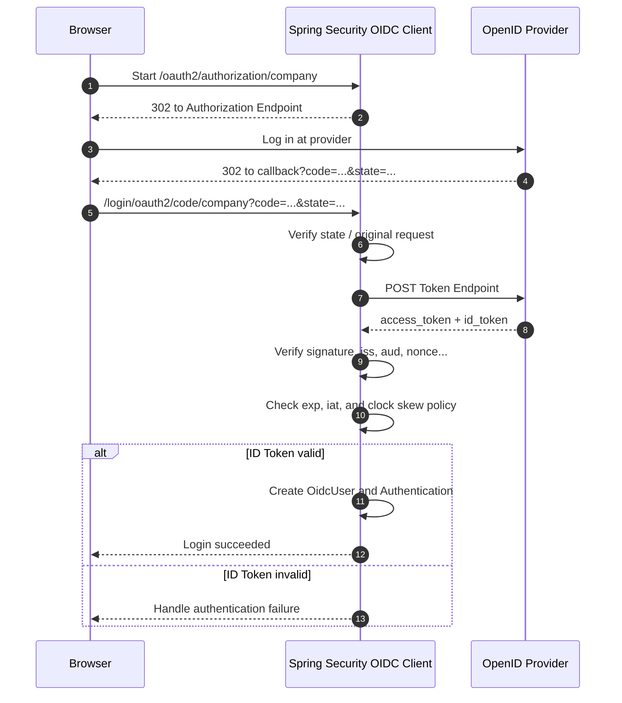

# 11.7. Checking `exp`, `iat`, Clock Skew, and System Time

In **Spring Security OAuth 2.0/OIDC Client**, after receiving an authorization code and exchanging it at the Token Endpoint, the application may receive an **ID Token** from the OpenID Provider. An ID Token is a JWT containing claims describing the authentication event and user identity. Beyond verifying the signature, `iss` (issuer), `aud` (audience), and `nonce` when applicable, the Client must inspect **time claims** to determine whether the token is still valid.

Two critical claims are **`exp`** (*expiration time*, when the token expires) and **`iat`** (*issued at*, when the token was issued). They depend directly on the **system clocks** of the token-issuing machine and the token-verifying machine. If those two clocks drift apart, a valid ID Token may be rejected, or a recently expired token may still be accepted for a small margin under a **clock skew** policy.

This lesson walks through claim meanings, time comparisons, handling clock skew, configuration, and diagnostics in a Spring Security OIDC Client application running on the Servlet stack.

## 1. Where Does the ID Token Appear in OAuth 2.0/OIDC Login?

When a user logs in via the OIDC Authorization Code Flow:

1. The browser is redirected by Spring Security to the OpenID Provider's Authorization Endpoint.
2. The user authenticates and grants consent if required.
3. The provider redirects the browser back to the application's Redirect URI with an authorization code and `state`.
4. Spring Security sends the authorization code to the Token Endpoint over HTTPS.
5. The Token Endpoint returns an `access_token` and **`id_token`** for OIDC; a `refresh_token` may also be included depending on the flow.
6. The Client verifies the ID Token and constructs `OidcUser`/`Authentication` when all checks succeed.

Example token response (illustrative values only):

```json
{
  "access_token": "EXAMPLE_ACCESS_TOKEN",
  "token_type": "Bearer",
  "expires_in": 3600,
  "scope": "openid profile email",
  "id_token": "EXAMPLE_SIGNED_ID_TOKEN"
}
```

An ID Token is a **JWT** with a header.payload.signature structure; after decoding the payload, you may see claims like:

```json
{
  "iss": "https://id.example.test/realms/company",
  "sub": "user-782",
  "aud": "spring-web-client",
  "exp": 1794794700,
  "iat": 1794791100,
  "auth_time": 1794791000,
  "nonce": "EXAMPLE_NONCE"
}
```

These integers illustrate **NumericDate**; this is not a real token or verified evidence. `auth_time` and `nonce` appear depending on the OIDC request context. Required protocol claims in an ID Token include `iss`, `sub`, `aud`, `exp`, and `iat`.

**Merely reading JSON does not mean the JWT is trustworthy.** Before the application uses claims in login decisions, the ID Token must pass signature, issuer, audience, and protocol checks. Time validation is one part of that complete verification.



## 2. Exact Meaning of `exp` and `iat`

| Claim | Full Name | JWT Type | Meaning |
|---|---|---|---|
| `exp` | Expiration Time | NumericDate | Time **on or after which the JWT must not be accepted** unless a small allowed clock skew applies |
| `iat` | Issued At | NumericDate | Time **at which the token was issued**; helps determine token age and detect anomalous timestamps per policy |
| `nbf` | Not Before | NumericDate | If present, the token must not be accepted before this time |
| `auth_time` | Authentication Time | NumericDate | Time **when the user actually authenticated**; not necessarily the same as when the ID Token was issued |

`exp` and `iat` are required claims in an **OIDC ID Token**. In JWTs generally, RFC 7519 defines time claims without mandating that every JWT carry them; mandatory requirements come from OIDC or the specific token profile in use.

### 2.1. `exp` Is an Absolute Point in Time

Example:

```json
{ "exp": 1794794700 }
```

It represents a point on the Unix timeline, not "seconds remaining." When the Client receives an ID Token, what matters is comparing **the current time** against `exp`.

Per JWT rules, without clock skew, a token is valid with respect to expiration only when:

```text
now < exp
```

If:

```text
now >= exp
```

the token has expired. Exactly at `exp`, the token is already expired; never use `now <= exp` to accept an extra unit of time.

### 2.2. `iat` States Issuance Time, Not Directly Expiration Time

Example:

```json
{ "iat": 1794791100 }
```

`iat` identifies when the token was issued. It **does not replace `exp`**. A token with a reasonable `iat` whose `exp` has passed must still be rejected.

OIDC describes `iat` as an issuance timestamp in the past. A Client may enforce a maximum token age policy or detect an abnormally future-dated `iat`, allowing for a small clock skew. However, **do not assume every validator in every library version automatically enforces the same "iat cannot be more than X seconds in the future" threshold**. Read the exact documentation and configuration of the validator in use.

### 2.3. What Does `exp - iat` Tell Us?

If both claims are valid, the difference:

```text
lifetime = exp - iat
```

shows the validity window expressed on the token. For example:

```text
iat = 10:00:00 UTC
exp = 11:00:00 UTC

exp - iat = 3600 seconds
```

This duration **is not** the remaining lifetime when the Client reads the token. If the Client receives the token at 10:20, roughly 40 minutes remain before accounting for clock skew.

An ID Token with an unusually long lifetime may be flagged by internal security policy, yet **an overly long lifetime cannot be fixed by modifying `iat` on the Client side**. A signed token is controlled by the provider. Never edit payload/`exp` to extend sessions.

## 3. NumericDate: Unix Seconds, Not Milliseconds

JWT uses **NumericDate**, the number of seconds since 1970-01-01T00:00:00Z per RFC 7519. Values may be integers or include a fractional part if higher precision is needed.

Illustrative conversion example:

```java
import java.time.Instant;

long expirationSeconds = 1794794700L;
Instant expiresAt = Instant.ofEpochSecond(expirationSeconds);

System.out.println(expiresAt);
```

To obtain a Unix timestamp from an `Instant`:

```java
long numericDate = Instant.parse("2026-11-16T03:00:00Z").getEpochSecond();
```

### 3.1. Seconds vs. Milliseconds Bugs

This is a very common root cause of timestamp errors:

```text
JWT exp (seconds):      1794794700
Java currentTimeMillis: 1794794700000 (milliseconds, illustrative)
```

Comparing two values with different units directly can make the application miscalculate token lifetimes by a factor of a thousand.

**Correct:** use `Instant.ofEpochSecond(exp)` and `Clock.instant()`, or normalize everything to the same unit before comparing. In modern Java, `java.time.Instant` is safer and clearer than raw epoch numbers.

### 3.2. UTC Is Not a Machine's Display Timezone

A single instant can be formatted in multiple timezones:

```text
2026-11-16T03:00:00Z
2026-11-16T10:00:00+07:00
```

Both strings represent **the exact same instant**, differing only in display formatting. A server configured with timezone `Asia/Ho_Chi_Minh` does not alter the meaning of `exp` inside a JWT. NumericDate represents an absolute instant.

Therefore:

- Never call `LocalDateTime.now()` and compare against a UTC string without explicit timezone conversion.
- Never add/subtract `7 hours` directly to `exp` to "adjust for Vietnam time."
- Never treat a UTC timestamp in logs as a bug merely because it differs from local wall-clock time.
- Never confuse a timezone display change with actual **clock drift**.

Timezones govern **how time is displayed**; clock skew is **absolute time divergence** between systems.

### 3.3. Anomalous Timestamp Values

Handle an ID Token cautiously when:

- `exp` or `iat` is missing from an OIDC ID Token.
- A claim has the wrong data type, such as the string `"tomorrow"` instead of a NumericDate.
- A value overflows the range supported by the decoder or `Instant`.
- `iat` lies far in the future relative to Client time.
- `exp` has expired under valid time comparison.
- `exp` precedes `iat` or the lifetime violates operational policy.

These can indicate provider misconfiguration, serialization bugs, a wrong issuer clock, or tampered data. Never patch invalid claims on the Client side and continue trusting the token.

## 4. Checking `exp` with Clock Skew

### 4.1. Standard Condition When Both Clocks Are Accurate

Suppose the Client's current time is `10:00:00 UTC`:

| `exp` in ID Token | Conclusion Without Clock Skew |
|---|---|
| 10:05:00 UTC | Not expired |
| 10:00:01 UTC | Not expired |
| 10:00:00 UTC | Expired |
| 09:59:59 UTC | Expired |
| 09:55:00 UTC | Expired |

**Clock skew** arises because the Authorization Server's clock and the Client's clock may drift slightly apart, or requests may experience network latency.

### 4.2. What Is Clock Skew?

Clock skew is **the difference between clocks**. For example:

```text
Actual time:            10:00:00 UTC
OP clock:               10:00:00 UTC
Client clock:           10:00:35 UTC
Client ahead by:        +35 seconds
```

If the OP just issued an ID Token with `exp=10:00:20 UTC`, the Client thinks it is already 10:00:35 and would reject the token immediately even though in real time 20 seconds remain.

RFC 7519 allows the verifier to apply **a small tolerance window** to compensate for clock differences. This margin is called **clock skew allowance**, **clock tolerance**, or **leeway**, depending on the library.

### 4.3. Formula with Tolerance for `exp`

Let:

- `now`: current time on the Client's clock.
- `exp`: expiration time in the token.
- `δ`: non-negative, bounded clock skew tolerance, e.g., 30 seconds.

An illustrative acceptance check:

```text
ID Token is not rejected by exp if:
now < exp + δ

Equivalently:
exp > now - δ
```

Example:

```text
Client now = 10:00:00 UTC
exp = 09:59:45 UTC
δ = 30 seconds

exp + δ = 10:00:15 UTC
now < exp + δ  => accepted for exp within tolerance
```

If `exp=09:59:20`:

```text
exp + δ = 09:59:50
now = 10:00:00
now >= exp + δ => rejected as expired
```

**Tolerance only compensates for small clock drift.** It does not renew tokens through a fresh grant and must not turn tokens expired by many minutes or hours into valid tokens.

### 4.4. No Single Clock Skew Value Fits Every System

One system may pick a tolerance of 30, 60, or 120 seconds depending on policy, clock-sync capability, and provider requirements. These numbers are **practical examples**, not a claim that Spring Security always defaults to a specific number across all token types, flows, or versions.

Principles:

1. **Fix system clocks** if they are actually drifting.
2. Use a **small, justified** tolerance aligned with documentation and security policy.
3. Never inflate clock skew excessively just to mask a time-sync bug.
4. Never allow disabling `exp` checks in production.
5. Monitor unusual expiration failures after library upgrades, proxy changes, container shifts, or IdP changes.

For example, "allowing 24-hour skew" severely undermines ID Token expiration, even if it temporarily makes a login test pass.

## 5. Checking `iat` and Future Issuance Times

### 5.1. Why Does a Future `iat` Matter?

Suppose the Client's clock is `10:00 UTC` yet receives an ID Token:

```json
{
  "iat": 1794794700,
  "exp": 1794798300
}
```

If `iat` decodes to a timestamp **significantly ahead of the Client's current time**, either the issuing machine is running fast, the Client machine is running slow, or the token violates expected conditions.

A common application-level `iat` check policy is:

```text
iat <= now + δ
```

where `δ` is the allowed clock skew tolerance. If `iat > now + δ`, the Client may treat the token as anomalous and reject it per policy.

Keep the boundary clear: **`iat` is issuance-time metadata**, not a standalone security lock; different libraries check `iat` differently or may not automatically enforce an extra future-`iat` threshold. Never claim "full `iat` validation" merely because the claim exists.

### 5.2. Do Not Confuse `iat` with `nbf`

Suppose a token has:

```json
{
  "iat": 1794791100,
  "nbf": 1794792000,
  "exp": 1794794700
}
```

- `iat`: the token was issued at a given time.
- `nbf`: the token must not be used before this time.
- `exp`: the token ceases to be valid on or after this time.

When `nbf` is present, the corresponding check is `now >= nbf`, or with a small tolerance:

```text
now + δ >= nbf
```

Do not treat `iat` as `nbf`. A token with `iat` in the past does not automatically become usable if its `nbf` is still in the future.

### 5.3. `iat` and Maximum Token Age Policy

An application may enforce a rule **rejecting ID Tokens issued too long ago**:

```text
now - iat <= maximumTokenAge
```

This is an **additional application policy**, not an alternative definition of `exp`. If a token has an unexpired `exp` yet its `iat` is too old by internal rules, the application may reject it under the stricter policy.

Design maximum-age policies around actual meaning:

- **`iat`** indicates when the ID Token was issued.
- **`auth_time`** indicates when the user authenticated.
- To require recent user reauthentication, OIDC's **`auth_time` and `max_age` parameter** are usually more meaningful than `iat`.

A provider can issue a fresh ID Token while the user has held an older SSO session at the IdP. In that case `iat` is recent while `auth_time` is old. If a feature requires "re-authenticated within the last 5 minutes," checking `iat` alone is insufficient.

## 6. `auth_time` and `max_age`: When Is Recent Authentication Required?

OIDC provides the `max_age` parameter for the Client to limit elapsed time since user authentication. For example, an authorization request contains:

```text
max_age=300
```

indicating that elapsed time since the authentication event must not exceed 300 seconds per OIDC rules. When `max_age` is used, the ID Token response must include `auth_time` so the Client can verify it.

Example timestamps:

```text
auth_time = 09:00 UTC
iat       = 10:00 UTC
now       = 10:01 UTC
```

The ID Token was freshly issued at 10:00, yet the user's authentication occurred at 09:00. For a requirement of "authenticated within 5 minutes," a recent `iat` **does not satisfy** the condition; you must rely on `auth_time` and related rules.

### 6.1. Cases Requiring `max_age`

- The user moves from viewing regular data to performing a sensitive action.
- The application requires reauthentication before changing security settings.
- A high-risk action demands proof of recent authentication.
- Corporate security policy or compliance defines "recent authentication."

Note that `max_age` and `auth_time` do not by themselves imply MFA. To know the authentication method or assurance level, inspect claims such as `amr` and `acr` when present, along with the provider contract.

### 6.2. Relationships Among Timestamps

| Timestamp | What Does It Describe? |
|---|---|
| `auth_time` | When the user authenticated at the OpenID Provider |
| `iat` | When the ID Token was issued |
| `exp` | When the ID Token expires |
| `expires_in` in token response | Relative lifetime of the **access token**, if returned |
| HTTP session expiry | Until when the application login session remains alive |
| Refresh token expiry | Until when new access tokens can still be requested |

ID Token expiration **does not mean** the application's HTTP session must automatically expire at that exact moment. The ID Token verifies the login event, after which the application applies its own session policy. Likewise, an access token expiring during API calls is separate from when the Client originally verified identity.

## 7. Time Comparison Examples With and Without Skew

Assume the Client's exact time is `12:00:00 UTC` and clock skew allowance is 60 seconds for `exp` checks. Scenarios:

| `exp` | `iat` | Evaluating `exp` with 60s Tolerance | Notes |
|---|---|---|---|
| 12:05:00 | 11:50:00 | Not expired | Timestamps look normal |
| 12:00:01 | 11:50:00 | Not expired | Only 1 second left in real time |
| 12:00:00 | 11:50:00 | Accepted within tolerance | Expired without skew |
| 11:59:30 | 11:40:00 | Accepted within tolerance | 30 seconds past `exp` |
| 11:59:00 | 11:40:00 | **Rejected** at boundary since `now >= exp + skew` | Reached end of tolerance window |
| 11:55:00 | 11:40:00 | Rejected | Expired too long ago |
| 12:05:00 | 12:03:00 | `exp` valid | Yet `iat` is 3 minutes in the future: evaluate under future-iat policy |

This table shows you **cannot inspect `exp` alone** to declare a token completely valid. The token must also pass signature, issuer, audience, nonce, and issuance/time policy checks.

### 7.1. Visualizing Clock Skew

```text
Actual UTC time
11:59:00 -------- 12:00:00 -------- 12:01:00
                       |
                       +-- Client reads this time

Example exp 11:59:30, skew 60s:
exp = 11:59:30
exp + skew = 12:00:30
Client now 12:00:00 -> inside tolerance window

Example exp 11:58:30:
exp + skew = 11:59:30
Client now 12:00:00 -> outside tolerance window, reject
```

This margin must stay small enough to cover only normal clock drift, never becoming a mechanism for accepting long-expired tokens.

## 8. Who Verifies the ID Token in Spring Security OIDC Client?

For a Servlet application using `oauth2Login` and a valid OIDC Provider, Spring Security already provides the infrastructure:

- Handles the authorization code callback via `OAuth2LoginAuthenticationFilter`.
- Exchanges the code at the Token Endpoint.
- Decodes and verifies the ID Token using the OIDC JWT decoder/validator.
- Validates required protocol claims and information tied to `ClientRegistration`.
- Creates `OidcUser` upon successful authentication.

A basic configuration:

```java
import org.springframework.context.annotation.Bean;
import org.springframework.context.annotation.Configuration;
import org.springframework.security.config.Customizer;
import org.springframework.security.config.annotation.web.builders.HttpSecurity;
import org.springframework.security.web.SecurityFilterChain;

@Configuration
public class SecurityConfig {

    @Bean
    SecurityFilterChain securityFilterChain(HttpSecurity http) throws Exception {
        http
            .authorizeHttpRequests(authorize -> authorize
                .requestMatchers("/", "/error").permitAll()
                .anyRequest().authenticated()
            )
            .oauth2Login(Customizer.withDefaults());

        return http.build();
    }
}
```

Client configuration with OIDC discovery:

```yaml
spring:
  security:
    oauth2:
      client:
        registration:
          company:
            provider: company
            client-id: ${OIDC_CLIENT_ID}
            client-secret: ${OIDC_CLIENT_SECRET}
            authorization-grant-type: authorization_code
            scope:
              - openid
              - profile
              - email
            redirect-uri: "{baseUrl}/login/oauth2/code/{registrationId}"
        provider:
          company:
            issuer-uri: https://id.example.test/realms/company
```

`id.example.test` and environment variables are illustrative values. A real application requires endpoints/issuer published by the provider and valid Client ID/secret.

**Do not write a custom controller reading the ID Token and calling `Base64.decode(...)` to authenticate.** `oauth2Login` already integrates JWT/OIDC verification; decoding manually without verifying signatures and claims introduces vulnerabilities.

### 8.1. APIs to Recognize

| Component | Role |
|---|---|
| `OidcIdTokenDecoderFactory` | Creates `JwtDecoder` for ID Tokens per `ClientRegistration` |
| `OidcIdTokenValidator` | Validator enforcing OIDC rules for ID Tokens |
| `JwtDecoderFactory<ClientRegistration>` | Abstraction creating decoders per `ClientRegistration` |
| `OidcIdToken` | ID Token represented as a Spring object |
| `OidcUser` | Principal for an OIDC-authenticated user |
| `JwtTimestampValidator` | Timestamp validator in Spring Security's JWT ecosystem; distinguish usage context |
| `OAuth2TokenValidator<Jwt>` | Interface validating configurable JWT conditions |

API names and configuration options can change between Spring Security 6 and 7. When modifying **ID Token** timestamp policy, check the exact version and integration points of the **OIDC ID Token decoder factory**; do not assume a Resource Server JWT decoder config affects OAuth2 Login.

### 8.2. OIDC ID Token Validation Differs from Resource Server JWT Validation

Spring Security supports multiple JWT use cases:

**A. OAuth2/OIDC Client**

```java
http.oauth2Login(Customizer.withDefaults());
```

The ID Token from the Token Endpoint is verified by the Client to log the user in.

**B. OAuth2 Resource Server**

```java
http.oauth2ResourceServer(oauth2 -> oauth2.jwt(Customizer.withDefaults()));
```

The Resource Server verifies the **JWT access token** sent by an HTTP Client to the API.

The two flows use separate decoders, issuers, audiences, and token policies for their respective purposes. A `JwtDecoder` bean configured for Resource Server **must not be assumed to control OIDC Client ID Token validation**.

When reading guides on configuring clock skew, check whether the author is discussing **ID Tokens** or **JWT access tokens**. Changing config in the wrong layer can leave OIDC login failing even after API validation changed.

### 8.3. Customize the Validator Only with Explicit Requirements

If an organization requires a custom timestamp policy, the technical approach is to use the **`ClientRegistration`-scoped `JwtDecoderFactory` / `OidcIdTokenDecoderFactory`** extension point supported by your Spring Security version while **preserving all other OIDC checks**.

Never replace the default validator with one that blindly returns success:

```java
// ANTI-PATTERN - DO NOT IMPLEMENT:
jwt -> OAuth2TokenValidatorResult.success()
```

Doing so disables core checks. Never alter ID Tokens, strip `exp`, or swap signing keys just to make login pass in an environment with broken clocks.

## 9. Reading Timestamps from `OidcUser` After Spring Authenticates

After `oauth2Login` succeeds, a controller can read the ID Token from the **Spring-authenticated** principal:

```java
import java.time.Instant;
import java.util.LinkedHashMap;
import java.util.Map;

import org.springframework.security.core.annotation.AuthenticationPrincipal;
import org.springframework.security.oauth2.core.oidc.OidcIdToken;
import org.springframework.security.oauth2.core.oidc.user.OidcUser;
import org.springframework.web.bind.annotation.GetMapping;
import org.springframework.web.bind.annotation.RestController;

@RestController
public class SessionInfoController {

    @GetMapping("/me/id-token-time")
    public Map<String, Object> idTokenTime(
            @AuthenticationPrincipal OidcUser user) {

        OidcIdToken token = user.getIdToken();
        Instant issuedAt = token.getIssuedAt();
        Instant expiresAt = token.getExpiresAt();

        Map<String, Object> result = new LinkedHashMap<>();
        result.put("issuedAt", issuedAt == null ? null : issuedAt.toString());
        result.put("expiresAt", expiresAt == null ? null : expiresAt.toString());
        result.put("subject", user.getSubject());

        return result;
    }
}
```

Illustrative response:

```json
{
  "issuedAt": "2026-11-16T03:00:00Z",
  "expiresAt": "2026-11-16T04:00:00Z",
  "subject": "user-782"
}
```

This code **does not replace the token validator**; it merely reads data from the principal after authentication succeeds. Protect the endpoint and expose only genuinely needed user details; do not expose uncontrolled debug endpoints in production.

### 9.1. Do Not Substitute Access Token Metadata for ID Token Metadata

`OAuth2AuthorizedClient#getAccessToken().getExpiresAt()` describes the expiration of the **access token** used to call resources. `OidcUser#getIdToken().getExpiresAt()` describes the **ID Token** expiration.

The two values can differ; they are issued for different purposes. Never use access token expiration to infer whether the ID Token was validly verified at login.

### 9.2. Do Not Put Raw JWTs into Responses or Logs

For debugging, you only need issuance/expiration timestamps, allowlisted issuer, registration ID, and error category. Do not print:

```java
// DO NOT DO THIS:
System.out.println(user.getIdToken().getTokenValue());
```

Raw ID Tokens can contain identity data and sensitive claims. Never put them in query strings, redirect URLs, logs, or support tickets.

## 10. Illustrating Time Checks with `java.time`

To understand the calculation, below is **a pure Java example** checking `exp` and an additional policy for `iat`. It **is not** a replacement for Spring Security's signature/issuer/audience/nonce verification.

```java
import java.time.Clock;
import java.time.Duration;
import java.time.Instant;
import java.util.Objects;

public final class IdTokenTimePolicy {

    private IdTokenTimePolicy() {}

    /**
     * Illustrative logic check after the JWT has been fully verified.
     * expiresAt and issuedAt are parsed from NumericDate in seconds.
     */
    public static void requireAcceptableTimes(
            Instant expiresAt,
            Instant issuedAt,
            Clock clock,
            Duration allowedSkew) {

        Objects.requireNonNull(expiresAt, "expiresAt");
        Objects.requireNonNull(issuedAt, "issuedAt");
        Objects.requireNonNull(clock, "clock");
        Objects.requireNonNull(allowedSkew, "allowedSkew");

        if (allowedSkew.isNegative()) {
            throw new IllegalArgumentException("allowedSkew must be nonnegative");
        }

        Instant now = clock.instant();

        // On or after exp + skew: expired per tolerance policy.
        if (!now.isBefore(expiresAt.plus(allowedSkew))) {
            throw new IllegalArgumentException("ID Token has expired");
        }

        // Additional future-iat rule to catch anomalous clocks/claims.
        if (issuedAt.isAfter(now.plus(allowedSkew))) {
            throw new IllegalArgumentException("ID Token iat is too far in future");
        }
    }
}
```

Example using a fixed clock for clarity:

```java
import java.time.Clock;
import java.time.Duration;
import java.time.Instant;
import java.time.ZoneOffset;

Clock fixedClock = Clock.fixed(
    Instant.parse("2026-11-16T03:00:00Z"),
    ZoneOffset.UTC
);

Instant issuedAt = Instant.parse("2026-11-16T02:50:00Z");
Instant expiresAt = Instant.parse("2026-11-16T03:00:30Z");

IdTokenTimePolicy.requireAcceptableTimes(
    expiresAt,
    issuedAt,
    fixedClock,
    Duration.ofSeconds(60)
);
```

In this example, `now=03:00:00Z` and `exp=03:00:30Z`, so the token is not expired, while `iat` precedes `now`. Using `Clock.fixed(...)` makes time boundaries clear without depending on when the code runs.

**Limitations of this example:**

- Does not verify signature, `iss`, `aud`, `nonce`, or `auth_time`.
- Does not parse JWTs, handle incoming token JSON, or act as a Spring Security bean.
- The tolerance in this example is illustrative policy; match it to your validator and real operational requirements.
- For extreme timestamps, `Instant.plus(...)` can overflow representable ranges; prefer Spring's validator library.
- Do not run two conflicting checkers; let the OIDC decoder/validator be the single source of truth for token acceptance.

### 10.1. Why Use `Clock` Instead of Scattered `Instant.now()` Calls?

`Clock` is Java's abstraction for reading time from a deterministic source. Benefits:

- Easy to test boundary cases right around `exp`.
- Prevents multiple clock reads from drifting across comparisons within one decision.
- Allows simulating fast/slow clocks to understand skew.
- Separates pure Java time math from Spring validator configuration.

In production, the clock used for token verification must reflect accurate system time. `Clock.systemUTC()` uses the system clock in UTC to construct `Instant` objects.

### 10.2. Never Parse JWTs Yourself Before Verification

Never write a flow like:

```text
1. Split JWT string on dots
2. Base64-decode payload
3. Read exp, iat
4. If not expired, log user in
```

This **lacks** signature, issuer, audience, nonce, and OIDC checks. A user could craft a fake JSON payload with `exp` in the future and bypass superficial checks.

Instead, let Spring Security OIDC Login verify the entire ID Token, and only then read trusted data via `OidcUser`.

## 11. System Time: Root Cause of Many Token Errors

### 11.1. Four Clocks Commonly Involved

In a distributed system, you may have:

1. **OpenID Provider / Authorization Server** issuing the ID Token.
2. **Spring Security Client** validating the ID Token.
3. **Resource Server / API** validating the access token when called.
4. **Reverse proxy server, container host, or Kubernetes node** affecting system clocks and logs.

If the OP is 90 seconds fast and the Client is 60 seconds slow, the gap between them reaches **150 seconds**. A 60-second tolerance will not suffice.

Example:

```text
Actual time:              12:00:00
OP clock:                 12:01:30   (+90s)
Spring Client clock:      11:59:00   (-60s)

ID Token iat from OP:     12:01:30
Client now:               11:59:00
iat - Client now:         +150s
```

If a future-`iat` policy allows only 60 seconds, the token is rejected; the real issue is **clock drift between the two machines**, not that time checks need to be disabled.

### 11.2. Wrong Timezone vs. Wrong Clock

One server set to `Asia/Ho_Chi_Minh` and another set to `UTC` can still be synchronized to **the exact same absolute instant**. A token error does not happen simply because logs print in two different timezones.

If the clocks genuinely drift, even when both servers are set to UTC, tokens will still fail. Always compare **epoch time / UTC instants** across machines or check drift against a trusted time source.

### 11.3. Synchronization via NTP

Systems typically use **NTP or an equivalent time-synchronization service** to keep clocks accurate.

On Linux with systemd, check status per your environment:

```bash
date -u
timedatectl status
```

If the system uses chrony:

```bash
chronyc tracking
chronyc sources -v
```

On Windows Server / Windows:

```powershell
Get-Date
w32tm /query /status
w32tm /query /source
```

These commands are for observation only. How NTP is **configured** depends on administrative privileges and infrastructure time services; never run commands altering production clocks without understanding the impact on databases, TLS, job schedulers, or active transactions.

### 11.4. Containers and Kubernetes Do Not Automatically Solve Clock Skew

In Docker/Kubernetes, containers usually inherit the clock of the **host/node**. An application configured with UTC inside a container will still read the wrong absolute time if the underlying node's clock has drifted.

When errors occur on only a single pod/instance:

- Identify which node the pod runs on.
- Compare the node's UTC time and NTP status against healthy nodes.
- Check timestamps in logs when tokens arrive, without logging raw ID Tokens.
- Check differences between the IdP issuer host and the verifying node.
- Do not change the container timezone as a workaround for NTP drift.

In multi-region deployments, network time and node clocks must still stay synchronized; geographic distribution does not imply hours of clock drift.

### 11.5. Other Causes of Wrong Time

- A VM or laptop slept/resumed after a long pause before time sync caught up.
- VM snapshots or live migrations caused a sudden clock jump.
- NTP/chrony/Windows Time was disabled or lost connectivity.
- A firewall blocked time sources or pointed machines to an untrusted time server.
- A test environment pinned a fixed clock and failed to restore it.
- Code treated seconds as milliseconds or vice versa.
- Code converted `Instant` to `LocalDateTime` and applied the wrong timezone.
- Tokens came from an older IdP using an inappropriate lifetime configuration.
- Network links or queues introduced high latency so tokens arrived right at expiration.

## 12. Clock Skew Across Different Token Types

### 12.1. Do Not Apply One Blanket Policy Unconditionally

A project may involve:

- ID Token for authenticating the user at the Client.
- Access token for calling APIs.
- Refresh token for obtaining new access tokens.
- HTTP session cookie for maintaining login state.

Each artifact has **different timing rules**. For example:

| Artifact | Common Time Info | Meaning |
|---|---|---|
| ID Token | `exp`, `iat`, possibly `auth_time` / `nbf` | Validates issuance/authentication and expiration in OIDC |
| JWT access token | May have `exp`, `iat`, `nbf` | Validated by Resource Server per token profile |
| Opaque access token | Authorization Server metadata or introspection | Do not try reading `exp` as a JWT |
| OAuth2 token response | `expires_in` | Relative lifetime of the access token |
| Refresh token | Lifetime/policy controlled by provider | Can be rotated or revoked |
| HTTP session | Application timeout/session policy | Application login duration, independent of ID Token validation |

Do not use an access token's `expires_in` to infer the ID Token's `exp`. Nor should you raise clock skew on a Resource Server claiming "OIDC login is failing" when the two mechanisms use separate validators.

### 12.2. ID Token Expiration Does Not Mean Calling the Token Endpoint Repeatedly

The ID Token is verified at OIDC authentication time. Afterward, Spring Security Servlet typically manages `SecurityContext` and login state via the HTTP session. An ID Token expiring after one hour does not automatically mean every HTTP request re-validates the ID Token like a bearer token.

If the application requires **recent authentication**, use appropriate session policies, reauthentication, and `max_age`/`auth_time`. If the application needs to call APIs with access tokens, use authorized-client / refresh-token management. These needs differ from merely lengthening ID Token `exp`.

### 12.3. Expiration on the Resource Server

An API receiving JWT access tokens may also allow a small clock skew to compensate for clock drift, yet it must still verify issuer, audience, signature, and scopes. In Spring Security Resource Server, APIs such as `JwtTimestampValidator` handle JWT `exp`/`nbf` checks.

**Do not assume** that modifying `JwtTimestampValidator` on a Resource Server changes `oauth2Login`'s OIDC ID Token validator. Identify which token type is being rejected and which component is validating it.

## 13. Diagnosing Expiration and Issuance Time Errors in OIDC Login

| Symptom | Common Cause | Isolation Steps |
|---|---|---|
| Newly issued ID Token reports expired | Client clock fast, provider issues overly short TTL, or wrong `exp` | Compare `exp`/UTC against system time and OP clock |
| ID Token reports `iat` in the future | OP clock fast, Client clock slow, or wrong `iat` units | Compare `iat` against Client `Instant.now()` and OP time source |
| Token errors occur on only one pod | Kubernetes node clock drifted, or config differs across pods | Inspect the node and synchronize clocks |
| Errors occur only in staging | Staging VM/NTP/IdP differs from production | Compare time sources, issuer, and token policy |
| "Expired" errors when token expired by a few seconds | Network delay or small clock skew | Check expiry, latency, skew policy; sync clocks |
| ID Token has `exp` hours in the past | Stale token, broken provider, or unit mismatch | Do not raise skew; find root cause |
| `iat` or `exp` resolves to a distant future year | Epoch milliseconds parsed as seconds or vice versa | Inspect NumericDate, parser, and provider output |
| Token has future `exp` yet login fails | Invalid signature, issuer, audience, nonce, or other claim | Check the actual error code; do not look at `exp` alone |
| `exp` valid yet API returns 401 | API access token expired/revoked or wrong audience | Distinguish ID Token from access token |
| User still has a session after ID Token expired | Session and ID Token have separate lifecycles | Check session/reauthentication policy |
| Login still fails after raising Resource Server skew | Changed access token validator instead of OIDC ID Token validator | Check where Spring validates the ID Token |
| Adding `max_age` breaks login | Missing `auth_time`, authentication too old, or unsupported by provider | Check OIDC requirements and `auth_time` claim |
| Token rejected right on the `exp` boundary | Clock near expiration, tiny skew, or `<`/`<=` comparison semantics | Check validator/version rules; never edit tokens manually |

### 13.1. Step-by-Step Troubleshooting Flow

1. **Identify which token failed.** ID Token in `oauth2Login`, API access token, or refresh token?
2. **Locate where the failure occurs.** After token exchange at the OIDC Client, or on an `Authorization: Bearer` request at the Resource Server?
3. **Verify token authenticity and trust source.** For ID Tokens, ensure right issuer/keys; never trust self-decoded tokens.
4. **Compare absolute timestamps.** Record Client `now` in UTC, plus `exp` and `iat` from a sanitized test token; avoid logging raw tokens.
5. **Check clocks across systems.** NTP, node/container, OP time, network latency.
6. **Inspect skew policy on the right validator.** Do not tweak an unrelated JWT bean.
7. **Fix the root cause.** Sync clocks, fix `seconds vs milliseconds`, issuer/TTL, or provider configuration.
8. **Confirm other checks remain enforced.** Signature, issuer, audience, nonce, expiration, and OIDC policies.

### 13.2. Useful Logging While Protecting Data

For diagnostics, you can temporarily configure Spring Security logging in development:

```yaml
logging:
  level:
    org.springframework.security: DEBUG
```

When writing custom logs, include only enough non-sensitive data to identify the issue:

```text
registrationId=company
tokenKind=ID_TOKEN
validationStage=TIMESTAMP
clientTimeUtc=2026-11-16T03:00:00Z
result=EXPIRED
```

Avoid logging:

- Raw ID Tokens / access tokens / refresh tokens.
- Authorization codes, `state`, `nonce`, or client secrets.
- Personally identifiable data from `email`, `phone_number`, or `address` claims.
- Full HTTP token responses or session cookies.

If a timestamp from a test token must be included in a bug report, sanitize the data and ensure logs contain no usable tokens.

## 14. Practice: Determining Timestamps and Boundaries

### Exercise 1: Expired Exactly at `exp`

Client time is:

```text
now = 2026-11-16T04:00:00Z
exp = 2026-11-16T04:00:00Z
```

If no skew is allowed, is the token still valid?

**Answer:** No. The standard rule is `now < exp`; at `now == exp`, the token has already expired.

### Exercise 2: 45-Second Clock Skew

Given:

```text
now = 10:00:00
exp = 09:59:30
skew = 45 seconds
```

**Answer:** `exp + skew = 10:00:15`; considering `exp` and the allowance alone, the time falls within the accepted window. That does not guarantee other claims are valid.

### Exercise 3: Token in the Future

Given:

```text
now = 10:00:00
iat = 10:02:00
exp = 11:00:00
future-iat skew = 60 seconds
```

**Answer:** `iat > now + 60s`, violating the illustrative future-`iat` policy even though `exp` has not expired. Check OP/Client clocks and timestamp parsing; do not simply keep raising skew until login succeeds.

### Exercise 4: UTC vs. Vietnam Time

IdP logs record:

```text
iat = 2026-11-16T03:00:00Z
```

Application logs display:

```text
2026-11-16 10:00:00 Asia/Ho_Chi_Minh
```

Are the two machines 7 hours out of sync?

**Answer:** No. Both values represent the exact same instant. To evaluate clock skew, convert both to the same `Instant`/epoch rather than comparing formatted hours across different timezones.

### Exercise 5: Recent `iat` but Stale `auth_time`

Given:

```text
iat       = 12:00
auth_time = 10:00
now       = 12:01
max_age   = 300 seconds
```

**Answer:** A freshly issued token does not prove the user just authenticated. `auth_time` is over 2 hours old and fails a 5-minute recent-authentication requirement unless a new authentication event satisfies policy.

### Exercise 6: Choosing the Right Place to Fix

An application calls an API with an access token and receives 401 `invalid_token`. A developer suggests changing `exp` tolerance in the ID Token decoder.

**Answer:** Diagnose **access token / API validation** first. `oauth2Login`'s ID Token decoder verifies identity at login, not access token expiration policy at the Resource Server. Inspect audience, expiry, revocation, refresh, and the API's clock.

### Exercise 7: Spring Works on One Instance, Fails on Another

Two instances run the exact same artifact. Instance A succeeds on OIDC login, while Instance B frequently reports ID Tokens several minutes in the future.

**Answer:** Inspect node/VM clocks, NTP, container hosts, time from the IdP, and validator config on both instances. Never treat running the same JAR as proof that clocks match.

## 15. Operational Principles to Apply

### 15.1. For the OpenID Provider

- Emit `exp` and `iat` as accurate NumericDate values in Unix seconds.
- Synchronize clocks on the Authorization Server and token-issuing components.
- Issue ID Tokens with lifetimes appropriate to Client policy.
- Publish valid issuer/JWKS metadata so Clients can verify signatures.
- When `max_age` is used, emit `auth_time` accurately reflecting the authentication event per OIDC.

### 15.2. For the Spring Security Client

- Use `oauth2Login` and Spring Security's ID Token verification infrastructure.
- Ensure `ClientRegistration` uses the right issuer, client ID, and provider.
- Synchronize server or container-node clocks.
- Keep clock skew small and justified, aligned with the specific validator's capabilities and policy.
- Never disable `exp` or mandatory claim checks due to environment glitches.
- Never substitute `iat` for `auth_time` when recent authentication is required.
- Never conflate ID Token lifetime with access token lifetime or HTTP session lifetime.
- Never expose raw tokens in logs, frontends, or URLs.

### 15.3. For Testing and Monitoring

- Use `Clock.fixed(...)` or simulated time when testing time-dependent application logic.
- Monitor clock drift / NTP status across all critical nodes.
- Clearly categorize expired tokens, not-yet-valid tokens, future `iat`, and signature/issuer/audience failures.
- Watch for errors triggered after VM resumes, deployments, scale-outs, or IdP failovers.
- When upgrading Spring Security versions, review the corresponding validator docs to understand default skew and customization hooks.
- Use test fixtures or redacted claims; never attach real tokens to bug reports.

## 16. Official References

1. [OpenID Connect Core 1.0 — ID Token](https://openid.net/specs/openid-connect-core-1_0.html#IDToken): definitions of `exp`, `iat`, `auth_time`, `iss`, `sub`, and ID Token claims.
2. [OpenID Connect Core 1.0 — ID Token Validation](https://openid.net/specs/openid-connect-core-1_0.html#IDTokenValidation): ID Token validation requirements in OIDC.
3. [OpenID Connect Core 1.0 — `max_age`](https://openid.net/specs/openid-connect-core-1_0.html#AuthRequest): recent authentication requests and relationship to `auth_time`.
4. [RFC 7519 — JSON Web Token](https://www.rfc-editor.org/rfc/rfc7519): NumericDate and time claims `exp`, `nbf`, `iat`.
5. [Spring Security Reference — OAuth2 Login (Servlet)](https://docs.spring.io/spring-security/reference/servlet/oauth2/login/core.html): OIDC login, `ClientRegistration`, and ID Token handling.
6. [Spring Security API — OidcIdToken](https://docs.spring.io/spring-security/reference/api/java/org/springframework/security/oauth2/core/oidc/OidcIdToken.html): reading `issuedAt` and `expiresAt` from an ID Token.
7. [Spring Security API — OidcIdTokenDecoderFactory](https://docs.spring.io/spring-security/reference/api/java/org/springframework/security/oauth2/client/oidc/OidcIdTokenDecoderFactory.html): decoder factory for OIDC Client ID Tokens.
8. [Spring Security API — OidcIdTokenValidator](https://docs.spring.io/spring-security/reference/api/java/org/springframework/security/oauth2/client/oidc/OidcIdTokenValidator.html): OIDC ID Token checks.
9. [Spring Security API — JwtTimestampValidator](https://docs.spring.io/spring-security/reference/api/java/org/springframework/security/oauth2/jwt/JwtTimestampValidator.html): validating time claims in JWTs.
10. [Java SE — `Instant`](https://docs.oracle.com/en/java/javase/21/docs/api/java.base/java/time/Instant.html) and [`Clock`](https://docs.oracle.com/en/java/javase/21/docs/api/java.base/java/time/Clock.html): representing and testing time in Java.

**`exp` defines when an ID Token expires; `iat` defines when the token was issued.** Both are **absolute instants** in NumericDate format, independent of display timezone. A small clock skew can absorb minor real-world drift, but it cannot substitute for system clock synchronization or complete ID Token verification. In Spring Security OAuth2/OIDC Client, let the OIDC validation mechanism verify tokens, use `Instant` when working with timestamps, and keep **ID Token**, **access token**, **reauthentication**, and **HTTP session** policies separate.
