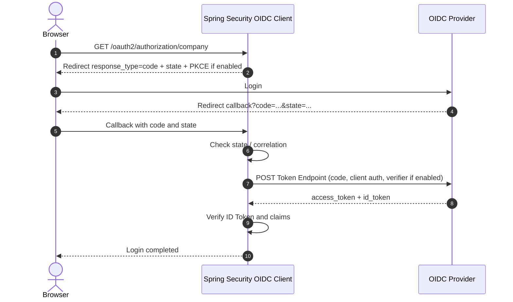

# 11.10. Hash Claims at_hash, c_hash, and Applicability by Flow

## 1. Why Does an ID Token Have `at_hash` and `c_hash`?

In **OpenID Connect (OIDC)**, the application (Relying Party / OIDC Client) receives an **ID Token** to verify user login information. An ID Token is usually a digitally signed JWT issued by the OpenID Provider (OP).

In certain flows, an **authorization code** or **access token** is returned alongside the ID Token in the **authorization response**. Those two values may traverse the browser (*front channel*), yet are not necessarily embedded inside the signed payload of the ID Token. Merely verifying the ID Token's signature does not automatically prove that the **accompanying code/token** is the exact artifact associated with that ID Token.

OIDC defines two hash-binding claims:

- **`at_hash`** (*Access Token hash value*): binds the **access token** to the **ID Token**.
- **`c_hash`** (*Code hash value*): binds the **authorization code** to the **ID Token**.

When verification is required, the client takes the **actual received** code/token value, computes a truncated hash using the ID Token's signing algorithm, and compares it against the corresponding claim.

For example: an application using **Hybrid Flow** receives `code` and `id_token` together from the Authorization Endpoint. The ID Token's signature confirms the claims inside the ID Token came from the OP; `c_hash` lets the client detect if `code` was swapped for another value in the response.

> **Key point:** `at_hash` and `c_hash` are **claims binding external values to a verified ID Token**, not standalone digital signatures for the access token/code, not new token types, and not replacements for `iss`, `aud`, `exp`, `nonce`, or `state` checks.

This lesson belongs to the **ID Token Validation** chapter of the **Spring Security OAuth 2.0 OIDC Client** module, focusing on claim meanings, computation, **flow-specific applicability**, and how to interpret them in a Spring Security application.

## 2. Distinguishing `at_hash`, `c_hash`, `state`, and PKCE

These mechanisms often appear within the same login transaction, yet solve different problems.

| Component | Where Does It Appear? | Data Bound / Checked | Primary Purpose |
| --- | --- | --- | --- |
| **`at_hash`** | Claim in ID Token | Access token value | Detects an access token mismatched with the ID Token when checking is required |
| **`c_hash`** | Claim in ID Token | Authorization code value | Detects an authorization code mismatched with the ID Token when checking is required |
| **`state`** | Authorization request and authorization response | Response against saved login initiation request | Prevents login CSRF; correlates callback with the right session/request |
| **`nonce`** | OIDC authorization request and ID Token | ID Token against original authentication request | Prevents replay/session mix-ups per OIDC rules |
| **PKCE `code_challenge`** | Authorization request | Binds challenge to client's secret verifier | Mitigates risk of stolen code exchange |
| **PKCE `code_verifier`** | Token request | Proves party exchanging code holds original verifier | Protects the authorization code-to-token exchange step |
| **JWS signature** | Signed ID Token | ID Token header/payload | Confirms origin and integrity of the ID Token |
| **`iss` / `aud` / `exp`** | Claims in ID Token | Issuer, intended recipient, timestamps | Determines whether token is valid for the client at the current time |

An application must never infer:

- If `state` matches, `at_hash` does not need checking when OIDC requires it.
- If PKCE is present, `c_hash` is automatically valid.
- If `at_hash` is present, the access token is guaranteed to be accepted by an API.
- If `c_hash` is present, the authorization code can be reused or token exchange skipped.
- A valid ID Token signature alone is enough without checking issuer, audience, or expiration.

**Each mechanism protects a separate trust boundary.** When the OIDC spec requires multiple checks, all of them must be satisfied.

## 3. Exact Definitions of the Two Hash Claims

### 3.1. `at_hash` — Access Token Hash

`at_hash` is the **unpadded Base64URL encoding of the left half of the hash of the access token value**. The hash function is determined by **`alg` in the ID Token's JWS header**.

Example ID Token payload:

```json
{
  "iss": "https://id.example.com/realms/company",
  "sub": "employee-4821",
  "aud": "employee-portal",
  "exp": 1794800000,
  "iat": 1794799400,
  "at_hash": "truncated-hash-computed-from-access-token"
}
```

The `at_hash` string above is solely a structural placeholder, **not a valid hash of a real token**.

When a client must verify `at_hash`, it needs:

1. **The verified ID Token** checked with trusted keys and algorithm.
2. **The exact access token** associated with the response under check.
3. **`alg` of the ID Token JWS header**, e.g., `RS256`.
4. The `at_hash` value placed by the OP in the ID Token.

### 3.2. `c_hash` — Authorization Code Hash

`c_hash` is also the **unpadded Base64URL encoding of the left half of the hash**, except the input is the **authorization code**, not the access token.

Illustrative ID Token payload:

```json
{
  "iss": "https://id.example.com/realms/company",
  "sub": "employee-4821",
  "aud": "employee-portal",
  "exp": 1794800000,
  "iat": 1794799400,
  "nonce": "nonce-from-authorization-request",
  "c_hash": "truncated-hash-computed-from-authorization-code"
}
```

When a client receives an **authorization response containing both `code` and `id_token`**, this hash claim confirms the accompanying code matches the OP-signed ID Token.

### 3.3. Direct Comparison

| Criterion | `at_hash` | `c_hash` |
| --- | --- | --- |
| Full name | Access Token hash value | Code hash value |
| Input to hash | **Raw access token string** | **Raw authorization code string** |
| Algorithm | Hash matching ID Token's `alg` | Hash matching ID Token's `alg` |
| Truncation | Left half of digest | Left half of digest |
| Claim encoding | Base64URL without `=` padding | Base64URL without `=` padding |
| Where does claim live? | ID Token payload | ID Token payload |
| When mandatory? | ID Token issued from Authorization Endpoint **with access token** | ID Token issued from Authorization Endpoint **with authorization code** |
| Mandatory flow examples | `id_token token`; `code id_token token` | `code id_token`; `code id_token token` |

**Do not take `at_hash` from inside a JWT access token's payload.** The input is the **exact raw access token received**, whether the access token is an opaque string or a JWT. Likewise, `c_hash` is never computed from the full callback URL, `state`, or code verifier.

## 4. How `at_hash` and `c_hash` Are Calculated

OIDC uses the exact same formula for both claims:

1. Select the hash function corresponding to the **JWS signing algorithm** of the **ID Token**.
2. Encode the **raw ASCII octets** of the access token / code into bytes.
3. Compute the digest of those bytes.
4. Take the **left-most half** of the digest by bit length.
5. Encode those bytes using **Base64URL without padding**.
6. Compare the result against the claim inside the **verified ID Token**.

Conceptual formula:

```text
D = HASH(ASCII(raw_value))
H = LEFT_HALF(D)
claim_value = BASE64URL_NO_PADDING(H)

at_hash = claim_value when raw_value is access_token
c_hash  = claim_value when raw_value is authorization_code
```

Here `HASH` is SHA-256 / SHA-384 / SHA-512, etc. per the ID Token's `alg`, **not an arbitrary choice** by the application.

### 4.1. Illustration with `RS256`

Suppose the ID Token is signed with `RS256`:

```json
{
  "alg": "RS256",
  "kid": "company-signing-key-2",
  "typ": "JWT"
}
```

The `RS256` signing algorithm uses SHA-256 as its hash. Therefore:

- The SHA-256 digest is **256 bits = 32 bytes**.
- The left half is **128 bits = first 16 bytes**.
- Unpadded Base64URL of 16 bytes normally has **22 characters**.

Example with access token `A` and authorization code `C`:

```text
at_hash = BASE64URL_NOPAD(LEFT_128_BITS(SHA256(ASCII(A))))
c_hash  = BASE64URL_NOPAD(LEFT_128_BITS(SHA256(ASCII(C))))
```

Here `A` and `C` are the **exact raw values** received — not JSON field names, and without a `Bearer ` prefix.

### 4.2. Common Algorithm Table

| ID Token JWS `alg` | Hash Function | Full Digest | Left Half | Unpadded Base64URL Length |
| --- | --- | --- | --- | --- |
| `RS256`, `PS256`, `ES256`, `HS256` | SHA-256 | 32 bytes | 16 bytes | 22 characters |
| `RS384`, `PS384`, `ES384`, `HS384` | SHA-384 | 48 bytes | 24 bytes | 32 characters |
| `RS512`, `PS512`, `ES512`, `HS512` | SHA-512 | 64 bytes | 32 bytes | 43 characters |

This table illustrates algorithm families whose suffix denotes hash strength. For other signing algorithms like `EdDSA` or specialized OIDC/JWT profiles, **never guess the hash function merely from the string name**; follow the specification/algorithm supported by the OP and library in use.

**Do not confuse `alg` with JWE's `enc`.** If an ID Token is signed and then encrypted, hash claim rules follow the **inner JWS signature algorithm**, not the outer encryption algorithm such as `A256GCM`.

### 4.3. Common Hash Calculation Mistakes

| Mistake | Why Is It Wrong? |
| --- | --- |
| Base64URL-encoding the entire SHA-256 | Spec requires the **left half**, not the full digest |
| Taking half of a hex string instead of digest bytes without proper handling | Easily takes the wrong byte/bit count or encoding |
| Using `SHA-256` for every ID Token | Hash must match the ID Token's `alg` |
| Using the signing algorithm of the **JWT access token** | Hash is based on the **ID Token**'s `alg` |
| Prepending `Bearer ` before the access token | Token-type prefix is not part of the raw access token |
| Decoding the JWT access token before hashing | Input must be the **raw token string**, not its JSON payload |
| Hashing `code_challenge` instead of the authorization code | `c_hash` uses the authorization **code**, not the PKCE challenge |
| Using standard Base64 `+`, `/`, `=` | OIDC requires **unpadded Base64URL** |
| Adding spaces or newlines to the raw value | Any byte change alters the hash |
| Computing hash before verifying the ID Token | Claims in an unverified ID Token are untrusted |

## 5. Flow Scope: When Is Each Claim Mandatory?

This is the single most important point: **not every ID Token must contain both `at_hash` and `c_hash`**. Whether a claim is mandatory depends on **whether the ID Token was returned from the Authorization Endpoint together with the code/access token**, rather than simply "we are using OAuth2/OIDC."

OIDC Core defines three historical flow families:

- **Authorization Code Flow**: `response_type=code`.
- **Implicit Flow**: `response_type=id_token` or `id_token token`.
- **Hybrid Flow**: `response_type=code id_token`, `code token`, or `code id_token token`.

### 5.1. Summary Matrix

| Flow | `response_type` | Authorization Endpoint Returns | Where Is ID Token Received? | `at_hash` | `c_hash` |
| --- | --- | --- | --- | --- | --- |
| **Authorization Code** | `code` | `code` | **Token Endpoint** | **Optional** | **Optional** |
| **Implicit** | `id_token` | `id_token` | **Authorization Endpoint** | Not required, since no access token accompanies it | Not required, since no code accompanies it |
| **Implicit** | `id_token token` | `id_token` + `access_token` | **Authorization Endpoint** | **Required** | Not required |
| **Hybrid** | `code id_token` | `code` + `id_token` | **Authorization Endpoint** (plus possibly another ID Token from Token Endpoint on code exchange) | Not required in front-channel ID Token if no access token accompanies it | **Required in ID Token from Authorization Endpoint** |
| **Hybrid** | `code token` | `code` + `access_token` | **Token Endpoint** on code exchange | Optional in Token Endpoint ID Token | Optional in Token Endpoint ID Token |
| **Hybrid** | `code id_token token` | `code` + `id_token` + `access_token` | **Authorization Endpoint** (plus possibly another ID Token from Token Endpoint) | **Required in ID Token from Authorization Endpoint** | **Required in ID Token from Authorization Endpoint** |

**How to read the table:** "Required" here means **the OP must include the claim and the client must check it per flow rules** for the ID Token in that specific response. If an ID Token comes from the Token Endpoint at another step, do not blindly enforce the same rule just because another token arrived on the front channel; identify **which ID Token is being validated**.

In flows where a claim is **optional**, the OP **may still include it** in the ID Token. When the claim is present and a corresponding value is available to compare, the client can verify it for extra assurance; do not assume optional claims are always absent.

### 5.2. Quick Rule of Thumb

```text
ID Token from Authorization Endpoint + Access Token in same response
    → at_hash REQUIRED in that ID Token

ID Token from Authorization Endpoint + Authorization Code in same response
    → c_hash REQUIRED in that ID Token

ID Token only from Token Endpoint in Authorization Code Flow
    → at_hash/c_hash not mandatory by default

No corresponding access_token or code in the response under check
    → cannot require a hash check against an absent value
```

This reasoning derives from **what is being hashed and where the ID Token was issued**. Specific security profiles (e.g., financial profiles or OP mandates) may impose stricter rules. Never replace OIDC rules with the assumption that every OP must emit both claims.

## 6. Authorization Code Flow: The Common Spring Security Case

### 6.1. Flow Progression

In the Authorization Code Flow:

1. The browser is redirected to the OP with `response_type=code`.
2. The OP authenticates the user and returns **`code`** to the callback.
3. Spring Security verifies `state` and the saved authorization request.
4. The backend exchanges the code for **access token + ID Token** at the Token Endpoint.
5. Spring Security verifies the ID Token and creates `OidcUser` and the session.



In **this flow**, the ID Token comes from the **Token Endpoint**, not alongside an access token from the Authorization Endpoint. Hence **`at_hash` is an optional claim**, not mandatory in every Authorization Code Flow ID Token. `c_hash` is also not mandatory by default.

A valid ID Token in the Code Flow may omit both claims:

```json
{
  "iss": "https://id.example.com/realms/company",
  "sub": "employee-4821",
  "aud": "employee-portal",
  "iat": 1794799400,
  "exp": 1794800000
}
```

This is solely an illustrative payload; other mandatory claims and real values must satisfy OIDC requirements. When `nonce` was sent in the authorization request, the ID Token must satisfy nonce rules per the flow.

### 6.2. What If an ID Token from the Token Endpoint Includes `at_hash`?

Some OPs still include `at_hash` in Authorization Code Flow ID Tokens. When present, the client **can** use it to verify the access token returned in the same token response using the ID Token's hash algorithm.

```text
Token response:
  access_token = ACCESS_TOKEN_X
  id_token.at_hash = HASH_HALF(ACCESS_TOKEN_X, ID_TOKEN_ALG)

Client:
  compute hash of ACCESS_TOKEN_X
  compare with id_token.at_hash
```

In this flow, **the absence of `at_hash` is not by default an OIDC error**. Conversely, if the application decides to verify a present claim, a mismatch must be treated as an authentication/integrity failure — never continue using the token as if everything were fine.

### 6.3. Should You Require `c_hash` in the Code Flow?

In pure Code Flow, the code arrives via callback while the ID Token comes from the Token Endpoint, so the condition **ID Token issued alongside code at the Authorization Endpoint** does not occur. Therefore `c_hash` is not automatically required.

In Spring Security `oauth2Login` with `authorization_code`, prioritize the exact steps:

- `state` / session correlation.
- PKCE if the flow is configured with PKCE.
- Client authentication at the Token Endpoint when applicable.
- Verification of ID Token signature and claims.
- Applying OIDC validators/policies for the actual flow.

Do not assume a provider is non-compliant merely because a Code Flow ID Token omits `at_hash` or `c_hash`.

## 7. Implicit Flow: ID Token and Access Token Travel on the Front Channel

**Implicit Flow** is a historical OIDC flow family where tokens can be issued directly from the Authorization Endpoint. For new applications, **Authorization Code Flow with PKCE** is strongly preferred; Implicit Flow increases risk because tokens pass through the browser environment and should not be the default for new architectures.

### 7.1. `response_type=id_token`

The Authorization Endpoint returns an **ID Token**, without an access token or authorization code in the same response.

```text
response_type=id_token

Authorization response:
    id_token = ...
    state    = ...
```

According to hash claim rules:

- **`at_hash` is not required** because no access token is returned with the ID Token.
- **`c_hash` is not required** because no authorization code is returned.

The client must still verify signature, issuer, audience, nonce when required, expiration, state, and remaining OIDC rules. Lacking hash claims does not mean skipping other validations.

### 7.2. `response_type=id_token token`

The Authorization Endpoint returns **both the ID Token and access token** in the same response:

```text
response_type=id_token token

Authorization response:
    id_token     = ...
    access_token = ACCESS_TOKEN_Y
    state        = ...
```

**`at_hash` is mandatory** in the ID Token because the OP issued the ID Token alongside the access token at the Authorization Endpoint.

Procedure:

1. Verify the ID Token's signature and mandatory claims.
2. Extract `at_hash` from the verified payload.
3. Compute the truncated hash of **ACCESS_TOKEN_Y** using the ID Token's `alg`.
4. Compare values; reject if missing or mismatched.
5. Proceed with the remaining security requirements of the flow.

**`c_hash` is not required** in this response because no authorization code is returned alongside the ID Token.

If a client verifies only the ID Token signature and ignores `at_hash` here, it skips the binding check between the front-channel access token and ID Token required by OIDC.

## 8. Hybrid Flow: Part of the Data at the Authorization Endpoint, Part at the Token Endpoint

Hybrid Flow combines returning an **authorization code** and **some tokens** from the Authorization Endpoint, followed by using the Token Endpoint to finish the exchange.

### 8.1. `response_type=code id_token`

The Authorization Endpoint returns:

```text
response_type=code id_token

Authorization response:
    code     = AUTH_CODE_A
    id_token = ID_TOKEN_A
    state    = ...
```

Here **`c_hash` is mandatory** in the ID Token from the Authorization Endpoint.

```text
ID_TOKEN_A.payload.c_hash
    must equal
BASE64URL_NOPAD(LEFT_HALF(HASH(ASCII(AUTH_CODE_A))))
```

`at_hash` **is not required in that ID Token**, because the authorization response does not return an access token alongside the ID Token. Afterward, the client exchanges the code for an access token (and depending on flow/provider, may receive an additional ID Token from the Token Endpoint). If another ID Token comes from the Token Endpoint, apply rules to that specific ID Token rather than carrying over the front-channel `c_hash` requirement to the later token response.

### 8.2. `response_type=code token`

The Authorization Endpoint returns:

```text
response_type=code token

Authorization response:
    code         = AUTH_CODE_B
    access_token = ACCESS_TOKEN_B
    state        = ...
```

Notably: **there is no ID Token in this authorization response**. In OIDC Hybrid Flow, the ID Token is received at the **Token Endpoint upon code exchange**.

Because no ID Token accompanies the code/access token at the Authorization Endpoint, the rule "ID Token issued alongside code/access token at the Authorization Endpoint" does not apply to the initial response. `at_hash` and `c_hash` are thus **not automatically mandatory in the ID Token received at the Token Endpoint** under these rules.

That **does not mean** the client can use the front-channel access token while bypassing other Hybrid Flow checks, including token verification, correlation, and protections defined for the response type.

### 8.3. `response_type=code id_token token`

The Authorization Endpoint returns all three values:

```text
response_type=code id_token token

Authorization response:
    code         = AUTH_CODE_C
    id_token     = ID_TOKEN_C
    access_token = ACCESS_TOKEN_C
    state        = ...
```

Because the ID Token is issued from the Authorization Endpoint **alongside both the code and access token**:

- **`c_hash` is mandatory**, computed from `AUTH_CODE_C`.
- **`at_hash` is mandatory**, computed from `ACCESS_TOKEN_C`.

```text
          ID_TOKEN_C (verified JWS)
             /                  \
            /                    \
          c_hash               at_hash
            |                     |
            v                     v
       HASH(AUTH_CODE_C)    HASH(ACCESS_TOKEN_C)
            |                     |
            +--------+------------+
                     |
          Both checks must succeed
```

If either required claim is missing or mismatched, the client must reject the response per OIDC policy. **Do not equate hash checks with token exchange**: the code must still be properly exchanged at the Token Endpoint and the access token must still be used with the right audience/scopes.

### 8.4. Hybrid Flows Can Have Multiple ID Tokens

In some Hybrid variants, the client may receive one ID Token from the Authorization Endpoint and later another ID Token from the Token Endpoint. Those tokens may carry **different claims**, because they were issued at different stages.

The principle is to **evaluate each ID Token according to where it was issued and what data accompanied it**, rather than insisting every ID Token in the same login carry the exact same `at_hash`/`c_hash` set.

## 9. Why Must the ID Token Signature Be Verified Before Trusting Hash Claims?

Suppose an attacker swaps the access token in the authorization response and simultaneously crafts an `at_hash` field containing the hash of the forged access token. If the client **does not verify the ID Token signature**, the attacker can rewrite the payload to make the hash check "pass."

Therefore, the trust order should be:

```text
Receive ID Token + related code/access token
       |
       v
Verify ID Token with trusted issuer and keys/algorithm
       |
       +-- Invalid signature/claim → REJECT
       |
       v
Validate iss, aud, exp, iat, nonce, and other flow requirements
       |
       +-- Invalid → REJECT
       |
       v
Check presence of at_hash/c_hash per flow
       |
       +-- Required claim missing → REJECT
       |
       v
Compute hash from corresponding raw access_token/code
       |
       +-- Mismatch → REJECT
       |
       v
Proceed with token exchange / authenticated session per flow
```

In practice, libraries may order internal steps differently as long as **no unverified data is used to grant access**. The core point is **never trust a hash claim not protected by ID Token validation**.

`at_hash` and `c_hash` do not prove the access token has the right API audience, sufficient scopes, or has not been revoked. Those conditions remain validated by the Resource Server/API and corresponding token policies.

## 10. Java Example for Computing and Checking Hash Claims

To inspect the algorithm clearly, we can write a standalone Java utility that performs **only the hash calculation**. It **does not replace** Spring Security's OIDC ID Token validator, JWS signature validation, or flow handling.

Example for **Java 17+** covering common JWS algorithm families:

```java
package com.example.oidc.security;

import java.nio.charset.StandardCharsets;
import java.security.MessageDigest;
import java.security.NoSuchAlgorithmException;
import java.util.Arrays;
import java.util.Base64;
import java.util.Objects;

public final class OidcTokenHash {

    private OidcTokenHash() {
    }

    /**
     * Computes at_hash/c_hash from a raw access token or authorization code.
     *
     * @param rawValue      raw ASCII value, without "Bearer "
     * @param verifiedAlg   JWS alg of an already-verified ID Token
     */
    public static String calculate(String rawValue, String verifiedAlg) {
        Objects.requireNonNull(rawValue, "rawValue");
        Objects.requireNonNull(verifiedAlg, "verifiedAlg");

        if (rawValue.isEmpty()) {
            throw new IllegalArgumentException("Token/code must not be empty");
        }
        if (rawValue.chars().anyMatch(value -> value > 0x7F)) {
            throw new IllegalArgumentException("Expected ASCII token/code");
        }

        String digestName = switch (verifiedAlg) {
            case "RS256", "PS256", "ES256", "HS256" -> "SHA-256";
            case "RS384", "PS384", "ES384", "HS384" -> "SHA-384";
            case "RS512", "PS512", "ES512", "HS512" -> "SHA-512";
            default -> throw new IllegalArgumentException(
                    "Unsupported ID Token JWS algorithm");
        };

        try {
            byte[] valueBytes =
                    rawValue.getBytes(StandardCharsets.US_ASCII);

            byte[] fullDigest =
                    MessageDigest.getInstance(digestName).digest(valueBytes);

            // Take the left half by byte length, not of a hex string.
            byte[] leftHalf =
                    Arrays.copyOf(fullDigest, fullDigest.length / 2);

            return Base64.getUrlEncoder()
                    .withoutPadding()
                    .encodeToString(leftHalf);

        } catch (NoSuchAlgorithmException ex) {
            throw new IllegalStateException(
                    "Required SHA digest is unavailable", ex);
        }
    }

    /**
     * Compares the claim from the ID Token against the actual received raw value.
     * Requires the ID Token's signature and claims to have already been verified.
     */
    public static boolean matches(
            String rawValue,
            String verifiedAlg,
            String claimValue) {

        if (claimValue == null || claimValue.isBlank()) {
            return false;
        }

        String calculated = calculate(rawValue, verifiedAlg);

        return MessageDigest.isEqual(
                calculated.getBytes(StandardCharsets.US_ASCII),
                claimValue.getBytes(StandardCharsets.US_ASCII));
    }
}
```

Key notes when reading this utility:

- `rawValue` takes the **access token or authorization code string**, not a parsed JWT object or full HTTP header.
- `verifiedAlg` is named *verified* to stress that **the ID Token's signature and algorithm policy must be verified first**. Never take an arbitrary `alg` string from the browser and use it to decide token trust.
- `Arrays.copyOf(fullDigest, fullDigest.length / 2)` keeps the **first half of the digest in bytes**.
- `Base64.getUrlEncoder().withoutPadding()` produces the Base64URL representation required by OIDC.
- `MessageDigest.isEqual(...)` avoids naive string comparisons. In production designs, you can also validate/normalize Base64URL length and format before comparing.
- The utility **intentionally rejects algorithms outside the supported list**, never guessing a hash for unknown `alg` values.
- `HS256` also uses SHA-256 for hash claims, yet **verifying an HMAC ID Token signature** has its own security rules and is never replaced by computing `at_hash`.

### 10.1. Illustrative Call for `at_hash`

Suppose the application **has already verified the ID Token**, obtained `alg=RS256`, and holds the matching access token:

```java
String rawAccessToken = tokenResponse.getAccessToken().getTokenValue();
String atHashClaim = verifiedIdToken.getClaimAsString("at_hash");

// "RS256" here must come from the JWS header processed inside a valid
// ID Token context, never from arbitrary request input.
boolean valid = OidcTokenHash.matches(
        rawAccessToken,
        "RS256",
        atHashClaim);

if (!valid) {
    throw new SecurityException("OIDC at_hash mismatch");
}
```

This is an **algorithm-illustration snippet** assuming `tokenResponse` and `verifiedIdToken` are available, not a standalone Spring class. In real applications, read `alg` from the verified ID Token itself rather than hardcoding `"RS256"` as in the example.

If the flow requires `at_hash` and the claim is missing, `matches` returns `false`. In Authorization Code Flow, the claim may be optional; execution logic must determine **whether absence is allowed by the flow** before invoking the verifier.

### 10.2. Illustrative Call for `c_hash`

When using Hybrid Flow with **ID Token and code together in the authorization response**:

```java
String rawAuthorizationCode =
        authorizationResponse.getCode();

String cHashClaim =
        verifiedFrontChannelIdToken.getClaimAsString("c_hash");

boolean valid = OidcTokenHash.matches(
        rawAuthorizationCode,
        verifiedIdTokenAlg,
        cHashClaim);

if (!valid) {
    throw new SecurityException("OIDC c_hash mismatch");
}
```

This snippet assumes `authorizationResponse`, `verifiedFrontChannelIdToken`, and `verifiedIdTokenAlg` come from a securely implemented OIDC Hybrid pipeline. It is not advice to write a custom callback controller replacing `OAuth2LoginAuthenticationFilter`.

When the response type is `code id_token` or `code id_token token`, a **missing `c_hash` must also be treated as an error** on the ID Token returned by the Authorization Endpoint.

### 10.3. Checking Both Claims Together

In Hybrid `code id_token token`:

```java
boolean codeMatches = OidcTokenHash.matches(
        rawAuthorizationCode,
        verifiedIdTokenAlg,
        verifiedIdToken.getClaimAsString("c_hash"));

boolean accessTokenMatches = OidcTokenHash.matches(
        rawAccessToken,
        verifiedIdTokenAlg,
        verifiedIdToken.getClaimAsString("at_hash"));

if (!codeMatches || !accessTokenMatches) {
    throw new SecurityException(
            "OIDC response is not bound to the verified ID Token");
}
```

Use **the exact code and access token from the same authorization response** as the ID Token being verified. Do not substitute a refreshed access token issued later and expect `at_hash` to match.

## 11. Integrating with Spring Security OAuth2/OIDC Client

### 11.1. Default `oauth2Login` Flow

Spring Boot MVC/Servlet example:

```yaml
spring:
  security:
    oauth2:
      client:
        registration:
          company:
            provider: company-oidc
            client-id: ${OIDC_CLIENT_ID}
            client-secret: ${OIDC_CLIENT_SECRET}
            authorization-grant-type: authorization_code
            redirect-uri: "{baseUrl}/login/oauth2/code/{registrationId}"
            scope:
              - openid
              - profile
        provider:
          company-oidc:
            issuer-uri: https://id.example.com/realms/company
```

And:

```java
import org.springframework.context.annotation.Bean;
import org.springframework.context.annotation.Configuration;
import org.springframework.security.config.Customizer;
import org.springframework.security.config.annotation.web.builders.HttpSecurity;
import org.springframework.security.web.SecurityFilterChain;

@Configuration
public class SecurityConfig {

    @Bean
    SecurityFilterChain webSecurity(HttpSecurity http) throws Exception {
        http.authorizeHttpRequests(authorize -> authorize
                    .requestMatchers("/", "/error").permitAll()
                    .anyRequest().authenticated())
            .oauth2Login(Customizer.withDefaults());

        return http.build();
    }
}
```

In this standard flow:

1. `OAuth2AuthorizationRequestRedirectFilter` initiates the Authorization Code flow.
2. The browser logs in and returns to the callback with `code`/`state`.
3. `OAuth2LoginAuthenticationFilter` coordinates correlation and token exchange.
4. The OIDC authentication provider verifies the ID Token, issuer, audience, nonce, and corresponding requirements.
5. Spring builds `OidcUser` and `Authentication`, then maintains the session per configuration.

Because **the ID Token arrives from the Token Endpoint in the Authorization Code Flow**, the application **must not by default reject every ID Token lacking `at_hash` or `c_hash`**.

### 11.2. Does Spring Security Verify `at_hash` / `c_hash` by Default?

This is an implementation question that **depends on the flow and library version**. Distinguish carefully:

- Spring Security `oauth2Login` primarily provides the **Authorization Code Flow** for user login.
- Default OIDC validators handle essential conditions such as signature/issuer/audience/time/nonce depending on configuration.
- **Do not claim every version verifies every optional claim, or fully supports all Implicit/Hybrid response types**, simply because they are part of the OIDC specification.
- For profiles requiring extra `at_hash`/`c_hash` checks, confirm the behavior of your **exact Spring Security version** and add a validator at the appropriate point.
- If using **Hybrid Flow**, verify that the entire pipeline supports that response type and checks the front-channel ID Token, `c_hash`, and `at_hash` as specified. **You cannot turn default `oauth2Login` into Hybrid Flow merely by altering `response_type` in the URL.**

More important than memorizing one implementation version is **not misapplying mandatory rules**: pure Code Flow differs from Implicit/Hybrid flows that return an ID Token from the Authorization Endpoint.

### 11.3. Adding a Verifier in `OidcUserService` for Code Flow

For an application with a **custom policy requiring `at_hash` verification whenever the claim is present** in an ID Token received at the Token Endpoint, we can illustrate a user service layer performing an extra check **after the provider has already verified the ID Token**.

The example below applies to **signed compact JWS ID Tokens** and uses Nimbus JOSE/JWT to read the signing algorithm from the header of the **already-validated ID Token**:

```java
package com.example.portal.security;

import com.nimbusds.jwt.SignedJWT;
import java.text.ParseException;

import org.springframework.security.oauth2.client.oidc.userinfo.OidcUserRequest;
import org.springframework.security.oauth2.client.oidc.userinfo.OidcUserService;
import org.springframework.security.oauth2.client.userinfo.OAuth2UserService;
import org.springframework.security.oauth2.core.OAuth2AuthenticationException;
import org.springframework.security.oauth2.core.OAuth2Error;
import org.springframework.security.oauth2.core.oidc.user.OidcUser;

public final class AdditionalAtHashOidcUserService
        implements OAuth2UserService<OidcUserRequest, OidcUser> {

    private final OidcUserService delegate = new OidcUserService();

    @Override
    public OidcUser loadUser(OidcUserRequest request)
            throws OAuth2AuthenticationException {

        // Call the default user service; do not replace ID Token validation.
        OidcUser user = delegate.loadUser(request);

        String atHash =
                request.getIdToken().getClaimAsString("at_hash");

        // Authorization Code Flow: at_hash may be absent.
        if (atHash == null) {
            return user;
        }

        try {
            String rawIdToken = request.getIdToken().getTokenValue();

            // Read alg of the ID Token already verified at the OIDC layer.
            String alg = SignedJWT.parse(rawIdToken)
                    .getHeader()
                    .getAlgorithm()
                    .getName();

            boolean matches = OidcTokenHash.matches(
                    request.getAccessToken().getTokenValue(),
                    alg,
                    atHash);

            if (!matches) {
                throw new OAuth2AuthenticationException(
                        new OAuth2Error(
                                "invalid_token",
                                "ID Token at_hash does not match access token",
                                null));
            }

            return user;

        } catch (ParseException | IllegalArgumentException ex) {
            throw new OAuth2AuthenticationException(
                    new OAuth2Error(
                            "invalid_token",
                            "Unable to validate ID Token at_hash",
                            null),
                    ex);
        }
    }
}
```

Security-boundary notes for this example:

- `OidcUserRequest` is received **inside the OIDC Login pipeline after the ID Token has been processed/verified** by the authentication provider. Parsing the JWS header here **is not a signature verification step**; it only reads `alg` to compute the matching hash.
- **Never trust an unverified `alg`** to decide whether to accept a token. Allowed algorithms must still be controlled by the trusted OIDC decoder/validator.
- The example assumes a **signed compact JWT**; if the application supports encrypted/nested ID Tokens (JWE), obtain the algorithm of the **inner JWS** through appropriate decryption/verification mechanisms rather than calling `SignedJWT.parse` directly on a JWE.
- For **Authorization Code Flow**, when `at_hash` is absent, this service **does not reject**, because the claim is not mandatory in this flow.
- If an application follows a security profile requiring **`at_hash` to always be present**, custom policy must replace the `null` branch with an error — yet that is a **custom profile requirement**, not a general OIDC Code Flow condition.
- Do not use this example to handle `c_hash` in front-channel Hybrid Flow: inside the Code Flow user service, authorization codes and ID Tokens are received/checked under a different model.

Wiring the custom user service into `SecurityFilterChain`:

```java
import org.springframework.context.annotation.Bean;
import org.springframework.context.annotation.Configuration;
import org.springframework.security.config.annotation.web.builders.HttpSecurity;
import org.springframework.security.web.SecurityFilterChain;

@Configuration
public class AdditionalHashValidationConfig {

    @Bean
    SecurityFilterChain webSecurity(HttpSecurity http) throws Exception {

        http.authorizeHttpRequests(authorize -> authorize
                .requestMatchers("/", "/error").permitAll()
                .anyRequest().authenticated())
            .oauth2Login(oauth2 -> oauth2
                .userInfoEndpoint(userInfo -> userInfo
                    .oidcUserService(
                            new AdditionalAtHashOidcUserService())));

        return http.build();
    }
}
```

This is **an alternative configuration** to `SecurityConfig` in section 11.1, not advice to declare two `SecurityFilterChain` beans with the same default matcher in one demo app.

**Scope of this custom class:** illustrates optional `at_hash` checking in OIDC Authorization Code Flow. If production requirements include scenarios where `OidcUserService` is bypassed, ID Tokens use JWE, or the flow is heavily customized, place the validator at the appropriate OIDC token-processing layer rather than relying solely on a user-info callback.

### 11.4. Do Not Write a Custom Controller to Process Hash Claims

An architectural mistake is writing:

```java
// Not an appropriate approach when using default oauth2Login.
@GetMapping("/login/oauth2/code/company")
public String callback(@RequestParam("code") String code) {
    // Manually fetch token while skipping state, nonce, and ID Token validation.
    return "redirect:/dashboard";
}
```

With Servlet OAuth2 Login, Spring Security already provides `OAuth2LoginAuthenticationFilter` to handle callbacks. Writing a custom controller just to "add `at_hash`" risks skipping far more critical protections. If additional validation is needed, extend the proper hook in the authenticated OIDC pipeline.

## 12. Test Cases for Hash Logic in a Learning Environment

Suppose `OidcTokenHash.calculate(...)` is used with a valid ID Token having `alg=RS256`. The following table lists **expected scenarios**, not execution output:

| Scenario | Condition | Required Behavior |
| --- | --- | --- |
| Intact access token, matching claim | `at_hash` = hash of raw access token | Check passes |
| Single character altered in access token | Recomputed hash does not match `at_hash` | Reject when hash check is required |
| Intact authorization code in Hybrid | `c_hash` matches front-channel code | Check passes |
| Code altered in Hybrid | Recomputed hash differs from `c_hash` | Reject |
| `code id_token` missing `c_hash` | Mandatory claim for ID Token from Authorization Endpoint | Reject |
| `id_token token` missing `at_hash` | Mandatory claim for ID Token from Authorization Endpoint | Reject |
| `code id_token token` has only `at_hash` | Missing mandatory `c_hash` | Reject |
| `code id_token token` has only `c_hash` | Missing mandatory `at_hash` | Reject |
| Code Flow has ID Token from Token Endpoint lacking both claims | No general mandatory requirement | Do not reject *solely* because both claims are absent |
| Code Flow has `at_hash` that mismatches | Claim is present and checked | Reject |
| Change `alg=RS256` to `RS512` without re-signing | ID Token signature is no longer valid | Reject at ID Token signature validation step |
| Hash JWT access token payload instead of raw token | Hash differs | Reject |
| Use `SHA-256` when ID Token is signed with `RS384` | Wrong hash function selected | Reject |
| Use padded Base64 | Wrong claim encoding | Comparison/canonical validation fails |

These scenarios distinguish **hash mismatch**, **missing mandatory claim**, **flow differences**, and **invalid token signature**. Never take real user tokens, secrets, or codes from production environments to place into logs or learning examples.

### 12.1. How to Interpret Differing Values

If an ID Token carries `at_hash` yet your computed result differs, before blaming the OP for non-compliance, verify:

1. Are you hashing the **exact access token** paired with that ID Token?
2. Did you accidentally include `Bearer `, spaces, newlines, or hash a subsequently refreshed access token?
3. Does the hash function match the **ID Token JWS `alg`**?
4. Did you take the **left half of digest bytes**, rather than half of a hex string incorrectly?
5. Did you use **unpadded Base64URL**?
6. Was the ID Token issued by the right issuer and its signature verified?
7. Does the flow mandate that hash claim or is the claim optional?

These steps are analytical knowledge for investigating incidents; running content QA or validating a specific system belongs to its own deployment workflow.

## 13. Common Errors and Misconceptions

| Symptom / Question | Correct Understanding |
| --- | --- |
| Code Flow ID Token lacks `at_hash` | Can still be valid; `at_hash` is not mandatory by default when ID Token comes from Token Endpoint |
| Code Flow ID Token lacks `c_hash` | Can still be valid; differs from Hybrid returning code + ID Token in the authorization response |
| Implicit `id_token token` lacks `at_hash` | Fails mandatory claim requirement for that response type |
| Hybrid `code id_token` lacks `c_hash` | Fails mandatory claim requirement in the front-channel ID Token |
| Hybrid `code id_token token` lacks either one | Invalid regarding mandatory claims |
| Has `at_hash` yet API returns 401 | `at_hash` does not replace access token validation at the API / Resource Server |
| Has `c_hash` yet Token Endpoint returns `invalid_grant` | `c_hash` does not guarantee the code is unexpired/unused or that PKCE/client authentication is valid |
| Compute access token hash using the access token's own `alg` | Wrong; must use the JWS `alg` of the **ID Token** |
| Base64-encode the entire SHA-256 | Wrong; take only the **left half** |
| Use `SHA-256` for an `RS512` ID Token | Wrong; the hash algorithm must match the signing algorithm |
| ID Token has `at_hash`, so skip signature verification | Wrong; unverified hash claims can be forged |
| Already have PKCE, so skip `c_hash` in Hybrid | Wrong; they are separate mechanisms |
| No access token on front channel means `at_hash` is forbidden | No; the claim may appear optionally in other flows |
| Seeing `at_hash` in the decoded payload is enough | No; signature, issuer/audience/claims, and comparison against the actual token are all required |
| Spring Security `oauth2Login` supports Implicit/Hybrid via YAML alone | Do not assume this; defaults focus on Authorization Code Flow |
| ID Tokens from both Authorization and Token Endpoints must have identical hash claims | No; evaluate each ID Token and its corresponding response separately |

## 14. Security Meaning: Hash Binding Is Not API Authorization

### 14.1. `at_hash` Does Not Validate the Access Token for the Resource Server

Suppose `at_hash` matches access token `T`: that only tells you `T` matches the hash claim in the **verified ID Token** under the applicable rules. It **does not prove**:

- The access token has the audience for the API being called.
- Scopes or roles are sufficient for the operation.
- The token has not been revoked.
- The token is still within the API's validity window.
- The API accepts the algorithm, issuer, token type, and corresponding policies.

The Resource Server must validate the access token per the API's contract. The ID Token belongs to the **OIDC Client**; the access token belongs to the **resource access authorization** flow.

### 14.2. `c_hash` Does Not Replace PKCE

`c_hash` binds **code and ID Token** in flows returning them together in the authorization response. PKCE ensures the party exchanging the code possesses the **code verifier** matching the earlier challenge.

A code can match `c_hash` yet still be rejected by the Token Endpoint if:

- It has expired.
- It was already used.
- It belongs to another client / redirect URI.
- The code verifier does not match.
- Client authentication fails.

Therefore, when using Hybrid Flow, never treat `c_hash` as a reason to omit PKCE when PKCE is required.

### 14.3. Hash Claims Do Not Solve All Mix-Up / Replay Risks

In multi-provider architectures, the client must also bind the authorization response to the right issuer and client registration, and protect `state`/`nonce`, callbacks, and token exchange. A matching hash claim must never be used to infer that all other flow parameters are trustworthy.

Likewise, on an expired ID Token or one with the wrong audience, even if `at_hash` and `c_hash` match, **the application must still reject the ID Token**.

## 15. When Should You Actively Add Checks in a Spring Project?

For modern Spring Security websites using `oauth2Login` with **Authorization Code + PKCE**, most applications do not need to reimplement hash calculation at the application layer. The right implementation approach is:

1. Configure the OIDC issuer, client registration, and redirect URI accurately.
2. Use Spring Security's OAuth2 Login / OIDC authentication provider and validators.
3. Preserve `state`, `nonce`, PKCE, and signature/claim checks.
4. Confirm the running library version and actual security profile when verifying whether **optional `at_hash`** checking is needed.
5. Only add a verifier if required by a security profile or specific OP integration, placing it at **the exact point after ID Token validation**.
6. If the project genuinely uses OIDC **Implicit/Hybrid Flow**, choose libraries/pipelines that properly support that response type and mandatory hash claims; never simply alter `response_type` in an app designed for Authorization Code.

### Concise Decision Table

| Question | Decision |
| --- | --- |
| Did the ID Token come from the **Authorization Endpoint**? | If not, do not assume `at_hash`/`c_hash` are mandatory |
| Does an **access token accompany the ID Token** from the Authorization Endpoint? | **`at_hash` mandatory** |
| Does an **authorization code accompany the ID Token** from the Authorization Endpoint? | **`c_hash` mandatory** |
| Do both code and access token accompany the ID Token from the Authorization Endpoint? | **Both mandatory** |
| Optional claim still present? | When verifying, use the exact raw value and the ID Token's JWS `alg` |
| Mandatory claim missing/mismatched? | Reject the response/token per OIDC requirements |
| Claim matched? | Still run signature/issuer/audience/nonce/PKCE/permission checks |

## 16. Summary

**`at_hash`** and **`c_hash`** are two ID Token claims used to **bind external values into the OP-signed payload**:

- `at_hash` takes the **access token** as input.
- `c_hash` takes the **authorization code** as input.
- Both use the **hash function matching the ID Token's signing algorithm**, keep the **left half of the digest**, and encode it in **unpadded Base64URL**.
- Standard **Authorization Code Flow** receives the ID Token from the Token Endpoint: neither claim is **mandatory by default**.
- **Implicit `id_token token`**: `at_hash` is mandatory.
- **Hybrid `code id_token`**: `c_hash` is mandatory.
- **Hybrid `code id_token token`**: **both `at_hash` and `c_hash` are mandatory** on the ID Token from the Authorization Endpoint.
- **Hybrid `code token`**: no ID Token accompanies code/access token from the Authorization Endpoint; evaluate the Token Endpoint ID Token under its own conditions.
- A matching hash claim **never replaces** the ID Token signature, `state`, `nonce`, PKCE, issuer/audience validation, or API permissions.

In Spring Security OAuth 2.0/OIDC Client, **start from the actual flow**, validate the ID Token with the library's standard mechanisms, and add hash-claim checks only where appropriate. Understanding the difference between **Code, Implicit, and Hybrid Flows** prevents two opposite mistakes: rejecting valid ID Tokens for lacking optional claims, or accepting front-channel responses that fail mandatory OIDC checks.

### References

- [OpenID Connect Core 1.0 — ID Token (at_hash, c_hash)](https://openid.net/specs/openid-connect-core-1_0.html#IDToken)
- [OpenID Connect Core 1.0 — Authorization Code Flow](https://openid.net/specs/openid-connect-core-1_0.html#CodeFlowAuth)
- [OpenID Connect Core 1.0 — Implicit Flow](https://openid.net/specs/openid-connect-core-1_0.html#ImplicitFlowAuth)
- [OpenID Connect Core 1.0 — Hybrid Flow](https://openid.net/specs/openid-connect-core-1_0.html#HybridFlowAuth)
- [OpenID Connect Core 1.0 — ID Token Validation](https://openid.net/specs/openid-connect-core-1_0.html#IDTokenValidation)
- [Spring Security — OAuth2 Login, Servlet](https://docs.spring.io/spring-security/reference/servlet/oauth2/login/index.html)
- [Spring Security — OAuth2 Login Advanced Configuration](https://docs.spring.io/spring-security/reference/servlet/oauth2/login/advanced.html)
- [RFC 7636 — PKCE](https://www.rfc-editor.org/rfc/rfc7636)
