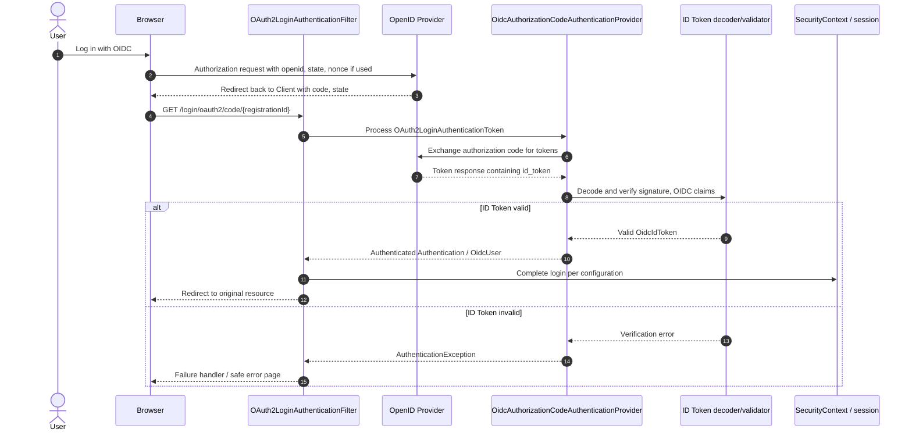
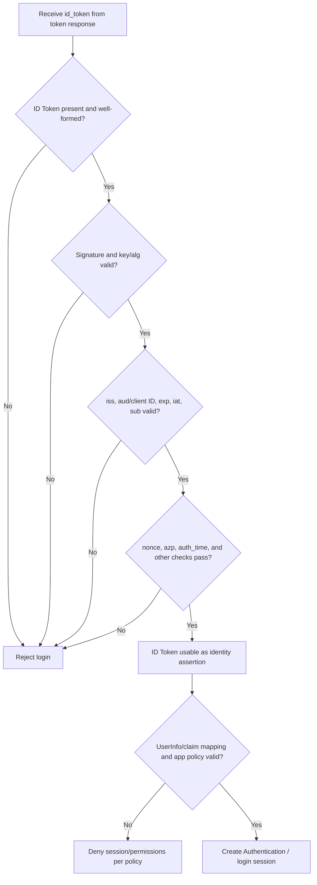

# 11.11. Handling ID Tokens with Invalid Signatures, Missing Claims, or Wrong Client

> **Module:** Spring Security OAuth 2.0 OIDC Client  
> **Chapter:** 11. ID Token Validation  
> **Scope:** OpenID Connect (OIDC) Authorization Code Login on Spring Security Servlet; handling an **ID Token that fails verification** due to an invalid signature/JWK, missing or invalid mandatory claims, or a token not issued for the Client performing login.

A Spring Boot application may complete the redirect to the OpenID Provider (OP), receive an authorization code, and successfully exchange the code at the Token Endpoint, yet **must still reject the login** if the received ID Token is invalid. An HTTP 200 from the Token Endpoint is not the final verdict on user identity.

Three critical failure categories are:

- **Invalid or unverifiable signature:** the Client cannot prove the ID Token was genuinely issued by a trusted OP and remains untampered.
- **Missing or invalid mandatory claims:** the ID Token lacks or violates required properties describing and bounding an authentication event.
- **Wrong Client:** the ID Token's `aud`/`azp` does not match the `client_id` of the receiving application, or it comes from a different issuer than configured.

The proper handling is **fail closed**: never construct `OidcUser` or a new authenticated session from unverified data; never downgrade to plain OAuth 2.0 Login; present only a safe error message to the user, log sanitized diagnostics, and allow restarting a valid transaction when appropriate.

## 1. Learning Objectives

After this lesson, you will be able to:

1. Distinguish **JWT decoding**, **signature verification**, **claims validation**, and **successful login**.
2. Name the mandatory ID Token claims per OIDC Core: `iss`, `sub`, `aud`, `exp`, `iat`.
3. Explain the roles of `nonce`, `azp`, `auth_time`, and conditional claims.
4. Identify why an ID Token with a valid signature must still be rejected if issuer or audience is wrong.
5. Describe the relationship between `ClientRegistration`, `client_id`, OP metadata, and JWK keys when validating an ID Token.
6. Understand Spring Security's OIDC processing path and where `OAuth2AuthenticationException`/authentication failures occur.
7. Write an `oauth2Login()` configuration with a failure handler that does not leak tokens or sensitive details.
8. Distinguish legitimate signing-key rotation from cases where token validity cannot be proven.
9. Build controlled negative test scenarios: forged signatures, missing `sub`/`aud`, wrong Client ID, expiration, and wrong nonce.
10. Design safe recovery flows without "skipping checks" to preserve login UX.

## 2. What Is an ID Token and Where Is It Used?

An ID Token is an identity assertion issued by the OP for the **Relying Party (RP)**, i.e., the client application. In OpenID Connect, an ID Token is usually a signed JWT containing claims stating the issuer, subject, audience, issuance/expiration times, and additional authentication metadata when requested.

In the Authorization Code Flow:

1. The browser is redirected to the OP with an authorization request containing the `openid` scope.
2. The OP authenticates the user and returns the browser to the Client with an authorization code.
3. Spring Security exchanges the code for tokens at the Token Endpoint.
4. The OIDC token response contains **`id_token`**.
5. **The Client verifies the ID Token** before treating user information as trustworthy.
6. Spring Security creates the `OidcUser` principal and login session if the entire process succeeds.

Key point to remember: an ID Token **is not an access token**.

| Artifact | Primary Recipient | Purpose |
|---|---|---|
| ID Token | Client / Relying Party | Verifies identity assertion from the OP |
| Access token | Resource Server / API | Grants permission to access protected resources |
| Authorization code | Token Endpoint via Client | Exchanged for tokens after authorization flow |
| Application session cookie | Browser and web app | Maintains application login state |

A JWT access token may contain `sub` and `iss`, yet that **does not make it an ID Token**. ID Token validation must use the right token type, right issuer, and right client ID.

## 3. Path of an ID Token in Spring Security Servlet

With `oauth2Login()` configured, Spring Security components handle each stage:



This diagram omits some intermediate layers. In real execution, Spring Security also validates the authorization request/response transaction, executes code exchange, may call UserInfo after the ID Token step, manages authorized clients, and applies the session strategy. Most importantly, **an invalid ID Token must cause the authentication flow to fail**, never entering the branch that creates a trusted principal.

### 3.1. Components Commonly Encountered

| Component | Responsibility |
|---|---|
| `ClientRegistration` | Defines `client-id`, `registrationId`, issuer/provider details, scopes, and Client settings |
| `OAuth2LoginAuthenticationFilter` | Receives callbacks and passes the request to `AuthenticationManager` |
| `OidcAuthorizationCodeAuthenticationProvider` | Handles OIDC Authorization Code flow, requires ID Token, invokes decoder and user service |
| `OidcIdTokenDecoderFactory` | Creates a decoder tailored to `ClientRegistration` to process ID Tokens via Spring Security mechanisms |
| `OidcUserService` | Creates `OidcUser` from the verified ID Token and UserInfo when appropriate |
| `OAuth2AuthenticationToken` | The `Authentication` normally stored in `SecurityContext` after successful login |
| Authentication failure handler | Handles login failures and sends a safe response to the browser |

Class names and wiring details may vary across versions; in Spring Security 6.x Servlet, this is a helpful mental model for finding the right extension point.

## 4. Two Verification Layers: Signature and Claims

For a JWS-signed JWT ID Token, the string typically takes the form:

```text
BASE64URL(header).BASE64URL(payload).BASE64URL(signature)
```

An illustrative payload **for reading comprehension**, not a signed JWT:

```json
{
  "iss": "https://login.example.test/realms/employees",
  "sub": "user-834",
  "aud": "employee-web",
  "exp": 1893459000,
  "iat": 1893455400
}
```

It is easy to Base64url-decode a JWT's header/payload even when the signature is invalid. **Successful decoding does not mean the data is trustworthy.**

Verification involves two groups of responsibilities:

**Group 1 — Cryptographic authenticity and integrity:** verify the accepted signature algorithm, trusted key source, valid signature, and `kid`/JWK handling per contract.

**Group 2 — Semantics and intended recipient:** verify `iss`, `sub`, `aud`, `exp`, `iat`, along with `nonce`, `azp`, `auth_time`, and other requirements when applicable.

A properly signed token **can still be rejected** because `aud` points to another Client. A token with the right `aud` **must still be rejected** if its signature cannot be verified. **Both groups** must pass before establishing identity.

## 5. Handling an ID Token with an Invalid Signature

### 5.1. Why Does the Signature Matter?

The signature lets the Client verify that the token was issued using a valid key of a trusted OP and that header/payload data has not been modified after signing.

If someone modifies:

```json
{
  "sub": "ordinary-user",
  "aud": "employee-web"
}
```

to:

```json
{
  "sub": "administrator",
  "aud": "employee-web"
}
```

without possessing the valid signing key, the JWS signature will no longer verify. The Client must reject the token instead of using `sub=administrator` to create a login session.

**Never** fix a signature verification failure by removing the verification step and only decoding the payload.

### 5.2. JWK Set URI and Trusted Key Sources

For OPs using asymmetric signatures such as RS256, the RP typically fetches public keys from the **JWKS (JSON Web Key Set)** published by the OP via trusted metadata.

The right chain of trust:

```text
ClientRegistration
  └── configured issuer-uri / trusted provider metadata
       └── OP's jwks_uri
            └── public key selected per matching alg/kid
                 └── verify ID Token signature
```

Never take `jku`/`x5u` or key URLs self-declared by an untrusted JWT header and download them from the Internet as a new key source without strict trust controls. Doing so can turn a forged token into a "valid" token when an attacker tricks the Client into verifying with a key supplied by the attacker.

Points to watch:

- `iss` in the ID Token must belong to the issuer expected by the Client.
- Keys must come from the source bound to the configured issuer/provider, never from an arbitrary issuer.
- Allowed signing algorithms must match metadata and Client policy.
- The `alg` header supplied by the token must never unilaterally select a weaker verification mechanism.
- `kid` usually assists key lookup; never treat `kid` alone as proof that a key is trustworthy.

### 5.3. Scenarios Causing Signature Failures

| Scenario | Symptom | Interpretation |
|---|---|---|
| Payload modified after signing | Signature verification fail | Token integrity broken |
| Client uses JWKS from another realm/tenant | No matching key found or invalid signature | Wrong issuer/provider configured |
| OP rotates keys while Client caches old JWKS | New `kid` not found; verification may fail | Requires safe JWKS refresh policy |
| Token uses a disallowed signing algorithm | Decoder rejects | Preserve allowlist and algorithm policy |
| `alg=none` outside accepted contract | No valid signature | Never let pass just because token "is readable" |
| Header has a `kid` missing from trusted JWKS | Cannot verify token | Never substitute an untrusted key |

**When signature verification fails:** halt login, create no authenticated session from that token, log a controlled error, and allow retrying the proper flow if appropriate.

### 5.4. Distinguishing Normal Key Rotation from Forged Tokens

An OP can rotate to signing with a new key. Upon seeing an unknown `kid`, the decoder or JWKS client library can execute its configured key-refresh mechanism. Distinguish clearly:

- **Valid case:** OP publishes the new key on its trusted JWKS URI; the token verifies successfully after cache refresh.
- **Invalid case:** the key is still missing from the trusted JWKS, the algorithm is anomalous, or the signature fails; the token must be rejected.

Never design "try every JWKS on the Internet" to rescue a login. Nor should you disable signature checks while an OP rotates keys. Operations should monitor rotation schedules, cache TTLs, and metadata/JWKS reachability, while **failing closed if unable to verify**.

## 6. Which Claims Are Mandatory in an ID Token?

Per OIDC Core, an ID Token has mandatory claims:

| Claim | Mandatory? | Meaning | Example |
|---|---|---|---|
| `iss` | Yes | Issuer that issued the ID Token | `https://login.example.test/realms/employees` |
| `sub` | Yes | User's subject identifier at the issuer | `user-834` |
| `aud` | Yes | One or more audiences; must contain the RP's client ID | `employee-web` |
| `exp` | Yes | Expiration time of the ID Token, NumericDate | `1893459000` |
| `iat` | Yes | Issuance time of the ID Token, NumericDate | `1893455400` |

Other claims can be **conditionally mandatory**:

| Claim | When Does It Matter? | Handling Principle |
|---|---|---|
| `nonce` | When the authorization request sent a nonce | ID Token must contain the nonce matching the saved request |
| `auth_time` | When the Client sent `max_age` or requested authentication time per OIDC | OP must supply it; Client evaluates freshness per policy |
| `azp` | When ID Token has multiple audiences or a separate authorized party | Validate per OIDC rules and Client policy |
| `acr` | When a specific authentication context level is required | Compare OP-asserted value against policy |
| `at_hash` | When present/required in the corresponding response type | Validate per OIDC rules for that specific flow |

There is no general OIDC requirement that every ID Token contain `email`, `name`, `picture`, `groups`, or `roles`. Those are profile/custom claims; omitting them may affect application logic, yet **does not mean a universally mandatory ID Token claim is missing**.

### 6.1. iss — Issuer Must Match

The issuer identifies the OP, usually declared via `issuer-uri` in Spring Boot:

```yaml
spring:
  security:
    oauth2:
      client:
        provider:
          corporate:
            issuer-uri: https://login.example.test/realms/employees
```

If an ID Token contains:

```json
{
  "iss": "https://login.example.test/realms/partners"
}
```

that is a different issuer. Even with the same hostname and OP software, two realms/tenants can be distinct trust entities. Never trim paths or compare only by domain to "make it match."

### 6.2. sub — Subject Identifier Must Exist and Be Valid

`sub` is the subject identifier issued by the OP. The Client should use the **(issuer, subject)** pair as its internal identity-linking key, rather than a bare `sub` or an unverified email.

If a token lacks `sub`, the Client lacks a standardized OIDC subject to identify the user. Never borrow `email`, `preferred_username`, or `userId` from an access token to fill in a missing mandatory claim and treat the login as valid.

### 6.3. aud — Audience Must Contain the Client ID

`aud` identifies which Clients are permitted to accept the ID Token. It can be a string or an array of strings.

Valid example for `client-id=employee-web`:

```json
{
  "aud": "employee-web"
}
```

Or:

```json
{
  "aud": ["employee-web", "another-authorized-client"]
}
```

Invalid example for Client `employee-web`:

```json
{
  "aud": "billing-web"
}
```

**Never** accept an ID Token just because `iss` and signature are valid if `aud` omits the application's client ID. This prevents **token substitution / audience confusion**: a real token issued by the OP for Client A being presented to Client B.

### 6.4. exp and iat — Are the Timestamps Valid?

`exp` and `iat` use NumericDate in Unix epoch seconds:

- `exp`: token must not be used after expiration (a small configured clock skew may apply).
- `iat`: states when the token was issued; missing or wrong type is an OIDC structural error.
- OP and Client need reasonably synchronized system clocks; never fix time errors by disabling `exp` checks altogether.
- An unexpired token does not automatically mean the user just re-authenticated; check `auth_time` when policy requires recency.

For instance, an already-past `exp` must be rejected even when signature and audience are valid.

### 6.5. Missing Profile Claims Are Not Always ID Token Errors

An ID Token containing only mandatory claims can still be OIDC-valid. When an application needs an email address to register an internal account:

1. Verify the ID Token first.
2. Read needed claims from ID Token / UserInfo per scopes and OP contract.
3. Verify UserInfo's `sub` matches the ID Token's `sub`.
4. If business-required profile data is still missing, stop the **provisioning / account-creation flow per application policy**, rather than misreporting it as "invalid token signature."
5. Trust `email_verified` or similar claims only per OP contract and policy; do not infer verification from the email domain.

## 7. ID Token for the Wrong Client: aud and azp

This is a high-severity security failure because the token can be completely validly signed yet **not intended for the current RP**.

### 7.1. Example of Two Clients on One OP

Suppose the same OP has two registrations:

| Registration | Client ID | Role |
|---|---|---|
| `portal` | `employee-portal` | Employee web portal |
| `reports` | `reports-dashboard` | Reporting dashboard |

Token issued for `reports-dashboard`:

```json
{
  "iss": "https://login.example.test/realms/employees",
  "sub": "user-834",
  "aud": "reports-dashboard",
  "exp": 1893459000,
  "iat": 1893455400
}
```

Client `employee-portal` **must not** use this ID Token to create a session, even though it may be the same user at the OP. The current RP must require `aud` to contain `employee-portal`.

### 7.2. azp — Authorized Party

When an ID Token contains multiple `aud` values, OIDC Core recommends checking for `azp`'s presence; when `azp` is present, the Client must verify that its value matches its own `client_id` per OIDC rules.

Example:

```json
{
  "iss": "https://login.example.test/realms/employees",
  "sub": "user-834",
  "aud": ["employee-portal", "reports-api"],
  "azp": "employee-portal",
  "exp": 1893459000,
  "iat": 1893455400
}
```

Here, `azp` identifies the authorized party matching `employee-portal`. If a token carries `azp=other-web-client`, the application must not ignore the mismatch merely because `aud` contains its ID.

Exact `azp` handling must follow OIDC Core and the security policy/validator of the framework version in use. Never inject `azp` into a token or strip the claim to "fix" an OP issue.

### 7.3. Confusing Access Token Audience

A Resource Server might receive an access token:

```json
{
  "aud": "orders-api",
  "scope": "orders.read"
}
```

That audience targets an API, **not** a web RP's client ID. Never use an access token with `aud=orders-api` as an ID Token for `employee-portal`.

Keep them separate:

- ID Token audience → Client / Relying Party;
- Access token audience → Resource Server or intended target per token policy;
- `client_id` → Client identifier assigned in registration.

### 7.4. Never Fix Audience Errors by Removing the Validator

If `client-id` is misconfigured compared to the OP, fix it by aligning the registration and Client record at the OP. If the token was genuinely issued for another Client, the right action is to **reject** that token. Configuring "accept any audience" in a login client is not an operational solution.

## 8. nonce: Preventing Reuse Outside the Intended Transaction

In OIDC, `nonce` binds the ID Token to the authentication request when the Client sent a nonce. In the Authorization Code flow, nonce can be used to strengthen protection against replay and transaction mix-ups; other OIDC flows have their own mandatory rules.

Sequence:

1. Client generates a nonce for the login transaction.
2. Authorization request sends the nonce value or appropriate representation per framework mechanism.
3. Client stores the nonce context to verify upon receiving the token.
4. OP includes the matching `nonce` claim in the ID Token when requested.
5. Client checks that the `nonce` claim matches the saved value before accepting login.

For example, the received ID Token contains:

```json
{
  "nonce": "nonce-of-another-login"
}
```

while the pending transaction expects a different nonce. Even with a valid signature and matching `aud`, this token **must not be treated as the result of the current transaction**.

### 8.1. state and nonce Are Not the Same

| Parameter | Where Does It Appear / Apply? | Role |
|---|---|---|
| `state` | Authorization request and callback | Binds authorization response to request; prevents CSRF and transaction mix-ups |
| `nonce` | OIDC authentication request and ID Token | Binds identity assertion to the corresponding OIDC request |
| PKCE `code_verifier` / `code_challenge` | Authorization request and Token Endpoint | Prevents authorization codes from being redeemed by parties lacking the verifier |

Never take a token with a mismatched nonce and "manually create a session" just because `state` matched. These defense layers mitigate distinct risks.

### 8.2. Nonce Failures Can Originate in the Application

If an application writes a custom `OAuth2AuthorizationRequestResolver` that drops attributes or fails to persist authorization requests properly, nonce matching can fail even when the OP has no bugs. Inspect transaction creation/storage and callbacks rather than disabling nonce validation.

## 9. auth_time and Authentication Freshness

When a Client sends `max_age` in an OIDC Authentication Request, the OP must include `auth_time` in the ID Token per OIDC Core. Certain `claims` requests can also require this field.

For example, the Client requires the user to have authenticated within the last 5 minutes:

```text
max_age=300
```

The returned result may contain:

```json
{
  "auth_time": 1893455700,
  "iat": 1893455760,
  "exp": 1893459360
}
```

**Distinction:**

- `iat` is when the ID Token was issued.
- `auth_time` is when the OP reports the user authenticated.
- `exp` is when the ID Token expires.

The application must specify which validator/policy checks `auth_time` and enforces freshness limits when required by business logic. A valid signature and recent `iat` do not prove the user just entered fresh credentials.

If `auth_time` is missing despite the Client sending `max_age`, the result fails the requested OIDC condition. Never ignore this claim when deciding whether to allow sensitive operations.

## 10. Order of Trust: Never Trust Claims Before the Token Is Validated

Some applications attempt to read `email` or `roles` from the JWT payload as soon as the Token Endpoint responds, verifying the signature only afterward. That order is wrong.

Conceptually, the right flow is:



This is a logical model, not the exact method call sequence of every Spring Security version. Rely on the library for cryptographic and OIDC validation instead of building a custom validator from the diagram.

### 10.1. Why Must We Fail Closed?

Skipping any of the three categories causes failures:

- **Skipping signature:** an attacker can forge identity inside the payload.
- **Skipping mandatory claims:** the application lacks standard data stating who issued the token, who it is for, and when it expires.
- **Skipping audience:** an attacker can replay a valid ID Token from Client A into Client B.

Whenever token validity cannot be proven, **never create an authenticated session from that token**. Distinguish an already-existing older session from an **invalid new login attempt**; design clearly how existing sessions are kept, cleared, or isolated per policy so a callback failure never unexpectedly leaves an incorrect authentication state.

## 11. Configuring OIDC Login in Spring Boot

A basic Servlet configuration:

```yaml
server:
  port: 8080

spring:
  security:
    oauth2:
      client:
        registration:
          employee:
            provider: employee-op
            client-id: employee-portal
            client-secret: ${EMPLOYEE_OIDC_CLIENT_SECRET}
            authorization-grant-type: authorization_code
            redirect-uri: "{baseUrl}/login/oauth2/code/{registrationId}"
            scope:
              - openid
              - profile
              - email
        provider:
          employee-op:
            issuer-uri: http://localhost:9000/realms/employees
```

The localhost address above illustrates a lab OP; real applications use HTTPS and the issuer published by the OP. Register the corresponding redirect URI `/login/oauth2/code/employee` and exact Client ID at the OP.

Key properties:

- `registration.employee`: Spring Security registration ID; appears in the login URL `/oauth2/authorization/employee`.
- `client-id: employee-portal`: value used to validate **ID Token audience**.
- `provider.employee-op.issuer-uri`: expected issuer and OP metadata source.
- `scope: openid`: triggers OIDC, not plain OAuth 2.0 Login fetching profile via API.
- `client-secret`: confidential Client credential at the Token Endpoint; it does **not** replace ID Token signature verification.

### 11.1. SecurityFilterChain

```java
import org.springframework.context.annotation.Bean;
import org.springframework.context.annotation.Configuration;
import org.springframework.security.config.Customizer;
import org.springframework.security.config.annotation.web.builders.HttpSecurity;
import org.springframework.security.web.SecurityFilterChain;

@Configuration
class WebSecurityConfiguration {

    @Bean
    SecurityFilterChain webSecurityChain(HttpSecurity http) throws Exception {
        return http
            .authorizeHttpRequests(auth -> auth
                .requestMatchers("/", "/login", "/error").permitAll()
                .anyRequest().authenticated()
            )
            .oauth2Login(Customizer.withDefaults())
            .build();
    }
}
```

When no custom OIDC behavior is needed, use Spring Security defaults. Never replace ID Token processing with manual `Base64.getDecoder()` or `parseClaimsWithoutVerify()`.

### 11.2. Do Not Confuse Client Secret and ID Token Signing Key

Two distinct types of credentials:

| Secret / Key | Who Owns It? | What Is It Used For? |
|---|---|---|
| Client secret | RP/Client and Authorization Server | Client authentication at Token Endpoint per registered method |
| OP private signing key | OP | Signs ID Tokens |
| Public verification key / JWK | Client fetches from trusted OP source | Verifies ID Token signature |

If the client secret is wrong, failure happens right at token exchange (e.g., `invalid_client`). If token exchange succeeds yet the ID Token signature is wrong, failure happens at ID Token verification. Never troubleshoot signature errors by randomly changing the client secret.

## 12. Failure Handler: Report Errors Safely Without Leaking Tokens

Spring Security supports `AuthenticationFailureHandler` so the application controls how to respond on login failure. Example redirecting users to a generic notice page:

```java
import jakarta.servlet.http.HttpServletRequest;

import org.springframework.context.annotation.Bean;
import org.springframework.context.annotation.Configuration;
import org.springframework.security.config.annotation.web.builders.HttpSecurity;
import org.springframework.security.web.SecurityFilterChain;

@Configuration
class OidcFailureHandlingConfiguration {

    @Bean
    SecurityFilterChain securityFilterChain(HttpSecurity http)
            throws Exception {

        return http
            .authorizeHttpRequests(auth -> auth
                .requestMatchers("/", "/login", "/error").permitAll()
                .anyRequest().authenticated()
            )
            .oauth2Login(oauth2 -> oauth2
                .failureHandler((request, response, exception) -> {
                    // Never expose exception.getMessage() or raw tokens to the browser.
                    String redirect = request.getContextPath()
                        + "/login?error";
                    response.sendRedirect(redirect);
                })
            )
            .build();
    }
}
```

This snippet **replaces** the `SecurityFilterChain` config in section 11; do not declare both beans with overlapping matchers. `/login?error` may be the default login page or a custom UI depending on app configuration; in production, provide a clear error page exposing no internal details.

**Never** display raw `exception.getMessage()`, full tokens, `Authorization` headers, or JWKS responses to end users. Exception text can vary across library versions and sometimes includes technical details unfit for external exposure.

### 12.1. Categorizing Errors for Operations

In environments with logging/monitoring, you can record a normalized error label:

| Observation Group | Example | Action |
|---|---|---|
| `oidc_signature_failure` | Signature verify fail / no matching key | Reject; check issuer/JWKS/rotation |
| `oidc_missing_required_claim` | Missing `sub` or `aud` | Reject; check OP and contract |
| `oidc_audience_mismatch` | `aud` lacks Client ID | Reject; check registration and token |
| `oidc_issuer_mismatch` | `iss` differs from expected issuer | Reject; check realm/tenant |
| `oidc_expired_or_time_invalid` | Expired token or invalid time claim | Reject; check clocks and policy |
| `oidc_nonce_mismatch` | Nonce mismatches authorization request | Reject; check transaction/session |
| `oidc_provider_unavailable` | Unable to reach trusted metadata/JWKS | Reject unverified tokens; investigate infrastructure |

These are **application-defined observation labels**, not a list of error codes Spring Security guarantees to emit verbatim. An internal error may be wrapped in `OAuth2AuthenticationException` with different error codes depending on where it arose.

Log enough sanitized context for diagnosis:

```text
event=oidc_login_failure
registrationId=employee
category=oidc_audience_mismatch
correlationId=<opaque-internal-id>
issuerConfigured=https://login.example.test/realms/employees
loginSessionCreated=false
```

Never log raw ID Tokens, access tokens, refresh tokens, nonces, authorization codes, or cookies. Even for `sub` and email, log only when truly required under organizational data policies.

### 12.2. Should the Application Auto-Retry Login?

You may let users retry with a **fresh authorization request**, while avoiding:

- Infinite loops: callback fails and immediately redirects to the OP forever.
- Reusing the same authorization code: codes are single-use.
- Accepting an old invalid token.
- Falling back to plain OAuth2 Login when the ID Token fails.
- Changing issuer or removing audience validation just because login fails.

For recoverable key-rotation issues, the system can rely on the library's JWKS refresh mechanism and **attempt safe verification** per policy. If verification still fails, login must fail; users should only start a new transaction once the underlying issue is fixed or via a safe recovery path.

## 13. Why Must You Never Fall Back to Plain OAuth2 Login?

In Spring Security Servlet, `OidcAuthorizationCodeAuthenticationProvider` handles OAuth2 Login requests with the `openid` scope. If the ID Token is missing or invalid, the OIDC provider must raise an error; never switch to `OAuth2LoginAuthenticationProvider` to use only the access token and UserInfo as a successful login.

Reasons:

1. The Client initiated an **OIDC authentication request** expecting a valid ID Token.
2. Signature/audience/issuer failures represent failure to verify the **core identity assertion**.
3. Switching to plain OAuth2 profile retrieval downgrades the initial trust guarantees.
4. An attacker could deliberately trigger an ID Token error to force a weaker path if the application implements an unsafe fallback.

An application may **separately support** OAuth2 Login for a non-OIDC provider under an explicit contract, yet that is a **pre-designed registration/flow**, never a rescue path when OIDC validation fails.

## 14. Handling Wrong-Issuer Tokens and Tenant Errors

Suppose an OP serves two realms:

```text
https://login.example.test/realms/employees
https://login.example.test/realms/partners
```

Each realm may have a distinct issuer, key set, policy, and user identifiers. If a Client is configured for the `employees` issuer yet receives a token with the `partners` issuer, it must reject that token.

### 14.1. Never Compare Hostnames Alone

Compare:

- Wrong: `iss.startsWith("https://login.example.test")`.
- Sound in principle: validate the configured issuer **according to OIDC rules and trusted metadata**, matching the exact value for that registration.

Valid tokens from two issuers can share the same `sub` while representing completely different people. Key internal identity on **(iss, sub)**, never `sub` alone.

### 14.2. Multi-Provider Setups and Login Mix-Up

If an application has multiple `ClientRegistration`s, each authorization request must stay bound to its registration and OP. After callback, never try every issuer/key until "some" issuer accepts the token.

The right processing path is:

1. Identify the registration tied to the original authorization transaction.
2. Use the issuer/JWKS of **the provider registered for that transaction**.
3. Validate the ID Token against that Client ID.
4. Reject if checks fail, even if the token would be valid for another registration.

This is why protecting `state`, redirect endpoints, and authorization request storage is essential.

## 15. Missing Claims Fall into Two Distinct Categories

Not every missing claim represents the same type of failure. Separate them:

### 15.1. Missing Mandatory OIDC Claim

Example:

```json
{
  "iss": "https://login.example.test/realms/employees",
  "aud": "employee-portal",
  "exp": 1893459000,
  "iat": 1893455400
}
```

`sub` is missing. This is **not** a complete ID Token per OIDC Core. Never substitute an arbitrary profile field to allow login.

Likewise, missing `aud`, `iss`, `exp`, or `iat` is an ID Token structural/validation failure; reject per OIDC rules.

### 15.2. Missing Business or Optional Claim

For example, an otherwise valid ID Token lacks:

```json
{
  "email": "person@example.test",
  "groups": ["staff"],
  "roles": ["EDITOR"]
}
```

This alone **does not** prove the ID Token is invalid. The OP may omit those claims, or serve them from the UserInfo Endpoint under separate scopes/policies.

If the system needs `groups` for authorization, set an explicit rule: without trusted data granting a permission, **do not grant that permission**. If a verified email is required to open an account, never use an unverified email as the sole identifier. Present a profile-completion step or reject registration per policy.

### 15.3. Why Distinguish the Two?

If you label every missing `email` as "invalid ID Token," developers may waste time debugging signatures/JWKS when the real issue is scopes or claim mapping. Conversely, if `sub` is missing and the app thinks "just missing profile info," creating a session for an unidentified subject is a severe flaw.

Guidance table:

| Missing Claim | Classification | Recommended Handling |
|---|---|---|
| `iss` | Invalid ID Token | Reject authentication |
| `sub` | Invalid ID Token | Reject authentication |
| `aud` | Invalid ID Token | Reject authentication |
| `exp` | Invalid ID Token | Reject authentication |
| `iat` | Invalid ID Token | Reject authentication |
| `nonce` when sent in request | Violates OIDC binding | Reject authentication |
| `auth_time` when `max_age` sent | Fails OIDC freshness requirement | Do not accept that authentication assertion |
| `email` | Missing profile information | Apply profile policy; never auto-grant privileges |
| `groups`/`roles` | Missing authorization data | Do not grant authorities depending on that data |

## 16. Customizing ID Token Validation: Only with Clear Requirements

Spring Security already provides OIDC login handling and ID Token validation. Customization may be needed when an organization enforces extra policy, such as requiring a custom claim committed by the OP. However, **never replace default validators with a weaker validator**.

### 16.1. Low-Level Extension Points

One relevant class is `OidcIdTokenDecoderFactory`, which builds JWT decoders per `ClientRegistration`. It exposes configuration hooks for JWS algorithms and validators depending on version.

Recommendations when going deeper:

- Prefer letting Spring Security build and verify ID Tokens per configured issuer/`ClientRegistration`.
- When extra policy is required, **compose** your validator with standard validation — never replace signature, issuer, audience, or expiration checks.
- Configure only signing algorithms approved by the OP/Client security contract.
- Check the exact API reference for your version before altering `JwtDecoderFactory<ClientRegistration>`.
- When customizing a decoder per Client, ensure it uses metadata/JWKS **bound to that Client's trusted issuer**.

**Never use code like the following in production:**

```java
// UNSAFE - anti-pattern example.
String payload = decodeBase64Url(idToken.split("\\.")[1]);
String userId = parseJson(payload).get("sub");
createSession(userId); // Skips signature, issuer, audience, exp, nonce!
```

A JWT with a readable payload can still be completely forged. This snippet is intentionally labeled **unsafe** to highlight the mistake; never deploy it.

### 16.2. Checking Additional Policies After Verification

Once the ID Token has been verified by the library and you receive `OidcUser`, you can enforce business policies using claims trusted under the OP contract.

For example, an endpoint reading the authenticated user:

```java
import org.springframework.security.access.prepost.PreAuthorize;
import org.springframework.security.core.annotation.AuthenticationPrincipal;
import org.springframework.security.oauth2.core.oidc.user.OidcUser;
import org.springframework.web.bind.annotation.GetMapping;
import org.springframework.web.bind.annotation.RestController;

@RestController
class ProfileController {

    @GetMapping("/me")
    String me(@AuthenticationPrincipal OidcUser user) {
        return user.getSubject();
    }
}
```

This endpoint only reads an `OidcUser` already established by Spring Security. It **does not** replace ID Token validation or provide business authorization. For endpoints requiring roles, configure `authorizeHttpRequests()` / method security and explicit authority mapping.

If the system also supports non-OIDC OAuth2 Login, controllers must handle the appropriate principal types rather than assuming every user is an `OidcUser`.

## 17. Symptom-Based Diagnostic Workflow

When the application reports an OIDC authentication failure, isolate which step failed before changing configuration.

### 17.1. Failures Before Receiving the ID Token

| Symptom | Where to Check |
|---|---|
| Cannot redirect to OP | Authorization endpoint, registration, HTTP Security, redirect |
| OP rejects callback URL | Registered Redirect URI at the OP |
| `invalid_client` when exchanging code | Client ID/secret and Token Endpoint client authentication method |
| `invalid_grant` when exchanging code | Authorization code, redirect, state/PKCE, and grant binding |
| OIDC response lacks `id_token` | Whether OP supports OIDC, `openid` scope, and token response contract |

These errors can fail login **before** signature verification. Do not lump every `oauth2Login()` error under "ID Token signature invalid."

### 17.2. Failures at the ID Token Verification Step

| Symptom | What to Inspect |
|---|---|
| Signature cannot be verified | Algorithm, JWKS URI, key rotation, issuer/tenant |
| Key not found by `kid` | JWKS cache/rotation and trusted key source |
| Missing `iss`/`sub`/`aud`/`exp`/`iat` | Whether OP returns an OIDC Core compliant ID Token |
| `iss` differs from expected | `issuer-uri`, realm/tenant, reverse proxy config |
| `aud` lacks client ID | Registration `client-id` and which Client the token was issued for |
| `azp` mismatches | OIDC rules for multiple audiences / authorized party |
| `exp` expired | OP/Client clocks, clock skew, token issuance time |
| `nonce` mismatches | Authorization request, session/repository storing nonce, callback correlation |
| `auth_time` too old or missing when required | `max_age`, OP behavior, and reauthentication policy |

Never "disable validators one by one" to see if login passes in a real application. Test hypotheses using controlled mock providers / test fixtures without weakening production policies.

## 18. Safe Lab Experiments with Invalid ID Tokens

The goal of these exercises is to **observe authentication fail in the right place**, never to attack an external OP. Use a local OP, a dedicated test tenant, or an approved mock OIDC provider.

### Lab A — Invalid Signature

**Setup:** a mock OP capable of issuing tokens signed with a key outside the Client's trusted JWKS, or generating an ID Token fixture with an invalid signature. Never use real user ID Tokens.

**Steps:**

1. Initiate a valid OIDC Code flow in the lab.
2. Have the test Token Endpoint return an ID Token whose payload/claims look valid yet whose signature fails verification against the trusted OP's keys.
3. Observe Spring Security refusing to complete login.
4. Verify the failure handler redirects to the generic error page.
5. Confirm no **new authenticated session was created from the invalid ID Token**.
6. Restore valid signing on the mock OP to compare successful behavior.

**Expected result:** an invalid signature causes authentication failure even when the payload has valid `iss`, `sub`, `aud`, `exp`, `iat`.

**Question:** why is changing the payload from `sub=user` to `sub=admin` without re-signing rejected?

### Lab B — Missing Mandatory Claim

**Setup:** a mock OP capable of issuing properly signed JWT fixtures missing one OIDC claim.

**Variants:**

- Missing `sub`.
- Missing `aud`.
- Missing `iss`.
- Missing `exp`.
- Missing `iat`.

**Steps:**

1. Run a valid flow as a baseline.
2. Have the mock OP return one missing-claim variant at a time, keeping other claims and the signature valid.
3. Observe OIDC validation / the failure handler.
4. Compare against a variant **without `email`** while retaining all mandatory claims.
5. Record the error category and team conclusions without logging raw JWTs.

**Expected result:** missing mandatory claims must cause rejection; missing `email` may be handled as a profile/provisioning policy issue.

**Question:** why must `email` not be used to replace `sub`?

### Lab C — ID Token for the Wrong Client

**Setup:** two Clients `web-a` and `web-b` on the same test OP, each with its own client ID.

**Steps:**

1. Use `web-a`'s registration to start OIDC login.
2. In the controlled mock OP, return a validly signed ID Token with `aud=web-b`.
3. Observe `web-a` rejecting the login.
4. Test a token with `aud=["web-a","another-client"]` with matching vs. mismatched `azp` per the OIDC rules under test.
5. Restore `aud=web-a` and complete a valid flow.

**Expected result:** a valid signature is not enough. Audience must contain the receiving Client's client ID; `azp` must be verified when applicable.

**Question:** why does sharing the same OP/JWKS not allow two Clients to freely share ID Tokens?

### Lab D — Different Issuer / Realm

**Setup:** two controlled issuers: `/realms/employees` and `/realms/partners`, or two mock OPs with distinct metadata.

**Steps:**

1. Configure registration `employee` pointing to the `employees` issuer.
2. Have the test token response return an ID Token from the `partners` issuer or with a wrong `iss`.
3. Observe the Client rejecting the token.
4. Inspect client registration and metadata, confirming no automatic fallback to `partners`.
5. Restore tokens from the `employees` issuer.

**Expected result:** issuer is part of identity and trust boundaries; never compare hostname alone.

### Lab E — Expired Token and Wrong Nonce

**Setup:** a mock OP capable of issuing tokens with `exp` in the past or a nonce mismatched with the authentication request.

**Steps:**

1. Perform a valid login as a baseline.
2. Return an expired token with a valid signature; confirm the Client rejects it.
3. Start a new request with a nonce, then have the mock return an ID Token carrying a different nonce; confirm rejection.
4. Retry with matching nonce and unexpired token.
5. Record only pass/fail results and redacted metadata.

**Expected result:** a valid signature does not waive time validity or transaction binding.

### Lab F — Valid Key Rotation

**Setup:** a mock OP capable of publishing two JWKs under a rotation policy; the Client fetches JWKS from the configured source.

**Steps:**

1. Log in with a token signed by key A; confirm success.
2. Add key B to the trusted JWKS and have the OP sign new tokens with B.
3. Observe the decoder refreshing keys/cache and verifying the token.
4. Test a token signed with key C **not published by the OP** and confirm rejection.
5. Never skip signature verification at any step.

**Expected result:** valid rotation is supported via JWKS metadata/caching; tokens unverifiable from trusted sources remain rejected.

## 19. Designing Automated Tests

At the unit/integration test level, include these test groups:

| Test Group | Input | Expected Outcome |
|---|---|---|
| Valid OIDC code flow | Validly signed ID Token, matching claims and Client | Login succeeds |
| Bad signature | Tampered payload/signature or signed with wrong key | Login failure |
| Unknown signing key | `kid` unverifiable from trusted JWKS | Login failure |
| Issuer mismatch | `iss` differs from registered issuer | Login failure |
| Wrong audience | `aud` lacks client ID | Login failure |
| Missing `sub` | Validly signed token missing subject | Login failure |
| Missing `exp` | Token missing expiration | Login failure |
| Expired token | Past `exp` | Login failure |
| Wrong nonce | Nonce mismatches request | Login failure |
| Missing business claim | Valid ID Token lacking group/email needed by business logic | Internal policy denies access or requests profile completion |
| JWK rotation | New key present in trusted JWKS | Verification succeeds per cache policy |
| OP unreachable | Cannot fetch metadata/JWKS when needed | Unverified token is not accepted |

When testing, you can use a mock OP or mock decoder at the right layer, yet there must be **at least one integration test layer** exercising real verification. Mocking the entire decoder to always return "success" cannot catch algorithm, JWKS, or audience bugs.

Some tests may need to control the clock for `exp`/`iat`; use fixtures with explicit NumericDate values rather than relying on hardcoded real-world timestamps. Ensure test code never prints real tokens to the console.

## 20. Log Security, Metrics, and Incident Response

An ID Token failure may indicate an accidental misconfiguration or a token-substitution attempt. Maintain enough observability for operations without exposing sensitive data.

**Should log:**

- Registration ID (e.g., `employee`).
- Normalized error category (e.g., `oidc_audience_mismatch`).
- Timestamp and internal correlation ID.
- **Configured** issuer and environment if non-sensitive.
- Authentication success/failure status.
- Aggregate error-rate metrics per deployment and provider.

**Should not log:**

- Full ID Tokens / Access Tokens / Refresh Tokens.
- Authorization codes, PKCE verifiers, nonces, or states.
- Client secrets or HTTP Basic credentials.
- Session cookies.
- Full payloads containing emails, groups, personal data, or sensitive custom claims.

In production, if signature errors suddenly spike across many accounts on one issuer, inspect JWKS/cache issues or scheduled key rotations. If audience errors spike on only one registration after a deployment, check client ID and OP settings. If issuer errors spike on a tenant, check realm/metadata mappings and reverse proxy changes.

**Never remove validators while troubleshooting an incident.** Use a lab environment and trusted metadata to reproduce the issue.

## 21. Common Misconceptions

| Misconception | Correct Understanding |
|---|---|
| "If the payload decodes, the JWT is valid." | Decoding does not verify signature, issuer, or audience. |
| "A valid signature is enough to log in." | You must also validate claims, issuer, client ID, timestamps, and transaction bindings. |
| "Same OP means all Clients share ID Tokens." | An ID Token must target a Client whose ID is in `aud`, plus `azp` rules when applicable. |
| "`email` is enough; `sub` isn't needed." | `sub` is mandatory in OIDC; email can be missing, changed, or unverified. |
| "Missing `email` proves the ID Token is invalid." | Not a universally mandatory claim; apply profile policy separately. |
| "If signature fails, switch to the UserInfo API to log in." | Never downgrade OIDC authentication after rejecting an ID Token. |
| "If `kid` isn't found, trust a key inside the token header." | Keys must come from the trusted JWKS/issuer source. |
| "Disable signature verification briefly during key rotation." | Always verify with new keys from the trusted source or fail closed. |
| "Valid client secret means valid ID Token signature." | Client auth at the token endpoint and OP signing are separate mechanisms. |
| "An access token with `sub` can replace an ID Token." | Access tokens serve APIs, not identity assertions for the RP. |
| "An unexpired ID Token means the user just authenticated." | `exp` does not prove recency; use `auth_time` when required. |
| "Change issuer or client ID to accept the incoming token." | Config must reflect true registration and trust boundaries; never loosen it to accept wrong-target tokens. |

## 22. Self-Check Questions

**Q1.** Why shouldn't you run `Base64URL.decode(payload)` and read `sub` to log a user in?

*Hint:* lacks signature verification and OIDC claims/binding checks.

**Q2.** If an ID Token has a valid signature from the right OP yet `aud=another-client`, what must the current Client do?

*Hint:* reject it; the token was issued for another recipient.

**Q3.** Which claims are mandatory in an ID Token per OIDC Core?

*Hint:* `iss`, `sub`, `aud`, `exp`, and `iat`.

**Q4.** How do a missing `email` and a missing `sub` differ?

*Hint:* an optional profile claim versus a mandatory subject-identifier claim.

**Q5.** If the OP just rotated its signing key, should you accept tokens with unverified signatures to preserve login UX?

*Hint:* no; verify via trusted JWKS or fail closed.

**Q6.** Why shouldn't you use an arbitrary JWKS URL appearing in a token header as a trusted key source?

*Hint:* an attacker can point to keys they control.

**Q7.** Can `iat` substitute for `auth_time` when the Client requests `max_age`?

*Hint:* no; they represent two different timestamps.

**Q8.** How do `state` and `nonce` differ in role?

*Hint:* one binds the authorization callback, while the other binds the ID Token assertion to the authentication request.

**Q9.** What should a failure handler display when an ID Token has the wrong audience?

*Hint:* a generic login failure message; sanitized technical details belong in secure telemetry.

**Q10.** Why not fall back to plain OAuth2 Login when the OIDC ID Token is missing or invalid?

*Hint:* that downgrades the authentication standard the Client requested.

## 23. Notes on Versions and Application Responsibilities

Spring Security provides multiple OIDC validation layers by default, yet **you must not assume every organizational security/business policy is part of the library defaults**. For example:

- Validating OIDC signature, issuer, and audience is part of the standard authentication flow.
- Requiring MFA, tenant membership, or internal roles requires corresponding application configuration and policies.
- Recent authentication via `max_age` requires explicitly handling `auth_time` checks and assurance levels per version/design.
- Multiple registrations or issuers require selecting the key source and client ID bound to the exact authorization transaction.
- A failure handler does not replace a validator; it only controls the response after a failure occurs.

When customizing decoders or upgrading Spring Security versions, read the exact API reference — especially for `OidcIdTokenDecoderFactory`, `OidcAuthorizationCodeAuthenticationProvider`, `OidcUserService`, and `oauth2Login()`. A configuration snippet valid in one library branch may not map identically to later branches.

## 24. References

- [OpenID Connect Core 1.0 — ID Token](https://openid.net/specs/openid-connect-core-1_0.html#IDToken): mandatory and conditional claims.
- [OpenID Connect Core 1.0 — ID Token Validation](https://openid.net/specs/openid-connect-core-1_0.html#IDTokenValidation): issuer, audience, azp, signature, timestamps, and nonce.
- [OpenID Connect Discovery 1.0](https://openid.net/specs/openid-connect-discovery-1_0.html): OP metadata, issuer, and `jwks_uri`.
- [RFC 7515 — JSON Web Signature (JWS)](https://www.rfc-editor.org/rfc/rfc7515): signature mechanism and JOSE header fields.
- [RFC 7517 — JSON Web Key (JWK)](https://www.rfc-editor.org/rfc/rfc7517): key format used in JWKS.
- [RFC 7519 — JSON Web Token (JWT)](https://www.rfc-editor.org/rfc/rfc7519): claims and NumericDate representation.
- [Spring Security — OAuth 2.0 Login](https://docs.spring.io/spring-security/reference/servlet/oauth2/login/index.html): Servlet/OIDC login.
- [Spring Security — Advanced OAuth 2.0 Login](https://docs.spring.io/spring-security/reference/servlet/oauth2/login/advanced.html): token/user service configuration points and login handling.
- [Spring Security API — OidcAuthorizationCodeAuthenticationProvider](https://docs.spring.io/spring-security/reference/api/java/org/springframework/security/oauth2/client/oidc/authentication/OidcAuthorizationCodeAuthenticationProvider.html): ID Token handling in OIDC Code flow.
- [Spring Security API — OidcIdTokenDecoderFactory](https://docs.spring.io/spring-security/reference/api/java/org/springframework/security/oauth2/client/oidc/authorization/OidcIdTokenDecoderFactory.html): creating decoders and configuring ID Token checks.
- [RFC 9700 — OAuth 2.0 Security Best Current Practice](https://www.rfc-editor.org/rfc/rfc9700): relevant OAuth/OIDC security principles.

**Conclusion:** An ID Token has value as authentication evidence only when **its signature is verified from a trusted key source**, **mandatory OIDC claims and transaction conditions are valid**, and **the audience/authorized party matches the client ID performing login**. Each failure belongs to a different security boundary, yet all require rejecting authentication when validity cannot be proven. With Spring Security, keep default verification intact, handle failures safely, and fix OP/Client configuration rather than loosening validators to let login pass.
