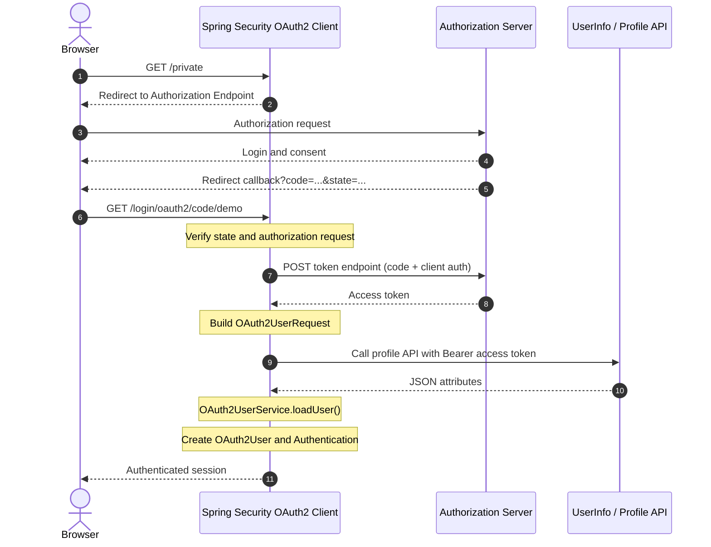

# 12.1. OAuth2UserService and DefaultOAuth2UserService

## 1. The Problem: After Obtaining an Access Token, How Does the Application Know Who the User Is?

When a **Spring Security OAuth 2.0/OIDC Client** application uses the Authorization Code Grant, the authorization code exchange step at the token endpoint can bring back an access token. For **non-OpenID Connect OAuth2 Login**, the access token is typically used to fetch the user profile from an API published by the provider. Spring Security needs to convert that data into a **principal** for the login session.

For example, the application calls a UserInfo/Profile API:

```http
GET /v1/me HTTP/1.1
Host: api.partner.example.net
Authorization: Bearer ACCESS_TOKEN_VALUE
Accept: application/json
```

The provider returns JSON:

```json
{
  "id": "account-214",
  "login": "example-user",
  "display_name": "Example User",
  "email": "user@example.net",
  "avatar_url": "https://cdn.example.net/avatar/214.png"
}
```

Two central components:

- **`OAuth2UserService<R, U>`** is the contract for loading or building a user from an OAuth2 user request.
- **`DefaultOAuth2UserService`** is the built-in implementation that uses the access token to send an HTTP request to the UserInfo/Profile Endpoint and builds an `OAuth2User` from the returned attributes.

They sit at **the user-info loading stage after token exchange**, and do not replace the authorize redirect, `state` matching, PKCE, token request, or ID Token validation.

The goal of this lesson is to understand the contract, provider configuration, HTTP/mapping customization points, and accurately distinguish an **OAuth2 profile API** from **OIDC UserInfo**.

> The URLs, IDs, tokens, and JSON in this lesson are illustrative examples. For a real provider, verify the scopes, schema, endpoints, and security requirements according to that provider's documentation.

## 2. Which Step of OAuth2 Login Does UserInfo Belong To?



Viewed from Java classes:

```text
ClientRegistrationRepository
    |
    +--> ClientRegistration
    |      |-- registrationId
    |      |-- userInfoUri
    |      +-- userNameAttributeName
    |
    v
Authorization Code Grant
    |
    v
OAuth2AccessToken (obtained from the token endpoint)
    |
    v
OAuth2UserRequest
    |
    v
OAuth2UserService.loadUser(...)
    |
    v
OAuth2User principal
    |
    v
OAuth2AuthenticationToken / SecurityContext
```

Key points:

1. `OAuth2UserService` is invoked when Spring Security needs a principal after OAuth2 Login.
2. It uses the obtained **access token** to fetch user information from the configured endpoint.
3. It is not the place that issues tokens, verifies authorization codes, or replaces client authentication.
4. After login, controllers obtain the principal from SecurityContext/session; **UserInfo is not called again by default on every page load**.

## 3. The OAuth2UserService Contract

Interface:

```java
org.springframework.security.oauth2.client.userinfo.OAuth2UserService
```

Conceptual form:

```java
public interface OAuth2UserService<
        R extends OAuth2UserRequest,
        U extends OAuth2User> {

    U loadUser(R userRequest)
            throws OAuth2AuthenticationException;
}
```

| Component | Meaning |
|---|---|
| `R` | Request describing the client and access token. |
| `U` | Returned user principal. |
| `loadUser(R)` | Loads, transforms, or builds user information. |
| `OAuth2AuthenticationException` | Authentication error if a valid principal cannot be obtained/created. |

For non-OIDC OAuth2 Login:

```java
OAuth2UserService<OAuth2UserRequest, OAuth2User>
```

For OIDC:

```java
OAuth2UserService<OidcUserRequest, OidcUser>
```

**Generic types carry protocol meaning.** `OidcUserRequest` contains the OIDC context, including the ID Token processed during authentication. You cannot arbitrarily replace an OIDC service with a service that only handles a JSON profile API.

### 3.1. OAuth2UserService Differs from UserDetailsService

| Interface | Common Purpose |
|---|---|
| `UserDetailsService` | Loads account information by username in authentication flows using local user details. |
| `OAuth2UserService` | Loads the principal after the OAuth2 Client receives an access token and needs user info from the provider. |
| `ReactiveOAuth2UserService` | Reactive version used with Spring WebFlux. |
| `OidcUserService` | Dedicated service for OpenID Connect login principals. |

The application does not need to implement `UserDetailsService` just to enable OAuth2 Login. If there is an internal user database, account linking can be managed by a separate service and invoked during login handling.

## 4. OAuth2UserRequest: The Input to loadUser

Class:

```java
org.springframework.security.oauth2.client.userinfo.OAuth2UserRequest
```

Important APIs:

| API | Returned Data |
|---|---|
| `getClientRegistration()` | Client and provider configuration. |
| `getAccessToken()` | OAuth2 access token issued to the client. |
| `getAdditionalParameters()` | Additional parameters from the token response when present. |

Example:

```java
import org.springframework.security.oauth2.client.userinfo.OAuth2UserRequest;
import org.springframework.security.oauth2.client.registration.ClientRegistration;
import org.springframework.security.oauth2.core.OAuth2AccessToken;

void inspect(OAuth2UserRequest request) {
    ClientRegistration registration = request.getClientRegistration();
    OAuth2AccessToken token = request.getAccessToken();

    String registrationId = registration.getRegistrationId();
    String nameKey = registration.getProviderDetails()
        .getUserInfoEndpoint()
        .getUserNameAttributeName();

    // Do not log token.getTokenValue().
}
```

`registrationId` is the internal key, for example `partner`; `userNameAttributeName` is the UserInfo field name used as the principal name, for example `id`. These are not two different names for the same field.

### 4.1. Information in ClientRegistration Related to UserInfo

| Property | Role |
|---|---|
| `registrationId` | Identifies the registration to select the right provider. |
| `clientId` | Client ID issued by the Authorization Server. |
| `providerDetails.userInfoEndpoint.uri` | Address of the UserInfo/Profile API. |
| `providerDetails.userInfoEndpoint.userNameAttributeName` | User identifier key in the response. |
| `providerDetails.userInfoEndpoint.authenticationMethod` | How the access token is sent in the UserInfo request. |
| `scopes` | Scopes requested by the client; may differ from the scopes actually granted. |

Do not accept a UserInfo URI entered from the browser and call it with the access token. The endpoint must come from a managed and trusted configuration source.

## 5. OAuth2User: The Result Used by Spring Security

Interface:

```java
org.springframework.security.oauth2.core.user.OAuth2User
```

Typical methods:

- `getName()`: the identifier value selected for the principal.
- `getAttributes()`: Map containing the user attributes.
- `getAttribute("name")`: reads an attribute by key.
- `getAuthorities()`: authorities of the principal.

Controller example:

```java
import java.util.LinkedHashMap;
import java.util.Map;

import org.springframework.security.core.annotation.AuthenticationPrincipal;
import org.springframework.security.oauth2.core.user.OAuth2User;
import org.springframework.web.bind.annotation.GetMapping;
import org.springframework.web.bind.annotation.RestController;

@RestController
class MeController {

    @GetMapping("/me")
    Map<String, Object> me(@AuthenticationPrincipal OAuth2User user) {
        Map<String, Object> result = new LinkedHashMap<>();

        result.put("externalId", user.getName());
        result.put("displayName", user.getAttribute("display_name"));

        return result;
    }
}
```

With a provider returning `id = "account-214"` and `display_name = "Example User"`:

- `getName()` can be `"account-214"` when the name key is declared as `id`.
- `getAttribute("display_name")` returns the name for display.
- The two values should not be conflated: the display name can change, whereas the external ID needs a stable contract.

Do not return the entire `getAttributes()` map from a public endpoint: it may contain unnecessary personal data.

### 5.1. DefaultOAuth2User

A common implementation of `OAuth2User` is:

```java
org.springframework.security.oauth2.core.user.DefaultOAuth2User
```

Example of creating a principal from processed data:

```java
import java.util.Map;
import java.util.Set;

import org.springframework.security.core.authority.SimpleGrantedAuthority;
import org.springframework.security.oauth2.core.user.DefaultOAuth2User;
import org.springframework.security.oauth2.core.user.OAuth2User;

OAuth2User principal = new DefaultOAuth2User(
    Set.of(new SimpleGrantedAuthority("ROLE_USER")),
    Map.of(
        "id", "account-214",
        "name", "Example User"
    ),
    "id"
);
```

The last parameter `"id"` must be a key that exists in the attribute map so the framework can determine the principal name. Assigning `ROLE_USER` in the example only illustrates the constructor; in a real application, roles must reflect a managed authorization policy.

## 6. What Does DefaultOAuth2UserService Do?

Class:

```java
org.springframework.security.oauth2.client.userinfo.DefaultOAuth2UserService
```

It implements:

```java
OAuth2UserService<OAuth2UserRequest, OAuth2User>
```

When `loadUser()` is called, the service:

1. Reads `ClientRegistration` and `OAuth2AccessToken`.
2. Determines the UserInfo endpoint and request authentication method.
3. Builds an HTTP `RequestEntity`, by default usually passing the access token via a Bearer header.
4. Sends the HTTP request using a `RestOperations`.
5. Reads the response attributes from the provider.
6. Applies a converter if configured.
7. Determines the principal name from `userNameAttributeName`.
8. Creates an `OAuth2User`.
9. Throws `OAuth2AuthenticationException` when fetching or building the user is invalid.

Typical request:

```http
GET /v1/me HTTP/1.1
Host: api.partner.example.net
Authorization: Bearer ACCESS_TOKEN_VALUE
Accept: application/json
```

Example response:

```json
{
  "id": "account-214",
  "display_name": "Example User"
}
```

### 6.1. There Is No Single Common UserInfo Schema Across All OAuth2 Providers

One provider may return:

```json
{
  "id": 34562,
  "login": "sample"
}
```

Another provider:

```json
{
  "user_id": "u-1234",
  "nickname": "sample"
}
```

OAuth2 does not require all profile APIs to have the same schema. Spring Security must be configured with the right `user-name-attribute` or have appropriate mapping.

**Do not assume email is the ID**, because email can change, be reused, be unverified, or not be returned at all.

### 6.2. The Service Is Not Meant for Every Token

In `client_credentials`, the client obtains a token representing the application, not a logged-in user. You should not call `DefaultOAuth2UserService` to fabricate an End-User just because an access token was obtained for a service.

## 7. Configuring Spring Boot to Load an OAuth2 Profile

Example of a Spring MVC/Servlet application using Spring Boot 3.x:

```groovy
dependencies {
    implementation 'org.springframework.boot:spring-boot-starter-web'
    implementation 'org.springframework.boot:spring-boot-starter-security'
    implementation 'org.springframework.boot:spring-boot-starter-oauth2-client'
}
```

With Spring Boot 4.x, the recommended web MVC and OAuth2 Client starter names are `spring-boot-starter-webmvc` and `spring-boot-starter-security-oauth2-client` respectively. Let Spring Boot's BOM/plugin manage dependency versions; do not mix incompatible framework lines.

### 7.1. Declaring an OAuth2 Provider with a Profile API

```yaml
spring:
  security:
    oauth2:
      client:
        registration:
          partner:
            provider: partner-oauth
            client-id: ${PARTNER_CLIENT_ID}
            client-secret: ${PARTNER_CLIENT_SECRET}
            client-authentication-method: client_secret_basic
            authorization-grant-type: authorization_code
            redirect-uri: "{baseUrl}/login/oauth2/code/{registrationId}"
            scope:
              - profile.read
        provider:
          partner-oauth:
            authorization-uri: https://login.partner.example.net/authorize
            token-uri: https://login.partner.example.net/oauth2/token
            user-info-uri: https://api.partner.example.net/v1/me
            user-name-attribute: id
```

Points to remember:

- `partner` is the Spring application's registration ID.
- `authorization-uri` and `token-uri` are the Authorization Server's endpoints.
- `user-info-uri` is the profile-fetching endpoint defined by the provider.
- `user-name-attribute: id` requires the response to have an `id` key at a position Spring Security can read.
- `profile.read` is only an illustrative scope specified by the provider, not a universal scope name across all of OAuth2.
- There is no `openid`; this example is **non-OIDC OAuth2 Login**.

Do not commit real secrets to Git. Environment variables must be provided securely to the deployment.

### 7.2. SecurityFilterChain

```java
import org.springframework.context.annotation.Bean;
import org.springframework.context.annotation.Configuration;
import org.springframework.security.config.Customizer;
import org.springframework.security.config.annotation.web.builders.HttpSecurity;
import org.springframework.security.web.SecurityFilterChain;

@Configuration
class SecurityConfig {

    @Bean
    SecurityFilterChain securityFilterChain(HttpSecurity http)
            throws Exception {

        http
            .authorizeHttpRequests(authorize -> authorize
                .requestMatchers("/", "/public/**").permitAll()
                .anyRequest().authenticated()
            )
            .oauth2Login(Customizer.withDefaults());

        return http.build();
    }
}
```

Default endpoint to initiate login:

```text
/oauth2/authorization/partner
```

Default callback:

```text
/login/oauth2/code/partner
```

With a compatible provider, Spring Security can use the default user service **without needing to write a custom `OAuth2UserService`**.

## 8. Customizing via userInfoEndpoint().userService(...)

In the Servlet DSL:

```java
http.oauth2Login(login -> login
    .userInfoEndpoint(info -> info
        .userService(customOAuth2UserService)
    )
);
```

An explicit bean example:

```java
import org.springframework.context.annotation.Bean;
import org.springframework.context.annotation.Configuration;
import org.springframework.security.config.annotation.web.builders.HttpSecurity;
import org.springframework.security.oauth2.client.userinfo.DefaultOAuth2UserService;
import org.springframework.security.oauth2.client.userinfo.OAuth2UserRequest;
import org.springframework.security.oauth2.client.userinfo.OAuth2UserService;
import org.springframework.security.oauth2.core.user.OAuth2User;
import org.springframework.security.web.SecurityFilterChain;

@Configuration
class OAuth2UserServiceConfig {

    @Bean
    OAuth2UserService<OAuth2UserRequest, OAuth2User> userService() {
        return new DefaultOAuth2UserService();
    }

    @Bean
    SecurityFilterChain filterChain(
            HttpSecurity http,
            OAuth2UserService<OAuth2UserRequest, OAuth2User> userService)
            throws Exception {

        http
            .authorizeHttpRequests(authorize -> authorize
                .anyRequest().authenticated()
            )
            .oauth2Login(login -> login
                .userInfoEndpoint(info -> info
                    .userService(userService)
                )
            );

        return http.build();
    }
}
```

The configuration above illustrates the hook point for the user service, and does not imply you must define a bean when the default already meets your requirements. Do not place it alongside another `SecurityFilterChain` that has the same catch-all URL matcher unless intentional.

## 9. Wrapping DefaultOAuth2UserService Using Delegation

If you only need to normalize or validate the profile, a simple approach is to **let DefaultOAuth2UserService make the HTTP call**, then process the `OAuth2User` it returns.

For example, the provider returns `id` and `display_name`; the application wants to add a `displayName` key for controllers.

```java
import java.util.LinkedHashMap;
import java.util.Map;

import org.springframework.security.oauth2.client.userinfo.DefaultOAuth2UserService;
import org.springframework.security.oauth2.client.userinfo.OAuth2UserRequest;
import org.springframework.security.oauth2.client.userinfo.OAuth2UserService;
import org.springframework.security.oauth2.core.OAuth2AuthenticationException;
import org.springframework.security.oauth2.core.OAuth2Error;
import org.springframework.security.oauth2.core.user.DefaultOAuth2User;
import org.springframework.security.oauth2.core.user.OAuth2User;

public final class PartnerUserService
        implements OAuth2UserService<OAuth2UserRequest, OAuth2User> {

    private final DefaultOAuth2UserService delegate =
        new DefaultOAuth2UserService();

    @Override
    public OAuth2User loadUser(OAuth2UserRequest request)
            throws OAuth2AuthenticationException {

        OAuth2User loaded = delegate.loadUser(request);

        Object externalId = loaded.getAttribute("id");
        if (externalId == null
                || externalId.toString().isBlank()) {
            throw new OAuth2AuthenticationException(
                new OAuth2Error(
                    "invalid_user_info",
                    "Provider did not return a stable user identifier",
                    null
                )
            );
        }

        Map<String, Object> attributes =
            new LinkedHashMap<>(loaded.getAttributes());

        Object name = loaded.getAttribute("display_name");
        if (name != null) {
            attributes.put("displayName", name);
        }

        return new DefaultOAuth2User(
            loaded.getAuthorities(),
            attributes,
            "id"
        );
    }
}
```

Significance:

- The delegate loads the profile only once.
- The code does not log the access token.
- Data is copied into a new map to avoid mutating a map that may not be mutable.
- `id` is the required identifier field of the provider in this example.
- Default authorities are preserved.
- `id` is the principal's name attribute key.

If you need to map multiple providers, read `request.getClientRegistration().getRegistrationId()` and apply logic **according to the managed registration**, rather than guessing the provider based on attributes returned by the profile API itself.

### 9.1. Wiring the Custom Service

```java
@Bean
OAuth2UserService<OAuth2UserRequest, OAuth2User> userService() {
    return new PartnerUserService();
}
```

Wire the bean into `oauth2Login().userInfoEndpoint().userService(...)`. When the project has multiple beans of the same type, use a qualifier or explicit injection to avoid ambiguity.

## 10. setAttributesConverter: Normalizing Nested JSON

Some providers return:

```json
{
  "user": {
    "id": "u-77",
    "display_name": "Example Person"
  },
  "meta": {
    "source": "partner"
  }
}
```

However, Spring configuration requires `user-name-attribute: id` at the top level. Spring Security **6.3+** provides:

```java
DefaultOAuth2UserService.setAttributesConverter(...)
```

The API takes `OAuth2UserRequest` and a converter to transform `Map<String,Object>` before creating the principal.

Example of a method in a `@Configuration` class:

```java
import java.util.LinkedHashMap;
import java.util.Map;

import org.springframework.context.annotation.Bean;
import org.springframework.security.oauth2.client.userinfo.DefaultOAuth2UserService;

@Bean
DefaultOAuth2UserService profileUserService() {
    DefaultOAuth2UserService service =
        new DefaultOAuth2UserService();

    service.setAttributesConverter(request -> attributes -> {
        Map<String, Object> result =
            new LinkedHashMap<>(attributes);

        Object nested = attributes.get("user");

        if (nested instanceof Map<?, ?> user) {
            Object id = user.get("id");
            Object displayName = user.get("display_name");

            if (id != null) {
                result.put("id", id);
            }
            if (displayName != null) {
                result.put("displayName", displayName);
            }
        }

        return result;
    });

    return service;
}
```

Benefits:

1. No need to write a new HTTP request.
2. Nested fields can be promoted to top-level keys to satisfy `user-name-attribute`.
3. The converter receives `OAuth2UserRequest`, so it can branch by registration ID.
4. The map is copied, avoiding direct mutation of a potentially immutable response.

If using Spring Security **prior to 6.3**, `setAttributesConverter` may not exist yet. In that case, use a delegate wrapper or an extension point available in the deployed version.

**Do not treat promoting a field to the top level as proof that the field is trustworthy.** If a `role` field comes from the profile API, permission to use it for authorization must be designed separately.

## 11. setRequestEntityConverter: Customizing the UserInfo Request

`DefaultOAuth2UserService` uses a converter to build `RequestEntity<?>` from `OAuth2UserRequest`. Method:

```java
void setRequestEntityConverter(
    Converter<OAuth2UserRequest, RequestEntity<?>> converter
);
```

Spring Security's default converter is named `OAuth2UserRequestEntityConverter`, and usually sends the access token as follows:

```http
Authorization: Bearer ACCESS_TOKEN_VALUE
```

Customize the converter when a provider requires a specific header or a different token transmission mechanism per its API contract. When doing so, ensure:

- The URI matches the configured endpoint, not an arbitrary URL from the browser.
- The access token only goes to the permitted resource server/UserInfo endpoint.
- Required token authentication headers/mechanisms are not dropped.
- The access token is not placed in logs or URL parameters.
- The HTTP method is not changed arbitrarily.

If the provider accepts the default request, **there is no need to write a custom converter**.

## 12. setRestOperations: Timeout, Proxy, and Error Handling

`DefaultOAuth2UserService` uses `RestOperations` to call the UserInfo endpoint. API:

```java
void setRestOperations(RestOperations restOperations);
```

A custom `RestTemplate` can provide custom timeouts and HTTP transport.

```java
import org.springframework.http.client.SimpleClientHttpRequestFactory;
import org.springframework.security.oauth2.client.http.OAuth2ErrorResponseErrorHandler;
import org.springframework.security.oauth2.client.userinfo.DefaultOAuth2UserService;
import org.springframework.web.client.RestTemplate;

SimpleClientHttpRequestFactory factory =
    new SimpleClientHttpRequestFactory();
factory.setConnectTimeout(3000);
factory.setReadTimeout(10000);

RestTemplate restTemplate = new RestTemplate(factory);
restTemplate.setErrorHandler(new OAuth2ErrorResponseErrorHandler());

DefaultOAuth2UserService service =
    new DefaultOAuth2UserService();
service.setRestOperations(restTemplate);
```

`OAuth2ErrorResponseErrorHandler` must be retained when replacing `RestOperations`, so that OAuth2 error responses returned by the endpoint are handled properly. Depending on the Spring Framework version, timeout setters may support milliseconds or `Duration`; use the syntax appropriate for the project's dependencies.

### 12.1. UserInfo and Token Endpoint May Use Different HTTP Clients

```text
POST /token     -> Authorization Code Token Response Client
GET  /userinfo  -> DefaultOAuth2UserService / RestOperations
GET  /jwks      -> JWT decoder/JWK retriever
GET  /.well-known/openid-configuration -> Discovery
```

Changing the token endpoint's timeout/proxy does not automatically fix the UserInfo connection. Similarly, JWKS connection failures after token exchange should not be worked around by disabling ID Token signature validation.

### 12.2. TLS Must Preserve Certificate Verification

If a provider uses a private CA or HTTPS through an internal proxy, configure the truststore/CA properly for the HTTP transport. **Do not use trust-all or disable hostname verification**, because a Bearer access token is a credential that can be stolen if sent to the wrong endpoint.

## 13. OAuth2UserService and OidcUserService Are Not the Same

**OpenID Connect (OIDC)** adds an identity verification layer on top of OAuth2. When the scope includes `openid` and the provider issues a valid **ID Token**, Spring Security uses the dedicated OIDC processing path.

### 13.1. Pure OAuth2 Flow

```text
OAuth2UserRequest
      |
      v
DefaultOAuth2UserService
      |
      v
OAuth2User
```

Identity is usually based on an ID field in the profile response, per the provider contract; there is no guarantee every provider uses `sub`.

### 13.2. OIDC Flow

```text
Authorization Code
      |
      v
Token response with ID Token
      |
      v
ID Token validation
      |
      v
OidcUserRequest
      |
      v
OidcUserService
      |
      v
OidcUser
```

`OidcUserService` belongs to package:

```java
org.springframework.security.oauth2.client.oidc.userinfo.OidcUserService
```

It is an `OAuth2UserService<OidcUserRequest, OidcUser>`. The OIDC principal has the ID Token and claims verified according to the protocol. OIDC identity data is linked using the `(iss, sub)` pair, not automatically by email.

### 13.3. Two Different Configuration Points

OAuth2 Login:

```java
http.oauth2Login(login -> login
    .userInfoEndpoint(info -> info
        .userService(customOAuth2UserService)
    )
);
```

OIDC Login:

```java
http.oauth2Login(login -> login
    .userInfoEndpoint(info -> info
        .oidcUserService(customOidcUserService)
    )
);
```

A common mistake is an application using OIDC login that only customizes `.userService(...)` and sees none of its logic run. You must choose the right extension point `.oidcUserService(...)`.

### 13.4. OidcUserService Can Use DefaultOAuth2UserService as a Delegate

`OidcUserService` has:

```java
setOauth2UserService(
    OAuth2UserService<OAuth2UserRequest, OAuth2User> userService
)
```

Example:

```java
import org.springframework.context.annotation.Bean;
import org.springframework.context.annotation.Configuration;
import org.springframework.security.oauth2.client.oidc.userinfo.OidcUserService;
import org.springframework.security.oauth2.client.userinfo.DefaultOAuth2UserService;

@Configuration
class OidcProfileConfig {

    @Bean
    OidcUserService oidcUserService() {
        DefaultOAuth2UserService userInfoDelegate =
            new DefaultOAuth2UserService();

        // Can set custom RestOperations or attributes converter.

        OidcUserService oidc = new OidcUserService();
        oidc.setOauth2UserService(userInfoDelegate);

        return oidc;
    }
}
```

Wire `oidcUserService` into `.oidcUserService(oidcUserService)` inside `oauth2Login().userInfoEndpoint()` if you want to replace the default service for OIDC.

This is how to customize the UserInfo HTTP/mapping part while keeping the OIDC principal flow.

### 13.5. OIDC UserInfo Is Not Necessarily Always Called

The OIDC ID Token already carries the core identity claims. `OidcUserService` can decide whether to call UserInfo depending on registration, scopes, and configuration. Newer Spring Security versions provide `setRetrieveUserInfo(...)` to customize that condition.

Important: if OIDC UserInfo is called, **`sub` in UserInfo must match `sub` in the verified ID Token**. Never merge attributes from a different person into the current principal.

| Characteristic | DefaultOAuth2UserService | OidcUserService |
|---|---|---|
| Request type | `OAuth2UserRequest` | `OidcUserRequest` |
| Principal type | `OAuth2User` | `OidcUser` |
| Identity source | Provider-specific profile ID | ID Token `iss` + `sub` |
| Load UserInfo | Primary responsibility | Conditional, can delegate |
| Requires ID Token | No | Yes |
| Servlet DSL | `.userService(...)` | `.oidcUserService(...)` |

Do not treat a JWT access token as if it were an ID Token. An API token has a different purpose and audience.

## 14. Attributes, Scopes, and Authorities Are Three Different Layers

| Category | Meaning |
|---|---|
| UserInfo attributes | User profile: ID, name, email, avatar. |
| OAuth2 scopes | Scope the client is authorized to call APIs with via the access token. |
| Spring Security authorities | Permissions the application uses for authorization checks. |

For example, the provider returns:

```json
{
  "id": "user-8241",
  "email": "user@example.net",
  "role": "admin"
}
```

Do not automatically convert `"role": "admin"` into `ROLE_ADMIN` if the provider is not trusted as an authority source or if users can edit that field themselves. Likewise, do not treat `SCOPE_email` as permission to read every account's email.

`GrantedAuthoritiesMapper` is an extension point for mapping authorities after the user service creates the principal. If you need to query an additional permission-control API using the access token, a custom delegating user service can do that, but it must use a trusted endpoint and an explicit policy.

Example of a pass-through mapper:

```java
import org.springframework.context.annotation.Bean;
import org.springframework.security.core.authority.mapping.GrantedAuthoritiesMapper;

@Bean
GrantedAuthoritiesMapper authoritiesMapper() {
    return authorities -> authorities;
}
```

This only illustrates the customization hook point, not a complete authorization strategy.

## 15. Linking External Identity to an Internal Account

A system can store:

```text
external_identity
--------------------------------------
provider_key       TEXT NOT NULL
external_user_id   TEXT NOT NULL
local_user_id      UUID NOT NULL

UNIQUE (provider_key, external_user_id)
```

For non-OIDC OAuth2 providers, `external_user_id` must be a stable ID committed by the provider. `provider_key` must accurately identify the corresponding identity namespace; multi-tenant setups or multiple registrations may require a more careful design.

For OIDC, the standardized key is **the `(iss, sub)` pair**. Do not automatically link accounts solely by email, because email can change, be reused, be missing, or be unverified.

### 15.1. Do Not Over-Synchronize

After login, you may want to update the name/avatar on the local account, however:

- Profile attributes can change over time.
- UserInfo APIs have timeouts/rate limits.
- Personal data requires retention/deletion policies.
- It is not necessary to call UserInfo again on every request.
- Business access permissions must come from a separate controlled source.

If real-time or scheduled synchronization is needed, that is a separate application workflow, not automatic behavior of `DefaultOAuth2UserService`.

## 16. Handling Errors When Loading UserInfo

| Symptom | Possible Cause | Resolution |
|---|---|---|
| HTTP 401 | Wrong/expired token or rejected by UserInfo | Check access token and endpoint |
| HTTP 403 | Insufficient scope/consent/policy | Check actually granted scopes |
| HTTP 404 | Wrong UserInfo URI | Verify provider metadata |
| HTTP 400 OAuth2 error | Provider returned a protocol error | Retain `OAuth2ErrorResponseErrorHandler` |
| Timeout | Proxy, DNS, firewall, slow API | Check `RestOperations` transport |
| TLS/PKIX | Untrusted certificate chain or CA | Fix truststore/host |
| Nested JSON | Username key is not at top level | Attributes converter |
| Missing ID | Response lacks identity data | Reject or handle per policy |
| OIDC `sub` mismatch | ID Token and UserInfo have different subjects | Reject combining them |
| Wrong roles | Mapping from untrusted profile | Review authorities policy |

### 16.1. Do Not Confuse UserInfo Errors with Token Endpoint Errors

Example:

```text
POST /token       -> HTTP 200
GET  /userinfo    -> HTTP 503
loadUser()        -> OAuth2AuthenticationException
OAuth2 Login      -> fails
```

Increasing the token endpoint timeout or changing the client secret will not fix a UserInfo 503. You must identify which HTTP step actually failed.

### 16.2. When ID Is Missing, Do Not Fabricate a Principal

Do not do:

```java
try {
    return delegate.loadUser(request);
} catch (Exception ignored) {
    // Bad practice: allow login even though the profile is unverified.
    return createGuestPrincipal();
}
```

If the required identifier per contract cannot be obtained, the user service should **fail safely**, rather than assigning a username from an unverified email or creating a privileged principal.

## 17. Securing Bearer Tokens and Profile Data

`OAuth2UserRequest.getAccessToken().getTokenValue()` is a credential. Do not log it or expose it to the frontend just to display a profile.

Important practices:

- Only call configured and trusted endpoints.
- Use HTTPS, preserving TLS certificate and hostname verification.
- Do not use a UserInfo URL supplied by a user request.
- Do not place the access token in query parameters or logs.
- Do not enable HTTP wire logging containing Authorization headers in production.
- Do not elevate privileges from attributes without a trusted contract.
- Do not return the entire UserInfo JSON if the frontend only needs a few fields.
- Apply appropriate retention and deletion policies for personal data.

A user-controlled UserInfo URI can cause SSRF or leak the access token to an untrusted server. Bind the endpoint to a managed `ClientRegistration`.

## 18. Testing a Custom OAuth2UserService

To test mapping logic without calling a real profile API, design the service to accept a delegate via its constructor:

```java
import org.springframework.security.oauth2.client.userinfo.OAuth2UserRequest;
import org.springframework.security.oauth2.client.userinfo.OAuth2UserService;
import org.springframework.security.oauth2.core.user.OAuth2User;

public final class DelegatingProfileService
        implements OAuth2UserService<OAuth2UserRequest, OAuth2User> {

    private final OAuth2UserService<OAuth2UserRequest, OAuth2User> delegate;

    public DelegatingProfileService(
            OAuth2UserService<OAuth2UserRequest, OAuth2User> delegate) {
        this.delegate = delegate;
    }

    @Override
    public OAuth2User loadUser(OAuth2UserRequest request) {
        OAuth2User loaded = delegate.loadUser(request);
        // Add real validation/mapping here.
        return loaded;
    }
}
```

In a unit test, you can inject a fake:

```java
OAuth2UserService<OAuth2UserRequest, OAuth2User> fake =
    request -> new DefaultOAuth2User(
        Set.of(new SimpleGrantedAuthority("OAUTH2_USER")),
        Map.of("id", "test-user", "name", "Example"),
        "id"
    );

DelegatingProfileService service = new DelegatingProfileService(fake);
OAuth2User actual = service.loadUser(testUserRequest);
```

The final snippet requires imports and a `testUserRequest` prepared from a `ClientRegistration` and a dummy access token. The goal is to decouple business mapping from HTTP for reliable testing.

Useful test cases:

- Response with a valid ID.
- Missing ID or wrong key.
- Nested JSON.
- Two providers with different name attributes.
- Mapper does not grant permissions outside policy.
- UserInfo errors are propagated as authentication failures.

### 18.1. MockMvc oauth2Login() Does Not Call Real UserInfo

Spring Security Test has a post-processor:

```java
import static org.springframework.security.test.web.servlet.request.SecurityMockMvcRequestPostProcessors.oauth2Login;
```

Example:

```java
mockMvc.perform(get("/me").with(oauth2Login()))
    .andExpect(status().isOk());
```

It primarily simulates an **already logged-in** principal, and does not prove that `DefaultOAuth2UserService` made an HTTP call or that the converter mapped the response accurately. To genuinely test UserInfo, mock HTTP at the `RestOperations` layer or integrate with a controlled test provider.

## 19. Servlet vs. WebFlux

On WebFlux, the corresponding components are:

```java
org.springframework.security.oauth2.client.userinfo.ReactiveOAuth2UserService
org.springframework.security.oauth2.client.userinfo.DefaultReactiveOAuth2UserService
```

| Criterion | Servlet | WebFlux |
|---|---|---|
| Contract | `OAuth2UserService<R,U>` | `ReactiveOAuth2UserService<R,U>` |
| Default | `DefaultOAuth2UserService` | `DefaultReactiveOAuth2UserService` |
| Return type | `OAuth2User` | `Mono<OAuth2User>` |
| HTTP transport | `RestOperations` | `WebClient` |
| HTTP customization | `setRestOperations` | `setWebClient` |
| Security config | `HttpSecurity`/`SecurityFilterChain` | `ServerHttpSecurity`/`SecurityWebFilterChain` |

Do not make blocking HTTP calls with `RestTemplate` directly on the event loop of a WebFlux application. Choose the right reactive service and keep data/asynchronicity throughout the pipeline.

## 20. Common Mistakes

### Mistake 1. Misconfiguring user-name-attribute

UserInfo returns `user_id` while the registration declares `id`. Spring Security fails to create the principal properly. Fix the key to match the schema, or normalize the attributes.

### Mistake 2. Using Email as External Identity

Email can change, be reused, or be unverified. Use a stable provider ID; for OIDC, use `(iss, sub)`.

### Mistake 3. Not Flattening Nested JSON

The response has `user.id`, while Spring looks for `id` at the top level. Use `setAttributesConverter` (6.3+) or custom mapping.

### Mistake 4. Custom userService Does Not Run in OIDC Login

The client has the `openid` scope and is using the OIDC flow. Instead of only `.userService(...)`, look at `.oidcUserService(...)` and the OIDC delegate.

### Mistake 5. Replacing RestOperations Without an Error Handler

OAuth2 errors are not translated properly. Set `OAuth2ErrorResponseErrorHandler` on the custom RestTemplate.

### Mistake 6. Confusing Scopes with Business Permissions

`SCOPE_profile.read` is not automatically equivalent to `ROLE_ADMIN`. Map by policy, not by arbitrary field names.

### Mistake 7. Mistaking an Access Token for an ID Token

An OAuth2 access token may be opaque or a JWT, but it is not an OIDC ID Token; it does not replace OIDC authentication.

### Mistake 8. Calling UserInfo Again on Every Request

An authenticated principal is usually maintained in the session. If you need to refresh the profile, build an explicit workflow for your requirements.

### Mistake 9. Forgetting Proxy Configuration for UserInfo

Token exchange through the proxy succeeds, while UserInfo cannot get through. The HTTP clients may be separate.

### Mistake 10. Swallowing UserInfo Errors and Allowing Login

If the ID is missing or the endpoint is untrusted, do not create a dummy principal to let login proceed. Handle failures safely.

## 21. Scenario Exercises

**Scenario A:** The provider returns `id = "a-1"` and `display_name = "An"`. With `user-name-attribute: id`, `OAuth2User.getName()` must represent the external ID, not the display name.

**Scenario B:** Two different providers both return `id = "1234"`. They cannot yet be treated as the same person; identity must include the provider namespace.

**Scenario C:** The response is `{"user":{"uid":"u-17"}}`. The client needs to normalize the nested field or change the name key configuration so the principal has a stable identifier.

**Scenario D:** The OIDC ID Token has `sub = "user-x"` while UserInfo has `sub = "user-y"`. Do not merge the profile; reject due to mismatch.

**Scenario E:** The token endpoint returns HTTP 200, while UserInfo returns HTTP 401. Check the scope/access token and user info endpoint rather than assuming token exchange failed.

**Scenario F:** The provider returns a `role: admin` field editable by the user. Do not use that field to grant admin permissions.

**Scenario G:** A Spring MVC backend uses `DefaultOAuth2UserService`, while a new project moves to WebFlux. Use `DefaultReactiveOAuth2UserService` instead of calling the blocking service on the reactive event loop.

**Scenario H:** Need to customize the UserInfo timeout. Use `setRestOperations` and keep the OAuth2 error handler; do not rewrite the entire authorization code grant.

## 22. Self-Check Questions

**1.** Does `OAuth2UserService` run before or after token exchange?  
**Answer:** After obtaining the access token and when the OAuth2 Login flow needs a principal.

**2.** What input and output types does `DefaultOAuth2UserService` take and return?  
**Answer:** It takes `OAuth2UserRequest` and returns `OAuth2User`.

**3.** What is `user-name-attribute` used for?  
**Answer:** Identifies the UserInfo field used as the principal name.

**4.** Which API can handle nested JSON?  
**Answer:** `setAttributesConverter` (Spring Security 6.3+) or custom mapping.

**5.** What do you use to change UserInfo timeout/proxy?  
**Answer:** `setRestOperations` with an appropriately configured RestOperations.

**6.** Which service should be customized for OIDC Login?  
**Answer:** `OidcUserService`; `DefaultOAuth2UserService` can be supplied as a delegate to load UserInfo.

**7.** Is `OAuth2User.getName()` always an email?  
**Answer:** No, it reads from the configured name attribute key.

**8.** Can administrative privileges be granted from an arbitrary profile field?  
**Answer:** Not without a trusted source and authorization contract.

**9.** Why not send the access token to a URL supplied by the browser?  
**Answer:** It can cause SSRF and leak the Bearer token.

**10.** Does MockMvc `.with(oauth2Login())` verify UserInfo HTTP mapping?  
**Answer:** No. It mocks authentication; test the user service/HTTP integration separately.

## 23. Summary

| Component | Key Takeaway |
|---|---|
| `OAuth2UserService` | Contract for loading/building a user principal from an OAuth2 request. |
| `DefaultOAuth2UserService` | Calls the UserInfo/Profile Endpoint and returns OAuth2User. |
| `OAuth2UserRequest` | ClientRegistration, access token, additional parameters. |
| `OAuth2User` | Principal with name, attributes, authorities. |
| `DefaultOAuth2User` | Implementation with an explicit name attribute key. |
| `user-info-uri` | The provider's profile endpoint. |
| `user-name-attribute` | Key used to identify the principal in the response. |
| `setAttributesConverter` | Normalizes the attributes map, from Spring Security 6.3. |
| `setRequestEntityConverter` | Customizes the HTTP UserInfo request. |
| `setRestOperations` | Customizes HTTP transport and error handling. |
| `userInfoEndpoint().userService(...)` | Service hook point for OAuth2 Login on Servlet. |
| `OidcUserService` | Dedicated service for OIDC Login and ID Token/UserInfo. |
| `DefaultReactiveOAuth2UserService` | Equivalent for WebFlux. |

**Conclusion:** `DefaultOAuth2UserService` is the right starting point when a provider offers a UserInfo/Profile API with a clear response. Leverage Spring Security's built-in capabilities to send Bearer tokens, read attributes, and handle errors, customizing only what is needed. For **OIDC**, prefer `OidcUserService` to preserve proper ID Token and `sub` matching rules. Whichever service you use, keep **profile data**, **identity**, **scopes**, and **business permissions** separate.

## Official References

- [Spring Security — OAuth2 Login Advanced Configuration (Servlet)](https://docs.spring.io/spring-security/reference/servlet/oauth2/login/advanced.html) — `OAuth2UserService`, `OidcUserService`, and authority mapping.
- [Spring Security — DefaultOAuth2UserService API](https://docs.spring.io/spring-security/reference/api/java/org/springframework/security/oauth2/client/userinfo/DefaultOAuth2UserService.html) — `loadUser`, `setAttributesConverter`, `setRequestEntityConverter`, `setRestOperations`.
- [Spring Security — OidcUserService API](https://docs.spring.io/spring-security/reference/api/java/org/springframework/security/oauth2/client/oidc/userinfo/OidcUserService.html) — UserInfo delegate and OIDC mapping.
- [Spring Security — Reactive OAuth2 Login](https://docs.spring.io/spring-security/reference/reactive/oauth2/login/advanced.html) — Reactive OAuth2UserService version.
- [OpenID Connect Core 1.0](https://openid.net/specs/openid-connect-core-1_0.html) — ID Token, UserInfo, and `sub` comparison.
