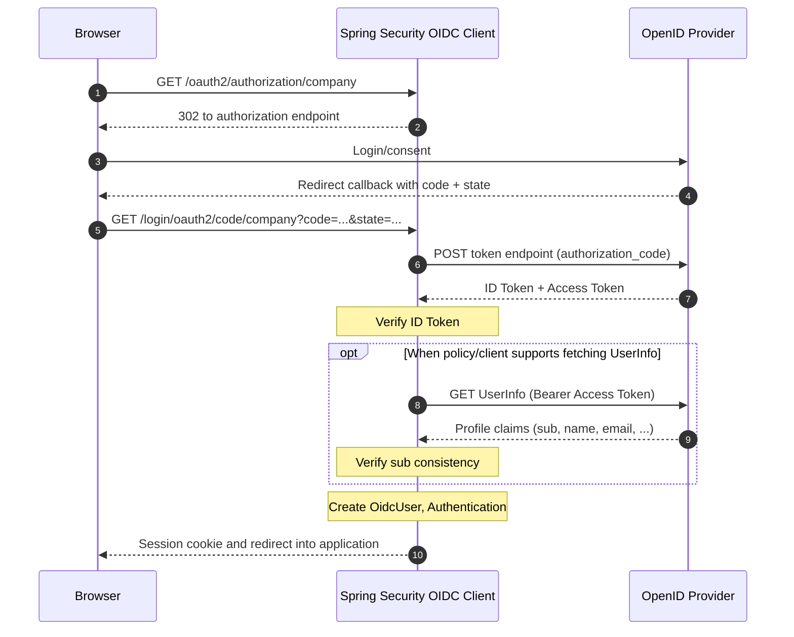
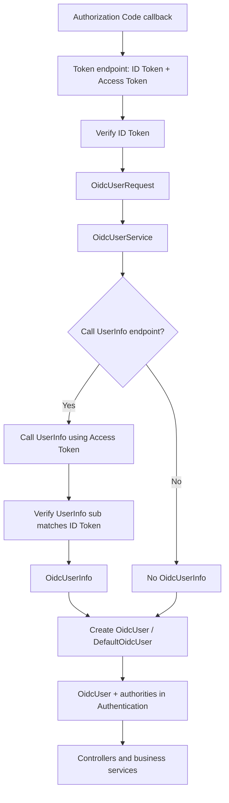
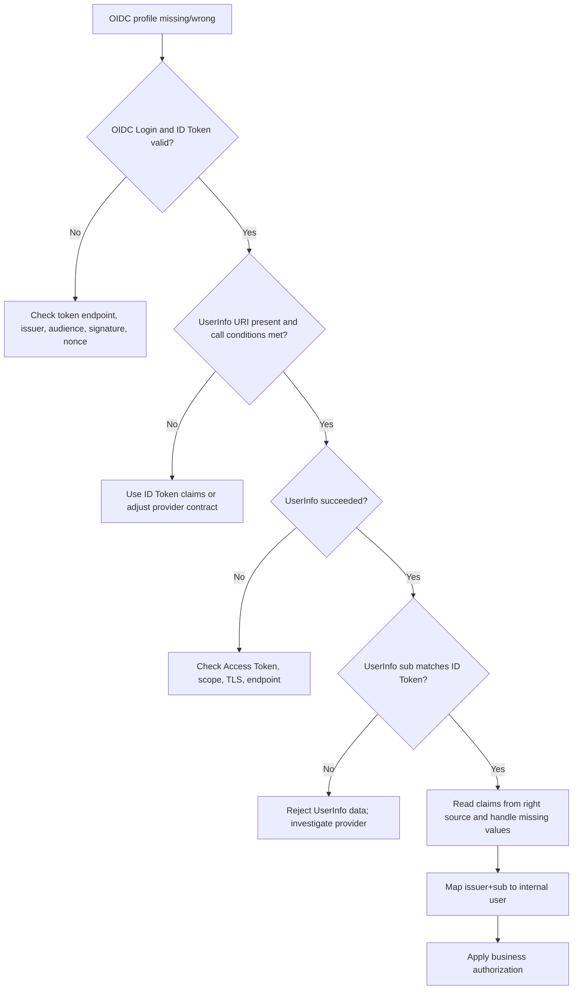

# 12.5. OidcUser, OidcUserInfo, and Combining ID Token Information

In a **Spring Security OAuth 2.0 / OpenID Connect (OIDC) Client** application, after a user logs in successfully, the program often needs to know *who is logged in*, *what information can be displayed in the UI*, and *what that person is allowed to do*. These three questions are related, yet must be clearly distinguished:

- **`OidcIdToken`** holds the claims of the **ID Token** issued by the OpenID Provider (OP) to the client upon authenticating the user.
- **`OidcUserInfo`** holds the user profile claims obtained from the **UserInfo endpoint**, if the client performs that request.
- **`OidcUser`** is the **OIDC principal** that Spring Security places into `Authentication` after login. The principal can combine claims from the ID Token and UserInfo, while also carrying a list of `GrantedAuthority` instances for Spring Security to use in authorization.

Combining both claim sources makes it convenient for the application to display the user's name, email, avatar, or locale. However, **ID Token, UserInfo, principal, and business permissions are not the same concept**. This lesson explains Spring Security's model, the UserInfo loading lifecycle, how to read data from the right source, issues when claims are missing or share names, internal user mapping, and how to extend `OidcUserService` safely.

## 1. Context: From OIDC Login to User Profile

In the Authorization Code Flow, the browser is redirected to the OpenID Provider and returns to the application with a `code`. The Spring Security backend exchanges the code for tokens, verifies the ID Token, optionally calls the UserInfo endpoint, and builds the `OidcUser`.



The key point to understand is that **UserInfo does not replace the ID Token**. The ID Token is the proof that authenticates the user to the OIDC Client; UserInfo is an endpoint for fetching additional profile claims, accessed with an appropriate access token. In an OIDC flow, the UserInfo Response must have a `sub` matching the ID Token's subject. If they differ, that response must not be used as the logged-in user's profile.

Not every OIDC Login must call UserInfo. Whether the endpoint exists or is called depends on provider metadata, scopes, Spring Security defaults and configuration, as well as the application's requirements.

## 2. Three Spring Security Objects and Their Responsibilities

| Object | Origin | Contents | Usage |
|---|---|---|---|
| `OidcIdToken` | ID Token in the token response, after OIDC verification | `iss`, `sub`, `aud`, `exp`, `iat`, `nonce` if present, and additional claims | Proof of identity authentication for the OIDC Client; read claims from the ID Token source. |
| `OidcUserInfo` | UserInfo Response from the OP, if called | `sub` and claims such as `name`, `email`, `picture`, `locale`... | Supplemental display profile; requires subject consistency with the ID Token. |
| `OidcUser` | Principal created by Spring Security after OIDC Login | ID Token, UserInfo (if present), exposed claims set, authorities, and principal name | Used in controllers/services after authentication to identify the user and enforce application rules. |

### 2.1. `OidcIdToken`: Authentication Claims Source

The `OidcIdToken` class belongs to package `org.springframework.security.oauth2.core.oidc`. Common operations:

```java
OidcIdToken idToken = oidcUser.getIdToken();

String subject = idToken.getSubject();
URI issuer = idToken.getIssuer();
List<String> audience = idToken.getAudience();
Instant issuedAt = idToken.getIssuedAt();
Instant expiresAt = idToken.getExpiresAt();
Map<String, Object> tokenClaims = idToken.getClaims();
```

`OidcIdToken` also holds the raw token string via `getTokenValue()`. Normally there is no need to return that value to the browser or log it. If you only need display name/email, use the corresponding accessors on `OidcUser` and handle absent values.

**Important:** Manually calling the `OidcIdToken` constructor on an unverified JWT string does not make that string trustworthy. During a valid `oauth2Login()`, Spring Security verifies the ID Token before using its claims to construct the principal. Business code should read the principal from `SecurityContext` instead of parsing data sent by the browser.

### 2.2. `OidcUserInfo`: Supplemental Profile

`OidcUserInfo` belongs to package `org.springframework.security.oauth2.core.oidc.user`. It provides standard OIDC user profile claims:

```java
OidcUserInfo info = oidcUser.getUserInfo();

if (info != null) {
    String displayName = info.getFullName();
    String email = info.getEmail();
    Boolean verified = info.getEmailVerified();
    Map<String, Object> profileClaims = info.getClaims();
}
```

`getUserInfo()` can return **`null`** if UserInfo was not loaded or no UserInfo data is available. Therefore never write `user.getUserInfo().getEmail()` without checking for missing UserInfo.

UserInfo typically carries UI-oriented fields such as name, email, picture, locale, timezone, or phone number when permitted by the OP and consent. The exact structure depends on the provider; scopes like `profile` or `email` are only **data requests**, not guarantees that every claim will be present.

### 2.3. `OidcUser`: Authenticated Principal

`OidcUser` is an interface in package `org.springframework.security.oauth2.core.oidc.user`. It extends Spring Security's OAuth2 principal model and provides:

```java
OidcIdToken idToken = user.getIdToken();
OidcUserInfo userInfo = user.getUserInfo();

String name = user.getName();
String subject = user.getSubject();
String email = user.getEmail();

Map<String, Object> claims = user.getClaims();
Collection<? extends GrantedAuthority> authorities = user.getAuthorities();
```

Accessors such as `getEmail()` and `getFullName()` read from the combined claims set exposed by the principal. Meanwhile, `user.getIdToken().getClaims()` reads **strictly from the ID Token source**, and `user.getUserInfo().getClaims()` (if non-null) reads **strictly from the UserInfo source**.

A common implementation is `DefaultOidcUser`. `OidcUser` is not merely a copy of the ID Token: it also carries UserInfo and authorities. Combining claims makes usage convenient, yet you should preserve the ability to distinguish sources for sensitive decisions.

## 3. OIDC Claims: Authentication Group vs. Profile Group

Not every claim has the same purpose or level of assurance.

| Claim | Where It Usually Appears | Meaning | Proper Usage |
|---|---|---|---|
| `iss` | ID Token | Issuer/OP that issued the ID Token | Distinguish identity domain; bind to a trusted registration. |
| `sub` | ID Token **and** UserInfo | Subject identifier issued by the issuer | Use with `iss` to map identity; mandatory match when loading UserInfo. |
| `aud` | ID Token | Audience, must include the matching client ID | Part of OIDC validation, not an API access permission. |
| `exp`, `iat` | ID Token | Expiration and issued-at timestamps | Part of temporal checks when accepting the token. |
| `nonce` | ID Token when applicable | Binds the token to the Authorization Request | Verify per OIDC requirements if a nonce was sent. |
| `name`, `given_name`, `family_name` | ID Token or UserInfo | Display name | UI presentation; may be missing or mutable. |
| `preferred_username` | ID Token or UserInfo | Human-readable username | Display/suggestion; not inherently stable or unique. |
| `email`, `email_verified` | ID Token or UserInfo | Email and verification status announced by the OP | Used for contact; does not inherently prove internal account ownership. |
| `picture` | ID Token or UserInfo | Avatar image URI | Treat as external data; restrict fetch sources and handle errors. |
| `locale`, `zoneinfo` | ID Token or UserInfo | Preferred language and time zone | UI localization; validate and provide fallbacks. |
| `updated_at` | ID Token or UserInfo | Time profile was updated at OP, if provided | Gauge freshness per OP contract; not an automatic sync mechanism. |
| Custom `groups`, `roles` | Provider-specific | Organization info or custom roles | Use only when issuer, schema, and mapping rules are explicitly approved. |

An ID Token can contain both authentication and profile claims. Alternatively, an OP may return only `sub` and a few required claims in the ID Token, placing extended profile data in UserInfo. Where claims appear depends on the provider, consent, scopes, and client configuration.

### 3.1. `openid` Scope Differs from `profile` and `email`

Example:

```yaml
spring:
  security:
    oauth2:
      client:
        registration:
          company:
            scope:
              - openid
              - profile
              - email
```

- `openid`: requests using OIDC for authentication, including an ID Token in the flow.
- `profile`: requests profile claims such as `name`, `picture`, `locale` when supported and permitted by the OP.
- `email`: requests `email` and `email_verified` when provided by the OP per contract.

Requesting a scope does not guarantee all corresponding claims will be returned. The client must still handle incomplete profiles and decide which fields are genuinely required for a feature.

### 3.2. Should Email Be Used as the Account Key?

Not by default. Email can change, be reused, or appear across multiple issuers. `email_verified=true` only reflects the OP's assertion under that OP's process, not universal proof to take over an internal account with the same email.

For OIDC account linking, **the (`iss`, `sub`) pair** is the standard basis for identifying a subject within an issuer's domain. When supporting multiple issuers, always store both components. With pairwise subject identifiers, the same real-world user may have different `sub` values across different clients; if cross-linking is needed, use an authorized workflow rather than inferring from email.

## 4. How Spring Security Builds OidcUser from Two Sources

In the Spring Security Servlet `oauth2Login()` flow with the `openid` scope, you can visualize it as:



`OidcUserService` takes `OidcUserRequest` as input. This request contains the client registration, access token, and ID Token in the context of a completed token exchange, enabling the service to fetch UserInfo and construct the principal.

Depending on the Spring Security version and configuration, the default service decides when to call UserInfo based on conditions such as UserInfo URI, grant type, and relevant scopes. **Do not assume having `openid` always triggers an HTTP GET to UserInfo.** If the application needs claims that only live in UserInfo, configure and test against the OP's exact contract.

### 4.1. Example of Two Claim Sets Before Combining

**Claims from ID Token:**

```json
{
  "iss": "https://idp.example.org/realms/company",
  "sub": "user-8472",
  "aud": "portal-client",
  "exp": 1795000000,
  "iat": 1794996400,
  "preferred_username": "employee8472"
}
```

**Claims from UserInfo:**

```json
{
  "sub": "user-8472",
  "name": "Nguyen Example",
  "email": "employee@example.org",
  "email_verified": true,
  "picture": "https://cdn.example.org/avatar/user-8472.png",
  "locale": "vi-VN"
}
```

This example uses dummy data. A complete ID Token must have valid cryptographic protection/signature; timestamps are illustrative only. Both sources share `sub=user-8472`.

After OIDC Login, `OidcUser` can provide:

```java
user.getSubject();               // "user-8472"
user.getPreferredUsername();     // "employee8472"
user.getFullName();              // "Nguyen Example"
user.getEmail();                 // "employee@example.org"
user.getLocale();                // "vi-VN" (depending on API/value type)
```

This example demonstrates accessing combined claims, and does not imply that `name` and `email` appeared in the ID Token. If a rule requires "email confirmed by the OP in the ID Token", inspect **`user.getIdToken().getClaims()` separately**; do not rely on `user.getEmail()` without knowing the source.

### 4.2. When ID Token and UserInfo Share a Claim Name

Both sources sometimes contain the same claim with different values; for instance, `name` in the ID Token is an old name while UserInfo has the new name. Exactly how `DefaultOidcUser` builds the combined claims map and precedence on key collisions is an implementation detail to check against **the Spring Security version in use**.

For sensitive data or requirements needing a specific source of evidence, never rely on implicit override order:

- Need **subject, issuer, or authentication constraints**: read from the verified ID Token.
- Need **current profile data published by UserInfo**: read from `OidcUserInfo` if present, verify `sub`, and handle `null`.
- Need a **convenient display label**: read from `OidcUser` with an explicit fallback policy.
- Need **business access permissions**: use internal policy and controlled mapped authorities, never arbitrary profile values.

Never read `iss`/`aud` from UserInfo as a substitute for the ID Token; UserInfo is not a source for validating the ID Token's audience.

## 5. Reading OidcUser in a Servlet Controller

Spring Security integrates `OidcUser` with `SecurityContext`. In a Spring MVC controller, you can use `@AuthenticationPrincipal` to receive the authenticated principal:

```java
import org.springframework.security.core.annotation.AuthenticationPrincipal;
import org.springframework.security.oauth2.core.oidc.user.OidcUser;
import org.springframework.web.bind.annotation.GetMapping;
import org.springframework.web.bind.annotation.RestController;

@RestController
class ProfileController {

    @GetMapping("/me")
    ProfileView me(@AuthenticationPrincipal OidcUser user) {
        return new ProfileView(
                user.getSubject(),
                user.getFullName(),
                user.getEmail(),
                user.getPicture());
    }

    record ProfileView(
            String subject,
            String displayName,
            String email,
            String picture) {}
}
```

This example applies to endpoints accessed **after OIDC Login**. If the application also supports form login, non-OIDC OAuth2 Login, or API bearer tokens, the principal may be a different type; check the authentication type or handle separately instead of assuming every user is an `OidcUser`.

To protect the route:

```java
@Bean
SecurityFilterChain securityFilterChain(HttpSecurity http) throws Exception {
    return http
            .authorizeHttpRequests(authorize -> authorize
                    .requestMatchers("/", "/error").permitAll()
                    .anyRequest().authenticated())
            .oauth2Login(Customizer.withDefaults())
            .build();
}
```

With the example above, `/me` requires authentication. Valid OIDC Login configuration is sufficient to receive `OidcUser`; there is no need to write a custom endpoint to decode ID Tokens or manually GET UserInfo in every controller.

### 5.1. Separating Claim Sources in the Response

Sometimes an application needs to show explicitly where data comes from, such as `subject` from the ID Token and `displayName` from UserInfo:

```java
@GetMapping("/me/overview")
Map<String, Object> overview(@AuthenticationPrincipal OidcUser user) {
    OidcIdToken idToken = user.getIdToken();
    OidcUserInfo info = user.getUserInfo();

    String displayName = (info != null && info.getFullName() != null)
            ? info.getFullName()
            : user.getFullName();

    return Map.of(
            "issuer", idToken.getIssuer().toString(),
            "subject", idToken.getSubject(),
            "displayName", displayName != null ? displayName : "User");
}
```

This example returns only the data needed for the UI. In real systems, `issuer`/`subject` may be internal identifiers that do not need to be exposed to the frontend; create a DTO based on business requirements. Never send the raw claims `Map` or the ID Token string in the response.

### 5.2. Fallback When UserInfo Is Missing

Example display logic should follow a chosen fallback order:

```text
Name from UserInfo (if present and trusted)
    -> name in OidcUser / ID Token
    -> preferred_username (if present)
    -> default label "User"
```

For the `email` field, the application can display blank and invite the user to provide contact info through a separate workflow. Never generate a fake email or use `sub` as an email.

## 6. Configuring OIDC Login and UserInfo in Spring Boot

Example `pom.xml` for Spring MVC:

```xml
<dependencies>
    <dependency>
        <groupId>org.springframework.boot</groupId>
        <artifactId>spring-boot-starter-web</artifactId>
    </dependency>
    <dependency>
        <groupId>org.springframework.boot</groupId>
        <artifactId>spring-boot-starter-security</artifactId>
    </dependency>
    <dependency>
        <groupId>org.springframework.boot</groupId>
        <artifactId>spring-boot-starter-oauth2-client</artifactId>
    </dependency>
</dependencies>
```

OIDC Client registration in `application.yml`:

```yaml
spring:
  security:
    oauth2:
      client:
        registration:
          company:
            provider: company-op
            client-id: "${OIDC_CLIENT_ID}"
            client-secret: "${OIDC_CLIENT_SECRET}"
            client-authentication-method: client_secret_basic
            authorization-grant-type: authorization_code
            redirect-uri: "{baseUrl}/login/oauth2/code/{registrationId}"
            scope:
              - openid
              - profile
              - email
        provider:
          company-op:
            issuer-uri: "https://idp.example.org/realms/company"
```

`issuer-uri` enables Spring Security/Spring Boot to use OIDC discovery when supported by the provider, retrieving information such as authorization endpoint, token endpoint, JWK Set URI, and UserInfo endpoint from metadata. Replace example values for your real provider; obtain client secrets from secure configuration variables, never hardcode them in Git.

Default login initiation path:

```text
/oauth2/authorization/company
```

Default callback:

```text
/login/oauth2/code/company
```

`OidcUserService` uses the right registration and login tokens to fetch UserInfo when conditions permit. Never fetch UserInfo by calling an arbitrary URL from the browser, and never use the ID Token as a bearer token at the UserInfo endpoint.

### 6.1. When the Provider Has No UserInfo Endpoint

Not every system provides a UserInfo endpoint. If a provider supports OIDC without publishing or providing this endpoint, the application can still receive a valid ID Token with required claims according to the provider's capabilities. In that case `OidcUserInfo` may be absent while `OidcUser` still has the ID Token.

If business logic strictly requires data not included in the ID Token, align the contract with the provider: add claims to the ID Token, enable UserInfo, or use a separate authenticated and authorized profile API. Never create a hidden assumption that `getUserInfo()` is always non-null.

### 6.2. The UserInfo Endpoint Requires an Access Token

The UserInfo flow uses an access token issued with appropriate permissions. Illustrative HTTP example:

```http
GET /oidc/userinfo HTTP/1.1
Host: idp.example.org
Authorization: Bearer <ACCESS_TOKEN_REDACTED>
Accept: application/json
```

Illustrative response:

```http
HTTP/1.1 200 OK
Content-Type: application/json

{
  "sub": "user-8472",
  "name": "Nguyen Example",
  "email": "employee@example.org",
  "email_verified": true
}
```

The UserInfo endpoint usually returns JSON over TLS; OIDC also supports signed/encrypted response forms when configured. Do not assume every UserInfo Response is a JWT or contains sensitive fields like email. Follow the OP's contract and verify `sub` matches the ID Token.

## 7. Customizing OidcUserService to Add Profile Processing

An application may need to map the OIDC principal to an internal account, record login timestamps, or verify whether a user is allowed to use the system. Spring Security provides the `OidcUserService` extension point inside `oauth2Login().userInfoEndpoint()`.

A common approach is to **delegate OIDC handling to the default `OidcUserService`**, then apply business rules. Example:

```java
import org.springframework.context.annotation.Bean;
import org.springframework.context.annotation.Configuration;
import org.springframework.security.oauth2.client.oidc.userinfo.OidcUserRequest;
import org.springframework.security.oauth2.client.oidc.userinfo.OidcUserService;
import org.springframework.security.oauth2.client.userinfo.OAuth2UserService;
import org.springframework.security.oauth2.core.oidc.user.OidcUser;

@Configuration
class OidcProfileConfig {

    @Bean
    OAuth2UserService<OidcUserRequest, OidcUser> applicationOidcUserService(
            ExternalIdentityService identities) {

        OidcUserService delegate = new OidcUserService();

        return request -> {
            // Delegate to Spring to fetch UserInfo per provider configuration.
            OidcUser user = delegate.loadUser(request);

            String issuer = user.getIdToken().getIssuer().toString();
            String subject = user.getIdToken().getSubject();

            // Check/link with internal account via (issuer, subject).
            identities.requireActiveLinkedUser(issuer, subject);

            return user;
        };
    }
}
```

Wiring into the security chain:

```java
@Bean
SecurityFilterChain securityFilterChain(
        HttpSecurity http,
        OAuth2UserService<OidcUserRequest, OidcUser> applicationOidcUserService)
        throws Exception {

    return http
            .authorizeHttpRequests(authorize -> authorize
                    .requestMatchers("/", "/error").permitAll()
                    .anyRequest().authenticated())
            .oauth2Login(oauth2 -> oauth2
                    .userInfoEndpoint(userInfo -> userInfo
                            .oidcUserService(applicationOidcUserService)))
            .build();
}
```

`ExternalIdentityService` is a service **implemented by the application**, such as querying the linking table (`issuer`, `subject`) and rejecting inactive accounts. Both snippets illustrate one configuration; declare the relevant Spring Security/Servlet imports such as `HttpSecurity` and `SecurityFilterChain` in your actual file.

Key points:

1. The default `OidcUserService` should continue handling UserInfo retrieval and principal construction per Spring Security's contract.
2. Internal account checks use `iss` and `sub` from the **verified ID Token**, not from request parameters or emails submitted by the frontend.
3. If no internal account is found, the application explicitly chooses an onboarding, invitation, or rejection flow per policy.
4. Never log access tokens, ID Tokens, or full claims during error handling.
5. Never call the UserInfo endpoint a second time in every controller just to fetch the same data. If real-time fresh data is required, design a separate refresh mechanism.

### 7.1. If You Want to Build a Custom DefaultOidcUser

When the application needs to add `GrantedAuthority` instances after resolving internal permissions, it can create a new `DefaultOidcUser` principal from the ID Token, UserInfo, and controlled authorities:

```java
OidcUser original = delegate.loadUser(request);

Set<GrantedAuthority> authorities =
        new HashSet<>(original.getAuthorities());

if (permissionService.canReadReports(
        original.getIdToken().getIssuer().toString(),
        original.getIdToken().getSubject())) {
    authorities.add(new SimpleGrantedAuthority("PERMISSION_REPORT_READ"));
}

OidcUser mappedUser;
if (original.getUserInfo() != null) {
    mappedUser = new DefaultOidcUser(
            authorities,
            original.getIdToken(),
            original.getUserInfo());
} else {
    mappedUser = new DefaultOidcUser(
            authorities,
            original.getIdToken());
}
```

This snippet illustrates logic **inside a custom user service** and assumes `delegate`, `request`, `permissionService`, and necessary imports exist. `DefaultOidcUser` is one option for constructing the principal; if the application has a custom principal-naming policy, ensure `nameAttributeKey` is appropriate and stable.

Never create authorities by grabbing all `groups` or `roles` from claims and blindly prepending `ROLE_`. Map through an allowlist, verify issuer/tenant, and check internal permissions. For frequently changing or sensitive permissions, authorization at resource-access time should still check current data.

### 7.2. When Is a Custom Service Unnecessary?

If the application only displays name/email/picture and uses permissions defined in its own system, the default `OidcUserService` and controllers reading `OidcUser` are usually sufficient. A custom service should only be added when there are clear requirements around user policy, account linking, or principal/authority creation.

## 8. Trust Boundaries When Combining ID Token and UserInfo

Combining claims happens across **two sources with different characteristics**:

```text
OpenID Provider
    |
    +-- Token endpoint --> ID Token
    |                     | issuer/audience/signature/exp/nonce...
    |                     v
    |                 [Verified identity]
    |
    +-- UserInfo endpoint --> UserInfo Response
                              | HTTPS + Access Token + sub matching
                              v
                         [Profile data]
                               |
                               v
                     Spring Security OidcUser
                               |
                   +-----------+------------+
                   |                        |
              Display fields          Internal identity
              (name, picture)         (iss, sub) -> account
                                               |
                                               v
                                        Business policy
```

### 8.1. UserInfo `sub` Must Match ID Token `sub`

Under OIDC, the UserInfo Response must contain `sub`, and the client must confirm it is **identical** to the subject in the ID Token. Example:

```text
ID Token: sub = "employee-8472"
UserInfo: sub = "employee-9531"
```

Never use `employee-9531`'s UserInfo data to populate the name/email for a session authenticated as `employee-8472`. Such a discrepancy may stem from the provider, endpoint configuration, wrong token context, or a more serious issue.

Spring Security includes corresponding verification in its default UserInfo flow; when replacing `OidcUserService`, using a custom HTTP client, or combining claims manually, the application must preserve this `sub` check. Never merely parse UserInfo JSON and merge it straight into ID Token claims.

### 8.2. ID Token Signatures and UserInfo Origin Are Not Identical

The ID Token is typically a signed JWT validated per OIDC. The UserInfo Response is normally fetched over HTTPS using an access token and bound via `sub`. If signed/encrypted UserInfo is used, the client must follow the corresponding additional processing requirements.

Thus there is **no general rule** that "every claim in UserInfo was directly signed with the ID Token's signature." Attributes may be delivered by different mechanisms, even though both come from a trusted OP.

### 8.3. Profile Data Does Not Mean Access Permission

Example UserInfo containing:

```json
{
  "sub": "employee-8472",
  "email": "manager@example.org",
  "email_verified": true,
  "department": "finance",
  "groups": ["finance"]
}
```

This may be helpful for displaying the user's department, yet it does not prove the subject is authorized to view all financial reports. Business APIs or services must still verify the internal account, organization, recognized roles, and per-resource permissions.

The `groups` claim can carry different semantics across providers. Use it for granting permissions only if the application has defined a contract with the issuer and safe mapping.

### 8.4. Do Not Trust Claims Submitted by the Browser

An endpoint allowing the browser to update a display name may receive a `name` string; that is **browser-supplied input**, and does not automatically become verified UserInfo. Likewise, the browser might send `email_verified=true` or `roles=admin` in JSON, but the application cannot treat them as trusted OIDC claims.

The logged-in identity must come from the `Authentication` established by Spring Security. Profile-modification operations require authorization checks and business validation.

## 9. Designing DTOs and Internal Profiles

`OidcUser` is a security model, not necessarily the API schema returned to the browser. Returning all of `user.getClaims()` can expose birth dates, phone numbers, emails, organizational IDs, or unnecessary custom claims.

Minimal DTO design:

```java
record PublicProfile(
        String displayName,
        String avatarUrl,
        String language) {}

PublicProfile toPublicProfile(OidcUser user) {
    String displayName = user.getFullName();
    if (displayName == null || displayName.isBlank()) {
        displayName = user.getPreferredUsername();
    }
    if (displayName == null || displayName.isBlank()) {
        displayName = "User";
    }

    return new PublicProfile(
            displayName,
            user.getPicture(),
            user.getLocale());
}
```

The example above uses claims for display, applies fallbacks, and returns only the three needed properties. For external image URIs, the frontend must handle URLs safely under CSP/image-source policies; do not automatically fetch arbitrary URLs server-side if the backend has image-fetching logic, to prevent SSRF.

### 9.1. Separating External Identity and Business User

A storage model:

```text
local_users
  id
  status
  organization_id
  display_name

external_identities
  local_user_id
  issuer
  subject
  linked_at
  UNIQUE (issuer, subject)

permissions
  local_user_id
  resource
  action
  scope / organization constraint
```

Linking flow:

1. Spring Security verifies the ID Token and creates `OidcUser`.
2. The application reads `issuer` and `subject` from the ID Token.
3. Query `external_identities` by (`issuer`, `subject`).
4. If already linked, read status and permissions from `local_users`/`permissions`.
5. If not yet linked, follow the onboarding/invitation/rejection workflow allowed by policy.
6. Use UserInfo to update **display data** when appropriate; do not overwrite user-managed fields automatically.

Profile updates must account for stale/fresh data, OP changes, privacy, and cases where a provider stops returning a claim. Do not delete a local email merely because a single UserInfo Response omitted `email`.

### 9.2. Difference Between Login-Time Snapshot and Current Profile

`OidcUser` typically reflects a **login-time snapshot** and UserInfo fetched at that moment. Hours later, a user might update their avatar or email at the OP, yet the principal in session does not automatically refresh simply because OP data changed.

If a feature requires an up-to-date profile, the application can sync in a controlled way via an authorized API or perform a UserInfo fetch through an appropriate mechanism. Account for access token lifetimes, refresh tokens, caching, rate limits, and data retention policies. Never turn every application request into an unnecessary UserInfo call.

## 10. Handling Errors When UserInfo Is Missing or Incompatible

| Symptom | Possible Cause | Resolution |
|---|---|---|
| `OidcUser.getUserInfo() == null` | UserInfo not loaded, provider exposes no endpoint, or scopes/default conditions did not trigger UserInfo | Check metadata, scopes, and `OidcUserService` configuration; design ID Token fallbacks. |
| `getEmail()` returns `null` | Claim not released, no UserInfo, or provider does not store email | Allow missing data; when email is mandatory, use a dedicated collection/verification workflow. |
| ID Token has `sub` while UserInfo `sub` differs | Wrong user's data returned, wrong endpoint/tenant, or wrong token used | Reject UserInfo and raise an OIDC error; inspect provider/registration. |
| UserInfo returns 401 | Access token invalid/expired/wrong audience or lacks permission to call UserInfo | Check authorized client and UserInfo endpoint; never substitute ID Token for access token. |
| UserInfo returns 403 | Scopes or policy deny access | Check `profile`, `email`, consent, client permissions, and OP policy. |
| UserInfo 404 or timeout | Wrong UserInfo URI, unsupported by provider, or network/TLS issue | Check metadata, connectivity, and timeouts; never bypass token verification. |
| `user.getClaims()` differs from `idToken.getClaims()` | Principal combines UserInfo with ID Token | Read from the specific claim source for business decisions; do not treat differences as errors by default. |
| User linked to wrong account | Used email/username instead of (`iss`, `sub`) | Redesign external identity mapping and controlled linking workflow. |
| `groups` present without Spring authorities | Authorities not mapped or policy forbids it | Build trusted-source mapping + allowlist; validate permissions at access time. |
| Profile not updated after editing at OP | `OidcUser` is a snapshot / cached or old session | Design profile refresh aligned with needs and token lifetimes. |

### 10.1. Debugging in Order



When debugging, distinguish *UserInfo not loaded* from *UserInfo loaded but missing a claim*. The first relates to metadata/scopes/configuration; the second can be completely valid depending on consent or data state at the OP.

### 10.2. Safe Logging

Do not log:

- `idToken.getTokenValue()`, access tokens, or refresh tokens.
- The HTTP `Authorization` header when calling UserInfo.
- Authorization codes, PKCE verifiers, client secrets, or session cookies.
- Full UserInfo/ID Token claim maps, as they may hold personal data and internal permission groups.

Useful diagnostic details include `registrationId`, processing step name, sanitized error codes, latency, approved provider endpoint, correlation ID, and whether UserInfo was present/absent. If internal user lookup is needed, log the internal identifier per system security policy.

## 11. Quick Comparison: Servlet vs. Reactive

OIDC defines the same ID Token and UserInfo at the protocol level, while Spring Security APIs differ by execution model:

| Topic | Spring MVC / Servlet | Spring WebFlux / Reactive |
|---|---|---|
| Web security | `HttpSecurity`, `SecurityFilterChain` | `ServerHttpSecurity`, `SecurityWebFilterChain` |
| Login | `oauth2Login()` on Servlet filter chain | `oauth2Login()` on reactive web filter chain |
| Loading user | `OidcUserService` / `OAuth2UserService<OidcUserRequest, OidcUser>` | `OidcReactiveOAuth2UserService` / corresponding reactive user service |
| Principal | `OidcUser` | `OidcUser` |
| Reading claims | `getIdToken()`, `getUserInfo()`, `getClaims()` | Same claim model, within reactive pipeline |
| SecurityContext | `SecurityContextHolder`, propagated via Servlet request | `ReactiveSecurityContextHolder` and Reactor `Context` |

A WebFlux controller can receive the principal via an argument resolver or publisher rather than relying on thread-locals. Regardless of stack, the principles of **sub matching, issuer/audience validation, separating ID Token and UserInfo, and internal user mapping** remain the same.

Never use `block()` on a WebFlux event loop to call UserInfo with a blocking client; use Spring Security's reactive mechanisms or appropriate non-blocking APIs.

## 12. Real-World Scenario: Employee Portal and OP Profile

Suppose a work management portal uses a Corporate OpenID Provider:

```text
Corporate OP
  ID Token:
      iss = https://idp.example.org/realms/employees
      sub = staff-0042
      aud = employee-portal

  UserInfo:
      sub = staff-0042
      name = "Nguyen Example"
      email = "nguyen@example.org"
      picture = "https://cdn.example.org/avatars/0042.png"
      locale = "vi-VN"

Portal:
  OidcUser
      -> ID Token + UserInfo + authorities
      -> external identity (iss, sub)
      -> local user #509, org #12
      -> UI: displayName, avatar, language
      -> API: internal permissions for tasks
```

When the user visits `/me`:

1. Spring Security has completed OIDC Login and created `OidcUser` in the session.
2. The controller reads name/avatar/locale from the principal; if UserInfo is missing, it uses fallbacks.
3. The identity service uses the (`iss`, `sub`) pair to look up the local user.
4. If the local user is inactive, the system denies access even though OIDC authentication was valid.
5. When the user wants to view another department's tasks, the API checks permissions and organization; **an email or group shown in UserInfo is not enough to bypass this policy**.

When the OP updates the user's photo, data inside `OidcUser` for the active session may still hold the old snapshot. The Portal must have a profile-update strategy when genuinely needed, rather than assuming the principal automatically syncs with every OP change.

## 13. Common Mistakes When Combining Claims

1. **Assuming `getUserInfo()` always exists.** It can be null. Always check before calling accessors.
2. **Assuming every `OidcUser` claim lives in the ID Token.** The principal can combine claims from UserInfo.
3. **Using `getEmail()` as the internal account key.** Use the identity source (`iss`, `sub`) and a controlled linking workflow.
4. **Treating `email_verified` as business authorization.** That is an OP claim, not proof of permission to view/edit all resources.
5. **Sending the ID Token instead of an access token to UserInfo/APIs.** UserInfo and Resource Servers use access tokens matching the audience/scopes.
6. **Merging UserInfo JSON without comparing `sub`.** UserInfo must match the ID Token's subject.
7. **Authorizing solely from uncontrolled `roles` or `groups` claims.** You need policy mapping, source verification, and tenant checks.
8. **Logging full ID Tokens/UserInfo.** Sources can contain personal data or tokens.
9. **Reading claims from the browser and treating them as the principal.** Obtain authentication from Spring Security.
10. **Expecting the session principal to auto-update with the OP.** Build a profile refresh strategy if business needs require it.

## 14. Review Questions

1. How do `OidcIdToken`, `OidcUserInfo`, and `OidcUser` differ in responsibility?
2. Why can OIDC Login succeed while `OidcUser.getUserInfo()` still returns null?
3. With `user.getClaims()`, how can you tell whether a specific claim came from the ID Token or UserInfo when that affects business logic?
4. Why must `sub` in UserInfo match `sub` in the ID Token?
5. Why does the `email` scope not guarantee `email` is always present on the principal?
6. Why is the (`iss`, `sub`) pair generally better suited for linking external identities to internal users than `email`?
7. When should you customize `OidcUserService` and when should you use the default?
8. Why should `OidcUser.getClaims()` not be sent intact to the browser?
9. Why should a `groups` claim in UserInfo not automatically become `ROLE_ADMIN`?
10. If a user changes their photo on the OP while Portal still shows the old photo, which data lifecycle must be inspected?

## References

- [OpenID Connect Core 1.0 — UserInfo Endpoint](https://openid.net/specs/openid-connect-core-1_0.html#UserInfo)
- [OpenID Connect Core 1.0 — UserInfo Response Validation](https://openid.net/specs/openid-connect-core-1_0.html#UserInfoResponse)
- [OpenID Connect Core 1.0 — Standard Claims](https://openid.net/specs/openid-connect-core-1_0.html#StandardClaims)
- [OpenID Connect Core 1.0 — Scope Values](https://openid.net/specs/openid-connect-core-1_0.html#ScopeClaims)
- [Spring Security Reference — OAuth2 Login (Servlet)](https://docs.spring.io/spring-security/reference/servlet/oauth2/login/core.html)
- [Spring Security Reference — OAuth2 Login Advanced Configuration](https://docs.spring.io/spring-security/reference/servlet/oauth2/login/advanced.html)
- [Spring Security API — OidcUser](https://docs.spring.io/spring-security/reference/api/java/org/springframework/security/oauth2/core/oidc/user/OidcUser.html)
- [Spring Security API — OidcUserInfo](https://docs.spring.io/spring-security/reference/api/java/org/springframework/security/oauth2/core/oidc/OidcUserInfo.html)
- [Spring Security API — OidcIdToken](https://docs.spring.io/spring-security/reference/api/java/org/springframework/security/oauth2/core/oidc/OidcIdToken.html)
- [Spring Security API — OidcUserService](https://docs.spring.io/spring-security/reference/api/java/org/springframework/security/oauth2/client/oidc/userinfo/OidcUserService.html)
