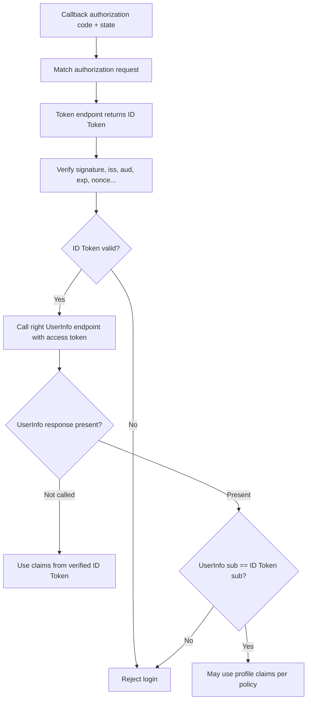

# 12.6. Matching sub Between ID Token and UserInfo

In **Spring Security OAuth 2.0 / OIDC Client**, after a user signs in at an OpenID Provider (OP), the application can receive an **ID Token** and then call the **UserInfo Endpoint** to fetch additional profile details such as display name, email, or avatar. Both data sources refer to the user, yet they may pass through different protocols, endpoints, and processing layers.

The mandatory security requirement is: **`sub` in the UserInfo Response must match exactly `sub` in the ID Token of the same login transaction**. If they do not match, the client **must not use claims from the UserInfo Response**. This rule is specified in OpenID Connect Core, section *UserInfo Response Validation*.

An error that looks merely profile-related — for instance, two sources having different `sub` values yet the same `email` — can actually cause the application to link **User A's** information to **User B's** login session. Therefore, this is an identity verification step, not merely a data lookup for display.

This lesson explains the protocol basis, where the check happens in Spring Security, how it operates with multiple providers, how to extend safely, and real-world failure detection scenarios.

## 1. Distinguishing ID Token and UserInfo

OpenID Connect (OIDC) extends OAuth 2.0 with an identity verification layer. In the Authorization Code Flow, the application typically receives the ID Token from the **token endpoint** after exchanging the authorization code. If additional profile claims are needed, the application can use the **access token** to call the **UserInfo Endpoint**.

| Characteristic | ID Token | UserInfo Response |
| --- | --- | --- |
| Role | Asserts the user's authentication event to the client | Provides authorized profile claims about the user |
| Typical origin | Token endpoint in the Authorization Code Flow | OP's UserInfo endpoint |
| Common representation | Signed JWT per OIDC mechanics | JSON over HTTPS; some configurations use signed/encrypted JWT |
| Core data | `iss`, `sub`, `aud`, `exp`, `iat`, and requested claims | Must include `sub`; may add `name`, `email`, `picture`, ... |
| Which token calls the endpoint? | ID Token is not used as a Bearer token to call UserInfo | Access token is sent to the UserInfo endpoint |
| Primary checks | Signature/MAC, issuer, audience, timestamps, and login binding | `sub` must equal ID Token's `sub`; other protocol checks depend on response mode |

**The ID Token is not an access token.** Never send an ID Token in an `Authorization: Bearer ...` header to call UserInfo or ordinary APIs merely because it is also a JWT.

An illustrative ID Token:

```json
{
  "iss": "https://id.example.test/realms/company",
  "sub": "user-1428",
  "aud": "portal-client",
  "iat": 1794800000,
  "exp": 1794803600,
  "name": "Nguyen An"
}
```

The UserInfo Response for the same user might be:

```json
{
  "sub": "user-1428",
  "name": "Nguyen An",
  "email": "an@example.test",
  "email_verified": true,
  "picture": "https://images.example.test/avatar/1428.png"
}
```

Both documents contain the same `sub = "user-1428"`. Additional claims may differ in completeness or update time; **`name` and `email` are not required to appear in both sources**.

## 2. What Is `sub` Really?

`sub` stands for **subject**: the subject identifier that the OP places into claims of the ID Token and UserInfo. Under OIDC, it is a **case-sensitive** string representing the End-User within the scope of the corresponding issuer.

Key characteristics to remember:

- **Not a username:** `preferred_username` is typically a login/display name that can change or be reassigned per policy.
- **Not an email:** `email` can change, be unverified, or be mapped differently across systems.
- **Not necessarily a database ID:** an OP may issue opaque, hashed, or pairwise subjects.
- **Not globally meaningful on its own:** two independent OPs can both issue `sub="123"` for two different people.
- **Must be treated verbatim:** do not `trim()`, change case, Unicode-normalize, or convert to a number before comparing.

In an application supporting multiple issuers, the identity-linking key is typically **the `(iss, sub)` pair from the verified ID Token**, rather than a bare `sub` string.

Example:

| Verified Issuer | `sub` | Interpretation |
| --- | --- | --- |
| `https://id-a.example.test` | `123` | User under OP A |
| `https://id-b.example.test` | `123` | User under OP B; do not assume same person |
| `https://id-a.example.test` | `ABC` | Distinct from `abc` within the same issuer |
| `https://id-a.example.test` | `abc` | A different subject from `ABC` |

### 2.1. Public Subject and Pairwise Subject

OIDC can use a **public subject identifier** or a **pairwise subject identifier**. With pairwise subjects, an OP may issue different `sub` values for the same user based on the client's *sector identifier*.

Example of the same person signing into two applications:

```text
Client portal-a -> ID Token sub = p-0f4c8a
Client portal-b -> ID Token sub = p-d3a71e
```

This is not automatically an error; it may be the OP's pairwise design. **What remains mandatory** is that within *one login transaction of one client*, UserInfo `sub` must equal the `sub` of the ID Token issued for that transaction.

If the same issuer emits two different `sub` values across two clients, do not try to merge them by email or display name. Account linking must rely on a separately designed, authorized, and verified mechanism.

## 3. OIDC Core Rule: Exact Match

The rule in **OpenID Connect Core 1.0, Section 5.3.2 — UserInfo Response Validation** requires the client to verify that the `sub` value in the UserInfo Response **exactly matches** the `sub` value in the ID Token; if it does not match, **do not use the UserInfo Response values**.

The core check can be expressed as:

```text
expectedSub = validatedIdToken.sub
actualSub   = userInfoResponse.sub

if actualSub is missing OR actualSub != expectedSub:
    reject UserInfo response
    DO NOT use UserInfo claims
else:
    UserInfo belongs to the subject in this login transaction
```

In Java, with properly parsed strings:

```java
boolean matches = idTokenSub != null
        && idTokenSub.equals(userInfoSub);
```

The comparison uses `String.equals`, which is case-sensitive and performs no value normalization.

### 3.1. What Does "Exact Match" Mean?

| ID Token `sub` | UserInfo `sub` | Result |
| --- | --- | --- |
| `user-1428` | `user-1428` | Match |
| `User-1428` | `user-1428` | Mismatch |
| `user-1428` | `user-1428 ` (trailing space) | Mismatch |
| `0001428` | `1428` | Mismatch |
| `pairwise-4ac` | `public-1428` | Mismatch |
| `user-1428` | Missing `sub` | Invalid UserInfo |
| `user-1428` | `null` | Invalid UserInfo |

`sub` is an opaque identifier. **Do not use `equalsIgnoreCase`, `strip()`, or numeric coercion** to "fix" a mismatch. If actual values differ, find the bug at the OP, token, or configuration pipeline.

### 3.2. What If UserInfo Is Not Called?

UserInfo is an **optional step that may not occur**. An application may need only the verified ID Token and skip calling the UserInfo Endpoint, for example because:

- No UserInfo URI is configured or the OP provides no matching endpoint.
- `OidcUserService` logic determines no extra claims need to be fetched.
- Scopes/permissions do not call for an additional profile.
- The application uses only claims already issued in the ID Token.

When there is no UserInfo Response, **there are no two `sub` values to compare**. The application must still verify the ID Token completely; never fabricate a fake UserInfo from `name`/`email` and treat the comparison step as complete.

### 3.3. What If UserInfo Is Present but Missing `sub`?

Per OIDC Core, **`sub` is a required claim in the UserInfo Response**. A response containing only:

```json
{
  "email": "an@example.test",
  "name": "Nguyen An"
}
```

is not a valid UserInfo Response for OIDC purposes, even if the email and name appear to match the ID Token. The client must not use those claims as profile data bound to the OIDC login session.

## 4. Why Matching Only Email or Username Is Dangerous

Suppose User A logs in successfully and has an ID Token:

```json
{
  "iss": "https://id.example.test/realms/company",
  "sub": "account-A",
  "aud": "portal-client",
  "email": "shared@example.test"
}
```

However, due to an integration bug, the application receives User B's UserInfo:

```json
{
  "sub": "account-B",
  "email": "shared@example.test",
  "name": "User B",
  "department": "finance"
}
```

If the application only compares `email` or sees an identical display name and accepts UserInfo, it can:

1. Display B's profile inside A's session.
2. Assign B's attributes or business roles to A.
3. Create/update the wrong person's internal account.
4. Route messages, logs, or action requests to the wrong profile.
5. Merge two accounts that the OP never confirmed are the same person.

This is a form of **account mix-up / identity misbinding**: data issued by different components gets attached to the wrong identity.

One person can have multiple email addresses, an email can change owners, and two systems can enforce different policies. Even with `email_verified=true`, email **does not replace** the `sub` requirement between ID Token and UserInfo.

### 4.1. The `(iss, sub)` Pair Is a More Stable Identifier for Multi-OP Applications

An internal account table usually needs to store identity links by pair:

```text
identity_link
----------------------------------------------
provider_issuer                         subject
https://id.example.test/realms/company   account-A
https://login.partner.example.test       account-A
```

The two rows above **do not automatically** refer to the same person. The same `sub` with different issuers belongs to two different identity spaces.

After the ID Token is verified, UserInfo in the same transaction must have `sub` equal to the verified subject value. Never use the UserInfo response to pick a new issuer: in plain UserInfo JSON, `iss` is not a core identity claim replacing the ID Token's issuer.

## 5. Lifecycle: When Does Spring Security Receive and Match `sub`?

Suppose a Spring Boot application has registered OIDC client `company`:

```text
GET /oauth2/authorization/company
```

In the Servlet flow:

1. `OAuth2AuthorizationRequestRedirectFilter` initiates the authorization request, generates/stores `state`, and redirects the browser to the OP.
2. The user logs in at the OP. The OP redirects the browser back to the callback with `code` and `state`.
3. `OAuth2LoginAuthenticationFilter` restores the authorization request and verifies correlation.
4. The OIDC authentication component exchanges the code for tokens and verifies the **ID Token**: signature, issuer, audience, timestamps, and related conditions.
5. **`OidcUserService`** may use the access token to retrieve UserInfo via the OP's endpoint.
6. If UserInfo is received, Spring Security must ensure **UserInfo `sub` = ID Token `sub`**.
7. Only after required conditions succeed does the system build `OidcUser` and complete Authentication.

```mermaid
sequenceDiagram
    autonumber
    actor User as User
    participant Browser as Browser
    participant Client as Spring Security Client
    participant OP as OpenID Provider
    participant UserInfo as UserInfo Endpoint

    Browser->>Client: Start /oauth2/authorization/company
    Client-->>Browser: Redirect authorize (state, PKCE if used)
    Browser->>OP: Authorization request
    User->>OP: Login / consent if needed
    OP-->>Browser: Redirect callback with code + state
    Browser->>Client: GET /login/oauth2/code/company?code=...&state=...
    Client->>Client: Restore original request and verify state
    Client->>OP: POST token endpoint to exchange code
    OP-->>Client: access_token + id_token
    Client->>Client: Verify ID Token, read sub_A
    Client->>UserInfo: GET UserInfo with Bearer access token
    UserInfo-->>Client: JSON with sub_B and profile claims
    Client->>Client: Check sub_A == sub_B
    alt sub matches
        Client->>Client: Combine claims, create OidcUser/Authentication
        Client-->>Browser: Login succeeds
    else sub mismatches or is missing
        Client->>Client: Discard UserInfo; authentication fails per configured flow
        Client-->>Browser: Appropriate login error page
    end
```

**Subtle point:** at the protocol level, the client **must not use** UserInfo values when `sub` mismatches. The specific failure behavior (throwing an exception, redirecting to login, logging an error) is determined by library and application configuration; with the default `OidcUserService`, a mismatch is a UserInfo authentication error and is never treated as a valid profile.

### 5.1. The ID Token Must Be Verified First

Comparing two `sub` strings by itself does not prove two responses are trustworthy. If both values came from unverified data, an attacker could supply two identical values.

A complete chain of trust is required:



If a token is validly signed yet `aud` belongs to a different client, or `iss` is not the expected issuer, you must reject the ID Token. Never use UserInfo having the same `sub` to "rescue" an invalid ID Token.

## 6. Relevant Spring Security Data Types

In Spring Security OAuth2/OIDC Client:

| Type/API | Role |
| --- | --- |
| **`OidcIdToken`** | Represents the framework-processed ID Token as a claim accessor |
| **`OidcUserInfo`** | Represents claims received from the UserInfo Endpoint |
| **`OidcUser`** | OIDC principal holding the ID Token and optional UserInfo |
| **`OidcUserRequest`** | Input to the OIDC user service; holds client registration, access token, and ID Token |
| **`OidcUserService`** | Standard service to load and combine OIDC principal information |
| **`OAuth2UserService<OidcUserRequest, OidcUser>`** | Service contract configurable on the OIDC UserInfo branch of login |
| **`OAuth2LoginAuthenticationFilter`** | Handles callbacks and Servlet login authentication results |

You can read the subjects via the API:

```java
String fromIdToken = oidcUser.getIdToken().getSubject();

OidcUserInfo userInfo = oidcUser.getUserInfo();
String fromUserInfo = (userInfo == null)
    ? null
    : userInfo.getSubject();
```

With an `OidcUser` built through the default post-verification flow, `getSubject()` is a convenient API to obtain the OIDC subject. However, to understand the exact comparison between **both sources**, inspect `getIdToken().getSubject()` and `getUserInfo().getSubject()` directly.

### 6.1. Default `OidcUserService`

Spring Security provides **`OidcUserService`** for use in `oauth2Login()`. It relies on provider/client configuration and the access token to fetch UserInfo when retrieval is triggered, then constructs `OidcUser`.

In the default processing path, the service checks that **the UserInfo subject corresponds to the ID Token subject**. Otherwise, UserInfo retrieval does not succeed. That is why typical applications **do not need to write custom controllers or manual decoders to check `sub`**.

Whether UserInfo is retrieved depends on OIDC client configuration and conditions, such as the OP-provided UserInfo endpoint, grant type, scopes, and how the service is customized. **Having `scope=openid` does not guarantee an HTTP UserInfo request will be sent on every login**.

### 6.2. Mismatch Checks Occur Before Using UserInfo Claims

If you want to read `name`/`email` from UserInfo to create a local account, **never persist that data before matching `sub`**. Specifically, a custom user service calling the UserInfo endpoint itself must never do:

```text
GET UserInfo -> read email -> UPDATE account
             -> compare sub afterwards
```

Safe order:

```text
GET UserInfo -> parse response
             -> verify sub is present and matches ID Token
             -> only then use claims to create/update profile
```

Failing to follow this order means a login failure caught late in the flow can still leave side effects in the database.

## 7. Spring Boot Configuration and Standard UserInfo Flow

Suppose the OP has valid OIDC discovery. A simple Servlet client configuration:

```yaml
spring:
  security:
    oauth2:
      client:
        registration:
          company:
            provider: company
            client-id: ${OIDC_CLIENT_ID}
            client-secret: ${OIDC_CLIENT_SECRET}
            authorization-grant-type: authorization_code
            redirect-uri: "{baseUrl}/login/oauth2/code/{registrationId}"
            scope:
              - openid
              - profile
              - email

        provider:
          company:
            issuer-uri: https://id.example.test/realms/company
```

`issuer-uri` lets Spring Security/Spring Boot fetch provider metadata when the OP supports discovery. Metadata may include the authorization endpoint, token endpoint, JWKS URI, and UserInfo endpoint.

For providers without discovery, configure provider details manually, for example:

```yaml
spring:
  security:
    oauth2:
      client:
        provider:
          company:
            authorization-uri: https://id.example.test/oauth2/authorize
            token-uri: https://id.example.test/oauth2/token
            jwk-set-uri: https://id.example.test/oauth2/jwks
            user-info-uri: https://id.example.test/oauth2/userinfo
            user-name-attribute: sub
```

This example only shows the **relevant endpoints**. For real OIDC, ensure metadata/issuer and token-verification settings are compatible; never treat an arbitrary JSON-returning API as a compliant UserInfo Endpoint.

### 7.1. Enabling OIDC Login in SecurityFilterChain

```java
import org.springframework.context.annotation.Bean;
import org.springframework.context.annotation.Configuration;
import org.springframework.security.config.Customizer;
import org.springframework.security.config.annotation.web.builders.HttpSecurity;
import org.springframework.security.web.SecurityFilterChain;

@Configuration
class SecurityConfig {

    @Bean
    SecurityFilterChain securityFilterChain(HttpSecurity http) throws Exception {
        return http
            .authorizeHttpRequests(auth -> auth
                .requestMatchers("/", "/error", "/public/**").permitAll()
                .anyRequest().authenticated())
            .oauth2Login(Customizer.withDefaults())
            .build();
    }
}
```

With registration `company`, the browser can initiate login at:

```text
/oauth2/authorization/company
```

After the callback succeeds, Spring Security establishes Authentication for the OIDC principal. If UserInfo is fetched, the service must enforce the `sub` constraint before using any claims.

### 7.2. The Access Token Is Used to Call UserInfo

A standard UserInfo request typically looks like:

```http
GET /oauth2/userinfo HTTP/1.1
Host: id.example.test
Authorization: Bearer ACCESS_TOKEN_VALUE
Accept: application/json
```

That is the **access token issued in the OAuth2/OIDC transaction**, not an ID Token or user password. The UserInfo Endpoint must validate the token and applicable access policies.

If the access token is rejected by the OP, the application may receive an HTTP/JSON error from UserInfo. **Never pull profile data from a different endpoint just because UserInfo returned 401**, and never use a token from one registration to mistakenly call another registration's UserInfo URI.

## 8. Java Example Checking Subject

If you must write a custom service using the ID Token and UserInfo, the core check should be explicit and **fail when UserInfo is wrong**.

```java
import org.springframework.security.oauth2.core.OAuth2AuthenticationException;
import org.springframework.security.oauth2.core.OAuth2Error;
import org.springframework.security.oauth2.core.oidc.OidcIdToken;
import org.springframework.security.oauth2.core.oidc.OidcUserInfo;

final class UserInfoSubjectVerifier {

    private UserInfoSubjectVerifier() {
    }

    static void requireSameSubject(
            OidcIdToken verifiedIdToken,
            OidcUserInfo userInfo) {

        if (verifiedIdToken == null || userInfo == null) {
            throw new IllegalArgumentException(
                "Both validated ID Token and UserInfo are required");
        }

        String expected = verifiedIdToken.getSubject();
        String actual = userInfo.getSubject();

        if (expected == null || actual == null
                || !expected.equals(actual)) {
            throw new OAuth2AuthenticationException(
                new OAuth2Error(
                    "invalid_user_info_response",
                    "UserInfo subject does not match ID Token subject",
                    null));
        }
    }
}
```

This is an illustrative helper **for the branch where a UserInfo Response is present**. If the application does not call UserInfo, do not invoke the helper with `null` to simulate an error. If UserInfo was received and `sub` is missing or mismatches, do not use the claims.

Prerequisite: the `verifiedIdToken` parameter must come from proper OIDC verification, not a JWT merely Base64-decoded from a client request. The helper does one thing: ensure the two subjects match; it **does not replace signature, issuer, audience, nonce, state, or TLS verification**.

### 8.1. Why Use `expected.equals(actual)`?

This call is an **exact string value comparison** in Java. Do not use:

```java
// DO NOT use for OIDC sub matching:
expected.equalsIgnoreCase(actual);

// DO NOT use to "fix" a mismatched sub:
expected.trim().equals(actual.trim());

// DO NOT compare by email:
idTokenEmail.equalsIgnoreCase(userInfoEmail);
```

If the OP returns a subject with wrong casing or whitespace, that is a data bug to fix at the source, not a reason for the client to relax validation.

### 8.2. Is Constant-Time Comparison Required?

`sub` is not a secret used for MAC/password verification. The rule here is an **exact string match** on an OIDC claim; `String.equals` is appropriate for expressing the logic. Specialized constant-time requirements apply to secret/cryptographic-primitive checks and do not replace issuer, audience, or signature validation.

## 9. Post-Login Status Check Example (Observation Only)

In a demo application or staging environment, you can expose an endpoint returning the **matching status**, avoiding exposing the raw subject and sensitive claims:

```java
import java.util.Map;

import org.springframework.security.core.annotation.AuthenticationPrincipal;
import org.springframework.security.oauth2.core.oidc.OidcUserInfo;
import org.springframework.security.oauth2.core.oidc.user.OidcUser;
import org.springframework.web.bind.annotation.GetMapping;
import org.springframework.web.bind.annotation.RestController;

@RestController
class OidcDiagnosticsController {

    @GetMapping("/diagnostics/oidc-userinfo")
    Map<String, Object> userInfoStatus(
            @AuthenticationPrincipal OidcUser principal) {

        OidcUserInfo info = principal.getUserInfo();
        if (info == null) {
            return Map.of(
                "userInfoPresent", false,
                "subjectMatch", "not_applicable");
        }

        boolean matches = principal.getIdToken().getSubject()
                .equals(info.getSubject());

        return Map.of(
            "userInfoPresent", true,
            "subjectMatch", matches);
    }
}
```

When using the default `OidcUserService`, a principal that has completed login normally will not hold UserInfo with a mismatched subject. If a custom service created the principal before checking, the endpoint above can help you **spot the issue**, but never treat this as the place where security policy is enforced: rejection must occur **before the principal is authenticated and claims are used**.

Diagnostic endpoints should not be publicly exposed in production; if retained, restrict to authorized operators and avoid returning ID Tokens, access tokens, or personal claims.

## 10. Customizing OidcUserService While Preserving sub Matching

A common case is adding mappings from OIDC claims to internal authorities or constructing a custom `OidcUser`.

**The safest approach in most applications:** use the standard `OidcUserService` as a delegate so it performs UserInfo retrieval and required validations, then process the verified result.

Example:

```java
import org.springframework.context.annotation.Bean;
import org.springframework.context.annotation.Configuration;
import org.springframework.security.oauth2.client.oidc.userinfo.OidcUserRequest;
import org.springframework.security.oauth2.client.oidc.userinfo.OidcUserService;
import org.springframework.security.oauth2.client.userinfo.OAuth2UserService;
import org.springframework.security.oauth2.core.oidc.user.OidcUser;

@Configuration
class CustomOidcUserServiceConfig {

    @Bean
    OAuth2UserService<OidcUserRequest, OidcUser> checkedOidcUserService() {
        OidcUserService delegate = new OidcUserService();

        return request -> {
            // Delegate loads UserInfo when needed and enforces OIDC rules.
            OidcUser user = delegate.loadUser(request);

            // Additional policy can run after data has been verified.
            // Never use raw UserInfo JSON before this step.
            return user;
        };
    }
}
```

Registering in the OAuth2 Login DSL:

```java
import org.springframework.context.annotation.Bean;
import org.springframework.context.annotation.Configuration;
import org.springframework.security.config.annotation.web.builders.HttpSecurity;
import org.springframework.security.oauth2.client.oidc.userinfo.OidcUserRequest;
import org.springframework.security.oauth2.client.userinfo.OAuth2UserService;
import org.springframework.security.oauth2.core.oidc.user.OidcUser;
import org.springframework.security.web.SecurityFilterChain;

@Configuration
class LoginConfiguration {

    @Bean
    SecurityFilterChain chain(
            HttpSecurity http,
            OAuth2UserService<OidcUserRequest, OidcUser> checkedOidcUserService)
            throws Exception {

        return http
            .authorizeHttpRequests(auth -> auth
                .requestMatchers("/", "/error").permitAll()
                .anyRequest().authenticated())
            .oauth2Login(login -> login
                .userInfoEndpoint(userInfo ->
                    userInfo.oidcUserService(checkedOidcUserService)))
            .build();
    }
}
```

The two configs above illustrate organizing the bean and filter chain; integrate them into your project configuration per your conventions. **Do not write a wrapper just to repeat a step `OidcUserService` already performs**. A wrapper is useful when the application wants to add role mapping, controlled audit metadata, or data policies after the service returns a valid `OidcUser`.

### 10.1. When Replacing the UserInfo Retrieval Mechanism Yourself

If an integration requirement forces you to use a custom `OAuth2UserService<OAuth2UserRequest, OAuth2User>` to retrieve UserInfo, keep in mind:

- Call the endpoint per the transaction's **ClientRegistration** and appropriate Bearer access token.
- Never use an endpoint supplied by raw JWT claims or a callback query parameter.
- Check HTTP status, content type, JSON/JWT structure, and appropriate TLS conditions.
- After parsing the response, verify **`sub` is present and equals ID Token `sub`** before creating/updating local profiles.
- If invalid UserInfo is returned, throw an authentication exception and halt processing rather than returning an `OidcUser` with mismatched merged claims.
- Do not skip standard OIDC validations when replacing `OidcUserService` outright.

### 10.2. Should You Skip UserInfo on Mismatch and Log In Using the ID Token?

OIDC Core requires **not using mismatched UserInfo data**. Depending on policy, an application may choose to fail login or rely solely on the verified ID Token if UserInfo is optional; however, **you must guarantee zero claims from the mismatched UserInfo are used**.

In applications using the default `OidcUserService`, a subject mismatch usually leads to authentication failure, surfacing the issue instead of silently hiding it. Do not "catch the exception and use partial UserInfo", because that can introduce someone else's data into the system.

## 11. Multi-Provider: `sub` Must Match Within the Right Issuer

A Spring Boot app with multiple registrations:

```yaml
spring:
  security:
    oauth2:
      client:
        registration:
          company:
            provider: company
            client-id: ${COMPANY_CLIENT_ID}
            client-secret: ${COMPANY_CLIENT_SECRET}
            authorization-grant-type: authorization_code
            scope: openid, profile

          partner:
            provider: partner
            client-id: ${PARTNER_CLIENT_ID}
            client-secret: ${PARTNER_CLIENT_SECRET}
            authorization-grant-type: authorization_code
            scope: openid, email

        provider:
          company:
            issuer-uri: https://id.example.test/realms/company
          partner:
            issuer-uri: https://login.partner.example.test/tenant
```

Each registration can initiate login at:

```text
/oauth2/authorization/company
/oauth2/authorization/partner
```

In each transaction, Spring Security knows the selected registration from the authorization request and valid callback. The ID Token must be verified against the corresponding issuer and client ID; UserInfo must be fetched from **that provider's** endpoint.

### 11.1. Why Not Select the UserInfo Endpoint Based on Email/Domain?

Suppose an application has logic like:

```text
If email ends with @partner.example.test
    -> call Partner OP's UserInfo
Otherwise
    -> call Company OP's UserInfo
```

That is a design flaw. Email may not belong to the authenticating provider's namespace, and a UserInfo endpoint will only accept access tokens per its own OP's policy.

**The authoritative source for selecting the UserInfo endpoint is the login transaction's registration/provider**, not email, `preferred_username`, or unverified browser data.

### 11.2. Why Not Join UserInfo via a Cache Keyed by Email?

A service caches UserInfo with key:

```text
cache["an@example.test"] = profileFromCompany
```

Later, a login from Partner shares the same email, and the client could mistakenly read the cached profile from Company. If that profile has a different `sub`, the comparison will flag a mismatch.

A safer cache needs explicit context:

```text
cache key = (trusted issuer, subject, client/registration context if needed)
```

Alongside choosing the key, enforce TTL, access control, and personal-data retention rules. When caching UserInfo, never substitute a stale record from another account into a failing response without verifying the subject.

### 11.3. Pairwise Subject When Two Clients Share the Same OP

A UserInfo response returning `public-sub` while the ID Token of a pairwise-configured client returns `pairwise-sub` is a **mismatch** for the current transaction.

Do not assume they are the same person just because both lead to the same `email`. Inspect the OP's subject policy, Client Registration, and UserInfo service. The OP must ensure UserInfo corresponds to the ID Token of the same client/grant.

## 12. Distinguishing ID Token `sub` from Access Token `sub`

An access token can be a JWT and also contain a `sub` claim. This easily causes confusion:

- **ID Token `sub`**: the End-User authenticated by the OIDC client with the OP.
- **UserInfo `sub`**: the End-User described by UserInfo claims; must match the transaction's ID Token.
- **Access token `sub`** (if the token is a JWT): defined by the specific token format and API; may describe a user or a client depending on grant and authorization server.

**Do not use the access token's `sub` as the reference value to match UserInfo instead of the ID Token.** Under OIDC, the standard rule is UserInfo `sub` equals ID Token `sub`.

In particular, with `client_credentials`, the access token may carry application identity and have no OIDC ID Token for an End-User. Never use a machine-to-machine access token to create an `OidcUser`.

## 13. Signed/Encrypted JWT UserInfo Responses

UserInfo normally returns JSON over HTTPS. However, OIDC also supports returning a **signed/encrypted UserInfo Response** per client/OP configuration.

In this situation:

1. The client must verify the signature and/or decrypt the response according to the agreed mechanism.
2. Apply mandatory checks for JWT/UserInfo Responses appropriate to the transmission mode.
3. Then **still compare UserInfo `sub` with ID Token `sub`**.

The fact that a UserInfo Response is a validly signed JWT **does not replace subject comparison**. A JWT from the right OP could still describe a user other than the subject logged into the current transaction.

### Constraints Table

| Check | Purpose |
| --- | --- |
| TLS/right provider endpoint | Protects the transport channel and ensures the right UserInfo source |
| Valid access token | Authorizes the client to query UserInfo for the permitted user |
| UserInfo JWT signature/encryption if applicable | Verifies response protection per configuration |
| Mandatory `sub` in UserInfo | Identifies which subject the profile data describes |
| Exact comparison against ID Token `sub` | Binds the profile to the person authenticated in the login transaction |

Never skip the final step merely because the earlier checks succeeded.

## 14. Common Errors and Diagnostics

| Symptom | Possible Cause | What to Check |
| --- | --- | --- |
| Valid ID Token but UserInfo rejected | `sub` differs or is missing | Compare subjects from both sources in a controlled environment without logging raw values |
| ID Token `sub=A`, UserInfo `sub=B` | Called UserInfo with another user's access token; cache mix-up; OP bug | Which transaction issued the token, cache key, endpoint, session |
| Identical email yet login rejected | Different subjects; may be two different accounts or pairwise subject | Do not fix using email; check OP subject policy |
| Intermittent failures in multi-tenant app | Wrong registration or UserInfo endpoint used | Issuer, client ID, registration ID, tenant config |
| Mismatch appears only after refresh/relogin | Reused stale access token/profile from another session | Token lifecycle, cache, session correlation |
| UserInfo returns HTTP 401 | Access token invalid for UserInfo endpoint | Audience/permissions, expiry, right endpoint and OP |
| UserInfo returns HTTP 403 | Valid token but lacks policy permissions | Scopes and UserInfo API policy |
| UserInfo JSON lacks `sub` | Non-compliant provider or wrong endpoint | `userinfo_endpoint` metadata and actual response |
| Matching `sub` yet login still fails | ID Token failed issuer/audience/nonce/expiry or another error | Check ID Token validation, callback, and authentication steps |
| Mismatch started after adding custom user service | Custom service skipped checks or called UserInfo wrongly | Delegate, endpoint selection, validation before merging claims |
| No UserInfo call observed | Retrieval conditions unmet or endpoint unconfigured | Scopes, provider metadata, `OidcUserService` logic |
| Login succeeds but wrong profile loaded from DB | Account-linking/cache logic outside Spring Security | `(iss, sub)` key, mapping, and local account query |

### 14.1. Scenario: Wrong Access Token Used After Switching Accounts

A user logs into account A, logs out, and logs into B. A custom integration retains access token A in a global cache variable. ID Token B has:

```text
sub = B
```

yet the UserInfo request uses token A and returns:

```text
sub = A
```

**Correct outcome:** reject using A's UserInfo for B's session. **Root cause to fix:** token cached with the wrong principal/session scope, not an overly strict `sub` check.

### 14.2. Scenario: Misconfigured UserInfo Endpoint

The OP issues an ID Token from issuer `https://id.company.example.test`, while the client points `user-info-uri` to a different staging environment where access tokens may be handled specially or return a non-matching profile.

**Correct outcome:** do not use UserInfo with a mismatched `sub`. **How to investigate:** cross-check the issuer and UserInfo URI from trusted metadata, the active client registration, and deployment environment.

### 14.3. Scenario: Caching UserInfo by Email

Two accounts at the same OP once shared an email through data entry. A stale cache returns the first account's UserInfo for the second user.

**Correct outcome:** `sub` mismatch must block the wrong data. **Fix:** key the cache by verified subject and issuer; avoid using email/username as the sole OIDC identity key.

### 14.4. Scenario: OP Uses Pairwise Subjects

Application A receives ID Token `sub=p-100`, while UserInfo returns `sub=public-100`. Even if an OP administrator confirms both values point to the same person in the database, **the UserInfo Response still does not match the transaction's ID Token**. Fix the OP configuration to emit consistent subjects across both responses.

## 15. Impact of Mismatches: Reject Claims Before Writing Data

An often-overlooked issue is **side effects**. Suppose a custom login service does:

```text
1. Call UserInfo
2. Read email, name, department
3. UPDATE users SET department = ...
4. Compare UserInfo.sub with IDToken.sub
5. Detect mismatch
```

Even though login is rejected at step 5, wrong data was already written at step 3. Therefore, structure code around this principle:

```text
Authenticate authorization response
        |
        v
Validate ID Token
        |
        v
Call UserInfo (if needed)
        |
        v
Validate UserInfo sub == ID Token sub
        |
        v
Create OidcUser / apply trusted profile mapping
        |
        v
Update local account / authorities / business state
```

**Never use partial claims from a mismatched UserInfo** to make authorization decisions, determine tenant, create accounts, or record audits under the authenticated identity.

If a profile needs internal permissions added, look them up using the trusted `(iss, sub)` identity and a system-controlled permission source. Claims like `department` or `groups` do not automatically constitute sufficient authority to access sensitive resources without explicit authentication and mapping policy.

## 16. Safe Observability and Logging

When implementing subject checks, you can emit event logs **without raw identifier values**:

```json
{
  "event": "oidc_userinfo_subject_validation",
  "registration_id": "company",
  "result": "mismatch",
  "stage": "userinfo",
  "environment": "staging",
  "trace_id": "internal-request-trace"
}
```

This is a **suggested log schema**, not automatic output from Spring Security. The `registration_id` field must come from the application-configured registration, never an arbitrary value from a callback query parameter.

Do not log:

- Raw user `sub` values to broad logs without clear need and appropriate data protection.
- ID Tokens, access tokens, refresh tokens, client secrets, codes, or `state`.
- Raw UserInfo JSON containing email, phone, address, picture, and sensitive claims.
- The `Authorization` header or full token endpoint bodies.
- Untrusted URIs supplied by client/browser.

To investigate root causes, log constrained metadata: provider/registration ID, error category, logical endpoint (excluding tokens), HTTP status, and trace ID. In controlled environments, compare subjects only by authorized personnel after masking data and complying with data policies.

### 16.1. When Inspecting Spring Security

You can temporarily enable DEBUG on the relevant packages:

```yaml
logging:
  level:
    org.springframework.security.oauth2.client: DEBUG
    org.springframework.security.oauth2.core.oidc: DEBUG
```

Actual log levels and output depend on version. Verify that interceptors/log formatters do not log raw responses, tokens, or personal data. Disable verbose logging once the cause is found, especially in production.

## 17. Matching sub in Complex Scenarios

### 17.1. User Has Multiple Accounts at the Same OP

A person has both a personal account and a work account in the same OP:

```text
Personal account: sub = user-personal-8
Work account:     sub = user-work-8
```

Even if they share a name or forwarded email, these are **two distinct subjects**. Logging in with the work account must use `user-work-8`'s UserInfo, never enriching the work session with the personal profile.

### 17.2. User Logs In Concurrently Across Multiple Tabs

One tab starts logging into account A, another tab starts logging into account B. If the application has a custom repository/cache storing only one global authorization request, data can cross over.

Spring Security uses correlation to bind callbacks to the original request; however, if custom code fails to isolate by session/state/principal, the risk of mixing up UserInfo or tokens rises. A `sub` mismatch is an important last-line detection signal, not a substitute for fixing state management.

### 17.3. User Links Two Providers

An application allows users to link Company SSO and Partner SSO to the same local account. This can be valid business logic, yet **it does not mean the two UserInfo `sub` values must be equal** across providers.

Each transaction must be verified independently:

```text
Company login:
  ID Token (iss=Company, sub=A)
  UserInfo (sub=A)  -> valid

Partner login:
  ID Token (iss=Partner, sub=B)
  UserInfo (sub=B)  -> valid
```

Binding both to one local account must rely on a **user-authenticated/authorized account-linking workflow**, not inferred from `A`, `B`, or email.

### 17.4. OIDC Front-Channel Logout or Session Change

In some systems, the login session at the OP or application can change while the user is calling APIs/UserInfo. If custom code uses a token/session from the wrong session, UserInfo may return mismatched information.

Never assume "requests sent after login must belong to the same user." Every call must use the right authorized client/principal and issued token; subject matching helps catch discrepancies.

### 17.5. UserInfo Not Returned Due to Scopes

`openid` triggers the OIDC request, while `profile`, `email`, and other scopes relate to releasable claim groups. Depending on OP and Spring Security configuration, only a subset of claims may be returned in the ID Token or via UserInfo. The absence of UserInfo **does not mean a mismatch occurred**; the mandatory requirement applies only when a **UserInfo Response is present**.

## 18. Troubleshooting Checklist When `sub` Errors Occur

To diagnose systematically, ask:

1. **Has the ID Token been verified?** Are signature, issuer, audience, expiration, nonce, and related constraints valid?
2. **Is the application processing the right registration?** Do `registrationId` and `client-id` belong to the right OP/tenant?
3. **Was UserInfo called at the right endpoint?** Does the URI come from trusted metadata/configuration, not arbitrary input?
4. **Do the Bearer access token belong to the same transaction and principal?** No stale tokens or tokens from another user.
5. **Did UserInfo return `sub`?** If not, it is an invalid response under OIDC.
6. **Does the `sub` value match exactly?** Never alter strings with trim, lowercase, or email mapping.
7. **Is there a custom user service, HTTP client, or cache in between?** Check whether responses are mixed across accounts, issuers, or sessions.
8. **Was UserInfo data used before validation?** Check for side effects in databases, authorities, and local profiles.
9. **Are there different issuers or pairwise subjects?** Confirm the OP's subject policy per client/sector.
10. **After fixing configuration, can it be reproduced with a fresh transaction?** Never try to reuse old authorization codes/ID Tokens to mask the issue.

This is **protocol and systems analysis**, not an excuse to relax validation policies.

## 19. Scenario Practice

### Scenario A — Subject Matches, Profile Claims Differ

ID Token:

```json
{"iss":"https://id.example.test","sub":"user-10","aud":"portal-client","name":"Anh Nguyen"}
```

UserInfo:

```json
{"sub":"user-10","name":"Nguyen Van Anh","email":"anh@example.test"}
```

**Question:** Is there a mismatch?

> **No**, because `sub` matches exactly. Names can differ due to source and update timing. The application still needs a policy deciding which claim is used when combining data.

### Scenario B — Email Matches, Subject Differs

ID Token:

```json
{"sub":"user-10","email":"shared@example.test"}
```

UserInfo:

```json
{"sub":"user-11","email":"shared@example.test"}
```

**Question:** Can they be treated as the same person?

> **No**. UserInfo `sub` differs from ID Token `sub`, so UserInfo claims must not be used for this login transaction. Matching emails are not grounds for an exception.

### Scenario C — Same `sub` Value, Different Issuer

Company ID Token: `iss=https://id.company.example.test`, `sub=123`. Partner ID Token: `iss=https://id.partner.example.test`, `sub=123`.

**Question:** Can bare `sub` be used as the application-wide user key?

> **No**. `sub` is scoped to the issuer. Manage identity links using `(iss, sub)` from the verified ID Token, and use a dedicated account-linking workflow if you want to connect two providers.

### Scenario D — UserInfo Response Missing sub

```json
{"name":"Nguyen An","email":"an@example.test","email_verified":true}
```

**Question:** Can you copy `sub` from the ID Token and inject it into the UserInfo Response?

> **No**. That hides a non-compliant response and turns an unlinked data source into seemingly valid data. Treat this as an invalid UserInfo Response and investigate the OP/endpoint. If the application does not need UserInfo, design it to rely solely on the verified ID Token without using this response.

### Scenario E — Both ID Token JWT and UserInfo Have Valid Signatures

Both sources are cryptographically verified, yet the ID Token has `sub=A` and UserInfo has `sub=B`.

**Question:** Can UserInfo be used because its signature is valid?

> **No**. Each signature proves the integrity/origin of its own message, whereas the OIDC rule requires **both messages to refer to the same subject** in the transaction. Signature validation does not replace subject matching.

### Scenario F — Custom OidcUserService Updates Account Before Checking

UserInfo fetches email and department; the service updates the database immediately, and only afterwards detects a subject mismatch.

**Question:** Which part must be fixed?

> Fix the processing order. Verify the ID Token, receive UserInfo, and check `sub` match **before** applying profile data, permissions, or updating the database. If erroneous writes already occurred, remediate the bad data per business process.

### Scenario G — No UserInfo Call

OIDC Login succeeds, `OidcUser.getUserInfo()` returns `null`, while the ID Token was fully verified.

**Question:** Should this be treated as a mismatch?

> **No**. There is no UserInfo Response to compare. Check UserInfo retrieval conditions if the application truly needs extra claims, and use only verified ID Token claims per policy.

### Scenario H — UserInfo Returns `Sub` Instead of `sub`

Provider returns:

```json
{"Sub":"user-10","email":"an@example.test"}
```

**Question:** Should the client silently map `Sub` to `sub`?

> Under OIDC, the claim name is `sub`. This is a non-compliant response and should not be silently accepted under a different claim name. Fix the provider or use a strictly evaluated adapter mechanism; never drop the subject verification requirement.

## 20. Key Takeaways

```text
Client starts OIDC Authorization Code Flow
    |
    v
Token endpoint -> Verified ID Token
    |
    | ID Token:
    |    iss = trusted issuer
    |    sub = A
    |    aud = expected client_id
    v
UserInfo endpoint <- Bearer access token
    |
    | UserInfo:
    |    sub = B
    |    profile claims...
    v
Check: A == B (exact, case-sensitive)
    |
    +-- MATCH -----> May use UserInfo claims
    |
    +-- MISMATCH --> DO NOT use UserInfo claims
                     Handle authentication failure per policy
```

- **UserInfo `sub` must exactly match ID Token `sub`** in the same transaction; UserInfo missing `sub` is also invalid.
- **Spring Security's default `OidcUserService`** provides UserInfo retrieval and subject matching in the OIDC Login flow. If writing a custom user service, preserve this constraint.
- **Subject matching occurs after ID Token verification and before using UserInfo claims.** Never assign permissions, update profiles, or link local accounts using an unchecked response.
- **Email, username, and display name do not replace subject.** With multiple OPs, identify users by the `(iss, sub)` pair.
- **Never fix a mismatch with trim/lowercase, switching endpoints, or trying random tokens.** A mismatch signals the need to investigate issuer, registration, access token, UserInfo endpoint, session, and cache.

### References

- [OpenID Connect Core 1.0 — 5.3.2 UserInfo Response Validation](https://openid.net/specs/openid-connect-core-1_0.html#UserInfoResponseValidation)
- [OpenID Connect Core 1.0 — 2. ID Token](https://openid.net/specs/openid-connect-core-1_0.html#IDToken)
- [OpenID Connect Core 1.0 — 8. Subject Identifier Types](https://openid.net/specs/openid-connect-core-1_0.html#SubjectIDTypes)
- [Spring Security API — OidcUserService](https://docs.spring.io/spring-security/reference/api/java/org/springframework/security/oauth2/client/oidc/userinfo/OidcUserService.html)
- [Spring Security — OAuth 2.0 Login Advanced Configuration](https://docs.spring.io/spring-security/reference/servlet/oauth2/login/advanced.html)
