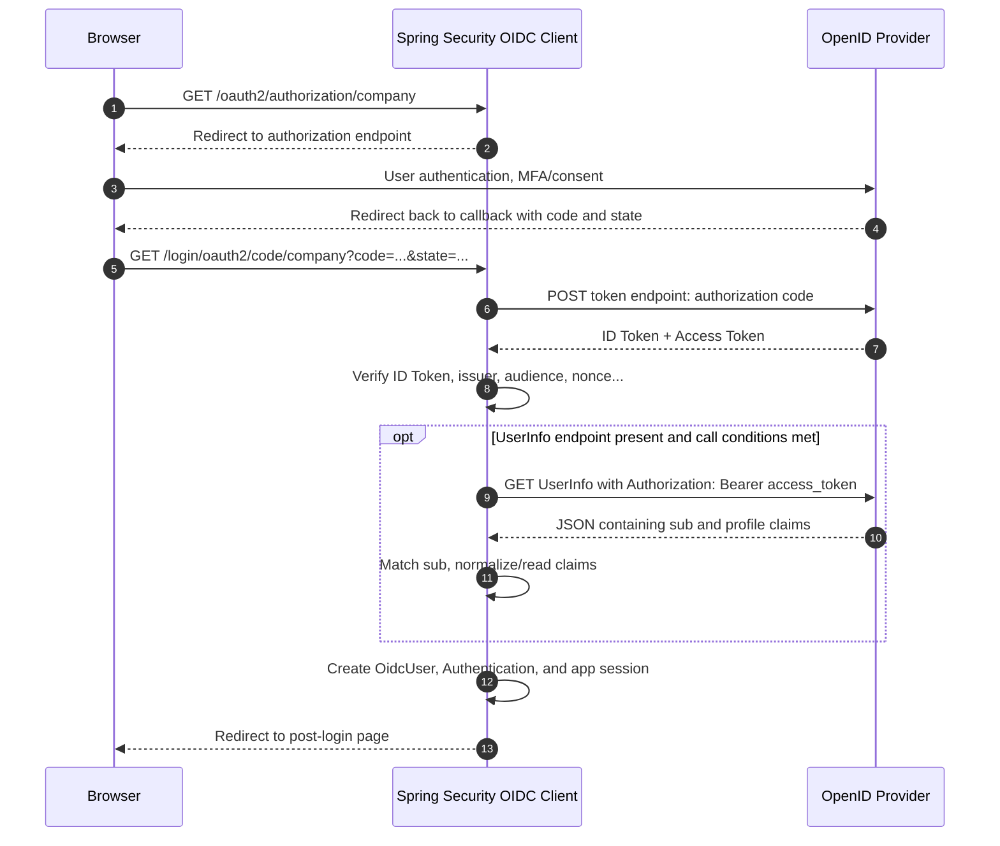
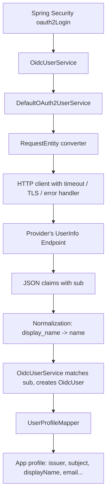

# 12.7. Customizing the Request, HTTP Client, and UserInfo Response Mapping

In **Spring Security OAuth 2.0 / OpenID Connect (OIDC) Client**, after a user logs in via the Authorization Code Flow, the application typically already has an **ID Token** containing the user's core identity. If the OpenID Provider (OP) supports the **UserInfo Endpoint**, the application can also use the **Access Token** to call a separate endpoint and receive additional profile claims such as name, email, avatar, or other provider-permitted information.

For an OIDC-compliant provider, Spring Security can handle most of that process through `OidcUserService` and its associated HTTP components. However, real-world applications sometimes need to:

- Add HTTP headers required by a provider, or alter how the UserInfo request is constructed within protocol bounds.
- Configure **timeouts, TLS, proxies, connection pools, error handling**, and HTTP client observability.
- Normalize JSON response representations, such as converting an extension claim `display_name` into an internal display name.
- Map a subset of claims from the ID Token/UserInfo to an **application profile** without turning provider data into uncontrolled access permissions.
- Distinguish UserInfo errors from ID Token verification, token endpoint, or login session errors.

Most importantly: **UserInfo does not replace the ID Token and is not an automatic source of business permissions**. Calling UserInfo must occur only within the context of a validly authenticated OIDC Client; the returned result must bind to the ID Token's exact `sub`, and profile data must be handled according to each claim's level of trust.

This lesson moves from the protocol to the extension points in **Spring Security Servlet**, accompanied by Java code examples and real-world provider integration scenarios.

## 1. Where Does the UserInfo Endpoint Fit in OIDC Login?

The OIDC Authorization Code Flow involves two distinct groups of data:

1. **ID Token** issued by the OP to the OIDC Client to verify the authentication event and identity.
2. **UserInfo Response** provided by the OP via the UserInfo Endpoint when the client sends an appropriate Access Token, containing profile claims the client is permitted to access.

Overall diagram:



In a Servlet web application, the browser **does not need to call the UserInfo Endpoint directly**. The call normally goes from the **Spring Boot backend to the OP**, using the Access Token received by the backend after token exchange. This lets the application manage tokens server-side rather than exposing Access Tokens to JavaScript merely to fetch a name or email.

UserInfo is not a mandatory step for every OIDC login. Whether it can and will be called depends on provider metadata, granted scopes, and the configuration/behavior of the `OidcUserService` in use.

### 1.1. How Do ID Token, Access Token, and UserInfo Differ?

| Component | Who Issues / Handles It? | Purpose |
|---|---|---|
| **Authorization code** | Issued by OP via browser redirect; exchanged by client at token endpoint. | Advances the flow from authorization endpoint to token endpoint. |
| **ID Token** | Issued by OP for OIDC Client; verified by client. | Proves OIDC authentication details, containing `iss`, `sub`, `aud`, and requested claims. |
| **Access Token** | Issued by Authorization Server to client. | Authorizes calling UserInfo or matching Resource Server APIs, per audience/scopes/policy. |
| **UserInfo Response** | Returned by UserInfo Endpoint upon receiving a valid Access Token. | Supplements profile claims for the authenticated subject. |
| **`OidcUser`** | Created by Spring Security after completing OIDC processing. | Principal used by the application in `Authentication`. |
| **Application profile** | Managed by business logic. | Internal identifier, user preferences, roles, and product-specific data. |

Do not use an Access Token in place of an ID Token to authenticate the OIDC Client merely because the Access Token happens to be a JWT. Conversely, never send an ID Token in UserInfo's Bearer header when the protocol requires an Access Token.

## 2. Basic UserInfo Request Under OIDC

The UserInfo Endpoint is a protected resource. A common invocation is HTTP GET over HTTPS with the Access Token in the Bearer header:

```http
GET /realms/company/protocol/openid-connect/userinfo HTTP/1.1
Host: id.example.org
Accept: application/json
Authorization: Bearer <access-token>
```

Illustrative response:

```http
HTTP/1.1 200 OK
Content-Type: application/json

{
  "sub": "person-2841",
  "name": "Nguyen Minh Anh",
  "preferred_username": "minh.anh",
  "email": "minh.anh@example.org",
  "email_verified": true,
  "picture": "https://cdn.example.org/avatars/person-2841.png",
  "department_code": "OPS"
}
```

This is illustrative data. Individual OPs may return fewer claims or include custom claims.

Under OIDC, a UserInfo Response **must contain `sub`**. The OIDC Client **must verify that `sub` in UserInfo matches the ID Token's `sub` exactly** before using any UserInfo data, preventing profile data from two different people from being mixed.

Comparison example:

```text
ID Token.sub    = person-2841
UserInfo.sub    = person-2841
Conclusion      = subject matches; proceed to process claims
```

Whereas:

```text
ID Token.sub    = person-2841
UserInfo.sub    = person-5000
Conclusion      = UserInfo must not be used for this session
```

Never fix a wrong `sub` by overwriting it with the ID Token's `sub` and treating the response as valid. That masks a serious security flaw.

### 2.1. How Is UserInfo Data Protected?

UserInfo typically uses HTTPS with a Bearer Access Token. A JSON response is not necessarily signed with JWS; its trustworthiness depends on a **trusted configured UserInfo Endpoint**, a purpose-appropriate Access Token, and a valid HTTPS connection.

Some providers may support **signed or encrypted UserInfo Responses** under OIDC. If a client is registered to receive that response format, the HTTP client/decoder must be implemented accordingly. Never assume an `application/jwt` or JWT UserInfo response is handled like plain JSON.

### 2.2. When Is UserInfo Not Called?

This can happen when:

- Metadata/provider configuration lacks a UserInfo Endpoint.
- Granted scopes do not satisfy `OidcUserService`'s retrieval condition for that version/configuration.
- The application intentionally relies on ID Token claims without querying UserInfo.
- The provider did not issue an Access Token authorized to call UserInfo.
- The flow is customized per organizational policy.

Do not assume every OIDC login issues at least one UserInfo HTTP request. When investigating missing claims, verify **whether UserInfo was actually called** before concluding response mapping failed.

## 3. Where Does Spring Boot Find the UserInfo Endpoint?

Typically, Spring Boot declares the OP's **issuer**:

```yaml
spring:
  security:
    oauth2:
      client:
        registration:
          company:
            provider: company-oidc
            client-id: ${OIDC_CLIENT_ID}
            client-secret: ${OIDC_CLIENT_SECRET}
            authorization-grant-type: authorization_code
            client-authentication-method: client_secret_basic
            redirect-uri: "{baseUrl}/login/oauth2/code/{registrationId}"
            scope:
              - openid
              - profile
              - email
        provider:
          company-oidc:
            issuer-uri: https://id.example.org/realms/company
```

When the OP supports OIDC Discovery, metadata can publish:

```json
{
  "issuer": "https://id.example.org/realms/company",
  "authorization_endpoint": "https://id.example.org/realms/company/protocol/openid-connect/auth",
  "token_endpoint": "https://id.example.org/realms/company/protocol/openid-connect/token",
  "userinfo_endpoint": "https://id.example.org/realms/company/protocol/openid-connect/userinfo",
  "jwks_uri": "https://id.example.org/realms/company/protocol/openid-connect/certs"
}
```

From this information, Spring Security learns which UserInfo URI to call. The relationship between properties should be clear:

| Configuration Group | Details |
|---|---|
| `spring.security.oauth2.client.registration.company.*` | `client-id`, `client-secret`, `scope`, `authorization-grant-type`, redirect URI, and client authentication method. |
| `spring.security.oauth2.client.provider.company-oidc.*` | `issuer-uri`, `user-info-uri`, `user-name-attribute`, and provider endpoints/metadata. |

If you must declare the UserInfo URI manually for a specific provider, the corresponding property is:

```properties
spring.security.oauth2.client.provider.company-oidc.user-info-uri=https://id.example.org/realms/company/protocol/openid-connect/userinfo
```

This is a **provider property**, not `registration.company.user-info-uri`.

### 3.1. Does `user-name-attribute` Replace `sub`?

For **non-OIDC** OAuth2 Login, a provider may return JSON keyed by `id` or `login` instead of a standard name. `user-name-attribute` allows Spring Security to select the identifier key in OAuth2 user data.

For OIDC, **`sub` is the standard subject identifier**; configuring `user-name-attribute` does not allow bypassing the `sub` rule between ID Token and UserInfo. Never replace `sub` with email, username, or employee code to "work around" UserInfo missing `sub`.

### 3.2. Scopes and Claims Are Not Equivalent

Common standard OIDC scopes:

- `openid`: requests OIDC.
- `profile`: requests standard profile claims that the OP can supply.
- `email`: requests email/email_verified per OP policy.
- `address`, `phone`: request the corresponding claim groups if supported by the OP.

**Requested scopes do not guarantee claims are returned.** A provider may return only `sub`, require consent, or restrict claims by client/user. Claims may appear in the ID Token, UserInfo, or not be released at all.

If you need a custom claim like `department_code`, check the provider documentation, scope/mapper/claim configuration at the OP, and UserInfo availability; mapping code in the application cannot force a provider to emit data it does not supply.

## 4. Key Extension Points in Spring Security Servlet

In `oauth2Login()`, components have distinct roles:

| Component | Responsibility |
|---|---|
| `OAuth2LoginAuthenticationFilter` | Receives the authorization code callback at the application. |
| `OidcAuthorizationCodeAuthenticationProvider` | Completes OIDC authentication, including ID Token and UserInfo when configuration permits. |
| `OidcUserService` | Loads/processes OIDC UserInfo and constructs `OidcUser`. |
| `DefaultOAuth2UserService` | Implements loading OAuth2 User attributes from a UserInfo URI via an HTTP client; also used appropriately by `OidcUserService`. |
| `OAuth2UserService<OidcUserRequest, OidcUser>` | Contract for a service handling OIDC users; suited for wrapping/decorating. |
| `OAuth2UserService<OAuth2UserRequest, OAuth2User>` | Contract for loading OAuth2 user attributes, used for non-OIDC and as a delegate in certain OIDC flows. |
| `DefaultOidcUser` / `OidcUser` / `OidcUserInfo` | OIDC principal and claims model. |
| `RestOperations` / `RestTemplate` and HTTP request converter | Points for configuring request headers, HTTP client, timeouts, and HTTP response handling. |
| `AuthenticationSuccessHandler` | Routes after login succeeds; not a place to replace `sub` verification. |

**Distinguishing configuration APIs:**

- `.oauth2Login(oauth2 -> oauth2.userInfoEndpoint(userInfo -> userInfo.oidcUserService(...)))` is for the **OIDC user service**.
- `.oauth2Login(oauth2 -> oauth2.userInfoEndpoint(userInfo -> userInfo.userService(...)))` is for the **OAuth2 user service** of non-OIDC logins.

Do not plug an `OAuth2UserService<OAuth2UserRequest, OAuth2User>` into a spot expecting `OAuth2UserService<OidcUserRequest, OidcUser>` without an appropriate adapter. The generic types and lifecycles of the two login flows differ.

### 4.1. Typical Processing Chain

```text
HTTP callback with authorization code
  |
  v
OAuth2LoginAuthenticationFilter
  |
  v
Token endpoint -> ID Token + Access Token
  |
  v
OIDC ID Token validation
  |
  v
OidcUserService
  |
  +-> DefaultOAuth2UserService (if UserInfo is retrieved)
  |     |
  |     +-> RequestEntity converter
  |     +-> RestOperations/HTTP client
  |     +-> UserInfo response JSON
  |     +-> Attributes converter (if supported by configuration)
  |
  v
Match sub; create OidcUser
  |
  v
Authentication / SecurityContext / application session
```

Do not manually call UserInfo from a controller before having a valid Access Token and treat it as a replacement for login. Customizations should be placed at the proper framework extension points.

## 5. Baseline OIDC Login Configuration

Maven dependencies:

```xml
<dependencies>
    <dependency>
        <groupId>org.springframework.boot</groupId>
        <artifactId>spring-boot-starter-web</artifactId>
    </dependency>
    <dependency>
        <groupId>org.springframework.boot</groupId>
        <artifactId>spring-boot-starter-security</artifactId>
    </dependency>
    <dependency>
        <groupId>org.springframework.boot</groupId>
        <artifactId>spring-boot-starter-oauth2-client</artifactId>
    </dependency>
</dependencies>
```

A simple Servlet login configuration:

```java
import org.springframework.context.annotation.Bean;
import org.springframework.context.annotation.Configuration;
import org.springframework.security.config.Customizer;
import org.springframework.security.config.annotation.web.builders.HttpSecurity;
import org.springframework.security.web.SecurityFilterChain;

@Configuration
public class SecurityConfiguration {

    @Bean
    SecurityFilterChain securityFilterChain(HttpSecurity http) throws Exception {
        http
            .authorizeHttpRequests(auth -> auth
                .requestMatchers("/", "/public/**").permitAll()
                .anyRequest().authenticated()
            )
            .oauth2Login(Customizer.withDefaults());

        return http.build();
    }
}
```

With `openid` in `scope`, Spring Security handles OIDC login and can fetch UserInfo via provider metadata. Many projects **do not need any UserInfo customization** if standard claims already satisfy the application.

When customization is needed, extend each layer **with a clear target**, rather than replacing the entire protocol flow. A UserInfo HTTP error is no reason to drop ID Token validation or switch to trusting raw callback query parameters.

## 6. Customizing the UserInfo Request: Adding Valid HTTP Headers

Some providers require extra headers such as `X-Client-Application`, `Accept`, or an internal correlation ID. The hook point can be `DefaultOAuth2UserService#setRequestEntityConverter`.

Example of a service dedicated to OIDC UserInfo:

```java
import java.net.URI;
import java.util.List;

import org.springframework.http.MediaType;
import org.springframework.http.RequestEntity;
import org.springframework.security.oauth2.client.userinfo.DefaultOAuth2UserService;
import org.springframework.security.oauth2.client.userinfo.OAuth2UserRequest;
import org.springframework.security.oauth2.client.userinfo.OidcUserService;
import org.springframework.security.oauth2.client.userinfo.OidcUserRequest;
import org.springframework.security.oauth2.client.userinfo.OAuth2UserService;
import org.springframework.security.oauth2.core.oidc.user.OidcUser;

public final class UserInfoServices {

    private UserInfoServices() { }

    public static OAuth2UserService<OidcUserRequest, OidcUser>
            oidcUserServiceWithHeader() {

        DefaultOAuth2UserService userInfoDelegate =
                new DefaultOAuth2UserService();

        userInfoDelegate.setRequestEntityConverter(
            (OAuth2UserRequest request) -> {
                String uri = request.getClientRegistration()
                    .getProviderDetails()
                    .getUserInfoEndpoint()
                    .getUri();

                URI endpoint = URI.create(uri);

                return RequestEntity.get(endpoint)
                    .headers(headers -> {
                        headers.setBearerAuth(
                            request.getAccessToken().getTokenValue()
                        );
                        headers.setAccept(List.of(MediaType.APPLICATION_JSON));
                        headers.set("X-Client-Application", "orders-web");
                    })
                    .build();
            }
        );

        OidcUserService oidcUserService = new OidcUserService();
        oidcUserService.setOauth2UserService(userInfoDelegate);

        return oidcUserService;
    }
}
```

Here:

1. The UserInfo endpoint URI is retrieved from the **trusted configured `ClientRegistration`**, never from query parameters or unverified token headers.
2. The Access Token is sent via `Authorization: Bearer ...`, not a client secret or ID Token.
3. `Accept: application/json` tells the provider what response format the application expects.
4. Extra headers are added only if required by the provider contract and reviewed for security.
5. `OidcUserService` still executes required OIDC logic; the custom delegate does not bypass the `sub` matching rule.

**Limitation of the example:** it demonstrates a JSON GET request suited for providers supporting that approach. A provider requiring UserInfo POST or JWT responses demands appropriate converter/response handling; never switch methods arbitrarily just for the sake of "customizing".

### 6.1. Why Be Careful When Building RequestEntity Yourself?

When supplying a custom request converter, the application becomes responsible for keeping all required parts intact. A faulty converter can:

- Omit `Authorization: Bearer` and receive `401 Unauthorized`.
- Mistakenly send the **ID Token** instead of the Access Token.
- Set a Content-Type/Accept or HTTP method unsupported by the provider.
- Inject a URL received from the browser and accidentally leak tokens to a third party.
- Accidentally log the Access Token during debug/tracing.
- Attach headers conflicting with security policies or gateways.

Therefore, **customize only when genuinely needed**, and use HTTPS to a trusted endpoint. If no special headers or behaviors are needed, keep Spring Security's default request converter.

### 6.2. Do Not Arbitrarily Redirect UserInfo to a New URL

With multiple OPs, each registration's UserInfo path must reside in controlled provider configuration. Never write:

```java
// WRONG: sending the Access Token to a URL supplied directly by the user
String userSuppliedUrl = request.getParameter("userinfo_url");
// Then calling that URL with Authorization: Bearer ...
```

This creates **Access Token leakage and SSRF** risks. Endpoint origins must come from verified issuer/metadata or a strict configuration allowlist. If a provider uses per-tenant UserInfo endpoints, the tenant-to-provider/issuer mapping must be designed and governed at configuration time, never driven by an untrusted callback parameter.

## 7. Customizing the HTTP Client: Timeouts, TLS, Proxy, and Errors

A UserInfo call can fail due to network/TLS issues even after token exchange succeeds. Without time bounds, login requests can hang when the UserInfo endpoint is too slow.

In Spring Security versions that provide `DefaultOAuth2UserService#setRestOperations(RestOperations)`, you can supply a configured `RestTemplate`. Example:

```java
import org.springframework.http.client.SimpleClientHttpRequestFactory;
import org.springframework.security.oauth2.client.http.OAuth2ErrorResponseErrorHandler;
import org.springframework.security.oauth2.client.userinfo.DefaultOAuth2UserService;
import org.springframework.security.oauth2.client.userinfo.OidcUserService;
import org.springframework.security.oauth2.client.userinfo.OAuth2UserService;
import org.springframework.security.oauth2.client.userinfo.OidcUserRequest;
import org.springframework.security.oauth2.core.oidc.user.OidcUser;
import org.springframework.web.client.RestTemplate;

public final class TimedUserInfoService {

    private TimedUserInfoService() { }

    public static OAuth2UserService<OidcUserRequest, OidcUser>
            create() {

        SimpleClientHttpRequestFactory requestFactory =
                new SimpleClientHttpRequestFactory();
        requestFactory.setConnectTimeout(3000);
        requestFactory.setReadTimeout(5000);

        RestTemplate restTemplate = new RestTemplate(requestFactory);
        restTemplate.setErrorHandler(
            new OAuth2ErrorResponseErrorHandler()
        );

        DefaultOAuth2UserService userInfoDelegate =
                new DefaultOAuth2UserService();
        userInfoDelegate.setRestOperations(restTemplate);

        OidcUserService oidcUserService = new OidcUserService();
        oidcUserService.setOauth2UserService(userInfoDelegate);

        return oidcUserService;
    }
}
```

This is an **example following APIs available in Spring Security versions that use `RestOperations`**. When a project runs a different version or uses a newer-generation HTTP client, select the equivalent mechanism supported by that version.

Meaning:

- `setConnectTimeout(3000)`: bounds connection wait time on the illustrative request factory, in milliseconds.
- `setReadTimeout(5000)`: bounds response read wait time on the corresponding request factory.
- `OAuth2ErrorResponseErrorHandler`: handles OAuth 2.0 error responses as Spring Security expects; never replace it with a handler that swallows all errors.
- `setRestOperations`: applies the configured HTTP client to `DefaultOAuth2UserService`.

Timeout values of **3 seconds and 5 seconds are illustrative only**; real values depend on network latency, SLAs, and login UX.

### 7.1. Why Not Use an Arbitrary `RestTemplate`?

If you configure a new HTTP client without preserving the conditions Spring Security requires, you can encounter:

- Failure to parse JSON responses due to missing message converters.
- Failure to translate OAuth2 UserInfo errors into the proper exception types.
- Missing Bearer token on UserInfo requests.
- Overly permissive TLS handling, such as trusting all certificates or disabling hostname verification.
- Unbounded retries on POST/GET overloading the provider.
- Sending tokens to hosts outside the trusted issuer configuration.

A `RestTemplate` created with the default constructor normally includes common message converters when JSON dependencies are on the classpath. If replacing the entire converter list or response/error handlers, restore the components required by the UserInfo protocol.

### 7.2. Connection Pooling and Proxies

`SimpleClientHttpRequestFactory` is suited for simple timeout examples. In production, many applications choose an HTTP client supporting **connection pooling**, DNS timeouts, keep-alive, proxies, TLS, and metrics per infrastructure standards.

When applying these:

1. Configure pool/connection limits so concurrent logins do not exhaust resources.
2. Set connect timeouts, response timeouts, and bounded retry/backoff policies.
3. Verify the trust store, hostname verification, and provider CA.
4. If routing through a forward proxy, allow only trusted proxies and prevent Access Tokens from being logged.
5. Restrict connections to the configured/allowlisted UserInfo URI, and do not follow unexpected redirects that could expose the `Authorization` header.
6. Separate metrics for timeouts and HTTP 401/403/429/5xx to diagnose root causes accurately.

Proxy/pool configuration code depends on the HTTP client library and Spring version, so you do not have to cram everything into a single bean if infrastructure already provides standard configuration.

### 7.3. Should UserInfo Be Retried on Errors?

Not every error should be retried:

| Error | Resolution |
|---|---|
| **401 Unauthorized** | Check whether the Access Token has the right audience/scopes, is still valid, and is sent properly as Bearer; retrying the same token usually will not help. |
| **403 Forbidden** | Check permissions and OP policy; blind retries do not grant extra scopes. |
| **429 Too Many Requests** | Respect limits/`Retry-After` if present; do not create retry loops during login. |
| **5xx or transient timeout** | Limited retries may be considered if policy allows, but weigh login latency and avoid amplifying load. |
| **TLS/certificate error** | Fix trust and network config; never disable TLS verification to retry. |
| **Invalid JSON/claims** | Do not retry indefinitely; diagnose the response contract and mapping. |

If UserInfo is an optional data source, the application can **design** a fallback strategy relying solely on verified ID Token data. However, fallbacks must be deliberate decisions aligned with security policy and profile needs; **never ignore mismatched `sub` responses or rejected tokens as minor errors**.

## 8. Wiring a Custom `OidcUserService` into `oauth2Login()`

From the earlier examples, you can expose an `OAuth2UserService<OidcUserRequest, OidcUser>` bean for Spring Security to use:

```java
import org.springframework.context.annotation.Bean;
import org.springframework.context.annotation.Configuration;
import org.springframework.security.config.annotation.web.builders.HttpSecurity;
import org.springframework.security.oauth2.client.userinfo.OAuth2UserService;
import org.springframework.security.oauth2.client.userinfo.OidcUserRequest;
import org.springframework.security.oauth2.core.oidc.user.OidcUser;
import org.springframework.security.web.SecurityFilterChain;

@Configuration
public class SecurityConfiguration {

    @Bean
    OAuth2UserService<OidcUserRequest, OidcUser> customOidcUserService() {
        return TimedUserInfoService.create();
    }

    @Bean
    SecurityFilterChain securityFilterChain(
            HttpSecurity http,
            OAuth2UserService<OidcUserRequest, OidcUser> customOidcUserService
    ) throws Exception {

        http
            .authorizeHttpRequests(auth -> auth
                .requestMatchers("/", "/public/**").permitAll()
                .anyRequest().authenticated()
            )
            .oauth2Login(oauth2 -> oauth2
                .userInfoEndpoint(userInfo -> userInfo
                    .oidcUserService(customOidcUserService)
                )
            );

        return http.build();
    }
}
```

**Code snippets in this lesson are standalone examples or components to assemble once in a real application.** Do not register multiple `SecurityFilterChain` beans simultaneously with identical matchers merely because each example includes a configuration class.

Here:

- `customOidcUserService` retains the OIDC types: takes `OidcUserRequest` and returns `OidcUser`.
- `TimedUserInfoService.create()` provides an `OidcUserService` wired with a `DefaultOAuth2UserService` using HTTP client timeouts.
- `.oidcUserService(...)` tells Spring Security to use this service when loading the OIDC user.
- Callback handling, code exchange, and ID Token verification remain managed by Spring Security.

### 8.1. When Should You Wrap `OidcUserService` Instead of Replacing It Completely?

When you need profile enrichment, internal data normalization, or login observability, the **delegate/wrapper** pattern is far easier for preserving protocol checks.

Example:

```java
import org.springframework.security.oauth2.client.userinfo.OAuth2UserService;
import org.springframework.security.oauth2.client.userinfo.OidcUserRequest;
import org.springframework.security.oauth2.client.userinfo.OidcUserService;
import org.springframework.security.oauth2.core.oidc.user.OidcUser;

public final class AuditedOidcUserService
        implements OAuth2UserService<OidcUserRequest, OidcUser> {

    private final OidcUserService delegate = new OidcUserService();

    @Override
    public OidcUser loadUser(OidcUserRequest request) {
        OidcUser user = delegate.loadUser(request);

        // Act only after the delegate has completed OIDC processing:
        String issuer = user.getIdToken().getIssuer().toString();
        String subject = user.getSubject();

        // Can use (issuer, subject) for internal profile mapping.
        // Do not log Access Token, ID Token, secret, or full UserInfo.
        return user;
    }
}
```

This is a minimal wrapper so it does not yet persist profiles; the goal is to illustrate where an internal service can hook in after the delegate finishes. If you need HTTP timeouts and request customization, use the delegate configured in the earlier section instead of instantiating `new OidcUserService()` without that configuration.

**Never catch a `sub`-verification exception and build a dummy `OidcUser` to let login continue.** Wrappers must preserve Spring Security's verification steps and only adjust application data per policy.

## 9. Mapping UserInfo JSON: From OP Claims to Application Structure

A UserInfo response commonly contains standard claims:

```json
{
  "sub": "person-2841",
  "name": "Nguyen Minh Anh",
  "given_name": "Minh Anh",
  "family_name": "Nguyen",
  "preferred_username": "minh.anh",
  "email": "minh.anh@example.org",
  "email_verified": true,
  "picture": "https://cdn.example.org/avatar/person-2841.png",
  "updated_at": 1760000000
}
```

In addition, the provider may return extension claims such as `department_code` or `tenant_code` per its documentation.

The application may want to represent the data via an immutable type:

```java
public record UserProfile(
    String issuer,
    String subject,
    String displayName,
    String email,
    boolean emailVerified,
    String departmentCode
) { }
```

You do not necessarily have to alter `OidcUser` for the application to have an internal profile. A safe approach is to **read the verified principal and map it to a DTO/domain model**.

### 9.1. Mapping After OIDC Login

Example mapper:

```java
import org.springframework.security.oauth2.core.oidc.user.OidcUser;
import org.springframework.stereotype.Component;

@Component
public class UserProfileMapper {

    public UserProfile fromOidcUser(OidcUser user) {
        String issuer = user.getIdToken().getIssuer().toString();
        String subject = user.getSubject();

        String displayName = optionalString(
            user.getClaims().get("name")
        );
        if (displayName == null || displayName.isBlank()) {
            displayName = optionalString(
                user.getClaims().get("preferred_username")
            );
        }
        if (displayName == null || displayName.isBlank()) {
            displayName = subject;
        }

        String email = optionalString(user.getClaims().get("email"));
        boolean verified = Boolean.TRUE.equals(
            user.getClaims().get("email_verified")
        );
        String departmentCode = optionalString(
            user.getClaims().get("department_code")
        );

        return new UserProfile(
            issuer, subject, displayName, email,
            verified, departmentCode
        );
    }

    private static String optionalString(Object value) {
        return value instanceof String s ? s : null;
    }
}
```

Rationale behind the decisions:

- **`issuer + subject`** is a better identity-linking key than email/username, because emails and names can change or collide in multi-issuer systems.
- `displayName` is display data, so it has fallbacks when `name` is absent.
- `emailVerified` is `true` only if the OP supplied a properly typed Boolean with the corresponding meaning.
- `departmentCode` is a supplemental claim; it does not automatically become an admin role.
- Claims may come from the ID Token or UserInfo depending on how Spring Security builds `OidcUser`; **never assume a claim is always present**.

If there is a collision on the same claim name between sources, clarify the source-selection policy. Do not blindly prefer UserInfo for every claim if it is critical data used for authentication/authorization. For `sub`, always enforce consistency with the ID Token.

### 9.2. Controller Using the Mapper

```java
import org.springframework.security.core.annotation.AuthenticationPrincipal;
import org.springframework.security.oauth2.core.oidc.user.OidcUser;
import org.springframework.web.bind.annotation.GetMapping;
import org.springframework.web.bind.annotation.RestController;

@RestController
public class ProfileController {

    private final UserProfileMapper mapper;

    public ProfileController(UserProfileMapper mapper) {
        this.mapper = mapper;
    }

    @GetMapping("/me")
    public UserProfile currentUser(
            @AuthenticationPrincipal OidcUser user) {
        return mapper.fromOidcUser(user);
    }
}
```

The `/me` endpoint runs **after** Spring Security has completed OIDC login. It does not need to exchange codes directly or re-call UserInfo on every request, unless the application has a specifically designed profile-synchronization requirement.

**Personal data note:** `email`, `picture`, and `department_code` should only be returned from endpoints/objects matching the caller's permissions; the example above assumes `/me` is protected by authentication and the subject only views their own information. Sensitive fields should not be exposed by default across all APIs.

## 10. Normalizing Provider-Specific Responses at the `DefaultOAuth2UserService` Layer

Some providers return responses with custom fields:

```json
{
  "sub": "person-2841",
  "display_name": "Nguyen Minh Anh",
  "mail": "minh.anh@example.org",
  "employee_group": "ops"
}
```

Suppose this is an OP with OIDC-compliant UserInfo (still having a valid `sub`), yet some claims have non-standard names. The application can **normalize those extra fields** without modifying `sub`.

In Spring Security versions supporting `DefaultOAuth2UserService#setAttributesConverter`, an example:

```java
import java.util.LinkedHashMap;
import java.util.Map;

import org.springframework.security.oauth2.client.userinfo.DefaultOAuth2UserService;
import org.springframework.security.oauth2.client.userinfo.OidcUserService;
import org.springframework.security.oauth2.client.userinfo.OAuth2UserService;
import org.springframework.security.oauth2.client.userinfo.OidcUserRequest;
import org.springframework.security.oauth2.core.oidc.user.OidcUser;

public final class NormalizingOidcService {

    private NormalizingOidcService() { }

    public static OAuth2UserService<OidcUserRequest, OidcUser>
            create() {

        DefaultOAuth2UserService userInfoDelegate =
                new DefaultOAuth2UserService();

        userInfoDelegate.setAttributesConverter(request -> attributes -> {
            Map<String, Object> normalized =
                    new LinkedHashMap<>(attributes);

            Object displayName = normalized.get("display_name");
            if (displayName instanceof String name
                    && !normalized.containsKey("name")) {
                normalized.put("name", name);
            }

            Object mail = normalized.get("mail");
            if (mail instanceof String email
                    && !normalized.containsKey("email")) {
                normalized.put("email", email);
            }

            return normalized;
        });

        OidcUserService service = new OidcUserService();
        service.setOauth2UserService(userInfoDelegate);

        return service;
    }
}
```

This snippet uses the `setAttributesConverter` API in versions that support it; if your project uses a version without that method, apply the appropriate extension point instead of copying the code verbatim.

Principles:

1. Only **supplement/normalize claims** per the provider contract; avoid overwriting an already-present standard claim unless an explicit rule dictates it.
2. Never remove or alter `sub` from UserInfo to bypass subject checks.
3. Never flip `email_verified` from `false`/absent to `true` merely because an email address is present.
4. Never use provider data to auto-grant sensitive authorities without permitted mapping and policy.
5. If a provider returns a non-standard structure missing `sub` entirely, that is an OIDC contract issue to fix at the source or through a carefully evaluated adapter, never a reason to skip subject checking.

### 10.1. Nested UserInfo Data

A non-standard non-UserInfo API might return:

```json
{
  "profile": {
    "id": "person-2841",
    "displayName": "Nguyen Minh Anh"
  }
}
```

This response is **not OIDC-compliant UserInfo JSON** if it lacks `sub` at the required level. Do not merely rename `profile.id` to `sub` in a mapping step and treat the ID Token/UserInfo as properly verified.

If the OP genuinely has compliant UserInfo yet the application also needs a separate profile API, you can:

- Use standard UserInfo to complete OIDC authentication.
- Then call the **separate profile API** with an appropriate Access Token, through a separate HTTP client.
- Bind the profile API data to the **verified issuer/subject** per an explicit contract.
- Check Access Token audience/scopes, authorization, and privacy for that separate API.

This is usually a cleaner design than forcing a custom API into the UserInfo Endpoint slot when it does not conform to OIDC.

## 11. UserInfo `sub`: An Invariant Check That Must Not Be Skipped

A critical OIDC rule:

```text
ID Token.sub == UserInfo.sub
```

Suppose there is a verified ID Token:

```json
{
  "iss": "https://id.example.org/realms/company",
  "sub": "person-2841",
  "aud": "orders-web",
  "exp": 1760000300,
  "iat": 1760000000
}
```

And UserInfo:

```json
{
  "sub": "person-5000",
  "email": "someone-else@example.org"
}
```

This is a mismatch. **Do not use the email in that UserInfo to log in or link profiles for `person-2841`.** A compliant OIDC implementation must reject a response whose subject does not match.

Therefore, when writing a custom `OidcUserService`:

- **Delegate** to Spring Security's OIDC mechanism to preserve `sub` checks and related controls.
- Never construct `DefaultOidcUser` manually from uncompared JSON.
- Never catch and ignore subject mismatch errors.
- Never decide `sub` by email or employee number when the ID Token already carries a standard `sub`.

### 11.1. Why Does `sub` Matter More Than Email?

In a multi-provider system:

```text
Issuer A: https://employees.example.org
    sub = 2841
    email = person@example.org

Issuer B: https://partners.example.org
    sub = 9100
    email = person@example.org
```

These can be two distinct identities even though the emails match. `sub` is the subject identifier within the issuer's context; thus the **`(issuer, sub)`** pair is the appropriate basis for linking internal accounts.

Additionally, email can change, be unverified, or not be returned. Never use an unverified email as proof to automatically bind privileges to a privileged account.

### 11.2. What Does `email_verified` Mean?

`email_verified` is information from the OP regarding email verification status under the OP's own policy. A `true` value is useful, yet it does not mean email becomes an immutable identifier key or that the user is automatically granted organizational permissions.

For high-security systems, evaluate issuer trustworthiness, the email verification process, mutability/revocation possibilities, and internal account mapping. Roles/permissions must still be determined by an appropriate authorization source.

## 12. Mapping UserInfo to Authorities and Roles: Security Boundaries

Some systems want to use claims like:

```json
{
  "sub": "person-2841",
  "department_code": "OPS",
  "groups": ["operations", "readers"]
}
```

to grant access into the application. This is no longer just **response mapping**; it has become **authorization mapping**.

Distinguish clearly:

- **Profile mapping:** displaying name, email, avatar, department.
- **Identity linking:** mapping `(issuer, sub)` to an internal user.
- **Authority mapping:** deciding application roles/permissions based on a trusted source and governed policy.

If a provider returns `groups` without a security contract defining its meaning, the application must not automatically add `ROLE_ADMIN` merely because the array contains the string `admin`.

A safe implementation pattern is typically:

1. Complete full OIDC login verification.
2. Identify the internal principal from issuer and subject.
3. Apply role-mapping policy per allowed provider/tenant/group.
4. When needed, reconcile roles against an internal permission database or policy engine.
5. Build authorities via an appropriate extension point without corrupting `OidcUser` or bypassing UserInfo checks.
6. Separate permission synchronization from profile display.

You can use a custom `OAuth2UserService<OidcUserRequest, OidcUser>`, `GrantedAuthoritiesMapper`, or other business components depending on requirements; pick APIs supported by your project's Spring Security version. Large systems are often better served by having the backend pull roles from a dedicated permission store rather than relying wholly on UserInfo.

## 13. Customizing HTTP Calls Without Breaking Trust Boundaries

Because UserInfo requests carry a **Bearer Access Token**, any custom HTTP client is responsible for protecting the token.

### 13.1. Never Send Bearer Tokens to Untrusted Hosts

Dangerous mistake:

```java
// PRINCIPALLY WRONG: destination taken directly from user input
URI uri = URI.create(userProvidedUrl);
// The HTTP client then sends Authorization: Bearer to uri
```

This can leak the Access Token to an attacker's server or probe internal resources. Endpoints must come from **verified provider metadata** or a tightly controlled configuration allowlist.

### 13.2. Never Disable TLS Verification to "Fix Errors"

If a staging environment uses self-signed certificates or an internal CA, the proper solution is configuring an organization-approved **trust store**/CA chain, not disabling hostname verification or trusting all certificates.

Beyond token-theft risk, a UserInfo response tampered with in transit can corrupt profiles and cause `sub` discrepancies.

### 13.3. Be Careful with HTTP Redirects

If the UserInfo Endpoint returns a redirect to another host, the HTTP client needs a redirect policy that protects the `Authorization` header. Never automatically forward Bearer tokens to hosts outside the trusted provider's scope.

When an endpoint moves, update metadata/configuration through a secure process rather than letting uncontrolled redirects silently swap the UserInfo source.

### 13.4. Be Careful When Caching Profile Information

Profiles can change over time. If the application caches UserInfo:

- Use a cache key containing issuer, subject, and necessary context; never email alone.
- Never cache the entire Access Token as a key exposed in logs or metrics.
- Set TTL and refresh policies aligned with privacy requirements.
- Never treat a cached profile as proof that the login session is still valid.
- For claims tied to access permissions, apply a dedicated cache/revocation model per authorization policy.

Receiving UserInfo at login does not mean it must be called on every request. Conversely, if the application requires continuously fresh profile data, design an explicit sync rather than relying on the initial login.

## 14. UserInfo Errors: Impact on the Login Process

Some common scenarios:

| Status | Meaning | Investigation Direction |
|---|---|---|
| `401 Unauthorized` | Access Token rejected at UserInfo endpoint. | Check exact Access Token, expiry, audience/scopes/policy, and Bearer header. |
| `403 Forbidden` | Token or client is not permitted to access UserInfo per policy. | Check scopes, consent, provider policy. |
| `404 Not Found` | Wrong UserInfo URI or endpoint not provided. | Check discovery metadata and provider configuration. |
| `429 Too Many Requests` | Rate-limited. | Bounded throttle/retry; reduce unnecessary logins/calls. |
| `5xx` | Provider experiencing transient errors. | Monitor SLA/timeouts; safely designed fallback strategy if applicable. |
| Timeout / connection refused | Cannot connect or wait exceeded limit. | Proxy, DNS, TLS, firewall, pool, timeouts. |
| Response is not expected JSON | Provider changed contract or client misconfigured for response type. | Content-Type, message converters, version/profile. |
| JSON missing `sub` or `sub` differs from ID Token | Response violates OIDC constraints. | Check provider mapping, API returning wrong user, wrong token context; never drop validation. |
| Claims lack `email` | Provider withholds claim due to scope/policy or user has no email. | Check scopes, consent, and claim source. |
| Login succeeds yet profile data does not update | App uses cached UserInfo/session or stale mapper. | Profile refresh and cache policy. |

### 14.1. Do Not Confuse UserInfo Errors with Token Endpoint Errors

If the backend has not yet received an ID Token/Access Token due to `invalid_client`, `invalid_grant`, or an unavailable token endpoint, **UserInfo has no basis to be called yet**. Fix token exchange first.

If the ID Token was already verified yet UserInfo returns 401, that is an **Access Token/UserInfo endpoint** issue, not necessarily a user-authentication failure at the OP.

If UserInfo succeeds yet the post-login session disappears, inspect `SecurityContextRepository` and session cookies rather than just claim mapping.

### 14.2. Should Login Be Allowed When the UserInfo Endpoint Errors?

The answer depends on product needs and policy:

- If the application only needs the verified ID Token to log in and UserInfo merely supplies avatar/display name, a controlled fallback based on the ID Token may be considered.
- If the application requires a mandatory UserInfo claim for account linking or security decisions, allowing login to proceed without that claim may be unsafe.
- If UserInfo returns a mismatched `sub`, never treat it as an optional error and proceed to use that response.
- If a fallback is applied, record the error without leaking tokens and provide a way to sync the profile later.

Never use handling like:

```java
try {
    return userInfoService.loadUser(request);
} catch (Exception ignored) {
    return trustUncheckedClaimsFromUserInfoOrCallback();
}
```

This snippet illustrates **what never to do**. Fallbacks must preserve existing authentication guarantees, never turning a security exception into accepting unverified identity.

## 15. Response Mapping Issues When Providers Diverge from Standards

### 15.1. Provider Returns Claims Nested Inside `data`

An in-house API might return:

```json
{
  "data": {
    "id": "person-2841",
    "fullName": "Nguyen Minh Anh",
    "mailAddress": "minh.anh@example.org"
  }
}
```

This is not a standard OIDC UserInfo response because `sub` is absent at the required level. If an organization wants to connect that provider as an OP, fix the standard contract **at the OP or a security-reviewed adapter**, ensuring `sub` matches the ID Token.

Never simply do:

```text
data.id -> sub
data.mailAddress -> email
=> treat as fully valid OIDC UserInfo
```

If this profile API is not UserInfo, call it in the **post-login business layer** with an appropriate token and map it to an internal `UserProfile`. That keeps OIDC authentication separate from profile data integration.

### 15.2. Provider Returns Claims with Non-Standard Data Types

Example response:

```json
{
  "sub": "person-2841",
  "email": "minh.anh@example.org",
  "email_verified": "true"
}
```

In the OIDC model, `email_verified` is represented as a Boolean. The string `"true"` has a different data type. For a non-compliant provider, a type-converting mapper may be needed, with clear rules:

- Which values are converted?
- Are `"TRUE"`, `1`, or other variants accepted?
- If unparseable, what is the safe default?
- Does this rule affect using the claim to grant permissions?

Never assume every value other than `false` means the email is verified. A conservative approach treats only a properly typed `Boolean.TRUE` as verified when no audited adapter is present.

### 15.3. Provider Returns Different Claim Names Across Environments

Dev has `department_code`, production has `departmentId`. This is a data-contract issue. Mappers need an explicit adaptation/versioning policy rather than relying on incidental field names.

When a claim affects business logic, check presence/data-type expectations and missing-data scenarios. Never auto-grant elevated privileges when a field is omitted.

## 16. Multiple OIDC Providers and Consistent Profile Mapping

An application can support two registrations:

```yaml
spring:
  security:
    oauth2:
      client:
        registration:
          employee:
            provider: employee-idp
            client-id: ${EMPLOYEE_CLIENT_ID}
            client-secret: ${EMPLOYEE_CLIENT_SECRET}
            authorization-grant-type: authorization_code
            redirect-uri: "{baseUrl}/login/oauth2/code/{registrationId}"
            scope: [openid, profile, email]
          partner:
            provider: partner-idp
            client-id: ${PARTNER_CLIENT_ID}
            client-secret: ${PARTNER_CLIENT_SECRET}
            authorization-grant-type: authorization_code
            redirect-uri: "{baseUrl}/login/oauth2/code/{registrationId}"
            scope: [openid, profile]
        provider:
          employee-idp:
            issuer-uri: https://employees.example.org
          partner-idp:
            issuer-uri: https://partners.example.org
```

The two OPs may return different claims:

| Category | Employee OP | Partner OP |
|---|---|---|
| Subject | `sub` | `sub` |
| Display name | `name` | `display_name` |
| Email | `email` | May be withheld |
| Department | `department_code` | Not applicable |
| Organization | May be withheld | `partner_company` |

Appropriate design direction:

1. **Per-issuer/registration OIDC validation:** each provider has its own metadata and UserInfo endpoint.
2. **Provider-specific normalization:** apply custom mappings only to the matching registration.
3. **Shared domain model:** `UserProfile` or equivalent type with optional fields.
4. **Identity linking:** use the `(issuer, sub)` pair, not email alone.
5. **Separate authorization:** a partner does not automatically gain employee permissions because a claim shares a name.

If the same `DefaultOAuth2UserService` is shared across multiple OPs, a request converter hardcoding headers/URLs for OP A can break OP B. Customizations should identify the right registration when applied or define dedicated services per source, preventing token leakage across providers.

## 17. Safe UserInfo Observability in Production

When diagnosing, you can log **secret-free metadata**:

- Configured registration ID and issuer.
- Stage: UserInfo request started, success, HTTP error, timeout, JSON mapping error, or subject mismatch.
- Latency and HTTP status, without raw tokens.
- Normalized exception name.
- Count or allowlisted names of released claims, without printing sensitive values.
- An internal diagnostic correlation ID not used as a credential.

Do not log:

- `Authorization: Bearer <access-token>` or token endpoint auth headers.
- Full UserInfo JSON if it contains email, phone number, address, date of birth, or personal data.
- ID Token, Access Token, Refresh Token, authorization code, PKCE verifier.
- Session cookies, client secrets, private keys.
- Full callback URLs containing `code`/`state`.

If an HTTP logging interceptor is already attached to `RestTemplate`, configure redaction **before** passing it to the UserInfo client. Libraries logging request/response bodies at DEBUG level can inadvertently persist profile data.

### 17.1. Metrics Worth Measuring

Useful metrics include:

| Metric / Group | Meaning |
|---|---|
| UserInfo call duration | Observes OP latency and impact on login. |
| UserInfo success/error count | Tracks endpoint stability. |
| 401/403/429/5xx by provider alias | Distinguishes token/scope/policy issues from rate limits and outages. |
| Timeout count | Detects DNS/TLS/pool/provider slowdowns. |
| Mapping failure count | Detects response schema changes or missing required claims. |
| Subject mismatch count | Signals an OIDC constraint violation requiring serious investigation. |

Never use email, subject, Access Token, or `state` values as metric labels, as doing so causes high cardinality and leaks sensitive data. The configured provider alias is usually a better label.

## 18. Common Integration Misconceptions

| Misconception | Reality |
|---|---|
| "Having `openid` guarantees UserInfo is called." | UserInfo also depends on endpoint, granted scopes, service conditions, and configuration. |
| "UserInfo authenticates the user instead of the ID Token." | UserInfo supplements profile data; the OIDC Client must still verify the ID Token and related constraints. |
| "A differing `sub` in UserInfo is fine if the email matches." | You must verify `sub` matches the ID Token; email does not replace subject. |
| "Having an Access Token lets you call any API." | The token must target that API/endpoint and carry appropriate permissions. |
| "The UserInfo HTTP client can use a URL sent by the frontend." | Risks Bearer token theft/SSRF; use a trusted provider endpoint. |
| "Just increasing the read timeout fixes every error." | 401/403, wrong scopes, missing claims, and `sub` mismatches require addressing their distinct root causes. |
| "Mapping `groups` straight to ROLE_ADMIN is enough." | That is an authorization decision requiring trusted sources, policies, and separate controls. |
| "If a response lacks `sub`, just put it into the map." | A UserInfo Response lacking `sub` violates OIDC rules; fix the provider/adapter rather than bypassing validation. |
| "Customizing UserInfo means handling authorization codes manually." | No; use `OidcUserService` and appropriate extension points while keeping Spring Security's callback/token validation. |
| "Since the ID Token is a JWT, send it as Bearer to UserInfo." | UserInfo uses an Access Token per OIDC; the ID Token is for client identity verification. |

## 19. An End-to-End Implementation Flow

Suppose an internal application needs to display name, email, and department; the OP returns UserInfo containing `display_name` and `department_code`. The backend must call UserInfo with timeouts, normalize the name, and map `UserProfile`.

The architecture can be separated into three layers:



For configuration code, you should:

1. Set `registration` and `issuer-uri` accurately for the OP; include `openid` and needed claim groups in scopes.
2. Enable `oauth2Login()` on the Servlet Security Filter Chain.
3. If special headers are needed, configure `DefaultOAuth2UserService#setRequestEntityConverter` while preserving the Bearer Access Token and trusted endpoint.
4. If timeouts/proxies are needed, configure `RestOperations`/HTTP client appropriately and keep OAuth2 error handling.
5. If claim normalization is needed, use the converter supported by your Spring Security version or map after OIDC login has been verified.
6. Wire the service into `userInfoEndpoint().oidcUserService(...)`.
7. Use the verified `OidcUser` to map to internal profiles, assigning permissions by a separate policy.
8. Protect Bearer tokens and personal data in logs, caches, and HTTP responses.

**Example of separated responsibilities**: handling `display_name` is profile logic; checking that `sub` matches the ID Token is a protocol requirement; deciding which orders an employee may view is business authorization. These three responsibilities should never be collapsed into one custom method that bypasses security boundaries.

## 20. References

- [OpenID Connect Core 1.0 — UserInfo Endpoint](https://openid.net/specs/openid-connect-core-1_0.html#UserInfo)
- [OpenID Connect Core 1.0 — UserInfo Response Validation](https://openid.net/specs/openid-connect-core-1_0.html#UserInfoResponseValidation)
- [OpenID Connect Discovery 1.0 — Provider Metadata](https://openid.net/specs/openid-connect-discovery-1_0.html)
- [Spring Security Reference — OAuth 2.0 Login (Servlet)](https://docs.spring.io/spring-security/reference/servlet/oauth2/login/index.html)
- [Spring Security Reference — OAuth 2.0 Client Core](https://docs.spring.io/spring-security/reference/servlet/oauth2/client/core.html)
- [Spring Security API — OidcUserService](https://docs.spring.io/spring-security/site/docs/current/api/org/springframework/security/oauth2/client/userinfo/OidcUserService.html)
- [Spring Security API — DefaultOAuth2UserService](https://docs.spring.io/spring-security/site/docs/current/api/org/springframework/security/oauth2/client/userinfo/DefaultOAuth2UserService.html)
- [OAuth 2.0 Bearer Token Usage — RFC 6750](https://www.rfc-editor.org/rfc/rfc6750)
- [OAuth 2.0 Security Best Current Practice — RFC 9700](https://www.rfc-editor.org/rfc/rfc9700)

In summary, **customizing UserInfo in Spring Security should go through the right layer of responsibility**: request converter to adjust HTTP requests, HTTP client to manage connections/timeouts/errors, `OidcUserService` to preserve OIDC correctness, and a business mapper to normalize profiles. Take endpoints from trusted provider configuration, send the **Access Token** properly, enforce **`sub` matching between UserInfo and ID Token**, avoid leaking tokens, and never automatically convert profile claims into access permissions. Maintaining these boundaries lets an application integrate provider-specific UserInfo without compromising OIDC login security.
