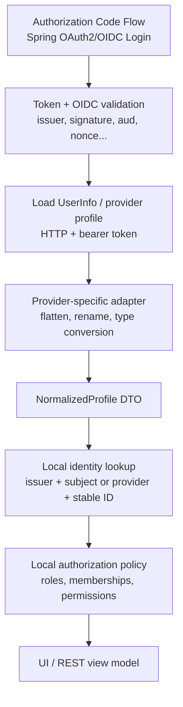

# 12.8. Handling Providers Returning Different Attribute Structures

In **Spring Security OAuth 2.0/OIDC Client**, after a user signs in, the application often needs information such as identifier, display name, email, avatar, language, or permission groups. The challenge is that **Identity Providers (IdPs) do not necessarily return the same JSON structure**, even when the application UI wants to display a unified profile.

For example, for the same user, three systems might return:

- **Standard OIDC OpenID Provider:** `sub`, `name`, `preferred_username`, `email`, `email_verified`, `picture`.
- **OAuth 2.0 provider with a custom profile API:** `id`, `login`, `avatar_url`, `display_name`.
- **Enterprise system:** information nested under `data.user`, with numeric `uid`, `fullName`, `contact.primaryEmail`, and array `roles`.

If business controllers read each JSON shape directly, the application fills up with `if ("providerA".equals(...))` branches, becomes brittle when providers evolve their schemas, and especially risks **mis-mapping identity or permissions**.

The proper approach is to **keep authentication faithful to the protocol**, then use a **per-provider adapter/normalizer** to convert profile data into a stable internal model. Distinguish clearly:

1. **Identity:** who logged in; what is the trusted identity source?
2. **Profile:** name, email, picture, display details that may be missing or change.
3. **Authorization:** what the user is allowed to do; never infer directly from an unnormalized/untrusted JSON field.

This lesson covers common payload shapes, using `user-name-attribute`, `DefaultOAuth2UserService`, `OidcUserService`, DTO mapping, handling data types and missing data, along with security principles when supporting multiple providers in Spring Security.

## 1. Why Do UserInfo Structures Differ?

### 1.1. OAuth 2.0 Does Not Define a Common User Profile Schema

**OAuth 2.0** is an authorization framework. It defines how a client obtains and uses access tokens, and **does not itself define** a standard profile JSON containing `id`, `name`, and `email`.

One provider may have an endpoint:

```http
GET /api/v1/account HTTP/1.1
Host: oauth-a.example.org
Authorization: Bearer <access-token>
```

Response:

```json
{
  "id": 2048,
  "login": "mai.dev",
  "name": "Mai Tran",
  "avatar_url": "https://cdn.example.org/avatar/2048.png"
}
```

Another provider may use an API:

```json
{
  "data": {
    "user": {
      "uid": "u-2048",
      "fullName": "Mai Tran",
      "contact": {
        "primaryEmail": "mai@example.org"
      },
      "picture": {
        "url": "https://assets.example.org/u-2048.jpg"
      }
    }
  }
}
```

Both payloads carry similar meaning, yet **cannot** be read using the same expression such as `attributes.get("id")`.

### 1.2. OIDC Standardizes Claims, Yet Does Not Guarantee All Claims Are Present

**OpenID Connect** adds an authentication layer on top of OAuth 2.0. A standard ID Token has the **`sub`** claim to identify the subject along with required claims such as `iss`, `aud`, and timestamps. OIDC also specifies the **UserInfo Endpoint** and standard claims such as:

| OIDC Claim | Purpose | Always Present? |
|---|---|---|
| `sub` | Subject identifier at the issuer | **Required in the ID Token; UserInfo response must also have `sub`** |
| `name` | Full display name | No |
| `given_name` / `family_name` | First / last name | No |
| `preferred_username` | Preferred username | No |
| `email` | Email address | No |
| `email_verified` | Indicates whether the OP verified the email | No |
| `picture` | Avatar image URL | No |
| `locale` | Language/locale | No |
| `groups` / `roles` | OP extension, **not a baseline guaranteed standard claim** | Depends on OP and integration contract |

For example, an ID Token or UserInfo might provide:

```json
{
  "sub": "248289761001",
  "preferred_username": "mai.dev",
  "name": "Mai Tran",
  "email": "mai@example.org",
  "email_verified": true,
  "picture": "https://images.example.org/mai.png"
}
```

Another OP might issue only `sub`, or place email and name in UserInfo rather than the ID Token. Scopes like `profile` and `email` **request access to a group of claims**, without guaranteeing every claim in that group is returned on every login.

**Key takeaway:** OIDC standardizes important semantics, yet profile data can still be missing, differ in values, or carry extensions. Systems should not make `email` or `name` mandatory to recognize a valid OIDC user when business logic does not require it.

## 2. Payload Shapes to Expect

### 2.1. Provider A: Flat Attributes, Numeric ID

```json
{
  "id": 2048,
  "login": "mai.dev",
  "name": "Mai Tran",
  "email": null,
  "avatar_url": "https://a.example.org/2048.png"
}
```

Characteristics:

- `id` is numeric.
- `login` differs from display name.
- `email` may be `null`.
- `avatar_url` uses a custom claim name rather than OIDC's `picture`.

Do not force users to have an email if the API allows keeping email private. If `id` is a stable identifier within the provider's scope, the adapter can convert it to the string `"2048"` for storage in the domain model.

### 2.2. Provider B: Deeply Nested Attributes

```json
{
  "data": {
    "user": {
      "uid": "external-2048",
      "fullName": "Mai Tran",
      "contact": {
        "primaryEmail": "mai@example.org"
      },
      "picture": {
        "url": "https://b.example.org/avatar/2048"
      }
    }
  },
  "requestId": "req-123"
}
```

Characteristics:

- ID is at `data.user.uid`.
- Display name is at `data.user.fullName`.
- Email and picture sit inside nested objects.
- `requestId` is API metadata, **not a user identifier**.

If you configure `user-name-attribute: uid` while the UserInfo response has `uid` **only inside `data.user`**, some `OAuth2User` construction steps cannot find the root attribute; you need to normalize/flatten first or use a custom OAuth2 user service.

### 2.3. Provider C: Both Flat Data and Extensions

```json
{
  "sub": "employee-2048",
  "preferred_username": "mai.dev",
  "profile": {
    "displayName": "Mai T.",
    "department": "Engineering"
  },
  "groups": ["engineering", "reviewers"],
  "email_verified": "true"
}
```

Characteristics:

- `sub` can serve as the OIDC identifier if issued by a compliant OP.
- `profile.displayName` is a custom extension.
- `groups` is a list of group names, **not automatically Spring authorities**.
- `email_verified` is sent as the string `"true"` — differing from OIDC's standard Boolean type. This signals an inconsistent schema; the adapter needs an explicit contract instead of guessing.

A provider returning a different schema does not mean the application should accept arbitrary data. For OIDC, standard claims must follow protocol verification; type errors in security-relevant claims should be handled strictly.

## 3. Separating Authentication, UserInfo, and Internal Profile Models

A clean architecture follows these steps:



Each layer owns one responsibility:

| Layer | What It Does | What It Must Not Do |
|---|---|---|
| OIDC/OAuth client | Completes login, validates tokens and protocol | Accept an unverified JWT as a session |
| UserInfo client | Calls endpoint with properly scoped access token | Treat JSON responses as internal access permissions |
| Adapter | Converts fields/data types per provider contract | Fabricate OIDC `sub` from email or nickname |
| Identity mapping | Links external identity to internal account | Auto-merge accounts solely by email |
| Authorization service | Checks permissions from trusted source | Grant `ROLE_ADMIN` because a free-form field contains `admin` |
| UI DTO | Returns only fields needed for display | Send raw tokens or all sensitive claims to the browser |

**Profile is data used by the application; authenticated identity is a verified assertion.** Never blur that boundary just to save lines of code.

## 4. Distinguishing OAuth2User and OidcUser

Spring Security provides two common principal families:

| Property | Non-OIDC OAuth 2.0 Login | OIDC Login |
|---|---|---|
| Typical scope | Provider-defined scopes, without `openid` | Includes `openid` |
| Principal | `OAuth2User` | `OidcUser` |
| Standard identity proof token | No OIDC ID Token | Has ID Token |
| Profile data | Provider-specific UserInfo/API | ID Token + OIDC UserInfo |
| User identifier | `id` / `uid` per provider contract | `sub` within `iss` scope |
| Common user service | `DefaultOAuth2UserService` | `OidcUserService` |
| Configuration hook | `userInfoEndpoint().userService(...)` | `userInfoEndpoint().oidcUserService(...)` |

Example in Spring Security Servlet:

```java
http.oauth2Login(oauth2 -> oauth2
    .userInfoEndpoint(userInfo -> userInfo
        .userService(customOAuth2UserService)
        .oidcUserService(customOidcUserService)));
```

This illustrative snippet assumes both user service variables have already been defined. **The two branches serve different flows:** an adapter for OAuth2-only does not automatically run for OIDC Login; when using the `openid` scope, the application must examine `OidcUserService` behavior separately.

If you only want to normalize profiles for display and persisting domain profiles, **you can let the default user services handle authentication** and then map `OAuth2User` or `OidcUser` into your own DTO, rather than replacing Spring's principal.

## 5. When Is user-name-attribute Enough?

In `ClientRegistration.ProviderDetails.UserInfoEndpoint`, the **`user-name-attribute`** property specifies which attribute from UserInfo is used as the principal name in the corresponding case.

For example, an OAuth2-only provider returns:

```json
{
  "id": "user-2048",
  "login": "mai.dev",
  "display_name": "Mai Tran"
}
```

Configuration:

```yaml
spring:
  security:
    oauth2:
      client:
        registration:
          legacy:
            provider: legacy
            client-id: ${LEGACY_CLIENT_ID}
            client-secret: ${LEGACY_CLIENT_SECRET}
            client-authentication-method: client_secret_basic
            authorization-grant-type: authorization_code
            redirect-uri: "{baseUrl}/login/oauth2/code/{registrationId}"
            scope: profile.read
        provider:
          legacy:
            authorization-uri: https://oauth-legacy.example.org/authorize
            token-uri: https://oauth-legacy.example.org/token
            user-info-uri: https://oauth-legacy.example.org/api/me
            user-name-attribute: id
```

If the JSON has a stable top-level `id` key, `DefaultOAuth2UserService` can usually be used directly without writing a custom adapter just to build the principal.

**`user-name-attribute` accepts only an attribute name**, not a nested-object access expression. A value like:

```yaml
user-name-attribute: data.user.uid
```

**must not be assumed** to have automatic JSONPath support. If the actual data contains a `data` object and no literal key named `data.user.uid`, Spring does not traverse nested paths via this property.

When a provider uses deeply nested fields or unsuitable attribute names/types, perform a transformation step before Spring builds `OAuth2User`.

## 6. Normalizing OAuth2-Only Responses with DefaultOAuth2UserService

### 6.1. Idea: Promoting Nested Structures to Stable Top-Level Attributes

Suppose provider `partner` returns:

```json
{
  "data": {
    "user": {
      "uid": 2048,
      "fullName": "Mai Tran",
      "contact": {
        "primaryEmail": "mai@example.org"
      },
      "picture": {
        "url": "https://partner.example.org/avatar/2048.png"
      }
    }
  }
}
```

Spring needs a top-level attribute for `user-name-attribute`. An adapter can transform the payload into:

```json
{
  "provider_user_id": "2048",
  "display_name": "Mai Tran",
  "email": "mai@example.org",
  "avatar_url": "https://partner.example.org/avatar/2048.png",
  "data": {
    "user": {
      "uid": 2048
    }
  }
}
```

The example preserves the original object so specialized components can inspect it if needed. In systems with sensitive personal data, you may choose to drop unnecessary fields per retention policy.

### 6.2. Using setAttributesConverter

In Spring Security versions supporting `DefaultOAuth2UserService#setAttributesConverter(...)`, you can customize mapping **after fetching the UserInfo response and before constructing `OAuth2User`**.

```java
import java.util.LinkedHashMap;
import java.util.Map;

import org.springframework.context.annotation.Bean;
import org.springframework.security.oauth2.client.userinfo.DefaultOAuth2UserService;
import org.springframework.security.oauth2.client.userinfo.OAuth2UserRequest;
import org.springframework.security.oauth2.client.userinfo.OAuth2UserService;
import org.springframework.security.oauth2.core.OAuth2AuthenticationException;
import org.springframework.security.oauth2.core.OAuth2Error;
import org.springframework.security.oauth2.core.user.OAuth2User;

@Bean
OAuth2UserService<OAuth2UserRequest, OAuth2User> oauth2UserService() {
    var service = new DefaultOAuth2UserService();

    service.setAttributesConverter(userRequest -> attributes -> {
        String registrationId =
            userRequest.getClientRegistration().getRegistrationId();

        // Apply the adapter only to providers with a nested schema.
        if (!"partner".equals(registrationId)) {
            return attributes;
        }

        Map<String, Object> flattened = new LinkedHashMap<>(attributes);

        Map<?, ?> data = asMap(attributes.get("data"));
        Map<?, ?> user = asMap(data.get("user"));

        String providerId = requiredId(user.get("uid"));
        flattened.put("provider_user_id", providerId);

        String fullName = optionalText(user.get("fullName"));
        if (fullName != null) {
            flattened.put("display_name", fullName);
        }

        Map<?, ?> contact = asMap(user.get("contact"));
        String email = optionalText(contact.get("primaryEmail"));
        if (email != null) {
            flattened.put("email", email);
        }

        Map<?, ?> picture = asMap(user.get("picture"));
        String avatar = optionalText(picture.get("url"));
        if (avatar != null) {
            flattened.put("avatar_url", avatar);
        }

        return flattened;
    });

    return service;
}

private static Map<?, ?> asMap(Object value) {
    if (value instanceof Map<?, ?> map) {
        return map;
    }
    return Map.of();
}

private static String optionalText(Object value) {
    if (value instanceof String s && !s.isBlank()) {
        return s;
    }
    return null;
}

private static String requiredId(Object value) {
    if (value instanceof String s && !s.isBlank()) {
        return s;
    }
    if (value instanceof Number n) {
        return n.toString();
    }
    throw new OAuth2AuthenticationException(
        new OAuth2Error("invalid_user_info"),
        "Provider profile has no valid stable user ID"
    );
}
```

The helper methods in the example must reside in **the same Java class** as the bean method or an appropriate utility class; the snippet highlights the essential logic to stay focused on conversion.

Points to note:

- `getRegistrationId()` comes from the registration used by Spring Security, never from an arbitrary browser query parameter.
- Normalize only when registration is `partner`; leave other providers' responses untouched.
- `uid` is validated as a non-blank string or number before becoming the external user ID.
- `fullName`, `email`, and `avatar_url` are optional data.
- Never fall back to `email` for `provider_user_id`; missing a stable ID is a **data error that must be handled**.
- Never turn an arbitrary object/map into an ID string via `String.valueOf(...)`, as that masks broken schemas.

### 6.3. Declaring user-name-attribute After Normalization

For the `partner` registration:

```yaml
spring:
  security:
    oauth2:
      client:
        provider:
          partner:
            authorization-uri: https://auth.partner.example.org/authorize
            token-uri: https://auth.partner.example.org/token
            user-info-uri: https://auth.partner.example.org/api/me
            user-name-attribute: provider_user_id
```

`provider_user_id` is the **top-level key added by the attributes converter**, enabling `DefaultOAuth2User` creation to use the right identifier.

If you omit the normalization step while UserInfo only has `data.user.uid`, configuring `user-name-attribute: provider_user_id` will not work because that field does not exist at the top level yet.

### 6.4. Wiring the Custom User Service into OAuth2 Login

Spring Security Servlet example:

```java
import org.springframework.context.annotation.Bean;
import org.springframework.context.annotation.Configuration;
import org.springframework.security.config.annotation.web.builders.HttpSecurity;
import org.springframework.security.oauth2.client.userinfo.OAuth2UserRequest;
import org.springframework.security.oauth2.client.userinfo.OAuth2UserService;
import org.springframework.security.oauth2.core.user.OAuth2User;
import org.springframework.security.web.SecurityFilterChain;

@Configuration
public class SecurityConfig {

    @Bean
    SecurityFilterChain securityFilterChain(
            HttpSecurity http,
            OAuth2UserService<OAuth2UserRequest, OAuth2User> profileUserService)
            throws Exception {

        http
            .authorizeHttpRequests(auth -> auth
                .requestMatchers("/", "/login", "/error").permitAll()
                .anyRequest().authenticated())
            .oauth2Login(oauth2 -> oauth2
                .userInfoEndpoint(userInfo -> userInfo
                    .userService(profileUserService)));

        return http.build();
    }
}
```

Note: the `profileUserService` bean in the example refers to the bean defined in Section 6.2. When an application has multiple beans of the same type, use `@Qualifier` or explicit bean names to select the right service.

**Important:** `userInfoEndpoint().userService(...)` applies to the OAuth2 UserInfo branch. If a registration has the `openid` scope and goes through OIDC Login, Spring normally uses `OidcUserService`. Do not assume the converter here automatically transforms all OIDC claims.

## 7. When Should You Write a Custom OAuth2UserService Instead of an Attributes Converter?

`setAttributesConverter(...)` fits when the HTTP UserInfo response can still be read by the default client and only the **map data** needs transformation. Some scenarios demand more:

- The provider requires a specialized header when calling the profile endpoint.
- The provider returns a response that is not a JSON object handled by the default client.
- A second endpoint must be called to supplement information.
- The provider returns identity info in response headers or a custom-signed envelope.
- Conditional fallback is needed while preserving identity rules.

In those cases, implement:

```java
OAuth2UserService<OAuth2UserRequest, OAuth2User>
```

and return an appropriate `OAuth2User`. Minimal structural example:

```java
import org.springframework.security.oauth2.client.userinfo.OAuth2UserRequest;
import org.springframework.security.oauth2.client.userinfo.OAuth2UserService;
import org.springframework.security.oauth2.core.user.OAuth2User;

public final class ProviderAwareOAuth2UserService
        implements OAuth2UserService<OAuth2UserRequest, OAuth2User> {

    private final OAuth2UserService<OAuth2UserRequest, OAuth2User> standard;

    public ProviderAwareOAuth2UserService(
            OAuth2UserService<OAuth2UserRequest, OAuth2User> standard) {
        this.standard = standard;
    }

    @Override
    public OAuth2User loadUser(OAuth2UserRequest request) {
        String registrationId =
            request.getClientRegistration().getRegistrationId();

        if ("custom-api".equals(registrationId)) {
            // Call custom profile client, validate response, normalize...
            // Then build OAuth2User with a stable ID and appropriate authorities.
            throw new UnsupportedOperationException(
                "Implement the custom provider profile contract here");
        }

        return standard.loadUser(request);
    }
}
```

This is an **illustrative skeleton**; the `custom-api` branch is intentionally not a runnable implementation: you must supply the HTTP client, protect the access token, normalize the schema, and build a real `OAuth2User`. Never leave placeholders/exceptions in production.

When constructing a principal yourself, you can use `DefaultOAuth2User` with authorities, attributes, and the identifier key name:

```java
import java.util.Map;

import org.springframework.security.oauth2.core.user.DefaultOAuth2User;

var user = new DefaultOAuth2User(
    authorities,
    Map.of(
        "provider_user_id", "external-2048",
        "display_name", "Mai Tran"
    ),
    "provider_user_id"
);
```

This example assumes `authorities` was created from an appropriate source. Never assign admin permissions from raw untrusted profile data. **`Map.of` does not permit null values**; for optional attributes, use a map where entries can be added conditionally.

If you only need to promote `data.user.uid` to top-level `provider_user_id`, using `DefaultOAuth2UserService` with a converter is generally shorter, easier to maintain, and preserves default HTTP/token-handling behavior.

## 8. OIDC: Keep sub and Validation, Normalize Profiles Only in the Application Layer

### 8.1. ID Token and UserInfo Must Be Consistent on Subject

An OIDC RP receives an ID Token after token exchange. If the application calls the **UserInfo Endpoint**, the UserInfo response must contain `sub`, and **that `sub` must match the verified ID Token's `sub`**.

Example verified ID Token:

```json
{
  "iss": "https://login.example.org",
  "sub": "user-2048",
  "aud": "portal-web",
  "exp": 1924999999,
  "iat": 1924996399
}
```

Subject-valid UserInfo response:

```json
{
  "sub": "user-2048",
  "name": "Mai Tran",
  "email": "mai@example.org"
}
```

Invalid UserInfo response:

```json
{
  "sub": "another-user",
  "name": "Mai Tran",
  "email": "mai@example.org"
}
```

**Never merge the second response into `user-2048`'s principal merely because email and name match.** Spring Security's `OidcUserService` handles binding UserInfo to the ID Token per OIDC; when customizing, preserve these checks.

### 8.2. Prefer Using OidcUser Without Replacing the Principal

In many cases, you do not need to modify `OidcUserService`. After OIDC Login, business services can read from `OidcUser` and convert to the system's standard DTO.

Example:

```java
import org.springframework.security.core.annotation.AuthenticationPrincipal;
import org.springframework.security.oauth2.core.oidc.user.OidcUser;
import org.springframework.web.bind.annotation.GetMapping;
import org.springframework.web.bind.annotation.RestController;

@RestController
public class MyProfileController {

    public record ProfileView(
        String issuer,
        String subject,
        String displayName,
        String email,
        boolean emailVerified
    ) {}

    @GetMapping("/me")
    public ProfileView me(@AuthenticationPrincipal OidcUser user) {
        String displayName = user.getFullName();

        if (displayName == null || displayName.isBlank()) {
            displayName = user.getPreferredUsername();
        }

        if (displayName == null || displayName.isBlank()) {
            displayName = user.getSubject();
        }

        return new ProfileView(
            user.getIdToken().getIssuer().toString(),
            user.getSubject(),
            displayName,
            user.getEmail(),
            Boolean.TRUE.equals(user.getEmailVerified())
        );
    }
}
```

In this example:

- `getSubject()` represents the OIDC-verified subject, not email.
- `getFullName()` and `getPreferredUsername()` may be missing; fallbacks are **for display only**.
- `emailVerified` is true only when the claim is a proper Boolean `true`; missing/null is represented as `false` in the view.
- The endpoint assumes the principal is `OidcUser`; if the application also supports non-OIDC OAuth2 Login, handle other principal types rather than casting blindly.

`email_verified = false` does not necessarily mean the OP proved the email is wrong; it may simply mean there is no proof the email was verified. For sensitive actions (account recovery, sending confidential information), enforce a specific email verification policy.

### 8.3. If an OP Returns Complex Profile Extensions

Suppose a compliant OP still returns `sub`, while adding:

```json
{
  "sub": "user-2048",
  "name": "Mai Tran",
  "organization": {
    "code": "ORG-01",
    "department": {
      "name": "Engineering"
    }
  }
}
```

These are **extension claims**. The application can read them via `user.getClaims()` (if merged into the principal) and normalize separately:

```java
import java.util.Map;

Map<String, Object> claims = user.getClaims();

Object organizationValue = claims.get("organization");
if (organizationValue instanceof Map<?, ?> organization) {
    Object departmentValue = organization.get("department");
    if (departmentValue instanceof Map<?, ?> department) {
        Object name = department.get("name");
        if (name instanceof String s) {
            // Use s as display profile data, not as a role.
        }
    }
}
```

Keep `sub` from the ID Token as the identity key. Never replace `sub` with `organization.code` or `preferred_username` just to solve profile display.

If an OP does not comply with OIDC UserInfo (e.g., missing `sub` or returning a `sub` different from the ID Token), treat it as a protocol contract defect to fix at the OP or a controlled integration layer, **never skip the subject-comparison step**.

## 9. Designing the NormalizedProfile Model

To keep controllers, services, and persistence decoupled from each provider's JSON, you can define an internal DTO:

```java
public record NormalizedProfile(
    String registrationId,
    String issuer,
    String externalUserId,
    String displayName,
    String email,
    boolean emailVerified,
    String avatarUrl
) {}
```

Meaning of fields:

| Field | Purpose | Notes |
|---|---|---|
| `registrationId` | Identifies the adapter/registration used in Spring | Local identifier, does not replace issuer |
| `issuer` | Verified OP in OIDC | For OAuth2-only, there may be no OIDC-standard issuer |
| `externalUserId` | Stable user ID at the source | OIDC uses `sub`; OAuth2-only uses a provider-guaranteed ID |
| `displayName` | Display name | Can change; not an account key |
| `email` | Contact info | May be missing, mutable, or unverified |
| `emailVerified` | Whether there is provider-accepted proof of email verification | Do not infer from email presence |
| `avatarUrl` | Avatar image URL | May be missing; restrict how URLs are fetched/rendered |

**Never use the DTO itself to decide whether an OAuth token is valid.** The DTO is constructed **after authentication** and serves business logic.

### 9.1. Two Forms of Identity Keys

For OIDC:

```text
external_identity_key = (iss, sub)
```

Example:

```text
(https://login.example.org, user-2048)
```

For OAuth2-only, the provider may not define an OIDC `iss`. In that case, use a system-controlled namespace:

```text
external_identity_key = (provider_namespace, provider_stable_user_id)
```

Example:

```text
(legacy-partner-prod, external-2048)
```

Never mix two namespaces or assume ID `2048` from provider A is the same person as ID `2048` from provider B.

### 9.2. Choosing Fallbacks Only for Display Attributes

Display name can be selected in order:

1. Valid `name` or `fullName`.
2. Valid `preferred_username` or `login`.
3. A friendly placeholder such as "User" or a safely processed ID fragment.

**Never** use email or display name as a fallback for **externalUserId** unless there is a very specific identity contract, risk analysis, and dedicated account governance. Names and emails can change or be reassigned.

## 10. An Application Mapper Supporting Both OIDC and OAuth2

The following example illustrates converting a Spring Security-authenticated principal into an internal DTO without overwriting the principal. The code below assumes the OAuth2-only branch has already been normalized per provider into fields like `provider_user_id`, `display_name`, and `avatar_url`.

```java
import org.springframework.security.oauth2.core.oidc.user.OidcUser;
import org.springframework.security.oauth2.core.user.OAuth2User;

public final class ProfileMapper {

    private ProfileMapper() {}

    public static NormalizedProfile fromOidc(
            String registrationId,
            OidcUser user) {

        String displayName = firstNonBlank(
            user.getFullName(),
            user.getPreferredUsername(),
            user.getSubject()
        );

        return new NormalizedProfile(
            registrationId,
            user.getIdToken().getIssuer().toString(),
            user.getSubject(),
            displayName,
            user.getEmail(),
            Boolean.TRUE.equals(user.getEmailVerified()),
            user.getClaimAsString("picture")
        );
    }

    public static NormalizedProfile fromOauth2(
            String registrationId,
            OAuth2User user) {

        String providerUserId = asText(
            user.getAttributes().get("provider_user_id")
        );

        // Example where OAuth2-only provider already has a top-level ID named "id".
        if (providerUserId == null) {
            providerUserId = asText(user.getAttributes().get("id"));
        }
        if (providerUserId == null) {
            throw new IllegalArgumentException(
                "OAuth provider returned no stable user ID");
        }

        String displayName = firstNonBlank(
            asText(user.getAttributes().get("display_name")),
            asText(user.getAttributes().get("name")),
            asText(user.getAttributes().get("login")),
            providerUserId
        );

        return new NormalizedProfile(
            registrationId,
            null, // OAuth2-only has no OIDC issuer.
            providerUserId,
            displayName,
            asText(user.getAttributes().get("email")),
            Boolean.TRUE.equals(
                user.getAttributes().get("email_verified")),
            firstNonBlank(
                asText(user.getAttributes().get("avatar_url")),
                asText(user.getAttributes().get("picture"))
            )
        );
    }

    private static String asText(Object value) {
        if (value instanceof String s && !s.isBlank()) {
            return s;
        }
        if (value instanceof Number n) {
            return n.toString();
        }
        return null;
    }

    private static String firstNonBlank(String... values) {
        for (String value : values) {
            if (value != null && !value.isBlank()) {
                return value;
            }
        }
        return null;
    }
}
```

Assuming `NormalizedProfile` is the record from Section 9, these methods only extract data from principals **that have already passed Spring's login step**.

This is an illustrative mapper. In multi-provider applications, avoid letting `fromOauth2(...)` blindly probe every provider's fields if there is any risk of **name collisions with different semantics**. As the number of providers grows, split each provider into an adapter keyed by `registrationId`.

### 10.1. Using Authentication to Pick the Right Branch

In Servlet OAuth2/OIDC Login, `OAuth2AuthenticationToken` lets you read the registration ID:

```java
import org.springframework.security.core.Authentication;
import org.springframework.security.oauth2.client.authentication.OAuth2AuthenticationToken;
import org.springframework.security.oauth2.core.oidc.user.OidcUser;
import org.springframework.security.oauth2.core.user.OAuth2User;

public final class CurrentProfileService {

    public NormalizedProfile normalize(Authentication authentication) {
        if (!(authentication instanceof OAuth2AuthenticationToken oauth)) {
            throw new IllegalStateException(
                "Expected an OAuth2/OIDC login authentication");
        }

        String registrationId =
            oauth.getAuthorizedClientRegistrationId();

        Object principal = oauth.getPrincipal();

        if (principal instanceof OidcUser oidcUser) {
            return ProfileMapper.fromOidc(registrationId, oidcUser);
        }

        if (principal instanceof OAuth2User oauth2User) {
            return ProfileMapper.fromOauth2(registrationId, oauth2User);
        }

        throw new IllegalStateException("Unsupported principal type");
    }
}
```

In a real product, you can define a `ProviderProfileAdapter` per registration instead of keeping branches inside one large class. Never use `authentication.getName()` as the universal unique identifier across all providers without knowing how it was mapped.

### 10.2. APIs Return DTOs, Not Raw Principals

Controller example:

```java
import org.springframework.security.core.Authentication;
import org.springframework.web.bind.annotation.GetMapping;
import org.springframework.web.bind.annotation.RestController;

@RestController
public class ProfileApi {

    private final CurrentProfileService profiles;

    public ProfileApi(CurrentProfileService profiles) {
        this.profiles = profiles;
    }

    @GetMapping("/api/me")
    public NormalizedProfile me(Authentication authentication) {
        return profiles.normalize(authentication);
    }
}
```

This snippet assumes `CurrentProfileService` is registered as a Spring bean and the endpoint is protected by `authenticated()`. In privacy-sensitive applications, do not necessarily return all DTO fields to the browser. You can create a **ProfileView** holding only the name/avatar needed by the UI; issuer and external user ID can stay internal.

## 11. Dedicated Adapter per Provider

When integrating multiple providers, a durable pattern is having each adapter own a single schema. Example interface:

```java
public interface ProviderProfileAdapter {

    String registrationId();

    NormalizedProfile normalize(
        org.springframework.security.oauth2.core.user.OAuth2User user
    );
}
```

Two implementations might be:

- `LegacyProviderAdapter`: reads `id`, `login`, `avatar_url` from top-level attributes.
- `PartnerProviderAdapter`: reads `provider_user_id`, `display_name` after the flattening step.
- OIDC should be handled by an adapter accepting `OidcUser` or a dedicated standard branch; do not force every principal type into an interface lacking ID Token information.

Advantages:

| Benefit | Explanation |
|---|---|
| Schema isolation | When a provider changes JSON, only that provider's adapter changes |
| Clear error control | Separates missing required ID from missing optional email |
| Reduces identity confusion | Each provider's ID/namespace rules are explicitly documented |
| Minimizes business churn | Services consume a stable `NormalizedProfile` |
| Avoids huge conditionals | No dozens of `if` statements in controllers |
| Extension governance | Claims like `department`, `groups`, or metadata are read per contract |

An adapter is not merely a few mapping lines. It must also know **which fields are required**, **which types are supported**, **which fields are allowed for authorization**, and **which data must be ignored**.

## 12. Handling Null Values, Missing Fields, and Type Changes

### 12.1. Classifying Required vs. Optional Fields

| Field | Requirement Level | Handling When Missing |
|---|---|---|
| OIDC ID Token `sub` | Required by OIDC | Reject token/login if invalid |
| OIDC UserInfo `sub` | Required and must match ID Token when UserInfo is called | Reject invalid UserInfo |
| OAuth2-only provider stable ID | Required for chosen account-mapping mechanism | Reject profile or login per policy |
| `name`/`displayName` | Optional | Display fallback |
| `email` | Optional | Leave `null` or ask user to provide via trusted workflow |
| `email_verified` | Optional | Do not treat missing as verified |
| `picture` / `avatar_url` | Optional | Default avatar |
| `locale` | Optional | Application default locale |
| `groups` | Per contract | Do not grant permissions if missing or unverified |

A missing email is not proof the user does not exist. Conversely, missing a stable ID **destroys the ability to identify a single account**, so it must fail safely.

### 12.2. Numbers vs. Strings

A provider might return:

```json
"id": 2048
```

and at other times:

```json
"id": "2048"
```

If the contract permits both representations, the adapter can convert to a stable string. However:

- Never use `double` for large IDs; large integers can lose precision in floating-point types.
- Never strip leading zeros (`"0002048"` differs from `"2048"` if the provider treats them as distinct identifiers).
- Never arbitrarily trim or change case on IDs unless the provider specifies such rules.
- Never use `String.valueOf(mapOrList)` to turn a wrong JSON type into a valid ID.

### 12.3. Booleans and String Booleans

OIDC `email_verified` is semantically a Boolean. Non-standard providers might return `"true"` or `1`.

**Never automatically assume every truthy-looking form is as trustworthy as a standard claim.** You need explicit provider documentation and a converter scoped strictly to that provider. Without a contract, accept only a genuine Boolean `true` and treat other values as unverified or schema errors depending on severity.

Example of deliberate parsing for a specific provider allowing `"Y"` and `"N"`:

```java
static boolean verifiedForLegacyProvider(Object value) {
    if ("Y".equals(value)) {
        return true;
    }
    if ("N".equals(value)) {
        return false;
    }
    return false; // Do not infer verified.
}
```

This function is **not** a general OIDC parser. It is only valid if the legacy provider contract explicitly specifies `Y/N`.

### 12.4. Nested Objects/Arrays

An attribute might be:

```json
"organization": {
  "id": "org-1",
  "departments": [
    {"code": "eng", "name": "Engineering"},
    {"code": "qa", "name": "Quality"}
  ]
}
```

Never cast:

```java
(String) attributes.get("organization")
```

because the value is a `Map`, not a `String`. When working with generic JSON:

- Check `instanceof Map<?, ?>` before accessing keys.
- Check `instanceof List<?>` before iterating lists.
- Check list element types as expected.
- Bound data size and nesting depth if profiles from untrusted sources can be large.
- Never dump entire raw objects into error logs.

## 13. Why Should Email Not Be Used to Auto-Link Accounts?

Suppose:

- The company OP returns `sub=employee-2048` and `email=mai@example.org`.
- The partner provider returns `id=partner-987` and `email=mai@example.org`.

Two identical emails **do not prove** this is the same external identity. Email may be unverified, changed, or reassigned to someone else. Auto-merging internal accounts by email could allow logging into an account belonging to someone else.

Appropriate design:

```text
local_user_id: 3152

external_identities:
  - provider: OIDC company
    issuer: https://login.company.example
    subject: employee-2048

  - provider: OAuth2 partner
    provider_namespace: partner-prod
    provider_user_id: partner-987
```

If two identities should point to the same `local_user_id`, execute an **authenticated account-linking workflow** designed per product policy.

### 13.1. Pairwise Subjects in OIDC

OIDC supports **pairwise subject identifiers**: the same user can receive different `sub` values for RPs in different sectors. So never expect `sub` to be an enterprise-wide universal ID simply because they share an OP.

Within one RP, use `(iss, sub)` as the external identity key; when cross-RP or cross-provider linking is needed, build a dedicated identity federation/account-linking mechanism.

## 14. Permissions and Roles Are Not Ordinary Profile Fields

A provider may return:

```json
{
  "id": "user-2048",
  "groups": ["engineering", "admin"],
  "permissions": ["orders.read", "orders.write"]
}
```

Never automatically do:

```java
new SimpleGrantedAuthority("ROLE_" + group.toUpperCase())
```

for every group string from UserInfo. Before mapping to authorities:

1. Verify whether `groups` is confirmed by the provider as trustworthy and bound to the right user.
2. Determine which issuer/provider is authorized to grant each internal role.
3. Match the group/role list against an application policy allowlist.
4. Distinguish **provider-side roles** from **internal roles**, whose semantics may differ.
5. Account for group revocation and active session/authority caches.
6. Separate authentication from authorization at business endpoints.

You can use `GrantedAuthoritiesMapper` or a custom user/authorization service for authority mapping, rather than mixing it into the name/avatar display adapter.

**Never grant `ROLE_ADMIN` merely because the payload contains `"admin"`** without verifying origin and policy.

## 15. Handling Differences in Endpoints, Scopes, and HTTP Responses

Sometimes differences go beyond JSON.

### 15.1. UserInfo Endpoint May Be Unavailable

In OIDC, a provider may publish a UserInfo endpoint; the OP supplies claims from the ID Token and UserInfo per policy. If the provider does not support the required endpoint or the application was not granted scopes, data may be incomplete.

In OAuth2-only, the profile URI is a **separate API**. Spring needs to know:

```yaml
provider:
  legacy:
    user-info-uri: https://oauth-legacy.example.org/api/me
    user-name-attribute: id
```

If `user-info-uri` is missing for OAuth2-only Login in a profile-dependent architecture, the framework may fail to create the expected principal. Never configure an arbitrary URL and treat it as standard OIDC UserInfo.

### 15.2. Authorization Header When Calling UserInfo

Normally the client calls the UserInfo/profile endpoint with an access token over HTTPS:

```http
GET /userinfo HTTP/1.1
Host: login.example.org
Authorization: Bearer <access-token>
```

Never send an ID Token instead of an access token just because both are JWTs. Nor should you send a client secret in the profile request URL.

Some OAuth2-only providers use custom headers; if needed, custom HTTP request conversion must be scoped strictly to that provider and never leak credentials to untrusted hostnames.

### 15.3. Expired Tokens and Profile Access

A UserInfo access token can expire. If the application re-calls the profile endpoint after login, manage authorized client storage and refresh token mechanics (when available) appropriately; never call the API with an expired token and misreport it as "user does not exist".

If no valid access token is available to call UserInfo, the application can use already-verified ID Token claims within verified scope, or prompt for a fresh login per policy. Never skip `sub` checking just because the profile endpoint failed.

### 15.4. Profile API Schema Changes by Version

A provider might migrate from:

```json
{"id": "user-2048", "name": "Mai Tran"}
```

to:

```json
{"data": {"user": {"uid": "user-2048", "fullName": "Mai Tran"}}}
```

This change can break the adapter without breaking OAuth token exchange. Maintain explicit contracts per provider, pin appropriate API versions, and design error handling so identity failures are not masked. Distinguish:

- **Valid login token but profile missing `displayName`**: use display fallbacks.
- **Valid login token but provider profile lost stable ID**: never silently link to another user.
- **OIDC UserInfo `sub` mismatches ID Token**: reject UserInfo as an identity-binding failure.

## 16. When Providers Have Multi-Level Lists or Scope-Dependent Fields

### 16.1. Scopes Determine Which Data May Appear

For example, `profile` and `email` scopes in OIDC do not necessarily make every claim appear. In OAuth2-only, a provider might require `user.read` or `profile:email` to return email.

Avoid logic like:

```java
if (email == null) {
    throw new IllegalStateException("Provider login invalid");
}
```

unless email is a mandatory business requirement guaranteed by the integration contract. If email is needed for contact, add a post-login collection step with its own verification mechanism.

### 16.2. A User Has Multiple Emails

A provider may return:

```json
{
  "id": "user-2048",
  "emails": [
    {"value": "mai.personal@example.org", "primary": false, "verified": true},
    {"value": "mai.work@example.org", "primary": true, "verified": false}
  ]
}
```

Never blindly take the first element and treat it as primary/verified. The adapter must select per contract:

- If business logic needs a verified primary email, pick the element meeting both conditions.
- If no email qualifies, leave email `null` or mark unverified.
- Never perform account linking based solely on an email in a list.

In standard OIDC, `email` and `email_verified` are claims with defined semantics; a provider's `emails[]` payload is an extension/API-specific structure.

### 16.3. Locale and Multilingual Names

`name` can contain Unicode characters, Vietnamese diacritics, combining characters, or non-Latin scripts. Never force ASCII conversion or lowercase identifiers. The profile adapter may normalize display strings as needed for the UI, yet must never alter `sub`/stable provider ID values.

If `locale` is present, use it only when validly formatted and supported by the application; otherwise use the default locale.

## 17. Handling Avatar Data Safely

A profile may provide:

```json
{
  "picture": "https://cdn.example.org/u-2048.png"
}
```

This is a display URL, not a user identifier.

When using URLs from a provider:

- Prefer `https`.
- Optionally allow only trusted CDN hostnames or proxy images through a controlled service.
- If the server fetches images itself, block private addresses, loopback, metadata endpoints, and disallowed hostnames to mitigate **SSRF**.
- Validate content type, limit response size and timeouts, and avoid unbounded decompression.
- If embedding directly in the browser, consider privacy: the browser will send requests to the provider/CDN hostname.
- Never inject unvalidated URLs into HTML via unescaped string concatenation.

If `picture` is an object `{"url":"..."}`, the adapter must read the right field. Never use the map's `toString()` as a URL, since the result is not a valid address.

## 18. Caching, Profile Updates, and Identity Changes

Profile information can change over time: new name, new photo, department transfer, new email. Distinguish accordingly:

| Data | Appropriate Management |
|---|---|
| External identity key | Stable per contract; OIDC uses `(iss, sub)` |
| Display name, avatar, locale | Can update periodically or on login |
| Email | Mutable; verify status when needed |
| Roles and permissions | Governed by authorization policy; revoke promptly |
| Access/refresh tokens | Store and protect per OAuth lifecycle; never mix into profile DTOs |

One implementation approach:

1. Complete login and verify identity.
2. Look up local account by external identity key.
3. If no account exists yet, run provisioning/linking per policy.
4. Update profile fields permitted to be overwritten.
5. Apply internal permissions via governed source and logic.
6. Return minimal `ProfileView` to the UI.

Do not overwrite a name or email the user edited inside the application merely because the provider returned a different value; define the **source of truth** for each field.

## 19. Common Errors and How to Classify Them

| Symptom | Possible Cause | Resolution |
|---|---|---|
| `missing attribute id` on OAuth2 Login | Wrong `user-name-attribute` or ID sits inside a nested object | Check response schema; use attributes converter |
| `ClassCastException: Map cannot be cast to String` | Cast a nested object to String | Check `Map<?, ?>` type and read the right field |
| Email always `null` | Provider withholds scope/claim or user keeps email private | Do not assume email is mandatory; check contract and scopes |
| ID sometimes numeric, sometimes string | Inconsistent provider schema/API | Parse in a controlled way, keep external ID stable |
| OIDC Login fails due to `sub` mismatch | UserInfo response has a different subject from ID Token | Never skip verification; fix at OP/profile integration |
| `user-name-attribute: data.user.uid` does not work | Property takes a key name, not JSONPath | Flatten to a top-level key and configure that key |
| Custom `userService(...)` does not run for OIDC | OIDC uses `OidcUserService` separately | Normalize after OIDC Login or customize the OIDC service hook |
| User logs in yet duplicate accounts are created | Matched by email/name instead of stable identity | Store `(iss,sub)` or namespace + provider ID |
| Wrong permissions when switching providers | Mapped groups/roles sharing names with different meanings | Scope authority policy per trusted provider |
| Image does not render | `picture` is an object or invalid URL | Provider adapter reads URL from right field; image fallback |
| Error occurs in only one environment | Different provider version, scopes, or tenant config | Separate registrations/adapters per environment and contract |
| Valid OIDC token yet UserInfo lacks optional fields | Claim not released; scopes do not guarantee all fields | Use display fallbacks; never drop required identity data |
| API returns 401 when calling UserInfo | Expired access token, wrong scopes, or endpoint rejects token | Check authorized client, scopes, and endpoint |
| Logs contain full profile/token | Debugging printed raw payload/headers | Redact PII, tokens, and log only essential metadata |

### 19.1. Distinguishing Token Errors from Profile Errors

When OAuth2/OIDC Login fails, isolate the layer:

- **Authorization callback/token exchange failed:** check `state`, PKCE, client ID/secret, token endpoint.
- **OIDC ID Token validation failed:** check issuer, audience, signature, expiration, nonce; never modify the profile adapter to bypass checks.
- **UserInfo HTTP call failed:** check access token, scopes, URI, TLS, response status.
- **Profile JSON mapping failed:** check field names, nested maps, data types, and contract.
- **Local account mapping failed:** check identity key and provisioning/linking.
- **Authorization failed:** check policies/roles; do not treat it as a name/avatar error.

Classifying at the right layer prevents dangerous workarounds like "disabling ID Token validation because the profile JSON looks weird".

## 20. Security Principles When Normalizing Provider Profiles

### 20.1. Trust Data Only from Appropriate Connections and Protocols

For OIDC:

- Verify the ID Token from a trusted issuer, with audience matching RP client ID, valid signature, and required claims.
- If calling UserInfo, ensure the response comes from the configured endpoint and `sub` matches the ID Token.
- Never pick an issuer/JWKS/UserInfo URI arbitrarily from a query parameter or unverified claim.

For OAuth2-only:

- Fetch profiles over HTTPS from the endpoint specified by a trusted registration.
- Use an access token matching the right client/grant/scopes.
- Determine the stable user ID per provider documentation and provider namespace.
- Never treat an OAuth2 profile API as proof of standard OIDC authentication.

### 20.2. Never Log Sensitive Data

Raw UserInfo can contain personal data and private extension claims. Access tokens can appear in HTTP headers. Do not log:

```text
Authorization: Bearer <access-token>
id_token=<id-token>
refresh_token=<refresh-token>
client_secret=<client-secret>
raw_user_info=<complete-profile-json>
```

Safer logging looks like:

```text
event=oauth2_profile_normalization
registrationId=partner
schemaVersion=v2
result=rejected
reason=missing_stable_user_id
correlationId=<non-secret-id>
```

Even external IDs must be handled according to the organization's logging and retention policies.

### 20.3. Never Mint Permissions from Untrusted Claims

Provider-specific `groups` or `roles` do not share semantics across IdPs. Map by policy and verified issuer/registration binding. Never use substring checks like checking whether `"super-admin"` contains `"admin"` to grant permissions.

### 20.4. Prevent Data Leakage in Responses

`OAuth2User.getAttributes()` may contain more fields than the UI needs. Never return raw attributes/claims or tokens through a public `/me` endpoint; use a field-selected `ProfileView`. Where email, phone number, or organizational details exist, apply **data minimization**.

### 20.5. Handling Temporary Provider Unavailability

If the profile endpoint fails transiently:

- Never create a new user with an empty ID.
- Never link accounts via email fallback.
- If a valid OIDC principal already exists and policy allows, use verified/session-cached claims for minimal display.
- If the flow strictly requires UserInfo to establish identity, fail safely and show an appropriate login message.

## 21. Multi-Provider Architecture Example in Spring Boot

Suppose an application has two registrations:

1. `company-oidc`: standard OIDC OP with issuer `https://login.company.example`.
2. `legacy-partner`: OAuth2-only provider returning `data.user.uid`.

### 21.1. Illustrative YAML Configuration

```yaml
spring:
  security:
    oauth2:
      client:
        registration:
          company-oidc:
            provider: company
            client-id: ${COMPANY_CLIENT_ID}
            client-secret: ${COMPANY_CLIENT_SECRET}
            client-authentication-method: client_secret_basic
            authorization-grant-type: authorization_code
            redirect-uri: "{baseUrl}/login/oauth2/code/{registrationId}"
            scope:
              - openid
              - profile
              - email

          legacy-partner:
            provider: legacy
            client-id: ${PARTNER_CLIENT_ID}
            client-secret: ${PARTNER_CLIENT_SECRET}
            client-authentication-method: client_secret_basic
            authorization-grant-type: authorization_code
            redirect-uri: "{baseUrl}/login/oauth2/code/{registrationId}"
            scope:
              - profile.read

        provider:
          company:
            issuer-uri: https://login.company.example

          legacy:
            authorization-uri: https://auth.partner.example/authorize
            token-uri: https://auth.partner.example/token
            user-info-uri: https://api.partner.example/profile
            user-name-attribute: provider_user_id
```

Update the condition in the Section 6.2 converter from `"partner"` to **`"legacy-partner"`** to match the actual registration ID. This highlights that the provider configuration name (`legacy`) and registration ID (`legacy-partner`) **do not have to be identical**.

### 21.2. Login Initiation Paths

The login page can render:

```html
<a th:href="@{/oauth2/authorization/company-oidc}">
    Sign in with company account
</a>

<a th:href="@{/oauth2/authorization/legacy-partner}">
    Sign in with partner account
</a>
```

Spring handles each flow per its own `ClientRegistration`. Upon success:

- For `company-oidc`, the principal is `OidcUser`; the identity key uses `(iss,sub)`.
- For `legacy-partner`, the principal is a normalized `OAuth2User`; the identity key uses provider namespace and `provider_user_id`.
- The business layer receives `NormalizedProfile` (or a dedicated domain identity), decoupled from the raw upstream schema.

You do not need to force two IdPs to emit identical JSON. What needs unifying is **the domain model contract after the adapter** and **identity/authorization rules**.

### 21.3. When a Provider Adds a New Attribute

For example, a provider begins returning `timezone` or `preferred_language`. The adapter can add the mapping if business logic needs it, without altering authentication or the external identity key.

If a provider renames its ID field or changes ID semantics, that is not a trivial UI change; perform controlled account migration/reconciliation to avoid creating duplicate accounts or misbinding data.

## 22. Workflow for Onboarding a New Provider

When integrating another identity provider into Spring Security OAuth2/OIDC Client, follow this order:

1. **Identify the protocol:** Does the OP support compliant OIDC, or only OAuth2 Login + a custom profile API?
2. **Identify registration and endpoints:** client ID, secret/auth method, scopes, issuer or authorization/token/UserInfo URIs.
3. **Identify the stable ID source:** OIDC uses `(iss,sub)`; OAuth2-only needs a provider-guaranteed ID and provider namespace.
4. **Inspect the profile schema:** top-level vs. nested keys, required vs. optional data, string/number/boolean/list/map types.
5. **Configure `user-name-attribute`:** use only when the provider has a suitable top-level key; never treat the value as JSONPath.
6. **Choose where to normalize:** attributes converter for simple OAuth2 UserInfo; custom user service when HTTP contracts differ; DTO adapter after OIDC Login when only display profiles are needed.
7. **Preserve OIDC boundaries:** never overwrite `sub` and never skip checking UserInfo's subject against the ID Token.
8. **Separate permissions from profile:** map roles/groups through trusted policy per issuer/provider.
9. **Handle missing data intentionally:** optional fields have fallbacks; missing identity keys must fail safely.
10. **Minimize data exposure:** never log tokens/raw UserInfo, return only a minimal `ProfileView`, and handle avatar URLs securely.
11. **Maintain per-provider contracts:** document schema versions, type-conversion rules, source of truth, and account linking.
12. **Isolate errors by layer:** token exchange, ID Token validation, UserInfo HTTP, profile normalization, and local authorization.

**Remember:** You do not need to force every Identity Provider to emit the exact same JSON. Let **Spring Security perform standards-compliant OAuth2/OIDC login**, use **per-provider adapters** to transform data into a **consistent internal profile**, and keep **stable identity** separate from display name, email, and access permissions.

## 23. References

- [OpenID Connect Core 1.0 — UserInfo Endpoint](https://openid.net/specs/openid-connect-core-1_0.html#UserInfo): retrieving UserInfo and requiring subject match with the ID Token.
- [OpenID Connect Core 1.0 — Standard Claims](https://openid.net/specs/openid-connect-core-1_0.html#StandardClaims): `sub`, `name`, `email`, `picture`, `locale`, and standard claims.
- [OpenID Connect Core 1.0 — ID Token Validation](https://openid.net/specs/openid-connect-core-1_0.html#IDTokenValidation): token checks prior to recognizing a user.
- [RFC 6749 — The OAuth 2.0 Authorization Framework](https://www.rfc-editor.org/rfc/rfc6749): OAuth 2.0 authorization/token semantics.
- [RFC 9700 — Best Current Practice for OAuth 2.0 Security](https://www.rfc-editor.org/rfc/rfc9700): OAuth 2.0 security recommendations.
- [Spring Security — OAuth 2.0 Login](https://docs.spring.io/spring-security/reference/servlet/oauth2/login/index.html): Servlet OAuth2/OIDC login.
- [Spring Security — OAuth 2.0 Login Advanced Configuration](https://docs.spring.io/spring-security/reference/servlet/oauth2/login/advanced.html): `userInfoEndpoint`, `OAuth2UserService`, and `OidcUserService`.
- [Spring Security — OAuth 2.0 Client](https://docs.spring.io/spring-security/reference/servlet/oauth2/client/index.html): `ClientRegistration`, provider details, authorized clients, and OAuth integration.
