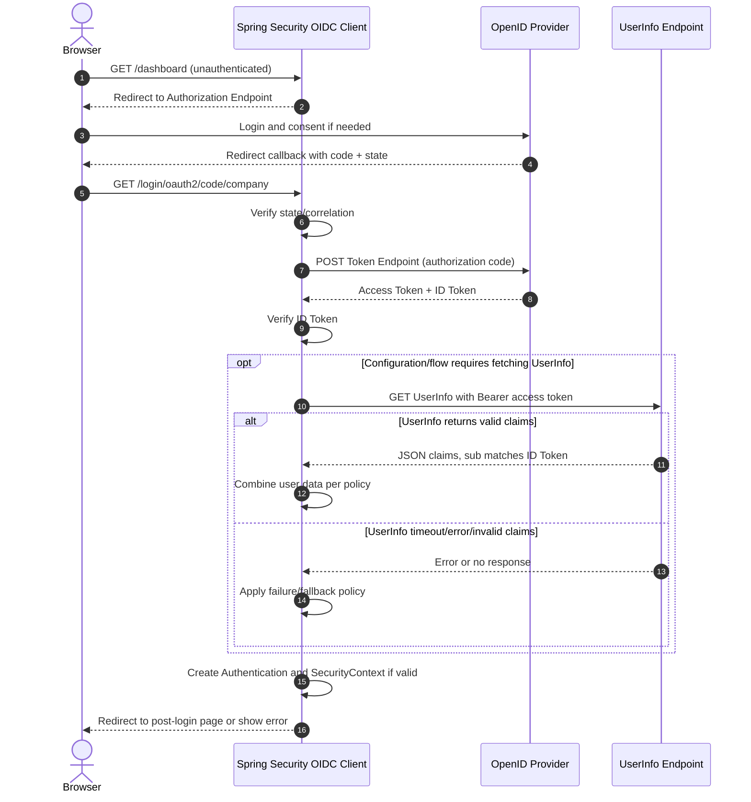

# 12.10. Timeouts, UserInfo Errors, and Handling Login Failures

## 1. Context: Valid ID Token, Yet Login Still Fails

Suppose **Employee Portal** is a Spring Boot MVC application using **Spring Security OAuth 2.0 / OIDC Client** to sign users in via an OpenID Provider (OP).

The user visits `/dashboard`, completes authentication at the OP, and the browser returns to Spring Security's callback. The application exchanges the authorization code for an access token and an ID Token. The ID Token's signature and key claims are all valid. However, while fetching additional profile info from the **UserInfo Endpoint**, the application encounters one of these situations:

- UserInfo responds too slowly, resulting in a **read timeout**.
- A connection to UserInfo cannot be established, resulting in a **connection timeout** or DNS/TLS error.
- The OP returns `401 Unauthorized` because the access token is rejected.
- The OP returns `403 Forbidden` due to permission policy or unsuitable scopes.
- The OP returns `429 Too Many Requests` or `503 Service Unavailable`.
- The OP returns invalid JSON or a `sub` claim that does not match `sub` in the ID Token.

At that point, the application must make the right decision: **can login complete using only the verified ID Token, or must login be rejected because UserInfo data is a mandatory requirement?** In addition, it must control wait times, user experience, logging, retries, and system impact when the provider experiences an outage.

This is the focus of lesson **"12.10. Timeouts, UserInfo Errors, and Handling Login Failures"** in chapter **"12. UserInfo and Profiles"**.

> **Principle:** UserInfo is a source of **user claims** protected by an OAuth access token. A UserInfo error **does not mean the ID Token is automatically wrong**, nor does it **permit the application to bypass an authentication/authorization condition required by business logic**.

After this lesson, you will know how to distinguish failure stages, configure HTTP timeouts for UserInfo, set up a failure handler in Spring Security Servlet, evaluate controlled fallbacks, and observe incidents without leaking tokens.

## 2. What Role Does UserInfo Play in OIDC Login?

### 2.1. ID Token and UserInfo Serve Different Purposes

| Component | ID Token | UserInfo Endpoint |
| --- | --- | --- |
| How received | In the token response of an OIDC flow, or Authorization Endpoint in certain flows | HTTP request to the OP's endpoint, using an access token |
| Primary data | Authentication claims: `iss`, `sub`, `aud`, `exp`, `iat`, `nonce` when applicable | Profile claims: `sub`, `name`, `email`, `picture`, `locale`... depending on OP |
| Security role | Authenticates user login details to the OIDC Client | Supplements user claims per scopes/consent and OP policy |
| Trust basis | After signature/issuer/audience/expiration/nonce are verified | After endpoint/token are validated and `sub` is matched against the ID Token |
| Required on every login? | ID Token must be processed in OIDC login | **Not necessarily**; depends on needed data, provider, flow, and configuration |
| Consumer | OIDC Client (Relying Party) | OIDC Client, calling OP using an access token |

Example verified ID Token payload (illustrative values):

```json
{
  "iss": "https://login.example.com/realms/company",
  "sub": "employee-4821",
  "aud": "employee-portal",
  "iat": 1794800000,
  "exp": 1794800600
}
```

A valid UserInfo response might be:

```json
{
  "sub": "employee-4821",
  "name": "Nguyen Van A",
  "preferred_username": "nva",
  "email": "nva@example.com",
  "email_verified": true,
  "locale": "vi"
}
```

**`sub` in UserInfo must match `sub` in the ID Token exactly**. If the two values do not match, the client must not use UserInfo claims to identify that user. This is not a UI glitch that can be silently ignored.

### 2.2. Scopes Do Not Guarantee Every Claim Is Always Present

For example, the client requests:

```text
scope=openid profile email
```

Meaning:

- `openid` requests the OIDC login mechanism, including an ID Token.
- `profile` requests standard profile claims when permitted by the OP.
- `email` requests `email` and `email_verified` claims when available.

Even after requesting `profile` or `email`, **there is no guarantee every optional claim will appear**. Presence also depends on the user, consent, provider, and data policies. Never write business logic assuming email cannot be null or that every user has an avatar.

### 2.3. Not Every OIDC Login Calls UserInfo

An application may receive all needed claims in the **verified ID Token**. In that case, the application may not need UserInfo. On the other hand, if application policy requires the freshest data from the OP or details absent from the ID Token, UserInfo can be an essential step.

In Spring Security, **whether `OidcUserService` calls UserInfo** depends on configuration and processing conditions, such as whether the UserInfo endpoint is published and whether the request qualifies for profile retrieval. Never assume "every OIDC login always sends an HTTP GET to UserInfo".

A practical troubleshooting tip is to confirm **whether a UserInfo request was actually issued** during that login before changing timeouts or failure handlers.

## 3. OIDC Login Flow and Where UserInfo Sits

### 3.1. Sequence Diagram



Some steps may execute inside the authentication provider and user service in an order specific to the Spring Security version, yet the core responsibility remains: **UserInfo is a supplemental phase while creating the user principal**, not a new callback from the browser.

### 3.2. Failure Points to Distinguish

| Stage | Component | Error Symptoms |
| --- | --- | --- |
| Authorization request | `OAuth2AuthorizationRequestRedirectFilter` | Wrong registration, redirect URI, provider rejects scopes |
| Callback/correlation | `OAuth2LoginAuthenticationFilter` and authorization request repository | State mismatch, lost session, original request not found |
| Token exchange | `OAuth2AccessTokenResponseClient` | `invalid_client`, `invalid_grant`, token endpoint timeout |
| ID Token validation | OIDC authentication provider / decoder | Invalid signature, issuer, audience, nonce, expired |
| **UserInfo call** | **`OidcUserService` / `DefaultOAuth2UserService`** | **Connect/read timeout, 401/403/429/5xx, invalid JSON, sub mismatch** |
| User mapping/authority | Custom user service / authorities mapper | Missing claims, role mapping error, internal permission source unavailable |
| SecurityContext/session | Spring Security and session store | Still anonymous after login or loops back to login page |
| Business authorization | Authorization rules | Logged in yet private page returns 403 |

If token exchange already failed, **you cannot call it a UserInfo error** even though the browser still shows a login failure page. Distinguish specifically so you fix the right layer.

## 4. HTTP Request to the UserInfo Endpoint

### 4.1. Common Request Pattern

After receiving an appropriate access token, the OIDC Client calls UserInfo:

```http
GET /realms/company/protocol/openid-connect/userinfo HTTP/1.1
Host: login.example.com
Authorization: Bearer <access-token>
Accept: application/json
```

The OP returns JSON containing user claims, typically:

```http
HTTP/1.1 200 OK
Content-Type: application/json

{
  "sub": "employee-4821",
  "name": "Nguyen Van A",
  "email": "nva@example.com",
  "email_verified": true
}
```

This is an example to explain the protocol, **not an actual executed HTTP trace**. UserInfo is called **from the backend**, so Browser Developer Tools normally will not show this request.

In certain OIDC profiles, UserInfo may use signed/encrypted responses per registration and metadata instead of only a JSON object. The application must use a client/parser supporting the actual response type, rather than naively forcing every response as JSON.

### 4.2. Which Data Is Mandatory?

Under OIDC, a UserInfo response must contain `sub`; other claims depend on scopes, user, and policy. `sub` must match the subject confirmed in the ID Token.

**Unacceptable** example:

```json
{
  "sub": "another-user-9999",
  "name": "Someone Else"
}
```

If the ID Token says `sub=employee-4821`, then a response saying `sub=another-user-9999` cannot be used as the logged-in user's details.

Sensitive identity/authorization claims such as organization, tenant, roles, and account status must be interpreted per **the provider's claim contract**, not inferred from `name` or `email`.

## 5. What Are Timeouts, and Where Do They Occur?

### 5.1. Common Timeout Types

| Type | Stage | Common Causes |
| --- | --- | --- |
| **Connection timeout** | Establishing connection to UserInfo host | Host unreachable, firewall, bad route, network outage |
| **Read/response timeout** | Connected yet waiting too long for response data | OP overloaded, OP's downstream backend slow, proxy stalling |
| **Connection pool acquisition timeout** | Waiting for a connection from the pool | Pool exhausted due to high concurrent requests |
| **DNS resolution timeout/failure** | Resolving OP domain name | DNS outage or high latency |
| **TLS handshake error/timeout** | Establishing secure HTTPS connection | Misconfigured trust store, certificates, or proxy/TLS |
| **Upstream gateway timeout** | Proxy between Client and OP receives timeout from backend | `504 Gateway Timeout` |
| **Global application timeout** | Login request exceeds system-allowed deadline | Ingress, load balancer, gateway, or request timeout |

Depending on the HTTP client, network errors may be wrapped in different exceptions. For instance, `SocketTimeoutException`, `ResourceAccessException`, or an HTTP library exception may signal a read timeout, but never rely solely on the exception class name to conclude the error type.

### 5.2. Login Latency Spans Multiple Steps

Total time for a single login is roughly:

```text
Browser authentication time at OP
+ Callback and session lookup time
+ Token Endpoint time
+ ID Token / JWKS verification time if needed
+ UserInfo time (if called)
+ Internal permission/profile load time (if any)
+ Session save and success redirect time
```

For example, if the Token Endpoint takes 700 ms, UserInfo takes 2,500 ms, and internal permission lookup takes 800 ms, the user may perceive slow login even though UserInfo **has not exceeded its timeout**. Measure timing per phase rather than just a single total "login latency" number.

### 5.3. Why Are Explicit Timeouts Needed?

Having no time bounds can hang callbacks, tie up Servlet request threads too long, and cause users to retry logging in repeatedly. Conversely, timeouts set too low cause false failures under normal OP latency.

Best practices:

- Set **connect timeout** and **read timeout** intentionally.
- Choose thresholds based on real latency, SLAs, network characteristics, and UX requirements.
- Distinguish UserInfo timeouts from Token Endpoint, Discovery, JWKS, or internal permission database timeouts.
- Bound the blast radius of retries, connection pools, and circuit breakers when the OP is overloaded.
- Return an appropriate message when the request cannot complete within safe bounds.

Numbers like 2 seconds / 3 seconds in the upcoming examples are **illustrative values only**, not universal SLA recommendations.

## 6. Common UserInfo Error Codes

| HTTP/OAuth Error | Possible Meaning | Priority Response |
| --- | --- | --- |
| `401 Unauthorized` / `invalid_token` | Access token missing, expired, wrong issuer/audience, or rejected by UserInfo | Check token from right provider, permissions/token format, UserInfo config |
| `403 Forbidden` / `insufficient_scope` | Insufficient scopes/permissions or denied by OP policy | Check scopes and policy; never expand permissions arbitrarily |
| `400 Bad Request` | Malformed request, wrong endpoint, or wrong token transport | Check request method/headers and provider contract |
| `404 Not Found` | Wrong UserInfo URI, non-existent, or proxy routing error | Verify OIDC metadata `userinfo_endpoint` and OP config |
| `429 Too Many Requests` | Rate limiting/quota at OP | Limit bursts/retries, honor Retry-After, review capacity policy |
| `500/502/503/504` | OP or upstream failure | Fail per policy, measure errors, recover once service stabilizes |
| HTTP 200 with invalid JSON | Unparseable response or wrong content type | Check media type, converter, and OP configuration |
| HTTP 200 without `sub` | UserInfo response fails required contract | Do not build a principal from this response |
| HTTP 200 with `sub` differing from ID Token | Received another user's data / session mix-up / OP bug | **Reject**; do not use claims from UserInfo |
| HTTP 200 missing `email` | Optional claim not released | Handle missing data per business rules; do not assume OIDC failure |
| Invalid TLS certificate | Endpoint cannot be authenticated securely | Fix trust/hostname/certificate; **never disable TLS verification** |

`401` does not mean "ID Token is invalid". UserInfo uses an **access token**, so the OP can reject the token at UserInfo while the ID Token still has a valid signature/claims. Conversely, if the ID Token has the wrong issuer or nonce, reject login **before trusting anything from UserInfo**, even if that endpoint returns `200`.

### 6.1. When the Access Token Is Rejected

Causes to consider:

1. The client used an access token from a **different registration/issuer** to call UserInfo.
2. The access token expired or was revoked by the OP.
3. The OP requires a specific scope or audience for UserInfo.
4. The client formatted the HTTP Authorization header incorrectly.
5. Dev/staging/prod endpoints were mixed up.
6. A UserInfo proxy/gateway failed to recognize or forward the Bearer token properly.

Never put the ID Token in the `Authorization: Bearer` header instead of the access token to "fix" a `401`. The ID Token is for the OIDC Client, not by default a credential to call UserInfo/Resource Servers.

### 6.2. When Profile Claims Are Incomplete

A UserInfo response with a valid `sub` yet missing `email` or `name` differs fundamentally from a security failure. For instance, business logic might need only `iss` + `sub` to identify the user and let them enter a name after login. However, if the product mandates a verified email, lacking `email_verified=true` can be grounds to **deny access to a feature** even though the OAuth/OIDC protocol authenticated the user.

Separate:

- **OIDC protocol validity**: are the response and identity valid?
- **Profile completeness**: does the user have enough display fields?
- **Business authorization policy**: is the user allowed into the business workflow?

These three decisions do not always yield the same outcome.

## 7. Relevant Spring Security Classes

For **Spring Boot Servlet/MVC**:

| Class/Abstraction | Responsibility |
| --- | --- |
| `DefaultOAuth2UserService` | Fetches user details from UserInfo/User Attributes Endpoint in OAuth2 Client; can be used internally by OIDC service |
| `OidcUserService` | Builds `OidcUser` based on ID Token and UserInfo when appropriate |
| `OAuth2UserService<OAuth2UserRequest, OAuth2User>` | Contract for standard OAuth2 user services |
| `OAuth2UserService<OidcUserRequest, OidcUser>` | Contract for OIDC user services |
| `OidcUserRequest` | Holds ClientRegistration, access token, and ID Token already processed in OIDC flow |
| `OAuth2LoginAuthenticationFilter` | Receives OAuth2 Login callback and coordinates authentication |
| `OidcAuthorizationCodeAuthenticationProvider` | Verifies OIDC Authorization Code login and invokes the right user service |
| `AuthenticationFailureHandler` | Handles UI/response when authentication fails |
| `SecurityFilterChain` / `HttpSecurity` | Configures `oauth2Login`, UserInfo user service, and failure handler |
| `OAuth2AuthorizedClientService` / repository | Stores issued tokens for client and principal per policy |

**`DefaultOAuth2UserService` and `OidcUserService` are not identical**. Non-`openid` OAuth2 Login typically fetches user attributes to build `OAuth2User`; OIDC Login has an ID Token and dedicated logic to verify/merge UserInfo into `OidcUser`.

### 7.1. Does Spring Automatically Fail Login When UserInfo Errors?

If UserInfo is actually called inside the authentication pipeline and that call throws an unhandled exception, authentication normally cannot complete; OAuth2 Login's failure handler processes the failure.

However, **Spring does not always call UserInfo**. If UserInfo is not requested by flow/configuration, a login can succeed using ID Token information. Furthermore, an application may install a custom user service with a different failure policy.

Therefore, never make sweeping claims like "UserInfo 503 always blocks every OIDC login" or "a valid ID Token always lets you ignore UserInfo 503" without inspecting **policy and integration hooks**.

## 8. Spring Boot Example: Basic OIDC Client

### 8.1. Dependencies

Maven example with Spring Boot 3.x / Spring Security 6.x:

```xml
<dependencies>
    <dependency>
        <groupId>org.springframework.boot</groupId>
        <artifactId>spring-boot-starter-web</artifactId>
    </dependency>
    <dependency>
        <groupId>org.springframework.boot</groupId>
        <artifactId>spring-boot-starter-security</artifactId>
    </dependency>
    <dependency>
        <groupId>org.springframework.boot</groupId>
        <artifactId>spring-boot-starter-oauth2-client</artifactId>
    </dependency>
</dependencies>
```

Subsequent code examples use the **Servlet stack** (`HttpSecurity`, `SecurityFilterChain`, `OidcUserService`), not WebFlux's `ServerHttpSecurity` / `SecurityWebFilterChain`.

### 8.2. Client Registration in `application.yml`

```yaml
server:
  port: 8080

spring:
  security:
    oauth2:
      client:
        registration:
          company:
            provider: company-oidc
            client-id: ${OIDC_CLIENT_ID}
            client-secret: ${OIDC_CLIENT_SECRET}
            client-authentication-method: client_secret_basic
            authorization-grant-type: authorization_code
            redirect-uri: "{baseUrl}/login/oauth2/code/{registrationId}"
            scope:
              - openid
              - profile
              - email
        provider:
          company-oidc:
            issuer-uri: https://login.example.com/realms/company
```

The OP must publish valid OIDC metadata with `authorization_endpoint`, `token_endpoint`, `jwks_uri`, and `userinfo_endpoint` if UserInfo is supported.

Relevant fields table:

| Property | Effect During Login |
| --- | --- |
| `registration.company` | Registration ID used in `/oauth2/authorization/company` and callback |
| `client-id` | Application audience and identifier in OAuth2 requests |
| `client-secret` | Authenticates confidential client at the Token Endpoint |
| `scope: openid` | Requests OIDC login and ID Token |
| `scope: profile/email` | Requests profile claims if permitted by OP |
| `provider.company-oidc.issuer-uri` | Identifies trusted OP; Discovery provides UserInfo URI |
| `redirect-uri` | Spring callback receiving authorization code; must match OP |

Never switch `userinfo_endpoint` to a domain received from user input. That URL must come from a **trusted provider** or managed configuration.

### 8.3. Minimal SecurityFilterChain

```java
package com.example.portal.security;

import org.springframework.context.annotation.Bean;
import org.springframework.context.annotation.Configuration;
import org.springframework.security.config.Customizer;
import org.springframework.security.config.annotation.web.builders.HttpSecurity;
import org.springframework.security.web.SecurityFilterChain;

@Configuration
public class SecurityConfig {

    @Bean
    SecurityFilterChain securityFilterChain(HttpSecurity http) throws Exception {
        http.authorizeHttpRequests(authorize -> authorize
                .requestMatchers("/", "/css/**", "/error").permitAll()
                .anyRequest().authenticated()
            )
            .oauth2Login(Customizer.withDefaults());

        return http.build();
    }
}
```

With this configuration, Spring Security handles the authorization request, callback, token exchange, and OIDC login. In standard cases, you do not need to write your own controller to receive `code` or call UserInfo with a custom HTTP client.

However, if you need **intentional UserInfo timeouts** or a **consistent failure handler**, you can customize `OidcUserService` and `oauth2Login` without rewriting the entire flow.

## 9. Configuring Dedicated HTTP Timeouts for UserInfo in the Servlet Stack

The example below configures `DefaultOAuth2UserService` with a `RestTemplate` having connect/read timeouts, then passes that service to `OidcUserService`. Durations are illustrative numbers and must be tuned for real operations.

### 9.1. Creating the UserInfo Service Beans

```java
package com.example.portal.security;

import org.springframework.context.annotation.Bean;
import org.springframework.context.annotation.Configuration;
import org.springframework.http.client.SimpleClientHttpRequestFactory;
import org.springframework.security.oauth2.client.http.OAuth2ErrorResponseErrorHandler;
import org.springframework.security.oauth2.client.oidc.userinfo.OidcUserService;
import org.springframework.security.oauth2.client.userinfo.DefaultOAuth2UserService;
import org.springframework.web.client.RestTemplate;

@Configuration
public class UserInfoHttpConfig {

    @Bean
    DefaultOAuth2UserService oauth2UserInfoService() {
        SimpleClientHttpRequestFactory factory =
                new SimpleClientHttpRequestFactory();

        // Example values: 2 seconds connect, 3 seconds read.
        factory.setConnectTimeout(2_000);
        factory.setReadTimeout(3_000);

        RestTemplate http = new RestTemplate();
        http.setRequestFactory(factory);
        http.setErrorHandler(new OAuth2ErrorResponseErrorHandler());

        DefaultOAuth2UserService service = new DefaultOAuth2UserService();
        service.setRestOperations(http);

        return service;
    }

    @Bean
    OidcUserService oidcUserService(
            DefaultOAuth2UserService oauth2UserInfoService) {

        OidcUserService oidc = new OidcUserService();

        // Use the configured HTTP transport when the OIDC service
        // decides UserInfo must be fetched from the provider.
        oidc.setOauth2UserService(oauth2UserInfoService);

        return oidc;
    }
}
```

The configuration uses built-in classes:

- **`SimpleClientHttpRequestFactory`**: configures connect and response-read timeouts for HTTP requests made through this factory.
- **`RestTemplate`**: sends the UserInfo HTTP request; another HTTP client may be used per network/proxy policy.
- **`OAuth2ErrorResponseErrorHandler`**: interprets OAuth2 error responses from the HTTP endpoint.
- **`DefaultOAuth2UserService`**: accepts `RestOperations` to load user attributes.
- **`OidcUserService`**: uses the underlying OAuth2 user service when calling UserInfo while retaining OIDC principal-creation logic.

**Only the timeout for UserInfo is configured in this example.** It **does not automatically adjust timeouts for the Token Endpoint, JWKS fetch, OIDC Discovery, HTTP session store, or internal role service**. Each component has its own HTTP client/resource to configure when needed.

### 9.2. Why Not Create an Empty `RestTemplate` and Omit Converters/Error Handler?

A default `RestTemplate` typically includes basic HTTP message converters, including a JSON converter when Jackson is on the classpath. However, when replacing the `RestOperations` used by `DefaultOAuth2UserService`, ensure it still has:

- Converters matching the OP's media types/responses.
- The handler recognizing OAuth2 error responses.
- Proper TLS/proxy/timeouts.
- Redirect, header, and Bearer token policies per the user service.

If you swap `RestOperations` for an incompatible implementation, a JSON converter failure can be misdiagnosed as a UserInfo timeout or invalid OP claims.

For environments needing connection pooling, proxy authentication, mTLS, or a custom TLS trust store, configure an appropriate HTTP transport and monitor **pool acquisition timeout** alongside connect/read timeouts. Never disable certificate verification to cut down timeouts.

### 9.3. Wiring the Services into `oauth2Login`

```java
package com.example.portal.security;

import org.springframework.context.annotation.Bean;
import org.springframework.context.annotation.Configuration;
import org.springframework.security.config.annotation.web.builders.HttpSecurity;
import org.springframework.security.oauth2.client.oidc.userinfo.OidcUserService;
import org.springframework.security.oauth2.client.userinfo.DefaultOAuth2UserService;
import org.springframework.security.web.SecurityFilterChain;

@Configuration
public class UserInfoLoginSecurityConfig {

    @Bean
    SecurityFilterChain securityFilterChain(
            HttpSecurity http,
            OidcUserService oidcUserService,
            DefaultOAuth2UserService oauth2UserInfoService)
            throws Exception {

        http.authorizeHttpRequests(authorize -> authorize
                .requestMatchers("/", "/login", "/error", "/css/**")
                    .permitAll()
                .anyRequest().authenticated()
            )
            .oauth2Login(oauth2 -> oauth2
                .userInfoEndpoint(userInfo -> userInfo
                    .oidcUserService(oidcUserService)
                    .userService(oauth2UserInfoService)
                )
                .failureUrl("/login?error")
            );

        return http.build();
    }
}
```

This is an **alternative configuration** replacing `SecurityConfig` in Section 8.3; do not place two `SecurityFilterChain` beans with the same default matcher simultaneously in one demo.

Explanation:

1. `userInfoEndpoint().oidcUserService(...)`: specifies the service handling **OIDC**.
2. `userInfoEndpoint().userService(...)`: specifies the service handling **non-OIDC OAuth2 login**, when the provider uses a user attributes endpoint.
3. `failureUrl("/login?error")`: when authentication fails, Spring directs the user to the configured login error URL.
4. `/login` is permitted so unauthenticated users can still view the login page. If using a custom login page, the application must serve that page.
5. `OidcUserService` remains where OIDC user-creation policy resides; using an HTTP client with timeouts does not disable validation or imply default fallbacks.

If login fails due to UserInfo, the failure handler is the right place to route and show messaging. **Never write a callback controller to catch UserInfo exceptions and manually create a session.**

## 10. Login Failure: How Does the Failure Handler Work?

`oauth2Login` provides **`AuthenticationFailureHandler`** for cases where the authentication pipeline does not complete. When authentication throws an error routed to the handler, Spring Security can clear appropriate state and send the user to an error page.

### 10.1. Default and Custom Failure URLs

Simple form:

```java
http.oauth2Login(oauth2 -> oauth2
        .failureUrl("/login?error"));
```

With a custom login page:

```java
http.authorizeHttpRequests(authorize -> authorize
        .requestMatchers("/login.html", "/error", "/css/**").permitAll()
        .anyRequest().authenticated()
    )
    .oauth2Login(oauth2 -> oauth2
        .loginPage("/login.html")
        .failureUrl("/login.html?error")
    );
```

Error pages shown to users should display neutral messaging, such as:

> Unable to complete sign-in right now. Please try again or contact support if the issue persists.

Never display raw exception messages from UserInfo HTTP responses, raw access tokens, ID Tokens, client secrets, authorization codes, stack traces, or URLs containing private data on screen.

### 10.2. Failure Handler with Safe Logging

If controlled structured logging is needed, you can wrap `SimpleUrlAuthenticationFailureHandler`:

```java
package com.example.portal.security;

import org.slf4j.Logger;
import org.slf4j.LoggerFactory;
import org.springframework.context.annotation.Bean;
import org.springframework.context.annotation.Configuration;
import org.springframework.security.web.authentication.AuthenticationFailureHandler;
import org.springframework.security.web.authentication.SimpleUrlAuthenticationFailureHandler;

@Configuration
public class LoginFailureHandlerConfig {

    private static final Logger log =
            LoggerFactory.getLogger(LoginFailureHandlerConfig.class);

    @Bean
    AuthenticationFailureHandler loginFailureHandler() {
        SimpleUrlAuthenticationFailureHandler redirect =
                new SimpleUrlAuthenticationFailureHandler("/login?error");

        return (request, response, exception) -> {
            // Log only the exception class name; do not log raw message/cause because
            // HTTP client details may contain sensitive data.
            log.warn("OIDC login failed; exceptionType={}",
                    exception.getClass().getSimpleName());

            redirect.onAuthenticationFailure(request, response, exception);
        };
    }
}
```

Wiring into OAuth2 Login:

```java
@Bean
SecurityFilterChain securityFilterChain(
        HttpSecurity http,
        OidcUserService oidcUserService,
        AuthenticationFailureHandler loginFailureHandler)
        throws Exception {

    http.authorizeHttpRequests(authorize -> authorize
            .requestMatchers("/", "/login", "/error").permitAll()
            .anyRequest().authenticated())
        .oauth2Login(oauth2 -> oauth2
            .userInfoEndpoint(userInfo -> userInfo
                .oidcUserService(oidcUserService))
            .failureHandler(loginFailureHandler));

    return http.build();
}
```

This is an **alternative variant** to the chain in Section 9.3; never declare multiple catch-all chains simultaneously.

In real products, you can include a **dedicated observability correlation ID**, standardized error classification code, timestamp, and provider name **resolved from trusted configuration**. Avoid logging arbitrary exception messages because they may contain URLs, queries, tokens, or user data.

### 10.3. When Should You Do More Than Just Redirect to Login?

Some systems want to:

- Show a maintenance notice when the OP is unavailable.
- Count failures per provider to alert operations.
- Send users to a support guidance page instead of a login loop.
- Distinguish account-permission denials from infrastructure failures without exposing internal details.

You can use `AuthenticationFailureHandler` to implement suitable UX/HTTP responses, while restricting target URLs and avoiding open redirects. For APIs or SPAs with a separate backend, responses can be JSON error codes per contract; however, never turn an authentication failure into a `200 OK` holding a logged-in session.

## 11. When UserInfo Fails: Fail-Closed or Fall Back to ID Token?

This is the most important architectural decision in the lesson. No single "always fall back" or "always block" answer fits every application, because UserInfo's role in authentication and authorization varies.

### 11.1. Distinguishing Three Business Models

| Model | Mandatory Data | Reaction When UserInfo Times Out |
| --- | --- | --- |
| **A. Minimal OIDC identity only** | Valid ID Token with `iss` + `sub`, audience, expiration... | Can design login **without depending** on UserInfo, if configured explicitly and not needed for permissions |
| **B. UserInfo used for optional profile** | Valid ID Token; name/photo/language do not govern permissions | May choose a bounded fallback policy, but must distinguish missing profile from authentication failure and never hide provider outages |
| **C. UserInfo is a mandatory source for permission decisions** | Required verified claims/groups/account status | **Fail closed**: do not complete login / do not grant permissions if required info cannot be fetched |

Examples:

- An app viewing public reports after login, using only `iss` and `sub` for identity; name/avatar can update later → usually no need to block all logins if protocol allows omitting UserInfo.
- An internal portal required to check which department a user belongs to or whether access was approved, when that info lives only in UserInfo → a UserInfo timeout **must not silently turn into granted access**.
- UserInfo returns a `sub` mismatching the ID Token → **not an "optional profile" error**; this is an identity consistency violation. The client must reject that response per OIDC.

### 11.2. Fail-Closed: Default Safe Behavior When Data Is Mandatory

In systems holding sensitive data, login/authorization decisions may depend on roles, tenant, groups, account status, or provider access conditions.

When mandatory data is missing, the right choice is:

1. Never create an authenticated principal with "guessed" permissions or unclear inherited rights.
2. Never auto-grant admin/default roles merely because the ID Token was valid.
3. Use a failure handler to deliver a controlled login-failure notice.
4. Record metrics and error categories without logging tokens or sensitive responses.
5. Let the user retry **through a fresh flow** once the provider recovers, avoiding reuse of old callbacks/codes.

If an application wants to allow a **lower-privilege** session, explicitly design a "degraded mode", restricting accessible resources and relying on trusted permission sources. Never treat degraded mode as an unconditional catch-all exception branch.

### 11.3. Using Claims from the ID Token: Only When Designed to Allow It

Sometimes OIDC login can complete using verified ID Token claims without calling UserInfo. This makes sense when:

- The ID Token contains sufficient identity per the OIDC contract.
- The application does not rely on UserInfo-only claims for mandatory authorization.
- No security rule requires the **freshest** user status/groups.
- No UserInfo response with a conflicting `sub` was received and ignored.
- Skipping UserInfo is **intentionally configured** and monitored, not a catch-all exception fallback.

With Spring Security, consider configuring UserInfo retrieval policy on `OidcUserService` per **the API of the version in use**, or implementing a formal user service using the ID Token as the identity source per approved requirements. No need to rewrite callback filters or ID Token signature validation.

**A common mistake** is writing:

```java
// CONTRAINDICATED: anti-pattern example only.
try {
    return oidcUserService.loadUser(userRequest);
} catch (Exception ignored) {
    return new DefaultOidcUser(
            List.of(new SimpleGrantedAuthority("ROLE_ADMIN")),
            userRequest.getIdToken());
}
```

The anti-pattern above is intentionally **not code to adopt**: it swallows every error (including `sub` mismatches and missing required profiles) and grants `ROLE_ADMIN` without permission evidence. Such an implementation creates a severe vulnerability.

If only minimal identity is needed, use intentional UserInfo-skipping mechanics and grant only **policy-defined minimal permissions**. If UserInfo is required for authorization, **never fall back to bypass infrastructure errors**.

### 11.4. Decision Table by Error Type

| Situation | Can Rely Solely on ID Token? | Notes |
| --- | --- | --- |
| No UserInfo endpoint, ID Token has enough claims | Yes, per design/flow | Do not issue requests to a nonexistent endpoint |
| UserInfo not called per policy | Yes, if ID Token suffices and policy permits | Do not manually call just because `profile` was requested |
| UserInfo times out yet only optional display name is needed | Only with an explicitly designed fallback policy | Do not mask outages; do not grant extra permissions |
| UserInfo times out when group/role is mandatory | **No** | Fail closed |
| UserInfo returns `sub` differing from ID Token | **Cannot use this response** | Reject per OIDC rules; investigate data source |
| UserInfo returns `401 invalid_token` | Not automatically | Investigate token, issuer, scopes; do not retry blindly |
| UserInfo returns `429/503` | Only if profile is truly optional and fallback is permitted | Bound retries; track circuit breaker |
| UserInfo lacks `email` when email is not used for identity | Can complete login | Handle blank email in UI |
| UserInfo lacks verified email when product mandates it | Cannot enter email-gated workflows | Can route to a **controlled** profile-completion flow; never fake email verified |

## 12. Customizing the User Service to Enforce Mandatory Profile Policies

In many projects, **UserInfo HTTP errors** and **missing claims after UserInfo responds** need distinct handling. The example below illustrates checking a **mandatory email** during principal construction, **after the default OIDC service completes its checks**.

### 12.1. Wrapper for `OidcUserService`

```java
package com.example.portal.security;

import org.springframework.security.oauth2.client.oidc.userinfo.OidcUserRequest;
import org.springframework.security.oauth2.client.oidc.userinfo.OidcUserService;
import org.springframework.security.oauth2.client.userinfo.OAuth2UserService;
import org.springframework.security.oauth2.core.OAuth2AuthenticationException;
import org.springframework.security.oauth2.core.OAuth2Error;
import org.springframework.security.oauth2.core.oidc.user.OidcUser;

public class RequiredProfileOidcUserService
        implements OAuth2UserService<OidcUserRequest, OidcUser> {

    private final OidcUserService delegate;

    public RequiredProfileOidcUserService(OidcUserService delegate) {
        this.delegate = delegate;
    }

    @Override
    public OidcUser loadUser(OidcUserRequest request)
            throws OAuth2AuthenticationException {

        // Delegate remains responsible for standard OIDC UserInfo processing.
        // Do not catch network exceptions and fabricate a privileged user.
        OidcUser user = delegate.loadUser(request);

        // Illustrates one business requirement: mandatory email.
        // Email may come from ID Token or valid UserInfo.
        String email = user.getEmail();

        if (email == null || email.isBlank()) {
            throw new OAuth2AuthenticationException(
                    new OAuth2Error(
                            "profile_incomplete",
                            "Required email claim is missing",
                            null));
        }

        return user;
    }
}
```

Here:

- If UserInfo is actually called and fails, the wrapper does not swallow the exception; authentication cannot shortcut to success.
- If the service builds `OidcUser` yet email is absent, the application rejects per the **illustrative business policy**.
- If the application only needs `iss` + `sub`, do not enforce a mandatory email condition like the example.
- **Email presence does not mean it is verified.** If the product requires a verified email, add a check based on the verified `email_verified` claim and provider contract, rather than checking only that the email string is non-empty.

### 12.2. Wiring the Wrapper into Configuration

```java
@Bean
RequiredProfileOidcUserService requiredProfileOidcUserService(
        OidcUserService oidcUserService) {
    return new RequiredProfileOidcUserService(oidcUserService);
}
```

Then inside the chain:

```java
http.oauth2Login(oauth2 -> oauth2
    .userInfoEndpoint(userInfo -> userInfo
        .oidcUserService(requiredProfileOidcUserService))
    .failureUrl("/login?error"));
```

These two snippets illustrate usage assuming beans/imports are prepared as in the previous section. Never declare multiple catch-all `SecurityFilterChain` beans simultaneously just to add a wrapper.

**Separate policy from UserInfo's role:** if email is required for business workflows yet allowed to be completed after login, create an incomplete-profile user state with restricted permissions. If email is a mandatory authorization prerequisite, missing email must block corresponding access.

### 12.3. Avoid Equating "Email Missing" with "UserInfo Endpoint Failed"

If the OIDC service did not need to call UserInfo, `OidcUser` can still lack an email because scopes/consent did not release it. That is a **missing claim**, not a connect/read timeout.

Conversely, if code catches `ResourceAccessException` from the HTTP transport when calling UserInfo, the problem is **network/timeout**, not a user failing to provide an email. Collapsing both into a single technical message like "invalid profile" makes operations harder.

## 13. Retries, Backoff, and Circuit Breakers

### 13.1. Should You Retry UserInfo on Timeouts?

UserInfo is usually called via **HTTP GET**, so retrying can be semantically sound in some transient failures. However, that is **not a license for unbounded retries**:

- The access token is a sensitive credential; every retry must still target **the same trusted UserInfo endpoint**.
- Retries can further overload an already struggling OP.
- Callbacks face an overall ingress/browser timeout; excessive retries leave users hanging.
- A `401 invalid_token` is normally not fixed by GETting again with the exact same token.
- A `403 insufficient_scope` or `sub` mismatch must be fixed via configuration/security checks, not endless retries.
- On `429`, respect rate limits and `Retry-After` per OP policy; never create a request storm.

### 13.2. Classifying Retryability

| Error Type | Auto-Retryable? | Conditions |
| --- | --- | --- |
| Transient connect timeout | Possibly, very few attempts | With retry budget, backoff, total timeout, and load control |
| Transient read timeout | Possibly within bounds | GET UserInfo is expected to have no side effects; avoid doubling load |
| `429 Too Many Requests` | Only per OP policy | Backoff, `Retry-After`, rate limits; do not exceed quota |
| `502/503/504` | Possibly bounded | Observe recovery and circuit breaker |
| `401 invalid_token` | Normally do not retry same token | Check token/issuer/scopes; if a valid refresh exists, use its own flow |
| `403 insufficient_scope` | No | Needs proper permissions/scopes, not a transient error |
| `sub` mismatch | **No** | Reject response; investigate identity incident |
| Invalid JSON or missing `sub` | Do not retry indefinitely | Check provider/format; never accept invalid responses |
| Invalid TLS certificate | No | Fix trust/certificate; never disable TLS verification |

### 13.3. Per-Provider Circuit Breaker

If one OP suffers widespread UserInfo failures, a circuit breaker can stop the application from hammering a broken endpoint, reducing load and failing fast.

Design requirements:

1. **Per provider/registration** rather than one shared circuit that breaks every login method.
2. Count only appropriate errors (timeouts/5xx), avoiding counting user permission denials as infrastructure failures.
3. Include a half-open recovery state with controlled traffic.
4. Never automatically redirect users to a different issuer merely because the current issuer's UserInfo failed.
5. If UserInfo is mandatory, an open circuit breaker must lead to a **controlled login failure**, never an automatic session.
6. Emit incident alerts so operators notice elevated login failure rates.

If using a resilience library outside Spring Security, wrap the **UserInfo HTTP call** or user service properly per architecture while preserving OAuth/OIDC validation rules. Never wrap the authentication provider layer with a circuit breaker that swallows all exceptions.

### 13.4. Timeout Budget for the Entire Login

Illustrative budget plan:

```text
Token Endpoint:     max timeout 3 seconds
UserInfo Endpoint:  connect 2 seconds, read 3 seconds
Role service:       max timeout 1 second
Ingress callback:   total budget must fit all phases and overhead
```

Do not mechanically add thresholds together and call that an SLA. Connection pooling, retries, TLS, DNS, and multiple internal calls can increase actual duration. Measure latency percentiles and set a budget aligned with user expectations.

## 14. UserInfo Can Fail Because of Another Network Layer, Not the OP

Production systems often have multiple intermediaries:

```text
Spring Boot Employee Portal
       |
       | HTTPS GET UserInfo + Bearer token
       v
Corporate Proxy / Service Mesh / Egress Gateway
       |
       | TLS / DNS / Routing / Rate Limit
       v
OIDC Provider API Gateway
       |
       v
UserInfo Service / User Directory
```

Thus a timeout can originate from:

- DNS failing to resolve a new host.
- Proxy blocking outbound network access to the realm/provider.
- JVM TLS trust store missing the appropriate CA.
- Service mesh outbound policy blocking UserInfo.
- HTTP client pool too small for login concurrency.
- OP calling internal LDAP/HR databases that are slow.
- Deployment zones having differing network routes or firewalls.

When only a few pods/instances fail, compare **deployment environment, DNS/TLS/proxy, and HTTP client settings**. When every instance fails simultaneously with HTTP 503, it is likely an upstream outage or shared configuration issue. Never guess root cause from status code alone.

### 14.1. Reverse Proxy for Callback Differs from UserInfo Proxy

The two traffic paths can traverse different routes:

- **Browser → Employee Portal callback**: crosses ingress; affects cookies, sessions, and redirect URIs.
- **Employee Portal → OP UserInfo**: outbound from backend; affects DNS, egress, TLS, proxies, and HTTP client timeouts.

A callback losing `state` is typically a session/cookie/correlation issue **before the UserInfo stage**. A `UserInfo 504` occurs **after token exchange**, when the backend calls the provider. Fixing forwarded headers on ingress will not necessarily resolve outbound UserInfo connectivity errors.

## 15. Observability: Knowing Where UserInfo Errors Are Spiking

A production system needs clear stage separation without reading logs containing sensitive data:

### 15.1. Useful Metrics

| Metric / Dimension | Purpose |
| --- | --- |
| `oidc.login.attempts` | Number of login starts |
| `oidc.login.success` | Number of successful authentications |
| `oidc.login.failure` | Number of failed authentications by error category |
| `oidc.userinfo.requests` | Number of UserInfo requests actually sent |
| `oidc.userinfo.duration` | UserInfo latency distribution per provider |
| `oidc.userinfo.errors` | Classifies timeouts, HTTP 401/403/429/5xx, parse errors, sub mismatches |
| `oidc.token_exchange.duration` | Separates Token Endpoint latency from UserInfo |
| `oidc.userinfo.fallback` | Tracks permitted degraded/fallback activations |
| `oidc.userinfo.circuit_state` | Tracks circuit breaker state when used |

The metric names above are **design suggestions only**, not metrics Spring Security emits out of the box. Integrate with Micrometer/OpenTelemetry or your existing observability stack as appropriate.

### 15.2. Safe Tags/Labels

Recommended:

```text
registration_id = company
provider = company-oidc
stage = userinfo
result = failure
reason = read_timeout
http_status = 504
```

Do not use as labels:

- Raw access tokens, refresh tokens, ID Tokens, or authorization codes.
- Emails, real names, phone numbers, addresses, or individual `sub` values.
- Full UserInfo URLs containing sensitive query strings.
- Unfiltered exception messages or response bodies containing personal data.

If correlating a session is needed, use a **dedicated correlation/request ID** with proper retention and log access controls. Avoid using OAuth `state`/`nonce` as public monitoring identifiers.

### 15.3. Difference Between Error Rate and Latency

An OP may not yet return HTTP errors while latency spikes sharply. For example:

- p50 200 ms, p95 2.5 seconds, p99 6 seconds.
- Client read timeout 3 seconds.
- Login failures rise in the latency tail.

Operators need to monitor both **latency distribution and error rate**, along with pool saturation and queued request counts. Never look solely at `5xx` rates because client timeouts happen **before an HTTP status is ever received**.

## 16. User-Friendly Yet Secure Error Handling

### 16.1. UI Messages by Scenario

| Scenario | Suggested User Message |
| --- | --- |
| Provider temporarily slow/unavailable | "Unable to complete sign-in right now. Please try again later." |
| Account lacks permission | "Your account has not been granted access to this application. Please contact an administrator." |
| Policy requires profile completion | "Please complete your account information to continue." |
| Identity data error | "Sign-in was unsuccessful. Please contact support." |
| Login session timed out | "Your sign-in session has expired. Please start again." |

These messages must be chosen from **safely classified error codes**. Never expose OP response bodies containing internal technical details or PII. When exact classification is unavailable, show a generic message.

### 16.2. Never Auto-Redirect Continuously to the Authorization Endpoint

A failure handler that always redirects to `/oauth2/authorization/company` can create a loop:

```text
UserInfo timeout
  → OAuth2 Login failure
  → auto-restart login
  → Token Endpoint succeeds
  → UserInfo timeout
  → infinite loop
```

A better approach sends the user to an **error page with an explicit user-triggered retry option**, plus a support code if needed. If offering auto-retry, enforce strict limits and avoid hammering an OP that is down.

### 16.3. Never Display Unverified Permissions or Profile Data

Before login completes, the UI must never extract data from an unverified ID Token payload and show the user as authenticated. Likewise, if a UserInfo fetch fails, never display claims from **another user's cached record** due to a cache key missing issuer/subject.

For previously stored profiles, enforce freshness policies, `(issuer, subject)` keying, and a clear boundary between **display data** and **authorization data**. Never use a stale profile cache as proof the user still holds access to sensitive systems.

## 17. Multi-Provider and Multi-Tenant: Policies Do Not Have to Match

A Spring Security Client can have multiple registrations:

| Registration | Purpose | Example UserInfo Policy |
| --- | --- | --- |
| `company` | Internal employee login | Requires latest org status/roles; critical UserInfo failure → fail closed |
| `partner` | Partner login | Requires OIDC identity only; display profile may sync later if policy permits |
| `customer` | Customer login | Uses `iss + sub` for identity only; email optional |
| `admin` | Admin login | Requires additional step-up/MFA/trusted authority; never fall back to admin if UserInfo fails |

These are **hypothetical policy examples**, not universal rules for these registration names.

### 17.1. Selecting Policy from Configured Registrations

Inside `OidcUserService`, you can retrieve the registration ID with:

```java
String registrationId = request.getClientRegistration()
        .getRegistrationId();
```

Then apply governed policy, such as "`admin` must carry verified permission claims from a trusted issuer". **Never take an arbitrary issuer or UserInfo URI from query parameters** to make outbound HTTP requests; select strictly among configured, permitted client registrations.

### 17.2. Avoid Mixing Data Across Issuers

A `sub` may be unique only **within a single issuer**; emails can also collide or change. When caching user profiles, use a namespaced key tied to issuer and subject, such as:

```text
user_key = (issuer, subject)
```

In multi-tenant systems, per-tenant/realm policies and ID Token `aud` checks may also be required. Never merge profiles by email or `preferred_username` without issuer verification.

### 17.3. Per-Registration Circuit Breaker

If `partner` hits UserInfo 503, `company` does not necessarily have to fail. Ideally, rate limits, timeouts, circuit breakers, and metrics are isolated per provider. In code, registrations sharing the same user service may still share an HTTP connection pool, so consider resource limits when one provider degrades.

## 18. Comparing Servlet and WebFlux for UserInfo Handling

This lesson used **Servlet/MVC**, while the reactive stack has corresponding classes:

| Servlet | Reactive WebFlux |
| --- | --- |
| `HttpSecurity` / `SecurityFilterChain` | `ServerHttpSecurity` / `SecurityWebFilterChain` |
| `DefaultOAuth2UserService` | `DefaultReactiveOAuth2UserService` |
| `OidcUserService` | `OidcReactiveOAuth2UserService` |
| `RestTemplate` / RestOperations | `WebClient` |
| Synchronous HTTP exception/timeout | Reactive error signal / timeout operator / WebClient exception |
| `AuthenticationFailureHandler` | Authentication failure handling in reactive security filters |

With WebFlux, never use synchronous `RestTemplate` and call `block()` inside the event loop to fetch UserInfo. Use the **reactive user service** and a `WebClient` configured with appropriate connect/read timeouts. Retries/circuit breakers must also operate on publishers without blocking threads via sleep.

OIDC principles **do not change across stacks**: ID Token must be verified, UserInfo `sub` must match, invalid claims must never build principals, and policies for mandatory authorization data must fail closed.

## 19. Practical Scenarios and Reasoning

The following scenarios are **examples to understand expected behavior**, not claims of execution on a live system or actual test results.

### 19.1. Case A — Slow UserInfo, Eventually Returns 200

```text
Token Endpoint: 200 OK after 350 ms
UserInfo: 200 OK after 2.8 seconds
Read timeout: 3.0 seconds
```

Login can succeed if the UserInfo response is valid and other checks pass. Still, total wait time rises. Measure latency and review timeout/UX budgets rather than prematurely labeling it an HTTP error.

### 19.2. Case B — UserInfo Exceeds Read Timeout

```text
Token Endpoint: 200 OK
ID Token: valid
UserInfo: no response before read timeout
Policy: requires latest roles from UserInfo
```

The right behavior under this policy is a **controlled login failure**. Do not create a session with stale permissions or default roles. The failure handler displays a neutral notice and metrics record reason `read_timeout`.

### 19.3. Case C — UserInfo 401

```text
UserInfo response: 401 invalid_token
Access token: came from company registration's token response
```

Check: are issuer/UserInfo endpoint right, is the access token valid, do scope/format/audience match the OP, and were registrations mixed up? Never put the ID Token into the Bearer header instead. Retrying GET with the exact same token repeatedly rarely helps.

### 19.4. Case D — UserInfo Returns a Different `sub`

```text
ID Token: sub = employee-4821
UserInfo: sub = employee-9999
```

This is a severe identity discrepancy. **Never merge UserInfo claims into the logging-in user**; reject the response and investigate config/bugs/provider. Never fall back by skipping subject checks and using untrusted claims anyway.

### 19.5. Case E — No Email, Yet Valid UserInfo

```text
ID Token: sub = employee-4821
UserInfo: {"sub":"employee-4821","name":"Nguyen Van A"}
Policy: email optional
```

Login can complete if other conditions are met; the profile page displays blank email or prompts to add one. **Missing email differs from a UserInfo timeout**.

If policy mandates a verified email before using a feature, block that feature or route the user into a managed profile-completion flow.

### 19.6. Case F — One OP Fails While Another OP Still Works

```text
company UserInfo: 503
partner UserInfo: 200
```

When using multiple providers, track metrics/circuit breakers per registration. Never automatically route employee logins to the partner OP when client registration, audience, tenant, and authorities are not equivalent.

### 19.7. Case G — Token Endpoint Times Out Before Obtaining ID Token

```text
Callback has code + state
POST Token Endpoint: read timeout
No token response
```

This is a **token exchange error**, not UserInfo. Configuring UserInfo timeouts from Section 9 will not fix it. Check the token response client/transport and Authorization Code retry policy, avoiding blindly resending single-use codes.

### 19.8. Case H — UserInfo Succeeds Yet Application Role Service Fails

```text
UserInfo: 200, sub matches
Internal role service: 503
Policy: internal roles mandatory
```

This is an **internal permission source error**, not a UserInfo error. Fail-closed behavior may still be required, yet the metrics and remediation differ. Do not increase the UserInfo timeout because the role service failed.

## 20. Quick Diagnostic Table

| Symptom | Stage to Check First | Resolution |
| --- | --- | --- |
| Login hangs long after callback | Token Endpoint, UserInfo, JWKS, role service | Measure per-phase latency; configure separate timeouts |
| `ResourceAccessException` on UserInfo GET | HTTP transport to UserInfo | DNS, TCP/TLS, proxy, connect/read timeouts |
| UserInfo 401 `invalid_token` | Access token and OP config | Verify right registration/issuer/scopes; never send ID Token instead of access token |
| UserInfo 403 | Permissions/scopes/policy | Check OP, consent, grants, and roles |
| UserInfo 429 | Rate limiting | Reduce request bursts, bounded backoff, monitor quota |
| UserInfo 502/503/504 | OP/upstream/network | Fail per policy, monitor, recover once provider stabilizes |
| UserInfo HTTP 200 yet parse fails | Media type/JSON converter/format | Check protocol response and converter |
| UserInfo HTTP 200 yet missing `sub` | OIDC response fails requirements | Reject that response data |
| UserInfo `sub` differs from ID Token | Identity mismatch | Reject and investigate incident |
| Logged in yet hit 403 | Application authorization | Check role/authority mapping, not callback |
| Still anonymous after login | Session/SecurityContext | Check cookies, LB, session store |
| Only one pod fails UserInfo | Local egress/proxy/trust store | Compare network/config per instance |
| Same error across all providers | HTTP client config or shared dependency | Check timeouts/pool/global network |
| Only one provider fails | Provider-specific endpoint, quota, policy | Separate metrics/circuit breakers per registration |
| Added UserInfo timeout yet Token Endpoint remains slow | Wrong config point | Configure token client separately; do not conflate the two HTTP clients |

### Error Source Identification Diagram

```text
Browser returns to callback
        |
        +-- Missing matching authorization request/state?
        |       -> session / cookie / OAuth2 correlation
        |
        v
Exchange authorization code for tokens
        |
        +-- Timeout / invalid_client / invalid_grant?
        |       -> Token Endpoint / client authentication / PKCE
        |
        v
Verify ID Token
        |
        +-- Invalid signature / issuer / audience / nonce?
        |       -> OIDC validation / JWKS
        |
        v
Is UserInfo needed per provider/policy?
        |
        +-- No -> use verified ID Token claims per policy
        |
        v
HTTP GET UserInfo with Bearer access token
        |
        +-- Connect/read timeout? -> network / transport / OP
        +-- 401/403? -> token / scope / provider policy
        +-- 429/5xx? -> rate limit / upstream outage
        +-- Malformed JSON? -> response converter / provider
        +-- sub mismatch? -> REJECT, identity consistency violation
        |
        v
Do profile/claims satisfy application policy?
        |
        +-- No -> failure or designed restricted profile flow
        |
        v
Create Authentication / SecurityContext
        |
        v
Success handler -> requested page
```

## 21. Frequently Asked Questions

### 21.1. Does a UserInfo Timeout Invalidate the ID Token?

**Not automatically.** A verified ID Token can still remain valid in signature and claims even when UserInfo is unavailable. However, if UserInfo is a source of mandatory permissions or claims, the application must still **deny login/withhold permissions** when required data cannot be retrieved.

### 21.2. Can You Use the ID Token Instead of the Access Token to Call UserInfo?

No. The OIDC UserInfo Endpoint is protected by an appropriate **OAuth access token**. The ID Token is for the Relying Party to verify identity, not by default accepted as a bearer credential at UserInfo.

### 21.3. Why Does `scope=email` Still Produce UserInfo Without Email?

Scopes request access to a claim category, **not a guarantee the data always exists**. The user may lack an email or the provider may withhold/disallow that claim. Handle missing values per business logic; if email verification is required, check `email_verified` from a trusted source.

### 21.4. Why Did Spring Not Call UserInfo During a Login?

The OP may lack a UserInfo endpoint, claims may have been read directly from the ID Token, or `OidcUserService`'s UserInfo retrieval conditions were not met. Check configuration and your running Spring Security version's behavior before assuming a bug.

### 21.5. Why Does a UserInfo Failure Still Show a Generic OAuth Error on the Login Page?

`OidcUserService` runs inside the OAuth2 Login pipeline. When it fails, the error may be routed to `AuthenticationFailureHandler` and shown via a generic error page. To pinpoint the root cause, classify safely in server-side logs/metrics without exposing detailed exceptions to the browser.

### 21.6. Can You Retry UserInfo GET Directly Inside `OidcUserService`?

Yes, if designed with an appropriate HTTP client/policy, provided there is a total timeout, max attempts, backoff, and provider protection. Never retry indefinitely on 401/403 or `sub` mismatches, and never add load to an OP returning 429.

### 21.7. If the OP Returns 503, Should You Auto-Login Using a Cached Account?

**Never do this by default.** A profile cache can serve display data per policy, yet it cannot independently prove current identity or mandatory permissions. If a degraded mode exists, it must be explicitly designed with trustworthy authentication proof and restricted privileges.

### 21.8. Can a Differing UserInfo `sub` Be Accepted If Emails Match?

**No.** OIDC requires UserInfo's subject to match the ID Token's subject. Matching emails do not prove the same user; emails can also change or be reused.

### 21.9. Does Setting a UserInfo Timeout Fix Token Endpoint Errors?

No. They are separate HTTP requests and extension points. `OAuth2AccessTokenResponseClient` calls the Token Endpoint, whereas `DefaultOAuth2UserService` calls UserInfo. Configure each corresponding client properly.

### 21.10. Should You Disable CSRF or `state` Checks to Reduce Login Failures?

No. CSRF/session/`state` protect the authorization flow and callback. A UserInfo timeout is a **backend-to-OP communication** failure; disabling `state` or CSRF does not fix the cause and introduces vulnerabilities.

## 22. Summary

In Spring Security OAuth 2.0/OIDC Client, UserInfo is a source of user profile claims called with an **access token** after or during OIDC authentication processing. If UserInfo is slow or fails, a login can still fail even though **Authorization Code token exchange succeeded** and the **ID Token is valid**.

To handle this properly:

1. **Pinpoint the exact failure stage**: callback/`state`, Token Endpoint, ID Token/JWKS, UserInfo, role service, or session.
2. **Set timeouts and HTTP transport config for UserInfo** on `DefaultOAuth2UserService` / `OidcUserService` on Servlet; do not confuse with token-exchange timeouts.
3. **Distinguish network errors, HTTP errors, and invalid claims**. In particular, UserInfo `sub` must match ID Token `sub`.
4. **Use `AuthenticationFailureHandler`** to present safe errors, avoid login loops, and keep sensitive data out of logs/UI.
5. **Choose fail-closed or fallback policies from explicit business requirements**. If UserInfo carries mandatory permission data, never ignore errors to grant a privileged session.
6. **Bound retries, backoff, circuit breakers, and monitoring per provider**; avoid worsening OP outages.
7. **Preserve OAuth/OIDC protections**: TLS, `state`, PKCE, ID Token signature, `iss`, `aud`, `nonce`, and application authorization.

This approach keeps the system **safe during provider outages**, able to pinpoint root causes, faster to fail cleanly, and clear in user experience rather than handling UserInfo errors through uncontrolled exceptions.

### References

- [Spring Security — OAuth2 Login (Servlet)](https://docs.spring.io/spring-security/reference/servlet/oauth2/login/index.html)
- [Spring Security — OAuth2 Login Advanced Configuration](https://docs.spring.io/spring-security/reference/servlet/oauth2/login/advanced.html)
- [Spring Security — OAuth2 Client Core Components](https://docs.spring.io/spring-security/reference/servlet/oauth2/client/core.html)
- [OpenID Connect Core 1.0 — UserInfo Endpoint](https://openid.net/specs/openid-connect-core-1_0.html#UserInfo)
- [OpenID Connect Core 1.0 — UserInfo Response](https://openid.net/specs/openid-connect-core-1_0.html#UserInfoResponse)
- [OAuth 2.0 Bearer Token Usage — RFC 6750](https://www.rfc-editor.org/rfc/rfc6750)
