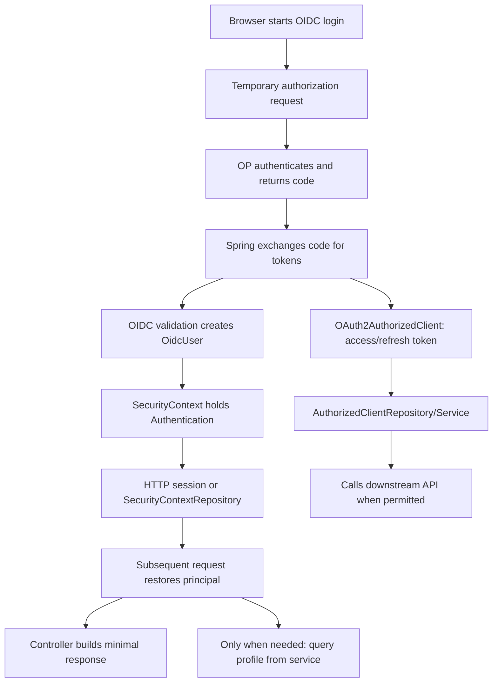

# 12.11. Limiting Personal Data Stored in the Session

When a **Spring Security OAuth 2.0 / OpenID Connect (OIDC) Client** application completes login successfully, Spring Security can create an `OidcUser` and store the `Authentication` in `SecurityContext`. From a developer's perspective, reading `user.getEmail()` or `user.getFullName()` is very convenient. However, that convenience easily leads to a dangerous habit: **copying the entire ID Token, UserInfo claims, or user profile into the HTTP session** and keeping them around longer than actually needed.

This lesson focuses on the **data minimization** principle — collecting, processing, and retaining only the data genuinely needed for the login session and business operations. In Spring Security Servlet, the goal is not to strip every detail out of `SecurityContext` at all costs; the goal is to understand **what data already exists in the security structures**, avoid pointless duplication, narrow access scope, control lifetimes, and choose the right storage architecture.

Context: **Spring Boot 3.x, Spring Security 6.x, `oauth2Login()` on Servlet/Spring MVC**, optionally using Spring Session or the servlet container's HTTP session. Examples use dummy names and URLs; final retention policies must fit product purpose, security requirements, and applicable regulations.

## 1. Goal of Limiting Data in the Session

After this lesson, you should be able to distinguish:

- **Essential authentication information:** issuer, subject, authorities, client registration, and data supporting Spring Security mechanics.
- **Display profile:** name, email, avatar, phone number, address, date of birth, or specialized claims returned by the provider.
- **Credentials and tokens:** ID Token, access token, refresh token, client secret, and session cookie; each has its own protection requirements.
- **Application session state:** `SecurityContext`, custom `HttpSession` attributes, `OAuth2AuthorizedClient`, and temporary Authorization Code Flow state.
- **Long-lived business data:** user profiles in the database, audit records, and data governed by retention policies distinct from the HTTP session.

One overarching principle:

> **Do not store an extra copy of the profile in the session merely because you can read it from `OidcUser`.** Start from the intended purpose, identify the minimal dataset, and choose the right storage location.

Reducing data in the session limits impact if the session store, logs, backups, or observability systems suffer unauthorized access; it also reduces stale data, sync bugs, and session replication overhead across nodes.

## 2. What Can an OIDC Login Session Contain?

### 2.1. Three Data Groups Often Conflated

| Data Group | Commonly Involved Component | Purpose | Risk If Copied Arbitrarily |
| --- | --- | --- | --- |
| **`SecurityContext` and principal** | `Authentication`, typically `OAuth2AuthenticationToken` holding `OidcUser` | Identifies the user and enforces authorization in web requests | Principal may carry claims/ID Token; duplicating expands the sensitive data footprint |
| **`OAuth2AuthorizedClient`** | `OAuth2AuthorizedClientRepository` / `OAuth2AuthorizedClientService` | Manages access tokens and refresh tokens when the client calls APIs | Tokens can grant API access if exposed |
| **Application-added session attributes** | `HttpSession#setAttribute`, session-scoped beans | Holds UI or business state across requests | Easily over-stores names, emails, addresses, permissions, or token copies |

Additionally, **while login is in progress**, `AuthorizationRequestRepository` may hold `OAuth2AuthorizationRequest` in the session, containing `state`, nonce/PKCE context, and callback correlation info. This is **temporary state** and should never be used as post-login profile data.

Important point: **where `OAuth2AuthorizedClient` is stored depends on configuration**. Some applications use a session-backed repository, others use `OAuth2AuthorizedClientService` with separate storage. Never assume access/refresh tokens always live in the session, nor assume they were never persisted merely because application code never called `session.setAttribute(...)`.

### 2.2. Diagram of a Stateful Web Application



```text
Browser cookie (usually only an opaque session identifier)
          |
          v
Server-side session store
  - SecurityContext and Authentication
  - Possible pending OAuth2 login state
  - Application-added session attributes
          |
          +--> Authorized client / token storage may be separate or tied to session
```

In a typical server-side session configuration, the `JSESSIONID` cookie **does not itself contain all OIDC claims**; it is an identifier helping the server locate the session. However, an application implementing **client-side sessions/JWT cookies** may place data inside the cookie — inspect the actual architecture rather than guessing from the word "session".

### 2.3. `OidcUser` Can Hold the ID Token and UserInfo

`OidcUser` in Spring Security typically exposes:

```java
user.getSubject();
user.getIssuer();
user.getIdToken();
user.getUserInfo();
user.getClaims();
user.getAuthorities();
```

Commonly, `DefaultOidcUser` holds `OidcIdToken` and may hold `OidcUserInfo`. Therefore:

- Removing `email` from a custom session attribute **does not mean** email disappeared from all data in `SecurityContext`.
- Narrowing scopes can reduce the claims an OP emits, yet the OP can still include extra claims in the ID Token.
- An authority or custom principal can also carry claim details if an implementation retains `OidcUserAuthority` objects.

**If the requirement states "the session store must not contain the ID Token or PII in any form"**, you cannot satisfy that requirement merely by removing a few `session.setAttribute` calls. You must intentionally design the principal/`SecurityContextRepository`/token store; see the advanced section below.

## 3. What Data Is Actually Needed for a Login Session?

In OIDC, core identity is normally tied to:

```text
(issuer, subject)
```

Where:

- `iss` is the OP's issuer.
- `sub` is the subject identifier within the issuer's scope.
- `aud` confirms the ID Token was intended for the right client, during **token verification**.

For applications with multiple OPs, using `sub` alone as a global key can mix up users because two different issuers can both emit `sub="123"`. A common identity-linking approach is **the issuer + subject pair**, mapped to an **internal account ID** via a user service.

Even the issuer/subject pair or internal account ID remains data **linkable to an individual**, so never treat it as "harmless" merely because it is not an email. Pseudonymous data still requires access and retention policies.

### 3.1. Data Storage Decision Matrix

| Data | Needed to Maintain Login Session? | Handling Suggestion |
| --- | --- | --- |
| Issuer + subject | Usually needed for identity mapping and account linking | Use only where needed; limit copies and logs |
| Internal account reference | May be needed for authorization/business logic | Use a stable internal identifier with access control |
| Minimal authorities/roles | Needed for enforced authorization rules | Include only permissions the app understands and uses; manage refresh lifetimes |
| Display name | Not a core requirement for OIDC authentication | Build responses when rendering; do not store across the whole session by default |
| Email | Not a required OIDC identifier; mutable | Fetch only with clear business purpose; check `email_verified` where appropriate |
| Avatar URL | Not essential for authentication | Load when UI needs it; watch for leaks to third-party image hosts |
| Phone number, address, date of birth | Usually unnecessary for login sessions | Do not request scopes/claims without transparent justification |
| Full `getClaims()` / UserInfo JSON | Almost never add arbitrarily to session | Access only needed attributes at point of use |
| Raw ID Token | Must be verified by framework at login; retention depends on principal/design | Never copy manually into session or logs |
| Access/refresh tokens | Needed only when OAuth2 Client features call APIs | Manage via secure authorized client storage; never attach arbitrarily to UI session |
| Client secret | Not user session data | Keep strictly in backend secret store/configuration |

Specific decisions depend on the application. For example, a site showing only "logged in" may not need email access; an app emailing invoices has a distinct purpose to persist addresses in its business system. **Long-term business needs are not a reason to automatically keep full emails/profiles inside the HTTP session.**

## 4. Data Minimization Principles When Using UserInfo

### 4.1. Start with the Smallest Scope Set

OIDC uses `openid` to request authentication. Scopes `profile`, `email`, `phone`, and `address` can allow the client to receive corresponding claims, depending on support, OP policy, and user consent.

If the application only needs to know a user is logged in, do not request every scope by default:

**Broad configuration — do not use as a default when unnecessary:**

```yaml
spring:
  security:
    oauth2:
      client:
        registration:
          academy:
            scope: [openid, profile, email, phone, address]
```

**Minimal starting configuration:**

```yaml
spring:
  security:
    oauth2:
      client:
        registration:
          academy:
            scope: [openid]
```

This example assumes other client ID, secret, issuer, and redirect URI properties are already configured. It illustrates **scope narrowing**, not a complete `application.yml`.

Key point: **scopes are a request sent to the OP, not a filter that deletes already-received data**. An OP may grant different scopes per configuration/consent, or include extra claims in the ID Token; the application must inspect the actual tokens/claims issued by the OP and enforce its own storage policies.

### 4.2. Do Not Call UserInfo Without Purpose

The UserInfo Endpoint can return far more information than a UI needs. With OIDC Login, `OidcUserService` can call UserInfo based on token, scope, and configuration conditions. If extra claims are unnecessary, consider **not requesting those scopes / not fetching unnecessary data**, rather than loading the entire profile and trying to scrub it from the session afterwards.

Never manually call:

```text
GET https://idp.example.com/oidc/userinfo
```

on every request just "to make sure the user is logged in". OIDC login already verifies the ID Token. UserInfo is for retrieving additional claims when business logic needs them, not a replacement for Session/Authentication.

When customizing `OidcUserService`, preserve OIDC rules, especially that **`sub` in UserInfo matches `sub` in the ID Token**. Never merge two accounts' data based solely on email.

### 4.3. Map Display Fields, Do Not Pass Raw Profiles

Suppose UserInfo returns:

```json
{
  "sub": "user-183",
  "name": "Nguyen An",
  "email": "an@example.com",
  "email_verified": true,
  "phone_number": "+84xxxxxxxxx",
  "address": {
    "country": "VN",
    "locality": "HCMC"
  },
  "picture": "https://images.example.com/users/183.png",
  "custom_groups": ["students", "alumni"]
}
```

If a screen only shows a greeting, the application layer needs only a display value like `name` — there is no need to put the entire JSON, phone number, address, and groups into the session or return them all to the frontend.

A controller example:

```java
import org.springframework.security.core.annotation.AuthenticationPrincipal;
import org.springframework.security.oauth2.core.oidc.user.OidcUser;
import org.springframework.web.bind.annotation.GetMapping;
import org.springframework.web.bind.annotation.RestController;

@RestController
public class GreetingController {

    public record GreetingView(String greeting) {}

    @GetMapping("/api/greeting")
    public GreetingView greeting(@AuthenticationPrincipal OidcUser user) {
        String givenName = user.getGivenName();
        String greeting = (givenName == null || givenName.isBlank())
                ? "Hello"
                : "Hello, " + givenName;

        return new GreetingView(greeting);
    }
}
```

This endpoint **uses data at response-creation time**, without creating an extra session attribute holding the profile. It assumes the endpoint is accessed only by OIDC-authenticated users. If the application supports other authentication methods, check the principal type appropriately.

**Warning:** returning a name in a response is still personal-data processing; the frontend should not store it indefinitely in local storage or analytics simply because the server avoided adding an extra session copy.

## 5. Where Does Personal Data Live Inside `SecurityContext`?

In a standard Servlet OIDC Login flow:

```text
SecurityContext
  |
  +-- Authentication: OAuth2AuthenticationToken
        |
        +-- principal: OidcUser (usually DefaultOidcUser)
        |     |
        |     +-- OidcIdToken
        |     |     +-- raw token value
        |     |     +-- ID Token claims
        |     |
        |     +-- OidcUserInfo (depending on configuration)
        |     |     +-- UserInfo claims
        |     |
        |     +-- Authorities
        |
        +-- authorizedClientRegistrationId
```

Because `SecurityContext` is typically persisted across requests in stateful applications, **the principal's object graph can enter the session store**. When using Spring Session with Redis/JDBC, serialized data may travel over the internal network and reside in storage outside the JVM.

### 5.1. Reducing Self-Stored Data Is the First Step, Not the Last

The following code is an **anti-pattern**:

```java
// DO NOT DO THIS: manually duplicating full profiles and tokens into the session
session.setAttribute("oidcClaims", oidcUser.getClaims());
session.setAttribute("idTokenRaw",
        oidcUser.getIdToken().getTokenValue());
session.setAttribute("userInfo", oidcUser.getUserInfo());
session.setAttribute("profile", entireProfileFromProvider);
```

Harms:

- Some of this data may already exist in the Spring-managed `OidcUser`.
- Sessions may be replicated to Redis or across multiple nodes.
- Data lingers until TTL/session invalidation, not necessarily syncing with OP updates.
- Components with session read access now gain extra paths to tokens and profiles.
- Deleting user/profile data per retention policies becomes harder due to multiple copies.

Instead, **use the existing `Authentication`/`OidcUser` when needed**, avoiding adding raw claims to the session yourself.

### 5.2. Not Every `OidcUser` Is "Small"

Never write in a security report that "the session contains no PII" simply because application code only added `session.setAttribute("uiTheme", "dark")`.

`DefaultOidcUser` can continue holding the ID Token and UserInfo. Beyond the principal, authority objects or `OAuth2AuthorizedClientRepository` may store sensitive data depending on the concrete storage implementation.

When the security requirement genuinely forbids **keeping raw ID Tokens or UserInfo claims in the session**, design a minimal principal builder or alternative `SecurityContextRepository` storage mechanism and thoroughly verify the consequences for authentication, OIDC semantics, serialization, and refresh tokens. No single simple Spring Boot property guarantees stripping all such data across every configuration.

## 6. Do Not Duplicate Data for Display Purposes

### 6.1. Bad Example: Dumping the Entire Profile into Session After Login

```java
// Anti-pattern example, do not use in production:
http.oauth2Login(oauth2 -> oauth2
    .successHandler((request, response, authentication) -> {
        OidcUser user = (OidcUser) authentication.getPrincipal();
        request.getSession().setAttribute(
                "fullProfile", user.getClaims());
        response.sendRedirect("/dashboard");
    }));
```

The issue is not merely sensitive data. When replacing the default `AuthenticationSuccessHandler`, your code also becomes responsible for proper post-login routing, such as saved requests. Adding a session attribute with all claims is needless duplication.

### 6.2. Better Example: Building a Small DTO for the Current Request

Instead of adding profiles to the session, build a minimal frontend representation per request:

```java
import org.springframework.security.core.annotation.AuthenticationPrincipal;
import org.springframework.security.oauth2.core.oidc.user.OidcUser;
import org.springframework.web.bind.annotation.GetMapping;
import org.springframework.web.bind.annotation.RestController;

@RestController
class ProfileViewController {

    record ProfileView(boolean signedIn, String displayName) {}

    @GetMapping("/api/profile-view")
    ProfileView view(@AuthenticationPrincipal OidcUser user) {
        String name = user.getGivenName();
        if (name == null || name.isBlank()) {
            name = "User";
        }

        return new ProfileView(true, name);
    }
}
```

Benefits:

1. No extra session attribute holding all of UserInfo.
2. The response contains only the two fields needed by the UI.
3. When UI requirements change, the session is not forced to become a dumping ground for every profile field.
4. Spring's access controls apply before the response is built.

However, **this does not strip claims from the underlying `OidcUser`**. It only limits the data the application actively duplicates and returns to the frontend.

### 6.3. Do Not Keep Copying Name/Avatar Across Every Layer

If the UI only needs a display name, never store it simultaneously in:

```text
Spring Security principal
+ HttpSession profile object
+ Redis session map
+ Application cache
+ Browser localStorage
+ Analytics event
+ Request/response logs
```

One value copied into six places creates six surfaces to protect and delete. Define **where data is owned** and what purpose/TTL each copy serves. Especially never place access/refresh tokens of a server-side application into `localStorage` just for frontend convenience.

## 7. If the Session Genuinely Needs Application-Specific State

Some UI state legitimately belongs in short-lived session storage, such as display theme, current wizard step, or temporary preferences. Not every piece of data needs the OP or database.

Example Java record containing only non-sensitive display state:

```java
import java.io.Serializable;

public record UiState(
        String theme,
        boolean showTips
) implements Serializable {
}
```

When storing:

```java
import jakarta.servlet.http.HttpSession;

public void rememberUiPreference(HttpSession session) {
    session.setAttribute("uiState",
            new UiState("dark", false));
}
```

If linking to an internal account is needed to drive business logic, consider storing a **backend-managed opaque reference** rather than the full profile. Even then, the reference remains data linkable to an individual; keep it short-lived, restrict read access, and guard against session hijacking.

### 7.1. Choosing the Right Place for Data

| Need | Better-Suited Location | Reason |
| --- | --- | --- |
| Request principal and authorities | Spring Security-managed `SecurityContext` | Avoids creating a duplicate custom "user session object" |
| Calling downstream APIs with OAuth2 access tokens | Secure authorized client repository/service | Associates tokens properly with registration/principal |
| Displaying user/name | Build view from principal or query permitted data | No need to store another full profile in session |
| Storing profiles with business lifecycle | Database/service with retention and access control | Manages updates, deletion, and auditing better than session |
| Short-lived UI wizard state | Small session attribute if truly needed | Session-scoped TTL, avoids PII |
| Recording security events | Minimal audit log with separate retention policy | Audit logs are not a copy dump for raw tokens/claims |

A login session should never become a **second profile database**.

## 8. Managing Access Tokens and Refresh Tokens Separately from Profiles

After OAuth2/OIDC Login, Spring Security can create an `OAuth2AuthorizedClient` holding the access token and refresh token (if issued by the OP). It is typically accessed via `OAuth2AuthorizedClientRepository`, `OAuth2AuthorizedClientService`, or the corresponding OAuth2 Client APIs.

Distinguish clearly:

- **ID Token:** proves user identity to the OIDC Client; may remain inside the default principal.
- **Access token:** credential for the client to call APIs/resource servers, per scopes/audience.
- **Refresh token:** credential capable of obtaining new access tokens; typically sensitive with its own lifetime/usage rights.
- **Session cookie:** session identifier for the Spring application, never treated as an OP access token.

**Never store a copy of the access token via `session.setAttribute("access_token", token)`** just so controllers can call APIs. Use the authorized client abstraction and proper HTTP client integration.

### 8.1. Request Offline Access Only When Truly Needed

Some OPs use `offline_access` or specific settings to issue refresh tokens. If the application does not need to call APIs after the user leaves the browser or does not need refresh tokens, avoid requesting broader privileges than intended.

Restricting scopes/token lifetimes **does not by itself erase tokens from storage**, yet it lowers the chance of minting tokens with more privilege than needed. Consider separating client registrations when features have distinct permission requirements.

### 8.2. Where Can Authorized Client Data Be Stored?

| Option | Characteristics | Security Decision |
| --- | --- | --- |
| HTTP session-backed repository | Tokens tied to application session | Protect session store, TTL, and logout |
| In-memory authorized client service | Data lives in backend process memory | Unsuitable for many multi-instance/durable deployments |
| Database or distributed store service/repository | Tokens may outlive and be accessed outside the JVM | Requires dedicated encryption/access control/audit/retention |
| Custom service with secure secret storage | Fits strict protection requirements | Must manage encryption keys, rotation, and read permissions |

Never assume a database is inherently safer than a session or vice versa. Token storage must be designed around sensitivity, usage scope, lifecycle, and revocation capability. Never write raw tokens into logs, error responses, or analytics.

## 9. Lifetimes: Sessions, Tokens, and Profiles Have Three Separate Lifecycles

A common operational mistake is setting `session timeout = 24 hours` and assuming all identity data and tokens should be retained for 24 hours.

In reality:

- **HTTP session timeout:** governs inactivity duration before the application session expires per container/store.
- **ID Token `exp`:** OP-issued token expiration, not necessarily when the session must auto-expire.
- **Access token `expires_at`:** lifetime for API-calling token; may be refreshed per client rules.
- **Refresh token:** independent lifecycle, potentially subject to rotation/revocation.
- **Profile cache:** if used, should have a TTL based on purpose and OP update frequency.
- **Audit records:** have their own retention policy; should not mirror session or token lifetimes.

If the application keeps ID Token or UserInfo claims inside `SecurityContext`, those claims may **not refresh automatically when the OP updates a profile**. Therefore, never treat the session principal as an always-current profile source.

### 9.1. Configuring Session Timeout

Example `application.yml`:

```yaml
server:
  servlet:
    session:
      timeout: 20m
      cookie:
        http-only: true
        secure: true
        same-site: lax
```

Equivalent `application.properties`:

```properties
server.servlet.session.timeout=20m
server.servlet.session.cookie.http-only=true
server.servlet.session.cookie.secure=true
server.servlet.session.cookie.same-site=lax
```

The `20m` value is **an example only**, not a mandatory timeout for every product. Choose based on risk, UX, data sensitivity, and organizational policy.

- `HttpOnly` reduces the risk of JavaScript directly reading the session cookie.
- `Secure` forces the cookie over HTTPS; proxy/TLS settings must be accurate.
- `SameSite=Lax` generally fits top-level GET callbacks in OIDC Authorization Code Flow, yet **may not work if the OP uses `response_mode=form_post`**.
- Cookie attributes protect the **session reference**, not encryption of data already sitting in the session store.

If the backend sits behind a reverse proxy, ensure public host/scheme and forwarded headers are trusted only from trusted proxies. Never fix cookie issues by globally disabling protections just to "make login work".

### 9.2. Short Timeouts Do Not Solve Full Retention

Even with a 20-minute timeout, data may persist in snapshots, database backups, logs, queues, or cache replicas per infrastructure policy. Data minimization must address the entire data path, not just `JSESSIONID` TTL.

## 10. Logout and Clearing Session Data

Spring Security lets you configure logout to clear Authentication and invalidate the HTTP session:

```java
import org.springframework.context.annotation.Bean;
import org.springframework.context.annotation.Configuration;
import org.springframework.security.config.Customizer;
import org.springframework.security.config.annotation.web.builders.HttpSecurity;
import org.springframework.security.web.SecurityFilterChain;

@Configuration
public class SecurityConfig {

    @Bean
    SecurityFilterChain securityFilterChain(HttpSecurity http)
            throws Exception {

        http
            .authorizeHttpRequests(auth -> auth
                .requestMatchers("/", "/error", "/assets/**").permitAll()
                .anyRequest().authenticated()
            )
            .oauth2Login(Customizer.withDefaults())
            .logout(logout -> logout
                .invalidateHttpSession(true)
                .clearAuthentication(true)
                .deleteCookies("JSESSIONID")
                .logoutSuccessUrl("/"));

        return http.build();
    }
}
```

In applications with CSRF protection (default in many Servlet configurations), logout must normally be triggered via **POST with a valid CSRF token**, rather than making a GET link perform a state-changing action.

**Scope note:** clearing the Spring application session does not by default:

- Delete long-lived user records in the database.
- Revoke all access/refresh tokens at the OP.
- Delete authorized clients stored outside the session.
- Log out of the SSO session at the OP.
- Delete previously collected backups or analytics.

If the application uses `OAuth2AuthorizedClientService` storing tokens independently, enforce a token cleanup policy per principal/registration and revocation on logout or when the user disconnects. If OP logout is required, use the appropriate OIDC logout flow rather than assuming deleting `JSESSIONID` logs out every system.

### 10.1. Cleaning Up Custom Session Attributes

When a specific flow finishes, remove attributes earlier than logout:

```java
session.removeAttribute("temporaryWizardState");
```

Temporary state needed for only one step should be **removed as soon as the step finishes**. Do not wait for the entire HTTP session to expire once the data no longer serves a purpose.

## 11. Reducing Data in Responses, Logs, and Observability Systems

The session store is not the only surface holding user data. If an application avoids storing profiles in the session yet logs raw ID Tokens, minimization still fails.

### 11.1. Never Log the Entire `OidcUser`

Do not do:

```java
// DO NOT DO THIS: toString() can accidentally leak protected data
log.info("OIDC user: {}", oidcUser);
log.info("OIDC claims: {}", oidcUser.getClaims());
log.info("Raw ID token: {}", oidcUser.getIdToken().getTokenValue());
```

Instead, log only necessary operational metadata, such as:

```java
log.info("OIDC login succeeded: registrationId={}", registrationId);
```

If correlating events per user is needed, consider a **purpose-built audit reference** with restricted access and a retention policy; never use full emails or raw subjects as default correlation IDs across every system.

### 11.2. Avoid Logging HTTP Authorization and Callback URLs

Fields prone to carrying credentials:

- `Authorization: Bearer <access-token>`.
- `Authorization: Basic <client-credential>` at the Token Endpoint.
- Callback query `?code=...&state=...`.
- Session cookie (`Cookie: JSESSIONID=...`).
- ID Token, refresh token, PKCE `code_verifier`.
- UserInfo JSON and user profiles from the OP.

Pay special attention to **reverse proxy access logs, distributed tracing, APMs, exception telemetry**, and user-support tools. Request IDs used for debugging should **carry no authentication capability**.

### 11.3. Masking Does Not Replace Not Collecting

Masking emails in logs helps, yet **not logging emails when unnecessary** is far better. Redaction can fail if the same claim appears in exception messages, structured logs, request bodies, or custom metadata; reducing the data entering the observability pipeline lowers the protection burden.

## 12. Session Replication and Spring Session Redis/JDBC

An HTTP session living only inside one node's JVM can be lost if the instance dies or the browser's callback lands on another node. Many systems adopt **Spring Session** to store sessions in Redis/JDBC or another distributed store.

This is not merely an availability concern:

- `SecurityContext` and the principal can be serialized.
- UserInfo/ID Token data retained on the principal can be written into an external session store.
- Multiple infrastructure components, operators, backup pipelines, or ops accounts may access session data.
- Data may be replicated to replicas, snapshots, or backups.
- An expired session record does not mean every backup copy has been erased.

Therefore, before enabling session replication, know **what the session actually contains**. Never open a Redis admin tool and dump raw key/value pairs containing tokens into logs or tickets just to inspect size.

### 12.1. Measures to Protect the Session Store

Deployment choices typically require:

1. **Network isolation**: the store accepts connections only from authorized applications/operational components.
2. **Authentication and access control**: restrict who can read/write session data.
3. **TLS in transit** to the store when supported and required by architecture.
4. **Encryption at rest** at an appropriate level, paired with backup protection.
5. **Clear TTL and cleanup** for sessions and temporary data.
6. **No logging of raw keys/values** or serializing tokens to analytics.
7. **Protecting recovery and debugging**: use sanitized data whenever possible.
8. **Updating/limiting replica lifecycles** in replication and backups per policy.

Never put raw session IDs into metric labels or log correlation IDs, because a session ID is a credential that can enable hijacking if leaked.

### 12.2. How Do Small Session Attributes Help Operations?

A 20 KB profile stored repeatedly across hundreds of thousands of sessions increases memory, network traffic, and storage volume. With frequent serialization/replication, costs climb further. More importantly, session profiles easily go **stale** compared to actual data sources. Small sessions reduce both leakage surface and operational cost.

## 13. Should You Build a Minimal `OidcUser` to Reduce SecurityContext Data?

This is an advanced question. Distinguish three levels:

### Level A — Do Not Store Extra Profile Copies

Keep default `oauth2Login()`, restrict scopes, and do not add `user.getClaims()`/raw tokens to the session. This is **easy to adopt and low risk**. It does not remove data already present inside `DefaultOidcUser` in `SecurityContext`.

### Level B — Use Only a Minimal Projection in the Application Layer

Controllers/services consume a small application model, such as an internal account reference and necessary authorities. Profile details are fetched when needed from a controlled source or projected into a small response DTO. This **does not modify the original principal**, yet limits data sprawl across the rest of the system.

### Level C — Actively Minimize Principal/Session Storage

When policy strictly forbids raw ID Tokens/UserInfo in the session, security teams may require:

- A custom-designed `OidcUserService` or principal builder storing only minimal application-required fields.
- A custom `SecurityContext` representation or `SecurityContextRepository` with minimal serialize/load policies.
- Separating token storage from the session and controlling token access by principal/registration.
- Explicit session lifecycle, logout, and claim refresh design.
- Verifying sensitive data does not linger indirectly in authorities, custom attributes, pending authorization requests, or other session-scoped beans.

**Do not achieve this by mechanically stripping the ID Token out of `DefaultOidcUser`.** `OidcUser` has OIDC semantics, and frameworks/applications may need token/claim parts to function properly. A custom implementation must ensure **OIDC ID Token validation finishes before creating a trusted principal**, without dropping issuer/subject/audience/nonce checks or confusing OAuth2 authentication with local authentication.

### 13.1. Why `OidcUserService` Is Only an Extension Point, Not a "PII Eraser Switch"

Customizer example:

```java
.oauth2Login(oauth2 -> oauth2
    .userInfoEndpoint(userInfo -> userInfo
        .oidcUserService(customOidcUserService)))
```

`customOidcUserService` is an application-provided `OAuth2UserService<OidcUserRequest, OidcUser>`. A custom service can alter UserInfo retrieval/principal mapping. However, if the service **still returns a `DefaultOidcUser` with the full ID Token and UserInfo**, the session can still hold that data. For deep minimization, inspect the stored object graph, authentication responsibilities, and API contracts in use.

Customizing merely to "hide" data in controllers does not prove the data is absent from the session store.

### 13.2. Is Stateless an Instant Solution?

One technical option is a **stateless Resource Server** API validating access tokens per request. However, mechanically enabling:

```java
.sessionManagement(session -> session
    .sessionCreationPolicy(SessionCreationPolicy.STATELESS))
```

in an `oauth2Login()` application can break assumptions about storing **authorization requests, `state`, and `SecurityContext`** for browser logins. Stateless APIs and **server-side OIDC login with browser redirects** are two different architectures. To move to a sessionless architecture, redesign how correlation, tokens, and login state are maintained — do not just flip an enum.

## 14. Designing Authorization Without Redundant Profile Data

Sometimes applications want to store `department`, `groups`, `email`, or all of UserInfo in the session "for faster permission checks". This can cause:

- Stale permissions when a user's roles are revoked at the OP.
- Claims interpreted inconsistently across multiple providers.
- Sensitive data leaking into code that only needed to know the user logged in.
- Sessions bloating with group counts.

A safer design direction:

1. Define **internal roles/permissions** that the application understands and needs.
2. Convert only OP-verified claims permitted by trust policy into appropriate authorities.
3. Define **permission refresh intervals** or re-check at the authorization source for sensitive operations.
4. Never keep the raw `groups` list if the application only needs one authority like `ROLE_VIEWER`.
5. Never use email, avatar, or full name as "proof" that a user holds a role.

Specifically, the `(issuer, subject)` pair serves identity linking, whereas application authorization policies require their own authorization mechanism.

## 15. Profile Changes While the Session Remains Active

Suppose a user signs in at 09:00, and the OP returns an old email and old display name. At 09:10, the user updates their email at the OP; the application's HTTP session stays alive.

If the application **kept the entire profile in the session**, it may display or act on stale data until the session ends. This leads to problems:

- Displayed info does not reflect recent updates.
- The user requests editing/deleting data yet the old copy persists in the session.
- Business decisions based on stale email/department may be wrong.
- Synchronizing duplicate copies becomes complex.

A sounder design identifies **primary data sources**:

- The OP is the source for OP-managed identity claims.
- The application database is the source for internal business profiles, if any.
- The session represents only a login session and necessary temporary state.

When up-to-date data is needed, the application can query the source in a controlled manner or use short-lived caches as needed. Avoid calling UserInfo on every request if cost is high; instead design explicit **freshness, TTL, event-driven invalidation**, or suitable caching.

## 16. End-to-End Minimal-Data Implementation Example

Suppose an academy website uses OP `academy`, needing only user authentication and login status display. We can start with a minimal scope configuration:

**`application.yml`:**

```yaml
spring:
  security:
    oauth2:
      client:
        registration:
          academy:
            provider: academy-op
            client-id: ${OIDC_CLIENT_ID}
            client-secret: ${OIDC_CLIENT_SECRET}
            authorization-grant-type: authorization_code
            scope: [openid]
            redirect-uri: "{baseUrl}/login/oauth2/code/{registrationId}"
        provider:
          academy-op:
            issuer-uri: ${OIDC_ISSUER_URI}

server:
  servlet:
    session:
      timeout: 20m
      cookie:
        http-only: true
        secure: true
        same-site: lax
```

**`SecurityFilterChain`:**

```java
import org.springframework.context.annotation.Bean;
import org.springframework.context.annotation.Configuration;
import org.springframework.security.config.Customizer;
import org.springframework.security.config.annotation.web.builders.HttpSecurity;
import org.springframework.security.web.SecurityFilterChain;

@Configuration
class SecurityConfig {

    @Bean
    SecurityFilterChain securityFilterChain(HttpSecurity http) throws Exception {
        http
            .authorizeHttpRequests(auth -> auth
                .requestMatchers("/", "/error", "/assets/**").permitAll()
                .anyRequest().authenticated()
            )
            .oauth2Login(Customizer.withDefaults())
            .logout(logout -> logout
                .invalidateHttpSession(true)
                .clearAuthentication(true));

        return http.build();
    }
}
```

**Small status endpoint**, without pulling the entire profile:

```java
import org.springframework.security.core.Authentication;
import org.springframework.web.bind.annotation.GetMapping;
import org.springframework.web.bind.annotation.RestController;

@RestController
class SessionStatusController {

    record SessionStatus(boolean signedIn) {}

    @GetMapping("/api/session-status")
    SessionStatus status(Authentication authentication) {
        return new SessionStatus(
                authentication != null && authentication.isAuthenticated());
    }
}
```

With `/api/session-status` under `anyRequest().authenticated()`, unauthenticated requests are routed into the login flow before the controller runs; this endpoint does not replace authorization checks or expose account details. If you want to return status for anonymous requests without redirecting, configure a separate request matcher/entry point.

**What this achieves:** does not request `profile`/`email` by default, does not manually store all of UserInfo, does not send raw tokens/profiles to the browser, and gives the session a TTL and logout. **What is not yet guaranteed:** Spring's default principal may still hold the ID Token and claims in `SecurityContext`; evaluate Level C if policy requires removing them completely.

### 16.1. Properties Version

```properties
spring.security.oauth2.client.registration.academy.provider=academy-op
spring.security.oauth2.client.registration.academy.client-id=${OIDC_CLIENT_ID}
spring.security.oauth2.client.registration.academy.client-secret=${OIDC_CLIENT_SECRET}
spring.security.oauth2.client.registration.academy.authorization-grant-type=authorization_code
spring.security.oauth2.client.registration.academy.scope=openid
spring.security.oauth2.client.registration.academy.redirect-uri={baseUrl}/login/oauth2/code/{registrationId}
spring.security.oauth2.client.provider.academy-op.issuer-uri=${OIDC_ISSUER_URI}

server.servlet.session.timeout=20m
server.servlet.session.cookie.http-only=true
server.servlet.session.cookie.secure=true
server.servlet.session.cookie.same-site=lax
```

Pick YAML **or** properties per project conventions; never intentionally define conflicting values and leave precedence to chance.

## 17. Common Implementation Mistakes

| Symptom or Bad Decision | Consequence | Fix |
| --- | --- | --- |
| `session.setAttribute("profile", user.getClaims())` | Duplicates claims/PII into session | Build minimal DTO per request or use storage with dedicated retention |
| Storing raw access token in a custom session attribute | Token sits outside authorized client abstraction | Use `OAuth2AuthorizedClientRepository/Service` with protective policies |
| Requesting all of `profile,email,phone,address` from day one | Collects more claims than needed | Narrow scopes; request permissions only when features require them |
| Removing email from DTO and claiming session has no PII | `DefaultOidcUser` may still hold ID Token/UserInfo | Inspect full `SecurityContext` and actual storage |
| Short `session.timeout` while logging raw claims/tokens | Tokens/PII live longer in the logging pipeline | Limit log fields, redact credentials, set log retention |
| Using `email` as sole key for OIDC accounts | Email can be missing, change, or collide across OPs | Use issuer+subject and an account-linking workflow |
| Storing full groups in session for authorization | Data may be sensitive and stale | Map to minimal internal authorities with a refresh policy |
| Redis session store lacks access control | Multiple components can read session data | Network isolation, auth/authz, and backup protection |
| Logout only deletes `JSESSIONID` while tokens live in another DB | Tokens remain usable | Build cleanup policies for authorized clients / token revocation |
| Switching to `STATELESS` without handling OAuth2 correlation | Login callback cannot find `state`/authorization request | Redesign flow or use appropriate session mechanics |
| Returning `OidcUser.getClaims()` via `/me` endpoint | Leaks unnecessary profile fields to frontend | Return a projection with only genuinely needed fields |
| Caching profiles without TTL | Stale data and uncontrolled retention | Short TTL, refresh/invalidation as needed |

## 18. Practice Exercise: Assessing Data in an Existing Application

An operational exercise you can perform **in a test environment with dummy data**, never dumping production sessions/tokens.

### 18.1. Map the Data Flow

```text
OP /authorize
   -> authorization code callback
   -> /token
   -> ID Token (+ access token)
   -> OidcUser / SecurityContext
   -> HttpSession/Spring Session
   -> Controller/service
   -> API response / cache / log / database
```

For each point, answer:

1. What data passes through?
2. Is that data needed for this purpose?
3. Is it persisted or only processed in-request?
4. Who has access?
5. After how long is it deleted or refreshed?
6. Is it copied into backups/tracing?

### 18.2. Inspecting Session Attributes at a Safe Metadata Level

When inspecting sessions in a test environment, **list only attribute names**, never print contents:

```java
import java.util.Collections;
import java.util.List;

import jakarta.servlet.http.HttpSession;
import org.springframework.web.bind.annotation.GetMapping;
import org.springframework.web.bind.annotation.RestController;

@RestController
class SessionAttributeInspector {

    @GetMapping("/internal/session-attributes")
    List<String> attributeNames(HttpSession session) {
        return Collections.list(session.getAttributeNames());
    }
}
```

This illustrative endpoint must be **strictly confined to internal test environments or never deployed to production**. Attribute names can inadvertently reveal system structure. Moreover, listing names **cannot prove object contents inside are minimized**; to inspect serialized data, use synthetic test fixtures in a secure environment, never publish real dumps.

### 18.3. Scenarios to Test

- Log in with scope `openid` and compare the released claims against scope `openid profile email` in a test OP.
- Hit UI endpoints and verify responses contain only genuinely needed fields.
- Log out and verify the old session can no longer access protected endpoints.
- Wait for session expiry and verify the session cannot be reused.
- Run two instances with a suitable session store and ensure nowhere dumps raw tokens.
- Update the profile at the OP and verify the application does not rely on indefinitely cached data.
- Have two OPs return the same email with different issuer/subject and ensure the system does not auto-merge accounts.
- Check tracing/proxy logs in the test environment to confirm `Authorization` headers, callback codes, and tokens are not recorded.

These are **test suggestions for learners or later verification steps**, not proof that an existing system already meets requirements.

## 19. Self-Check Questions

**Q1.** An application only shows a greeting yet stores `user.getClaims()` in the session. What should change?

> Stop duplicating all claims. Build only the response field needed when rendering the greeting, and review the scopes/claims returned by the OP.

**Q2.** You removed `session.setAttribute("email", ...)`. Can you claim the session no longer contains email?

> Not yet. `OidcUser` in `SecurityContext` may still hold an ID Token or UserInfo containing email. Inspect the actual object graph and storage.

**Q3.** Should email be used as a durable identifier for accounts logging in across multiple OPs?

> No. Distinguish issuer and subject, as emails can change or be unverified.

**Q4.** The session cookie holds only an opaque session ID. Does that mean server-side session data is non-sensitive?

> No. The cookie identifier grants access to the session; server-side storage may hold `Authentication`, claims, tokens, or other state.

**Q5.** If the application needs to call APIs with an OAuth2 access token, should it add `accessToken` to a custom session attribute?

> No. Use the authorized client abstraction and an appropriately protected token store.

**Q6.** Does a 20-minute session timeout guarantee tokens are gone from backups or logs after 20 minutes?

> No. Sessions, token stores, logs, and backups have independent lifecycles requiring separate retention policies.

**Q7.** Is disabling sessions with `STATELESS` the fastest way for an `oauth2Login()` website to stop retaining UserInfo?

> No. The Authorization Code Flow still needs to manage `state`, nonce/PKCE context, and callback correlation. Redesign the architecture if you genuinely want statelessness.

**Q8.** Why not keep the `groups` list from the ID Token as a long-lived session field?

> Because groups can be sensitive, change over time, or fail to reflect internal permissions. Map only genuinely needed permissions and establish a refresh policy.

**Q9.** A user updates their address at the OP while the session is still alive. What should the system do?

> Do not assume the stale profile in the session is the source of truth. Design reloading/updating data based on purpose, freshness, and access permissions.

**Q10.** If legal requirements prohibit keeping raw ID Tokens in the session, is narrowing scopes enough?

> Not enough. Spring's default principal may still hold the ID Token; design `SecurityContext`/principal/token storage accordingly and verify that the data footprint is bounded.

## 20. Key Takeaways

1. **`SecurityContext`, `OidcUser`, `OAuth2AuthorizedClient`, and custom `HttpSession` attributes are distinct storage/access points.** Trace the entire data path.
2. **Never habitually copy `getClaims()`, `OidcUserInfo`, raw ID Tokens, or access/refresh tokens into the session.**
3. **Request minimal scopes**, using UserInfo and claims only for defined needs.
4. **Build small DTOs for responses**, rather than sending entire profiles to the browser.
5. **Understand that `DefaultOidcUser` may keep ID Token/UserInfo inside SecurityContext**; removing custom session attributes does not automatically erase that data.
6. **Tokens for calling APIs belong in authorized client storage**, with dedicated policies for storage, access, refresh, revocation, and logout.
7. **Session timeouts, cookie policies, logout, logging, Spring Session/Redis, and backups** all govern how long and where data persists.
8. **Issuer + subject** is the standard foundation for OIDC identity linking; email/name are not trustworthy unique keys.
9. For strict requirements like "sessions must contain no personal data/tokens", build **a verified custom SecurityContext and principal storage architecture**, not a superficial setting.
10. Data minimization is an **end-to-end architectural decision across the data lifecycle**, not a single line removing an attribute.

### References

- [Spring Security Reference — OAuth 2.0 Login](https://docs.spring.io/spring-security/reference/servlet/oauth2/login/index.html).
- [Spring Security Reference — OAuth 2.0 Login Advanced Configuration](https://docs.spring.io/spring-security/reference/servlet/oauth2/login/advanced.html).
- [Spring Security Reference — OAuth 2.0 Client](https://docs.spring.io/spring-security/reference/servlet/oauth2/client/index.html).
- [Spring Security Reference — SecurityContext and SecurityContextHolder](https://docs.spring.io/spring-security/reference/servlet/authentication/architecture.html).
- [Spring Security Reference — Persisting Authentication](https://docs.spring.io/spring-security/reference/servlet/authentication/persistence.html).
- [Spring Session Reference](https://docs.spring.io/spring-session/reference/).
- [Spring Boot Reference — Servlet Web Sessions](https://docs.spring.io/spring-boot/reference/web/servlet.html).
- [OpenID Connect Core 1.0 — Claims](https://openid.net/specs/openid-connect-core-1_0.html#Claims).
- [OpenID Connect Core 1.0 — UserInfo Endpoint](https://openid.net/specs/openid-connect-core-1_0.html#UserInfo).
- [OpenID Connect Core 1.0 — ID Token Validation](https://openid.net/specs/openid-connect-core-1_0.html#IDTokenValidation).
- [OWASP Session Management Cheat Sheet](https://cheatsheetseries.owasp.org/cheatsheets/Session_Management_Cheat_Sheet.html).
