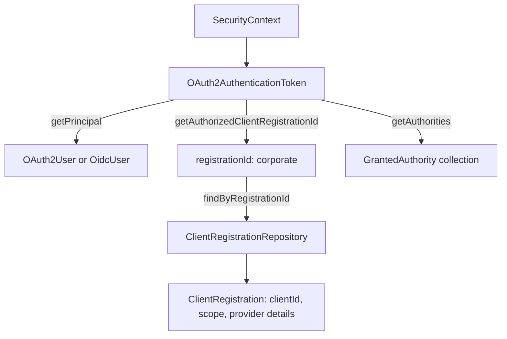
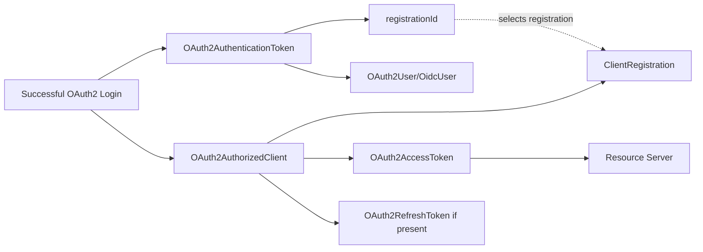
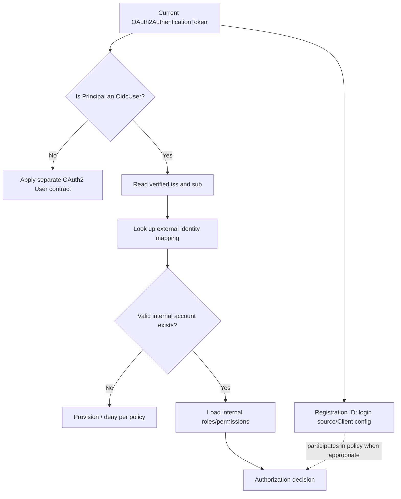

# 13.1. OAuth2AuthenticationToken and How to Retrieve the Registration ID

> **Module:** Spring Security OAuth 2.0 OIDC Client  
> **Chapter:** 13. Principal and Authorization  
> **Focus:** Understand `OAuth2AuthenticationToken` in Spring Security Servlet after OAuth 2.0/OIDC Login; retrieve the exact **registration ID** of the Client used to log in; distinguish identity information, Client registration, and access permissions; use them in controllers, services, and API-calling flows.

A Spring Boot application may allow logging in with multiple Identity Providers: internal SSO, Google, GitHub, or organization-specific OpenID Providers. After a user logs in successfully, Spring Security typically places an `OAuth2AuthenticationToken` object into the web request's `SecurityContext`.

This object helps answer two different questions:

1. **Who is the current user, and what authorities do they have?** → check `getPrincipal()`, `getName()`, `getAuthorities()`.
2. **Which OAuth2 Client configuration of the application did the user log in with?** → check `getAuthorizedClientRegistrationId()`.

For example, the application has a registration ID `corporate` pointing to an OpenID Provider with the actual client ID `employee-portal-web`. After the user selects "Log in with Company SSO", `getAuthorizedClientRegistrationId()` returns **`corporate`**, not `employee-portal-web`, not the issuer URL, and not the user's role.

Even a small mix-up here can cause the code to look up the wrong `OAuth2AuthorizedClient`, retrieve an access token for a different registration, or use the login provider as an unsafe basis for granting permissions.

This lesson analyzes the object, the process that creates it, the right ways to retrieve the registration ID in Spring MVC, how to use that ID with an authorized client, and the security pitfalls when transitioning from login to authorization.

---

## 1. Learning Objectives

After this lesson, you can:

1. Describe what `OAuth2AuthenticationToken` is and at which stage of Servlet OAuth2/OIDC Login it is created.
2. Distinguish between `Authentication`, `OAuth2AuthenticationToken`, `OAuth2User`, `OidcUser`, and `OAuth2AuthorizedClient`.
3. Use `getAuthorizedClientRegistrationId()` to retrieve the registration ID of the current login.
4. Distinguish **registration ID**, **provider ID**, **client ID**, **issuer**, and **subject** using a concrete configuration example.
5. Access the registration ID in a controller via an `OAuth2AuthenticationToken` parameter or via `SecurityContextHolder` in a synchronous service.
6. Write safe code when authentication does not yet exist or is not an OAuth2 Login.
7. Understand why an OIDC user still typically has `OAuth2AuthenticationToken` at the Authentication level, even though the principal is an `OidcUser`.
8. Use the registration ID to locate the appropriate `ClientRegistration` or `OAuth2AuthorizedClient` when needed, without confusing the login token with an API access token.
9. Identify the difference between the registration used to **log in** and the registration used to **authorize** another API Client.
10. Define the boundary between login information, roles/authorities, and business authorization policies.

## 2. Three Concepts to Separate: Authentication, Principal, and Registration

Spring Security manages the current authentication information through the `Authentication` interface. In a web application using OAuth2 Login, a common post-login implementation is `OAuth2AuthenticationToken`.

An Authentication object typically includes:

- **Principal:** the object representing the authenticated user.
- **Authorities:** the collection of `GrantedAuthority` instances used when evaluating permissions.
- **Name:** the principal name produced by the login mechanism.
- **Authenticated flag:** the authentication state of the object.
- **Details:** additional information depending on the processing mechanism.

Specifically, `OAuth2AuthenticationToken` also holds the **authorized client registration ID**, which is the key of the Client registration used in the login flow.

Diagram:



The pieces of data in the diagram answer different questions:

| Data | Question Answered | Does Not Mean |
|---|---|---|
| `authentication.getName()` | What is the current principal's name according to the user service? | Not the registration ID |
| `authentication.getPrincipal()` | What is the user object after OAuth2/OIDC Login? | Not the access token |
| `authentication.getAuthorities()` | What authorities does the principal have? | Not the list of Client registrations |
| `getAuthorizedClientRegistrationId()` | Which Client configuration was used to log in? | Does not by itself prove role or tenant membership |
| `ClientRegistration.getClientId()` | Which Client ID is registered with the OP/AS? | Not the internal registration name |
| `OAuth2AuthorizedClient` | Token/authorization of a Client registration in a given context | Not synonymous with the current Authentication |

**Fundamental rule:** the registration ID is metadata about the **Client**, while the principal is information about the **user**. These two kinds of information cannot substitute for each other.

## 3. What Is OAuth2AuthenticationToken?

`org.springframework.security.oauth2.client.authentication.OAuth2AuthenticationToken` is a Spring Security class representing Authentication after a user logs in via OAuth 2.0 Login.

Members of interest:

```java
// Conceptual signature, simplified for explanation:
public class OAuth2AuthenticationToken
        extends AbstractAuthenticationToken {

    public OAuth2AuthenticationToken(
            OAuth2User principal,
            Collection<? extends GrantedAuthority> authorities,
            String authorizedClientRegistrationId);

    public OAuth2User getPrincipal();

    public String getAuthorizedClientRegistrationId();

    public String getName();
}
```

This is an illustration of the public members; do not copy this class declaration into your project. Use the existing implementation in the Spring Security dependency.

### 3.1. Commonly Used Methods

| Method | Data Type | Practical Meaning |
|---|---|---|
| `getAuthorizedClientRegistrationId()` | `String` | Registration ID used to log in |
| `getPrincipal()` | `OAuth2User` | Authenticated user; may be an `OidcUser` |
| `getName()` | `String` | Principal name according to the OAuth2/OIDC user service mapping |
| `getAuthorities()` | `Collection<? extends GrantedAuthority>` | Permissions/authorities on the Authentication |
| `isAuthenticated()` | `boolean` | State of the Authentication object |
| `getDetails()` | `Object` | Detailed data depending on configuration |

In a production application, you should not return the entire `Authentication` object from an API or unconditionally log `authentication.toString()`: depending on the implementation and custom details, the data may contain more than should be exposed.

### 3.2. When Does This Object Appear?

In Spring Security Servlet with `oauth2Login()`, the callback is handled by `OAuth2LoginAuthenticationFilter`. After `AuthenticationManager` successfully authenticates OAuth2/OIDC, the result is converted into an Authentication for subsequent requests and stored according to the application's `SecurityContextRepository`/session strategy.

In a typical login flow, that object is `OAuth2AuthenticationToken`.

Do not confuse it with:

- `OAuth2LoginAuthenticationToken`: an **internal** token used while processing the callback and exchanging the authorization code.
- `OAuth2AuthorizationCodeAuthenticationToken`: a lower-level token involved in authorization code authentication.
- `JwtAuthenticationToken`: commonly seen when the application acts as a Resource Server verifying a bearer JWT sent by an API client.
- `UsernamePasswordAuthenticationToken`: may appear if the application also supports form login.
- `AnonymousAuthenticationToken`: represents anonymous authentication in certain unauthenticated contexts.

Not every `Authentication` in every application is an `OAuth2AuthenticationToken`. Therefore, **type checking** is necessary when mixed authentication mechanisms are used.

## 4. Registration ID, Provider ID, and Client ID: One Concrete Example

Suppose `application.yml` is configured as:

```yaml
spring:
  security:
    oauth2:
      client:
        registration:
          corporate:
            provider: company-op
            client-id: employee-portal-web
            client-secret: ${CORP_CLIENT_SECRET}
            authorization-grant-type: authorization_code
            redirect-uri: "{baseUrl}/login/oauth2/code/{registrationId}"
            scope:
              - openid
              - profile
              - email

        provider:
          company-op:
            issuer-uri: https://id.example.test/realms/employees
```

Now there are at least four identifiers:

| Term | Value in Example | Used For |
|---|---|---|
| **Registration ID** | `corporate` | Selecting the Client registration in Spring; login URL, callback, authorized client lookup |
| **Provider ID** | `company-op` | Linking the registration to the provider config section |
| **Client ID** | `employee-portal-web` | Identifying the OAuth2 Client at the OP; ID Token `aud` must match |
| **Issuer URI** | `https://id.example.test/realms/employees` | OP identifier, discovery, and `iss` verification |
| **Subject** | e.g., `person-492` | User identifier scoped to the issuer |

When the user logs in via:

```text
GET /oauth2/authorization/corporate
```

then upon success:

```java
authentication.getAuthorizedClientRegistrationId()
// "corporate"
```

Not:

```java
// Not the value returned by the method above:
"employee-portal-web"                          // client-id
"company-op"                                   // provider ID
"https://id.example.test/realms/employees"     // issuer
"person-492"                                   // subject
```

### 4.1. Callbacks Use the Registration ID

With the default redirect URI:

```text
{baseUrl}/login/oauth2/code/{registrationId}
```

the callback is:

```text
https://app.example.test/login/oauth2/code/corporate
```

The OP must also register the matching URI. Having `corporate` in the callback helps Spring Security look up the right `ClientRegistration` and authorization request context. However, **you should not parse the callback path yourself to infer the current authentication** on post-login requests; use `getAuthorizedClientRegistrationId()` from the Authentication established by Spring Security.

### 4.2. What Does Changing the Registration ID Affect?

If you rename `corporate` to `employee-sso` in YAML:

- The default login initiation URL changes to `/oauth2/authorization/employee-sso`.
- The default callback changes to `/login/oauth2/code/employee-sso`.
- The result of `getAuthorizedClientRegistrationId()` changes to `employee-sso`.
- Code calling `findByRegistrationId("corporate")` or `@RegisteredOAuth2AuthorizedClient("corporate")` must be reviewed and updated.
- Stored authorized clients using the old registration ID may need migration or invalidation depending on your architecture.

Meanwhile, the client ID `employee-portal-web` and the issuer can remain unchanged if the OP registration has not changed. Renaming it in Spring **does not automatically** update the callback registration on the OP side.

## 5. Flow That Creates OAuth2AuthenticationToken in Servlet

Simplified flow:

```mermaid
sequenceDiagram
    autonumber
    actor U as User
    participant B as Browser
    participant R as AuthorizationRequestRedirectFilter
    participant OP as OpenID Provider
    participant F as OAuth2LoginAuthenticationFilter
    participant AM as AuthenticationManager
    participant SC as SecurityContext
    U->>B: Select corporate login
    B->>R: GET /oauth2/authorization/corporate
    R->>R: Find ClientRegistration corporate; generate state/PKCE/nonce as appropriate
    R-->>B: 302 to authorization endpoint
    B->>OP: Authenticate and consent
    OP-->>B: Redirect code/state to /login/oauth2/code/corporate
    B->>F: Callback
    F->>AM: authenticate(OAuth2LoginAuthenticationToken)
    AM->>AM: OAuth2/OIDC provider authenticates; load principal
    AM-->>F: Authenticated OAuth2User or OidcUser
    F->>F: Create OAuth2AuthenticationToken(principal, authorities, corporate)
    F->>SC: Save Authentication; save authorized client per configuration
    F-->>B: Redirect to post-login page
    B->>SC: Subsequent request via session/security context
    SC-->>B: Authentication has registrationId=corporate
```

In practice, saving Authentication and the authorized client also passes through repositories, filters, and strategies depending on the version and configuration, but the core idea remains: **the registration ID is known from the ClientRegistration of the login transaction**, not guessed from the username.

### 5.1. The Registration Is Decided Before Login

The Client can display multiple login links:

```html
<a href="/oauth2/authorization/corporate">Company SSO</a>
<a href="/oauth2/authorization/google-work">Google Workspace</a>
<a href="/oauth2/authorization/github-account">GitHub</a>
```

The user picks a registration; Spring Security initiates the transaction, stores correlation data such as `state`, and handles the callback. Once Authentication succeeds, the transaction's registration ID is attached to `OAuth2AuthenticationToken`.

Do not trust a caller-supplied HTTP header such as `X-Registration-Id: corporate` to claim that the user logged in through that provider. Trusted metadata about the login session must come from the authentication result established by Spring Security.

## 6. Approach 1 — Retrieving the Registration ID Directly in a Spring MVC Controller

This is the most readable approach when the endpoint only serves OAuth2/OIDC Login users.

```java
package example.web;

import java.util.Map;

import org.springframework.security.oauth2.client.authentication
    .OAuth2AuthenticationToken;
import org.springframework.web.bind.annotation.GetMapping;
import org.springframework.web.bind.annotation.RestController;

@RestController
class LoginInfoController {

    @GetMapping("/login-info")
    Map<String, String> loginInfo(
            OAuth2AuthenticationToken authentication) {

        return Map.of(
            "registrationId",
            authentication.getAuthorizedClientRegistrationId(),
            "principalName",
            authentication.getName()
        );
    }
}
```

**Note on imports:** in a real Java file, the package name must be written on **one line**:

```java
import org.springframework.security.oauth2.client.authentication.OAuth2AuthenticationToken;
```

The example uses `Map.of` from Java 9+, which fits Spring Boot 3.x / Java 17 projects.

If logged in via the `corporate` registration, an illustrative response is:

```json
{
  "registrationId": "corporate",
  "principalName": "person-492"
}
```

`principalName` depends on the user service and the provider's identity attribute; do not assume it is always an email. With OIDC, it may be the subject or a customized value.

### 6.1. Preconditions of the Example

A method accepting `OAuth2AuthenticationToken` assumes the request has gone through OAuth2 Login. On an endpoint that only requires `authenticated()` in an application with multiple login mechanisms, the principal may not be of this token type.

To handle multiple Authentication types, accept the general interface and check the type as shown in the next section. Do not cast blindly:

```java
// Likely to throw ClassCastException if the request uses form login or JWT bearer:
OAuth2AuthenticationToken oauth =
    (OAuth2AuthenticationToken) SecurityContextHolder
        .getContext().getAuthentication();
```

A safer approach is `instanceof` before calling `OAuth2AuthenticationToken`-specific methods.

### 6.2. Sample HTTP Security Configuration

```java
package example.security;

import org.springframework.context.annotation.Bean;
import org.springframework.context.annotation.Configuration;
import org.springframework.security.config.Customizer;
import org.springframework.security.config.annotation.web.builders.HttpSecurity;
import org.springframework.security.web.SecurityFilterChain;

@Configuration
class SecurityConfiguration {

    @Bean
    SecurityFilterChain securityFilterChain(HttpSecurity http)
            throws Exception {
        return http
            .authorizeHttpRequests(auth -> auth
                .requestMatchers("/", "/error").permitAll()
                .anyRequest().authenticated()
            )
            .oauth2Login(Customizer.withDefaults())
            .build();
    }
}
```

If the application declares its own `SecurityFilterChain`, it must enable `oauth2Login()` when OAuth2/OIDC login is desired. Simply having a registration in YAML does not guarantee a custom chain has this feature enabled.

## 7. Approach 2 — Accepting General Authentication and Checking the Type

A real-world application may receive requests authenticated by an OIDC session, form login, or bearer JWT. In that case, the method should accept `Authentication` and only call `getAuthorizedClientRegistrationId()` if the type matches.

```java
package example.web;

import java.util.LinkedHashMap;
import java.util.Map;

import org.springframework.http.HttpStatus;
import org.springframework.http.ResponseEntity;
import org.springframework.security.core.Authentication;
import org.springframework.security.oauth2.client.authentication.OAuth2AuthenticationToken;
import org.springframework.web.bind.annotation.GetMapping;
import org.springframework.web.bind.annotation.RestController;

@RestController
class AuthenticationInfoController {

    @GetMapping("/authentication-info")
    ResponseEntity<Map<String, Object>> authenticationInfo(
            Authentication authentication) {

        if (!(authentication instanceof OAuth2AuthenticationToken oauth)) {
            return ResponseEntity.status(HttpStatus.BAD_REQUEST)
                .body(Map.of(
                    "error", "This endpoint requires OAuth2/OIDC Login"
                ));
        }

        Map<String, Object> result = new LinkedHashMap<>();
        result.put(
            "registrationId",
            oauth.getAuthorizedClientRegistrationId()
        );
        result.put("principalName", oauth.getName());
        result.put(
            "principalType",
            oauth.getPrincipal().getClass().getSimpleName()
        );
        return ResponseEntity.ok(result);
    }
}
```

Here `Authentication` is the general abstraction, and `OAuth2AuthenticationToken` is the specialized case. This check avoids `ClassCastException`. HTTP 400 in the example is just an illustrative choice; in production, depending on the API contract, you may return 401/403 or another response. HTTP Security policies must still block inappropriate access.

### 7.1. Why Not Just Use isAuthenticated()?

Some implementations such as `AnonymousAuthenticationToken` can return `isAuthenticated() == true` depending on how they are constructed, even though the user is effectively anonymous. Therefore, checking `isAuthenticated()` alone does not mean "logged in via OAuth2".

If the goal is to retrieve the registration ID, checking the **Authentication type** is essential. If the goal is to protect an endpoint, use `authorizeHttpRequests()` or method security with explicit policies rather than writing a custom boolean condition in a controller.

### 7.2. Non-Null Authentication and Wrong Authentication Types

| State | Possible Value | Appropriate Handling |
|---|---|---|
| Not logged in | `null`, anonymous, or login redirect per chain | Do not call `OAuth2AuthenticationToken`-specific methods |
| OAuth2/OIDC login | `OAuth2AuthenticationToken` | Safe to retrieve registration ID |
| Bearer JWT API | `JwtAuthenticationToken` | Does not have an OAuth2 Login registration ID via this method |
| Username/password login | `UsernamePasswordAuthenticationToken` | Do not cast to `OAuth2AuthenticationToken` |
| Application-created Authentication | Custom implementation | Only use contracts that are genuinely supported |

For multi-mechanism APIs, clearly define the accepted conditions and principal types. Do not assume that "because the project has the OAuth2 Client dependency, every Authentication is an OAuth2AuthenticationToken".

## 8. Approach 3 — Using SecurityContextHolder in a Synchronous Service

When inside the service layer and you do not want to depend directly on a controller argument, you can obtain the Authentication from the current SecurityContext.

```java
package example.security;

import java.util.Optional;

import org.springframework.security.core.Authentication;
import org.springframework.security.core.context.SecurityContextHolder;
import org.springframework.security.oauth2.client.authentication.OAuth2AuthenticationToken;
import org.springframework.stereotype.Component;

@Component
public class CurrentOAuth2Login {

    public Optional<String> registrationId() {
        Authentication authentication = SecurityContextHolder
            .getContext()
            .getAuthentication();

        if (authentication instanceof OAuth2AuthenticationToken oauth) {
            return Optional.of(
                oauth.getAuthorizedClientRegistrationId()
            );
        }
        return Optional.empty();
    }
}
```

Usage:

```java
package example.service;

import org.springframework.stereotype.Service;

@Service
class LoginAuditService {

    private final CurrentOAuth2Login currentOAuth2Login;

    LoginAuditService(CurrentOAuth2Login currentOAuth2Login) {
        this.currentOAuth2Login = currentOAuth2Login;
    }

    public String currentLoginMethod() {
        return currentOAuth2Login.registrationId()
            .orElse("not-an-oauth2-login");
    }
}
```

This snippet returns a registration name or a fallback status; **it does not decide whether the user is authorized**. Do not use the `not-an-oauth2-login` result to grant default permissions to an unauthenticated user.

### 8.1. Notes on Threads and Asynchronous Processing

`SecurityContextHolder` typically binds the security context to the thread handling the request in the Servlet stack. When running `@Async`, spawning a new thread, or submitting work to an executor, the context may **not propagate automatically** the way you expect.

If you need identity in asynchronous processing:

- Prefer passing the minimal authenticated information explicitly via business parameters.
- If the full context must be propagated, use a propagation mechanism supported by Spring Security appropriate for your executor and architecture.
- Do not use static variables or custom `ThreadLocal` fields to "remember" the registration ID across requests.
- Do not assume a background task still has access to the same `OAuth2AuthenticationToken` after the request finishes.

In a service with a clear API, passing `registrationId` or a controlled principal context is usually easier to test and less thread-dependent.

## 9. Approach 4 — Retrieving the Principal While Receiving the Registration ID Separately

Spring MVC can inject the principal via `@AuthenticationPrincipal`. For example:

```java
package example.web;

import java.util.LinkedHashMap;
import java.util.Map;

import org.springframework.security.core.annotation.AuthenticationPrincipal;
import org.springframework.security.oauth2.client.authentication.OAuth2AuthenticationToken;
import org.springframework.security.oauth2.core.oidc.user.OidcUser;
import org.springframework.security.oauth2.core.user.OAuth2User;
import org.springframework.web.bind.annotation.GetMapping;
import org.springframework.web.bind.annotation.RestController;

@RestController
class PrincipalController {

    @GetMapping("/whoami")
    Map<String, Object> whoami(
            OAuth2AuthenticationToken authentication,
            @AuthenticationPrincipal OAuth2User principal) {

        Map<String, Object> data = new LinkedHashMap<>();
        data.put("registrationId",
            authentication.getAuthorizedClientRegistrationId());
        data.put("name", principal.getName());
        data.put("oidc", principal instanceof OidcUser);

        if (principal instanceof OidcUser oidc) {
            data.put("subject", oidc.getSubject());
            data.put("issuer",
                oidc.getIdToken().getIssuer().toString());
        }
        return data;
    }
}
```

Illustrative output:

```json
{
  "registrationId": "corporate",
  "name": "person-492",
  "oidc": true,
  "subject": "person-492",
  "issuer": "https://id.example.test/realms/employees"
}
```

`@AuthenticationPrincipal` extracts the **principal**, not the `OAuth2AuthenticationToken` containing the registration ID. If you only accept:

```java
@GetMapping("/principal")
OAuth2User principal(@AuthenticationPrincipal OAuth2User user) {
    return user;
}
```

then you have an `OAuth2User`, which has no `getAuthorizedClientRegistrationId()` method directly on that interface. Moreover, returning the entire principal object directly may expose attributes/claims unnecessarily; in a real API, create a DTO containing only the fields allowed to be disclosed.

### 9.1. OAuth2User Is Not OAuth2AuthenticationToken

| Type | Key Data | Has Method to Get Registration ID? |
|---|---|---|
| `OAuth2AuthenticationToken` | Authentication, principal, authorities, registration ID | **Yes:** `getAuthorizedClientRegistrationId()` |
| `OAuth2User` | Name, attributes, authorities | **No** such method |
| `OidcUser` | ID Token, UserInfo, OIDC claims, authorities | **No** such method on the interface |
| `ClientRegistration` | Client ID, scopes, redirect/provider details, registration ID | **Yes:** `getRegistrationId()` |
| `OAuth2AuthorizedClient` | ClientRegistration, access/refresh token | Retrieved via `getClientRegistration().getRegistrationId()` |

This also explains why a component receiving only `OidcUser` cannot reliably infer the OAuth2 Client registration from `getIssuer()`: the same issuer can serve multiple registrations in one application.

## 10. OIDC Login: OAuth2AuthenticationToken Still Holds OidcUser

With OIDC, Spring Security uses specialized authentication components to receive and verify the ID Token. After login completes in the Servlet stack, the Authentication is usually still `OAuth2AuthenticationToken`, while the inner principal is an implementation of `OidcUser`, such as `DefaultOidcUser`.

Example:

```java
OAuth2AuthenticationToken oauth = ...;

OAuth2User principal = oauth.getPrincipal();

if (principal instanceof OidcUser oidc) {
    String subject = oidc.getSubject();
    String issuer = oidc.getIdToken().getIssuer().toString();
    String registrationId =
        oauth.getAuthorizedClientRegistrationId();
}
```

Here:

- `registrationId` states which registration the application used.
- `issuer` states which OP issued the ID Token.
- `subject` states which user the OP identified.
- The registration's `client_id` must match the ID Token audience during OIDC verification.
- The authorities on the principal/Authentication are used by the application to evaluate permissions.

### 10.1. Do Not Use isOidc to Conclude Admin Privileges

An authenticated OIDC principal does not automatically possess `ADMIN` privileges. `getAuthorities()` supplies the authorities placed on the Authentication by Spring Security after the user service and mapping. Even when `roles` or `groups` claims are present, the application must have a clear mapping policy and trusted source.

**OIDC answers "who was authenticated and by whom?"; internal authorization answers "what is that person allowed to do?"** The registration ID can help select a policy, but it is not a permission by itself.

### 10.2. Distinguishing Subject and Name

In a multi-provider application:

- `OidcUser.getSubject()` is the subject confirmed by the OP.
- `OAuth2User.getName()` is the principal name according to the service/mapping; it may be the subject or another provider attribute.
- `OAuth2AuthenticationToken.getName()` follows the principal's name.
- `getAuthorizedClientRegistrationId()` remains the application's Client registration.

For long-lived OIDC account linking, you usually need a key composed of **issuer + subject** rather than storing only the principal name or email. For non-OIDC OAuth2 Login, an identity policy aligned with the provider's contract must be evaluated separately.

## 11. Multiple Registrations: How Does Retrieving the ID Work?

Suppose the application has three registrations:

```yaml
spring:
  security:
    oauth2:
      client:
        registration:
          corporate:
            provider: company-op
            client-id: employee-portal
            client-secret: ${CORPORATE_CLIENT_SECRET}
            scope: [openid, profile, email]

          google-work:
            provider: google
            client-id: ${GOOGLE_CLIENT_ID}
            client-secret: ${GOOGLE_CLIENT_SECRET}
            scope: [openid, profile, email]

          github-account:
            provider: github
            client-id: ${GITHUB_CLIENT_ID}
            client-secret: ${GITHUB_CLIENT_SECRET}
            scope: [read:user]

        provider:
          company-op:
            issuer-uri: https://id.example.test/realms/employees
```

In this configuration, `google`/`github` are provider IDs with built-in defaults when supported by the Spring Security version. This is a logical example; the OP/AS must have valid Client registrations, secrets, and redirect URIs to run in practice.

| Login URL Selected by User | Principal Is Typically | `getAuthorizedClientRegistrationId()` |
|---|---|---|
| `/oauth2/authorization/corporate` | `OidcUser` | `corporate` |
| `/oauth2/authorization/google-work` | `OidcUser` | `google-work` |
| `/oauth2/authorization/github-account` | `OAuth2User` | `github-account` |

If two registrations reference the same provider, the registration ID still distinguishes the two Client configurations. Using only the issuer or hostname is not enough to know which registration the user logged in with.

### 11.1. Same Provider, Different Registrations

Example:

```yaml
registration:
  portal:
    provider: shared-op
    client-id: portal-web
    scope: [openid, profile]
  support:
    provider: shared-op
    client-id: support-web
    scope: [openid, profile, support.read]
provider:
  shared-op:
    issuer-uri: https://id.example.test/realms/company
```

When a user logs in via `portal`, `getAuthorizedClientRegistrationId()` returns `portal`, even though the issuer and subject may be identical to a login via `support`. The two registrations have different client IDs, scopes, and authorized client records.

**Do not infer** that the `support.read` scope or a support role has been granted simply because the user came from the shared issuer.

### 11.2. Logging In a Second Time in the Same Session

If a web session allows logging in through registration A and then through B, the current Authentication typically reflects **the login that created or replaced the current Authentication**. Meanwhile, depending on the repository, `OAuth2AuthorizedClient` records from earlier registrations may still remain stored.

Therefore:

- `getAuthorizedClientRegistrationId()` is the **registration of the active Authentication**, not a list of all Clients ever authorized.
- To know whether an API Client already has an authorized client, query the authorized-client repository/service/manager by registration ID and principal/context.
- Logout, session expiration, and token storage policies can affect which authorized clients remain.

Do not build a "all connected accounts" UI solely from the single registration ID string on Authentication.

## 12. Retrieving ClientRegistration from the Registration ID

When you need to know the Client ID, scopes, or provider metadata after login, use `ClientRegistrationRepository` with the registration ID established by Spring Security.

```java
package example.service;

import org.springframework.security.oauth2.client.authentication.OAuth2AuthenticationToken;
import org.springframework.security.oauth2.client.registration.ClientRegistration;
import org.springframework.security.oauth2.client.registration.ClientRegistrationRepository;
import org.springframework.stereotype.Service;

@Service
public class CurrentClientDescription {

    private final ClientRegistrationRepository registrations;

    public CurrentClientDescription(
            ClientRegistrationRepository registrations) {
        this.registrations = registrations;
    }

    public ClientRegistration find(
            OAuth2AuthenticationToken authentication) {

        String registrationId =
            authentication.getAuthorizedClientRegistrationId();

        ClientRegistration registration =
            registrations.findByRegistrationId(registrationId);

        if (registration == null) {
            throw new IllegalStateException(
                "ClientRegistration not found: " + registrationId
            );
        }

        return registration;
    }
}
```

From `ClientRegistration`, you can inspect:

```java
ClientRegistration registration = ...;

String registrationId = registration.getRegistrationId();
String clientId = registration.getClientId();
String redirectUri = registration.getRedirectUri();
String issuerUri = registration.getProviderDetails().getIssuerUri();
```

If the provider does not use OIDC issuer metadata, `getIssuerUri()` may have no value. You do not need to use the issuer to infer the Client ID because `ClientRegistration` provides it directly.

**Do not return the raw ClientRegistration from an API or log it:** the object may contain the client secret, endpoints, and metadata not meant for every user. When diagnostics are needed, select only permitted fields, and never print `getClientSecret()`.

### 12.1. When Does findByRegistrationId Return Null?

There are several possibilities:

- The registration changed its ID between the user's session and the current run.
- A customized `ClientRegistrationRepository` bean lacks the registration used earlier.
- Configurations across profiles/environments are inconsistent.
- The application uses a tenant-specific/dynamic registration repository and the tenant context does not match.

This is a configuration/lifecycle synchronization error that must be handled, not a reason to arbitrarily pick another registration.

## 13. OAuth2AuthorizedClient Differs from OAuth2AuthenticationToken

Because the two class names look similar, they are easy to confuse:

**`OAuth2AuthenticationToken`** represents **the user's Authentication in the web app**.

**`OAuth2AuthorizedClient`** represents **an authorized Client registration and its associated tokens**, used when the application needs to access a Resource Server or manage an authorized client.

Diagram:



Comparison:

| Object | Main Contents | Useful Members |
|---|---|---|
| `OAuth2AuthenticationToken` | Principal + authorities + login registration ID | `getAuthorizedClientRegistrationId()` |
| `OAuth2AuthorizedClient` | ClientRegistration + access token + refresh token if present | `getClientRegistration()`, `getAccessToken()`, `getRefreshToken()` |
| `ClientRegistration` | Configuration of an OAuth 2.0 Client | `getRegistrationId()`, `getClientId()` |
| `OAuth2User`/`OidcUser` | User identity | `getName()`, claims, authorities |
| `OAuth2AuthorizedClientRepository` | Saves/loads authorized Clients in Servlet context | `loadAuthorizedClient(...)` |

Important: **`OAuth2AuthenticationToken` does not have a general `getAccessToken()` method** for you to send a token to an API. To call an API, retrieve the authorized client/token via the appropriate OAuth2 Client mechanism.

## 14. Using the Registration ID to Load OAuth2AuthorizedClient

In a Servlet application with a repository for authorized clients, you can use:

```java
import jakarta.servlet.http.HttpServletRequest;

import org.springframework.security.oauth2.client.OAuth2AuthorizedClient;
import org.springframework.security.oauth2.client.web.OAuth2AuthorizedClientRepository;
import org.springframework.security.oauth2.client.authentication.OAuth2AuthenticationToken;
import org.springframework.stereotype.Service;

@Service
class AuthorizedClientLookup {

    private final OAuth2AuthorizedClientRepository authorizedClients;

    AuthorizedClientLookup(
            OAuth2AuthorizedClientRepository authorizedClients) {
        this.authorizedClients = authorizedClients;
    }

    OAuth2AuthorizedClient currentLoginAuthorizedClient(
            OAuth2AuthenticationToken authentication,
            HttpServletRequest request) {

        String registrationId =
            authentication.getAuthorizedClientRegistrationId();

        return authorizedClients.loadAuthorizedClient(
            registrationId,
            authentication,
            request
        );
    }
}
```

The behavior of `loadAuthorizedClient(...)` depends on the repository, session storage, and whether the Client has actually been authorized. The result may be `null`. Never assume every `OAuth2AuthenticationToken` always has an authorized client in every store at all times.

If the application uses `OAuth2AuthorizedClientService` instead of the HTTP repository, a common lookup pattern is:

```java
OAuth2AuthorizedClient authorized = authorizedClientService
    .loadAuthorizedClient(
        authentication.getAuthorizedClientRegistrationId(),
        authentication.getName()
    );
```

However, **the service and repository do not necessarily use the same storage mechanism**. With a session-backed repository, querying directly via the service might not see an authorized client stored in the HTTP session. Use the abstraction that matches your actual configuration.

### 14.1. Why Are Both Registration ID and Principal Needed?

One user can authorize multiple Client registrations, and one Client can be authorized by multiple users. An authorized client is usually keyed by **registration ID + principal name / storage context**.

For example:

```text
(user-42, corporate)       -> token set for Client corporate
(user-42, calendar-api)    -> token set for Client calendar-api
(user-99, corporate)       -> token set of user-99 with corporate
```

A registration ID alone is not enough to look up an arbitrary user's token, and must not be used to read tokens across users or tenants.

### 14.2. Having an Access Token Does Not Mean Access to Every API

The access token must match the target Resource Server, scope, audience, and API policies. Finding an authorized client does not prove the token is unexpired or authorized for the target API. When automatic issuance/refresh is needed, use `OAuth2AuthorizedClientManager` and appropriate client mechanisms rather than assuming an old token is always usable.

With OIDC, **the ID Token does not replace the access token** when calling APIs.

## 15. @RegisteredOAuth2AuthorizedClient: Retrieving an Authorized Client by Declared ID

Spring Security supports the `@RegisteredOAuth2AuthorizedClient` controller parameter in an MVC context configured with OAuth2 Client.

Example:

```java
import java.util.Map;

import org.springframework.security.oauth2.client.OAuth2AuthorizedClient;
import org.springframework.security.oauth2.client.annotation.RegisteredOAuth2AuthorizedClient;
import org.springframework.web.bind.annotation.GetMapping;
import org.springframework.web.bind.annotation.RestController;

@RestController
class ApiClientInfoController {

    @GetMapping("/calendar-client-info")
    Map<String, String> clientInfo(
            @RegisteredOAuth2AuthorizedClient("calendar-api")
            OAuth2AuthorizedClient authorizedClient) {

        return Map.of(
            "registrationId",
            authorizedClient.getClientRegistration().getRegistrationId(),
            "clientId",
            authorizedClient.getClientRegistration().getClientId()
        );
    }
}
```

This example only returns metadata, **not the access token**. It assumes the application has configured the `calendar-api` registration, authorized client infrastructure, and appropriate access policies. Depending on configuration, the argument resolver may participate in authorizing the Client if no authorized client exists yet; do not treat this annotation as merely a passive getter.

**Key point:** `"calendar-api"` in the annotation is the **registration requested to use the Client**, not necessarily the registration used to log in.

For example, the user:

- Logs in using `corporate`.
- Later, the application needs calendar access at another service via the `calendar-api` Client registration.

Then:

```text
authentication.getAuthorizedClientRegistrationId() = corporate
@RegisteredOAuth2AuthorizedClient("calendar-api") = Client calendar-api
```

The two registration IDs are different, yet both serve the same valid session. Do not confuse "login provider" with "authorized API Client".

### 15.1. When Not to Use the Login Registration ID?

If the goal is to **call another provider's API**, you must select the registration corresponding to that API rather than blindly taking the registration from the user's login.

For instance, if the user logs in with corporate SSO and the app calls Google Calendar, it must use the registration/authorized client registered for Google Calendar. Using `corporate` to look up a token for `google-calendar` mixes up layers of responsibility.

## 16. Reading the Registration ID Cleanly in a Security-Aware Service

In large systems, business logic should not know too many framework details. You can define a small type to pass the authenticated login information.

Example:

```java
package example.security;

public record LoginIdentity(
        String registrationId,
        String principalName,
        boolean oidc) {
}
```

Create the value from Authentication:

```java
package example.security;

import java.util.Optional;

import org.springframework.security.core.Authentication;
import org.springframework.security.oauth2.client.authentication.OAuth2AuthenticationToken;
import org.springframework.security.oauth2.core.oidc.user.OidcUser;
import org.springframework.stereotype.Component;

@Component
public class LoginIdentityMapper {

    public Optional<LoginIdentity> map(Authentication authentication) {
        if (!(authentication instanceof OAuth2AuthenticationToken oauth)) {
            return Optional.empty();
        }

        return Optional.of(new LoginIdentity(
            oauth.getAuthorizedClientRegistrationId(),
            oauth.getName(),
            oauth.getPrincipal() instanceof OidcUser
        ));
    }
}
```

Controllers or services can then accept a `LoginIdentity` instead of calling multiple framework classes directly. However, this record is only a **projection of login metadata**; it does not contain enough data to prove tenant membership or access permissions.

If the system needs persistent OIDC identity linking, the model should include the verified `issuer` and `subject`, not just `principalName`.

## 17. Is the Registration ID Authorization Data?

No. This is a particularly important question in the chapter **Principal and Authorization**.

Suppose the application enables two login registrations:

- `employees`: employee OP.
- `partners`: partner OP.

A developer writes:

```java
// Wrong if used as the SOLE condition to grant business permissions.
if ("employees".equals(
        oauth.getAuthorizedClientRegistrationId())) {
    grantAdminAccess();
}
```

This can be dangerous because:

1. The registration ID only tells you **which Client configuration** of the application the user went through.
2. It does not prove the user has the `ADMIN` authority in the organization.
3. It does not verify that the account has been provisioned and remains in a valid state.
4. It does not guarantee that every user of that OP has the same privilege level.
5. A user authenticated at the employee OP may still not qualify for administrative features.

### 17.1. Registration ID Can Participate in Policy, but Is Not Sufficient Alone

An application may require: only accept users who logged in via a trusted issuer/registration **and** who hold an authority mapped by the application. For example:

- The Client registration must belong to the allowed set.
- The ID Token has been verified by Spring Security from the right OP.
- The issuer/subject pair is linked to a valid internal account.
- The internal account has the required role/permission.
- Additional conditions such as MFA, session freshness, or tenant policy are satisfied.

Use the registration ID as **a routing/policy condition**, not as standalone proof to grant permissions.

### 17.2. Authorities Are the Direct Input to Spring Security Authorization

Example:

```java
@Bean
SecurityFilterChain securityFilterChain(HttpSecurity http)
        throws Exception {
    return http
        .authorizeHttpRequests(auth -> auth
            .requestMatchers("/", "/error").permitAll()
            .requestMatchers("/admin/**").hasRole("ADMIN")
            .anyRequest().authenticated()
        )
        .oauth2Login(Customizer.withDefaults())
        .build();
}
```

`hasRole("ADMIN")` checks for an authority prefixed with `ROLE_ADMIN` by default. A successful OIDC login **does not automatically create `ROLE_ADMIN`**. The application must configure role/authority mapping from a trusted source or an internal account management policy.

### 17.3. Default Authorities Are Not Business Roles

OAuth2/OIDC Login may produce authorities such as `OAUTH2_USER`, `OIDC_USER`, or authorities derived from scopes/tokens depending on configuration. Do not treat those default authorities as equivalent to "allowed to administer".

With OIDC, `OidcUserAuthority` may contain the ID Token/UserInfo; mapping to `ROLE_ADMIN` should be explicitly designed rather than arbitrarily reading a claim and granting elevated rights.

## 18. From OIDC Claims to an Internal Account

An enterprise application usually does not store only the registration ID. It needs to map the OIDC user to the product's own account.

The identity key should typically be:

```text
externalIdentityKey = (issuer, subject)
```

For example:

```text
issuer  = https://id.example.test/realms/employees
subject = person-492
```

Two different OPs can issue the same string `sub="person-492"` representing two different people. The registration ID cannot replace the issuer in this key: one OP can be referenced by multiple Client registrations, and renaming a registration does not necessarily change the verified OP identity.

### 18.1. Example Reading Verified Claims

```java
import org.springframework.security.oauth2.client.authentication.OAuth2AuthenticationToken;
import org.springframework.security.oauth2.core.oidc.user.OidcUser;

public record ExternalIdentity(
        String registrationId,
        String issuer,
        String subject) {

    public static ExternalIdentity from(
            OAuth2AuthenticationToken authentication) {

        if (!(authentication.getPrincipal() instanceof OidcUser oidc)) {
            throw new IllegalArgumentException(
                "OIDC Login is required"
            );
        }

        return new ExternalIdentity(
            authentication.getAuthorizedClientRegistrationId(),
            oidc.getIdToken().getIssuer().toString(),
            oidc.getSubject()
        );
    }
}
```

Use the ID Token processed by Spring Security during login. Do not take a raw JWT sent in an HTTP header by the client and parse it manually to construct `ExternalIdentity`.

### 18.2. Identity and Permission Mapping Process



The input from the registration ID can be useful for applying policies per login source, but granting elevated privileges must still rely on verified identity and roles/permissions, not merely a configuration name.

## 19. When the User Is Not Logged In

On a controller protected by `anyRequest().authenticated()` and `oauth2Login()`, an unauthenticated user is normally redirected into the login flow before the controller runs. However, if the endpoint is public or invoked in a mixed authentication context, Authentication may be null or anonymous.

Example:

```java
import java.util.Map;

import org.springframework.security.core.Authentication;
import org.springframework.security.oauth2.client.authentication.OAuth2AuthenticationToken;
import org.springframework.web.bind.annotation.GetMapping;
import org.springframework.web.bind.annotation.RestController;

@RestController
class OptionalLoginController {

    @GetMapping("/optional-login")
    Map<String, String> optional(Authentication authentication) {

        if (authentication instanceof OAuth2AuthenticationToken oauth) {
            return Map.of(
                "login", "oauth2",
                "registrationId",
                oauth.getAuthorizedClientRegistrationId()
            );
        }

        return Map.of("login", "not-oauth2");
    }
}
```

This avoids exposing tokens, does not assume a principal exists, and reads the registration ID only when the authentication type matches.

**Do not return the entire `Authentication` object in JSON** just for debugging; many implementations contain details/claims that should not be exposed.

## 20. When the Application Is a Resource Server

A Spring Boot API may use:

```java
http.oauth2ResourceServer(resourceServer ->
    resourceServer.jwt(Customizer.withDefaults()));
```

When a request carries:

```http
GET /api/orders HTTP/1.1
Authorization: Bearer <access-token>
```

the authentication in the SecurityContext is typically `JwtAuthenticationToken`, not an `OAuth2AuthenticationToken` created from interactive login. Therefore, the following is not always valid:

```java
OAuth2AuthenticationToken oauth =
    (OAuth2AuthenticationToken) authentication;
```

A Resource Server that only verifies bearer tokens **has no concept of logging in with a web application's `ClientRegistration`** via `getAuthorizedClientRegistrationId()`. If it needs the Client ID from the access token, the Resource Server must rely on verified access token claims/contracts, such as `client_id` or `azp` depending on the issuer, and must not equate them with a Spring Security Client registration ID.

### 20.1. An Application That Is Both OAuth2 Client and Resource Server

Multiple `SecurityFilterChain` beans can be used, for example:

- A web chain protecting the UI with `oauth2Login()`, producing `OAuth2AuthenticationToken`.
- An API chain handling bearer JWTs with `oauth2ResourceServer()`, producing `JwtAuthenticationToken`.

In a service invoked from both paths, the logic must distinguish the Authentication type. Do not create a `currentRegistrationId()` method that always forces a cast, because API requests do not have a login registration ID in that way.

## 21. Inspecting Principal Type and Authorities

When building a profile screen or internal diagnostics, you can extract minimal information:

```java
import java.util.List;
import java.util.Map;
import java.util.stream.Collectors;

import org.springframework.security.core.GrantedAuthority;
import org.springframework.security.oauth2.client.authentication.OAuth2AuthenticationToken;
import org.springframework.security.oauth2.core.oidc.user.OidcUser;

static Map<String, Object> describe(
        OAuth2AuthenticationToken authentication) {

    List<String> authorities =
        authentication.getAuthorities().stream()
            .map(GrantedAuthority::getAuthority)
            .collect(Collectors.toList());

    return Map.of(
        "registrationId",
        authentication.getAuthorizedClientRegistrationId(),
        "principalName",
        authentication.getName(),
        "oidc",
        authentication.getPrincipal() instanceof OidcUser,
        "authorities",
        authorities
    );
}
```

Use this only on endpoints with an appropriate access policy: authorities can reveal internal authorization structure. Do not print all claims or access tokens just to get "quick info".

### 21.1. When OIDC-Specific Data Is Needed

Some data applies only when the principal is an `OidcUser`:

```java
if (authentication.getPrincipal() instanceof OidcUser oidc) {
    String issuer = oidc.getIdToken().getIssuer().toString();
    String subject = oidc.getSubject();
}
```

With a standard OAuth2 Login provider such as a profile API that does not support OIDC, the principal may be `DefaultOAuth2User` and have no ID Token. Do not blindly cast to `OidcUser` just because a registration is named `google` or `corporate`; that still depends on the actual protocol, scopes, and flow.

## 22. MockMvc: Testing the Registration ID Without Calling a Real OP

Spring Security Test provides request post-processors for OAuth2/OIDC Login, allowing you to simulate Authentication in `MockMvc`.

### 22.1. Test Dependency

Maven example:

```xml
<dependency>
    <groupId>org.springframework.security</groupId>
    <artifactId>spring-security-test</artifactId>
    <scope>test</scope>
</dependency>
```

### 22.2. Testing OAuth2 Login with a Specific ClientRegistration

Test outline when the controller returns `registrationId` as in Section 6:

```java
import static org.springframework.security.test.web.servlet.request
    .SecurityMockMvcRequestPostProcessors.oauth2Login;
import static org.springframework.test.web.servlet.request
    .MockMvcRequestBuilders.get;
import static org.springframework.test.web.servlet.result
    .MockMvcResultMatchers.jsonPath;

// ClientRegistration registration is created in the test fixture with
// registrationId = "corporate" and valid properties.

mockMvc.perform(get("/login-info")
        .with(oauth2Login().clientRegistration(registration)))
    .andExpect(jsonPath("$.registrationId").value("corporate"));
```

In real Java code, static imports must be written on one line:

```java
import static org.springframework.security.test.web.servlet.request.SecurityMockMvcRequestPostProcessors.oauth2Login;
import static org.springframework.test.web.servlet.request.MockMvcRequestBuilders.get;
import static org.springframework.test.web.servlet.result.MockMvcResultMatchers.jsonPath;
```

`oauth2Login()` creates an Authentication for the test request **without executing the full OAuth2 protocol with a real OP**. This is a controller/security integration test in a mock environment, not a test of ID Token signature verification or the Token Endpoint.

### 22.3. Testing OIDC Login

With OIDC, you can use `oidcLogin()`:

```java
import static org.springframework.security.test.web.servlet.request.SecurityMockMvcRequestPostProcessors.oidcLogin;

mockMvc.perform(get("/login-info")
        .with(oidcLogin().clientRegistration(registration)))
    .andExpect(jsonPath("$.registrationId").value("corporate"));
```

These request post-processors typically let you customize the user, authorities, and `ClientRegistration` for test scenarios. When creating an OIDC fixture, ensure the registration and mock ID Token are data-consistent for the test; such tests **do not replace integration tests** that exercise a real OP, Authorization Code, PKCE, ID Token validation, and real sessions.

### 22.4. Negative Tests

You should also include cases where the endpoint or service does not receive `OAuth2AuthenticationToken`:

- Anonymous request.
- `@WithMockUser` creating another Authentication type.
- Bearer JWT request on an API chain in a mixed architecture.
- A registration ID missing from the repository if the code performs a lookup.
- An authorized client repository that does not yet hold a token for the requested registration.

The goal is to confirm that the code **does not cast incorrectly** and handles the absence of an interactive login registration properly.

## 23. Lab A — Printing the Registration ID After OIDC Login

**Objective:** observe `getAuthorizedClientRegistrationId()` in a Servlet application.

**Preparation:**

1. An OP supporting OIDC in a lab environment.
2. Client registration `corporate` in `application.yml`.
3. Matching Client ID, secret, and redirect URI on the OP.
4. A `SecurityFilterChain` bean enabling `oauth2Login()`.
5. The `/login-info` controller from Section 6.

**Steps:**

1. Start the OP and the application.
2. Open a private window and navigate to `/oauth2/authorization/corporate`.
3. Complete login at the OP and verify the `/login/oauth2/code/corporate` callback.
4. Visit `/login-info`.
5. Note the `registrationId` field without saving raw tokens.
6. Compare it with the registration key in YAML and the `client-id` value.

**Expected result:** `registrationId=corporate`, even though the actual client ID is `employee-portal-web`.

**Question:** why should you not use the issuer URI to infer the registration ID when one OP can serve multiple Client registrations?

## 24. Lab B — Two Registrations, One Principal Type

**Objective:** see that the registration ID distinguishes login configurations even when the Authentication type is the same.

**Preparation:** two OIDC registrations `corporate` and `google-work` with valid redirect URIs.

**Steps:**

1. Log in via `/oauth2/authorization/corporate`, open `/whoami`, and record the registration ID.
2. Log out according to application policy or use a fresh browser session.
3. Log in via `/oauth2/authorization/google-work` and open `/whoami`.
4. Compare `registrationId`, issuer, subject, and principal type.
5. Observe that in both cases Authentication can still be `OAuth2AuthenticationToken`, and the principals can both implement `OidcUser`.

**Expected result:** the two logins produce two different registration ID values. Having the same principal type does not lose registration information.

**Question:** if one login does not return an `OidcUser`, where should you check the `openid` scope and the OP configuration?

## 25. Lab C — Log In with Client A, Call an API with Client B

**Objective:** understand why you must not misuse the current Authentication's registration ID to choose an API token.

**Preparation:** web login `corporate`, a separate registration `calendar-api` used to access an API, and appropriate `oauth2Client()` / authorized client infrastructure.

**Steps:**

1. Log into the application using `corporate`.
2. Confirm `getAuthorizedClientRegistrationId()` returns `corporate`.
3. Design the authorization flow for `calendar-api` if no authorized client exists yet.
4. Retrieve the authorized client for `calendar-api` using the appropriate repository/manager.
5. Do not use `corporate`'s ID Token as an access token for the API.
6. Observe that the resulting authorized client can contain `ClientRegistration.getRegistrationId() = calendar-api`.
7. Test API access using an access token with the proper audience and scopes.

**Expected result:** the registration used for login and the registration used to call an API do not have to be the same. Data on `OAuth2AuthenticationToken` is not a list of all authorized Clients.

## 26. Lab D — Authorization Not Based Solely on Registration ID

**Objective:** clearly see that login source is not a business role.

**Steps:**

1. Configure `/admin/**` to require `hasRole("ADMIN")`.
2. Log in via `corporate` using a lab account without the `ROLE_ADMIN` authority.
3. Confirm `getAuthorizedClientRegistrationId() = corporate`.
4. Access `/admin/dashboard`; observe it is denied by policy.
5. Use internal role mapping or trusted claims mapping to grant `ROLE_ADMIN` to a lab account that truly has permission.
6. Log in again so authority mapping takes effect and try `/admin/dashboard`.

**Expected result:** with the same `corporate` registration, only the user with the appropriate authority can enter admin. The registration ID can be used for policy routing, not as a shortcut replacing roles.

## 27. Lab E — A Service Working with Multiple Authentication Types

**Objective:** avoid `ClassCastException` in a system combining OAuth2 Login and bearer JWT APIs.

**Steps:**

1. Create a service using `CurrentOAuth2Login.registrationId()` from Section 8.
2. Call it from an OAuth2 Login request; observe a populated `Optional`.
3. Call it from an unauthenticated context; observe an empty `Optional`.
4. Test a `JwtAuthenticationToken` or `UsernamePasswordAuthenticationToken` context in a test.
5. Verify the service does not cast incorrectly and does not grant permissions based on the fallback value.
6. When running asynchronously, pass the required context explicitly in a controlled manner instead of relying on `ThreadLocal` copying automatically.

**Expected result:** the code extracts the registration ID only when Authentication is genuinely `OAuth2AuthenticationToken`.

## 28. Common Troubleshooting Table

| Symptom | Cause to Check | Resolution |
|---|---|---|
| `ClassCastException` when casting Authentication | Request did not use OAuth2 Login | Use `instanceof OAuth2AuthenticationToken` |
| `getAuthorizedClientRegistrationId()` not found on `OAuth2User` | Confused principal with Authentication | Call the method on `OAuth2AuthenticationToken` |
| Method returns `corporate` when code expects `employee-portal-web` | Confused registration ID with client ID | Access `ClientRegistration.getClientId()` when needed |
| Visiting `/oauth2/authorization/company-op` fails to log in | Confused provider ID with registration ID | Use `/oauth2/authorization/corporate` |
| Controller only works for OIDC, fails with GitHub OAuth2 | Cast principal directly to `OidcUser` | Check `instanceof OidcUser` |
| Have registration ID but token not found | No authorized client or wrong storage | Check repository/service/manager and principal |
| `@RegisteredOAuth2AuthorizedClient("calendar-api")` does not match login registration | These are two different Client registrations | Distinguish login Client and API Client |
| SSO login succeeds but `/admin` returns 403 | Missing `ROLE_ADMIN` | Check authority mapping and internal policy |
| `SecurityContext` is empty inside `@Async` | Context does not propagate to new threads automatically | Pass identity safely or use supported propagation |
| Bearer JWT API has no login registration ID | Authentication is `JwtAuthenticationToken` | Read the verified JWT contract; do not cast |
| Renaming registration breaks token lookup | Code and storage still use the old ID | Sync YAML, login URL, callback, and repository |
| Using issuer as lookup ID gives wrong result | One issuer can have multiple registrations | Use `getAuthorizedClientRegistrationId()` |

## 29. Misconceptions to Avoid

| Misconception | Correct Understanding |
|---|---|
| "`OAuth2AuthenticationToken` is the access token." | It is a Spring Security Authentication object, not a string OAuth2 access token. |
| "`getAuthorizedClientRegistrationId()` returns the IdP's Client ID." | It returns the **internal registration ID** in Spring Security. |
| "OIDC login always creates `OidcAuthenticationToken` instead of `OAuth2AuthenticationToken`." | In Servlet `oauth2Login()`, the post-login Authentication is usually `OAuth2AuthenticationToken` with an `OidcUser` principal. |
| "`OAuth2User.getName()` is the registration name." | It is the principal name, not the Client configuration. |
| "Having `OAuth2AuthenticationToken` means the access token is valid and can call any API." | Authorized client, token lifetime, scopes, and audience must be managed separately. |
| "Logging in from corporate SSO automatically grants admin rights." | Roles/permissions depend on authority mapping and business policy. |
| "Issuer is enough to infer the registration ID." | Multiple Client registrations can share the same OP/issuer. |
| "`AnonymousAuthenticationToken.isAuthenticated()` is false in every case." | Do not rely on this assumption; verify the Authentication type and access policy. |
| "`@RegisteredOAuth2AuthorizedClient` always retrieves the login Client." | The annotation can specify a different registration for an API Client. |
| "Because the session holds `OAuth2AuthenticationToken`, every thread sees it." | `SecurityContext` propagation depends on request/thread and async configuration. |

## 30. Self-Check Questions

**Question 1.** Why does `getAuthorizedClientRegistrationId()` return `corporate` instead of `employee-portal-web`?

*Hint:* one value is Spring's registration key, while the other is the client ID at the OP.

**Question 2.** If you want to look up the Client secret, scopes, or issuer from a registration ID, which repository type do you use?

*Hint:* `ClientRegistrationRepository.findByRegistrationId(...)`; do not try to decode the principal to guess it.

**Question 3.** Can you call `getAuthorizedClientRegistrationId()` on `OidcUser`?

*Hint:* not directly; the method is on `OAuth2AuthenticationToken`.

**Question 4.** Why can an OIDC application see the Authentication type `OAuth2AuthenticationToken`?

*Hint:* the OIDC principal sits inside Spring Security Servlet's OAuth2 Login Authentication.

**Question 5.** You log in with `corporate` and then call Google Calendar using the `calendar-api` registration. Which ID should be used when looking up the Calendar token?

*Hint:* the registration used for Calendar, not the login registration by default.

**Question 6.** Can `hasRole("ADMIN")` be decided solely by the registration ID?

*Hint:* no; permissions must be based on trusted, managed authorities/identity policies.

**Question 7.** Is `SecurityContextHolder.getContext().getAuthentication()` always an `OAuth2AuthenticationToken`?

*Hint:* it can be null, anonymous, form login, or JWT bearer Authentication.

**Question 8.** Why is the `issuer + subject` pair better than relying solely on `getName()` to link OIDC accounts?

*Hint:* subject is scoped to the issuer; name can be customized and is not unique across OPs.

**Question 9.** Why can `OAuth2AuthorizedClientRepository.loadAuthorizedClient(...)` return null even when the request is authenticated?

*Hint:* `OAuth2AuthorizedClient` has its own storage/lifecycle, and not every registration has been authorized.

**Question 10.** When testing with Spring Security Test's `oauth2Login()`/`oidcLogin()`, have you fully tested real ID Token validation?

*Hint:* not yet; they mock principal/authentication for controller tests, whereas protocol/integration tests must go through real verification.

## 31. Production Implementation Principles

When designing an identity and authorization module, define clear boundaries:

1. **Login (authentication):** Spring Security validates the OAuth2/OIDC result and provides `Authentication`.
2. **Client information:** `OAuth2AuthenticationToken.getAuthorizedClientRegistrationId()` tells you the login's Client registration.
3. **User identity:** `OAuth2User` or `OidcUser` provides protocol attributes/claims; with OIDC, prefer the `(iss, sub)` key.
4. **Business permissions:** map the principal to an internal account and controlled authorities/permissions.
5. **API calls:** obtain the appropriate `OAuth2AuthorizedClient` by registration/username/context and manage access tokens separately.
6. **Observability and operations:** log only the registration ID, principal type, and non-sensitive metadata when truly needed; never print tokens, secrets, or full claims.

Name variables to reduce confusion:

```java
String loginRegistrationId =
    authentication.getAuthorizedClientRegistrationId();

String principalName = authentication.getName();

ClientRegistration clientRegistration =
    registrations.findByRegistrationId(loginRegistrationId);

String oauthClientId = clientRegistration.getClientId();
```

The names `loginRegistrationId` and `oauthClientId` make it clear that these are two **non-identical** values, even if developers occasionally happen to set them to the same string.

## 32. References

- [Spring Security Reference — OAuth 2.0 Login](https://docs.spring.io/spring-security/reference/servlet/oauth2/login/index.html): Servlet login flow and post-callback Authentication.
- [Spring Security Reference — OAuth 2.0 Client](https://docs.spring.io/spring-security/reference/servlet/oauth2/client/index.html): ClientRegistration, OAuth2AuthorizedClient, repositories, and authorized client manager.
- [Spring Security API — OAuth2AuthenticationToken](https://docs.spring.io/spring-security/reference/api/java/org/springframework/security/oauth2/client/authentication/OAuth2AuthenticationToken.html): Authentication class and `getAuthorizedClientRegistrationId()`.
- [Spring Security API — OAuth2User](https://docs.spring.io/spring-security/reference/api/java/org/springframework/security/oauth2/core/user/OAuth2User.html): principal and attributes of OAuth2 Login.
- [Spring Security API — OidcUser](https://docs.spring.io/spring-security/reference/api/java/org/springframework/security/oauth2/core/oidc/user/OidcUser.html): OIDC principal, ID Token, and subject.
- [Spring Security API — ClientRegistration](https://docs.spring.io/spring-security/reference/api/java/org/springframework/security/oauth2/client/registration/ClientRegistration.html): client ID, registration ID, scopes, and provider details.
- [Spring Security API — OAuth2AuthorizedClient](https://docs.spring.io/spring-security/reference/api/java/org/springframework/security/oauth2/client/OAuth2AuthorizedClient.html): authorized Client and token set.
- [Spring Security Reference — Testing OAuth2](https://docs.spring.io/spring-security/reference/servlet/test/mockmvc/oauth2.html): `oauth2Login()` and `oidcLogin()` in MockMvc.
- [Spring Security Reference — Authorize HTTP Requests](https://docs.spring.io/spring-security/reference/servlet/authorization/authorize-http-requests.html): checking authorities/roles in HTTP Security.
- [OpenID Connect Core 1.0](https://openid.net/specs/openid-connect-core-1_0.html): `iss`, `sub`, ID Token, and identity verification.

**Key takeaway:** in a Spring Security Servlet application after OAuth2/OIDC Login, call **`OAuth2AuthenticationToken.getAuthorizedClientRegistrationId()`** to retrieve the exact **registration ID of the current login**. Use the principal to identify the user, `ClientRegistrationRepository` to look up Client configuration, and `OAuth2AuthorizedClientRepository`/manager to manage API tokens. The registration ID is only metadata about the login source; **do not use it alone to grant business permissions or infer unverified identity/roles**.
