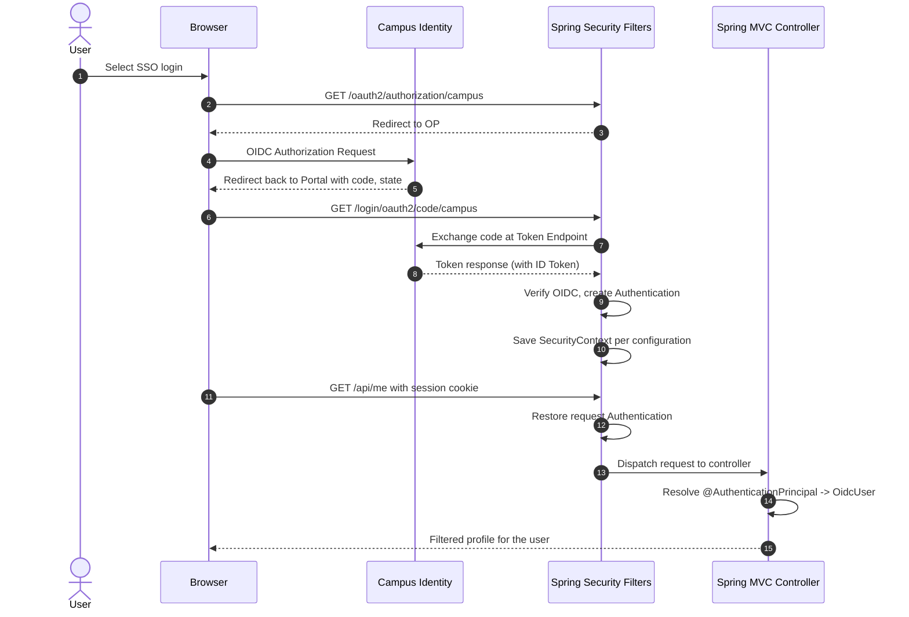

# 13.3. @AuthenticationPrincipal in Servlet Controllers

## Lesson Objectives

After this lesson, you can:

- Explain what a **principal** is and where `@AuthenticationPrincipal` retrieves it from in a Spring Security **Servlet** application.
- Use `@AuthenticationPrincipal` in a Spring MVC controller to obtain `OidcUser`, `OAuth2User`, or `UserDetails` depending on the configured authentication mechanism.
- Understand the differences between **`Authentication`**, **`SecurityContext`**, **principal**, and **`OAuth2AuthorizedClient`** in the Spring Security OAuth 2.0/OIDC Client flow.
- Extract verified `sub`, `iss`, and profile details from `OidcUser` without exposing the ID Token, access token, or refresh token.
- Know when the parameter can be `null`, when type mismatches occur, and how to use `expression`, `errorOnInvalidType`, and custom annotations.
- Design the `/api/me` endpoint and business APIs with **proper authorization**, never treating an email, display name, or login button as proof of access rights.
- Test controllers with Spring Security Test and distinguish OIDC login from a JWT Resource Server.

## 1. Context: The User Has Logged In and the Controller Needs to Know Who They Are

Suppose **Learning Portal** is a Spring Boot web application. A user logs in through **Campus Identity**, an OpenID Provider (OP). Spring Security completes the OIDC Authorization Code Flow, validates the ID Token, optionally fetches UserInfo, and creates an `Authentication` for the application session.

Then the browser sends:

```http
GET /api/me HTTP/1.1
Host: portal.example.org
Cookie: JSESSIONID=<session-cookie>
```

The controller needs to know **who is sending this request** so it can display their own profile.

A straightforward way to write this:

```java
@RestController
class MeController {

    @GetMapping("/api/me")
    Map<String, String> me(@AuthenticationPrincipal OidcUser user) {
        return Map.of(
            "subject", user.getSubject(),
            "issuer", user.getIdToken().getIssuer().toString()
        );
    }
}
```

Here, `@AuthenticationPrincipal` instructs Spring MVC to retrieve the **principal authenticated by Spring Security** for the current request and pass it into the `user` parameter.

It **does not read `userId` from a query string**, does not decode an ID Token itself, and does not call the OpenID Provider directly every time the controller runs.

> **Core idea:** `@AuthenticationPrincipal` is a convenient way to obtain `Authentication.getPrincipal()` from `SecurityContext` when handling a Servlet request in Spring MVC. It lets the controller use **an identity verified by the framework**, though the annotation itself **does not decide resource access permissions**.

### 1.1. From OIDC Login to the Request Principal



In a typical session-based flow, authentication persists across requests via the configured session/cookie mechanism. Depending on the application, `SecurityContext` may also be built from a Bearer token on each request; in that case the principal type may differ from `OidcUser`.

## 2. Four Concepts to Distinguish

| Concept | Purpose | In Servlet OIDC Login |
| --- | --- | --- |
| `SecurityContext` | Holds security information for the current execution | Contains `Authentication` |
| `Authentication` | Authentication result along with authorities, principal, and related info | Usually `OAuth2AuthenticationToken` after OAuth2/OIDC login |
| `principal` | Represents the authenticated identity | Usually `OidcUser` with OIDC, or `OAuth2User` with standard OAuth2 Login |
| `OAuth2AuthorizedClient` | Stores Client Registration, access token, and refresh token if issued | Used for calling APIs with OAuth2 Client; **not** the principal |

An illustrative structure:

```text
SecurityContext
  |
  +-- Authentication: OAuth2AuthenticationToken
        |
        +-- principal: OidcUser
        |     +-- ID Token claims
        |     +-- UserInfo claims (if present)
        |     +-- authorities
        |
        +-- authenticated: true
        +-- authorities: [...]
        +-- authorizedClientRegistrationId: "campus"

OAuth2AuthorizedClient (managed separately)
  +-- ClientRegistration("campus")
  +-- accessToken
  +-- refreshToken (optional)
```

**Do not confuse `OidcUser` with an access token.** An `OidcUser` tells the application the user's identity and claims; when the backend needs to call a Resource Server, it must use the **appropriate access token** from an authorized client, not the ID Token or principal as a Bearer token.

### 2.1. `Authentication.getPrincipal()` Differs from `Authentication.getName()`

`getPrincipal()` returns the identity object, which may carry claims or user details.

`getName()` returns an identifier string according to the `Authentication` and principal implementation. In an OIDC flow, the value is typically based on the `sub` identifier or a configured attribute name; **you should not assume** it is an email or display name.

A controller can accept the whole object:

```java
@GetMapping("/api/whoami")
Map<String, String> whoami(Authentication authentication) {
    return Map.of(
        "authenticationType",
        authentication.getClass().getSimpleName(),
        "name",
        authentication.getName()
    );
}
```

This example requires the endpoint to be protected so that an appropriate `Authentication` is present. When you need `OidcUser` and specific OIDC claims, `@AuthenticationPrincipal` is usually clearer in intent.

## 3. How Does `@AuthenticationPrincipal` Work in Spring MVC?

Standard import:

```java
import org.springframework.security.core.annotation.AuthenticationPrincipal;
```

In a Servlet web application using Spring MVC, Spring Security registers an **argument resolver** (typically `AuthenticationPrincipalArgumentResolver`) into controller method argument resolution.

When a controller declares:

```java
@GetMapping("/profile")
ProfileResponse profile(@AuthenticationPrincipal OidcUser user) {
    // ...
}
```

Conceptually, the resolver performs:

```text
1. Receive the request after it passes through the Spring Security Filter Chain.
2. Retrieve Authentication from the current SecurityContext.
3. Obtain authentication.getPrincipal().
4. If the annotation has an expression, evaluate it against the principal.
5. Pass the resulting value into the controller parameter.
```

The controller **does not need** to manually write:

```java
SecurityContextHolder.getContext()
    .getAuthentication()
    .getPrincipal();
```

for cases that only need the principal; the annotation decouples HTTP/controller code from direct `SecurityContextHolder` access.

### 3.1. Conditions for the Annotation to Work

- The request must pass through the appropriate **SecurityFilterChain**.
- The authentication mechanism must be enabled and succeed before the controller is invoked.
- Spring MVC must have the Spring Security argument resolver registered; a standard Spring Boot Servlet app with Spring Security MVC integration already supports this.
- The parameter type must match the **actual principal type** inside the request's `Authentication`.

`@AuthenticationPrincipal` does not enable security by itself. If a controller is configured with `permitAll()`, an unauthenticated user may have no principal of the expected type; handle that case explicitly.

### 3.2. It Does Not Read Raw HTTP Headers

A user cannot simply send:

```http
X-Principal-Sub: admin
```

and make `@AuthenticationPrincipal OidcUser user` turn into `admin`. The resolver reads the principal from `SecurityContext` populated by security components. Naturally, the application must safeguard how `Authentication` is created and never place untrusted data into `SecurityContext`.

This is why controllers should rely on the verified principal rather than trusting `userId`, `email`, or `role` sent by the client in the request.

## 4. What Data Type Is the Principal?

The principal type depends on the **authentication mechanism**, not on naming the controller parameter `user`.

| Authentication Mechanism | Typical Principal Type | How to Read in Controller |
| --- | --- | --- |
| **OIDC Login** via `oauth2Login()` with scope `openid` | `OidcUser`, typically `DefaultOidcUser` | `@AuthenticationPrincipal OidcUser user` |
| **OAuth2 Login** without OIDC | `OAuth2User`, typically `DefaultOAuth2User` | `@AuthenticationPrincipal OAuth2User user` |
| **Form Login** with standard `UserDetailsService` | `UserDetails` or implementation such as `org.springframework.security.core.userdetails.User` | `@AuthenticationPrincipal UserDetails user` |
| **JWT Resource Server** with Bearer token | `Jwt` in the default configuration | `@AuthenticationPrincipal Jwt jwt` |
| **Opaque token Resource Server** | An `OAuth2AuthenticatedPrincipal` or provider-specific class | `@AuthenticationPrincipal OAuth2AuthenticatedPrincipal user` when appropriate |
| **Custom Authentication** | Principal class set by the application | `@AuthenticationPrincipal MyPrincipal user` |

Distinctions to keep in mind:

- **`OAuth2User`** is the general interface for OAuth2 Login principals.
- **`OidcUser`** extends `OAuth2User` and adds APIs for the ID Token and UserInfo.
- Not every `OAuth2User` is an `OidcUser`; if the provider does not run OIDC, casting to `OidcUser` will fail.
- A Bearer JWT in a Resource Server does not automatically become an `OidcUser`, even if the JWT has claims named `sub`, `iss`, or `email`.

### 4.1. When Is `@AuthenticationPrincipal OidcUser` Appropriate?

When the application uses **OpenID Connect Login**:

```yaml
spring:
  security:
    oauth2:
      client:
        registration:
          campus:
            scope:
              - openid
              - profile
              - email
```

And the `SecurityFilterChain` enables:

```java
http.oauth2Login(Customizer.withDefaults());
```

Once login completes validly, the principal can be read as `OidcUser` and contains the claims supplied by the OP according to the flow.

### 4.2. When Is `OAuth2User` Needed Instead of `OidcUser`?

An OAuth2 Login not using `openid` may use a provider-specific user-info service:

```java
@GetMapping("/profile/oauth2")
Map<String, Object> profile(@AuthenticationPrincipal OAuth2User user) {
    return Map.of(
        "name", user.getName(),
        "attributes", user.getAttributes()
    );
}
```

The snippet illustrates the API, but **you should not return raw `attributes` from a production API** because it may contain personal data or unnecessary fields. In production systems, filter attributes into a DTO.

If you need `getIdToken()` or `getUserInfo()`, only use them when the principal is genuinely an `OidcUser`.

## 5. Sample Spring Boot OIDC Client Configuration (Servlet)

Example Learning Portal using Campus Identity:

```yaml
spring:
  security:
    oauth2:
      client:
        registration:
          campus:
            provider: campus
            client-id: ${CAMPUS_CLIENT_ID}
            client-secret: ${CAMPUS_CLIENT_SECRET}
            client-authentication-method: client_secret_basic
            authorization-grant-type: authorization_code
            redirect-uri: "{baseUrl}/login/oauth2/code/{registrationId}"
            scope:
              - openid
              - profile
              - email
        provider:
          campus:
            issuer-uri: https://login.example.org/realms/campus
```

This is an **illustrative configuration**. You must register a real OAuth Client at the OP, use HTTPS, and manage the client secret via an appropriate secret manager. `issuer-uri` lets Spring Security/Boot use OIDC Discovery when supported by the OP.

`SecurityFilterChain` configuration:

```java
@Configuration
class WebSecurityConfig {

    @Bean
    SecurityFilterChain securityFilterChain(HttpSecurity http) throws Exception {
        http
            .authorizeHttpRequests(auth -> auth
                .requestMatchers("/", "/login", "/error", "/assets/**")
                    .permitAll()
                .requestMatchers("/api/me", "/api/me/**")
                    .authenticated()
                .anyRequest()
                    .authenticated()
            )
            .oauth2Login(Customizer.withDefaults());

        return http.build();
    }
}
```

The snippet assumes dependencies for Spring Web/MVC, Spring Security, and OAuth2 Client are present; imports are omitted.

Default login initiation normally starts at:

```text
/oauth2/authorization/campus
```

After OP processing, the callback normally arrives at:

```text
/login/oauth2/code/campus
```

Spring verifies the OIDC ID Token, builds the `Authentication`, and the controller can then receive `OidcUser` via the annotation.

### 5.1. Is Form Login Required to Use the Annotation?

No. `@AuthenticationPrincipal` only relies on an `Authentication` already present in `SecurityContext`. It works with OIDC Login, OAuth2 Login, form login, JWT Bearer, and many other mechanisms.

For a Portal using SSO, enabling only `oauth2Login()` is sufficient for the OIDC login path when the rest of the configuration is in place. There is no need to implement a Campus Identity password form in the application.

### 5.2. Does `@AuthenticationPrincipal` Call UserInfo Again?

No. The annotation only retrieves the principal **already present** in the request. Fetching UserInfo (if it happens) belongs to the OIDC user-loading phase and the `OidcUserService`/provider configuration, and is not re-triggered each time a controller references the principal.

If the profile changes at the provider while `OidcUser` still holds data from an earlier login session, reading the annotation alone will not fetch the updated name or email automatically.

## 6. Building a `/api/me` Endpoint Returning a Safe DTO

This is the most common scenario: the backend provides concise details about the currently logged-in user.

### 6.1. DTO Containing Only Necessary Fields

A Java record can be used:

```java
public record MyProfileResponse(
    String subject,
    String issuer,
    String displayName,
    String email,
    Boolean emailVerified
) {}
```

Controller:

```java
@RestController
@RequestMapping("/api")
class MyProfileController {

    @GetMapping("/me")
    MyProfileResponse me(@AuthenticationPrincipal OidcUser user) {
        return new MyProfileResponse(
            user.getSubject(),
            user.getIdToken().getIssuer().toString(),
            user.getClaimAsString("name"),
            user.getClaimAsString("email"),
            user.getClaimAsBoolean("email_verified")
        );
    }
}
```

In this example, Spring Security must protect `/api/me` with `.authenticated()`, and the application assumes the user logged in via OIDC, so `OidcUser` is present.

Illustrative response:

```json
{
  "subject": "student-9b71",
  "issuer": "https://login.example.org/realms/campus",
  "displayName": "Nguyen Anh",
  "email": "anh@example.org",
  "emailVerified": true
}
```

Not every OP returns `name`, `email`, or `email_verified`. If a claim is absent, the API can return `null` or apply a fallback according to the product contract. `sub` is the identifier from the issuer; do not infer email from `sub`.

**Never `return user;` directly.** `OidcUser` may contain broad claim sets, the ID Token, UserInfo, or attributes not intended for the browser. Return only a filtered, permitted DTO.

### 6.2. Why Prefer `sub` Over Email for Identification?

Emails and names can change; some providers do not even return an email. In OIDC, `sub` is used by the OP to identify the subject. When multiple OPs are involved, internal identity should be keyed by the **`(issuer, sub)` pair**, for example:

```text
(https://login.example.org/realms/campus, student-9b71)
```

Do not use email as a unique key to look up personal records or automatically merge accounts from two different OPs without a secure account-linking process.

### 6.3. Reading ID Token and UserInfo Claims Separately

An `OidcUser` provides:

```java
OidcIdToken idToken = user.getIdToken();
OidcUserInfo userInfo = user.getUserInfo();
Map<String, Object> mergedClaims = user.getClaims();
```

- `idToken` represents the ID Token processed by the OIDC Client.
- `userInfo` may be `null` if the UserInfo Endpoint was not called or returned no required data.
- `getClaims()` provides the combined claims map for the application; it may merge claims from both ID Token and UserInfo depending on how the principal was built.

When you need to know the **origin** of email or another claim:

```java
boolean emailFromIdToken =
    user.getIdToken().getClaims().containsKey("email");

boolean emailFromUserInfo =
    user.getUserInfo() != null
        && user.getUserInfo().getClaims().containsKey("email");
```

Do not assume `@AuthenticationPrincipal` guarantees every claim is always present, or that `getClaims()` reads solely from the ID Token.

## 7. Extracting a Single Property Using `expression`

`@AuthenticationPrincipal` has an `expression` attribute using Spring Expression Language (SpEL). The expression is evaluated with the principal as the root object, allowing access to its properties.

Example extracting only email:

```java
@GetMapping("/api/me/email")
Map<String, String> email(
        @AuthenticationPrincipal(expression = "claims['email']")
        String email) {

    if (email == null) {
        return Map.of("message", "No email was shared");
    }

    return Map.of("email", email);
}
```

This illustrates expression syntax, not that an email shared by an OP is always trustworthy as an **authorization key**. If the application requires a verified email, check `email_verified` and the OP trust policy as well.

Another expression reading subject from the ID Token:

```java
@GetMapping("/api/me/subject")
Map<String, String> subject(
        @AuthenticationPrincipal(expression = "idToken.subject")
        String subject) {
    return Map.of("subject", subject);
}
```

The snippet assumes the principal is an `OidcUser` with `idToken`; for a non-OIDC `OAuth2User`, this property may not exist.

### 7.1. When to Use an Expression vs. Accepting the Full `OidcUser`?

**Use an expression** when the controller only needs a simple property and you are certain of the principal type on that endpoint.

**Accept the full `OidcUser`** when you need to:

- Read `iss`, `sub`, email, and other claims together.
- Handle fallbacks for missing attributes.
- Query a service keyed by `(iss, sub)`.
- Check whether `UserInfo` is present.
- Apply business logic requiring multiple verified fields.

Avoid embedding complex authorization logic inside annotation SpEL strings: a tested, clearly managed service is generally far better.

## 8. `errorOnInvalidType`: When the Principal Type Does Not Match

With the annotation:

```java
@AuthenticationPrincipal OidcUser user
```

If `Authentication.getPrincipal()` is actually a `UserDetails`, `Jwt`, or `String`, that value **cannot** be assigned to `OidcUser`.

By `@AuthenticationPrincipal`'s design, when the type does not match, the resolver may default to passing `null` rather than failing on an invalid cast. The `errorOnInvalidType` attribute selects stricter behavior:

```java
@GetMapping("/api/me/strict")
String strictMe(
        @AuthenticationPrincipal(errorOnInvalidType = true)
        OidcUser user) {

    return user.getSubject();
}
```

If a principal exists but is not an `OidcUser`, the resolver can throw `ClassCastException` instead of silently returning `null`.

**Do not use `errorOnInvalidType = true` as an authentication or authorization mechanism.** It only surfaces a type mismatch in the controller; access control must be enforced by `SecurityFilterChain` and authorization rules.

### 8.1. Why Can a Type Mismatch Occur?

- Form login was used and the principal is `UserDetails`, not `OidcUser`.
- The same application has Bearer JWT Resource Server endpoints where the principal is `Jwt`.
- A non-OIDC OAuth2 provider produces a plain `OAuth2User`.
- A unit test uses `@WithMockUser`, so the principal does not match an OIDC environment.
- The application creates an `Authentication` with a custom principal.
- The endpoint allows anonymous access and has no principal of the expected type.

When multiple authentication mechanisms coexist, design dedicated endpoints or abstractions rather than forcing every request to be OIDC.

### 8.2. Checking for `null` on Public Endpoints

If an endpoint uses `permitAll()`, an unauthenticated user may not have an `OidcUser`:

```java
@GetMapping("/public/greeting")
Map<String, String> greeting(
        @AuthenticationPrincipal OidcUser user) {

    String message = (user == null)
        ? "Hello guest"
        : "Hello " + user.getSubject();

    return Map.of("message", message);
}
```

This pattern suits a public endpoint displaying optional personalized content. Do not use it to guard private data: for APIs requiring a principal, configure `.authenticated()` rather than merely hoping `user` is non-null.

## 9. Using `Authentication` When Authorities or Login Mechanism Details Are Needed

Sometimes a controller needs not just the principal, but also authorities or the registration ID:

```java
@GetMapping("/api/me/authentication")
Map<String, Object> authentication(Authentication authentication) {
    Map<String, Object> response = new LinkedHashMap<>();

    response.put("name", authentication.getName());
    response.put(
        "authorities",
        authentication.getAuthorities().stream()
            .map(GrantedAuthority::getAuthority)
            .toList()
    );

    if (authentication instanceof OAuth2AuthenticationToken oauth) {
        response.put(
            "registrationId",
            oauth.getAuthorizedClientRegistrationId()
        );
    }

    return response;
}
```

This illustrates inspecting metadata on a **protected** endpoint. In production systems, the authorities list can be internal information; return it only when explicitly required.

Comparison:

| Controller Parameter | What Do You Receive? | When to Use? |
| --- | --- | --- |
| `@AuthenticationPrincipal OidcUser user` | OIDC Principal | Reading OIDC identity and claims |
| `@AuthenticationPrincipal OAuth2User user` | OAuth2 Principal | Using a common API for OAuth2/OIDC principals |
| `Authentication authentication` | Current Authentication | Needing authorities, `isAuthenticated`, type, or registration ID |
| `Principal principal` | Standard principal interface | Only needing a generic name |
| `@CurrentSecurityContext(expression = "authentication") Authentication auth` | Authentication via SecurityContext | Needing custom security context resolution |
| `@RegisteredOAuth2AuthorizedClient("campus") OAuth2AuthorizedClient client` | Authorized client and token state | Backend needs to manage/call OAuth2 APIs; protect tokens carefully |

`@AuthenticationPrincipal` is a tool for **obtaining the principal**, not for directly reading every detail of `OAuth2AuthorizedClient`.

### 9.1. Why Shouldn't `Authentication.getName()` Be Assumed to Be an Email?

In OIDC, the `sub` subject is normally the stable identifier within an issuer. Some systems configure `nameAttributeKey` or a custom user principal, so `getName()` may hold another attribute.

If the API needs an email, read the email claim per policy. If it needs an immutable identifier for account lookup, read the OIDC-verified **`iss` and `sub`** and map them to a local user ID.

## 10. A Principal Does Not Grant Permissions by Itself: Designing Proper Authorization

Having an `OidcUser` only tells you Spring Security recognized a user from OIDC. It **does not automatically prove** that person is allowed to view every course record.

Dangerous example:

```java
@GetMapping("/api/students/{studentId}/grades")
GradeResponse grades(
        @PathVariable String studentId,
        @AuthenticationPrincipal OidcUser user) {

    // WRONG if using caller-supplied studentId alone
    // without checking whether the user is allowed to view this record.
    return gradeService.findGrades(studentId);
}
```

A logged-in user can simply alter `studentId` in the URL to read someone else's data if the backend does not enforce ownership.

### 10.1. Use the Principal to Find the Local User, Then Check Permissions

A better design:

```text
OIDC issuer + subject
    |
    v
ExternalIdentityRepository
    |
    v
LocalUser ID (internal user)
    |
    v
AccessPolicy / Service
    |
    v
Return resource only when authorized
```

Example illustrating controller logic:

```java
@RestController
class GradeController {

    private final IdentityService identities;
    private final GradeService grades;

    GradeController(
            IdentityService identities,
            GradeService grades) {
        this.identities = identities;
        this.grades = grades;
    }

    @GetMapping("/api/courses/{courseId}/my-grades")
    GradeResponse myGrades(
            @PathVariable Long courseId,
            @AuthenticationPrincipal OidcUser oidcUser) {

        String issuer =
            oidcUser.getIdToken().getIssuer().toString();
        String subject = oidcUser.getSubject();

        Long localUserId =
            identities.requireLocalUserId(issuer, subject);

        return grades.findGradesForEnrolledStudent(
            courseId, localUserId
        );
    }
}
```

In this example, `findGradesForEnrolledStudent` **must check enrollment/ownership in the service layer** before returning data. These business interfaces/classes are application-defined, not built-in Spring classes.

Security rationale:

- `issuer` and `subject` come from the authenticated OIDC principal.
- `localUserId` is looked up in a trusted identity-linking store.
- The caller-supplied `courseId` is **not enough** to confirm permission to view grades.
- The service decides access based on the internal user and their relationship to the resource.

### 10.2. Use Method Security When Needed

Spring Security can protect methods with `@PreAuthorize` when method security is enabled:

```java
@Configuration
@EnableMethodSecurity
class MethodSecurityConfiguration {
}
```

Example illustrating the idea when the app has a `courseAccess` bean:

```java
@PreAuthorize("@courseAccess.canView(authentication, #courseId)")
@GetMapping("/api/courses/{courseId}")
CourseResponse course(@PathVariable Long courseId) {
    return courseService.load(courseId);
}
```

The expression invokes `canView` on an application-built service; that service must verify permissions using trusted data. `authentication` in method security represents the current Authentication, not a browser-supplied request parameter.

If you use:

```java
@PreAuthorize("hasRole('ADMIN')")
```

the application must actually have a mechanism mapping business roles to the corresponding `GrantedAuthority`. Standard OIDC Login **does not automatically create `ROLE_ADMIN` from an arbitrary `groups` or `roles` array**. A trust contract and explicit mapping must be configured.

### 10.3. Profile Claims Are Not Permissions

Claims such as:

```text
email
name
preferred_username
picture
locale
```

serve profile display, not proof of business permissions.

Even when an OP returns:

```json
{
  "groups": ["staff"]
}
```

you must determine the claim source, trust level, freshness, semantics, and mapping to authorities. Never grant administrative privileges just because a user clicked `/oauth2/authorization/staff` or their email ends with a certain domain.

## 11. Reusable Custom Annotations Across Controllers

If many endpoints accept `OidcUser`, you can create a custom annotation for readability. Spring Security supports using `@AuthenticationPrincipal` as a **meta-annotation**.

Example:

```java
@Target(ElementType.PARAMETER)
@Retention(RetentionPolicy.RUNTIME)
@AuthenticationPrincipal
public @interface CurrentOidcUser {
}
```

Then:

```java
@GetMapping("/api/me")
MyProfileResponse me(@CurrentOidcUser OidcUser user) {
    return new MyProfileResponse(
        user.getSubject(),
        user.getIdToken().getIssuer().toString(),
        user.getClaimAsString("name"),
        user.getClaimAsString("email"),
        user.getClaimAsBoolean("email_verified")
    );
}
```

Import the annotations from `java.lang.annotation` and Spring Security's `AuthenticationPrincipal`. `@CurrentOidcUser` does not need custom authentication logic; it is simply a readable alias for principal resolution.

### 11.1. When Is a Custom Annotation Helpful?

- The system has many controllers and wants a uniform way to inject the principal.
- You want to clearly distinguish endpoints for **OIDC sessions** from endpoints for JWT APIs.
- You want to reduce repetitive long imports/annotations.
- You want a cleaner boundary for evolving a principal abstraction later.

However, this annotation **does not turn a JWT Resource Server principal into an `OidcUser`**. Naming it `CurrentOidcUser` also does not replace authentication/authorization checks.

### 11.2. Should You Inject a JPA `User` Entity Directly?

Do not assume an OIDC principal is a database entity ready to be serialized into responses. Usually it is better to follow:

```text
OIDC principal (iss, sub)
  -> IdentityService
  -> local account/domain user
  -> filtered DTO
```

This avoids tying persistence entities to `SecurityContext`, reduces the risk of leaking sensitive fields, and supports mapping multiple providers to one local account in a controlled way.

## 12. Resource Server Is Not OIDC Client Login

In a Spring Boot architecture, two distinct applications may coexist:

```text
Learning Portal
  - oauth2Login()
  - login with OIDC
  - principal is typically OidcUser
  - session/cookie for browser

Course API
  - oauth2ResourceServer().jwt()
  - receives Bearer Access Token
  - principal is typically Jwt
  - typically authenticates every request
```

Example controller in Course API:

```java
@RestController
class CourseApiController {

    @GetMapping("/api/token-subject")
    Map<String, String> subject(
            @AuthenticationPrincipal Jwt jwt) {

        return Map.of("subject", jwt.getSubject());
    }
}
```

With default `oauth2ResourceServer().jwt()`, the principal is typically a `Jwt` object. The endpoint still needs a `SecurityFilterChain` requiring a valid Bearer token, and the Resource Server must verify issuer, audience/scopes, timestamps, and signature as configured.

**Do not use `@AuthenticationPrincipal OidcUser` in a JWT Resource Server and conclude the annotation is broken when it evaluates to `null`.** That is simply a principal-type difference caused by the authentication mechanism.

### 12.1. Sample `SecurityFilterChain` for a Bearer-Token API

```java
@Bean
SecurityFilterChain apiSecurity(HttpSecurity http) throws Exception {
    http
        .securityMatcher("/api/**")
        .authorizeHttpRequests(auth -> auth
            .anyRequest().authenticated()
        )
        .oauth2ResourceServer(oauth2 -> oauth2
            .jwt(Customizer.withDefaults())
        );

    return http.build();
}
```

This is an illustrative Resource Server configuration and **does not replace** Learning Portal's OIDC Login configuration. If one application hosts both OIDC Login and a Bearer API, design multiple filter chains/entry points with explicit match order; never guess the principal solely from URL paths.

### 12.2. `@AuthenticationPrincipal` Does Not Refresh Access Tokens

When the backend uses OAuth2 Client to call an API on behalf of a user, use **`OAuth2AuthorizedClient`** or `OAuth2AuthorizedClientManager`. Reading the principal only tells you the request identity:

```java
void handler(@AuthenticationPrincipal OidcUser user) {
    // user identifies the person.
    // It does not provide a fresh access token to call a Resource Server.
}
```

When a token expires, the `OAuth2AuthorizedClientManager` layer and refresh configuration handle token renewal according to the client's grant. Do not cache an access token in a singleton controller field or try to use the ID Token as an access token.

## 13. Session, Request Thread, and SecurityContext

In Servlet security, Spring Security filters establish `SecurityContext` for request processing. A common mechanism uses `SecurityContextHolder` so code handling the same request can access authentication.

With HTTP session-based OIDC Login:

```text
Browser Cookie
   -> Spring Security filters
   -> load SecurityContext/Authentication from session
   -> DispatcherServlet
   -> Controller method
   -> resolve @AuthenticationPrincipal
```

This has several implications:

- `@AuthenticationPrincipal` operates within a Spring MVC **request context**.
- Do not expect it to work inside a background job with no HTTP request.
- When offloading work to another thread, use the framework's proper security context propagation mechanism if genuinely needed.
- Never copy the principal or `SecurityContext` into a global/static mutable field shared across users.
- On logout, the local session may be invalidated; that is separate from the SSO session state at the OP and token revocation.

### 13.1. Why Not Call `SecurityContextHolder` in Every Service?

A business service accepting `OidcUser` everywhere becomes tightly coupled to the security framework and harder to unit test independently. Depending on your design, the controller or a boundary service can convert the authenticated principal into an **internal identity** and pass it into services:

```java
record CurrentIdentity(String issuer, String subject) {}

CurrentIdentity identityFrom(OidcUser user) {
    return new CurrentIdentity(
        user.getIdToken().getIssuer().toString(),
        user.getSubject()
    );
}
```

The service then enforces permissions based on the verified identity/status and business data.

Some applications use `Authentication` directly in services or method security, which is also valid, provided responsibility boundaries stay consistent so services do not silently read a missing context in background tasks.

## 14. Testing Controllers Using `@AuthenticationPrincipal`

Spring Security Test supports simulating principals for MockMvc. For OIDC Login, you can use `oidcLogin()`.

Conceptual example:

```java
@Test
void meReturnsSubject() throws Exception {
    mockMvc.perform(
            get("/api/me")
                .with(oidcLogin()
                    .idToken(token -> token
                        .claim("sub", "student-9b71")
                        .claim("name", "Nguyen Anh")
                    )
                )
        )
        .andExpect(status().isOk())
        .andExpect(jsonPath("$.subject").value("student-9b71"));
}
```

In this example, it is assumed that:

- `mockMvc` is configured with Spring Security Test integration.
- The `/api/me` controller returns a DTO with a `subject` field.
- `oidcLogin()` comes from `SecurityMockMvcRequestPostProcessors`.
- The project includes a version-compatible `spring-security-test` dependency.
- Imports for `get`, `status`, `jsonPath`, and the test class are properly configured.

**Important:** `oidcLogin()` creates a **mock authentication** for controller testing. It **does not mean the full Authorization Code Flow ran, the OP's JWT signature was verified, or a real Token Endpoint was called**. When you need to verify OIDC provider configuration, issuer, audience, redirect URI, and callback handling, run dedicated integration tests or test against a real OP environment.

### 14.1. Why Doesn't `@WithMockUser` Suit Every OIDC Test?

For example:

```java
@WithMockUser(username = "alice")
```

normally creates an `Authentication` whose principal is a Spring Security `UserDetails`/mock user. If the controller declares:

```java
@AuthenticationPrincipal OidcUser user
```

the mocked principal is not an `OidcUser`, resulting in `null` or a type mismatch depending on the annotation setting.

For endpoints requiring `OidcUser`, `oidcLogin()` expresses intent far more accurately. For endpoints accepting generic `Authentication`, `@WithMockUser` can suffice for simple rule tests.

### 14.2. Testing Authorization Differs from Testing Principal Injection

You often need at least two groups of tests:

1. **Controller tests:** ensure the OIDC principal resolves properly, the DTO contains only allowed fields, and missing claims are handled.
2. **Authorization tests:** ensure unauthorized users are blocked, ownership is checked, and users cannot read each other's records.

A passing test using `@AuthenticationPrincipal OidcUser` **does not prove** an endpoint is properly protected against attackers.

## 15. Common Integration Issues

| Symptom | Possible Cause | Resolution |
| --- | --- | --- |
| `@AuthenticationPrincipal OidcUser user` is `null` | Unauthenticated request, non-OIDC principal, or wrong `SecurityFilterChain` | Check `.authenticated()`, login flow, and actual principal type |
| `ClassCastException` on injection | `errorOnInvalidType` enabled and principal has a different type | Check whether form login, OAuth2, or JWT is handling the request |
| `getIdToken()` unavailable on `OAuth2User` | Principal is a non-OIDC OAuth2 user | Use `OidcUser` only in OIDC Login with `openid` |
| Reading email claim returns `null` | OP did not supply or share the claim | Check scopes/consent/UserInfo; apply fallback |
| Controller NPE on `user.getSubject()` | Endpoint permits anonymous access or type mismatch | Protect endpoint, or handle `user == null` on public endpoints |
| Test uses `@WithMockUser` while expecting `OidcUser` | Mock principal lacks OIDC type | Use `oidcLogin()` |
| Bearer API receives `Jwt` while controller expects `OidcUser` | Confused Resource Server with OAuth2 Login | Use `@AuthenticationPrincipal Jwt` or design an appropriate identity abstraction |
| Logged in, yet `hasRole('ADMIN')` fails | Business role not mapped to authority | Check mapping from authoritative permission source |
| `getName()` is not an email | Principal name attribute differs from email | Read email claim separately; identify by `(iss, sub)` |
| User changing email creates a duplicate record | Used email as the identity key | Map `(issuer, subject)` to a local account ID |
| `return user` leaks data | Serialized the raw OIDC principal | Return a filtered DTO excluding tokens and raw claims |
| Calling an API with token from principal fails | Confused ID Token or principal with access token | Retrieve authorized client and proper access token |
| Async task sees empty `SecurityContext` | Request/thread context was not propagated | Pass identity explicitly or use supported security context propagation |
| Login succeeds, yet business API leaks another user's data | Only authentication checked, missing ownership check | Enforce per-record/resource authorization |

### 15.1. How to Narrow Down Issues

When a controller does not receive the expected principal:

1. **Identify which `SecurityFilterChain`** actually handles the request.
2. **Identify the authentication mechanism**: OIDC Login, OAuth2 Login, form login, bearer JWT, or anonymous.
3. **Verify whether the route requires `authenticated()`** and whether any custom entry point, CSRF, or session setting interferes.
4. **Inspect the `Authentication` and principal types** using sanitized technical logs (never log tokens).
5. **Choose the annotation and parameter type** matching the authentication mechanism, or adjust multi-chain routing if the endpoint hits the wrong mechanism.
6. If a claim is missing, **check what data the OP released**, rather than assuming the annotation is broken.

Never disable `SecurityFilterChain` or replace `@AuthenticationPrincipal` with reading a user ID from the request just to bypass an error.

## 16. Real-World Scenarios

### Scenario A — Portal Using OIDC Login

Learning Portal has `scope: [openid, profile, email]`; Spring validates the ID Token and creates `OidcUser`. `/api/me` accepts `@AuthenticationPrincipal OidcUser`.

**Handling:** return a DTO containing `iss`, `sub`, and name/email when shared. Use `(iss, sub)` to map the internal user and never expose the ID Token.

### Scenario B — Unauthenticated User Calls a Public Endpoint

A user visits `/public/greeting` without a session. `@AuthenticationPrincipal OidcUser` may be `null`.

**Handling:** return guest content or prompt for login depending on purpose. For endpoints with private data, protect them with `.authenticated()` and authorization rules instead of allowing anonymous access.

### Scenario C — Backend Is a Resource Server

Course API accepts JWT access tokens, while a controller declares `@AuthenticationPrincipal OidcUser`. Under default JWT Resource Server configuration, the principal is `Jwt`, not `OidcUser`.

**Handling:** use `Jwt` in the API and validate audience/issuer/scopes properly. Do not add `openid` to an Access Token and expect it to become an OIDC login session.

### Scenario D — User Changes Email

The OP still issues the same OIDC `sub` for the user, but their email changed at the OP. Because the application linked accounts by email, it creates a duplicate user.

**Handling:** link by issuer and subject, treating email as a mutable profile attribute updated according to policy.

### Scenario E — Clicking the Staff Login Button Without Having the Role

A user logs in via `/oauth2/authorization/campus-staff`; OIDC login succeeds and the controller receives `OidcUser`. Still, the user is not allowed to view `/staff/reports`.

**Handling:** merely choosing a login registration **does not grant staff privileges**. Check actual authorities or business permissions, e.g., via method security or service policy.

### Scenario F — Concurrent Requests

Two requests from the same user enter two controllers, each injected with `OidcUser`. It is the **request principal**, not an object to store in a singleton field.

**Handling:** use the per-request value or an immutable identity abstraction; never store the current user in a global variable.

## 17. Practice Exercises

### Exercise 1 — Write a Display Name Endpoint

Requirement: after OIDC login, `/api/me/name` returns the display name or a fallback if the OP does not provide `name`.

Hint:

```java
@GetMapping("/api/me/name")
Map<String, String> displayName(
        @AuthenticationPrincipal OidcUser user) {

    String name = user.getClaimAsString("name");

    if (name == null || name.isBlank()) {
        name = "User " + user.getSubject();
    }

    return Map.of("displayName", name);
}
```

The endpoint assumes authentication is already required. In production, consider whether to display `sub` or use a fallback that does not expose technical identifiers.

### Exercise 2 — Compare `Authentication` and Principal

Given:

```java
@GetMapping("/api/me/details")
String details(
        Authentication authentication,
        @AuthenticationPrincipal OidcUser user) {
    // ...
}
```

**Question:** Why don't the two parameters hold the same type?

**Answer:** `Authentication` represents the entire authentication state, authorities, and principal; `OidcUser` is the `Authentication.getPrincipal()` object extracted separately by the resolver.

### Exercise 3 — Avoid Exposing the ID Token

An endpoint is written as:

```java
@GetMapping("/api/me/raw")
OidcUser raw(@AuthenticationPrincipal OidcUser user) {
    return user;
}
```

**Question:** Why should this be fixed?

**Answer:** Serializing the raw principal can accidentally include claims or token objects in the response. Create a DTO containing only the necessary fields permitted for sharing.

### Exercise 4 — Choose the Right Principal Type

Select the appropriate parameter type:

| Context | Appropriate Parameter Type |
| --- | --- |
| OIDC Login in web Portal | `@AuthenticationPrincipal OidcUser user` |
| OAuth2 Login without OIDC | `@AuthenticationPrincipal OAuth2User user` |
| Form Login using UserDetails | `@AuthenticationPrincipal UserDetails user` |
| JWT Resource Server | `@AuthenticationPrincipal Jwt jwt` |
| Need authorities and registration ID after OAuth2 Login | `Authentication` / `OAuth2AuthenticationToken` |

### Exercise 5 — Record-Level Authorization

A user sends:

```text
GET /api/courses/77/my-grades
```

**Question:** Is checking `user != null` sufficient?

**Answer:** No. You must map the OIDC identity to a local user and verify whether that user is allowed to view grades for course 77. Authentication does not determine ownership.

### Exercise 6 — Test Using a Mock Principal

Test:

```java
mockMvc.perform(get("/api/me").with(user("alice")));
```

Controller expects:

```java
@AuthenticationPrincipal OidcUser user
```

**Question:** Why might the test not receive an `OidcUser`?

**Answer:** `user("alice")` creates a mock principal based on `UserDetails`, not an OIDC principal. Use `oidcLogin()` to simulate the login type expected by the controller.

## 18. Self-Check Questions

**1. Does `@AuthenticationPrincipal` verify the ID Token signature by itself?**

> No. The annotation only retrieves the principal from `SecurityContext`. ID Token verification belongs to Spring Security's preceding OIDC Login pipeline.

**2. Where does `@AuthenticationPrincipal OidcUser` get its data from?**

> From `Authentication.getPrincipal()` on the current request; after a successful OIDC login, the principal is typically `OidcUser`.

**3. Why can a parameter still be `null` even with the annotation on the controller?**

> The user may not be logged in, the principal may be of another type, or the request was not handled by the expected OIDC mechanism. Check the filter chain and authentication.

**4. What should you use if you need to inspect authorities?**

> You can accept `Authentication` and call `getAuthorities()`; `OidcUser` also exposes authorities, though granting permissions must rely on valid mapping and policies.

**5. How do `OidcUser` and `OAuth2AuthorizedClient` differ?**

> `OidcUser` represents the authenticated identity and claims; `OAuth2AuthorizedClient` holds OAuth2 authorization state and tokens for the client to call a Resource Server.

**6. Should email be used as the lookup key for user records?**

> Do not treat email as an immutable identifier. Map `(iss, sub)` to a local user ID and check permissions.

**7. Why should `/api/me` return a DTO instead of the raw `OidcUser`?**

> To control which fields are disclosed and prevent leaking tokens, sensitive claims, and internal principal details.

**8. Where is `@AuthenticationPrincipal Jwt` used?**

> In a Resource Server application accepting Bearer JWTs with a `Jwt` principal, not by default for OIDC Login in a web app.

**9. Can `@WithMockUser` completely replace OIDC tests?**

> No. It usually creates `UserDetails`/mock Authentication; use `oidcLogin()` for controllers requiring `OidcUser` and separate integration tests for real OIDC steps.

**10. Does having a valid `OidcUser` mean the user can call every endpoint?**

> No. Authorization by roles, scopes, business policies, and per-resource permissions is still required.

---

## Key Takeaway

In **Spring Security Servlet**, **`@AuthenticationPrincipal`** lets Spring MVC inject the **principal of the current `Authentication`** into a controller. After OIDC login via `oauth2Login()`, the principal is typically **`OidcUser`**; it provides `sub`, the ID Token, and profile claims, **not an access token or authorization rules by itself**. Use the verified principal to identify the user via `(iss, sub)`, map to an internal user when needed, enforce business permissions, and return a **minimal DTO**. For other mechanisms such as standard OAuth2 Login, form login, or JWT Resource Server, select the **matching principal type**, protect endpoints via `SecurityFilterChain`/method security, and never expose the raw principal object in responses.
