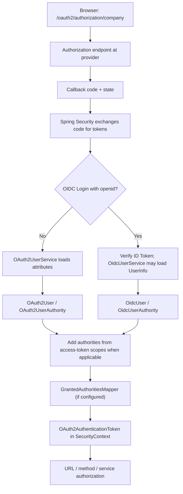
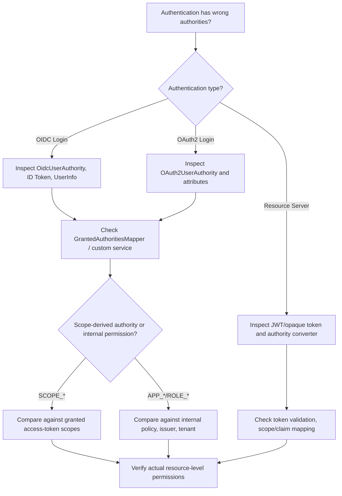

# 13.5. OAuth2UserAuthority, OidcUserAuthority, and Scope-Derived Authorities

In **Spring Security OAuth 2.0 / OpenID Connect (OIDC) Client**, logging in successfully and being permitted to access a feature are **two distinct decisions**. When a user logs in via an Authorization Server / OpenID Provider, Spring Security creates an `Authentication` containing the principal and a set of `GrantedAuthority` instances. Those authorities can then be evaluated by `authorizeHttpRequests`, `@PreAuthorize`, or other authorization mechanisms.

Three concepts frequently appear in the same authority collection yet carry different meanings:

- **`OAuth2UserAuthority`**: an authority tied to user information from an **OAuth2 Login** flow, typically holding attributes loaded from the provider by the OAuth2 User Service.
- **`OidcUserAuthority`**: an authority tied to **OIDC Login**, holding `OidcIdToken` and optionally `OidcUserInfo`, allowing access to claims from the identity provider.
- **`SCOPE_xxx` authorities**: represent an **access token scope** as a `GrantedAuthority` so the application can use it in certain authorization decisions. It is not automatically equivalent to an internal role, nor is it an ID Token `roles` claim.

This lesson focuses on the **origin, structure, inspection, and mapping** of these authorities in Spring Security, as well as the boundary between identity information, granted OAuth2 permissions, and internal business permissions.

## 1. Principal, GrantedAuthority, Role, and Scope: Do Not Lump Them Together

After OAuth2/OIDC Login completes, a Servlet application typically receives an `OAuth2AuthenticationToken` in `SecurityContext`. This authentication token holds:

1. **Principal**: the object describing the logged-in user, such as `OAuth2User` or `OidcUser`.
2. **Authorities**: a collection of `GrantedAuthority` implementations, each representing a permission or authority label that Spring Security can check.
3. **Authorized client**: the corresponding registration details and access/refresh tokens, managed separately via `OAuth2AuthorizedClientRepository` or `OAuth2AuthorizedClientService`.

| Concept | Example | Which Question Does It Answer? |
|---|---|---|
| Principal | `OidcUser` with `sub=user-42` | *Who logged in?* |
| `GrantedAuthority` | `APP_REPORT_READ` | *Which permission does the application recognize for this Authentication?* |
| Role | `ROLE_ADMIN` | *Which permissions does the application group under a role?* |
| OAuth2 scope | `reports.read` | *Which OAuth2 scope did the Client request/receive from the provider?* |
| Scope authority | `SCOPE_reports.read` | *By what naming convention does Spring represent that scope as an authority?* |
| ID Token claim | `email`, `groups`, `sub` | *What information does the provider assert about the subject?* |
| Resource permission | "Can read reports of department A" | *Is this action allowed on this specific object?* |

`GrantedAuthority` is a small interface, usually providing only `String getAuthority()`. The same interface can be implemented by `SimpleGrantedAuthority`, `OAuth2UserAuthority`, `OidcUserAuthority`, and custom types. **An authority string is only meaningful when the application knows who issued it, by what rules it was created, and where it is checked.**

### 1.1. `hasAuthority` Differs from `hasRole`

In Spring Security, `hasAuthority("APP_REPORT_READ")` matches the exact authority name. With the default role prefix configuration, `hasRole("ADMIN")` checks for the authority `ROLE_ADMIN`.

```java
@PreAuthorize("hasAuthority('APP_REPORT_READ')")
public Report viewReport(long reportId) { /* ... */ }

@PreAuthorize("hasRole('ADMIN')")
public void manageUsers() { /* ... */ }
```

These two methods illustrate how conditions are written; they do not generate the corresponding authorities by themselves. A trusted mechanism must map authorities onto `Authentication` or check permissions dynamically in the service. If the provider only grants `scope=openid profile`, that does not automatically produce `ROLE_ADMIN`.

> **A naming convention is not a security mechanism.** Never allow a browser to supply strings like `ROLE_ADMIN` or `SCOPE_reports.write` and turn them into a `GrantedAuthority`. Authorities must be produced by controlled authentication/authorization mechanisms and enforced by policy.

## 2. At Which Stage Are Authorities Created?

Let us place authorities within the Servlet OAuth2 Login flow:



In a typical OAuth2 Login setup:

- `OAuth2UserAuthority` usually carries the default authority name `OAUTH2_USER`.
- `OidcUserAuthority` usually carries the default authority name `OIDC_USER`.
- When the access token has granted scopes, Spring Security can add `SimpleGrantedAuthority` instances named `SCOPE_<scope>`.

The actual set of authorities depends on the Spring Security version, provider, granted scopes, and custom configuration. In particular, do not assume every OIDC app has the exact same authorities if a custom `GrantedAuthoritiesMapper` or `OidcUserService` is configured.

### 2.1. An Example Before and After Login

Suppose the client registers scopes `openid`, `profile`, and `reports.read`. After login, the provider issues an access token with scopes:

```text
openid profile reports.read
```

A typical OIDC `Authentication` may contain:

```text
OIDC_USER
SCOPE_openid
SCOPE_profile
SCOPE_reports.read
```

If the application adds a mapper that inspects an OP-issued user group and maps internal permissions, it may also include:

```text
APP_REPORT_READ
```

`APP_REPORT_READ` is an **application-defined** authority, not a Spring default authority or a standard OIDC scope.

## 3. OAuth2UserAuthority: Attributes in OAuth2 Login

`OAuth2UserAuthority` belongs to package:

```java
org.springframework.security.oauth2.core.user.OAuth2UserAuthority
```

It implements `GrantedAuthority` and holds a `Map<String, Object>` containing **user attributes** from an OAuth2 provider. In plain OAuth2 Login, user information can be fetched from a UserInfo-like endpoint per provider configuration and `OAuth2UserService`.

Methods of interest:

```java
String authorityName = oauth2Authority.getAuthority();
Map<String, Object> attributes = oauth2Authority.getAttributes();
```

Illustrative attributes:

```json
{
  "id": "u-2048",
  "login": "example-user",
  "display_name": "Example User",
  "team": "reporting"
}
```

An OAuth2 provider is not necessarily an OpenID Provider. Plain OAuth2 **does not define an ID Token**, and keys such as `id`, `login`, or `team` are provider-specific structures. Therefore, do not apply OIDC `iss/sub` rules or ID Token validation to an `OAuth2UserAuthority` that has no OIDC source.

### 3.1. Reading Attributes Safely

```java
for (GrantedAuthority authority : authentication.getAuthorities()) {
    if (authority instanceof OAuth2UserAuthority userAuthority) {
        Map<String, Object> attrs = userAuthority.getAttributes();
        Object team = attrs.get("team");

        if ("reporting".equals(team)) {
            // Only an example of reading a claim; do not conclude business permission by itself.
        }
    }
}
```

With a real provider, clearly identify the attribute source, user-info endpoint, data types, and schema contract. Never create `ROLE_ADMIN` by concatenating an unchecked provider-returned string into an authority:

```java
// AVOID: role name from external data used without validation.
new SimpleGrantedAuthority("ROLE_" + attrs.get("role"));
```

If business logic needs roles, map them via an explicit allowlist and policy—for example, group `reporting` can serve as one input when **evaluating** `APP_REPORT_READ`, alongside checking the internal account and tenant. In particular, never use browser-editable properties as authorization proof.

### 3.2. Constructing OAuth2UserAuthority

Common construction APIs:

```java
Map<String, Object> attrs = Map.of(
        "id", "user-123",
        "login", "alice");

OAuth2UserAuthority userAuthority = new OAuth2UserAuthority(attrs);
String name = userAuthority.getAuthority(); // "OAUTH2_USER" by default
```

Spring Security also provides a constructor to specify a custom authority name. However, **instantiating the object in a unit test** does not validate the attribute source. In production, data must come from the OAuth2 Login flow and a properly configured service.

## 4. OidcUserAuthority: ID Token and UserInfo

`OidcUserAuthority` belongs to package:

```java
org.springframework.security.oauth2.core.oidc.user.OidcUserAuthority
```

This object carries:

- `getIdToken()`: an `OidcIdToken` representing the OIDC Login ID Token.
- `getUserInfo()`: an `OidcUserInfo` if UserInfo was loaded; UserInfo data may be absent.
- `getAuthority()`: the authority name, typically `OIDC_USER` by default.

Unlike `OAuth2UserAuthority`, `OidcUserAuthority` allows accessing the ID Token and UserInfo sources **separately**, which is important when the application maps user data from a specific trusted source.

```java
for (GrantedAuthority authority : authentication.getAuthorities()) {
    if (authority instanceof OidcUserAuthority oidcAuthority) {
        OidcIdToken idToken = oidcAuthority.getIdToken();
        OidcUserInfo info = oidcAuthority.getUserInfo();

        String issuer = idToken.getIssuer().toString();
        String subject = idToken.getSubject();
        String email = info != null ? info.getEmail() : null;

        // issuer + subject are used to identify the external account.
        // email may be used for display; do not use it as an authorization key by default.
    }
}
```

Corresponding imports:

```java
import org.springframework.security.core.GrantedAuthority;
import org.springframework.security.oauth2.core.oidc.OidcIdToken;
import org.springframework.security.oauth2.core.oidc.user.OidcUserAuthority;
import org.springframework.security.oauth2.core.oidc.user.OidcUserInfo;
```

### 4.1. ID Token Claims Do Not Automatically Mean Application Permissions

An ID Token can carry `sub`, `email`, `email_verified`, `acr`, or a custom `groups` claim. These are assertions made by the provider about the user, and do not automatically mean:

- `email_verified=true` means the user has admin privileges.
- `groups=["finance"]` means access to all financial reports across every tenant.
- `acr` describing an authentication method equals `ROLE_ADMIN`.

They are merely inputs for application decisions once issuer, tenant, and client have been verified and the claim contract is trusted. Actual authorization should live in application policy or a service backed by up-to-date data.

### 4.2. UserInfo and ID Token Are Two Sources to Distinguish

Suppose the ID Token contains:

```json
{
  "iss": "https://idp.example.org/realms/company",
  "sub": "u-123",
  "aud": "portal-client",
  "groups": ["report-readers"]
}
```

While UserInfo returns:

```json
{
  "sub": "u-123",
  "email": "person@example.org",
  "name": "Example Person"
}
```

When making decisions based on user groups, the application must know whether `groups` came from the ID Token or UserInfo, how far it is trusted, and whether the claim is protected by the provider under OIDC rules. `OidcUserAuthority` keeps the two sources distinct so you do not merge everything into one `Map` and lose provenance.

OIDC requires `sub` in the UserInfo Response to match `sub` in the ID Token. If they do not match, **that UserInfo must not be used**. When customizing `OidcUserService`, preserve this check and never merge responses from untrusted endpoints.

### 4.3. OidcUserAuthority Is Not the Entire OidcUser

`OidcUser` is the **principal**, providing the ID Token, UserInfo (if present), claims, and authorities. `OidcUserAuthority` is a **`GrantedAuthority`** holding the OIDC data sources. In a controller, injecting the principal is usually convenient:

```java
@GetMapping("/me")
Map<String, String> me(@AuthenticationPrincipal OidcUser user) {
    return Map.of(
            "subject", user.getSubject(),
            "displayName",
            user.getFullName() != null ? user.getFullName() : "User");
}
```

In authorization logic, inspect `Authentication.getAuthorities()` to see **the authorities actually granted to the session**; do not assume `OidcUser.getAuthorities()` and post-mapper authorities are always identical in every configuration.

## 5. Scope-Derived Authorities: What Does `SCOPE_` Indicate?

**Scope** is the OAuth2 permission range requested by the client and granted by the Authorization Server. A token response may include granted scopes, for example:

```json
{
  "access_token": "<REDACTED>",
  "token_type": "Bearer",
  "expires_in": 3600,
  "scope": "openid profile reports.read"
}
```

During OAuth2 Login, Spring Security can represent each scope of the access token as a `SimpleGrantedAuthority` prefixed with `SCOPE_`:

```text
openid        -> SCOPE_openid
profile       -> SCOPE_profile
reports.read  -> SCOPE_reports.read
```

Hence a single `Authentication` can contain both `OIDC_USER` and `SCOPE_reports.read`. These two carry different meanings:

| Authority | Common Source / Meaning |
|---|---|
| `OIDC_USER` | Principal created via OIDC Login, holding ID Token/UserInfo data. |
| `OAUTH2_USER` | Principal created via plain OAuth2 Login, holding OAuth2 user attributes. |
| `SCOPE_reports.read` | The OAuth2 Login access token was granted scope `reports.read` and represented as an authority by convention. |
| `APP_REPORT_READ` | Internal permission **defined and mapped by the application itself**. |
| `ROLE_ADMIN` | Application role; never created automatically just from OIDC Login or access-token scopes. |

### 5.1. Requested Scope Differs from Granted Scope

Suppose `ClientRegistration` requests:

```yaml
spring:
  security:
    oauth2:
      client:
        registration:
          company:
            scope:
              - openid
              - profile
              - reports.read
              - reports.export
```

The provider might grant only `openid profile reports.read`. **Never conclude the user has `reports.export` just because YAML requested that scope.** When checking scope-based permissions, understand the source of granted scopes and the provider's policy.

```java
Set<String> requested = registration.getScopes();
Set<String> granted = authorizedClient.getAccessToken().getScopes();

boolean canRequestExport = requested.contains("reports.export");
boolean hasGrantedExport = granted.contains("reports.export");
```

This snippet illustrates the difference between the two sets, not a complete business authorization check. Providers can have their own token formats and scope rules; the Resource Server enforces access token rules when APIs are called.

### 5.2. `hasAuthority('SCOPE_xxx')` Works, but Know Its Limits

An application may restrict a controller to authentications carrying `SCOPE_reports.read`:

```java
@PreAuthorize("hasAuthority('SCOPE_reports.read')")
public List<Report> listReports() {
    return reportService.listVisibleReports();
}
```

This condition checks the authority currently in the Spring Security context; **it does not query the Authorization Server**, does not guarantee the latest token still holds that scope, and does not verify whether the user is allowed to read all reports.

With multi-tenant data, controllers/services must also check the local account, organization, report object, and other access rules.

### 5.3. Adding a Scope Authority Does Not Modify the Access Token

Suppose an application adds:

```java
new SimpleGrantedAuthority("SCOPE_reports.export")
```

to `Authentication` via a custom mapper. That **does not add the `reports.export` scope to the access token** signed/issued by the provider. If the backend sends that access token to the Reports API, the API still decides access based on the token itself and its own policy.

Conversely, an access token with broad scopes does not mean every application method should automatically be unlocked. Apply authorization rules where actions are performed.

## 6. Configuring OAuth2/OIDC Login to Observe Authorities

Spring Boot Servlet example with core Maven dependencies:

```xml
<dependency>
    <groupId>org.springframework.boot</groupId>
    <artifactId>spring-boot-starter-web</artifactId>
</dependency>
<dependency>
    <groupId>org.springframework.boot</groupId>
    <artifactId>spring-boot-starter-security</artifactId>
</dependency>
<dependency>
    <groupId>org.springframework.boot</groupId>
    <artifactId>spring-boot-starter-oauth2-client</artifactId>
</dependency>
```

Illustrative `application.yml`:

```yaml
spring:
  security:
    oauth2:
      client:
        registration:
          company:
            provider: company-op
            client-id: "${OIDC_CLIENT_ID}"
            client-secret: "${OIDC_CLIENT_SECRET}"
            client-authentication-method: client_secret_basic
            authorization-grant-type: authorization_code
            redirect-uri: "{baseUrl}/login/oauth2/code/{registrationId}"
            scope:
              - openid
              - profile
              - reports.read
        provider:
          company-op:
            issuer-uri: "https://idp.example.org/realms/company"
```

`reports.read` is an example scope supported by the application's provider; it must be configured on the Authorization Server side. `openid` requests OIDC Login. `issuer-uri` must match the issuer published by the OP; when discovery is supported, Spring fetches endpoint metadata and verification keys.

A Servlet `SecurityFilterChain`:

```java
import org.springframework.context.annotation.Bean;
import org.springframework.context.annotation.Configuration;
import org.springframework.security.config.Customizer;
import org.springframework.security.config.annotation.web.builders.HttpSecurity;
import org.springframework.security.web.SecurityFilterChain;

@Configuration
class SecurityConfig {

    @Bean
    SecurityFilterChain securityFilterChain(HttpSecurity http) throws Exception {
        return http
                .authorizeHttpRequests(authorize -> authorize
                        .requestMatchers("/", "/error").permitAll()
                        .anyRequest().authenticated())
                .oauth2Login(Customizer.withDefaults())
                .build();
    }
}
```

The application starts the flow at `/oauth2/authorization/company`; after callback and token exchange succeed, Spring Security builds an `Authentication` for the user.

### 6.1. Inspecting Authority Names in `Authentication`

In development, you can add a restricted diagnostic endpoint:

```java
import java.util.List;
import org.springframework.security.core.Authentication;
import org.springframework.web.bind.annotation.GetMapping;
import org.springframework.web.bind.annotation.RestController;

@RestController
class AuthorityDebugController {

    @GetMapping("/internal/auth-summary")
    List<String> currentAuthorityNames(Authentication authentication) {
        return authentication.getAuthorities().stream()
                .map(GrantedAuthority::getAuthority)
                .sorted()
                .toList();
    }
}
```

This example only shows how to observe **authority names** without returning the access token, ID Token, or full claims. In production, restrict diagnostic endpoints to internal admins or enable them only in test environments; even authority names can reveal internal permission structures.

You can inspect `authentication.getPrincipal()` to distinguish OAuth2 and OIDC:

```java
Object principal = authentication.getPrincipal();

if (principal instanceof OidcUser oidcUser) {
    String subject = oidcUser.getIdToken().getSubject();
    // This is an authenticated OIDC principal in Spring Security.
} else if (principal instanceof OAuth2User oauth2User) {
    String name = oauth2User.getName();
    // Plain OAuth2 Login does not necessarily have an ID Token.
}
```

If an application supports multiple authentication types, do not cast the principal directly to `OidcUser` in every controller.

## 7. Mapping OAuth2/OIDC Authorities with GrantedAuthoritiesMapper

The defaults `OAUTH2_USER`, `OIDC_USER`, and `SCOPE_*` may not be enough to express internal permissions. Spring Security lets you use `GrantedAuthoritiesMapper` to **transform or augment** OAuth2/OIDC Login authorities.

Example policy:

- Only the internal issuer `https://idp.example.org/realms/company` is trusted to supply the `groups` claim used in mapping.
- Group `report-readers` can be mapped to application permission `APP_REPORT_READ`.
- Group `report-admins` does **not automatically** become `ROLE_ADMIN` without an approval workflow and tenant check.
- Retain original authorities if other conditions rely on them.

### 7.1. Java Code for a Mapper with an Allowlist

```java
import java.util.Collection;
import java.util.HashSet;
import java.util.Set;
import org.springframework.context.annotation.Bean;
import org.springframework.security.core.GrantedAuthority;
import org.springframework.security.core.authority.SimpleGrantedAuthority;
import org.springframework.security.core.authority.mapping.GrantedAuthoritiesMapper;
import org.springframework.security.oauth2.core.oidc.OidcIdToken;
import org.springframework.security.oauth2.core.oidc.user.OidcUserAuthority;

@Bean
GrantedAuthoritiesMapper businessAuthoritiesMapper() {
    return authorities -> {
        Set<GrantedAuthority> mapped = new HashSet<>(authorities);

        for (GrantedAuthority authority : authorities) {
            if (!(authority instanceof OidcUserAuthority oidcAuthority)) {
                continue;
            }

            OidcIdToken idToken = oidcAuthority.getIdToken();

            // Trust the claim contract only from the approved issuer.
            if (!"https://idp.example.org/realms/company"
                    .equals(idToken.getIssuer().toString())) {
                continue;
            }

            Object rawGroups = idToken.getClaims().get("groups");
            if (rawGroups instanceof Collection<?> groups
                    && groups.contains("report-readers")) {
                mapped.add(
                        new SimpleGrantedAuthority("APP_REPORT_READ"));
            }
        }

        return mapped;
    };
}
```

This example assumes the provider publishes `groups` as a collection containing `report-readers`. It does not derive authority names directly from arbitrary claims, nor does it grant admin privileges automatically. Checking the issuer alone is not enough to enforce all business rules: in multi-tenant apps, also confirm the issuer is configured for the right registration, the subject is linked to an internal user, organization, account status, and active permission policy.

ID Token validation steps such as signature, audience, and timestamps belong to Spring Security's OIDC Login pipeline; the mapper should process data from an **already authenticated Authentication**, never accepting raw browser-submitted JWTs.

### 7.2. Wiring the Mapper into OAuth2 Login

```java
@Bean
SecurityFilterChain securityFilterChain(
        HttpSecurity http,
        GrantedAuthoritiesMapper businessAuthoritiesMapper) throws Exception {

    return http
            .authorizeHttpRequests(authorize -> authorize
                    .requestMatchers("/", "/error").permitAll()
                    .anyRequest().authenticated())
            .oauth2Login(oauth2 -> oauth2
                    .userInfoEndpoint(userInfo -> userInfo
                            .userAuthoritiesMapper(businessAuthoritiesMapper)))
            .build();
}
```

This is an **alternative configuration** replacing the `SecurityFilterChain` bean in Section 6; do not declare two overlapping chains unintentionally. After login, `Authentication.getAuthorities()` will contain both the original authorities and `APP_REPORT_READ`.

### 7.3. Checking Permissions with Method Security

To use `@PreAuthorize`, enable method security:

```java
import org.springframework.context.annotation.Configuration;
import org.springframework.security.config.annotation.method.configuration.EnableMethodSecurity;

@Configuration
@EnableMethodSecurity
class MethodSecurityConfig {}
```

Business service:

```java
import org.springframework.security.access.prepost.PreAuthorize;
import org.springframework.stereotype.Service;

@Service
class ReportService {

    @PreAuthorize("hasAuthority('APP_REPORT_READ')")
    public Report readReport(long reportId) {
        // Must still verify permission for reportId/organization in business logic.
        return loadAllowedReport(reportId);
    }
}
```

`loadAllowedReport` is an illustrative business method without an implementation in this snippet. With multi-tenant data, enforce permissions **on the specific resource**, not solely via a coarse-grained authority check. Note also that method security relies on AOP; internal calls within the same bean (self-invocation) typically bypass the proxy under standard setups.

## 8. When Permissions Must Come from a Database or Internal API

Not every system should map permissions from group claims in the ID Token. There are several reasons:

- Internal roles change more frequently than session lifetimes.
- The same `groups` name can mean different things across two issuers.
- Permissions depend on organization, tenant, contract, specific report object, or user status.
- The provider only authenticates identity and does not own business permissions.

In such cases, a better approach is:

1. Use OIDC Login to verify the user's identity.
2. Read `iss` and `sub` from the verified ID Token.
3. Look up `external_identity` to find the internal user.
4. Load roles/permissions from an application-managed source.
5. Enforce permission checks in the service/API; optionally add authorities representing stable capabilities.

Data model:

```text
external_identity
    issuer
    subject
    local_user_id
    UNIQUE(issuer, subject)

local_user
    id
    organization_id
    status

permission
    local_user_id
    resource_type
    action
    scope_to_organization
```

Never use `email` or `preferred_username` as an automatic linking key. Those claims can change or collide across issuers. The (`iss`, `sub`) pair is generally far better for identifying a subject issued by an OP, combined with a controlled account-linking workflow.

### 8.1. `GrantedAuthoritiesMapper` or a Custom `OidcUserService`?

| Extension Point | Best Fit When |
|---|---|
| `GrantedAuthoritiesMapper` | Transforming authorities/claims **already present** after OAuth2/OIDC Login, e.g., mapping known groups to internal authorities. |
| Custom `OidcUserService` | Needing to load extra internal data, reject locked users, link accounts, or construct the principal with enriched authorities. |
| Method/service authorization | Needing to check permissions **at resource access time**, especially when permissions change or depend on report/tenant. |
| Resource Server authorization | Protecting APIs based on the API access token and Resource Server policy, independent of web client session authorities. |

`GrantedAuthoritiesMapper` receives a collection of authorities and returns a new collection; it has no built-in tenant context from a database and is not the default place for complex remote calls to permission systems.

### 8.2. Customizing `OidcUserService` as Needed

If you need to fetch permissions from an internal system at login, you can wrap the default `OidcUserService` to get `OidcUser`, query an internal service using `iss/sub`, and construct a `DefaultOidcUser` with approved authorities:

```java
OidcUserService delegate = new OidcUserService();

OAuth2UserService<OidcUserRequest, OidcUser> service = request -> {
    OidcUser original = delegate.loadUser(request);

    String issuer = original.getIdToken().getIssuer().toString();
    String subject = original.getIdToken().getSubject();

    // InternalPermissionService: business service implemented by the application.
    Set<String> allowedPermissions =
            internalPermissionService.findPermissions(issuer, subject);

    Set<GrantedAuthority> authorities =
            new HashSet<>(original.getAuthorities());

    if (allowedPermissions.contains("report.read")) {
        authorities.add(new SimpleGrantedAuthority("APP_REPORT_READ"));
    }

    if (original.getUserInfo() != null) {
        return new DefaultOidcUser(
                authorities, original.getIdToken(), original.getUserInfo());
    }
    return new DefaultOidcUser(authorities, original.getIdToken());
};
```

This is **an illustrative snippet inside service configuration**, assuming `internalPermissionService` and required imports exist. A complete application registers this service under `oauth2Login().userInfoEndpoint().oidcUserService(...)`. Never use this code to bypass Spring Security's ID Token validation; `delegate.loadUser(request)` must be called with the `OidcUserRequest` from the authentication flow.

When constructing `DefaultOidcUser`, account for the primary identifier attribute (`nameAttributeKey`) if the application uses a custom setting. Do not treat login-time authority enrichment as a substitute for dynamic permission checks.

## 9. Do OAuth2 Login, OIDC Login, and Resource Server Share the Same `SCOPE_*`?

All of these scenarios can produce `SCOPE_xxx` strings, yet **the authentication source and contextual meaning differ**:

| Context | Component Creating Authentication | Typical Scope Source | Final Authorities |
|---|---|---|---|
| Servlet OAuth2 Login | `OAuth2LoginAuthenticationFilter` and related authentication provider | Granted scopes of the access token received during token exchange | May include `OAUTH2_USER`, `SCOPE_*`, and custom authorities. |
| Servlet OIDC Login | Spring Security OIDC Login components | Granted scopes of the access token and OIDC principal | May include `OIDC_USER`, `SCOPE_*`, and custom authorities. |
| JWT Resource Server | `BearerTokenAuthenticationFilter`, `JwtAuthenticationProvider` | `scope` or `scp` claim of the **JWT access token** per default converter | Typically `SCOPE_*`; depends on converter/config. |
| Opaque-token Resource Server | Opaque token introspection / Authentication provider | Attributes/scopes returned by provider introspection | Depends on configuration and corresponding converter. |
| Client credentials | Authorized client not representing a logged-in user | Scopes granted to the application/service | Does not create an `OidcUser` or end-user login session. |

In a JWT Resource Server, `JwtGrantedAuthoritiesConverter` typically turns token scopes into `SCOPE_`-prefixed authorities. However, the token verified at the API has its **own audience/resource and policy**. Having `SCOPE_reports.read` in a frontend/BFF session does not make the Reports API trust that session automatically.

### 9.1. Same Authority Name Does Not Mean Same Source

Suppose an OIDC-authenticated BFF and a JWT-protected API both check:

```java
hasAuthority("SCOPE_reports.read")
```

However:

- In the BFF, the authority may originate from the access token issued during OAuth2 Login and stored in the session's security context.
- In the API, the authority may originate from the JWT access token verified by the API on **every request**.

Sharing a policy name across both places is safe only when assumptions about token, issuer, audience, scope, and lifetime are controlled. Never reuse a string blindly while ignoring its authentication source.

## 10. URL and Method Authorization: Realistic Example

Suppose the reporting portal has two layers:

1. The user must be logged in and hold scope `reports.read` to access the reports screen.
2. The user must hold internal permission `APP_REPORT_READ` and belong to the right organization to view a specific report.

Route configuration:

```java
@Bean
SecurityFilterChain securityFilterChain(HttpSecurity http) throws Exception {
    return http
            .authorizeHttpRequests(authorize -> authorize
                    .requestMatchers("/", "/error").permitAll()
                    .requestMatchers("/reports/**")
                        .hasAuthority("SCOPE_reports.read")
                    .anyRequest().authenticated())
            .oauth2Login(Customizer.withDefaults())
            .build();
}
```

Service rule:

```java
@PreAuthorize("hasAuthority('APP_REPORT_READ')")
public ReportDetails loadReport(long reportId) {
    // Verify reportId belongs to an organization the local user is allowed to access.
    return reportRepository.loadVisibleReport(reportId);
}
```

These examples use illustrative classes/services (`ReportDetails`, `reportRepository`) without implementations in the snippet. Using `@PreAuthorize` requires enabling `@EnableMethodSecurity`.

**A two-layer rule does not automatically enforce per-report access.** The query must constrain reports by tenant/user, or the service must enforce policy per report ID; otherwise a user with general report-reading authority could fetch reports outside their authorization.

## 11. Authority Sets Can Change Over Time

Authorities mapped at OAuth2 Login are usually a **snapshot at login time**. If a user was just removed from `report-readers` on the OP or lost an internal permission in the database, an active session may still hold `APP_REPORT_READ` until refreshed or terminated.

Management options include:

- Limit session age and require re-login per policy.
- Perform dynamic permission checks in services when accessing sensitive data.
- Proactively invalidate sessions or update security contexts when a user is locked or permissions are revoked, if the architecture supports it.
- Distinguish UI-visibility permissions from permissions strictly re-enforced at the API.
- For resource servers, configure token validation and token lifetimes per policy; already-issued tokens are not rewritten when roles change.

`OAuth2AuthorizedClientManager` can refresh an access token when a refresh token and conditions permit, but that **does not automatically re-run `GrantedAuthoritiesMapper` to update session authorities** or guarantee immediate internal permission synchronization.

### 11.1. Never Use Scope Authorities to Infer MFA Verification

Scopes like `profile`, `reports.read`, or `offline_access` describe OAuth2 permissions; they do not prove the user passed MFA. If an application requires high assurance authentication, it may need to check `acr`, `amr`, `auth_time`, `max_age` policies, or step-up flows per the OP contract. Those claims also require semantic validation; never turn an arbitrary `amr` string into an admin role.

## 12. Testing and Observing Authorities in the Application

When designing permissions, separate your test layers:

| Test Level | What Should It Prove? |
|---|---|
| Mapper unit test | Input authorities with valid claims produce `APP_REPORT_READ`; mismatched issuer or different claim schema does not. |
| OAuth2/OIDC Login integration | Spring produces the expected principal and authorities after token exchange and UserInfo. |
| Method security test | Callers with/without `APP_REPORT_READ` pass/fail `@PreAuthorize` as expected. |
| Resource Server test | The API properly validates access tokens, issuer, audience, scopes, and object-level policy. |
| End-to-end | When a role is revoked, sessions/tokens and API permissions follow the updated policy. |

Outline of a mapper unit test:

```java
// Build a test OidcIdToken prepared for the test.
// Construct an OidcUserAuthority from that test token and pass it to the mapper.
// Assert the mapper adds APP_REPORT_READ when issuer/claims match.
// Assert the mapper does not add APP_REPORT_READ when issuer/claims do not match.
//
// This is a unit test of mapping logic, NOT a test of ID Token signature verification.
```

An `OidcIdToken` instantiated in a test **does not become a cryptographically verified token**. Integration tests need a test provider or appropriate simulation verifying issuer/audience/nonce and token validation end-to-end.

During diagnostics, log only what is necessary: `registrationId`, authentication type, log-approved authority names, and error codes. Never dump `OidcIdToken.getTokenValue()`, access tokens, refresh tokens, client secrets, authorization codes, or full UserInfo attributes.

## 13. Common Troubleshooting Table

| Symptom | Possible Cause | Resolution |
|---|---|---|
| Has `OIDC_USER` but `hasRole('ADMIN')` denies access | `OIDC_USER` is not `ROLE_ADMIN` | Design internal authorities/roles and controlled mapping. |
| Has `SCOPE_reports.read` yet API still returns 403 | API expects a different audience/policy, wrong token, or lacks permission for that report | Inspect access token sent to API, issuer/audience, scopes, and resource permissions. |
| Principal's `getAuthorities()` differs from `Authentication`'s | Mapper transformed authorities during authentication creation | Verify which source is used for actual authorization and how principal is built. |
| Missing `SCOPE_reports.export` | Scope was requested but not granted, or belongs to a different registration/provider | Inspect scopes in the actual access token and token response, not just YAML. |
| Mapper never sees `OidcUserAuthority` | This may be non-OIDC OAuth2 Login, or authority loading was customized | Check `openid` scope, provider, and actual principal type. |
| Calling `getUserInfo()` fails | UserInfo is absent | Check for null; use ID Token and appropriate fallbacks. |
| `groups` claim grants no authority | Claim is not in ID Token (maybe UserInfo), wrong schema, or wrong issuer | Verify claim source/format and trust contract; do not accept arbitrary values. |
| After removing role at OP, user still has access | Authorities were snapshotted in session | Apply refresh/session invalidation/dynamic permission checks. |
| Partner user gets employee permissions | Group mapping is not restricted by issuer/tenant | Add source policy, local identity, and organization checks. |
| Scope authority matches, yet user accesses cross-organization resources | Checked authority only, missing object-level authorization | Enforce report/tenant permissions in service/API. |
| `client_credentials` lacks `OidcUser` | Machine-to-machine flow does not log in an end user | Distinguish service authorized clients from end-user web authentication. |

### 13.1. Procedure for Identifying Authority Origins



Categorizing by authority source helps avoid mistakenly editing `ClientRegistration` when the real issue lies in role mapping or object-level policy.

## 14. End-to-End Scenario: Portal and Reports API

Suppose the system consists of:

- **Corporate OP**: authenticates employees via OIDC.
- **Portal BFF**: uses Spring Security `oauth2Login()`, holding sessions and authorized clients.
- **Reports API**: standalone Resource Server validating access tokens.
- **Local Permission Service**: manages department-level report-reading rights.

User Alice logs in:

```text
Corporate OP:
  ID Token:
    iss = https://idp.example.org/realms/company
    sub = employee-0042
    groups = ["report-readers"]

  Access Token:
    granted scopes = openid profile reports.read

Portal Authentication:
    OIDC_USER
    SCOPE_openid
    SCOPE_profile
    SCOPE_reports.read
    APP_REPORT_READ    # created by Portal's mapper or permission service

Reports API:
    validates access token targeted to the API
    checks reports.read scope and permissions on reportId/organization
```

Analysis:

1. `OidcUserAuthority` lets Portal read the issuer, subject, and `groups` claim from the Spring-verified ID Token.
2. `SCOPE_reports.read` reflects a granted scope in the OAuth2 Login context, not a guarantee that Alice can read every report.
3. `APP_REPORT_READ` is an internal Portal decision; it can be granted once policy confirms Alice is an active employee of the right organization.
4. Reports API must still verify the access token and return only reports Alice is permitted to view. A Portal session authority does not automatically transfer into an API token.
5. If Alice's permissions are revoked mid-session, the system must have a refresh/revocation policy and dynamic checks as needed rather than waiting solely for access token expiration.

This model clarifies three layers: **user authentication via OP**, **authority mapping in Portal**, and **actual authorization at the API**. If even one layer is unprotected, having seemingly valid authority names does not ensure security.

## 15. Review Questions

1. How do `OAuth2UserAuthority` and `OidcUserAuthority` differ in their internal data and origins?
2. Why is `OIDC_USER` not synonymous with `ROLE_ADMIN`?
3. Where can `SCOPE_reports.read` come from during OAuth2 Login, and how does it differ from scopes requested in YAML?
4. Why does adding `SCOPE_reports.export` in a custom mapper not grant extra permissions on the provider-issued access token?
5. If report-reading permission must be scoped by organization, why is checking `SCOPE_reports.read` alone insufficient?
6. In `GrantedAuthoritiesMapper`, why should you verify the issuer and use an allowlist when mapping group claims to permissions?
7. Why should `Authentication.getAuthorities()` be used to inspect effective post-mapper authorities rather than reading only the principal?
8. When should you use `OidcUserService` instead of `GrantedAuthoritiesMapper`, and when must permissions be checked directly in the service?
9. Why can the same `SCOPE_xxx` authority name in a BFF and a Resource Server have different authentication sources and semantics?
10. If a user is removed from a permission group at the OP while holding an active Portal session, how should the system handle stale authorities?

## References

- [Spring Security Reference — OAuth2 Login Advanced Configuration](https://docs.spring.io/spring-security/reference/servlet/oauth2/login/advanced.html)
- [Spring Security Reference — OAuth2 Login Core Configuration](https://docs.spring.io/spring-security/reference/servlet/oauth2/login/core.html)
- [Spring Security Reference — OAuth2 Client (Servlet)](https://docs.spring.io/spring-security/reference/servlet/oauth2/client/index.html)
- [Spring Security Reference — JWT Resource Server](https://docs.spring.io/spring-security/reference/servlet/oauth2/resource-server/jwt.html)
- [Spring Security Reference — Method Security](https://docs.spring.io/spring-security/reference/servlet/authorization/method-security.html)
- [Spring Security API — OAuth2UserAuthority](https://docs.spring.io/spring-security/reference/api/java/org/springframework/security/oauth2/core/user/OAuth2UserAuthority.html)
- [Spring Security API — OidcUserAuthority](https://docs.spring.io/spring-security/reference/api/java/org/springframework/security/oauth2/core/oidc/user/OidcUserAuthority.html)
- [Spring Security API — GrantedAuthoritiesMapper](https://docs.spring.io/spring-security/reference/api/java/org/springframework/security/core/authority/mapping/GrantedAuthoritiesMapper.html)
- [OpenID Connect Core 1.0 — ID Token](https://openid.net/specs/openid-connect-core-1_0.html#IDToken)
- [RFC 6749 — OAuth 2.0 Scope](https://datatracker.ietf.org/doc/html/rfc6749#section-3.3)
