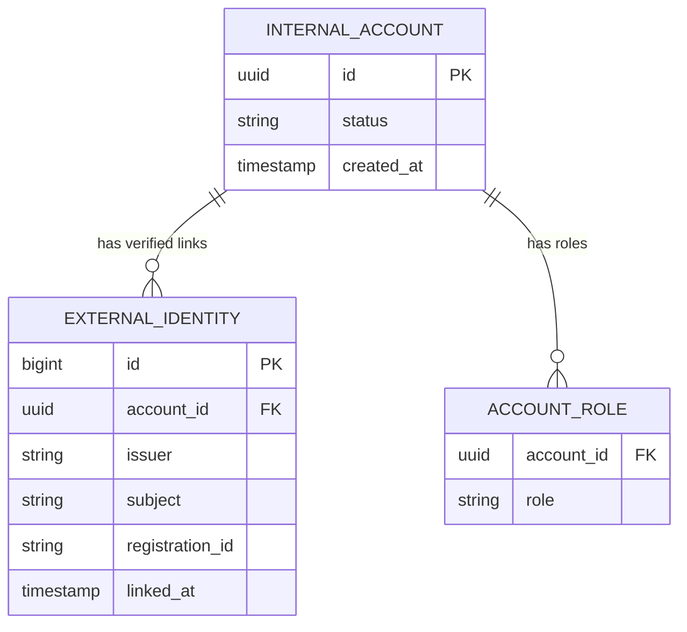
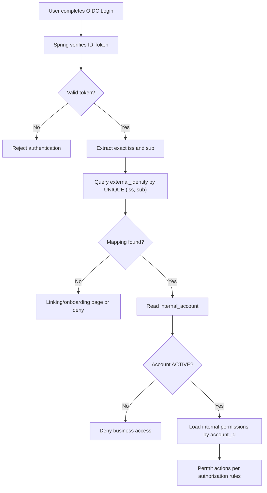
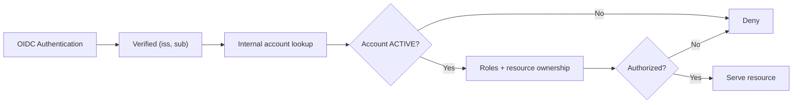

# 13.8. Linking Internal Accounts Using Issuer and Subject

In a **Spring Security OAuth 2.0/OIDC Client** application, a user logging in successfully via Google, Microsoft Entra ID, Keycloak, or another OpenID Provider (OP) only proves they were **authenticated by the identity provider**. The application still has to answer a separate question: **which account in the internal system does this external identity correspond to?**

For instance, an order management application has internal account `account_id=7f4...`, inventory view permissions, a shopping cart, and transaction history. When a user logs in through Keycloak, Spring Security receives an ID Token carrying `iss` and `sub`. The application must find the right internal account to associate data and permissions, yet **should not rely on email or display name for automatic account matching**.

Under OIDC, the durable identifier key distinguishing a user at a provider is the **`(issuer, subject)` pair**, commonly written **`(iss, sub)`**. This lesson covers the meaning of this key pair, how to store and look it up, handling first-time logins, linking multiple providers, secure design to prevent account takeover, and integration with Spring Security Servlet.

> **Key message:** `(iss, sub)` is the key for an **external OIDC identity**, while `account_id` is the key for an **internal business account**. The link between them must be a relationship created, verified, and updated securely—not an arbitrary email comparison.

## 1. Distinguishing Three Concepts Before Designing

| Concept | Example | Data Source | Purpose |
|---|---|---|---|
| **External identity** | `(https://id.example.test/realms/staff, 00u8abc123)` | Verified OIDC ID Token | Identifies the logged-in user at a specific OP |
| **Internal account** | `account_id=9d1a...` | Application database | Subject owning orders, settings, roles, and business data |
| **Profile attributes** | `name`, `email`, `picture` | ID Token, UserInfo, or internal profile | Display and contact; may change over time |

With a single internal account, a user can link multiple external identities:

```text
InternalAccount
  id = 7f4f8f9c-...  (immutable within the application)
  status = ACTIVE

ExternalIdentity A
  issuer  = https://id.example.test/realms/staff
  subject = keycloak-user-567
  account_id = 7f4f8f9c-...

ExternalIdentity B
  issuer  = https://accounts.google.com
  subject = google-sub-890
  account_id = 7f4f8f9c-...
```

This is a **many external identities → one internal account** relationship. It does not mean two external identities belong to the same person merely because they share the same email. They become two login methods for the same account **only after a valid authorized linking process**.

### 1.1. Authentication Differs from Authorization and Account Linking

- **Authentication:** the OP authenticates the user and Spring validates the ID Token.
- **Account resolution:** the application looks up `account_id` from `(iss, sub)`.
- **Account linking:** the application creates a new association between an external identity and an internal account via a verified process.
- **Authorization:** the application checks whether the internal account is permitted to view/edit resources or perform actions.

If OIDC login succeeds yet no mapping is found, that **does not automatically grant** access to any internal account's data. The application may require onboarding, verified account linking, or deny access according to policy.

### 1.2. Do Not Unconditionally Use Principal Name as a Business Key

`Authentication#getName()`, `OidcUser#getName()`, or `preferred_username` is not always a globally unique key. Some providers define the principal name from `sub`, yet `userNameAttributeName` can be customized. For OIDC linking, extract **issuer and subject from the ID Token verified by Spring Security**, never from a display name or arbitrary UI field.

## 2. `iss` and `sub` in the ID Token

A verified OIDC ID Token might contain this illustrative payload:

```json
{
  "iss": "https://id.example.test/realms/staff",
  "sub": "0cae8f5c-9e83-47f0-a42f-167a9b8c2f20",
  "aud": "warehouse-web",
  "iat": 1794791100,
  "exp": 1794794700,
  "email": "lan@example.test",
  "email_verified": true,
  "name": "Nguyễn Thị Lan"
}
```

Values are illustrative only, not a real signed JWT.

### 2.1. Issuer — `iss`

`iss` identifies the OpenID Provider that issued the ID Token. In OIDC, it is an issuer URL published by the OP, normally matching discovery metadata and the token's issuer claim.

Examples:

```text
https://accounts.google.com
https://id.example.test/realms/staff
https://login.microsoftonline.com/TENANT_ID/v2.0
```

Issuer distinguishes two OPs that happen to issue an identical `sub`. It is also a security boundary: tokens from an untrusted issuer **cannot** be treated as tokens from a registered issuer.

### 2.2. Subject — `sub`

`sub` identifies the end user scoped to the **issuer**. OIDC defines `sub` as an identifier value up to 255 ASCII characters, unique at the issuer and not meant to be reassigned to another user per protocol guarantees.

Example:

```text
iss = https://id.example.test/realms/staff
sub = user-782
```

This does not mean `user-782` is a universal key across the Internet. Another provider could issue `sub=user-782` to a completely different person.

### 2.3. Why Use the **Pair** `(iss, sub)`?

| Issuer | Subject | OIDC Identity |
|---|---|---|
| `https://id-a.example.test` | `user-101` | A |
| `https://id-b.example.test` | `user-101` | B, **different from A** |
| `https://id-a.example.test` | `user-102` | C, **different from A** |
| `https://id-a.example.test` | `user-101` | A within the appropriate issuer/Client scope |

Because `sub` only has meaning within its issuer's scope, the proper linking key is:

```text
external_identity_key = (exact_verified_issuer, exact_verified_subject)
```

Do not store only `sub` in a multi-provider database. Likewise, do not use only `iss`: one issuer issues tokens for many users.

### 2.4. Public and Pairwise Subject Identifiers

OIDC supports two common subject identifier types:

- **Public subject:** the provider may return the same `sub` for the same user across related Clients per OP policy.
- **Pairwise subject:** the provider returns different `sub` values for the same user across different **sector identifiers** to limit cross-Client tracking/correlation.

For example, the real user is one person, yet applications A and B may receive:

```text
Application A:
iss = https://accounts.example.test
sub = pairwise-aaa

Application B:
iss = https://accounts.example.test
sub = pairwise-bbb
```

**Never infer that A and B are the same person** solely from email, name, or matching issuer. If accounts must be merged when changing Client ID, sector identifier, or OP setup, use an evidence-based, controlled migration/linking workflow verified by the OP or user.

### 2.5. Why Avoid Arbitrary String Normalization?

The issuer in the ID Token must be verified by Spring Security against trusted metadata / client registration. When storing the mapping key:

- Keep the **verified** issuer in the exact canonical representation published by the OP.
- Never rewrite `http` to `https` or strip tenant/realm paths yourself.
- Never strip trailing slashes, lowercase the entire URL, or alter the host without OP-confirmed canonicalization rules.
- Never trim/lowercase `sub` or convert it to an email; `sub` is an opaque identifier string.
- Use exact string comparison rules, avoiding case-insensitive collations that merge two distinct subjects into one.

For example, `https://id.example.test/realms/a` and `https://id.example.test/realms/b` are two distinct issuers; collapsing them by host alone breaks tenant boundaries.

## 3. Preconditions Before Trusting `iss` and `sub`

The `(iss, sub)` pair is only trustworthy when it comes from **a properly verified ID Token**. Never Base64-decode two strings from a raw JWT and treat them as authentication proof.

A valid OIDC Login must verify relevant protocol elements, including:

| Condition | Why It Matters |
|---|---|
| ID Token signature and algorithm | Prevents forged or tampered tokens |
| `iss` matches trusted OP issuer | Prevents mixing identities across providers |
| `aud` contains expected Client ID | Token must be intended for this Client, not another app |
| `azp` if applicable | Binds authorized party when token has multiple audiences |
| `exp` and time conditions | Token is unexpired and valid per OIDC rules |
| `nonce` when flow requires it | Binds ID Token to the authentication request, reducing replay/swap risk |
| `state` in authorization flow | Binds callback to Client-initiated request, preventing login CSRF |
| Non-empty, properly typed `sub` | Produces a meaningful identifier key |
| UserInfo `sub` matches ID Token `sub` | Prevents receiving another person's profile |

In Spring Security Servlet, configuring `oauth2Login` and `ClientRegistration` properly lets the framework execute these OIDC checks. **Only after Spring returns an authenticated `OidcUser` principal** should you extract `getIdToken().getIssuer()` and `getSubject()` to look up mappings.

### 3.1. Never Trust an Issuer Submitted by the Browser

Example of a malicious request:

```http
POST /api/link-account HTTP/1.1
Content-Type: application/json

{
  "issuer": "https://id.example.test",
  "subject": "admin-sub"
}
```

Two JSON fields sent by a browser do not prove the sender controls that identity. A linking endpoint **must not** create mappings solely from user-input `issuer` and `subject`; identity proof must come from a **completed OIDC flow verified by Spring**.

Furthermore, never accept an arbitrary issuer URL and immediately fetch metadata from it unless it is pre-registered and approved. That can open paths to SSRF, internal network probing, or trusting a rogue OP.

### 3.2. UserInfo Cannot Replace a Verified ID Token

UserInfo can contain `sub`, `email`, and `name`. However, UserInfo data must be bound to the token and matched against the ID Token's subject; never use UserInfo JSON from an arbitrary endpoint as subject proof.

If:

```text
ID Token sub  = customer-11
UserInfo sub = customer-22
```

the application must **not use that UserInfo response** for this principal. Never "patch" `sub` in JSON and proceed with login.

## 4. Why Is Email Not a Safe Linking Key?

A common pitfall is looking up an internal account by email as soon as a user logs in via OIDC:

```java
// UNSAFE to automatically link to an existing account:
String email = oidcUser.getEmail();
Account account = accountRepository.findByEmail(email);
```

Even when the ID Token contains `email_verified=true`, **email is still not a substitute for `(iss, sub)`**.

### 4.1. Cases That Can Cause Wrong Linking

1. **Email changes:** the user changes their address at the OP, while `sub` remains the same.
2. **Email recycling:** an old address may be reassigned to a new employee in an organization or another system.
3. **Missing/hidden email:** providers are not required to return email, or the user may withhold consent.
4. **Multiple people/tenants sharing a display email:** IdP policies vary and do not guarantee a single identity.
5. **Unverified email:** `email_verified` may be absent or `false`.
6. **Claim does not prove internal account ownership:** a valid email at a new OP does not prove the user controls an existing account in the application.
7. **Aliases, plus-addressing, casing, and Unicode:** email canonicalization varies across providers and mail servers; normalization "tricks" can cause false merges.

### 4.2. Account Takeover via Automatic Email Linking

Suppose internal account `account_id=1001` has email `staff@example.test` but no OIDC link yet. The application lets any integrated OP returning the same email auto-link into that internal account.

If a new external identity is allowed to assert or claim that email in a context without equivalent trust, an attacker could get their external identity linked to `account_id=1001`.

**Solution:** if a matching email is found on an old account, treat it solely as a **hint to trigger a linking workflow**; never log the user directly into the old account. The user must prove control over both the **internal account** (via another trusted factor/method) and the **new external identity** (via OIDC).

### 4.3. What Is Email Appropriately Used For?

- Displaying notification recipient names.
- Sending confirmation emails per policy.
- Hinting that an account may already exist, while avoiding account enumeration when inappropriate.
- Syncing profile fields once `(iss, sub)` is linked and policy permits.
- Supporting account recovery workflows with dedicated verification.

Email can be stored as a **mutable attribute**, not a durable foreign key binding login identities.

## 5. Database Model: Separating Accounts and External Identities

A common design includes:

- `internal_account` table: business accounts inside the application.
- `external_identity` table: linked external login methods.
- Role/permission tables referencing `account_id`, independent of email.

### 5.1. Relationship Diagram



Example of one internal account linked to three identities:

```text
account_id = 01H...
  ├─ Google:   (https://accounts.google.com, sub-A)
  ├─ Keycloak: (https://id.example.test/realms/staff, sub-B)
  └─ Entra ID: (https://login.microsoftonline.com/TENANT/v2.0, sub-C)
```

Three distinct issuer-subject pairs share one `account_id` because **they were linked with verification**.

### 5.2. Reference SQL for PostgreSQL

```sql
CREATE TABLE internal_account (
    id UUID PRIMARY KEY,
    status VARCHAR(20) NOT NULL
        CHECK (status IN ('ACTIVE', 'DISABLED', 'PENDING')),
    created_at TIMESTAMPTZ NOT NULL DEFAULT CURRENT_TIMESTAMP
);

CREATE TABLE external_identity (
    id BIGINT GENERATED ALWAYS AS IDENTITY PRIMARY KEY,
    account_id UUID NOT NULL REFERENCES internal_account(id),
    issuer TEXT NOT NULL,
    subject VARCHAR(255) NOT NULL,
    registration_id VARCHAR(128) NOT NULL,
    linked_at TIMESTAMPTZ NOT NULL DEFAULT CURRENT_TIMESTAMP,

    CONSTRAINT ck_external_issuer_nonempty CHECK (length(issuer) > 0),
    CONSTRAINT ck_external_subject_nonempty CHECK (length(subject) > 0),
    CONSTRAINT uq_external_identity_issuer_subject
        UNIQUE (issuer, subject)
);

CREATE INDEX idx_external_identity_account
    ON external_identity(account_id);

CREATE TABLE account_role (
    account_id UUID NOT NULL REFERENCES internal_account(id),
    role VARCHAR(80) NOT NULL,
    PRIMARY KEY (account_id, role)
);
```

**This is a sample design**, not a mandatory migration for every project. Applications should add auditing, account deletion policies, row-level access, encryption, or additional governance columns as needed.

Core points:

- `internal_account.id` is an independent, stable business key.
- `external_identity.issuer` and `subject` store **values from verified tokens**.
- **`UNIQUE (issuer, subject)`** prevents one external identity from being linked to two different accounts.
- `registration_id` records metadata about which Client configuration was used, yet **does not replace `issuer`** in the unique key.
- `account_role` references `account_id`; changing email or switching providers does not break business data links.
- `issuer` and `subject` must be compared with exact string semantics as OIDC specifies; verify collation/case sensitivity in your database engine.

Never place `UNIQUE(email)` on the external identity table to assume one email belongs to only one identity. Two providers can attach the same email to two external identities, which **does not prove** they are the same person.

### 5.3. Store Issuer as a URL or an Internal Provider ID?

The model above stores the actual issuer string to preserve the exact OIDC identity. In multi-provider systems, you can also add a `trusted_identity_provider` table:

```text
trusted_identity_provider:
  provider_id (internal key)
  issuer (unique, exact)
  status
  allowed_clients
  trust_policy
```

This table helps define which issuers are allowed to log in, without **changing the linking principle**. Mappings must still bind to a specific verified issuer, not merely a developer-chosen config key like `company`.

If one registration allows multiple valid issuers under a specialized multi-tenant setup, enforce explicit issuer verification policy. Never use `registrationId` alone as proof that two tenants are the same.

## 6. Login Flow: Looking Up an Existing Mapping

A safe flow for an application allowing only *pre-provisioned* accounts:



**Never include a step "mapping not found → find account with matching email → auto-link".** That is a direct path to account takeover.

### 6.1. Lookup Outcomes to Handle

| Outcome | Appropriate Behavior |
|---|---|
| Exact `(iss, sub)` linked to an `ACTIVE` account | Log into the internal account and apply authorization rules |
| No mapping, policy allows only pre-provisioned accounts | Grant no access; display admin-contact or onboarding instructions |
| No mapping, app allows self-signup | Create a **new internal account** via controlled onboarding; never claim an old account by email |
| Mapping exists, yet account is `DISABLED` | Deny application access even if the OIDC token is valid |
| One `(iss, sub)` points to multiple accounts | Severe data error; unique constraint must prevent this |
| Provider/issuer trust revoked | Reject login even though an old mapping exists |

A valid ID Token does not prove the application account is still active. **Account status** and internal policies must be checked independently.

### 6.2. Java Code: Extracting the Key from `OidcUser`

After Spring Security completes `oauth2Login`:

```java
import org.springframework.security.oauth2.core.oidc.user.OidcUser;

public record ExternalIdentityKey(String issuer, String subject) {

    public ExternalIdentityKey {
        if (issuer == null || issuer.isBlank()) {
            throw new IllegalArgumentException("issuer is required");
        }
        if (subject == null || subject.isBlank()) {
            throw new IllegalArgumentException("subject is required");
        }
    }

    public static ExternalIdentityKey from(OidcUser principal) {
        if (principal == null) {
            throw new IllegalArgumentException("OIDC principal is required");
        }

        return new ExternalIdentityKey(
            principal.getIdToken().getIssuer().toString(),
            principal.getSubject()
        );
    }
}
```

Meaning:

- `getIdToken().getIssuer()` reads the issuer from the Spring-verified ID Token.
- `getSubject()` reads the OIDC subject.
- `ExternalIdentityKey` encapsulates the key for internal database lookup.

**Critical condition:** call `from(...)` only on an `OidcUser` from an `Authentication` accepted by Spring Security; never construct `OidcUser` from browser-sent token JSON and trust that data.

### 6.3. Controller Resolving the Current Account via Mapping

An application layer can abstract the lookup:

```java
import java.util.UUID;

public interface AccountBindingService {

    UUID requireActiveAccountId(ExternalIdentityKey identity);
}
```

In a controller:

```java
import java.util.Map;
import java.util.UUID;

import org.springframework.security.core.annotation.AuthenticationPrincipal;
import org.springframework.security.oauth2.core.oidc.user.OidcUser;
import org.springframework.web.bind.annotation.GetMapping;
import org.springframework.web.bind.annotation.RestController;

@RestController
public class CurrentAccountController {

    private final AccountBindingService bindings;

    public CurrentAccountController(AccountBindingService bindings) {
        this.bindings = bindings;
    }

    @GetMapping("/me")
    public Map<String, String> me(@AuthenticationPrincipal OidcUser user) {
        ExternalIdentityKey external = ExternalIdentityKey.from(user);
        UUID accountId = bindings.requireActiveAccountId(external);

        // Illustrates a protected endpoint only.
        return Map.of("accountId", accountId.toString());
    }
}
```

`AccountBindingService` is an **application-implemented** database-backed interface; the snippet above does not create mappings itself. In production, you do not necessarily need to expose the internal account ID to the frontend if the UI does not require it.

**Authorization note:** guarding only `/me` is insufficient. Other endpoints must also obtain a trusted account context and check status/permissions. Usually a shared service or security layer resolves the mapping so no endpoint accidentally forgets and accesses data using a user-supplied ID.

## 7. Querying `(iss, sub)` in the Database

Example PostgreSQL repository using `JdbcTemplate`:

```java
import java.util.List;
import java.util.Optional;
import java.util.UUID;

import org.springframework.jdbc.core.JdbcTemplate;
import org.springframework.stereotype.Repository;

@Repository
public class JdbcExternalIdentityRepository {

    private final JdbcTemplate jdbc;

    public JdbcExternalIdentityRepository(JdbcTemplate jdbc) {
        this.jdbc = jdbc;
    }

    public Optional<UUID> findActiveAccountId(ExternalIdentityKey identity) {
        List<UUID> ids = jdbc.query(
            """
            SELECT e.account_id
            FROM external_identity e
            JOIN internal_account a ON a.id = e.account_id
            WHERE e.issuer = ?
              AND e.subject = ?
              AND a.status = 'ACTIVE'
            """,
            (rs, rowNum) -> rs.getObject("account_id", UUID.class),
            identity.issuer(),
            identity.subject()
        );

        return ids.stream().findFirst();
    }
}
```

This assumes PostgreSQL, the DDL tables above, and a configured Spring JDBC setup. Java text blocks require a compatible JDK. The **unique constraint `(issuer, subject)`** guarantees at most one matching row in valid data states.

This code intentionally **does not query by email**, does not auto-create accounts, and does not allow a `DISABLED` record to log in.

### 7.1. Reading an Account Differs from Granting Access

A service can implement:

```java
import java.util.UUID;

import org.springframework.security.access.AccessDeniedException;
import org.springframework.stereotype.Service;

@Service
public class DatabaseAccountBindingService implements AccountBindingService {

    private final JdbcExternalIdentityRepository identities;

    public DatabaseAccountBindingService(
            JdbcExternalIdentityRepository identities) {
        this.identities = identities;
    }

    @Override
    public UUID requireActiveAccountId(ExternalIdentityKey identity) {
        return identities.findActiveAccountId(identity)
            .orElseThrow(() ->
                new AccessDeniedException("Internal account unavailable")
            );
    }
}
```

The message intentionally avoids revealing whether an account exists. For unmapped users, the application may route to an onboarding flow instead of returning 403; that is a UX/product choice tied to security policy.

### 7.2. Why Still Filter Queries by Account ID?

In every business operation, services should scope data by the resolved account:

```sql
SELECT *
FROM orders
WHERE account_id = :trusted_account_id
  AND id = :requested_order_id;
```

`trusted_account_id` must come from the `(iss, sub)` mapping and verified authorization context, **not** from a user-chosen `?accountId=...` query parameter.

## 8. Three Strategies for First-Time Login

No single policy fits every product. There are at least three models:

| Strategy | When `(iss, sub)` Has No Mapping | Best Suited For |
|---|---|---|
| **Pre-provisioned / invitation** | Deny data access; direct user to invitation or admin verification | Enterprises with an approved user roster |
| **Just-in-time (JIT) signup** | Create a **new internal account** if issuer and signup rules pass | Products allowing self-registration |
| **Link existing** | Require proof of control over the old account before creating the mapping | Users who already have a local account and want to add a login method |

### 8.1. Pre-Provisioning

Administrators or a provisioning system create account records and mappings from verified external identities or trusted channels. At login:

```text
(verified iss, sub) -> account_id -> status/roles
```

If no mapping exists, the user is not automatically attached to an account with a matching email. In internal systems, mappings may arrive via SCIM or trusted admin workflows, provided the exact subject for the relevant issuer/Client is captured.

### 8.2. JIT Signup: Create a New Account, Never Auto-Link an Old One

If policy allows new registrations, the transaction should:

1. Verify the external identity via OIDC.
2. Validate issuer, audience, Client type, and onboarding policy.
3. Look up `(iss, sub)`; if already present, use the existing mapping.
4. If absent, create a **new `internal_account`** in the appropriate initial status.
5. Insert `external_identity` pointing to the new account.
6. Commit the transaction; handle concurrent requests racing on the unique key.
7. Never claim an existing account merely because the email matches.

Consider starting new accounts in `PENDING` until business checks finish rather than granting full privileges immediately.

### 8.3. Link Existing: Prove Both Sides

When a user already has an internal account, they may want to add Google, Keycloak, or Entra ID as a new login option. A sound flow requires proof that the user controls both:

- **The internal account being linked** (trusted active session, often requiring recent reauthentication).
- **The new external identity** (completed OIDC Login with the right OP/Client and a Spring-verified ID Token).

Controlling only one side is **never enough** to attach a new identity to an existing account.

## 9. Designing a Secure Account-Linking Flow

Suppose a user is logged into internal account `A` with username/password and wants to add Google login.

### 9.1. Recommended Process

1. User navigates to **Account Settings → Linked accounts** from an authenticated internal session.
2. Application requires **reauthentication** or an appropriate verification factor for this sensitive action.
3. Backend creates a short-lived **pending-link context** bound to `account_id=A`, the current session, and the allowed provider, stored in a trusted server-side store.
4. Backend initiates the OAuth2/OIDC Authorization Code Flow toward the chosen OP; `state`, PKCE, nonce, and callback are managed by Spring Security.
5. OP authenticates the new external identity.
6. Spring verifies the ID Token and extracts `(iss, sub)` from the valid principal.
7. Backend checks that the pending-link context is valid, unused, and matches the current session/account and provider.
8. Inside a transaction, verify the external identity does not belong to another account and insert `(iss, sub) -> A`.
9. Record an audit event without sensitive tokens, mark the pending-link context as consumed, and display the linking result.
10. On subsequent logins, the mapping lets that external identity resolve to `account_id=A`.

```mermaid
sequenceDiagram
    autonumber
    actor User as User
    participant Browser as Browser
    participant App as Spring Application
    participant OP as OpenID Provider
    participant DB as Account DB

    User->>App: Logged into account A
    User->>App: Select "Link Google"
    App->>App: Check reauthentication/CSRF
    App->>DB: Save pending link bound to account A + session
    App-->>Browser: Start OIDC authorization code flow
    Browser->>OP: User logs into Google
    OP-->>Browser: Callback with code, state
    Browser->>App: OAuth2 callback
    App->>App: Spring validates state, token, issuer, subject
    App->>DB: Check pending link + UNIQUE(issuer,subject)
    alt Unlinked and valid
        App->>DB: INSERT external_identity -> account A
        App-->>Browser: Linking succeeded
    else Belongs to another account / invalid context
        App-->>Browser: Do not link; safe error message
    end
```

**Never replace Spring's `state` with an account ID or email.** The pending-link context is separate business state bound securely to the authorization flow without weakening OAuth2 login CSRF protection.

### 9.2. Why Require Reauthentication?

A browser left with an old session might have enough access for routine settings. Adding a new login method can grant **long-term access** to the account. Hence many systems require:

- Password/passkey/MFA or a defined reauthentication workflow.
- A time limit since the most recent authentication.
- CSRF protection on the "start linking" action.
- Security notifications after linking succeeds.
- Session/request validation before committing the mapping.

If OIDC is the primary login method, `max_age`/`auth_time` can enforce recent authentication per OP policy. The ID Token's `iat` alone does not prove the user just re-entered credentials.

### 9.3. Preventing Account-Linking CSRF

This attack occurs when an attacker tricks a victim into attaching **the attacker's** external identity to the victim's internal account—for example, the victim is logged into account A and gets tricked into opening a callback URL completing a linking flow started by the attacker.

Defense requires multiple layers:

- Spring Security manages `state`, PKCE, and authorization request session binding.
- Pending-link context is created by the backend and bound to the trusted account/session.
- Verify the callback completes **the exact linking action the user intentionally initiated**.
- Require reauthentication/step-up when linking, not a single stray link click.
- Never accept `accountId`, `issuer`, and `sub` from query strings as linking decisions.
- Prevent replay with short TTLs and one-time pending-link consumption.
- Enforce uniqueness and ownership inside the database transaction.

Never replace the entire flow with `POST /link {email: "..."}`, even with a CSRF token; CSRF protection does not prove the user controls the new external identity.

## 10. Transactions and Data Constraints When Creating Links

### 10.1. Two Concurrent Requests

Suppose two browsers try linking the same external identity `(iss, sub)` to two different accounts.

```text
Request 1 -> account A
Request 2 -> account B

Both SELECT first:
  no mapping found

Without UNIQUE:
  both INSERTs succeed -> identity points to two accounts

With UNIQUE(iss, sub):
  only one INSERT can succeed
  the other request hits a conflict and must handle it cleanly
```

Running a `SELECT` before `INSERT` is **not enough** to prevent race conditions. The database unique constraint is the final line of defense.

### 10.2. Example Controlled Linking Repository

A simple example with `JdbcTemplate` and transactions, assuming OIDC and pending-link checks were **verified before calling the method**:

```java
import java.util.UUID;

import org.springframework.dao.DuplicateKeyException;
import org.springframework.jdbc.core.JdbcTemplate;
import org.springframework.stereotype.Repository;
import org.springframework.transaction.annotation.Transactional;

@Repository
public class JdbcIdentityLinkWriter {

    private final JdbcTemplate jdbc;

    public JdbcIdentityLinkWriter(JdbcTemplate jdbc) {
        this.jdbc = jdbc;
    }

    @Transactional
    public void createLink(
            UUID verifiedInternalAccountId,
            ExternalIdentityKey verifiedIdentity,
            String trustedRegistrationId) {

        try {
            jdbc.update(
                """
                INSERT INTO external_identity (
                    account_id, issuer, subject, registration_id
                )
                VALUES (?, ?, ?, ?)
                """,
                verifiedInternalAccountId,
                verifiedIdentity.issuer(),
                verifiedIdentity.subject(),
                trustedRegistrationId
            );
        } catch (DuplicateKeyException duplicate) {
            // Never overwrite the owner of an external identity.
            // Raise a business exception once transaction/SQL error is handled properly.
            throw new IdentityAlreadyLinkedException();
        }
    }

    public static final class IdentityAlreadyLinkedException
            extends RuntimeException {

        public IdentityAlreadyLinkedException() {
            super("External identity is already linked");
        }
    }
}
```

Technical note: this example illustrates a **write step** and must be invoked inside a linking flow that checks the account is `ACTIVE`, pending link, session, reauthentication, allowed issuer, and transaction boundaries. It is **not a public endpoint** accepting `verifiedInternalAccountId` from users. Depending on the database and transaction manager, a unique-constraint failure may mark the transaction for rollback; design idempotency or conflict handling at the service layer accordingly.

### 10.3. Idempotency and Handling Existing Mappings

If `(iss, sub)` already points to the same `account_id=A`, the application may treat a repeated link attempt as idempotent **after re-verifying permission to perform the action**.

If `(iss, sub)` points to `account_id=B` while the request tries to link it to A:

- **Do not** overwrite it to A.
- **Do not** automatically merge A and B.
- Do not disclose account B's details in the error message.
- Direct the user to a two-sided verified support/recovery process if your product permits it.

An identity key should have **at most one active owner** at a time, per the application's storage and link history policy.

### 10.4. Should an External Identity Be Unique by Registration ID?

A common mistake is using:

```text
UNIQUE (registration_id, sub)
```

and omitting the issuer. `registrationId` is an application-chosen name that can change across upgrades or deployments; it does not necessarily represent the OIDC issuer. Worse, two registration IDs can point to the same issuer and yield the same subject.

The OIDC key should be **`UNIQUE (issuer, subject)`**. You may keep `registrationId` for tracing or configuration metadata, not as a substitute identifier.

## 11. Integrating Spring Security OIDC Login

### 11.1. `ClientRegistration` Configuration

A corporate provider with OIDC discovery:

```yaml
spring:
  security:
    oauth2:
      client:
        registration:
          staff:
            provider: staff-op
            client-id: ${OIDC_CLIENT_ID}
            client-secret: ${OIDC_CLIENT_SECRET}
            authorization-grant-type: authorization_code
            scope:
              - openid
              - profile
              - email
            redirect-uri: "{baseUrl}/login/oauth2/code/{registrationId}"
        provider:
          staff-op:
            issuer-uri: https://id.example.test/realms/staff
```

The `example.test` domain and credentials are illustrative only. Production applications must register the Client, callback, and policies with the OP, and configure the exact issuer published by the provider.

Servlet configuration:

```java
import org.springframework.context.annotation.Bean;
import org.springframework.context.annotation.Configuration;
import org.springframework.security.config.Customizer;
import org.springframework.security.config.annotation.web.builders.HttpSecurity;
import org.springframework.security.web.SecurityFilterChain;

@Configuration
public class SecurityConfig {

    @Bean
    SecurityFilterChain securityFilterChain(HttpSecurity http) throws Exception {
        http
            .authorizeHttpRequests(authorize -> authorize
                .requestMatchers("/", "/error").permitAll()
                .anyRequest().authenticated()
            )
            .oauth2Login(Customizer.withDefaults());

        return http.build();
    }
}
```

With this setup, users can log in via OIDC. However, to isolate business data by `account_id`, the application still needs an **internal account resolution step** and internal authorization rules.

### 11.2. Key from an Authenticated `Authentication`

`OAuth2AuthenticationToken` holds the registration ID of the Client used to log in; for OIDC, the principal is typically `OidcUser`:

```java
import org.springframework.security.core.Authentication;
import org.springframework.security.oauth2.client.authentication.OAuth2AuthenticationToken;
import org.springframework.security.oauth2.core.oidc.user.OidcUser;

public final class OidcPrincipalKeys {

    private OidcPrincipalKeys() {}

    public static ExternalIdentityKey requireKey(
            Authentication authentication) {

        if (!(authentication instanceof OAuth2AuthenticationToken oauth)) {
            throw new IllegalArgumentException(
                "OAuth2 authentication is required"
            );
        }

        if (!(oauth.getPrincipal() instanceof OidcUser user)) {
            throw new IllegalArgumentException(
                "OIDC principal is required"
            );
        }

        return ExternalIdentityKey.from(user);
    }
}
```

`oauth.getAuthorizedClientRegistrationId()` is useful for auditing and ClientRegistration selection policies, while the external identity key still comes from `user.getIdToken().getIssuer()` and `user.getSubject()`. There is no reason to use a raw authorization code or access token as the linking key.

## 12. Checking the Mapping Inside `OidcUserService`

If the product requires that **only users with an ACTIVE internal account can complete login into the application**, you can integrate a mapping check into a custom OIDC user service.

Safe principle: **delegate to the default `OidcUserService`** first, then check the mapping and return the verified `OidcUser`.

```java
import java.util.Optional;
import java.util.UUID;

import org.springframework.security.oauth2.client.oidc.userinfo.OidcUserRequest;
import org.springframework.security.oauth2.client.oidc.userinfo.OidcUserService;
import org.springframework.security.oauth2.client.userinfo.OAuth2UserService;
import org.springframework.security.oauth2.core.OAuth2Error;
import org.springframework.security.oauth2.core.OAuth2AuthenticationException;
import org.springframework.security.oauth2.core.oidc.user.OidcUser;

public final class MappedOidcUserService
        implements OAuth2UserService<OidcUserRequest, OidcUser> {

    private final OidcUserService delegate = new OidcUserService();
    private final ActiveAccountLookup accounts;

    public MappedOidcUserService(ActiveAccountLookup accounts) {
        this.accounts = accounts;
    }

    @Override
    public OidcUser loadUser(OidcUserRequest request) {
        // Delegate preserves default UserInfo/OIDC processing steps.
        OidcUser user = delegate.loadUser(request);

        ExternalIdentityKey key = ExternalIdentityKey.from(user);
        Optional<UUID> accountId = accounts.findActiveAccountId(key);

        if (accountId.isEmpty()) {
            throw new OAuth2AuthenticationException(
                new OAuth2Error("internal_account_not_available"),
                "Internal account is not available"
            );
        }

        return user;
    }

    public interface ActiveAccountLookup {
        Optional<UUID> findActiveAccountId(ExternalIdentityKey key);
    }
}
```

This code illustrates **pre-provisioned mode**. Without a mapping, login fails rather than silently attaching an account by email. `ActiveAccountLookup` is implemented by the application against the database and tenant/status policies.

Wiring the service into `oauth2Login`:

```java
import org.springframework.context.annotation.Bean;
import org.springframework.security.config.annotation.web.builders.HttpSecurity;
import org.springframework.security.oauth2.client.oidc.userinfo.OidcUserRequest;
import org.springframework.security.oauth2.client.userinfo.OAuth2UserService;
import org.springframework.security.oauth2.core.oidc.user.OidcUser;
import org.springframework.security.web.SecurityFilterChain;

@Bean
SecurityFilterChain securityFilterChain(
        HttpSecurity http,
        OAuth2UserService<OidcUserRequest, OidcUser> oidcUserService)
        throws Exception {

    http
        .authorizeHttpRequests(auth -> auth
            .requestMatchers("/", "/error").permitAll()
            .anyRequest().authenticated()
        )
        .oauth2Login(oauth2 -> oauth2
            .userInfoEndpoint(userInfo -> userInfo
                .oidcUserService(oidcUserService)
            )
        );

    return http.build();
}
```

In a real application configuration, register the corresponding bean, e.g.:

```java
@Bean
OAuth2UserService<OidcUserRequest, OidcUser> oidcUserService(
        MappedOidcUserService.ActiveAccountLookup lookup) {

    return new MappedOidcUserService(lookup);
}
```

**Do not use this exact setup as-is for a "link existing" workflow** when the new OIDC user has no mapping yet: it will be rejected inside the user service and never reach the linking step. A product supporting both normal login and linking needs separate flow/linking session handling and authorization policies, using an appropriate success handler or application step. The core rule is that the new external identity **must never be granted access to the old account** before linking completes.

### 12.1. Why Not Auto-Assign `ROLE_ADMIN` at Login?

The default `OidcUserService` creates OIDC-related principal/authorities. Yet application permissions often come from `account_role`. Code like:

```java
// AVOID:
if (user.getEmail().endsWith("@company.test")) {
    authorities.add(new SimpleGrantedAuthority("ROLE_ADMIN"));
}
```

neither proves `user` has a valid internal account nor that they are an admin. Instead, resolve `account_id` from `(iss, sub)`, load roles for that `ACTIVE` account from a controlled permission store, and enforce authorization in Spring Security or business services.

### 12.2. How to Cache Mappings and Permissions?

If querying the database on every request is too expensive, you can cache:

```text
cache key   = (verified issuer, verified subject)
cache value = internal account ID + status/version (per policy)
```

However, caching raises **revocation** questions:

- When an account is disabled, is the cache evicted/updated quickly?
- When a provider is unlinked, how long does an existing login session survive?
- When a role changes from admin to user, are sessions/caches invalidated?
- Is the cache partitioned by tenant/environment to avoid cross-tenant lookups?

For sensitive data, balance cache TTL against revocation requirements; never assume mappings/roles can be cached forever inside `SecurityContext`.

## 13. Authorization Model After Linking

Suppose the OP reports the identity:

```text
iss = https://id.example.test/realms/staff
sub = user-782
```

The application resolves:

```text
external_identity -> account_id = a3e9...
internal_account  -> status = ACTIVE
account_role      -> ROLE_READER
```

A data-read request can flow through:



**An authenticated user** does not mean **permitted to access every resource**. Access can depend on:

- Internal account roles/permissions.
- The tenant owning the resource.
- The owner of the order/document.
- Account and resource status.
- MFA or reauthentication policies for sensitive actions.

A user with a valid external identity who has left the company must be **disabled/revoked in the internal system** per process, even if OIDC tokens from the OP are still valid.

### 13.1. Enforce Access by Account ID; Never Trust an Account ID from the Request

For example, an invoice service should enforce:

```sql
SELECT i.*
FROM invoice i
WHERE i.id = :invoice_id
  AND i.account_id = :current_verified_account_id;
```

Never let a client supply `current_verified_account_id` arbitrarily and skip mapping resolution. This is the core principle against unauthorized object access (*IDOR/BOLA*).

### 13.2. Can a Generic `ROLE_USER` Be Assigned to Every OIDC Login?

A generic role might permit accessing an onboarding screen, yet **should never grant access to business data** before a mapping exists. Distinguish states clearly:

```text
EXTERNALLY_AUTHENTICATED  -> authenticated at the OP
INTERNAL_ACCOUNT_LINKED   -> valid mapping exists
ACCOUNT_ACTIVE            -> internal account is active
AUTHORIZED_FOR_ACTION     -> permitted by specific policy
```

These states do not transition automatically simply because an ID Token contains an email or group name.

## 14. One Internal Account Linked to Multiple Providers

Users may add backup login methods:

```text
Account A
  ├── Google: (iss=accounts.google.com, sub=G123)
  ├── Keycloak: (iss=id.example.test/realms/staff, sub=K456)
  └── Entra: (iss=login.microsoftonline.com/TENANT/v2.0, sub=E789)
```

One `account_id=A`, three different external keys. These methods point to A only after verified linking.

### 14.1. Never Auto-Link Providers Based on Matching Email

For example:

```text
Google email: lan@example.test
Keycloak email: lan@example.test
```

Those are merely two equal profile claims. No OIDC rule proves they represent a single internal account. Use a verified linking workflow or trusted administrative provisioning.

### 14.2. Handling a Retired Provider

If an organization retires provider A, the system can:

1. Notify users and ask them to link a new login method.
2. Verify account control following a migration workflow.
3. Create the new external identity for provider B.
4. Confirm the user can log in with B.
5. Revoke/unlink A per policy while keeping audit records.
6. Leave `account_id` and all business data untouched.

Never look up or merge users by `email` during migration as a shortcut without trustworthy evidence.

## 15. Multi-Tenancy and Per-Tenant Issuers

In Microsoft Entra ID, Keycloak realms, or enterprise IdPs, the issuer may encode tenant/realm details.

For example:

```text
Keycloak tenant A:
https://id.example.test/realms/tenant-a

Keycloak tenant B:
https://id.example.test/realms/tenant-b
```

Two tokens both containing `sub=user-15` yet having different issuers are **two distinct external identities**. If the application also stores an internal tenant ID, enforce the policy:

```text
(verified iss, sub) -> internal_account_id -> internal_tenant_id
```

Do not do:

```text
strip /realms/{tenant}
then lookup by sub only
```

That could attach an identity from tenant B to a tenant A account.

### 15.1. Issuer Allowlist

Accept only issuers approved for the specific application or tenant. Configuration example:

```text
Tenant A -> allowed issuer(s): id.example.test/realms/tenant-a
Tenant B -> allowed issuer(s): id.example.test/realms/tenant-b
```

Internal mapping is an **additional** check, not a replacement for OIDC validation and issuer trust policy. Even if the database accidentally retains a mapping to an old/untrusted issuer, the Client must still reject invalid tokens.

### 15.2. `aud` and Client ID Must Also Match

When sharing one OP across multiple apps, an ID Token issued for app B must not be accepted by app A just because `iss` and `sub` match. The OIDC Client must verify `aud`/`azp` as required. Having a database mapping **never justifies skipping audience validation**.

### 15.3. Pairwise Subjects and Client ID Migration

A user may receive a different `sub` if the Client or sector identifier changes. When an old mapping is not found, that does not always mean "brand-new user". Still, never assume two subjects are the same person solely because emails match.

Handle this via:

- A migration process confirmed by the OP or corporate identity team.
- The user proving control of the old account and completing the new OIDC login.
- Administrators handling exceptions under policy.
- Auditing mapping changes rather than silently overwriting `sub` in the database.

## 16. OIDC Differs from Non-ID-Token OAuth2 Logins

`OidcUser` has a verified ID Token, giving us OIDC `iss` and `sub`. However, not every OAuth2 provider supports OIDC.

For example, a standard GitHub OAuth App returns `OAuth2User`, with the user's ID inside user attributes API payloads and no OIDC ID Token.

Never write:

```java
// INCORRECT when the app also accepts non-OIDC OAuth2:
OidcUser user = (OidcUser) authentication.getPrincipal();
```

for every provider.

If the product supports both:

- For OIDC: use **`(verified iss, sub)`**.
- For non-OIDC OAuth2: define a **provider-specific identity key** from a trusted provider and a stable account attribute published by its API, such as `(provider, provider_user_id)`.
- Keep the two key namespaces/types clearly separated; never fabricate a fake `iss` and treat it as OIDC proof.
- Evaluate token validation, user attributes, permissions, and linking separately.

**This lesson focuses on OIDC**, so snippets built around `OidcUser` do not apply verbatim to a GitHub OAuth App.

## 17. Link, Unlink, Disable, and Account Lifecycle

### 17.1. Unlinking a Provider

When a user wants to remove an external identity:

1. Require appropriate reauthentication.
2. Confirm the linked identity belongs to that exact internal account.
3. Verify the user still has at least one viable login or recovery method, if policy requires it.
4. Revoke related permissions/authorized clients when needed and supported by the provider.
5. Delete or mark the link inactive while preserving audit logs per retention policy.
6. Invalidate related internal sessions/tokens if policy requires it.

Never allow removing the sole login method and locking the user out without a recovery path unless explicitly intended.

### 17.2. Disabling an Internal Account

If an internal account is disabled, its mappings may remain in the database for auditing/recovery, yet authorization must **deny application access**. Never delete `account_id` and create a fresh account simply because the OP still lets the user log in.

### 17.3. Account Deletion and Privacy

Account deletion workflows should address:

- Which business data is deleted, retained, or anonymized per policy.
- Whether `iss`/`sub` mappings and link history constitute personal data in your system's legal context.
- Minimal audit trails for linking/unlinking events needed for security investigations.
- Stored tokens/credentials that remain or can be revoked.
- Never reusing a deleted user's `account_id` for someone else.

Stay consistent on security and privacy—do not store extra claims merely because the IdP sent them.

### 17.4. SCIM and Provisioning Are Not Automatically OIDC Identity Linking

SCIM is used to manage user/group lifecycles in some enterprise systems. A SCIM record may carry its own ID. **A SCIM user ID is not automatically the OIDC `sub`** unless there is an explicit contract between the provisioning system and the OP.

When receiving mappings from SCIM, the application must verify:

- The provisioning source is trusted and authorized to supply mappings.
- Which fields map to the real OIDC issuer and subject.
- Relevant tenant, Client, and trust boundaries.
- Revocation workflows when users are disabled/deprovisioned.
- Never using email as the sole key just because SCIM provides `userName`/`emails`.

## 18. Common Issues and Narrowing Down Root Causes

| Symptom | Possible Cause | Resolution |
|---|---|---|
| OIDC Login succeeds yet no internal account is found | Missing mapping, changed issuer/subject, or wrong tenant | Inspect verified `(iss, sub)` and onboarding/linking workflow |
| Two users merged into one account | Auto-linked by email or keyed by `sub` alone | Stop auto-linking, inspect audits, restore proper mappings |
| One external identity works for two accounts | Missing unique constraint on `(issuer, subject)` | Enforce DB constraint and clean up bad data before migrating |
| Changing email loses account access | Looked up by email instead of `(iss, sub)` | Use durable account mappings; treat email as an attribute |
| Keycloak realm A logs into realm B's data | Stripped realm path from issuer | Preserve exact issuer and enforce tenant policies |
| Another app's token is accepted | Audience/`azp` validation missing or disabled | Restore standard OIDC verification |
| Changing Client ID alters `sub` | Pairwise subject or OP config change | Migrate/link with verified evidence, never guess by email |
| Casting `OAuth2User` to `OidcUser` fails | Non-OIDC OAuth2 provider | Separate identity key strategies per provider type |
| Disabled account still enters the app | Relied solely on token/session without checking internal status | Check status and revoke sessions/caches per policy |
| Admin role persists after revocation | Stale authority/cache snapshot | Query authoritative role source or invalidate caches |
| New link fails with unique key error | Identity already linked or race condition | Never overwrite; return a safe error and inspect owner |
| Attacker attaches their external identity to victim's account | Missing reauth/pending-link binding, account-linking CSRF | Start linking from trusted session; verify both sides and use one-time context |
| Verified email still caused wrong link | Treated verified email as proof of internal account ownership | Separate email verification from proof of ownership |
| New user sees old account's data | JIT signup reused an account by email | Create a new account; merge only via verified workflows |
| Cannot unlink the last provider | No fallback login method | Design recovery/step-up before unlinking |
| UserInfo returns a different `sub` than ID Token | Inconsistent endpoint, token, or provider | Reject UserInfo; fix configuration and inspect flow |

### 18.1. Safe Debugging Order

1. **Check whether OIDC Login itself is valid.** Signature, issuer, audience, expiry, nonce, state.
2. **Inspect verified `registrationId` and issuer.** Correct environment, tenant, realm?
3. **Compare `(iss, sub)` against database mappings.** Never compare emails to decide.
4. **Check internal account status.** `ACTIVE`, `PENDING`, or `DISABLED`?
5. **Check internal roles and tenant ownership.** Appropriate roles and resource policies?
6. **If creating a new link, check pending-link audit.** Who started it, reauthenticated, valid session/expiry?
7. **On races, inspect unique constraints and transaction outcomes.** Never overwrite owners arbitrarily.
8. **If mappings broke after migration, check subject type and Client/sector changes.** Perform evidence-based migration.

Never log raw ID Tokens, refresh tokens, authorization codes, or real emails unnecessarily. Log a random correlation ID, registration ID, error category code, and an operational HMAC of the mapping key if correlation is needed without exposing the subject.

## 19. Protecting `iss`, `sub`, and Link Logs

Although `sub` is not a password, it is a **pseudonymous identifier** capable of linking events to an account. Therefore:

- Avoid exposing `sub` publicly in frontend/logs without purpose.
- Protect the external identity table as identity data with restricted access and backups.
- Never use raw subjects in guessable URLs exposing account data.
- Never let external identity linking endpoints reveal "this identity is already linked to account X" to unauthenticated callers.
- Audit `LINK_STARTED`, `LINK_SUCCEEDED`, `LINK_REJECTED`, and `UNLINKED` with minimal metadata.
- Have an incident response process if a mapping was created erroneously or an external identity was compromised.
- Clearly define retention periods, audit needs, and privacy requirements for mapping data.

For stable log correlation, you can HMAC `issuer + delimiter + subject` with an internal key, managing keys and formatting securely—never treat a plain unsalted hash as absolute anonymization.

## 20. Design Scenarios

### Scenario A: Pre-Provisioned Employees

A company allows only pre-provisioned employees to log in. A valid OIDC user logs in with no mapping.

**Handling:** deny access to internal data, display admin contact details, or use an approved onboarding flow. Never auto-create mappings by corporate email.

### Scenario B: Self-Service Signup

A product lets any valid Google user create a new account.

**Handling:** if `(iss, sub)` has no mapping, create a **new `internal_account`** inside a transaction. If the email matches an existing account, do not auto-merge; the user must go through a linking workflow.

### Scenario C: Linking Keycloak and Google

A user is logged into Account A via Keycloak and selects "Link Google".

**Handling:** re-verify access to Account A per policy, start the Google OIDC flow, validate pending link/session/state, obtain Google's verified `(iss, sub)`, and create the mapping to A if unlinked to any other account.

### Scenario D: Two Logins Sharing `sub` Across Different Issuers

```text
Provider X: iss=X, sub=777
Provider Y: iss=Y, sub=777
```

**Handling:** these are two distinct external identities. Never merge them based on `777`.

### Scenario E: Same Email, Different Subject After OP Change

An existing account has `(iss=A, sub=old)`, yet after changing Client/sector the user receives `(iss=A, sub=new)` with the same email.

**Handling:** do not automatically replace `old` with `new`. Use a migration confirmed by the OP/identity team or a verified reauthorization/linking flow. Audit both keys and the transition action.

### Scenario F: OIDC Login Succeeds, Internal Account Locked

The provider still lets the user log in, while `internal_account.status=DISABLED`.

**Handling:** block all business operations. For high security, invalidate sessions/caches and coordinate deprovisioning with the IdP to avoid frustrating login loops.

## 21. Practice Exercises

### Exercise 1: Picking the Right Key

Given three valid ID Tokens:

```text
A: iss=https://id-a.example.test, sub=user-1, email=alice@example.test
B: iss=https://id-b.example.test, sub=user-1, email=alice@example.test
C: iss=https://id-a.example.test, sub=user-2, email=alice@example.test
```

Do A, B, and C automatically belong to the same internal account?

**Answer:** no. A, B, and C are three distinct external identity keys. Matching emails do not permit auto-merging; if they are the same person, require verified linking.

### Exercise 2: Designing the Unique Constraint

The mapping table currently has `UNIQUE(subject)`. Is this appropriate?

**Answer:** no, because two different issuers can issue the same subject. Use `UNIQUE(issuer, subject)` with OIDC-compliant string comparison.

### Exercise 3: Linking Solely by Verified Email

An OP returns `email=staff@example.test` and `email_verified=true`. The system finds an internal account with that email and immediately grants access to the old account's data.

**Answer:** this links without proof of control over the old account, creating an account takeover risk. Require the user to authenticate the old account or use trusted provisioning before creating the mapping.

### Exercise 4: Logging In from a New Issuer

Keycloak moves a realm from `https://old.example.test/realms/staff` to `https://new.example.test/realms/staff`, keeping `sub` unchanged.

**Answer:** the `(iss, sub)` pair changed because the issuer changed. Perform a verified, audited identity migration; never ignore the issuer host just to keep logins working.

### Exercise 5: Race Condition Creating a Mapping

Two requests both look up `(iss, sub)` and find no record. One tries to link Account A, the other Account B.

**Answer:** the database unique constraint ensures only one row is inserted. The losing request must handle the conflict rather than overwriting or merging. A `SELECT` before `INSERT` cannot prevent races.

### Exercise 6: UserInfo Missing Email

The application receives an ID Token with valid issuer/subject, yet UserInfo omits `email`.

**Answer:** if policy does not require email, mapping still relies on `(iss, sub)`. If business logic needs email, ask the user to provide/verify it through a dedicated flow. Never abandon `(iss, sub)` for display names.

### Exercise 7: Post-Login Authorization

A user completes OIDC login; the mapping resolves to Account A holding `ROLE_READER`. The user visits `/admin/delete`.

**Answer:** deny access for lacking the required permission. Successful authentication never grants `ROLE_ADMIN` automatically. Authorization must verify internal roles/permissions.

### Exercise 8: Adding a Second Login Provider

A user logged into Account A via Keycloak wants to link Google. List the minimum steps to prevent account-linking CSRF.

**Hint:** verify Account A's session and reauthenticate, create a one-time server-side pending link, start Google OIDC flow with standard state/PKCE/nonce, validate callback and verified `(iss, sub)`, match the pending link, enforce unique ownership, and write the mapping inside a transaction with auditing.

## 22. References

1. [OpenID Connect Core 1.0 — ID Token](https://openid.net/specs/openid-connect-core-1_0.html#IDToken): meaning of `iss` and `sub` in ID Tokens.
2. [OpenID Connect Core 1.0 — Subject Identifier Types](https://openid.net/specs/openid-connect-core-1_0.html#SubjectIDTypes): public and pairwise subject identifiers.
3. [OpenID Connect Core 1.0 — ID Token Validation](https://openid.net/specs/openid-connect-core-1_0.html#IDTokenValidation): verifying issuer, audience, and OIDC rules.
4. [OpenID Connect Core 1.0 — UserInfo Endpoint](https://openid.net/specs/openid-connect-core-1_0.html#UserInfo): requirement for UserInfo `sub` to match the ID Token.
5. [Spring Security Reference — OAuth2 Login (Servlet)](https://docs.spring.io/spring-security/reference/servlet/oauth2/login/core.html): configuring OIDC login, `ClientRegistration`, and principals.
6. [Spring Security Reference — Advanced OAuth2 Login](https://docs.spring.io/spring-security/reference/servlet/oauth2/login/advanced.html): user service and authority mapping extension points.
7. [Spring Security API — OidcUser](https://docs.spring.io/spring-security/reference/api/java/org/springframework/security/oauth2/core/oidc/user/OidcUser.html): reading ID Token, issuer, and subject from the principal.
8. [Spring Security API — OidcUserService](https://docs.spring.io/spring-security/reference/api/java/org/springframework/security/oauth2/client/oidc/userinfo/OidcUserService.html): processing OIDC principals.
9. [Spring Security API — OAuth2AuthenticationToken](https://docs.spring.io/spring-security/reference/api/java/org/springframework/security/oauth2/client/authentication/OAuth2AuthenticationToken.html): registration ID and Authentication for OAuth2 Login.
10. [Spring Security Reference — Authorization](https://docs.spring.io/spring-security/reference/servlet/authorization/index.html): HTTP/method authorization, separating authentication from authorization.
11. [RFC 9700 — OAuth 2.0 Security Best Current Practice](https://www.rfc-editor.org/rfc/rfc9700): OAuth 2.0 security best practices, protecting flows, and preventing Client mix-ups.

## 23. Key Takeaways

**Linking internal accounts using issuer and subject** means: after Spring Security OIDC Client verifies the ID Token, the application extracts **`(iss, sub)`**, queries an external identity table protected by a unique constraint, and resolves the business **`account_id`** and associated permissions.

Core principles:

- **`(iss, sub)`** is the OIDC identity key—not `email`, `name`, or `preferred_username`.
- **Issuer must be verified**; never accept raw issuer and subject from the browser or unverified JWT decoding.
- **Never auto-merge accounts by email**, even when `email_verified=true`.
- **The database must enforce `UNIQUE(issuer, subject)`** and safe concurrency handling.
- **Account linking is a sensitive security operation**: prove control over both the old account and new external identity, use state/PKCE/pending context, and audit events.
- **Internal accounts and business permissions live independently** of OIDC providers; switching OPs or changing email should not change the data key.
- **Multi-tenancy and pairwise subjects** can alter issuers or subjects; migrations must be evidence-based, never guessed.
- **Successful OIDC Authentication does not automatically grant application access**: account status, tenant, roles, and ownership must all be verified.

When this boundary is cleanly designed, an application can support multiple login providers without compromising internal data consistency, while avoiding the most severe account-linking vulnerability: **logging an authenticated user from one source into someone else's account**.
