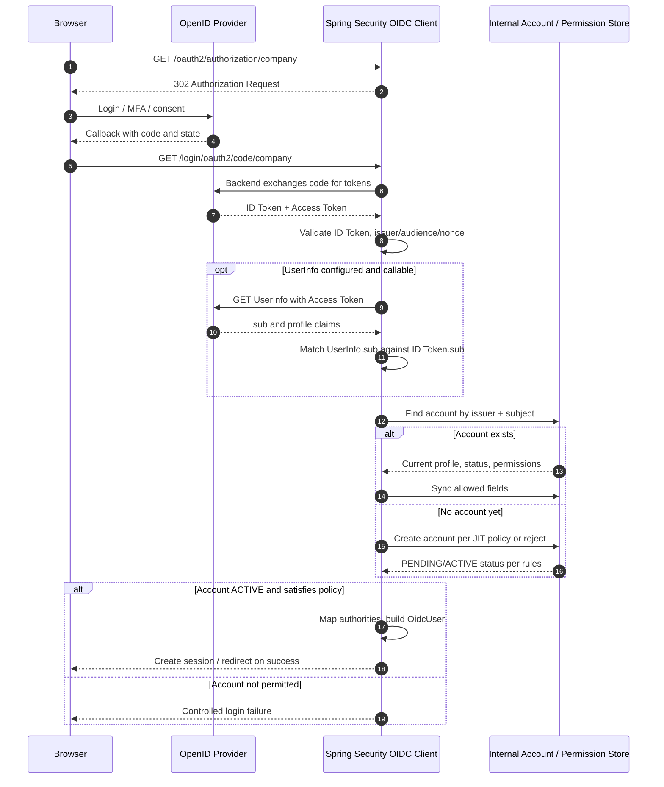
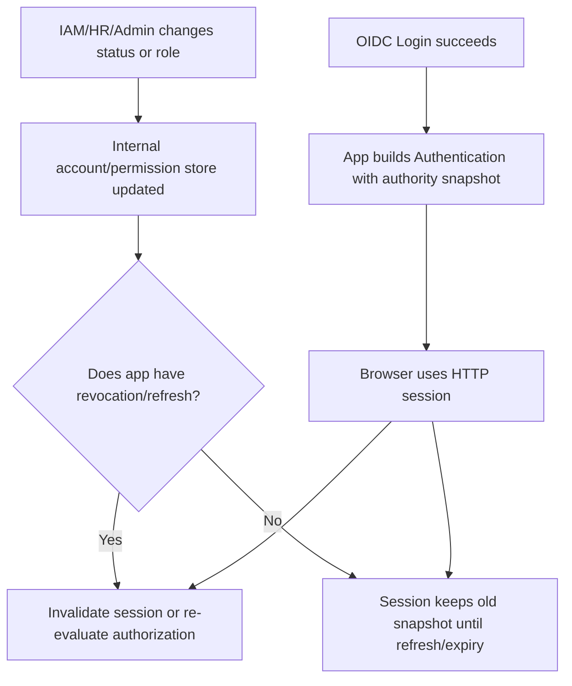

# 13.10. Synchronizing Profiles, Account Status, and Application Permissions

A Spring Boot application integrating **Spring Security OAuth 2.0 / OpenID Connect (OIDC) Client** can authenticate users through an OpenID Provider (OP) and obtain a valid `OidcUser`. However, **logging in successfully at the OP does not mean the account is permitted to use every application feature**, nor does it guarantee internal profile data is up to date.

For example: an employee still holds an SSO session at the identity provider yet has been disabled in the order management system; a user switched departments while old permissions still sit in their HTTP session; or a brand-new user logs in for the first time with no profile record yet in the application database. These are problems of **profile synchronization, account lifecycle, and authorization**, not solely OIDC authentication.

This lesson presents how to design a safe flow: from **verified ID Token/UserInfo**, linking to an **internal account**, updating **profiles under control**, resolving **account status and effective permissions**, and then feeding the right authorities into Spring Security while maintaining consistency as data changes.

## 1. Three Layers to Separate: Identity, Profile, and Authorization

A web system typically asks three sets of questions:

1. **Identity / authentication:** Who is currently logging in? Which OpenID Provider authenticated them?
2. **Profile / account lifecycle:** Which application account is linked to that identity? Is the account active, pending approval, or locked?
3. **Authorization:** Which actions is this account allowed to perform on which resources, and within which tenant/data scope?

These three groups can pull data from different sources:

| Layer | Typical Data | Typical Authoritative Source | Decision Permitted |
|---|---|---|---|
| OIDC Identity | `iss`, `sub`, `aud`, timestamps, nonce, and auth context | ID Token verified by Spring Security against registered OP | Identify an authenticated principal |
| Display Profile | Name, email, avatar, locale, department | ID Token/UserInfo, HR/SCIM, user edits in-app | Display and sync profile data per policy |
| Account Status | `PENDING`, `ACTIVE`, `SUSPENDED`, `DELETED` | Application database, IAM, or designated admin system | Allow or block using the application |
| Application Permissions | `ROLE_MANAGER`, `orders:read`, membership, ownership | Application policy, permission store, trusted IAM group mappings | Decide concrete actions and data scope |
| Local Login Session | `Authentication`, authorities, session cookie | Spring Security / session repository | Maintain login context across requests |

**Principle:** a profile claim such as `department=finance` or `email_verified=true` is **never automatically** an `ADMIN` role. To turn external data into permissions, the application must define an explicit **data-source contract, mapping, trust boundaries, and revocation policy**.

### 1.1. OIDC SSO Does Not Replace Internal Account Management

OIDC answers "Which subject did the OP authenticate for this client?". The application still needs to know:

- Is that subject enrolled to use the product?
- Is the internal account locked due to policy violations, ended contract, or support hold?
- Which tenant/organization does the user belong to?
- Where are read, write, approval, or administrative permissions defined?
- When HR disables a user, must revocation be immediate or is slight delay acceptable?
- Which profile fields may be overwritten from the OP, and which belong to the user or operations team?

Without answering these questions, systems easily **confuse authentication with authorization**, or sync once at login and let stale privileges linger too long.

## 2. Overall Flow: OIDC Login Followed by Account Linking

Suppose an order management app uses an internal OP. The browser initiates login via the `company` registration.



Obtaining identity and granting entry into the application must be designed as **two independent checks**:

- A verified ID Token and valid `sub` only assert identity.
- The application must check account status and permissions from the **designated source** before granting access.

For locked accounts, never establish an authenticated session with business permissions merely because the OIDC callback succeeded. A failure handler can display an appropriate message without exposing sensitive internal reasons.

## 3. Identity Linking: Use `(issuer, subject)` Instead of Email

In OIDC, the `sub` claim is the subject identifier within the issuer's context. An OP may issue `sub` as a UUID, opaque code, or other string.

Example verified ID Token:

```json
{
  "iss": "https://id.example.org/realms/company",
  "sub": "8f21d0a1-0b36-4c2a-8949-fca12e0f8d4c",
  "aud": "orders-web",
  "iat": 1760000000,
  "exp": 1760000300
}
```

In the application, use the **`(iss, sub)` pair** as the linking key, or an internal key referencing this pair.

| Field | Use as Long-Term Identity Key? | Reason |
|---|---|---|
| `issuer + sub` | Generally yes, after valid OIDC validation | Distinguishes subjects across different issuers. |
| `sub` alone | No in multi-issuer systems | Two OPs can assign the same `sub` string to two different people. |
| `email` | Should not be sole identity key | Can change, be unverified, be recycled, or collide across providers. |
| `preferred_username` | No | Mutable, not guaranteed unique, and meant for display. |
| `name` | No | Profile information only. |
| `kid` of ID Token | No | Signing key ID; rotates when the OP rotates keys. |
| `client-id` | No | Identifies the client application, not the user. |

### 3.1. Sample Linking Schema

A simple illustrative SQL schema:

```sql
CREATE TABLE app_user (
    id                BIGINT GENERATED ALWAYS AS IDENTITY PRIMARY KEY,
    issuer            VARCHAR(512) NOT NULL,
    subject           VARCHAR(255) NOT NULL,
    display_name      VARCHAR(255),
    email             VARCHAR(320),
    email_verified    BOOLEAN NOT NULL DEFAULT FALSE,
    account_status    VARCHAR(32) NOT NULL,
    profile_version   BIGINT NOT NULL DEFAULT 0,
    created_at        TIMESTAMP NOT NULL,
    updated_at        TIMESTAMP NOT NULL,
    UNIQUE (issuer, subject)
);

CREATE TABLE app_user_role (
    user_id           BIGINT NOT NULL REFERENCES app_user(id),
    role_code         VARCHAR(100) NOT NULL,
    PRIMARY KEY (user_id, role_code)
);
```

This is illustrative DDL; adapt identity/auto-increment syntax, timestamp types, migrations, and foreign keys to your real DBMS.

The `UNIQUE(issuer, subject)` constraint is critical when multiple callbacks for the same user arrive concurrently. JIT account creation must be **idempotent**: two racing requests must not create duplicate user records. Use transactions and proper unique constraint/upsert handling.

### 3.2. Stable Internal Identifier

Once linked, the application can use `app_user.id` as the internal identifier:

```text
OIDC principal:
  issuer = https://id.example.org/realms/company
  sub    = 8f21d0a1-...

Identity mapping:
  (issuer, sub) -> app_user.id = 4107
```

Entities such as orders, comments, and audit events can reference `app_user.id` instead of email, while retaining the OIDC source mapping to authenticate future logins.

If an enterprise switches OPs and issuer/subject changes, that is an **authorized account linking/migration** problem. Never auto-link a new user to an old account just because emails match.

### 3.3. Multi-Tenancy Needs Additional Constraints

In multi-tenant apps, `(issuer, sub)` identifies the OIDC identity yet does not automatically grant access to every tenant. Tenant access must rely on internal memberships or a trusted IAM source and formal mappings.

A single user might hold:

```text
app_user.id = 4107
  memberships:
    tenant A -> ROLE_READER
    tenant B -> ROLE_APPROVER
```

Never grant a global `ROLE_APPROVER` just because the user has approval rights in tenant B. Authorization checks must tie to the request's tenant and resource.

## 4. Source of Truth: Who May Overwrite Which Fields?

Before syncing, define the **source of truth** for each data field. For example:

| Data | Recommended Source of Truth | Update Strategy |
|---|---|---|
| `issuer` / `subject` | Verified OIDC identity | Never change arbitrarily after linking. |
| `name` / `picture` | OP/UserInfo or user preference, per policy | Selective sync while tracking provenance. |
| `email` / `email_verified` | Trusted OP or dedicated verification system | Never treat unverified email as an account key. |
| `department` / `manager` | HR/SCIM or designated directory | Sync with versions/events and conflict rules. |
| `locale` / `preferredTheme` | User settings inside the app | Never overwrite with default OP claims. |
| Internal `account_status` | Application admin or designated IAM | Updated via workflow and account-lock policy. |
| Internal `role` / `permission` | Role store / policy engine or approved IAM mapping | Requires explicit grant and revocation rules. |
| `last_login_at` | Application | Updated after valid login. |

For example, a user chooses the display name "Minh Anh" in the app while the OP returns a longer legal name. If your design permits **user overrides**, do not overwrite that choice on every login. Store both alongside each other:

```text
display_name_from_idp = "Nguyen Thi Minh Anh"
preferred_display_name = "Minh Anh"
effective_display_name = preferred_display_name if set
```

This separates external data from internal preferences, preventing sync from wiping out user profile edits.

### 4.1. Missing Values Do Not Mean Deletion

If the OP omits `email` on one login, the cause may be changed scopes, consent, or provider policy. Never immediately write `email=NULL` to the DB unless your contract states **claim absence means data deletion**.

Distinguish three cases:

- **Missing**: the claim does not appear.
- **Explicit null/empty**: the provider returned it with an empty value.
- **Value changed**: the provider returned a different value.

Only update or clear data when the data-source contract clearly defines its semantics, recording timestamps and update sources when traceability is needed.

### 4.2. Avoid Assuming Claims Are Always Present

OIDC scopes `profile` or `email` only request claim groups; they do not guarantee the provider returns all of them. In Java, use appropriate nullable/`Optional` types, check claim data types, and apply safe fallbacks for display-only fields.

A profile mapper must not crash the whole login over an optional missing `picture`. Conversely, if policy mandates an organization identifier, its absence must be handled as an unmet registration/account requirement—never by inventing default privileges.

## 5. Common Profile Synchronization Models

No single strategy fits every application. Often multiple mechanisms are combined.

### 5.1. Just-in-Time (JIT) Provisioning at Login

**JIT provisioning** creates or updates the internal account during OIDC login.

```text
Successful OIDC login
       |
       v
Find (issuer, sub)
       |
       +-- Exists -> sync allowed fields, check status and permissions
       |
       +-- Missing -> check account creation policy
                           |
                           +-- Allowed -> create ACTIVE or PENDING
                           |
                           +-- Not allowed -> reject login into app
```

**Pros:** relatively simple to implement, refreshes data when users log in, no need to pre-sync an entire directory.

**Limits:** changes to roles, departments, or user status **after login** may not take effect until the next login. Users who never log in may not get updated internally; offboarded employees require extra mechanisms.

JIT works well for initial profiles and basic profile attributes, yet should not be the sole mechanism if immediate account lockouts are required.

### 5.2. Provisioning from HR/IAM Systems or SCIM

An IAM/HR system can push user lifecycle and group updates to the application via provisioning APIs or **SCIM**.

Example:

```text
HR / Directory -> IAM / SCIM -> App user store
                       |
                       +-> create / update / deactivate
                       +-> group / membership changes
```

**Pros:** updates status and permissions without waiting for the user to log in; suits enterprise onboarding/offboarding.

**Limits:** requires securing the provisioning channel, identity mapping, consistency, retries, idempotency, event ordering, and handling outages.

SCIM does not replace OIDC login. **OIDC authenticates the user at login time; provisioning manages profiles and account lifecycles.** Both channels must map to the same internal account using a trusted identifier.

### 5.3. Webhooks or Event-Driven Synchronization

A provider or HR system may emit events:

```json
{
  "event_id": "evt-10482",
  "type": "user.suspended",
  "subject": "8f21d0a1-0b36-4c2a-8949-fca12e0f8d4c",
  "issuer": "https://id.example.org/realms/company",
  "occurred_at": "2026-11-16T02:00:00Z"
}
```

This is an **internal schema** example, not a universal OIDC webhook format.

When receiving events:

1. Authenticate the event source via signature, mTLS, or registered credentials.
2. Validate issuer, event type, subject, and sender authorization.
3. Prevent replay using `event_id` and verified versions/timestamps.
4. Update account status or permissions inside a transaction.
5. Emit cache/session invalidation signals if required.
6. Write an audit event without exposing tokens or excessive personal data.

Never trust a POST containing `type=user.suspended` if the webhook endpoint does not authenticate the caller. Forged events can lock out users or grant unauthorized privileges.

### 5.4. Scheduled Sync and Reconciliation

A periodic job can compare application data against the authoritative source, detect drift, and reconcile per rules. This helps recover missed webhooks, handle non-guaranteed delivery, or audit lingering permissions.

Strategies are often combined:

| Strategy | Update Timing | Best Fit |
|---|---|---|
| JIT login | When user completes OIDC login | Account creation, refreshing profile claims. |
| SCIM/HR provisioning | When authoritative source changes | Joining/leaving org, department moves, suspensions. |
| Webhook/event | Near event occurrence | Fast revocation, membership updates. |
| Polling/reconciliation | Scheduled | Recovering dropped events, catching data drift. |
| Request-time authorization lookup | Per operation or short-TTL cache | Sensitive privileges always checking latest state. |

## 6. Internal Account Status as a State Machine

A simple model:

| Status | Meaning | Allowed to Log Into App? |
|---|---|---|
| `PENDING` | Profile created, awaiting approval or prerequisites. | Usually **not yet** allowed to use business features. |
| `ACTIVE` | Enabled to use the application. | Allowed to log in and evaluated for specific permissions. |
| `SUSPENDED` | Temporarily locked by admin, risk, or policy. | Cannot start new sessions; existing sessions must be handled. |
| `DEACTIVATED` | Deactivated per org/contract lifecycle. | Denied access. |
| `DELETED` | Deleted/anonymized per retention policy. | Denied login; data handled per retention policy. |

Status names and workflows are decided by the application; these **are not standard OIDC claims**.

Rules to define upfront:

- Who is allowed to transition `PENDING -> ACTIVE`?
- Can only admins or IAM/HR move accounts to `SUSPENDED` or `DEACTIVATED`?
- Does `SUSPENDED -> ACTIVE` require approval or extra checks?
- Can a `DELETED` account be restored, or must a new identity link be created?
- If IAM reports "active" while an app admin locked the account for fraud, which wins?
- Are status transitions audited with actor and reason?

### 6.1. Blocking at Login Differs from Blocking Existing Requests

If an account moves to `SUSPENDED` after login, an HTTP session may still hold the earlier `Authentication` and authorities. Hence **checking status only inside `OidcUserService` at login is insufficient for immediate revocation**.

The system may need to:

1. Invalidate the user's sessions when status changes.
2. Or check account status in the authorization/service layer on critical requests.
3. Or combine session invalidation with short-TTL caches for sensitive resources.
4. Propagate changes across all nodes and user devices.

Appropriate behavior depends on business sensitivity and revocation SLAs. Never claim that disabling a user at the IdP automatically destroys all internal application sessions.

### 6.2. IdP Account Status and App Account Status Are Independent

A user disabled at the OP cannot obtain **new tokens**, yet an already-created app HTTP session may still remain valid. Conversely, a user who can still log into the OP must be actively blocked if their app account is locked.

OIDC Login does not provide real-time account status sync by default. Back-channel logout, SCIM, session events, or user-management APIs are distinct capabilities that must be intentionally designed and implemented.

## 7. Roles, Permissions, and Data Scopes Are Not the Same

Suppose the application has:

- Role `ROLE_USER`: basic usage rights.
- Role `ROLE_MANAGER`: approval capability.
- Permission `orders:read`: read orders.
- Permission `orders:approve`: approve orders.
- Tenant membership: operate only within assigned tenants.

Concepts to keep separate:

| Concept | Meaning | Example |
|---|---|---|
| **Role** | Business-meaningful permission grouping. | `MANAGER`, `SUPPORT`. |
| **Permission/authority** | Specific capability checked in authorization. | `orders:read`, `orders:approve`. |
| **OAuth2 Scope** | Scope requested by client and granted by Authorization Server on Access Token. | `openid`, `profile`, `orders.read`. |
| **IdP Group** | Membership managed by directory/provider. | `corporate/ops`. |
| **Ownership** | Data permission based on relationship to the resource. | Order owner can view their order. |
| **Tenant boundary** | Organizational/data scope permitted for operations. | Only data with `tenantId=alpha`. |

In Spring Security, `GrantedAuthority` represents permissions for authentication/authorization, yet authority names must follow a consistent design:

- `ROLE_MANAGER` is typically checked with `hasRole("MANAGER")`, because `hasRole` adds the `ROLE_` prefix by default.
- `orders:read` can be checked with `hasAuthority("orders:read")`.
- `SCOPE_orders.read` normally reflects an OAuth2 scope in certain token flows; **not automatically equivalent to an internal role**.

Never turn every `groups` or `roles` string returned by a provider into `ROLE_*` without an allowlist and mapping rules.

### 7.1. Mapping IdP Groups to Application Roles

Suppose the OP returns groups:

```json
{
  "groups": ["company/orders-readers", "company/team-ops"]
}
```

The application can define a governed mapping table:

| Group from Trusted Source | Application Permission |
|---|---|
| `company/orders-readers` | `orders:read` |
| `company/orders-approvers` | `orders:approve` |
| `company/team-ops` | Organizational metadata only; grants no role automatically. |

To map safely:

1. Trust the provider/issuer to emit group claims under a clear contract.
2. Validate data types, tenant/scope, and membership semantics.
3. Accept only groups in an explicit allowlist.
4. Prevent a claim from provider A from granting permissions meant only for provider B.
5. Maintain mapping updates, reviews, and audits.
6. Handle users without groups following **least privilege**.
7. Provide a revocation mechanism when groups change.

### 7.2. Role Mapping Does Not Replace Object-Level Authorization

A user holding `orders:read` is not necessarily permitted to read **all** orders. The service may still need to check:

```text
principal has permission orders:read
AND order.tenant_id belongs to principal's tenant
AND order.visibility satisfies policy
```

`@PreAuthorize("hasAuthority('orders:read')")` is one layer; filtering data by tenant and ownership belongs in the appropriate business/repository layer.

## 8. Sample Spring Boot OIDC Client Configuration

### 8.1. Registration/Provider Configuration

Example `application.yml`:

```yaml
spring:
  security:
    oauth2:
      client:
        registration:
          company:
            provider: company-oidc
            client-id: ${OIDC_CLIENT_ID}
            client-secret: ${OIDC_CLIENT_SECRET}
            client-authentication-method: client_secret_basic
            authorization-grant-type: authorization_code
            redirect-uri: "{baseUrl}/login/oauth2/code/{registrationId}"
            scope:
              - openid
              - profile
              - email
        provider:
          company-oidc:
            issuer-uri: https://id.example.org/realms/company
```

This is a **Servlet OIDC Client** configuration, not a Resource Server or Authorization Server configuration. Spring Security uses `issuer-uri` to fetch metadata and validate ID Tokens per provider.

`client-secret` must stay on the backend; never commit real secrets or pass them to the frontend. Requested scopes do not guarantee the OP will issue every claim. Profile mappers must handle missing claims and use claims only after valid authentication.

### 8.2. Dependencies and Login Mechanism

Gradle example:

```gradle
dependencies {
    implementation("org.springframework.boot:spring-boot-starter-web")
    implementation("org.springframework.boot:spring-boot-starter-security")
    implementation("org.springframework.boot:spring-boot-starter-oauth2-client")
    implementation("org.springframework.boot:spring-boot-starter-data-jpa")
}
```

`spring-boot-starter-data-jpa` is only an example if the app uses JPA to store profiles/roles. JDBC, jOOQ, or an external IAM service can be used instead.

Basic Servlet flow:

```java
import org.springframework.context.annotation.Bean;
import org.springframework.context.annotation.Configuration;
import org.springframework.security.config.Customizer;
import org.springframework.security.config.annotation.web.builders.HttpSecurity;
import org.springframework.security.web.SecurityFilterChain;

@Configuration
class SecurityConfiguration {

    @Bean
    SecurityFilterChain webSecurityFilterChain(HttpSecurity http)
            throws Exception {
        http
            .authorizeHttpRequests(auth -> auth
                .requestMatchers("/", "/public/**").permitAll()
                .anyRequest().authenticated()
            )
            .oauth2Login(Customizer.withDefaults());

        return http.build();
    }
}
```

This configuration suffices to illustrate OIDC login, yet **does not sync profiles or check internal status**. Those requirements need a dedicated service/mapping and account policy.

## 9. Example Domain Model for Account Synchronization

To separate responsibilities, define application domain types:

```java
import java.util.Set;

public enum AccountStatus {
    PENDING,
    ACTIVE,
    SUSPENDED,
    DEACTIVATED
}

public record VerifiedExternalIdentity(
    String issuer,
    String subject,
    String displayName,
    String email,
    boolean emailVerified
) { }

public record LocalAccountSnapshot(
    long userId,
    AccountStatus status,
    Set<String> permissions,
    long authorizationVersion
) { }

public interface AccountProvisioningService {
    LocalAccountSnapshot resolveAndSynchronize(
        VerifiedExternalIdentity identity
    );
}
```

These declarations only illustrate data types; in real Java projects, **each `public` top-level type must reside in its own appropriately named source file** per Java rules, or use package-private/nested types per project structure. This lesson does not create separate Java files.

Responsibilities of `AccountProvisioningService`:

1. Accept **verified identity data**, never raw JWTs from the browser.
2. Look up by `(issuer, subject)`.
3. Apply JIT creation rules if absent.
4. Sync profile fields writable from the OP.
5. Load account status and roles/permissions from the **application's authoritative source**.
6. Return a consistent snapshot or throw a business exception when policy cannot be satisfied.
7. Enforce transactions, idempotency, and unique constraints.

Do not stuff all business logic inside `SecurityFilterChain`. Configuration beans only **wire** Spring Security to the responsible business service.

### 9.1. Sanitizing and Normalizing Incoming Profiles

Before writing to the database:

- Ensure issuer/subject come from the verified OIDC principal.
- Enforce length limits on fields like `displayName`, `email`, `picture`, `locale`.
- Handle Unicode and data types safely.
- Never treat a missing email as a command to delete the account.
- Never embed avatar URLs into unescaped HTML.
- Never trust `department`/`groups` unless the claim source is designated authoritative.
- Never dump full ID Token/UserInfo JSON into the database without clear purpose and retention policy.
- Never log Access Tokens, ID Tokens, or unnecessary personal information.

For email, treat it as verified only when a trusted source explicitly returns `email_verified=true` with matching semantics—never infer verification merely because the string looks like a valid email.

## 10. Plugging Into `OidcUserService` to Sync at Login

For **OIDC login**, Spring Security allows plugging an `OAuth2UserService<OidcUserRequest, OidcUser>` into `oauth2Login().userInfoEndpoint().oidcUserService(...)`.

A safe pattern is **wrapping `OidcUserService`**: the delegate keeps OIDC protocol logic, then the application links the account and maps authorities.

### 10.1. Service Mapping Principal and Permissions

Example:

```java
import java.util.HashSet;
import java.util.Set;

import org.springframework.security.core.GrantedAuthority;
import org.springframework.security.core.authority.SimpleGrantedAuthority;
import org.springframework.security.oauth2.client.userinfo.OAuth2UserService;
import org.springframework.security.oauth2.client.userinfo.OidcUserRequest;
import org.springframework.security.oauth2.client.userinfo.OidcUserService;
import org.springframework.security.oauth2.core.OAuth2AuthenticationException;
import org.springframework.security.oauth2.core.OAuth2Error;
import org.springframework.security.oauth2.core.oidc.user.DefaultOidcUser;
import org.springframework.security.oauth2.core.oidc.user.OidcUser;

public final class LocalAccountOidcUserService
        implements OAuth2UserService<OidcUserRequest, OidcUser> {

    private final OidcUserService delegate = new OidcUserService();
    private final AccountProvisioningService accounts;

    public LocalAccountOidcUserService(AccountProvisioningService accounts) {
        this.accounts = accounts;
    }

    @Override
    public OidcUser loadUser(OidcUserRequest request) {
        // Delegate handles OIDC UserInfo and related validations.
        OidcUser oidcUser = delegate.loadUser(request);

        VerifiedExternalIdentity identity = new VerifiedExternalIdentity(
            oidcUser.getIdToken().getIssuer().toString(),
            oidcUser.getSubject(),
            oidcUser.getFullName(),
            oidcUser.getEmail(),
            Boolean.TRUE.equals(
                oidcUser.getClaims().get("email_verified")
            )
        );

        // Sync lookup, status check, and internal permissions.
        LocalAccountSnapshot account =
            accounts.resolveAndSynchronize(identity);

        if (account.status() != AccountStatus.ACTIVE) {
            throw new OAuth2AuthenticationException(
                new OAuth2Error(
                    "local_account_not_active",
                    "Account is not enabled for this application",
                    null
                )
            );
        }

        Set<GrantedAuthority> authorities =
            new HashSet<>(oidcUser.getAuthorities());

        for (String permission : account.permissions()) {
            // Permissions here must come from an internal allowlist / policy.
            authorities.add(new SimpleGrantedAuthority(permission));
        }

        return new DefaultOidcUser(
            authorities,
            oidcUser.getIdToken(),
            oidcUser.getUserInfo(),
            "sub"
        );
    }
}
```

Explanation:

- The `OidcUserService` delegate continues handling UserInfo and required OIDC checks. ID Token verification runs in the framework's OIDC authentication pipeline before the user service is called.
- `issuer` and `sub` come from the processed `OidcUser`, not from HTTP callback parameters.
- `AccountProvisioningService` handles JIT updates, status, and internal permissions.
- If the account is not `ACTIVE`, the service throws an authentication error rather than silently granting a default `ROLE_USER`.
- `GrantedAuthority` entries are added only from permissions trusted by the application.
- `DefaultOidcUser` preserves `IdToken`, `UserInfo`, and uses `sub` as the name attribute—never building a principal from email alone.
- This snippet illustrates **login-time mapping**; revoking privileges mid-session requires the strategies covered later.

**Architecture note:** if application permissions vary per tenant on each request, do not dump permissions from every tenant into global session authorities. An `AccountSnapshot` can hold baseline rights while detailed checks execute per tenant/resource inside services.

### 10.2. Wiring the Service into Spring Security

Configuration replacing the basic `SecurityFilterChain` earlier:

```java
import org.springframework.context.annotation.Bean;
import org.springframework.context.annotation.Configuration;
import org.springframework.security.config.annotation.web.builders.HttpSecurity;
import org.springframework.security.oauth2.client.userinfo.OAuth2UserService;
import org.springframework.security.oauth2.client.userinfo.OidcUserRequest;
import org.springframework.security.oauth2.core.oidc.user.OidcUser;
import org.springframework.security.web.SecurityFilterChain;

@Configuration
public class OidcAccountSecurityConfiguration {

    @Bean
    OAuth2UserService<OidcUserRequest, OidcUser> localOidcUserService(
            AccountProvisioningService accounts) {
        return new LocalAccountOidcUserService(accounts);
    }

    @Bean
    SecurityFilterChain securityFilterChain(
            HttpSecurity http,
            OAuth2UserService<OidcUserRequest, OidcUser>
                    localOidcUserService) throws Exception {

        http
            .authorizeHttpRequests(auth -> auth
                .requestMatchers("/", "/public/**", "/login").permitAll()
                .anyRequest().authenticated()
            )
            .oauth2Login(oauth2 -> oauth2
                .userInfoEndpoint(userInfo -> userInfo
                    .oidcUserService(localOidcUserService)
                )
                .failureUrl("/login?oauth2Error")
            );

        return http.build();
    }
}
```

This is a **standalone configuration**; do not register multiple `SecurityFilterChain` beans with overlapping matchers in the same project merely because each example in this lesson shows one bean.

When an account is locked or fails provisioning, the failure handler can redirect to a page with a generic notice. Never put stack traces, raw ID Tokens, Access Tokens, internal groups, or sensitive lock reasons in URLs.

### 10.3. Security-Significant Ordering of Checks

The flow should follow this order:

```text
Receive callback
    |
    v
Verify state/authorization request, token exchange
    |
    v
Verify OIDC ID Token and UserInfo if used
    |
    v
Extract verified issuer + subject
    |
    v
Look up internal account / controlled JIT sync
    |
    v
Check status, tenant conditions, permission source
    |
    v
Build authorities and Authentication
    |
    v
Save session, enforce authorization per request
```

Never move internal account loading **before** OIDC verification by reading `sub` from an unverified JWT and trusting it. Never create a session merely because the repository has a user with the same email.

## 11. JIT Provisioning Requires Idempotency and Transactions

Illustrative pseudocode:

```text
resolveAndSynchronize(identity):
    assert identity.issuer, identity.subject came from verified OIDC

    BEGIN TRANSACTION
        existing = findByIssuerAndSubjectForUpdate(
            identity.issuer, identity.subject
        )

        if existing is absent:
            if not policy.allowAutoProvision(identity):
                fail "not provisioned"
            existing = createUser(
                issuer=identity.issuer,
                subject=identity.subject,
                status=policy.initialStatus(identity)  // usually PENDING
            )

        updateOnlyPermittedProfileFields(existing, identity)
        status = readEffectiveAccountStatus(existing)
        permissions = readEffectivePermissions(existing)
    COMMIT

    return snapshot(status, permissions, version)
```

Key rules:

1. **Never default every new subject to `ACTIVE`** if the product requires an approval workflow.
2. **Never lose an internal lock state** just because the OP emits `active=true` or SSO remains valid.
3. **Never overwrite manual permissions** with default groups on every login unless policy permits it.
4. **Never create duplicate users** on concurrent callbacks; database unique constraints and upsert logic are the final guard.
5. **Never hold transactions open too long** if calling external services; separate network I/O from database transactions cleanly.
6. **Never expose full profiles** just to diagnose provisioning errors.

### 11.1. Contention on Two Concurrent Logins

Scenario:

```text
Thread A: SELECT user WHERE issuer=X AND sub=Y -> none
Thread B: SELECT user WHERE issuer=X AND sub=Y -> none
Thread A: INSERT user X/Y -> success
Thread B: INSERT user X/Y -> unique constraint violation
```

This is not a meaningless data bug; it is a normal JIT race condition. The service can handle it via transaction/upsert and **re-reading the existing record** after a conflict as supported by your DBMS. Never drop the unique constraint to "avoid errors".

### 11.2. JIT Profiles Do Not Sync the Entire Account Lifecycle

If a user is offboarded while holding an active session, a completed login will not update their permissions on its own. For sensitive requirements, use webhooks/provisioning/reconciliation and request-time status checks. JIT is only **one update source**.

## 12. Mapping Roles/Permissions at Login

Another option is using `GrantedAuthoritiesMapper` to transform authorities after authentication. However, remember its responsibility is **authority mapping**, not handling full provisioning and lifecycles.

Example mapping internal authorities from a confirmed permission set:

```java
import java.util.HashSet;
import java.util.Set;
import org.springframework.security.core.GrantedAuthority;
import org.springframework.security.core.authority.SimpleGrantedAuthority;

public final class AuthorityFactory {

    private AuthorityFactory() { }

    public static Set<GrantedAuthority> fromApprovedPermissions(
            Set<String> permissions) {

        // This allowlist is illustrative only.
        Set<String> allowed = Set.of(
            "orders:read",
            "orders:create",
            "orders:approve"
        );

        Set<GrantedAuthority> result = new HashSet<>();
        for (String permission : permissions) {
            if (allowed.contains(permission)) {
                result.add(new SimpleGrantedAuthority(permission));
            }
        }
        return result;
    }
}
```

In real systems, the allowed permissions list lives in a policy registry, role store, or centrally maintained code. Crucially, **never turn raw untrusted claim strings directly into authorities**.

### 12.1. Mapped Authorities Must Not Exceed Source Trust

If the provider returns:

```json
{
  "groups": ["orders-approvers", "external-auditors"]
}
```

the application must apply only approved mappings scoped to the right issuer and tenant:

```text
issuer company-idp
group orders-approvers
    -> permission orders:approve
    applies only to assigned tenant / membership

issuer external-partner-idp
group orders-approvers
    -> DO NOT grant the same permission
```

A group claim may not be independently signed, yet inside a verified ID Token or `sub`-matched UserInfo it reflects data from a trusted provider. **That is still not enough** to treat every group name as a business permission; an explicit contract and mapping policy are still required.

### 12.2. Role Changes Must Refresh Authorities

Authorities built at login are typically stored with `Authentication` in the session. When permissions change in the DB:

- `Authentication.getAuthorities()` on the old session **does not update automatically**.
- `@PreAuthorize` sees only existing authorities unless a live authorization service is consulted.
- Requests using the logged-in session may keep using old roles until the session expires or refreshes.

For fast revocation, choose a strategy: **invalidate sessions**, **controlled authority refresh**, **live DB/policy-engine checks per request**, or a risk-appropriate combination.

## 13. Authorization at Endpoints and the Business Layer

Example endpoint allowed only with `orders:approve`:

```java
import org.springframework.security.access.prepost.PreAuthorize;
import org.springframework.web.bind.annotation.PathVariable;
import org.springframework.web.bind.annotation.PostMapping;
import org.springframework.web.bind.annotation.RestController;

@RestController
public class OrderApprovalController {

    private final OrderApprovalService approvals;

    public OrderApprovalController(OrderApprovalService approvals) {
        this.approvals = approvals;
    }

    @PostMapping("/orders/{id}/approve")
    @PreAuthorize("hasAuthority('orders:approve')")
    public void approve(@PathVariable long id) {
        approvals.approveOrder(id);
    }
}
```

To enable method security, for example:

```java
import org.springframework.context.annotation.Configuration;
import org.springframework.security.config.annotation.method.configuration.EnableMethodSecurity;

@Configuration
@EnableMethodSecurity
public class MethodSecurityConfiguration {
}
```

**Do not stop at `hasAuthority`** if the action must be scoped by tenant or ownership. `approvals.approveOrder(id)` must verify the order belongs to an allowed tenant, is in a valid state, and meets other business conditions.

### 13.1. Sensitive Privileges Should Check Fresh State

Illustrative business interface:

```java
public interface CurrentAccountAccess {
    void requireActiveAccount();
    void requirePermissionForOrder(long orderId, String permission);
}
```

Flow for a sensitive operation:

```text
Authenticated HTTP session
    -> resolve linked app_user.id
    -> check current account_status
    -> check permission + tenant + resource
    -> execute operation inside appropriate transaction
```

This is a **dynamic** authorization layer. It may use a short-TTL cache or policy engine, provided revocation SLAs are clearly defined. Never read an email from the request and use it to identify the acting user.

### 13.2. Do Not Confuse Role and Scope

OIDC login uses scopes `openid profile email`. Those are scopes of the OIDC request, not proof the user holds `orders:approve`.

Conversely, a Resource Server may receive an Access Token containing `scope=orders.read` and map it to `SCOPE_orders.read`. That is a different authorization mechanism; if one app acts as both web OIDC Client and Resource Server, separate the two authentication mechanisms and authority mappings cleanly.

## 14. Account Locked While the User Still Has an Active Session

This is the most common issue in permission synchronization.

Scenario:

```text
09:00  User completes OIDC login, account ACTIVE, has orders:approve
09:05  App creates session holding Authentication + orders:approve
10:00  Admin sets account to SUSPENDED
10:01  Browser sends POST /orders/42/approve with old session
```

If the app **only** checks `SUSPENDED` in `OidcUserService` at login, the `10:01` request can still pass `hasAuthority` using the stale authority. That is why post-login session/permission governance is required.

### 14.1. Three Consistency Levels for Revocation

| Level | Characteristics | Suitable For |
|---|---|---|
| **Until next login** | Authorities/status refresh only upon OIDC re-authentication. | Low-sensitivity data, low risk, short sessions. |
| **Bounded delay** | Short-TTL role/status cache, refresh, or event invalidation. | Many enterprise apps tolerating brief eventual consistency. |
| **Near-instant revocation** | Invalidate sessions and/or check authoritative state on critical operations. | Financial systems, sensitive data, strict compliance. |

There is no single formula. Document the **maximum revocation window** per product goals and design checks accordingly.

### 14.2. Invalidating Sessions When Account Status Changes

When an admin locks an account, the app can look up sessions tied to that app user ID and invalidate them if session infrastructure supports it. In multi-instance deployments, use a session index / shared store or event propagation.

Points to evaluate:

- A user may be logged in across multiple browsers or devices.
- Session IDs may rotate due to session-fixation protection.
- An OIDC logout at the OP does not necessarily clear sessions across all clients unless logout notifications are implemented.
- Background jobs or API tokens not backed by HTTP sessions need separate revocation controls.

### 14.3. Permission Versioning to Detect Stale Sessions

One technique adds `authorization_version` to the account:

```text
App user:
  id = 4107
  authorization_version = 18

Session snapshot:
  userId = 4107
  authorizationVersion = 17
```

On sensitive requests, if the authoritative version differs from the session version, the app can reload permissions or reject the request and require fresh authentication/authorization. This version checks freshness—**it does not replace resource-level authorization checks**.

Define the authoritative version source, caching strategy, and async event handling clearly. If policy demands immediate revocation, never treat a long-TTL cache as instant.

## 15. Syncing from the IdP Does Not Automatically Refresh Every Session

Changes can arrive from several sources:

- OP/IdP changes password or disables the account.
- SCIM updates `active` status or group memberships.
- HR reports an employee departure.
- App admin revokes a role.
- A logout event arrives via the corresponding protocol.

Not all of these changes automatically appear inside the `OidcUser` stored in an earlier session.

Lifecycle diagram:



Hence a system must design both **data synchronization** and **change enforcement**. Updating the database accurately without refreshing authorization decisions still leaves a security gap.

### 15.1. Back-Channel Logout and SCIM Are Two Different Things

- **SCIM/provisioning** focuses on user records, memberships, and account status.
- **OIDC logout notifications** focus on SSO/login session state between OP and client when supported and configured.
- **Authorization invalidation** focuses on internal application permissions and state.

A SCIM deactivation event may need to trigger session invalidation, which the application integrates explicitly; provisioning protocols do not automatically destroy local sessions.

## 16. Securing Data Synchronization and Preventing Privilege Escalation

A sync pipeline can open new trust boundaries. Required controls include:

### 16.1. Sync Only from Verified Identities

Never Base64-decode an **unverified JWT payload** to query accounts or assign roles. For OIDC, ensure Spring Security validated the ID Token's issuer, audience, timestamps, nonce, and related rules; if UserInfo is used, its `sub` must match the ID Token.

Never trust browser parameters such as `email`, `groups`, or `role` on callbacks to determine local accounts.

### 16.2. Let External Sources Modify Only Their Designated Fields

A directory may be authoritative for departments yet **must never** alter `fraud_hold`, `billing_owner`, or app-granted admin roles. Track source metadata:

```text
profile.displayName:
  source = user_preference
  fallback = oidc_profile

profile.departmentCode:
  source = hr_directory

account.status:
  source = app_admin + iam_offboarding_policy

permissions:
  source = app_policy_store
  idp_group_mapping = allowlisted inputs only
```

A `groups` field from UserInfo must never be treated as a direct command to "grant every role matching each group string".

### 16.3. Securing Events/Webhooks

For webhooks/SCIM:

- Authenticate senders and endpoints using mTLS, signatures, or strict access policies.
- Restrict provisioning credentials to least privilege.
- Prevent replay, duplicate events, and handle ordering/versioning.
- Maintain audit logs for status/permission changes.
- Reject events from issuers not authorized to manage that tenant.
- Configure retries/backoff, dead-letter queues, and reconciliation to prevent sync drift.

### 16.4. PII, Retention, and Privacy

Profiles may hold email, phone number, birth date, avatar, address, or sensitive organizational attributes. Store only fields the application needs, define retention windows, access/edit rights, and deletion workflows aligned with policy.

Never log full ID Token/UserInfo JSON, Access Tokens, session cookies, or unnecessary organizational details. If data must appear in audits, minimize it and enforce strict access controls.

### 16.5. Do Not Create a Backdoor via "User Not Found"

If JIT provisioning is disabled and a subject has no account, never fall back to "find a user by email and log into it" without an authorized account-linking step. That creates a direct account takeover path, especially when emails can change or are unverified.

## 17. Handling New Accounts and Pending-Approval Accounts

Suppose a new user logs in via a valid OP, yet the app requires admin approval.

A suitable model:

```text
New OIDC subject
   |
   v
Create app_user(status=PENDING)
   |
   v
Grant zero business permissions
   |
   v
Show "Account pending approval" screen
   |
   v
Admin/IAM approves -> status=ACTIVE and assign roles
   |
   v
User can log in/refresh per designed flow
```

Two ways to structure the UX:

1. **Block login into the app:** the user service throws a controlled error; the failure handler shows a status notice.
2. **Create a restricted session for onboarding only:** design a minimal, explicit `PENDING` principal/authority and strictly block all business APIs—never share a full authenticated session hoping the UI hides buttons.

If choosing the second option, define a **`PENDING` principal** permitted to reach only onboarding endpoints, and evaluate whether creating such a session complies with product security policy.

### 17.1. Never Default to Overly Broad Permissions

When no role is found:

- The safe default is zero special permissions.
- New accounts may wait in pending approval.
- Apply a default role only when formal policy allows it and its scope is tightly bounded.
- Never rely on logic like "corporate domain email means ADMIN" without stronger conditions.

Even if the OP verified an email on a corporate domain, that does not prove the user belongs to a specific department or is authorized to approve orders.

## 18. Handling Sync Errors at Login Time

A JIT flow can fail if the database is down, IAM is slow, a policy service times out, or provider data is missing.

| Situation | Classification | Suggested Handling |
|---|---|---|
| No `app_user` and policy forbids auto-create | Policy-driven denial | Prompt for registration/approval; never auto-link by email. |
| Account `SUSPENDED` | Intentional denial | Do not issue a privileged session; audit internal reason. |
| Account `PENDING` | Prerequisites unmet | Route to onboarding or pending-approval notice per design. |
| Database temporarily unreachable | Sync infrastructure error | Fail closed on unknown permission decisions; show generic error. |
| `email` claim missing | Optional profile field missing | Do not fail login unless policy requires email. |
| Policy-required claim missing | Insufficient identity/prerequisite data | Reject or require a valid onboarding step. |
| Role store returns inconsistent data | Permission error | Never fall back to high privileges; preserve tenant boundaries. |
| Two logins create an account concurrently | Race condition | Unique constraint + transaction/upsert/idempotency. |
| IAM event arrives late | Eventual consistency | Reconciliation and SLA-aligned permission checks. |
| OP returns different `sub` in ID Token and UserInfo | OIDC violation | Reject UserInfo; keep `OidcUserService` checks intact. |

### 18.1. Fail Closed Without Losing Observability

When account status cannot be read from the authoritative source, the application **must not assume `ACTIVE`**. Still, keep user-facing messages generic like "Unable to complete login right now", avoiding policy or DB details.

In internal logs, record standardized error codes such as `ACCOUNT_LOOKUP_UNAVAILABLE`, `ACCOUNT_SUSPENDED`, or `ROLE_MAPPING_FAILED` along with a safe correlation ID. Never put Access Tokens, ID Tokens, emails/identifiers, or secrets in standard logs.

### 18.2. Separating Login Failures from Post-Login 403 Errors

- **Login failure:** the app could not create an Authentication due to OIDC validation or account policy.
- **HTTP 403:** the user is authenticated yet lacks permission for a specific resource/action.
- **HTTP 401:** an API request lacks valid authentication per the API's mechanism; may differ from web login redirects.
- **Session timeout:** local authentication expired, requiring the browser to run a fresh flow.

Proper classification prevents broken loops that repeatedly redirect to the OP when the actual cause is missing business permissions.

## 19. Logging, Auditing, and Sync Monitoring

A system with multiple status/permission sources needs traceability:

| Event / Metric | Meaning | What to Store |
|---|---|---|
| `oidc.login.success` | Authentication and account policy succeeded | Registration alias, internal user ID, timestamp, diagnostic ID. |
| `profile.sync.updated` | One or more fields updated | Field names, source, version—no raw PII needed. |
| `account.status.changed` | Account status changed | Old/new status, actor/source, timestamp, reason code. |
| `authorization.roles.changed` | Permissions/memberships changed | Snapshot/version or sanitized diff. |
| `session.revoked` | Session intentionally invalidated | Internal user ID, reason, timestamp, session count if needed. |
| `sync.event.failed` | Event/provisioning failure | Source, event ID, error type, retry count. |
| `authorization.denied` | Access denied | Resource/action, policy ID, diagnostic ID; avoid sensitive payloads. |

Avoid using `email`, `sub`, Access Tokens, or session IDs as metric labels; they cause high cardinality and leak data. To correlate events, use internal user IDs or diagnostic IDs under controlled log access.

### 19.1. Permission Audits Must Explain Decisions

To answer "Why was this user allowed to approve an order yesterday?", logs should reconstruct:

- Which internal principal acted?
- Which policy/role-mapping version applied?
- What status was the account in?
- Which memberships/permissions did the user hold then?
- Which tenant owned the resource?
- Who or what source granted/revoked the permission?

Never log a bare `ROLE_MANAGER` string without source, tenant, and version context. At the same time, audits do not need full raw JWTs or UserInfo payloads to explain decisions.

## 20. Testing Profile Sync and Authorization

Functional scenarios to include in your system test strategy:

| Scenario | Expected Outcome |
|---|---|
| Valid ID Token, subject has `ACTIVE` account | Logs in and receives exact internal permissions. |
| Unknown subject, JIT disabled | Does not auto-create or match email; rejects per policy. |
| Unknown subject, JIT creates `PENDING` | Creates exactly one `PENDING` account with zero business rights. |
| Two parallel callbacks for same subject | Exactly one account record via unique constraint/idempotency. |
| Email changed, subject unchanged | Still resolves the same user; updates email per policy. |
| UserInfo missing optional claims | Login succeeds if policy does not require them. |
| UserInfo `sub` differs from ID Token `sub` | Rejects mismatched response. |
| Account `SUSPENDED` before login | Does not create a session with business permissions. |
| Account `SUSPENDED` mid-session | Session revoked or sensitive actions denied within SLA. |
| Admin revokes `orders:approve` | Permission ceases working within defined window. |
| Group from untrusted issuer | Does not turn into internal permissions. |
| Tenant A user accesses tenant B data | Blocked despite holding `orders:read`. |
| Duplicate webhook `event_id` | Processed idempotently without double-applying. |
| Spoofed webhook caller | Rejected without altering status/permissions. |
| Sync fails due to DB outage | Never defaults to allow; errors classified and observed. |
| Session refresh / re-login after role change | Authorities or authorization lookup reflects updated policy. |

In this lesson, these scenarios establish architectural correctness; real systems select appropriate integration, security, and contract tests per environment.

## 21. Anti-Patterns to Avoid

### 21.1. Keying by Email and Auto-Linking Accounts

```text
OIDC login -> email = alice@example.org
DB findByEmail("alice@example.org") -> ADMIN account
=> creates ADMIN session
```

This risks account takeover if email is recycled, unverified, or asserted by a less-trusted issuer. Link via verified issuer/subject with explicit account linking when migrating identities.

### 21.2. Granting `ROLE_ADMIN` Directly from Profile Fields

```text
UserInfo.department = "admin"
=> ROLE_ADMIN
```

Department names/fields vary across providers or may be editable at non-authoritative sources. Role mapping requires policy, allowlists, and trusted sources.

### 21.3. Making Every New User `ACTIVE` with Broad Default Rights

With uncontrolled JIT creation, a public-facing OIDC client can become an automated account factory with excessive rights. If the product is invite-only, enforce invitations/allowlists/tenant enrollment before `ACTIVE`.

### 21.4. Relying on Login-Time Authority Snapshots Forever Until Logout

A user's `orders:approve` permission is revoked, yet an old session still carries that authority. When fast revocation is required, implement invalidation or live permission checks rather than merely updating the DB.

### 21.5. Assuming IdP Disablement Destroys App Sessions

OIDC login and application sessions are two separate layers. Disabling an IdP account does not automatically erase existing app cookies/sessions. Integrate notifications and app-level enforcement.

### 21.6. Overwriting Every Field from UserInfo on Every Login

A claim omitted or changed due to user consent could wipe useful profile data, or erase user-customized preferences. Enforce field-level ownership and merge rules.

### 21.7. Turning `OidcUserService` Into an All-Systems Orchestrator

If every login synchronously calls dozens of slow external services, login latency and availability degrade severely. Fetch only data required for login-time decisions; sync non-critical profile data asynchronously if policy permits.

### 21.8. Skipping Permission Checks in the Service Layer

Hiding the "Approve" button in the UI does not stop direct API requests. Controllers, services, and repositories must enforce policies and tenant/resource boundaries.

## 22. Reference Architecture for Enterprise Applications

Responsibilities can be layered as follows:

```text
OpenID Provider
  ├── ID Token / UserInfo
  └── Authentication / SSO
          |
          v
Spring Security OIDC Client
  ├── OAuth2 Login + ID Token validation
  ├── OidcUserService wrapper
  └── SecurityContext / session
          |
          v
Identity Linking / Account Provisioning
  ├── (issuer, sub) -> app_user.id
  ├── JIT create & selective profile merge
  └── account_status
          |
          +----------+
          |          |
          v          v
Profile Store     Authorization Store
  ├── name/email   ├── roles/permissions
  ├── preferences  ├── tenant memberships
  └── provenance   └── policy versions
          |          |
          +----+-----+
               |
               v
HTTP / Service Authorization
  ├── static route permissions
  ├── active-account policy
  └── object/tenant-level checks

Additional sync sources:
  HR / IAM / SCIM / Webhook
      -> Profile & Account Store
      -> Role/Permission Store
      -> Session invalidation / cache refresh
```

With this design:

- **Spring Security** handles OIDC login protocol mechanics and holds the authenticated principal.
- **Account provisioning** links identities and updates profiles per rules.
- **Authorization store / policy engine** determines effective permissions.
- **Session infrastructure** preserves authentication and supports revocation/refresh when state changes.
- **HR/IAM/SCIM/webhooks** drive lifecycle updates regardless of whether the user logged in recently.

Each component has a clear contract, keeping the system free from relying solely on static snapshots inside ID Tokens or UserInfo.

## 23. Summary

In Spring Security OAuth2/OIDC Client, **the authenticated principal is only the starting point**. A business application must link the principal to an internal account, sync profiles under control, check account eligibility status, and enforce permissions from authoritative sources and policies.

Key principles:

- Use **verified `(issuer, subject)`** to link identities; never use email as the sole key.
- Separate **profile data**, **account status**, and **application permissions**; each has its own source of truth.
- **JIT provisioning** inside `OidcUserService` can create/update accounts at login, provided transactions and idempotency are enforced.
- Preserve OIDC checks from `OidcUserService`/Spring Security; never skip ID Token or UserInfo `sub` validation.
- Map `GrantedAuthority` from application-recognized permissions; never turn arbitrary `groups` claims into roles.
- Re-check status/permissions **when needed** rather than relying solely on hours-old authority snapshots.
- Combine **SCIM/HR/events/reconciliation** with invalidation/caching policies when rapid revocation is required.
- Always enforce **tenant/ownership/resource** checks in the business layer alongside route-level authorities.
- Keep audits detailed enough to explain who granted/revoked permissions without leaking tokens, secrets, or excessive PII.

### References

- [Spring Security Reference — OAuth 2.0 Login (Servlet)](https://docs.spring.io/spring-security/reference/servlet/oauth2/login/index.html)
- [Spring Security Reference — Method Security](https://docs.spring.io/spring-security/reference/servlet/authorization/method-security.html)
- [Spring Security Reference — Authorization](https://docs.spring.io/spring-security/reference/servlet/authorization/index.html)
- [Spring Security API — OidcUserService](https://docs.spring.io/spring-security/site/docs/current/api/org/springframework/security/oauth2/client/userinfo/OidcUserService.html)
- [Spring Security API — DefaultOidcUser](https://docs.spring.io/spring-security/site/docs/current/api/org/springframework/security/oauth2/core/oidc/user/DefaultOidcUser.html)
- [OpenID Connect Core 1.0](https://openid.net/specs/openid-connect-core-1_0.html)
- [SCIM 2.0 Core Schema — RFC 7643](https://www.rfc-editor.org/rfc/rfc7643)
- [SCIM 2.0 Protocol — RFC 7644](https://www.rfc-editor.org/rfc/rfc7644)
- [OAuth 2.0 Security Best Current Practice — RFC 9700](https://www.rfc-editor.org/rfc/rfc9700)

The goal of synchronization is not "copying every claim into the database", but **maintaining an accurate, auditable, and sufficiently fresh access decision**: OIDC proves identity, the internal system determines account and permissions, and Spring Security enforces authorization in the context of each request.
