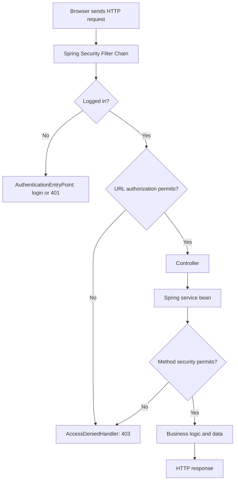

# 13.11. Applying URL Authorization and Method Security After Login

In a **Spring Security OAuth 2.0 / OpenID Connect (OIDC) Client** application running on Servlet, logging in successfully only answers **"who is this user?"**. From the moment Spring Security constructs `Authentication` and stores it in `SecurityContext`, the application still must decide **"what operations is that user permitted to perform?"**.

Two key mechanisms enforce that decision:

- **URL authorization:** checks permissions when an HTTP request passes through `SecurityFilterChain`, typically configured via `authorizeHttpRequests(...)` and `requestMatchers(...)`.
- **Method security:** checks permissions when a Java method is invoked on a protected Spring bean, such as `@PreAuthorize`, `@PostAuthorize`, and related mechanisms.

This lesson focuses on **combining both access-control layers after OIDC login** to protect endpoints and business logic, rather than simply setting `.anyRequest().authenticated()` and treating every logged-in user as fully privileged.

Examples use **Spring Boot 3.x, Spring Security 6.x, Spring MVC/Servlet, and `oauth2Login()`**. Some APIs and defaults may vary across Spring Security versions; verify configurations against your actual application version.

## 1. How Does Authentication Differ from Authorization?

### 1.1. Authentication — Confirming Identity

The user starts at:

```text
GET /oauth2/authorization/academy
```

Spring redirects the browser to the OP; after the OP authenticates the user, the browser is redirected back to:

```text
GET /login/oauth2/code/academy?code=...&state=...
```

Spring Security exchanges the authorization code for tokens, validates the ID Token per OIDC, creates `OidcUser` and an `Authentication` (usually `OAuth2AuthenticationToken`). The `SecurityContext` for subsequent requests holds the principal and authorities seen by the application.

### 1.2. Authorization — Checking Permissions

After logging in, the user may request:

```text
GET    /api/reports/101
POST   /api/reports
GET    /admin/users
DELETE /api/reports/101
```

These operations **are not automatically permitted merely because `Authentication.isAuthenticated()` is `true`**. The application needs policies: can the user read reports, who may create reports, which reports belong to their scope, and who may access administration?

Typical flow:



URL authorization checks **HTTP entry points**; method security protects **business operations**. The two layers complement each other; they do not need—and should not blindly duplicate—the exact same condition everywhere.

## 2. Authentication and GrantedAuthority After OIDC Login

An `OAuth2AuthenticationToken` typically provides:

```java
Authentication authentication =
        SecurityContextHolder.getContext().getAuthentication();

String principalName = authentication.getName();
Collection<? extends GrantedAuthority> authorities =
        authentication.getAuthorities();
```

With OIDC login, the principal is typically `OidcUser`. You can read fields such as `getSubject()`, `getIssuer()`, and `getClaims()` as supplied by the provider.

Example data from an OP:

```json
{
  "iss": "https://idp.example.com/realms/academy",
  "sub": "user-482",
  "preferred_username": "learner",
  "email": "learner@example.com",
  "groups": ["report-readers"]
}
```

**There is no universal rule that Spring automatically converts any `groups` or `roles` claim into `ROLE_ADMIN`.** Before using `hasRole` or `hasAuthority`, know where the authorities on `Authentication` actually come from and whether they align with application policy.

### 2.1. Common Permission Concepts

| Concept | Example | Meaning |
| --- | --- | --- |
| OIDC principal | `OidcUser` | User authenticated by the OP whose ID Token Spring accepted. |
| Spring `GrantedAuthority` | `ROLE_ADMIN`, `REPORT_READ`, `SCOPE_orders.read` | Authority string matched by Spring policies. |
| Role | `ADMIN` | Permission grouping in app policy; with default prefix `hasRole("ADMIN")` checks `ROLE_ADMIN`. |
| Permission/authority | `REPORT_READ` | Specific business permission, checked directly via `hasAuthority("REPORT_READ")`. |
| OAuth2 scope | `orders.read` | Scope granted by the OP/Authorization Server to an OAuth2 client or access token; not an app role by default. |
| Subject | `sub` | User identifier within an issuer's scope; not a permission. |
| OIDC claim | `groups` | Data usable as input for authority mapping after verifying the source. |

In OAuth2 Login setups, the framework may issue default authorities related to OAuth2/OIDC users and scopes (such as `OIDC_USER`, `OAUTH2_USER`, or `SCOPE_...` depending on mechanism/version). Those default authorities **do not represent permission to view all reports or administer the system**.

### 2.2. `hasRole` and `hasAuthority` Are Not Identical

Suppose authentication contains these authorities:

```text
ROLE_ADMIN
REPORT_READ
SCOPE_orders.read
```

Sample expressions:

| Expression | Check |
| --- | --- |
| `hasRole("ADMIN")` | Typically equivalent to requiring `ROLE_ADMIN` with the default role prefix. |
| `hasAuthority("ROLE_ADMIN")` | Exact string match for `ROLE_ADMIN`. |
| `hasAuthority("REPORT_READ")` | Exact match for business permission `REPORT_READ`. |
| `hasAuthority("SCOPE_orders.read")` | Exact match for this authority, if mapped/granted by Spring. |
| `isAuthenticated()` | User is validly logged in; does not imply admin privileges. |
| `permitAll()` | No authentication required for URLs/methods covered by this rule. |
| `denyAll()` | Denies every user within this rule's scope. |

If the application customizes the role prefix, interpret `hasRole` according to the active configuration. To reduce confusion across multi-system projects, prefer **permissions like `hasAuthority("REPORT_READ")`** for capabilities and a consistent `ROLE_ADMIN` convention for roles.

## 3. URL Authorization Protects Requests at the HTTP Layer

In Spring Security 6, modern Servlet setups use `SecurityFilterChain` with:

```java
http.authorizeHttpRequests(authorize -> authorize
    .requestMatchers("/public/**").permitAll()
    .requestMatchers("/admin/**").hasRole("ADMIN")
    .anyRequest().authenticated());
```

This enforces decisions when requests traverse the **authorization filter**. It does not protect services if a service is invoked from a scheduler, message listener, another controller, or code bypassing the restricted URL.

### 3.1. Realistic Configuration Example with HTTP Methods

Suppose a website requires:

- Home page and static assets are publicly accessible.
- `GET /api/reports/{id}` requires `REPORT_READ`.
- `POST /api/reports` requires `REPORT_WRITE`.
- `/admin/**` requires role `ADMIN`.
- Undeclared HTTP methods on `/api/reports/**` are denied.

Example:

```java
import org.springframework.context.annotation.Bean;
import org.springframework.context.annotation.Configuration;
import org.springframework.http.HttpMethod;
import org.springframework.security.config.Customizer;
import org.springframework.security.config.annotation.method.configuration.EnableMethodSecurity;
import org.springframework.security.config.annotation.web.builders.HttpSecurity;
import org.springframework.security.web.SecurityFilterChain;

@Configuration
@EnableMethodSecurity
public class SecurityConfig {

    @Bean
    SecurityFilterChain securityFilterChain(HttpSecurity http)
            throws Exception {

        http
            .authorizeHttpRequests(authorize -> authorize
                .requestMatchers("/", "/login", "/error",
                                 "/css/**", "/js/**", "/images/**")
                    .permitAll()

                .requestMatchers(HttpMethod.GET, "/api/reports/**")
                    .hasAuthority("REPORT_READ")

                .requestMatchers(HttpMethod.POST, "/api/reports")
                    .hasAuthority("REPORT_WRITE")

                .requestMatchers("/api/reports/**")
                    .denyAll()

                .requestMatchers("/admin/**")
                    .hasRole("ADMIN")

                .requestMatchers("/api/me")
                    .authenticated()

                .requestMatchers("/api/**")
                    .denyAll()

                .anyRequest()
                    .authenticated()
            )
            .oauth2Login(Customizer.withDefaults())
            .logout(Customizer.withDefaults());

        return http.build();
    }
}
```

**Meaning of the matcher order:**

1. Public URLs are accessible without logging in.
2. HTTP `GET` for reports requires `REPORT_READ`.
3. HTTP `POST` to the reports collection requires `REPORT_WRITE`.
4. Other report methods/paths (such as `DELETE`) **do not slip through accidentally**.
5. Admin URLs require the admin role.
6. `/api/me` requires only login.
7. Any `/api/**` without a declared policy is denied.
8. Remaining URLs require authentication.

Spring Security evaluates **request matchers in rule order**; the first matching rule wins. Placing `.anyRequest().authenticated()` before `/admin/**` prevents later rules from taking effect or fails DSL validation depending on version.

### 3.2. Matcher Order and Specificity

Compare two configurations:

**Prone to violating intent:**

```java
.authorizeHttpRequests(auth -> auth
    .requestMatchers("/api/**").authenticated()
    .requestMatchers("/api/admin/**").hasRole("ADMIN")
    .anyRequest().denyAll())
```

The broad rule `/api/**` matches `/api/admin/**` first, rendering the admin role requirement unreachable for that path.

**Better:**

```java
.authorizeHttpRequests(auth -> auth
    .requestMatchers("/api/admin/**").hasRole("ADMIN")
    .requestMatchers("/api/**").authenticated()
    .anyRequest().denyAll())
```

Always place **the most specific rules before general rules**. For sensitive endpoints, using `denyAll` as a fallback for undeclared URLs reduces risk when a team adds a REST endpoint and forgets to declare permissions.

### 3.3. HTTP Methods Are Part of the Policy

Restricting by path alone easily causes bugs. For example:

```java
.requestMatchers("/api/reports/**").hasAuthority("REPORT_READ")
```

If that path also accepts `DELETE` or `POST`, a **read-only** user passes the URL rule. Define rules by **method + path**, and guard state-changing operations with dedicated permissions.

Never assume `GET` is inherently safe: the application itself must ensure `GET` handlers have no side effects. If a controller deletes data on `GET`, that is a separate HTTP and authorization design flaw.

### 3.4. `permitAll` Differs from Ignoring Requests in Spring Security

In Spring Security, `permitAll()` makes a URL public **while requests still flow through the filter chain and security headers/protections**. It is generally preferable to excluding paths completely with `web.ignoring()` merely for static assets.

Never make `/actuator/**`, admin pages, or debug endpoints public just because they "need to work before login". Explicitly identify which paths genuinely require no identity.

## 4. Method Security Protects Business Logic at the Java Layer

URL authorization is a crucial perimeter, yet **multiple code paths can reach the same service**:

```text
HTTP /api/reports/{id} ----> ReportController ----+
                                                  |
Scheduler / worker -------------------------------+--> ReportService.getReport(id)
                                                  |
Another controller -------------------------------+
```

If only the first URL is guarded, other paths may bypass that policy. **Method security** places rules directly on business methods so every call through a Spring proxy is checked.

### 4.1. Enabling `@EnableMethodSecurity`

Add to a Spring configuration class:

```java
import org.springframework.context.annotation.Configuration;
import org.springframework.security.config.annotation.method.configuration.EnableMethodSecurity;

@Configuration
@EnableMethodSecurity
public class MethodSecurityConfig {
}
```

In Spring Security 6, `@EnableMethodSecurity` is the modern approach. It enables annotations such as `@PreAuthorize` and `@PostAuthorize` by default. If using `@Secured` or JSR-250 annotations like `@RolesAllowed`, enable the corresponding flags (`securedEnabled`, `jsr250Enabled`).

**Do not declare `@EnableMethodSecurity` twice** when `SecurityConfig` above already includes it. These two snippets simply illustrate configuration structure options.

### 4.2. `@PreAuthorize` Executes Before the Method

Simple business service example:

```java
import org.springframework.security.access.prepost.PreAuthorize;
import org.springframework.stereotype.Service;

@Service
public class ReportService {

    @PreAuthorize("hasAuthority('REPORT_READ')")
    public String getReport(long id) {
        return "report-" + id;
    }

    @PreAuthorize("hasAuthority('REPORT_WRITE')")
    public String createReport(String title) {
        return "created-" + title;
    }
}
```

When a controller or another bean calls `reportService.getReport(101)`, Spring method security checks `REPORT_READ` **before running the method body**. An unauthorized caller receives an access denied error instead of reading data.

The snippet above illustrates the policy layer; returning simple strings makes the check point easy to see. In real systems, the service interacts with repositories/databases and enforces ownership, tenant, and record-state rules.

### 4.3. URL Authorization and Method Security Do Not Have to Be Identical

An endpoint:

```text
GET /api/reports/101
```

may need to pass:

1. **URL rule**: `GET /api/reports/**` requires `REPORT_READ`.
2. **Service rule**: `getReport(...)` requires `REPORT_READ` **and** permission to view report `101` specifically.

The URL layer rejects HTTP requests lacking general read rights early. The method layer enforces resource-specific policies and stays reusable across callers.

### 4.4. Controller Calling the Service

Wiring HTTP to the service:

```java
import org.springframework.http.ResponseEntity;
import org.springframework.web.bind.annotation.*;

@RestController
@RequestMapping("/api/reports")
public class ReportController {

    private final ReportService reportService;

    public ReportController(ReportService reportService) {
        this.reportService = reportService;
    }

    @GetMapping("/{id}")
    public ResponseEntity<String> get(@PathVariable long id) {
        return ResponseEntity.ok(reportService.getReport(id));
    }

    public record CreateReportRequest(String title) {}

    @PostMapping
    public ResponseEntity<String> create(
            @RequestBody CreateReportRequest request) {
        return ResponseEntity.ok(
                reportService.createReport(request.title()));
    }
}
```

The controller does not parse URLs to guess roles. Spring Security enforces URL policies, then the service enforces its own policies. Even if another controller calls the service and forgets a URL rule, method security still guards the business operation—**provided the call goes through the bean proxy**.

## 5. Enforcing Per-Record Permissions: Preventing IDOR

A rule like `hasAuthority("REPORT_READ")` only says the user may read **some** reports. It **does not mean** they may read every report in the system.

Suppose two reports exist:

```text
Report 101 -> owned by internal account A
Report 202 -> owned by internal account B
```

Both A and B may hold `REPORT_READ`, yet A must not view Report 202 without additional permission. Checking only a general authority and querying by a client-supplied `id` leads to **Insecure Direct Object Reference (IDOR)**.

### 5.1. Adding a Resource-Level Permission Check

Spring method security can invoke a permission-checking bean:

```java
import org.springframework.security.access.method.P;
import org.springframework.security.access.prepost.PreAuthorize;
import org.springframework.stereotype.Service;

@Service
public class ReportService {

    @PreAuthorize(
        "hasAuthority('REPORT_READ') and " +
        "@reportAccess.canRead(authentication, #reportId)")
    public String getReport(@P("reportId") long reportId) {
        return "report-" + reportId;
    }

    @PreAuthorize("hasAuthority('REPORT_WRITE')")
    public String createReport(String title) {
        return "created-" + title;
    }
}
```

Note: this is a **replacement** for `ReportService` in Section 4, not a second duplicate class to create. `@P("reportId")` helps Spring Security resolve the `reportId` parameter name in the expression when builds strip Java parameter names; projects can also enable the `-parameters` compiler flag or use other supported mechanisms.

An illustrative policy bean:

```java
import java.util.Map;

import org.springframework.security.core.Authentication;
import org.springframework.security.oauth2.core.oidc.user.OidcUser;
import org.springframework.stereotype.Component;

@Component("reportAccess")
public class ReportAccess {

    // Mock data solely for illustration.
    // Production: look up owner/tenant/ACL from a trusted repository.
    private final Map<Long, String> reportOwners = Map.of(
        101L, "https://idp.example.com/realms/academy|user-482",
        202L, "https://idp.example.com/realms/academy|user-913"
    );

    public boolean canRead(Authentication authentication, long reportId) {
        if (authentication == null
                || !authentication.isAuthenticated()
                || !(authentication.getPrincipal() instanceof OidcUser user)) {
            return false;
        }

        String externalIdentity =
                user.getIssuer().toString() + "|" + user.getSubject();

        return externalIdentity.equals(reportOwners.get(reportId));
    }
}
```

This illustrates **where ownership is checked**, not a production identity store design. Real systems map `(issuer, subject)` to an **internal account ID** via a user directory service, then check resources against databases/ACLs/tenant boundaries. Never put username/email in the URL and treat it as proof of ownership.

### 5.2. Combining Multiple Conditions

A policy might state:

```text
Has REPORT_READ
AND report belongs to current tenant
AND report is not locked
AND (
      owner is current user
      OR user has REPORT_AUDIT permission
    )
```

For testability and auditability, multi-condition logic belongs inside a **domain authorization service** like `ReportAccess`, rather than stuffing huge SpEL strings into annotations or scattering checks across controllers.

### 5.3. Do Not Rely Solely on `@PostAuthorize` to Prevent IDOR

`@PostAuthorize` checks results after the method finishes, for example:

```java
@PostAuthorize("hasAuthority('REPORT_READ')")
public ReportRecord findReport(long reportId) { ... }
```

However, the method **already executed before the decision is evaluated**. If the method sent an email, called an API with side effects, or read/wrote sensitive data inappropriately, blocking the final return value is too late. For sensitive actions and record-level permissions, check **before querying or inside the query constrained by principal/tenant** whenever possible.

## 6. Common Method Security Annotations

| Annotation | Evaluation Time | Example | Notes |
| --- | --- | --- | --- |
| `@PreAuthorize` | Before method runs | `@PreAuthorize("hasAuthority('REPORT_READ')")` | Ideal for guarding service methods. |
| `@PostAuthorize` | After method returns | `@PostAuthorize("returnObject.ownerId == authentication.name")` | Does not replace pre-checks before side effects; check data/identity types carefully. |
| `@PreFilter` | Filters collection argument before method | `@PreFilter("filterObject.ownerId == authentication.name")` | Suits collection inputs; does not replace DB policies. |
| `@PostFilter` | Filters collection return value | `@PostFilter("filterObject.visible")` | Expensive on large datasets; never use instead of DB queries to avoid fetching unauthorized data. |
| `@Secured` | Legacy role/authority annotation | `@Secured("ROLE_ADMIN")` | Requires enabling `securedEnabled=true`. |
| `@RolesAllowed` | JSR-250 role check | `@RolesAllowed("ADMIN")` | Requires enabling `jsr250Enabled=true`. |

In Spring Security 6, `@PreAuthorize` expresses detailed conditions cleanly and is widely used. Avoid stacking multiple annotations on one method without understanding how they combine; prefer **one clear policy** near ownership logic.

### 6.1. `@PostFilter` Is Not Query Authorization

Example:

```java
@PostFilter("hasAuthority('REPORT_READ')")
public List<ReportRecord> allReports() {
    return repository.findAll();
}
```

Even when the expression filters results, `repository.findAll()` **already loaded the data into the application tier** before Spring filtered it. For large datasets or tenant-partitioned data, pass the verified account/tenant filter directly into the database query, paginate, and enforce access at the query layer. Never rely on `@PostFilter` alone for multi-tenant isolation.

### 6.2. How Can Method Security Use the Principal?

Inside method security expressions, common variables include:

- `authentication`: the current `Authentication`.
- `principal`: the authentication's principal.
- `#paramName`: method parameter, when Spring can resolve parameter names.
- `returnObject`: return value for post-execution checks.
- Bean methods, e.g., `@reportAccess.canRead(authentication, #reportId)`.

With OIDC, `authentication.name` usually relates to the principal's subject/name, yet **is not guaranteed to equal the system's internal user ID**. When multiple issuers exist, use normalized identity mappings or an app-specific principal rather than relying solely on `authentication.name` for cross-tenant decisions.

## 7. Mapping Authorities from OIDC Claims

Both URL and method security match **`GrantedAuthority`**. Thus if an application writes `hasRole("ADMIN")` without an authority named `ROLE_ADMIN`, even logged-in users will be denied.

Spring Security offers extension points to map authorities. Still, mapping must rely on **verified identity sources and trust policies** of the application, never blindly trusting arbitrary `groups` values or an email domain.

### 7.1. Example `GrantedAuthoritiesMapper` Restricted by Issuer

Suppose the official OP `https://idp.example.com/realms/academy` supplies a `groups` claim in ID Token/UserInfo under a verified contract. The app wants:

- group `report-readers` → authority `REPORT_READ`;
- group `report-editors` → authority `REPORT_WRITE`;
- group `portal-admins` → role authority `ROLE_ADMIN`.

Java example:

```java
import java.util.Collection;
import java.util.HashSet;
import java.util.Set;

import org.springframework.context.annotation.Bean;
import org.springframework.context.annotation.Configuration;
import org.springframework.security.core.GrantedAuthority;
import org.springframework.security.core.authority.SimpleGrantedAuthority;
import org.springframework.security.core.authority.mapping.GrantedAuthoritiesMapper;
import org.springframework.security.oauth2.core.oidc.user.OidcUserAuthority;

@Configuration
public class AuthoritiesConfiguration {

    private static final String TRUSTED_ISSUER =
            "https://idp.example.com/realms/academy";

    @Bean
    GrantedAuthoritiesMapper userAuthoritiesMapper() {
        return authorities -> {
            Set<GrantedAuthority> mapped = new HashSet<>(authorities);

            for (GrantedAuthority authority : authorities) {
                if (!(authority instanceof OidcUserAuthority oidc)) {
                    continue;
                }

                String issuer = oidc.getIdToken()
                        .getIssuer().toString();

                if (!TRUSTED_ISSUER.equals(issuer)) {
                    continue;
                }

                Object rawGroups = oidc.getAttributes().get("groups");
                if (!(rawGroups instanceof Collection<?> groups)) {
                    continue;
                }

                if (groups.contains("report-readers")) {
                    mapped.add(new SimpleGrantedAuthority("REPORT_READ"));
                }
                if (groups.contains("report-editors")) {
                    mapped.add(new SimpleGrantedAuthority("REPORT_WRITE"));
                }
                if (groups.contains("portal-admins")) {
                    mapped.add(new SimpleGrantedAuthority("ROLE_ADMIN"));
                }
            }

            return mapped;
        };
    }
}
```

This snippet **only illustrates mapping when policy trusts the `groups` claim from the issuer above**. It never grants permissions based on email, `preferred_username`, or browser-submitted values. In real applications, also account for audience, UserInfo provenance, provider config, group namespaces, and revocation.

Specifically: if `groups` is absent or the provider puts groups in another custom claim, the mapper will **not** fabricate application authorities, and protected endpoints remain denied. Failing closed is far safer than silently granting access.

### 7.2. Registering the Mapper with `oauth2Login()`

In `SecurityFilterChain` configuration, you can replace:

```java
.oauth2Login(Customizer.withDefaults())
```

with:

```java
.oauth2Login(oauth2 -> oauth2
    .userInfoEndpoint(userInfo -> userInfo
        .userAuthoritiesMapper(userAuthoritiesMapper)))
```

This assumes `GrantedAuthoritiesMapper userAuthoritiesMapper` is injected into the configuration method from a Spring bean (or resolved via `@Configuration`). Explicit integration inside the bean method:

```java
@Bean
SecurityFilterChain securityFilterChain(
        HttpSecurity http,
        GrantedAuthoritiesMapper mapper
) throws Exception {

    http
        .authorizeHttpRequests(authorize -> authorize
            .requestMatchers("/", "/error").permitAll()
            .requestMatchers("/admin/**").hasRole("ADMIN")
            .anyRequest().authenticated())
        .oauth2Login(oauth2 -> oauth2
            .userInfoEndpoint(userInfo -> userInfo
                .userAuthoritiesMapper(mapper)));

    return http.build();
}
```

This is **an alternative security chain configuration**, not a second bean to create alongside `SecurityConfig` in Section 3. It simply shows where the mapper plugs in. When applying to your project, keep all required URL authorization rules and swap only the login mapping part.

### 7.3. Never Grant All OIDC Users Admin Rights

An anti-pattern:

```java
// WRONG: every logged-in user gets admin privileges
mapped.add(new SimpleGrantedAuthority("ROLE_ADMIN"));
```

OIDC Authentication verifies identity; **it does not grant administrative privileges by default**. Map claims/roles only after verifying source, claim contract, trust level, and business conditions. For sensitive privileges, querying internal roles from a database/authorization service is often safer than trusting long-lived claims.

### 7.4. Mapping Permissions from Scope

If `Authentication` contains `SCOPE_orders.read`, you can use:

```java
.hasAuthority("SCOPE_orders.read")
```

but understand the difference between **an access token scope issued by the OP** and an application authority. Scopes generally represent permissions an OAuth2 client may request or use against a Resource Server; they **do not prove** the user can edit every record in the website. Never use `SCOPE_orders.read` alone to bypass ownership/tenant checks.

## 8. Multi-Provider and Multi-Account Contexts

An application may support logging in via `corporate` and `partner`:

```yaml
spring:
  security:
    oauth2:
      client:
        registration:
          corporate:
            provider: corporate-op
            client-id: ${CORP_CLIENT_ID}
            client-secret: ${CORP_CLIENT_SECRET}
            authorization-grant-type: authorization_code
            scope: [openid, profile]
          partner:
            provider: partner-op
            client-id: ${PARTNER_CLIENT_ID}
            client-secret: ${PARTNER_CLIENT_SECRET}
            authorization-grant-type: authorization_code
            scope: [openid, profile]
        provider:
          corporate-op:
            issuer-uri: ${CORP_ISSUER_URI}
          partner-op:
            issuer-uri: ${PARTNER_ISSUER_URI}
```

A role named `admin` from Corporate OP and a role `admin` from Partner OP **do not necessarily mean the same thing**. When mapping authorities:

1. Check the verified issuer/registration.
2. Confirm which provider is allowed to grant which authority.
3. Normalize roles/permissions in the internal domain.
4. Map identities by `(issuer, subject)`, not solely email.
5. Never let a lower-trust provider grant `ROLE_ADMIN` across the whole app.

In multi-tenant apps, **tenant boundaries must be enforced alongside permissions**—e.g., services verify a report belongs to a tenant the principal is allowed to access. Never let a browser-sent tenant ID act as the sole basis.

## 9. Layer-by-Layer Authorization Decision Flow

To design policies, you can use this matrix:

| Request / Operation | URL Authorization | Method Security | Data Checks |
| --- | --- | --- | --- |
| `GET /` | `permitAll` | Usually not needed | Never return private data |
| `GET /api/me` | `authenticated` | If calling a service, apply dedicated policy | Return only current user info, never raw tokens/full claims |
| `GET /api/reports/{id}` | `REPORT_READ` | `REPORT_READ` + ownership/tenant | Query/report must belong to user's scope |
| `POST /api/reports` | `REPORT_WRITE` | `REPORT_WRITE`, verify business state | Derive owner/tenant from server-side principal |
| `GET /admin/users` | `ROLE_ADMIN` | Matching admin permission in service | May need tenant-scoped admin boundaries |
| `DELETE /api/reports/{id}` | Deny if not yet designed | Dedicated delete permission, if implemented | Verify status, ownership, audit |
| Internal report batch job | Does not go through HTTP | Method invoked under proper security context or separate policy | Never assume jobs have a browser principal |

**Key point:** URL authorization decides whether an HTTP request can proceed; method security guards business logic when services are called from different entry points. Finally, **object-level authorization** ensures data belongs to the right user/tenant.

## 10. Important Limitations of Method Security

### 10.1. Spring AOP Proxies and Self-Invocation

Method security in Spring Security Servlet typically relies on **Spring AOP proxies**. That means calls must pass through the Spring-managed proxy for the interceptor to execute.

Common pitfall:

```java
@Service
public class ReportWorkflow {

    public void process(long id) {
        // Calling this.getSecretReport(...) within the same instance
        // usually DOES NOT pass through the method-security proxy.
        String report = getSecretReport(id);
        // ...
    }

    @PreAuthorize("hasAuthority('REPORT_READ')")
    public String getSecretReport(long id) {
        return "secret-" + id;
    }
}
```

If `process` is unprotected and directly calls `getSecretReport`, the annotation on the inner method may not trigger on that call path. Safer designs:

- Place sensitive logic in a **separate service bean** and call it via Spring injection.
- Or guard the outer entry-point method actually invoked through the proxy.
- Avoid relying on `private`, `final`, or self-invocation where AOP proxies cannot intercept as expected.
- If using AspectJ weaving or another mode, understand the differences and exact setup.

### 10.2. Objects Created with `new` Are Not Managed by Spring

Example:

```java
ReportService service = new ReportService();
service.getReport(101);
```

An object instantiated manually with `new` **is not a Spring bean wrapped by a method security proxy**. To enforce permissions in services, use dependency injection and Spring-managed beans.

### 10.3. Schedulers, Queue Consumers, and Background Jobs

If a job calls a `@PreAuthorize`-annotated service without a user `SecurityContext`, the expression will deny access—this signals you must define **background-job permissions** explicitly, not disable method security.

Options include:

- Separate user-facing service policies from internal business logic with controlled entry points.
- Use a trusted service identity/authorization mechanism for the job.
- Pass and validate actor/tenant explicitly per contract in delegated workflows.
- Never reuse a browser session's `SecurityContext` arbitrarily across threads.

### 10.4. Method Security Can Be Bypassed by Test Setup

A unit test calling a service instance directly outside a Spring context will not execute method security proxies. To verify annotations actually enforce rules, test through the **Spring-managed bean/proxy** or write proper integration tests. Unit tests checking plain Java logic do not test runtime authorization.

## 11. CSRF and Sessions Still Matter After Login

Apps using `oauth2Login()` normally rely on a **session cookie**. Browsers automatically attach cookies on matching requests, so authorization does not replace **CSRF protection**.

Example request:

```http
POST /api/reports HTTP/1.1
Host: app.example.com
Cookie: JSESSIONID=...
Content-Type: application/json

{"title":"Monthly report"}
```

Even if the user holds `REPORT_WRITE`, a state-changing request must still carry a valid **CSRF token** when CSRF protection is enabled and applicable.

- **Authorization:** does the current user have permission to create a report?
- **CSRF:** did the state-changing request originate from genuine user interaction rather than another site forcing the browser to submit it?

Never call `csrf.disable()` app-wide just to make POSTs pass in tests. Use the proper CSRF token mechanism (form/HTTP header) and protect cookies.

### 11.1. Authentication Cookies and OAuth2 Tokens Differ

Server-side websites after OIDC login typically use `JSESSIONID` for the Spring session. Access tokens are managed via `OAuth2AuthorizedClient` for the backend to call APIs. Never use the **ID Token** as a default Bearer token for REST APIs, and never treat the session cookie as an external Resource Server credential.

If an endpoint serves both browser sessions and Bearer token APIs, design explicit security chains and principal/authority mappings; **OAuth2 Login is not OAuth2 Resource Server**.

## 12. 401, 403, and Login Redirects: Interpreting Outcomes Accurately

In a web app using `oauth2Login()`, an unauthenticated request to a protected URL usually triggers a redirect to the login page or authorization flow. The browser observes an **HTTP 302 redirect** rather than `401`.

After logging in:

- Missing authority in a URL rule → typically denied (`403 Forbidden`) by exception handling.
- Missing permission in method security → typically throws `AccessDeniedException`, translated by Spring Security to the corresponding response.
- An HTTP POST with the right permission but missing CSRF token → also returns `403`, whose cause is **not missing authorities**.
- OIDC login failure (`state`, ID Token, nonce, issuer) → belongs to the **authentication flow**, not the `REPORT_READ` policy.

| Situation | Typical Response | Meaning |
| --- | --- | --- |
| Anonymous user opens protected page | Redirect to login/OP | No valid Authentication yet. |
| Logged-in OIDC user lacks `ROLE_ADMIN` | `403` | Authenticated, yet not allowed to use this feature. |
| POST has `REPORT_WRITE` yet lacks CSRF | `403` | CSRF protection blocked the request. |
| API receives invalid Bearer token | `401` if Resource Server | Resource Server token validation failed. |
| Endpoint does not exist | `404` if routed to MVC with no handler | Does not mean policy allowed access to all data. |

For pure JSON APIs, you may want **`401` instead of an HTML redirect** for anonymous `/api/**` calls. Configure `AuthenticationEntryPoint` and `AccessDeniedHandler` per request matcher/chain, or separate web UI and API into distinct security chains. Never return `401` for every `403` or vice versa.

## 13. Testing Policies with Spring Security Test

### 13.1. Test Dependency

In Maven:

```xml
<dependency>
    <groupId>org.springframework.security</groupId>
    <artifactId>spring-security-test</artifactId>
    <scope>test</scope>
</dependency>
```

Spring Security Test provides convenient request post-processors and annotations to simulate principals/authorities without running a real OP in every test.

### 13.2. URL Authorization with `MockMvc`

Testing requests with matching controllers:

```java
import static org.springframework.security.test.web.servlet.request
        .SecurityMockMvcRequestPostProcessors.oidcLogin;
import static org.springframework.security.test.web.servlet.request
        .SecurityMockMvcRequestPostProcessors.csrf;

import static org.springframework.test.web.servlet.request.MockMvcRequestBuilders.get;
import static org.springframework.test.web.servlet.result.MockMvcResultMatchers.status;

import org.junit.jupiter.api.Test;
import org.springframework.beans.factory.annotation.Autowired;
import org.springframework.boot.test.autoconfigure.web.servlet.AutoConfigureMockMvc;
import org.springframework.boot.test.context.SpringBootTest;
import org.springframework.security.core.authority.SimpleGrantedAuthority;
import org.springframework.test.web.servlet.MockMvc;

@SpringBootTest
@AutoConfigureMockMvc
class ReportAuthorizationTests {

    @Autowired MockMvc mockMvc;

    @Test
    void loggedInUserWithoutReadAuthorityIsForbidden() throws Exception {
        mockMvc.perform(get("/api/reports/101")
                .with(oidcLogin()))
            .andExpect(status().isForbidden());
    }

    @Test
    void loggedInUserWithReadAuthorityCanPassUrlRule() throws Exception {
        mockMvc.perform(get("/api/reports/101")
                .with(oidcLogin().authorities(
                    new SimpleGrantedAuthority("REPORT_READ"))))
            .andExpect(status().isOk());
    }
}
```

This test assumes `/api/reports/101` is handled by a controller that can return `200`, and either **the underlying service adds no ownership policy** or the fixture grants access. If the service uses `ReportAccess` from Section 5, set matching issuer, subject, and test record/ACL fixtures so the call succeeds. Apps backed by repositories or external databases must seed matching fixtures.

### 13.3. POST Must Satisfy Both Authority and CSRF

```java
import static org.springframework.security.test.web.servlet.request
        .SecurityMockMvcRequestPostProcessors.oidcLogin;
import static org.springframework.security.test.web.servlet.request
        .SecurityMockMvcRequestPostProcessors.csrf;

import static org.springframework.test.web.servlet.request.MockMvcRequestBuilders.post;
import static org.springframework.test.web.servlet.result.MockMvcResultMatchers.status;

import org.springframework.http.MediaType;
import org.springframework.security.core.authority.SimpleGrantedAuthority;

// Excerpt inside an @Test with MockMvc configured:
mockMvc.perform(post("/api/reports")
        .with(oidcLogin().authorities(
                new SimpleGrantedAuthority("REPORT_WRITE")))
        .with(csrf())
        .contentType(MediaType.APPLICATION_JSON)
        .content("{\"title\":\"Demo\"}"))
    .andExpect(status().isOk());
```

Here `ReportController.create` returns `200`. If your real app returns `201 Created`, update the expectation to match the contract. Without `with(csrf())` when CSRF is enabled, the POST request may be rejected **before method security ever executes**.

### 13.4. `@WithMockUser` Does Not Verify OIDC Claim Mapping

`@WithMockUser(authorities = "REPORT_READ")` is very useful for testing **URL/method policies** with mocked authorities. Yet it **does not prove** a real OP `groups` claim is mapped correctly by your mapper, nor does it prove ID Token validation works.

Therefore maintain two test categories:

1. **Authorization policy tests**: mock authorities to verify which rules allow/deny access.
2. **Authentication/mapping integration tests**: use a test OP or proper verification/mapper components to verify issuer, claims, authority mapping, and real login.

Never assume testing policies with mock users tests the entire OIDC flow.

## 14. Permission Model for Multi-Tenant Applications

Suppose a reporting system has:

```text
Tenant A:
  user A1: REPORT_READ, REPORT_WRITE
  user A2: REPORT_READ

Tenant B:
  user B1: REPORT_READ
```

If `GET /api/reports/101` checks only `REPORT_READ`, both A2 and B1 pass the URL rule. Yet Report 101 may belong to Tenant A. **URL-level authorities are not enough to stop B1 from reading Report 101**.

A service policy must use **server-side tenant identity**, for example:

```text
authenticated request
  -> map (issuer, subject) to internal account
  -> load tenant(s) the account may access
  -> query report by (reportId, allowed tenantId)
  -> verify REPORT_READ permission and business status
  -> return report
```

You can check `@PreAuthorize("@reportAccess.canRead(authentication, #id)")`, and production systems should also apply **query-level tenant filtering** in repositories to minimize the risk of leaking data. Never accept a `tenantId` query parameter as sole proof the user belongs to that tenant.

If the OP includes a `tenant` claim, verify which tenants that OP is authoritative for, how freshness is maintained, and how it integrates with your app's tenancy model. Never let every issuer declare arbitrary tenants.

## 15. Permissions Can Change While a Session Is Still Active

An OIDC session normally holds the `Authentication`/authorities resolved at login time. If an admin later revokes `REPORT_WRITE` at the OP or in the database, the app may still hold stale authorities until the session updates.

Thus an authorization policy needs not only "allow conditions", but also **permission freshness**:

- Low-sensitivity permissions can be session-cached with an appropriate TTL.
- Admin, payment, or data-deletion rights may require checking authoritative stores near action time.
- Upon revocation, invalidate sessions, refresh authorities, or re-check internal permissions on sensitive operations.
- With multiple providers, never let an old token from provider A override a revoked right from provider B.
- Never assume `@PreAuthorize` automatically calls the OP to refresh claims on every request.

A well-written method check operating on **stale authorities** can still violate organizational policy. Retention/refresh intervals must be set by product and security requirements.

## 16. Common Implementation Errors

| Symptom | Possible Cause | Resolution |
| --- | --- | --- |
| OIDC login succeeds yet `/admin/**` returns `403` | `ROLE_ADMIN` missing from authorities | Inspect mapper and role prefix; never grant ADMIN to everyone. |
| `hasRole("ADMIN")` fails to match `ADMIN` | Default `ROLE_` prefix added | Use `ROLE_ADMIN` or `hasAuthority` consistently across the system. |
| User with `REPORT_READ` can call DELETE | URL rule too broad, ignored HTTP method | Configure method + path rules and add `denyAll` fallback. |
| Controller is protected yet scheduler calls service freely | URL authorization only | Place policies on service methods or job entry points. |
| `@PreAuthorize` does not fire on same-class calls | Self-invocation bypasses AOP proxy | Extract to another Spring bean/entry point or redesign call path. |
| Unit test calling `new ReportService()` throws no security error | Bypasses Spring method security proxy | Test the bean via Spring context and security configuration. |
| User reads another tenant's report | Checked general authority only, missing object/tenant ownership | Enforce resource policies and safe query filters. |
| User has role yet POST still returns `403` | Missing CSRF token | Check CSRF before blaming roles/authorities. |
| Unauthenticated API client gets `302` instead of `401` | Default web login entry point | Configure an appropriate API entry point / separate chain. |
| `@PreAuthorize` referencing `#id` cannot resolve parameter | Parameter names missing for expressions | Use `@P`, `-parameters`, or supported parameter discovery. |
| `groups` claim present yet authority missing | Missing mapper, wrong claim location, or OP didn't emit it | Check OP contract and mapping config; never guess roles. |
| Partner provider's `admin` becomes system-wide admin | Mapping unbound by issuer/tenant | Apply issuer-specific allowlists and internal policies. |
| Permission revoked yet active session still works | Stale authorities kept in `SecurityContext` | Implement refresh/invalidation or re-check sensitive operations. |
| Access token has scope yet website returns `403` | Scope not mapped to application authority | Distinguish OAuth2 scopes from app permissions and inspect mapping. |
| URL blocked yet data leaks via another endpoint | Protected only one HTTP route | Enforce method security and object-level authorization in services. |
| Tests pass with `@WithMockUser`, production OIDC lacks roles | Mocks do not test real authority mapping | Add OAuth2/OIDC mapping integration tests. |

## 17. Anti-Patterns to Avoid

### 17.1. Using Only `.anyRequest().authenticated()`

```java
.authorizeHttpRequests(a -> a.anyRequest().authenticated())
```

This only requires logging in; **it does not distinguish read, write, delete, or admin rights**. That may fit a single-role demo app, not applications with privilege levels or per-owner data.

### 17.2. Treating Email or Username as a Role

```java
if (user.getEmail().endsWith("@example.com")) {
    grant("ROLE_ADMIN");
}
```

Emails can change, be unverified, or come from different sources. Never use an email domain as the sole condition for sensitive privileges. Use trusted role stores or internal authorization systems.

### 17.3. Hiding Buttons Only on the Frontend

Hiding the "Delete" button from unprivileged users helps UX, yet **does not protect the HTTP endpoint**. Browsers can still craft manual requests. The server must enforce permissions at URL, service, and data-object layers.

### 17.4. Trusting Client-Supplied `tenantId` for Data Scoping

```text
GET /api/reports/101?tenantId=other-tenant
```

If the server accepts `tenantId` as proof of access scope without checking identity/ACLs, users can read another tenant's data. Tenant scope must come from trusted server-side state.

### 17.5. Disabling CSRF Because Method Security Works

Method security and CSRF address different threat classes. For cookie-based websites, never disable CSRF globally just because service methods use `@PreAuthorize`. Require valid CSRF tokens on `POST/PUT/PATCH/DELETE` per architecture.

### 17.6. Using `SCOPE_openid` as a Business Permission

`openid` marks OIDC login, **not permission to view all data**. Requiring `hasAuthority("SCOPE_openid")` lets virtually any OIDC user pass the URL rule regardless of business role.

### 17.7. Accepting Admin Roles from Any OP

When multiple OPs are integrated, never map `groups=admin` from a less-trusted OP to system-wide `ROLE_ADMIN`. Role mappings must bind issuer, tenant, registration, and authorization contracts.

### 17.8. Treating Self-Invocation as a "Privileged" Path

If a service uses `@PreAuthorize` yet an unprotected method calls a protected method on `this`, that is a proxy-bypass risk. Never rely on it as an intentional privilege mechanism; design service authorization cleanly.

## 18. Practice Exercise: Building an Authorization Matrix

Suppose a reporting site defines:

- `REPORT_READ`: read reports within assigned scope.
- `REPORT_WRITE`: create/edit reports within assigned scope.
- `REPORT_DELETE`: delete reports, requiring stricter policy.
- `ROLE_ADMIN`: access admin UI.
- Unauthenticated users may view only the home page and static assets.

### Step 1 — Define URL Policy

| URL | Method | Condition |
| --- | --- | --- |
| `/` | GET | `permitAll` |
| `/api/reports/{id}` | GET | `REPORT_READ` |
| `/api/reports` | POST | `REPORT_WRITE` + CSRF |
| `/api/reports/{id}` | DELETE | `REPORT_DELETE` + CSRF if delete is implemented |
| `/admin/**` | All required methods | `ROLE_ADMIN` |
| `/api/me` | GET | `authenticated` |

In an initial release without a delete API, use **`denyAll` for unsupported HTTP methods** rather than accidentally allowing them just because the user is logged in.

### Step 2 — Define Method Policy

- `ReportService.getReport(id)`: `REPORT_READ` and `reportAccess.canRead(authentication, id)`.
- `ReportService.createReport(request)`: `REPORT_WRITE`, derive owner from server-side identity.
- `ReportService.deleteReport(id)`: `REPORT_DELETE` and `reportAccess.canDelete(...)`, verify report status.
- `AdminService.listUsers()`: `ROLE_ADMIN`, optionally adding tenant-level admin boundaries.

### Step 3 — Define Authority Mapping

For each OP:

1. Which client registration and issuer are trusted?
2. Which claim does the OP guarantee means "user belongs to report-readers"?
3. Which authority does the app mapper produce?
4. When a user is removed from the group, when does the authority update?
5. Is this permission scoped to a tenant or individual records?

### Step 4 — Trace Execution Paths

- Anonymous user hitting `/admin/users`: prompted to log in or receives 401 per contract.
- OIDC user holding only `REPORT_READ` calling `GET /api/reports/101`: allowed if the report is in their scope.
- Same user calling `POST /api/reports`: denied for lacking `REPORT_WRITE`.
- User with `REPORT_WRITE` sending POST without CSRF: still denied.
- User with `ROLE_ADMIN` from an issuer not allowed to grant admin: mapper must **not** turn it into an internal admin authority.
- Service invoked from another controller: method policy still applies when invoked through the Spring proxy.
- User with `REPORT_READ` attempting to read another tenant's report: denied by object-level policy.

## 19. Self-Check Questions

**Question 1.** An OIDC-authenticated user lacks `ROLE_ADMIN`. Does `requestMatchers("/admin/**").hasRole("ADMIN")` allow access?

> No. `authenticated` and holding `ROLE_ADMIN` are separate conditions. The system should return access denied per the configured flow.

**Question 2.** How does `hasRole("ADMIN")` differ from `hasAuthority("ADMIN")`?

> With the default role prefix, `hasRole("ADMIN")` checks for `ROLE_ADMIN`, while `hasAuthority("ADMIN")` matches the exact string `ADMIN`.

**Question 3.** Why can't you rely solely on URL authorization to protect `ReportService`?

> The service can be invoked from another controller, scheduler, message consumer, or Java call paths bypassing the protected URL. Method security enforces policies at the business layer.

**Question 4.** A user has `REPORT_READ` and supplies a report ID. Can they read every report?

> No. Verify ownership/tenant/ACL on the record, not merely a general authority. This defends against IDOR.

**Question 5.** `@PreAuthorize` on a service method does not run when another method in the same class calls it directly. Why?

> Self-invocation typically bypasses the Spring AOP proxy, so the method security interceptor is never triggered.

**Question 6.** A user holds `REPORT_WRITE`, yet POSTing a report returns 403. Is a missing role guaranteed to be the cause?

> No. When CSRF protection is active, a missing CSRF token also produces `403`. Distinguish the cause before changing role policies.

**Question 7.** Are `email_verified=true` and a corporate domain address enough to grant `ROLE_ADMIN`?

> No. Administrative privileges must come from trusted role/permission stores and internal policies; email never replaces authorization.

**Question 8.** Does a passing test using `@WithMockUser(authorities="REPORT_READ")` prove real OIDC claim mapping works?

> Not yet. Mock users inject authorities directly without running token validation or custom `GrantedAuthoritiesMapper`. Write integration tests for mapping.

**Question 9.** `@EnableMethodSecurity` is enabled, yet the caller runs `new ReportService()`. Does the annotation work?

> Not automatically. The manually created object does not pass through a Spring security proxy; inject Spring-managed beans and test accordingly.

**Question 10.** Is method security needed when a service is called only from one URL-protected controller?

> It depends on sensitivity and architecture, yet method security adds valuable protection for domain policies—especially if the service is ever reused or needs object-level checks. Avoid mechanically duplicating rules everywhere; assign responsibilities clearly.

**Question 11.** If the OP updates a user's groups before the session expires, does `@PreAuthorize` automatically pull updated roles from the OP?

> No. It evaluates the current `Authentication` and whatever data policy services query. Design refreshes or authoritative lookups where needed.

**Question 12.** Why is `SCOPE_orders.read` insufficient to decide whether a user may read someone else's order?

> Scopes express client/token permissions at an API, not ownership of specific business objects. Enforce fine-grained policies by account, tenant, and order.

## 20. Summary

Combining URL authorization and method security looks like:

```text
Successful OIDC Login
      |
      v
OidcUser + GrantedAuthority
      |
      v
SecurityContext holding Authentication
      |
      v
HTTP request
      |
      +--> URL authorization:
      |      - requestMatchers
      |      - HTTP method + path
      |      - hasRole / hasAuthority
      |      - permitAll / authenticated / denyAll
      |
      v
Controller
      |
      v
Service via Spring proxy
      |
      +--> Method security:
      |      - @PreAuthorize
      |      - @PostAuthorize (when appropriate)
      |      - domain authorization bean
      |
      v
Object-level / tenant-level check
      |
      v
Execute business logic and return permitted data
```

Principles to remember:

1. **OIDC authenticates identity; Spring Security authorization decides permissions.** Successful login does not open every endpoint.
2. **URL authorization protects HTTP entry points**; match by method + path and order specific rules before broad ones.
3. **Method security protects business logic**, ensuring calls through Spring proxies obey policies across all invocation paths.
4. **Authorities must be mapped deliberately** from trusted OPs or role stores. `ROLE_ADMIN` never appears merely from holding an ID Token.
5. **Coarse permissions do not replace ownership/tenant checks.** Object-level authorization is mandatory for multi-user data.
6. **`@EnableMethodSecurity` and Spring AOP proxies have limits**: self-invocation, `new`-instantiated objects, and non-proxied calls bypass annotations.
7. **CSRF, session, and token security remain essential** after login, especially for cookie-based web apps.
8. **Testing authorization policies and testing OIDC authority mapping are distinct scopes**; mocked authorities do not verify ID Tokens or real claim contracts.
9. **Permissions have their own lifecycle**: plan for revocation and authority refreshes while sessions remain active.
10. Practice **defense in depth**: URL rules → method rules → verified account/tenant data ownership → permitted action.

### References

- [Spring Security Reference — Authorize HTTP Requests](https://docs.spring.io/spring-security/reference/servlet/authorization/authorize-http-requests.html).
- [Spring Security Reference — Method Security](https://docs.spring.io/spring-security/reference/servlet/authorization/method-security.html).
- [Spring Security Reference — Architecture](https://docs.spring.io/spring-security/reference/servlet/architecture.html).
- [Spring Security Reference — OAuth 2.0 Login](https://docs.spring.io/spring-security/reference/servlet/oauth2/login/index.html).
- [Spring Security Reference — OAuth 2.0 Login Advanced](https://docs.spring.io/spring-security/reference/servlet/oauth2/login/advanced.html).
- [Spring Security Reference — Testing Method Security](https://docs.spring.io/spring-security/reference/servlet/test/method.html).
- [Spring Security Reference — Testing OAuth 2.0](https://docs.spring.io/spring-security/reference/servlet/test/mockmvc/oauth2.html).
- [Spring Security Reference — CSRF Protection](https://docs.spring.io/spring-security/reference/servlet/exploits/csrf.html).
- [OpenID Connect Core 1.0 — ID Token](https://openid.net/specs/openid-connect-core-1_0.html#IDToken).
- [OWASP Authorization Cheat Sheet](https://cheatsheetseries.owasp.org/cheatsheets/Authorization_Cheat_Sheet.html).
