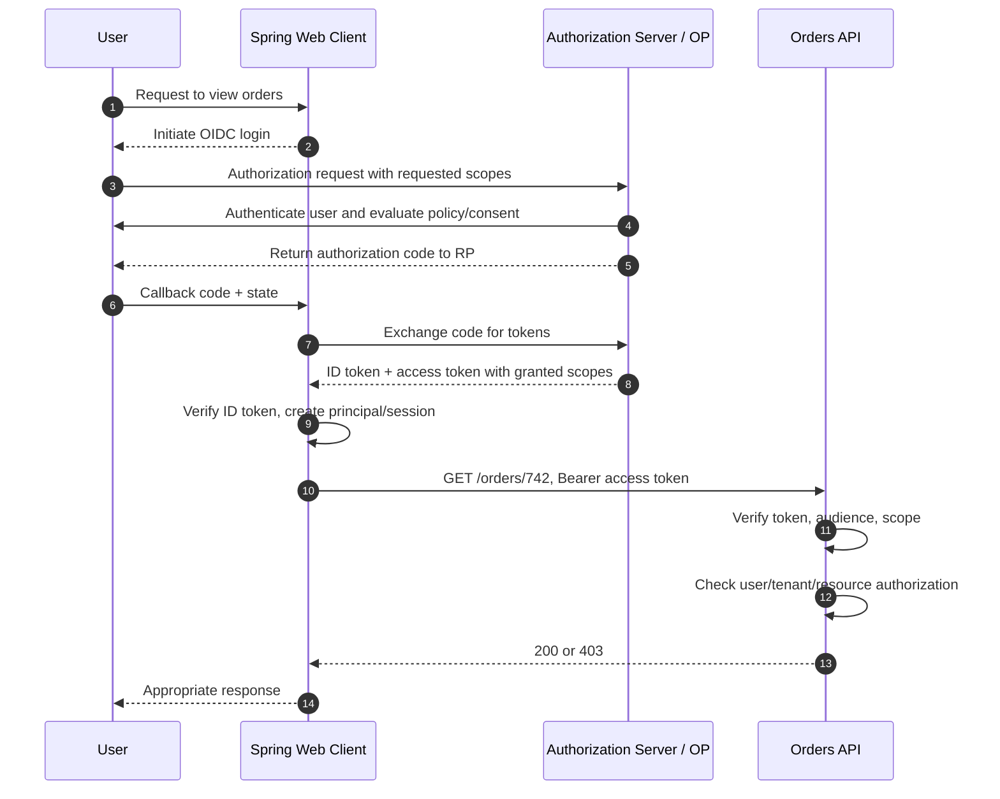
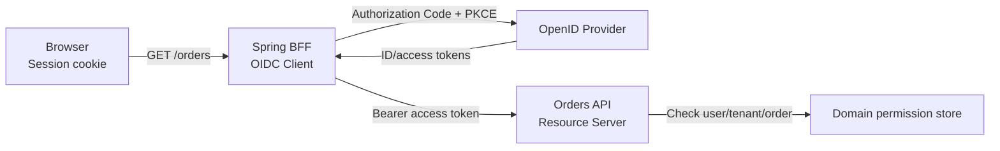

# 13.12. Distinguishing User Permissions from Client-Granted Scopes

In **Spring Security OAuth 2.0/OIDC Client**, after a user logs in successfully, the application can simultaneously hold:

- A **principal** representing the authenticated user.
- A set of **authorities/roles** that the application uses to enforce the principal's permissions.
- An **`OAuth2AuthorizedClient`** containing the access token issued by the Authorization Server.
- The access token's **scopes**, representing the access range delegated to the OAuth client when presenting that token.

These four concepts are related, yet **not synonymous**. Severe bugs occur when a system infers: "The access token has scope `orders.write`, so the logged-in user must be allowed to edit every order", or "The user has role ADMIN, so the OAuth client can call every API even without the matching token scope".

**Lesson focus:** user permissions and client-granted scopes must be evaluated by **role, resource, and token**. In many systems, an operation is permitted only when *the access token is valid, the scope allows the operation, the user holds permission on the specific resource, and business policy approves*.

This article distinguishes the terms, analyzes OAuth 2.0/OIDC from both Relying Party and Resource Server perspectives, and shows how to apply them in Spring Security Servlet with Java/YAML examples and common authorization mistakes.

## 1. Four Questions That Must Not Be Collapsed Into One

| Component | Question Answered | Example | Who Manages / Verifies? |
|---|---|---|---|
| **Authentication / principal** | Who logged in? | User with `iss=https://login.example.org`, `sub=user-725` | OP authenticates; RP validates ID token |
| **User role / authority** | Which actions is the user allowed to perform in the system? | `ROLE_ORDER_VIEWER`, `ROLE_ORDER_ADMIN` | Application policy / trusted permission source |
| **OAuth scope** | What access range was granted to the client's access token? | `orders.read`, `orders.write` | Authorization Server grants; Resource Server enforces |
| **Resource-level authorization** | May the user act on *this specific object*? | Permitted to view order `#742` belonging to company A | API/service and business data |

A user may be validly authenticated yet lack permission to view financial reports. An OAuth client may hold a token with `orders.read`, yet the subject behind that token still cannot view orders belonging to another tenant.

Conversely, a user may be an admin allowed to edit orders in the application, yet **an access token granted only `orders.read` does not become an `orders.write` token**.

### 1.1. A Pragmatic Authorization Principle

For a request to read an order:

```text
Allow reading order 742 when:

  Access token is valid for the orders API
  AND Token carries scope orders.read
  AND Subject is reliably identified
  AND Subject has permission to read order 742
  AND All tenant/status/organization rules hold
```

This is a typical combined model, **not a rigid formula for every protocol**. A service-to-service API may have no End-User; policies then evaluate workload/client permissions rather than an interactive user's permissions.

## 2. Roles in OAuth 2.0/OIDC

In the Authorization Code Flow:

- **Resource Owner / End-User:** the person using the application who can authorize the client to access data within protocol/policy limits.
- **OAuth Client / Relying Party:** the Spring Boot application, e.g., internal portal `portal.example.org`.
- **Authorization Server / OpenID Provider:** the server authenticating and issuing tokens, e.g., `login.example.org`.
- **Resource Server:** the API accepting access tokens, e.g., `orders-api.example.org`.



**Two distinct checks:**

1. The RP validates the **ID token** to confirm the OP authenticated the user and establish an OIDC session.
2. The Resource Server validates the **access token** and **business permissions** to decide whether to return data.

Never use an ID token as an access token simply because it is a validly signed JWT. An ID token normally has the OAuth client as its audience; an access token must be issued for the target Resource Server or API.

## 3. What Scope Is and What It Is Not

### 3.1. Scope in OAuth 2.0

`scope` is a set of strings expressing the **access range** requested by or granted to a client in the OAuth 2.0 protocol. Scope names depend on the Authorization Server and Resource Server, for example:

```text
orders.read
orders.write
reports.export
profile
email
```

OAuth does not standardize every business scope in the world. `orders.read` only has concrete meaning when the AS and Orders API agree on what kind of access that scope represents.

An authorization request might ask for:

```http
GET /authorize?response_type=code
  &client_id=portal-web
  &scope=openid%20profile%20orders.read
  &redirect_uri=https%3A%2F%2Fportal.example.org%2Flogin%2Foauth2%2Fcode%2Fcompany
  &state=<random-state>
```

Line breaks above are for readability; real requests must be properly URL-encoded.

After token exchange, the access token may receive only a **subset** of requested scopes. Distinguish **requested scopes** from **granted scopes**.

### 3.2. Scope Is Not a User Role

Suppose a user holds internal role `ROLE_ORDER_VIEWER`, and the RP requests an access token with scope `orders.read`. Both may hold true, yet their source and semantics differ:

- `ROLE_ORDER_VIEWER` is a **permission the application attaches to a principal** under application policy.
- `orders.read` is a **scope granted to the token** so the client may request a class of operations against the API.

Scopes do not by themselves identify which resources belong to the user, which tenant the user belongs to, or whether the user may approve a particular order.

For example, `orders.read` may allow the client to **ask the API to evaluate an order-read operation**, without automatically allowing reading **every order** of every customer.

### 3.3. Scope Is Not Necessarily a Permanent Client Right

An OAuth access token has its own lifetime, audience, and scope. Granted scopes can vary by:

- Client registration and allowed scopes at the AS.
- Logged-in user and consent policies.
- Target resource server/audience.
- Grant type used.
- Organizational policy and token issuance time.
- Original authorization grant limits when using refresh tokens.

Therefore, never treat "the client was once granted `orders.write`" as a permanent license. The API must validate the active access token and enforce current business permission policies.

## 4. OIDC Scopes Do Not Equal Business Permissions

In OIDC, common scopes include:

| Scope | Primary Meaning |
|---|---|
| `openid` | Request OIDC processing and an ID token |
| `profile` | Request access to a standard set of profile claims |
| `email` | Request email claims |
| `address` | Request address claims |
| `phone` | Request phone number claims |
| `offline_access` | Request offline access / refresh token per OP rules |

For example:

```yaml
scope:
  - openid
  - profile
  - email
```

does not mean:

```text
ROLE_USER
ROLE_ADMIN
reports.read
orders.write
```

Similarly, `profile` is no guarantee the OP always returns full name, picture, gender, birthdate, or every possible claim. Several fields are optional and subject to scope/consent policy.

**Avoid this mistake:** automatically granting `ROLE_ADMIN` or edit rights merely because a user logged in with `openid`, `profile`, `email`.

## 5. ID Token, Access Token, and UserInfo Have Different Jobs

### 5.1. ID Token Authenticates the User to the RP

Example ID token payload:

```json
{
  "iss": "https://login.example.org",
  "sub": "user-725",
  "aud": "portal-web",
  "exp": 1924999999,
  "iat": 1924996399,
  "preferred_username": "linh"
}
```

The OIDC ID token answers: *Which OP authenticated which subject for which client in what context?*

The RP must validate signature, issuer, audience, expiration, nonce, and related OIDC conditions. `sub` combined with `iss` is typically the right external identity key—**not a role**.

### 5.2. Access Token Serves the Resource Server

Example JWT access token following a provider profile:

```json
{
  "iss": "https://login.example.org",
  "sub": "user-725",
  "aud": "orders-api",
  "client_id": "portal-web",
  "scope": "orders.read",
  "exp": 1924999999,
  "iat": 1924996399
}
```

This token is sent to Orders API to verify access rights. JWT access tokens vary in structure; exact claim names and meanings depend on the profile/AS. Access tokens **do not have to be JWTs**—they may be opaque tokens requiring introspection by the API.

With JWT access tokens, `scope` may be a space-delimited string or `scp` a list of scopes depending on AS convention. Spring Security Resource Server maps scopes accordingly, yet the app must confirm the provider's actual format.

### 5.3. UserInfo Serves Profile Data, Not Automatic Permissions

An OIDC UserInfo Endpoint might return:

```json
{
  "sub": "user-725",
  "name": "Linh Nguyen",
  "email": "linh@example.org",
  "email_verified": true
}
```

These claims assist profile display and identity mapping. A verified email does not mean the user holds admin roles. If `groups` or `roles` claims appear, verify under which contract the OP issued them and whether the app trusts them for authorization.

At the RP, always verify that UserInfo's `sub` matches the verified ID token's `sub` before using UserInfo under OIDC.

## 6. User Roles, Authorities, and Permissions in Spring Security

Spring Security represents the login outcome through an `Authentication` with:

- `principal`: the authenticated user or subject.
- `authorities`: the collection of `GrantedAuthority` objects the app permits for authorization checks.
- `authenticated`: authentication status per framework.
- `details`/`credentials`: additional implementation-specific data.

```java
Authentication authentication =
    SecurityContextHolder.getContext().getAuthentication();

Object principal = authentication.getPrincipal();
boolean authenticated = authentication.isAuthenticated();

Collection<? extends GrantedAuthority> authorities =
    authentication.getAuthorities();
```

`GrantedAuthority` is how Spring represents **permissions mapped onto the principal in `SecurityContext`**. Depending on the **Authentication type and converter**, it may represent roles, scopes, or custom authorities.

### 6.1. Roles in Spring Security

Common convention:

```text
ROLE_ORDER_VIEWER
ROLE_ORDER_ADMIN
ROLE_SUPPORT_AGENT
```

When configuring:

```java
.hasRole("ORDER_ADMIN")
```

Spring Security looks for `ROLE_ORDER_ADMIN` by default. Meanwhile:

```java
.hasAuthority("ROLE_ORDER_ADMIN")
```

checks the exact authority string.

Never assume values like `"admin"` or `"ROLE_ADMIN"` in profile JSON are automatically trusted by the framework and converted into `GrantedAuthority`. The app needs explicit **mapping rules** and a trusted permission source.

### 6.2. Business Permissions Can Be Finer-Grained Than Roles

A role groups permissions. An application might define:

```text
ROLE_ORDER_VIEWER
  -> order.read

ROLE_ORDER_EDITOR
  -> order.read
  -> order.update

ROLE_ORDER_ADMIN
  -> order.read
  -> order.update
  -> order.approve
```

Yet effective access may still depend on:

- The user's tenant and the order's tenant.
- Assigned owner/assignee.
- Order status.
- Approval tier and transaction amount.
- Separation of duties (SoD) rules or time windows.

`ROLE_ORDER_ADMIN` must not automatically bypass all data constraints unless business policy allows it.

### 6.3. Authorities Do Not Come from a Single Source

An authority may come from:

1. An internal permissions database.
2. Group/role mapping from a trusted OP.
3. Access token claims verified by a Resource Server.
4. A dedicated authorization policy/service.
5. Client-specific rules for machine-to-machine grants.

Before using `hasAuthority(...)`, know **who created the authority and what it means**. The same authority string across two Authentication types does not prove the same authorization mechanism.

## 7. Spring OAuth2 Login and Spring OAuth2 Resource Server Are Two Contexts

This is the most important distinction when using Spring Security.

| Aspect | `oauth2Login()` — Spring OAuth2/OIDC Client | `oauth2ResourceServer().jwt()` — API |
|---|---|---|
| Who/what is authenticated | User logging in via OP | Subject represented by a bearer access token |
| Typical Authentication | `OAuth2AuthenticationToken` | `JwtAuthenticationToken` |
| OIDC Principal | `OidcUser` | Usually `Jwt` or a custom principal |
| Central token | ID token for login; access token kept in authorized client | Access token received by the API |
| Authorities checked by `hasAuthority` | Authorities on the web session principal | Authorities derived by converter from access token or another source |
| Access token scopes | Read from `OAuth2AuthorizedClient.getAccessToken().getScopes()` | Often mapped to `SCOPE_...` in default JWT setups |
| API roles | Not automatically granted by `scope: openid,profile` | API policies combine scope + user/resource permissions |

**Never assume an `oauth2Login()` `OAuth2AuthenticationToken` automatically contains `SCOPE_orders.read` just because its authorized client holds an access token with that scope.**

Conversely, in Spring's default JWT Resource Server, the framework maps `scope` or `scp` claims into `SCOPE_`-prefixed authorities. That is an **API-side access token conversion convention**, not proof those scopes became internal End-User roles.

### 7.1. Same Request, Two Perspectives

The web RP may hold:

```text
Authentication:
  principal: OidcUser(sub=user-725)
  authorities:
    OIDC_USER
    ROLE_ORDER_VIEWER

OAuth2AuthorizedClient:
  registrationId: company
  accessToken.scopes:
    orders.read
    profile
```

When the RP calls Orders API, the API receives the access token and creates:

```text
JwtAuthenticationToken:
  principal: user-725
  authorities (per API converter):
    SCOPE_orders.read
    SCOPE_profile
```

This is an **illustrative example**, not a mandatory default authority list across every version or configuration. `ROLE_ORDER_VIEWER` at the RP may be mapped from a database, while the API may need to query user permissions separately. Both SecurityContexts do not automatically sync roles just because they participate in the same OAuth flow.

## 8. Configuring OAuth2/OIDC Login in Spring Boot

Suppose a Spring MVC portal performs OIDC Login for employees:

### 8.1. Dependencies

Gradle Groovy DSL:

```groovy
dependencies {
    implementation 'org.springframework.boot:spring-boot-starter-web'
    implementation 'org.springframework.boot:spring-boot-starter-security'
    implementation 'org.springframework.boot:spring-boot-starter-oauth2-client'
}
```

### 8.2. Client Registration

```yaml
spring:
  security:
    oauth2:
      client:
        registration:
          company:
            provider: company
            client-id: ${OIDC_CLIENT_ID}
            client-secret: ${OIDC_CLIENT_SECRET}
            client-authentication-method: client_secret_basic
            authorization-grant-type: authorization_code
            redirect-uri: "{baseUrl}/login/oauth2/code/{registrationId}"
            scope:
              - openid
              - profile
              - email
              - orders.read
        provider:
          company:
            issuer-uri: ${OIDC_ISSUER_URI}
```

Note:

- `company` is the local registration ID.
- `client-id` is the OAuth client ID issued by the OP.
- `scope` in the registration lists **requested scopes**, not `GrantedAuthority` entries of the logged-in user.
- Actual granted scopes must be inspected on the **access token / token response**.
- Listing `orders.read` in YAML does not force Orders API to let the user read all orders.

The OP may reject or narrow requested scopes based on client config and user policies. The token endpoint is not required to grant every scope the client requests.

### 8.3. Enabling Servlet OIDC Login

```java
import org.springframework.context.annotation.Bean;
import org.springframework.context.annotation.Configuration;
import org.springframework.security.config.Customizer;
import org.springframework.security.config.annotation.web.builders.HttpSecurity;
import org.springframework.security.web.SecurityFilterChain;

@Configuration
public class SecurityConfig {

    @Bean
    SecurityFilterChain webSecurity(HttpSecurity http) throws Exception {
        http
            .authorizeHttpRequests(authorize -> authorize
                .requestMatchers("/", "/error").permitAll()
                .anyRequest().authenticated())
            .oauth2Login(Customizer.withDefaults());

        return http.build();
    }
}
```

Upon successful login, Spring creates an `Authentication` for the user and manages `OAuth2AuthorizedClient` holding tokens via the configured authorized client repository/service.

**Keep them distinct:** `authorizeHttpRequests` protects the RP's own pages using authorities in the **web `SecurityContext`**. Calling Orders API with an access token must obey **API policies**, where the token is re-verified.

## 9. Reading Principal Permissions and Granted Scopes Without Confusion

Spring MVC can access both the principal and authorized client via their respective argument resolvers.

```java
import java.util.List;
import java.util.Set;

import org.springframework.security.core.Authentication;
import org.springframework.security.core.GrantedAuthority;
import org.springframework.security.oauth2.client.OAuth2AuthorizedClient;
import org.springframework.security.oauth2.client.annotation.RegisteredOAuth2AuthorizedClient;
import org.springframework.web.bind.annotation.GetMapping;
import org.springframework.web.bind.annotation.RestController;

@RestController
public class LoginContextController {

    public record LoginContext(
        String principalName,
        List<String> userAuthorities,
        Set<String> grantedScopes
    ) {}

    @GetMapping("/internal/login-context")
    public LoginContext loginContext(
            Authentication authentication,
            @RegisteredOAuth2AuthorizedClient("company")
            OAuth2AuthorizedClient authorizedClient) {

        List<String> authorities = authentication.getAuthorities()
            .stream()
            .map(GrantedAuthority::getAuthority)
            .sorted()
            .toList();

        Set<String> scopes = authorizedClient.getAccessToken().getScopes();

        return new LoginContext(
            authentication.getName(),
            authorities,
            scopes
        );
    }
}
```

This snippet illustrates three datasets **kept separate**:

- `authentication.getName()`: principal name set by the login mechanism.
- `authentication.getAuthorities()`: authorities present in the web `SecurityContext`.
- `authorizedClient.getAccessToken().getScopes()`: granted scopes on the access token for registration `company`.

**Operational note:** `@RegisteredOAuth2AuthorizedClient` can trigger client lookup/authorization depending on integration and context. This example assumes registration `company` is already logged in and has an authorized client; real apps must handle missing tokens. Expose diagnostic endpoints only in controlled debug environments; never leak unnecessary permissions/metadata to browsers.

Never return `accessToken.getTokenValue()`, refresh tokens, ID tokens, or client secrets in debug JSON.

### 9.1. Why Not Use `getAuthorities()` to Guess Granted Scopes?

Some apps customize `GrantedAuthoritiesMapper` to build authorities from groups/roles, while others convert token scopes. Hence `Authentication.getAuthorities()` is **the result of authentication/mapping policy at that boundary**, not a universal source of truth for every managed OAuth token.

If the app needs to know whether the active access token carries `orders.read`, inspect **the token's own granted scopes**. If it needs to know whether the user may view order 742, ask the **business authorization service**.

## 10. Mapping User Roles in OAuth2 Login

### 10.1. A Preferred Design: Local Role Service

Suppose the Portal uses OIDC for identity authentication while storing report-viewing permissions in an internal database. Rule:

```text
OP authenticates:
  iss=https://login.example.org
  sub=user-725

App looks up permissions:
  (iss,sub) -> local_user_id=142
  local_user_id=142 -> REPORT_VIEWER, ORDER_VIEWER

Web SecurityContext:
  ROLE_REPORT_VIEWER
  ROLE_ORDER_VIEWER
```

Benefits:

- Identity truth is anchored to `(iss,sub)` rather than email.
- Permissions can change independently of OAuth client scopes.
- Each RP can apply its own permission policies while sharing one OP.
- Never grants permissions automatically from `scope=openid profile email`.

### 10.2. Custom `OidcUserService` Adding Internal Authorities

Example service mapping application-controlled permissions:

```java
import java.util.HashSet;
import java.util.Set;

import org.springframework.security.core.GrantedAuthority;
import org.springframework.security.core.authority.SimpleGrantedAuthority;
import org.springframework.security.oauth2.client.oidc.userinfo.OidcUserRequest;
import org.springframework.security.oauth2.client.oidc.userinfo.OidcUserService;
import org.springframework.security.oauth2.client.userinfo.OAuth2UserService;
import org.springframework.security.oauth2.core.oidc.user.DefaultOidcUser;
import org.springframework.security.oauth2.core.oidc.user.OidcUser;

public final class LocalRoleOidcUserService
        implements OAuth2UserService<OidcUserRequest, OidcUser> {

    private final OidcUserService delegate = new OidcUserService();
    private final LocalRoleService localRoles;

    public LocalRoleOidcUserService(LocalRoleService localRoles) {
        this.localRoles = localRoles;
    }

    @Override
    public OidcUser loadUser(OidcUserRequest request) {
        // Spring already processed the OIDC token flow before calling the service.
        OidcUser oidcUser = delegate.loadUser(request);

        String issuer = oidcUser.getIdToken().getIssuer().toString();
        String subject = oidcUser.getSubject();

        Set<GrantedAuthority> authorities =
            new HashSet<>(oidcUser.getAuthorities());

        // LocalRoleService returns only roles allowed by application policy.
        for (String role : localRoles.findRoleNames(issuer, subject)) {
            authorities.add(new SimpleGrantedAuthority("ROLE_" + role));
        }

        if (oidcUser.getUserInfo() != null) {
            return new DefaultOidcUser(
                authorities,
                oidcUser.getIdToken(),
                oidcUser.getUserInfo(),
                "sub"
            );
        }

        return new DefaultOidcUser(
            authorities,
            oidcUser.getIdToken(),
            "sub"
        );
    }

    public interface LocalRoleService {
        Set<String> findRoleNames(String issuer, String subject);
    }
}
```

Here `LocalRoleService` is a data-layer interface to be implemented as a bean fitting your system. Its contract should constrain role names to a **governed allowlist**, such as `REPORT_VIEWER`, `ORDER_VIEWER`—never concatenating arbitrary IdP profile strings into authority names.

This class **does not use granted scopes as a role source**. It uses the verified OIDC identity to look up permissions in the application. If role changes must take effect immediately, do not rely solely on session-cached authorities from login; add request/service-level refresh/revalidation policies.

### 10.3. Wiring the User Service into `oauth2Login()`

```java
import org.springframework.context.annotation.Bean;
import org.springframework.context.annotation.Configuration;
import org.springframework.security.config.annotation.web.builders.HttpSecurity;
import org.springframework.security.web.SecurityFilterChain;

@Configuration
public class AppSecurityConfig {

    @Bean
    SecurityFilterChain webSecurity(
            HttpSecurity http,
            LocalRoleOidcUserService.LocalRoleService roleService)
            throws Exception {

        var userService = new LocalRoleOidcUserService(roleService);

        http
            .authorizeHttpRequests(authorize -> authorize
                .requestMatchers("/", "/error").permitAll()
                .requestMatchers("/reports/**").hasRole("REPORT_VIEWER")
                .anyRequest().authenticated())
            .oauth2Login(oauth2 -> oauth2
                .userInfoEndpoint(userInfo -> userInfo
                    .oidcUserService(userService)));

        return http.build();
    }
}
```

`hasRole("REPORT_VIEWER")` normally requires `ROLE_REPORT_VIEWER` in the **web Authentication**. This rule protects `/reports/**` on the RP without altering the access token scopes the RP uses to call Reports API.

A user holding `ROLE_REPORT_VIEWER` may still fail to call Reports API if the access token lacks `reports.read`, has the wrong audience, or the API enforces stricter data policies.

## 11. Checking Access Token Scopes in Spring Resource Server

When Orders API receives a bearer token, it acts as a **Resource Server**, not a web OIDC Login RP.

### 11.1. Dependencies and Basic Configuration

Gradle:

```groovy
dependencies {
    implementation 'org.springframework.boot:spring-boot-starter-web'
    implementation 'org.springframework.boot:spring-boot-starter-security'
    implementation 'org.springframework.boot:spring-boot-starter-oauth2-resource-server'
}
```

`application.yml`:

```yaml
spring:
  security:
    oauth2:
      resourceserver:
        jwt:
          issuer-uri: https://login.example.org
```

This is an example configuration for an AS issuing **JWT access tokens**. The API must ensure tokens carry an **audience targeting this API**, not merely a valid issuer; configure audience validation per your Spring Security version and AS contract.

If access tokens are opaque, configure introspection instead of a JWT decoder. Never assume any three-part dot-separated token is an ID token, and never send an ID token to an API for scope checks.

### 11.2. How Does Spring Map Scopes to `SCOPE_*`?

With a JWT Resource Server and the default `JwtGrantedAuthoritiesConverter`, the `scope` (space-separated string) or `scp` claim is typically mapped to authorities:

```text
Access token:
  scope = "orders.read orders.write"

JwtAuthenticationToken authorities:
  SCOPE_orders.read
  SCOPE_orders.write
```

Thus:

```java
.hasAuthority("SCOPE_orders.read")
```

appropriately checks a scope mapped to an authority at the Resource Server.

However:

```java
.hasRole("orders.read")
```

looks for `ROLE_orders.read` by default, **not** `SCOPE_orders.read`.

Note that names and prefixes can be customized, especially with providers using different claims or opaque-token introspection. Never assume every `Authentication` across every filter chain automatically holds `SCOPE_...` authorities.

### 11.3. API `SecurityFilterChain`

```java
import org.springframework.context.annotation.Bean;
import org.springframework.context.annotation.Configuration;
import org.springframework.http.HttpMethod;
import org.springframework.security.config.annotation.web.builders.HttpSecurity;
import org.springframework.security.web.SecurityFilterChain;

@Configuration
public class ApiSecurityConfig {

    @Bean
    SecurityFilterChain apiSecurity(HttpSecurity http) throws Exception {
        http
            .authorizeHttpRequests(auth -> auth
                .requestMatchers(HttpMethod.GET, "/api/orders/**")
                    .hasAuthority("SCOPE_orders.read")
                .requestMatchers(HttpMethod.POST, "/api/orders/**")
                    .hasAuthority("SCOPE_orders.write")
                .anyRequest().authenticated())
            .oauth2ResourceServer(resource -> resource.jwt(
                org.springframework.security.config.Customizer.withDefaults()
            ));

        return http.build();
    }
}
```

This defines the **minimum scope required for HTTP operations**. It does not decide which specific orders the user may view.

If an application acts as both a web RP and a Resource Server, design separate filter chains/matchers for `/api/**` and UI sessions so APIs return proper `401`/`403` statuses rather than redirecting to a login page.

### 11.4. Checking Per-Order Permissions Beyond Scope

Suppose Orders API requires:

- Valid access token with the right issuer and API audience.
- Scope `orders.read` mapped by the Resource Server.
- Subject authorized to read the order based on `issuer` and `subject`.

```java
import org.springframework.security.access.AccessDeniedException;
import org.springframework.security.access.prepost.PreAuthorize;
import org.springframework.security.core.annotation.AuthenticationPrincipal;
import org.springframework.security.oauth2.jwt.Jwt;
import org.springframework.web.bind.annotation.GetMapping;
import org.springframework.web.bind.annotation.PathVariable;
import org.springframework.web.bind.annotation.RequestMapping;
import org.springframework.web.bind.annotation.RestController;

@RestController
@RequestMapping("/api/orders")
public class OrdersApi {

    private final OrderAuthorizer authorizer;
    private final OrderService orders;

    public OrdersApi(OrderAuthorizer authorizer, OrderService orders) {
        this.authorizer = authorizer;
        this.orders = orders;
    }

    @PreAuthorize("hasAuthority('SCOPE_orders.read')")
    @GetMapping("/{id}")
    public OrderView getOrder(
            @PathVariable String id,
            @AuthenticationPrincipal Jwt jwt) {

        String issuer = jwt.getIssuer().toString();
        String subject = jwt.getSubject();

        if (!authorizer.canRead(issuer, subject, id)) {
            throw new AccessDeniedException("Order access denied");
        }

        return orders.loadView(id);
    }

    public interface OrderAuthorizer {
        boolean canRead(String issuer, String subject, String orderId);
    }

    public interface OrderService {
        OrderView loadView(String orderId);
    }

    public record OrderView(String id, String status) {}
}
```

To use `@PreAuthorize`, enable method security:

```java
import org.springframework.context.annotation.Configuration;
import org.springframework.security.config.annotation.method.configuration.EnableMethodSecurity;

@Configuration
@EnableMethodSecurity
public class MethodSecurityConfig {
}
```

`OrderAuthorizer` and `OrderService` are domain-layer contracts to implement with real beans backed by data and policies. This example assumes the API receives a **delegated user access token** carrying a user subject and trusted AS issuer. If the token comes from `client_credentials`, `sub` may represent a workload or client, so you cannot apply user ownership rules blindly without distinguishing token types.

This design enforces the exact boundary:

```text
SCOPE_orders.read
    -> Token permits the client to request a read operation

OrderAuthorizer.canRead(iss, sub, orderId)
    -> Is the subject allowed to read this specific order?

Both true
    -> Return data
```

## 12. Should JWT Groups or Roles Become Spring Authorities?

Some Authorization Servers issue access tokens carrying extra claims like:

```json
{
  "iss": "https://login.example.org",
  "sub": "user-725",
  "aud": ["orders-api"],
  "scope": "orders.read",
  "app_roles": ["ORDER_READER"]
}
```

If the AS is trusted by the API and `app_roles` is part of **the API's own authorization contract**, you can map it to `ROLE_ORDER_READER`. Still, **never automatically map arbitrary `roles` or `groups` strings from every issuer**.

Illustrative converter example:

```java
import java.util.ArrayList;
import java.util.Collection;
import java.util.List;
import java.util.Set;

import org.springframework.context.annotation.Bean;
import org.springframework.security.core.GrantedAuthority;
import org.springframework.security.core.authority.SimpleGrantedAuthority;
import org.springframework.security.oauth2.server.resource.authentication.JwtAuthenticationConverter;
import org.springframework.security.oauth2.server.resource.authentication.JwtGrantedAuthoritiesConverter;

@Bean
JwtAuthenticationConverter jwtAuthenticationConverter() {
    var scopes = new JwtGrantedAuthoritiesConverter();
    var converter = new JwtAuthenticationConverter();

    Set<String> acceptedRoles =
        Set.of("ORDER_READER", "ORDER_EDITOR");

    converter.setJwtGrantedAuthoritiesConverter(jwt -> {
        Collection<GrantedAuthority> authorities =
            new ArrayList<>(scopes.convert(jwt));

        List<String> rawRoles =
            jwt.getClaimAsStringList("app_roles");

        if (rawRoles != null) {
            for (String role : rawRoles) {
                if (acceptedRoles.contains(role)) {
                    authorities.add(
                        new SimpleGrantedAuthority("ROLE_" + role)
                    );
                }
            }
        }

        return authorities;
    });

    return converter;
}
```

Conditions for safe usage:

1. The JWT decoder already verified **signature, issuer, expiration, and API audience**.
2. The `app_roles` claim is genuinely issued by an authority **permitted to grant permissions for this API**.
3. Role names are allowlisted rather than constructed from arbitrary strings.
4. The converter is wired into `oauth2ResourceServer().jwt().jwtAuthenticationConverter(...)`.
5. The API still enforces per-resource/tenant permissions when needed.

If internal roles live in a database, querying permissions at the API/service may fit better than reading role claims from tokens. With token roles, also plan **revocation** while tokens remain unexpired.

### 12.1. Never Equate User Groups with Client Scopes

`groups=["accounting"]` is user metadata in an identity directory; `scope="reports.read"` is a property of an access token. Both may be required for one decision:

```text
Access token has reports.read
AND user belongs to accounting group (per trusted source)
AND report belongs to user's organization scope
    -> Allow viewing report
```

Yet never write default mappings like:

```text
groups contains accounting
    -> auto-grant SCOPE_reports.read
```

because the application would be **fabricating token scopes** instead of requesting a valid token with scopes granted by the AS.

## 13. Client Credentials Grant: Scopes Do Not Describe an Interactive User

With `client_credentials`, a backend job can obtain a token under a workload identity:

```http
POST /oauth2/token HTTP/1.1
Host: auth.example.org
Authorization: Basic <service-client-credentials>
Content-Type: application/x-www-form-urlencoded

grant_type=client_credentials&scope=inventory.read
```

The token might carry:

```json
{
  "iss": "https://auth.example.org",
  "sub": "inventory-sync-service",
  "aud": "inventory-api",
  "scope": "inventory.read",
  "exp": 1924999999
}
```

The `sub` value and token layout depend on the AS profile. The key point is **no interactive End-User authenticated via Authorization Code/OIDC Login**.

In this case:

- `scope=inventory.read` expresses the token's access range for the workload/client.
- There is no employee's `ROLE_INVENTORY_VIEWER` to infer.
- The Resource Server checks client identity, audience, scope, and workload policy.
- Data access is governed by service-account/tenant/resource policies.

Never treat a `client_credentials` token as proof "user A logged in" or spoof an End-User by putting an email in a request header.

### 13.1. Not Every Scope Is a Delegated User Permission

In OAuth 2.0, scope is the access range granted to an access token. In Authorization Code Flow, it normally sits in the context of access **delegated on behalf of a user**. In Client Credentials Grant, scopes apply to **the client/workload itself**.

Hence saying "scope is always a user permission" is false; saying "scope is always solely an app permission" is also imprecise. The accurate understanding is that **scope describes a token's access boundary within a specific grant and audience**.

## 14. Comparison Scenarios: Same API, Different Outcomes

Suppose Orders API requires `orders.write` to edit an order and checks user permissions on that order.

| User Allowed to Edit Order? | Access Token Has `orders.write`? | Token Valid for This API? | Outcome |
|---|---|---|---|
| Yes | Yes | Yes | Allowed, if other policies hold |
| Yes | No | Yes | **Denied** due to missing scope |
| No | Yes | Yes | **Denied** because user lacks data permission |
| No | No | Yes | **Denied** due to missing both |
| Yes | Yes | No | **Denied** due to invalid token / wrong audience |
| Workload, no user | Yes | Yes | Follows dedicated client/workload policy, not user roles |
| User holds `ROLE_ADMIN` at RP | Only `orders.read` | Yes | **Cannot edit** solely from RP role |
| User's rights revoked | Old token still holds scope | Yes | Needs appropriate revocation / live permission checks |

"Allowed, if other policies hold" highlights that scopes and roles are usually **necessary conditions**, not sufficient if tenant, ownership, business state, or risk policies also apply.

### 14.1. Scope as an Access Ceiling

In delegated authorization architectures, effective permissions sit at the **intersection** of constraints:

```text
Capabilities of the access token
  ∩ User's effective permissions
  ∩ Resource-level permissions
  ∩ API policy
= Permitted action
```

This is a conceptual model; not every system encodes all constraints in the same permission set. For machine-to-machine grants, "user permissions" are replaced by client/workload policies.

## 15. Why Not Copy RP Authorities Directly to the API?

In a Spring MVC app using `oauth2Login()`, the RP may map internal rights to:

```text
ROLE_REPORT_VIEWER
ROLE_ORDER_ADMIN
```

When the RP calls Orders API with an access token, the API receives only the token (or introspection result) and request context—**it does not automatically receive the RP's `SecurityContext`**.

Common misconception:

```text
RP: user has ROLE_ORDER_ADMIN
=> API surely knows user has ROLE_ORDER_ADMIN
```

That is false unless there is an explicit trusted mechanism to **carry and verify** permissions between the two services.

Design options include:

- The API resolves user permissions itself via trusted user/tenant identity.
- The AS issues access tokens containing API permission claims under an agreed source and policy.
- The API queries a centralized authorization service for decisions.
- Service-to-service calls use workload identities and dedicated controls.

Never copy raw authorities from browser-controlled headers such as `X-User-Roles: ADMIN` and trust them. Passing user context across services requires strong authentication and clear trust boundaries.

## 16. Distinguishing `Authentication.getAuthorities()` by Authentication Type

This table avoids confusion about how Spring Security populates authorities:

| Principal / Authentication | Common Source | Authorities You Might See | Do Not Conclude |
|---|---|---|---|
| `OAuth2AuthenticationToken` with `OidcUser` | OIDC Login at RP | `OIDC_USER`, roles from mapper/local DB | Does not automatically include access token scopes |
| `OAuth2AuthenticationToken` with `OAuth2User` | Non-OIDC OAuth2 Login | `OAUTH2_USER`, app-assigned roles | Does not automatically reflect API rights |
| `JwtAuthenticationToken` | Resource Server validating JWT access token | `SCOPE_...` from converter, roles from custom mapping | Does not automatically match RP user roles |
| `BearerTokenAuthentication` | Resource Server introspecting opaque token | Authorities from introspection/converter | Cannot infer all ID token claims |
| Form login Authentication | Username/password/local user service | `ROLE_...` from local user store | Has no OAuth scopes unless using OAuth client |
| Machine/service principal | Workload authentication/token | Client/service authorities or scopes | Has no End-User by default |

This list is an **illustrative model**. Actual authorities depend on Spring Security version, provider, converter, user service, and application policy. Always identify the **current Authentication type** rather than relying on an authority prefix to infer identity or permission provenance.

### 16.1. `hasRole` and `hasAuthority`

```java
hasRole("ADMIN")
```

defaults to checking `ROLE_ADMIN`.

```java
hasAuthority("SCOPE_orders.read")
```

checks the exact authority representing scope `orders.read`.

If a team writes `@PreAuthorize("hasRole('orders.read')")` to check a token scope, they end up checking `ROLE_orders.read` by mistake. Conversely, checking `hasAuthority("SCOPE_orders.read")` on an OIDC web session lacking that authority fails to enforce what the author intended.

**Choose expressions that match the actual `SecurityContext` and policy source.**

## 17. Cases Where User Roles and Scopes Relate Yet Differ

### 17.1. User Consent

In some systems, users see a consent screen letting a client access email or orders. Consent is part of **delegating access to the client**, not granting the user new business roles.

For instance, a read-only user consenting to `orders.read` for a client does not gain `ROLE_ORDER_ADMIN`.

### 17.2. Issuing Scopes Based on User Permissions

The AS may withhold `orders.write` when the user lacks the corresponding right. That is a good defense layer, yet the API must still check:

- Is the token unexpired and unrevoked?
- Did the user's permissions change after token issuance?
- Are there object/tenant rules scopes cannot express?
- Was the scope issued for the right audience?

Never treat "the AS issued the scope" as permanent proof that every object-level permission holds.

### 17.3. User Is `ADMIN`, yet Client Has Limited Scope

A read-only reporting tool can log in an admin user while requesting only `reports.read`. This is sound **least privilege** design: the user's high privileges do not force the client to receive `reports.write`.

### 17.4. Client Allowed Broad Scopes, yet User Is Restricted

A client registration may list `orders.read` and `orders.write` as allowed scopes, yet a specific user is not allowed to edit certain orders. The AS, consent, and API enforce time-of-use limits. **Allowed scopes on a client registration are not user entitlements.**

## 18. Scope and Audience Must Be Evaluated Together

A token with `scope=orders.read` and `aud=reports-api` is **not valid for Orders API**, even though the scope string matches a name Orders API recognizes.

Example:

```json
{
  "iss": "https://login.example.org",
  "aud": "reports-api",
  "scope": "orders.read",
  "exp": 1924999999
}
```

Orders API must never run only:

```java
hasAuthority("SCOPE_orders.read")
```

while forgetting to verify **issuer, signature/introspection, expiration, and API audience** in the token validation layer.

Moreover, if an API trusts multiple issuers, restrict trusted token issuers and scope policies per issuer. A `scope` claim from one AS does not automatically share semantics with an identically named claim from another AS.

### 18.1. OAuth Client Scopes vs. API Resource Scopes

In some setups, `openid` and `profile` serve OIDC UserInfo while `orders.read` serves Orders API. An RP might request multiple scopes in one authorization request, yet the AS does not necessarily issue **one universal token valid for every API**.

When calling multiple Resource Servers, check token audiences, resource indicators, and how the AS mints targeted tokens. Never skip audience validation just because "the scope looks right".

## 19. What Happens When a User's Permissions Change?

Suppose a user holds `ORDER_EDITOR` and an active access token with `orders.write`. Later, an admin revokes order-editing rights.

Possible outcomes:

1. **API queries internal permissions on every request:** revocation takes effect quickly, even if the access token still carries `orders.write`.
2. **API trusts embedded role claims in the JWT:** privileges may persist until JWT expiration unless revocation, introspection, denylists, or invalidation are implemented.
3. **RP caches roles in session:** session roles can grow stale without authority refresh or re-login.
4. **AS changes allowed scopes:** normally affects new tokens; already-issued tokens require expiration or explicit revocation.

Therefore, for sensitive privileges:

- Use appropriate access token lifetimes.
- Consider introspection, revocation, or dynamic permission checks.
- Define revocation SLAs and acceptable consistency bounds.
- Never rely solely on past consent or previously issued scopes.
- Never abuse refresh tokens to prolong revoked permissions indefinitely.

### 19.1. A Refresh Token Is Not a License to Request Arbitrary New Scopes

Clients using refresh tokens are typically constrained by the original grant/scopes and AS policy. Never append `orders.admin` to a refresh request expecting the AS to grant it. New scopes or broader rights typically require a fresh authorization/consent transaction or get rejected.

## 20. Practicing Multi-Layer Permission Design

For an Orders system, you can define:

**Authorization Server / OAuth layer**

```text
Scopes:
  orders.read
  orders.write

Audiences:
  orders-api
  reports-api
```

**Application / domain layer**

```text
User roles:
  ORDER_VIEWER
  ORDER_EDITOR
  ORDER_APPROVER

Permissions:
  readOrder(orderId)
  editOrder(orderId)
  approveOrder(orderId)

Context:
  userTenantId
  orderTenantId
  orderStatus
  approvalLimit
```

**Resource Server policy**

```text
GET /orders/{id}:
  token valid for orders-api
  AND scope includes orders.read
  AND user canRead(orderId)

PATCH /orders/{id}:
  token valid for orders-api
  AND scope includes orders.write
  AND user canEdit(orderId)

POST /orders/{id}/approve:
  token valid for orders-api
  AND scope/policy allows approval
  AND user has approval authority for this order
```

You do not need an OAuth scope for every `(user, order)` pair. Scopes represent the **token's** permission tier, while object-level policies belong to **domain authorization**.

### 20.1. Applying This in Multi-Tenant Systems

A user in tenant A may hold `ORDER_EDITOR`, while order `#742` belongs to tenant B. If the API checks only role and scope without checking tenant, **broken object-level authorization (BOLA)** occurs.

Hence conditions should include:

```text
token audience == orders-api
AND scope includes orders.write
AND user has ORDER_EDITOR permission
AND user is authorized for order 742
AND tenant constraints hold
```

Never treat an `ADMIN` role or `write` scope as permission to bypass tenant checks unless the system explicitly defines and controls cross-tenant roles.

## 21. Anti-Patterns to Avoid

### 21.1. Creating User Roles Directly from Token Scopes

```java
// Incorrect illustration: never use to grant internal user roles
for (String scope : accessToken.getScopes()) {
    userAuthorities.add(
        new SimpleGrantedAuthority("ROLE_" + scope.toUpperCase())
    );
}
```

This mixes two policy layers and creates unintended roles. If the API uses scopes as `SCOPE_...` authorities, use the proper converter **at the Resource Server**; never convert them into End-User `ROLE_...` entries.

### 21.2. Granting Access Just Because a Scope Is Listed in `application.yml`

```yaml
scope:
  - orders.write
```

That is a **requested scope**; it does not prove the actual token received it, much less that the user is authorized to modify resources.

### 21.3. Using an ID Token to Call APIs

```http
Authorization: Bearer <id-token>
```

ID tokens typically target the OAuth client as audience. APIs require access tokens targeting the resource server and must validate token type per profile. Never accept an ID token as an access token merely because its signature is valid.

### 21.4. Checking Only `hasRole` in the API and Ignoring Token Scope

An API might read roles from an internal store and skip scope checks, allowing a client to misuse a token that was never granted that operation's scope. When the API contract requires a scope, verify both scope and user permissions.

### 21.5. Checking Only `hasAuthority("SCOPE_*")` and Ignoring Data Permissions

An access token carrying `orders.read` does not prove the user owns every order. Returning objects by ID without object-level checks risks leaking cross-tenant data.

### 21.6. Using Email to Decide Roles

`email=ceo@example.org` or a corporate email domain is not a safe authorization key. Emails can change, go unverified, or disagree with the authoritative account store. Prefer `(iss,sub)` and trusted permission stores.

### 21.7. Trusting Arbitrary `groups` Claims

`groups` in UserInfo/ID tokens can be provider-specific extensions; verify issuer, contract, allowlisted groups, and freshness. Never let users edit a custom claim and receive `ROLE_ADMIN`.

### 21.8. Using `client_credentials` to Impersonate a User

A `client_credentials` access token represents a workload; it does not authenticate an End-User. Never construct an `OidcUser` from it or treat it as proof a human user approved a business action.

## 22. Troubleshooting 401, 403, and "Login Succeeded, Yet API Rejected"

When the OIDC Login UI succeeds yet API calls fail, isolate the cause.

| Symptom | Common Cause | Layer to Check |
|---|---|---|
| RP not logged in, redirects to OP | No web authentication session yet | OAuth2/OIDC Login |
| API returns **401** | Missing, invalid, expired token, or wrong issuer/audience | Bearer authentication / token validation |
| API returns **403** despite valid token | Missing scope or missing business permission | Resource Server authorization |
| Scope appears in YAML yet missing in access token | AS narrowed grant or disallowed scope | Requested vs. granted scopes |
| User is ADMIN in Portal yet API returns 403 | API lacks matching role, token lacks scope, or resource denied | RP/API policy boundary |
| Has `SCOPE_orders.read` yet cannot view order | User/tenant lacks object permission | Domain authorization |
| Token has `ROLE_ADMIN` from unfamiliar source | Improper claim mapping or wrong trust policy | JWT converter / issuer contract |
| Client credentials token treated as human user | Confused workload and delegated tokens | Grant type, principal model |
| Role changed yet session keeps old permissions | Cached authorities in session/token | Revocation / session / update policy |
| Token for Reports API rejected at Orders API | Audience mismatch | Resource Server token validation |

### 22.1. `401` Differs from `403`

Under common HTTP API conventions:

- **401 Unauthorized:** the request lacks valid authentication credentials.
- **403 Forbidden:** the request has an authenticated context yet lacks permission for the operation.

Still, some filter chains, authentication entry points, or exception handlers return different status codes per configuration. Check the API's actual policy rather than guessing whether a scope or role is missing from status codes alone.

### 22.2. Safe Logging

You can log:

```text
event=api_authorization
principalType=delegated-user
issuer=https://login.example.org
audienceMatched=true
requiredScope=orders.read
scopePresent=true
domainPermission=false
result=denied
```

Avoid logging full access tokens, ID tokens, refresh tokens, client secrets, or sensitive profile claims. When logging user or resource identifiers, follow data protection and retention policies.

## 23. Backend-for-Frontend Architecture and Permission Scopes

In the **Backend for Frontend (BFF)** pattern:



There are two trust boundaries:

1. **Browser ↔ BFF:** user session, authorities, and UI navigation.
2. **BFF ↔ API:** access token, audience, and granted scopes, followed by the API checking domain permissions.

The BFF can hide the "Edit" button if the principal lacks `ROLE_ORDER_EDITOR`. That improves UX, yet **the API must still reject edits itself** if scope or resource permissions are insufficient. Never treat hiding a UI button as a security control.

**User permissions and client scopes must be enforced at their proper trust boundaries**, even when the UI already used them to control rendering.

## 24. OAuth2/OIDC Client Authorization Design Checklist

Before deploying, verify:

1. **What role does the app play?** Login RP, Resource Server, or both?
2. **Which grant is used?** Authorization Code/PKCE on behalf of a user, or Client Credentials for a workload?
3. **Where is each token used?** ID token for RP login, access token for API calls; never swap their roles.
4. **Do requested and granted scopes differ?** Read scopes from the actual access token, not only YAML.
5. **What is the source of user permissions?** Local DB, trusted group claims with a contract, or an authorization service?
6. **Are audience and issuer validated at the API?** Matching scope alone is never enough.
7. **Which authority prefixes are used?** `ROLE_` for policy roles; `SCOPE_` for converter-mapped scopes.
8. **Do endpoints check object/tenant permissions?** Never stop at `hasAuthority("SCOPE_...")`.
9. **Are client credentials handled as workloads?** Never fabricate interactive users.
10. **When do revoked permissions take effect?** Define token TTLs, session authority caches, and revalidation mechanisms.
11. **Do multi-issuer/multi-tenant setups isolate trust policies?** Never assume identical group/scope names across two issuers mean the same thing without a contract.
12. **Do logs and responses avoid leaking tokens/PII?** Emit only necessary metadata and protect sensitive data.

**Conclusion:** in Spring Security OAuth 2.0/OIDC Client, **user permissions** answer "what is this person allowed to do with which data?", while **access token scopes** answer "which access range was granted to the client for this grant and API?". Both complement each other, yet neither can substitute for the other. Validate ID tokens properly to identify users, validate access tokens properly at Resource Servers, and always enforce business authorization on specific resources.

## 25. References

- [RFC 6749 — The OAuth 2.0 Authorization Framework](https://www.rfc-editor.org/rfc/rfc6749): scopes, authorization grants, access tokens, Resource Servers, and Client Credentials Grant.
- [RFC 9068 — JWT Profile for OAuth 2.0 Access Tokens](https://www.rfc-editor.org/rfc/rfc9068): JWT access token claims, audience, and client identity.
- [RFC 8707 — Resource Indicators for OAuth 2.0](https://www.rfc-editor.org/rfc/rfc8707): binding target resource/audience.
- [RFC 9700 — Best Current Practice for OAuth 2.0 Security](https://www.rfc-editor.org/rfc/rfc9700): OAuth 2.0 security best practices.
- [OpenID Connect Core 1.0](https://openid.net/specs/openid-connect-core-1_0.html): ID tokens, user identity, and OIDC scopes.
- [Spring Security — OAuth 2.0 Client](https://docs.spring.io/spring-security/reference/servlet/oauth2/client/index.html): `OAuth2AuthorizedClient`, token lifecycle, and OAuth2 Login.
- [Spring Security — OAuth 2.0 Login](https://docs.spring.io/spring-security/reference/servlet/oauth2/login/index.html): principals and authorities in Servlet OAuth2/OIDC Login.
- [Spring Security — OAuth 2.0 Resource Server JWT](https://docs.spring.io/spring-security/reference/servlet/oauth2/resource-server/jwt.html): JWT authentication, scopes, and `JwtGrantedAuthoritiesConverter`.
- [Spring Security — Authorization](https://docs.spring.io/spring-security/reference/servlet/authorization/index.html): authorization rules, `hasRole`, and `hasAuthority`.
- [Spring Security — Method Security](https://docs.spring.io/spring-security/reference/servlet/authorization/method-security.html): `@EnableMethodSecurity` and `@PreAuthorize` for method-level authorization.
