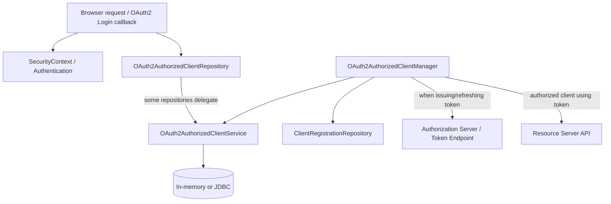
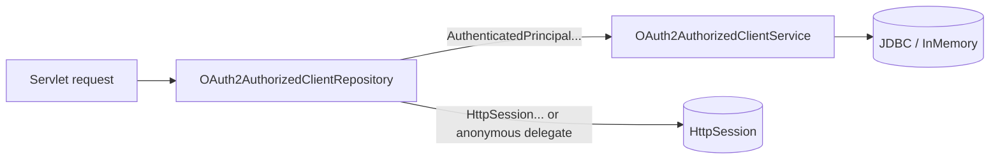

# 14.2. OAuth2AuthorizedClientService in Servlet Applications

> **Module:** Spring Security OAuth 2.0 OIDC Client  
> **Chapter:** 14. Authorized Client  
> **Scope:** Spring Boot/Spring Security OAuth 2.0 Client on the **Servlet stack** (Spring MVC), focusing on `OAuth2AuthorizedClientService`, storing/retrieving authorized clients, integration with HTTP requests, and non-request background tasks.

When a Spring Security application signs a user in via OAuth 2.0/OIDC or obtains authorization to call an API, the result is not just an `Authentication` representing the user. The application can also hold an **authorized client**: a Client registration configuration paired with an access token and, when issued, a refresh token. This data needs a place to be stored and retrieved for subsequent API calls.

`OAuth2AuthorizedClientService` is Spring Security's abstraction for **saving, reading, and removing an `OAuth2AuthorizedClient` by registration ID and principal**. In a Servlet application, it is often paired with `OAuth2AuthorizedClientRepository` to handle the HTTP context, or with `AuthorizedClientServiceOAuth2AuthorizedClientManager` when the application needs to operate outside a web request, such as in a scheduled job.

A common point of confusion is the name:

- `OAuth2AuthorizedClientService` is **not** a service that calls arbitrary APIs on the user's behalf.
- It does **not** verify ID tokens or create a login session.
- It is **not** the Authorization Server's Token Endpoint.
- It does **not** automatically choose a grant, request a new token, or refresh a token simply because you call `loadAuthorizedClient(...)`.

This lesson covers the API contract, choosing between in-memory and JDBC, wiring with Servlet configuration, and key security boundaries to keep in mind.

## 1. Learning Objectives

After this lesson, you will be able to:

1. Explain what `OAuth2AuthorizedClient` contains and why it must be stored.
2. Distinguish `OAuth2AuthorizedClientService`, `OAuth2AuthorizedClientRepository`, `ClientRegistrationRepository`, and `OAuth2AuthorizedClientManager`.
3. Properly use the three operations `loadAuthorizedClient(...)`, `saveAuthorizedClient(...)`, and `removeAuthorizedClient(...)`.
4. Understand the **(registration ID, principal name)** lookup key and the risks of using the wrong identity.
5. Configure `InMemoryOAuth2AuthorizedClientService` for labs or simple applications.
6. Configure `JdbcOAuth2AuthorizedClientService` and the authorized client table for multi-instance applications or persistent storage.
7. Know when `AuthenticatedPrincipalOAuth2AuthorizedClientRepository` delegates Servlet operations to the service and when a session repository may be used.
8. Use `AuthorizedClientServiceOAuth2AuthorizedClientManager` in tasks without an `HttpServletRequest` using the `client_credentials` grant.
9. Handle expired tokens, refresh, logout, and token revocation without confusing responsibilities across layers.
10. Avoid exposing access tokens/refresh tokens via logs, HTTP responses, or unprotected databases.

## 2. What Is an Authorized Client?

In Spring Security, an `OAuth2AuthorizedClient` represents a **Client registration that has been authorized within a principal context**, along with the tokens the Client received from the Authorization Server.

An authorized client holds these important fields:

| Field/Method | Description |
|---|---|
| `getClientRegistration()` | `ClientRegistration`: client ID, configured scopes, grant type, provider endpoints, etc. |
| `getPrincipalName()` | The principal name this authorized client is stored for |
| `getAccessToken()` | Access token, token type, granted scopes, issued/expiration timestamps |
| `getRefreshToken()` | Refresh token if issued by the Authorization Server; may be `null` |

Conceptual example:

```text
OAuth2AuthorizedClient
├── clientRegistration
│   ├── registrationId = "calendar"
│   ├── clientId = "web-calendar-client"
│   └── provider details = ...
├── principalName = "user-734"
├── accessToken = <sensitive bearer token>
│   ├── scopes = ["calendar.read"]
│   ├── issuedAt = ...
│   └── expiresAt = ...
└── refreshToken = <sensitive token, if present>
```

**Access tokens and refresh tokens are sensitive credentials.** `tokenValue` strings must never be arbitrarily returned to the browser, logged, included in screenshots, or stored in source code.

### 2.1. Authorization Is Not the Same as Login

There are two related flows:

- **OAuth2/OIDC Login:** a user signs into the web app; Spring Security holds an `OAuth2AuthenticationToken` in `SecurityContext` and can save the authorized client from the login flow.
- **OAuth2 Client for API calls:** the application uses `OAuth2AuthorizedClientManager` or an equivalent mechanism to obtain/exchange/refresh an access token for a Client registration when needed.

An application may sign users in using `corporate-login` while calling a calendar API using the `calendar-api` Client registration. These two `OAuth2AuthorizedClient` instances are not necessarily the same. Therefore, the service needs the **exact registration ID**, not just the username.

## 3. Role of OAuth2AuthorizedClientService in the Architecture

Overview diagram on the Servlet stack:



This diagram illustrates **roles** rather than claiming every repository or manager always calls the service. For example, an `HttpSessionOAuth2AuthorizedClientRepository` can store tokens by HTTP session without using `OAuth2AuthorizedClientService`; conversely, `AuthenticatedPrincipalOAuth2AuthorizedClientRepository` can use the service to store authorized clients for authenticated principals.

### 3.1. Four Important Abstractions

| Abstraction | Primary Responsibility | Key/Input | Depends on HTTP Request? |
|---|---|---|---|
| `ClientRegistrationRepository` | Reads Client registration configuration | `registrationId` | No |
| `OAuth2AuthorizedClientService` | Saves, loads, removes authorized clients | `registrationId` + `principalName` or `Authentication` | No |
| `OAuth2AuthorizedClientRepository` | Saves, loads, removes authorized clients in Servlet web context | `registrationId` + `Authentication` + `HttpServletRequest`, sometimes response | **Yes** |
| `OAuth2AuthorizedClientManager` | Orchestrates authorize/reauthorize, requesting or refreshing tokens per configured grant | `OAuth2AuthorizeRequest` | Depends on implementation |

You can think of it as:

- **Configuration repository** knows which Clients exist.
- **Storage service** knows which tokens are stored for a principal/registration.
- **Servlet repository** knows the request, response, and how to bind tokens to the HTTP/user context.
- **Manager** knows when a Client needs authorizing/re-authorizing, using the appropriate providers and storage.

Do not use `OAuth2AuthorizedClientService` as an automatic API permission checker. A stored token may already be expired or lack the required scope/audience.

## 4. API Contract of OAuth2AuthorizedClientService

In Spring Security, the interface is in package:

```java
org.springframework.security.oauth2.client.OAuth2AuthorizedClientService
```

Its main methods can be described as follows:

```java
public interface OAuth2AuthorizedClientService {

    <T extends OAuth2AuthorizedClient> T loadAuthorizedClient(
        String clientRegistrationId,
        String principalName
    );

    void saveAuthorizedClient(
        OAuth2AuthorizedClient authorizedClient,
        Authentication principal
    );

    void removeAuthorizedClient(
        String clientRegistrationId,
        String principalName
    );
}
```

This is a simplified view of the interface for learning; use the actual API of your current dependency when writing project code.

### 4.1. loadAuthorizedClient

```java
OAuth2AuthorizedClient authorizedClient =
    authorizedClientService.loadAuthorizedClient(
        "calendar-api",
        authentication.getName()
    );
```

Purpose: retrieves a stored authorized client under the key pair **`("calendar-api", principalName)`**.

The result may be `null`, for example when:

- The user has never authorized that registration.
- The token was removed on logout or according to lifecycle policy.
- The application switched storage from session to database and old records do not exist.
- The registration/principal name changed.
- The application reads from a different instance while storage is in-memory only.

**Important:** calling `loadAuthorizedClient` alone is **not** a token refresh step and does not guarantee a fresh token. If you need token lifecycle management by grant and expiry, use an authorized client manager.

### 4.2. saveAuthorizedClient

```java
authorizedClientService.saveAuthorizedClient(
    authorizedClient,
    authentication
);
```

Purpose: saves or updates an authorized client bound to the appropriate principal. The `OAuth2AuthorizedClient` object must come from a **trusted authorization flow** or test fixture, never from an arbitrary token value submitted by an HTTP client.

In most standard flows, the framework/manager has a success handler that handles saving. You normally **do not have to call** this method manually after every request.

### 4.3. removeAuthorizedClient

```java
authorizedClientService.removeAuthorizedClient(
    "calendar-api",
    authentication.getName()
);
```

Purpose: deletes the authorized client record for that key pair from storage.

Deleting a local record is **not equivalent** to:

- Revoking the access token at the Authorization Server.
- Revoking the refresh token on the server.
- Signing out the SSO session at the OpenID Provider.
- Clearing `SecurityContext` or invalidating the web session.
- Deleting authorized clients for other registrations.

For true logout/revocation, design the appropriate steps based on the OP, application, and storage policy.

## 5. Identifier Key: Registration ID and Principal Name

The service is typically queried by the pair:

```text
(clientRegistrationId, principalName)
```

Example:

| Client registration ID | Principal name | Authorized client |
|---|---|---|
| `corporate-login` | `user-734` | Token from corporate login |
| `calendar-api` | `user-734` | Token to access user-734's calendar |
| `calendar-api` | `user-962` | Token to access user-962's calendar |
| `reporting-job` | `reporting-worker` | Token for background task using client_credentials |

The same principal can have **multiple** authorized clients across registrations; the same registration can serve **multiple principals**.

### 5.1. registration ID Differs from client ID and provider ID

Example configuration:

```yaml
spring:
  security:
    oauth2:
      client:
        registration:
          calendar-api:
            provider: company-op
            client-id: app-calendar-client
            client-secret: ${CALENDAR_CLIENT_SECRET}
            authorization-grant-type: authorization_code
            scope: [openid, calendar.read]
        provider:
          company-op:
            issuer-uri: https://login.example.test/realms/company
```

Three strings with different roles:

- `calendar-api`: **registration ID**; used in `loadAuthorizedClient("calendar-api", ...)`.
- `company-op`: **provider ID**; points to the provider configuration block.
- `app-calendar-client`: **client ID** registered with the OP; not the service lookup key.

If you mistakenly call:

```java
authorizedClientService.loadAuthorizedClient(
    "app-calendar-client", // wrong if no registration ID with this name exists
    authentication.getName()
);
```

then you generally will not find the desired authorized client.

### 5.2. principalName Is Not an Arbitrary Parameter from the Browser

When storing a token for the current user, use the identity established by Spring Security's `Authentication` and understand the application's mapping rules:

```java
String principalName = authentication.getName();
```

**Do not do this:**

```java
// Anti-pattern: caller chooses another user to read their token.
String principalName = request.getParameter("username");

OAuth2AuthorizedClient client =
    authorizedClientService.loadAuthorizedClient(
        "calendar-api",
        principalName
    );
```

If an endpoint lets any user pick `principalName`, it can read the wrong record or leak another user's token. The service is a **storage abstraction**, not a layer that enforces authorization for the caller requesting a record.

### 5.3. Notes on Durable Principal Names

`Authentication.getName()` can be determined by `OAuth2UserService`/`OidcUserService`; it is not necessarily an email. If you want long-term user-scoped storage:

- Use a stable key for the authenticated identity.
- With OIDC, consider identity mapping based on **(issuer, subject)** and controlled internal rules.
- Avoid using unverified emails or mutable values as token storage identifiers.
- In multi-tenant applications, avoid principal name collisions across tenants; the `(registrationId, principalName)` pair is only safe when **the namespace of both values is sufficiently distinct**.
- When changing the principal naming strategy, define a migration or invalidation policy for existing records.

For example: two different issuers both have `sub="42"`. If both feed into a shared registration or a storage key without a tenant namespace, records can collide. Registration/identity mapping design must preserve trust boundaries.

## 6. InMemoryOAuth2AuthorizedClientService Implementation

Spring Security provides the implementation:

```java
org.springframework.security.oauth2.client.InMemoryOAuth2AuthorizedClientService
```

This is in-process memory storage. It is suitable for:

- Labs or learning.
- Development environments.
- Small single-instance applications where losing authorized clients on restart is acceptable.
- Unit/integration tests needing a simple setup.

### 6.1. Explicit Bean Declaration

```java
package example.security;

import org.springframework.context.annotation.Bean;
import org.springframework.context.annotation.Configuration;
import org.springframework.security.oauth2.client.InMemoryOAuth2AuthorizedClientService;
import org.springframework.security.oauth2.client.OAuth2AuthorizedClientService;
import org.springframework.security.oauth2.client.registration.ClientRegistrationRepository;

@Configuration
class AuthorizedClientStorageConfig {

    @Bean
    OAuth2AuthorizedClientService authorizedClientService(
            ClientRegistrationRepository clientRegistrations) {

        return new InMemoryOAuth2AuthorizedClientService(
            clientRegistrations
        );
    }
}
```

In a typical Spring Boot OAuth2 Client setup, the framework may auto-configure a default service if conditions are met. Explicit bean declaration is useful when you want to make the storage choice explicit, but check existing beans to avoid conflicts or creating a service that the web flow **does not actually use**.

### 6.2. Important Limitations

| Limitation | Consequence |
|---|---|
| Stored in one JVM's RAM | Restarts lose authorized clients |
| Multiple instances do not share memory | One instance cannot read tokens stored by another instance |
| No backup/persistence mechanism | Unsuitable when durable token management is required |
| Records can accumulate without cleanup | Needs lifecycle/eviction policy |
| Does not guarantee tokens remain valid | Access tokens can expire between requests |
| Memory may contain secrets/tokens | Do not casually dump heap or log sensitive objects |

When load balancing across multiple pods, session stickiness does not turn `InMemoryOAuth2AuthorizedClientService` into distributed storage. Consider a shared service or an application-specific session/repository design.

## 7. JdbcOAuth2AuthorizedClientService Implementation

For applications requiring persistent storage and multiple instances, Spring Security provides:

```java
org.springframework.security.oauth2.client.JdbcOAuth2AuthorizedClientService
```

This implementation uses JDBC to store authorized clients in a relational database.

### 7.1. Basic Dependencies

With Maven and Spring Boot 3.x:

```xml
<dependencies>
    <dependency>
        <groupId>org.springframework.boot</groupId>
        <artifactId>spring-boot-starter-oauth2-client</artifactId>
    </dependency>
    <dependency>
        <groupId>org.springframework.boot</groupId>
        <artifactId>spring-boot-starter-security</artifactId>
    </dependency>
    <dependency>
        <groupId>org.springframework.boot</groupId>
        <artifactId>spring-boot-starter-web</artifactId>
    </dependency>
    <dependency>
        <groupId>org.springframework.boot</groupId>
        <artifactId>spring-boot-starter-jdbc</artifactId>
    </dependency>
    <!-- Add the JDBC driver for your database. -->
</dependencies>
```

For example, when using PostgreSQL or another RDBMS, add the corresponding driver and DataSource configuration. Never put database connection credentials in source code.

### 7.2. JDBC Service Bean

```java
package example.security;

import org.springframework.context.annotation.Bean;
import org.springframework.context.annotation.Configuration;
import org.springframework.jdbc.core.JdbcOperations;
import org.springframework.security.oauth2.client.JdbcOAuth2AuthorizedClientService;
import org.springframework.security.oauth2.client.OAuth2AuthorizedClientService;
import org.springframework.security.oauth2.client.registration.ClientRegistrationRepository;

@Configuration
class JdbcAuthorizedClientConfiguration {

    @Bean
    OAuth2AuthorizedClientService authorizedClientService(
            JdbcOperations jdbcOperations,
            ClientRegistrationRepository clientRegistrations) {

        return new JdbcOAuth2AuthorizedClientService(
            jdbcOperations,
            clientRegistrations
        );
    }
}
```

This is an **alternative to** the `InMemoryOAuth2AuthorizedClientService` in the previous section. Do not declare two beans for the same role simultaneously and expect Spring to guess which storage to use. If you intentionally need multiple stores, use `@Qualifier` and explicit repository/manager wiring.

### 7.3. Database Schema

`JdbcOAuth2AuthorizedClientService` requires a table/schema matching the implementation and Spring Security version. Distributions include a reference schema script, typically located at:

```text
classpath:org/springframework/security/oauth2/client/oauth2-client-schema.sql
```

In a lab environment with a database that can auto-initialize schemas, you can configure Spring SQL initialization referencing this script when appropriate:

```yaml
spring:
  sql:
    init:
      mode: always
      schema-locations:
        - classpath:org/springframework/security/oauth2/client/oauth2-client-schema.sql
```

**Caution:** this is for test environments only; do not enable repeated automatic table creation in production. In real projects, use Flyway/Liquibase or a migration manager, and verify the DDL matches your database and version. Some sample scripts require adjusting column types or index keys for the target RDBMS.

Conceptually, the `oauth2_authorized_client` table contains:

- `client_registration_id`;
- `principal_name`;
- access token type, token value, and issued/expiration timestamps;
- granted scopes;
- refresh token and issued timestamp if present;
- related management metadata.

The logical primary key is typically tied to **(client_registration_id, principal_name)**.

### 7.4. What the JDBC Service Does Not Handle Automatically

Having JDBC does not mean:

- Tokens are automatically encrypted at the application level.
- Access tokens/refresh tokens are automatically revoked at the OP when rows are deleted.
- Every `loadAuthorizedClient` triggers a refresh.
- Locking/distributed refresh for multiple instances is provided out of the box.
- Web sessions or Spring SecurityContext are persisted to the database.
- All signed-in users share sessions across pods.
- Database backups are inherently safe to store bearer tokens.

You must design **encryption at rest**, database privileges, auditing, rotation, migrations, and lifecycle management appropriately when using JDBC in production.

## 8. How Do Servlet Repository and Service Differ?

On the Servlet stack, `OAuth2AuthorizedClientRepository` typically appears wherever `HttpServletRequest`/`HttpServletResponse` are needed. The repository interface has corresponding methods:

```java
OAuth2AuthorizedClient loadAuthorizedClient(
    String clientRegistrationId,
    Authentication principal,
    HttpServletRequest request
);

void saveAuthorizedClient(
    OAuth2AuthorizedClient authorizedClient,
    Authentication principal,
    HttpServletRequest request,
    HttpServletResponse response
);

void removeAuthorizedClient(
    String clientRegistrationId,
    Authentication principal,
    HttpServletRequest request,
    HttpServletResponse response
);
```

Major differences from the service:

- The repository can decide to store data in the HTTP session.
- The repository can distinguish anonymous and authenticated principals.
- The repository is used by Servlet HTTP components and certain authorized client managers.
- The service does not take request/response, making it suitable as storage outside web requests.

### 8.1. Two Common Repository Implementations

**`HttpSessionOAuth2AuthorizedClientRepository`**

Stores authorized clients bound to the HTTP session. If the user loses their session, authorized clients in the session may become inaccessible. It does not implicitly use the JDBC/InMemory service you declared.

**`AuthenticatedPrincipalOAuth2AuthorizedClientRepository`**

Uses `OAuth2AuthorizedClientService` for authenticated principals; for anonymous principals, it can delegate storage to another repository, defaulting typically to a session-based repository.

Explicit example:

```java
import org.springframework.context.annotation.Bean;
import org.springframework.context.annotation.Configuration;
import org.springframework.security.oauth2.client.OAuth2AuthorizedClientService;
import org.springframework.security.oauth2.client.web.AuthenticatedPrincipalOAuth2AuthorizedClientRepository;
import org.springframework.security.oauth2.client.web.OAuth2AuthorizedClientRepository;

@Configuration
class AuthorizedClientRepositoryConfig {

    @Bean
    OAuth2AuthorizedClientRepository authorizedClientRepository(
            OAuth2AuthorizedClientService service) {

        return new AuthenticatedPrincipalOAuth2AuthorizedClientRepository(
            service
        );
    }
}
```

When using a JDBC service across multiple instances, what matters is **whether the actual OAuth2 Login/Manager path uses a repository backed by that service**. Simply defining a JDBC bean while leaving a custom HTTP session repository running separately can still leave tokens in the session only.

### 8.2. Modeling Both Storage Mechanisms



Inspect your application's bean configuration rather than assuming a single default across all Spring Boot/Spring Security versions. In production, document the storage choice in your architecture and verify the final token persistence mechanism before running multiple instances.

## 9. Relationship with oauth2Login() and oauth2Client()

In Spring Security Servlet, two HTTP Security configurations have related but distinct responsibilities:

- `oauth2Login()`: authenticates users via OAuth 2.0/OIDC; after login, an Authentication is established and an authorized client can be saved.
- `oauth2Client()`: enables OAuth2 Client support to access protected resources via client authorization, even in applications that do not use OAuth2 Login as their primary sign-in method.

Web application example:

```java
package example.security;

import org.springframework.context.annotation.Bean;
import org.springframework.context.annotation.Configuration;
import org.springframework.security.config.Customizer;
import org.springframework.security.config.annotation.web.builders.HttpSecurity;
import org.springframework.security.web.SecurityFilterChain;

@Configuration
class WebSecurityConfiguration {

    @Bean
    SecurityFilterChain webSecurityChain(HttpSecurity http)
            throws Exception {

        return http
            .authorizeHttpRequests(auth -> auth
                .requestMatchers("/", "/error").permitAll()
                .anyRequest().authenticated()
            )
            .oauth2Login(Customizer.withDefaults())
            .oauth2Client(Customizer.withDefaults())
            .build();
    }
}
```

An application that only needs OAuth2 Login might not need both configured as shown in the example; they serve different purposes. If you provide a custom repository/service or manager, verify **which configuration uses which repository/service** per the DSL and actual dependency injection.

### 9.1. After Login, Does the Service Have a Record?

Do not assume one universal default for every application.

- If the OAuth2 Login flow saved to `AuthenticatedPrincipalOAuth2AuthorizedClientRepository` backed by the service, you can look up the record from the service.
- If the configuration chose `HttpSessionOAuth2AuthorizedClientRepository`, the authorized client may live only in the HTTP session.
- If a custom repository/manager is configured, behavior depends on that implementation.
- If custom success/failure handlers or save/remove policies are used, the lifecycle also differs.

To be certain: inspect the application's bean/repository/manager configuration. Do not treat `loadAuthorizedClient(...) == null` as always meaning the user never logged in.

## 10. Reading Authorized Clients in an Application Service

A service can accept a verified `Authentication` from a caller, obtain the principal name, and look up the authorized client:

```java
package example.service;

import java.util.Optional;

import org.springframework.security.core.Authentication;
import org.springframework.security.oauth2.client.OAuth2AuthorizedClient;
import org.springframework.security.oauth2.client.OAuth2AuthorizedClientService;
import org.springframework.stereotype.Service;

@Service
public class AuthorizedClientLookup {

    private final OAuth2AuthorizedClientService authorizedClientService;

    public AuthorizedClientLookup(
            OAuth2AuthorizedClientService authorizedClientService) {
        this.authorizedClientService = authorizedClientService;
    }

    public Optional<OAuth2AuthorizedClient> find(
            String registrationId,
            Authentication authentication) {

        if (authentication == null || registrationId == null) {
            return Optional.empty();
        }

        OAuth2AuthorizedClient client =
            authorizedClientService.loadAuthorizedClient(
                registrationId,
                authentication.getName()
            );

        return Optional.ofNullable(client);
    }
}
```

This method demonstrates a **storage read** operation, not requesting a token. `Authentication` must come from a secured context; never fabricate an `Authentication` with a caller-supplied username to read another user's token.

### 10.1. Safe Usage in a Controller

Example returning whether an authorized client exists, **without returning tokens**:

```java
import java.util.Map;

import org.springframework.security.core.Authentication;
import org.springframework.web.bind.annotation.GetMapping;
import org.springframework.web.bind.annotation.RestController;

@RestController
class AuthorizationStatusController {

    private final AuthorizedClientLookup lookup;

    AuthorizationStatusController(AuthorizedClientLookup lookup) {
        this.lookup = lookup;
    }

    @GetMapping("/api/connections/calendar")
    Map<String, Object> calendarStatus(Authentication authentication) {
        boolean connected = lookup.find(
            "calendar-api",
            authentication
        ).isPresent();

        return Map.of(
            "registrationId", "calendar-api",
            "stored", connected
        );
    }
}
```

HTTP requests to this endpoint must be protected by appropriate access rules; for instance, only callable in an authenticated user session. The `stored=true` field only means the service currently holds a record; it **does not guarantee the token is still valid or that the user still has API permissions**.

### 10.2. Do Not Return OAuth2AuthorizedClient Directly

Avoid:

```java
// Unsafe: risks serializing access/refresh tokens to the browser.
@GetMapping("/api/debug/authorized-client")
OAuth2AuthorizedClient debug(...) {
    return authorizedClientService.loadAuthorizedClient(...);
}
```

If connection status is needed, return a DTO with minimal fields such as registration ID, connection state, and appropriately evaluated expiration time. Never let the frontend arbitrarily specify `principalName` to read service records.

## 11. Removing an Authorized Client for the Right Purpose

Suppose a user wants to disconnect the application from Calendar. You can delete the service record:

```java
public void disconnectCalendar(Authentication authentication) {
    authorizedClientService.removeAuthorizedClient(
        "calendar-api",
        authentication.getName()
    );
}
```

However, this only deletes **local storage**. If you want to truly stop the token from being usable at the AS/Resource Server, check whether the OP provides a **token revocation endpoint** or appropriate authorization revocation API and design the sequence:

1. Verify the user is permitted to disconnect their own connection.
2. Identify the exact registration/principal and authorized client.
3. If policy requires, send a revocation request to the OP using the appropriate method and credentials, without logging the token.
4. Remove the local authorized client after handling per your error/retry policy.
5. Handle races with concurrent tasks using the token.
6. Update connection state in application data.

**Do not automatically treat `removeAuthorizedClient` as global logout or end-user logout at the OP.**

### 11.1. Removing from Service vs. Removing from Repository Can Differ

If the authorized client is stored in an HTTP session repository, calling `OAuth2AuthorizedClientService.removeAuthorizedClient(...)` may **not remove the data from the session**. Conversely, if the repository delegates to the service, that call may delete from the right place.

Therefore, when a web endpoint needs to remove the current user's record, prefer removing via the **repository/manager bound to the current HTTP request and storage** in use. If non-request jobs/clients use the service, define a separate service removal policy.

## 12. OAuth2AuthorizedClientManager: Why Another Layer Is Needed

`OAuth2AuthorizedClientService` only has load/save/remove. It does not decide:

- Whether to call the Token Endpoint now.
- Which grant fits the Client registration.
- When a refresh token should be used.
- What to do if the token is expired.
- Which mechanism to use for client authentication.
- Whether to delete the authorized client when reauthorization fails.

Those decisions belong to **OAuth2AuthorizedClientManager** and its configured `OAuth2AuthorizedClientProvider` instances.

### 12.1. Manager for Servlet Requests

A common choice when code runs inside an `HttpServletRequest` is `DefaultOAuth2AuthorizedClientManager`. It works with:

- `ClientRegistrationRepository`.
- `OAuth2AuthorizedClientRepository`.
- Configured `OAuth2AuthorizedClientProvider` instances.

Because the repository accepts request/response and principal, this manager fits Servlet applications with an HTTP context.

### 12.2. Manager for Work Outside Servlet Requests

`AuthorizedClientServiceOAuth2AuthorizedClientManager` directly uses:

- `ClientRegistrationRepository`.
- `OAuth2AuthorizedClientService`.
- `OAuth2AuthorizedClientProvider`.

It is intended for cases **without an HttpServletRequest**, such as:

- `@Scheduled` jobs.
- Queue consumers.
- Batch processes.
- Service-to-service calls using `client_credentials`.
- Background components triggered independently of a browser request.

This is an important distinction within this lesson's scope: **the service can be used outside a Servlet request**, even when the application itself is a Servlet application.

## 13. Complete Example: Background Job Using client_credentials

Suppose the application needs to call a reporting API every night, with no interactive user. The AS registers a confidential Client with the `client_credentials` grant.

### 13.1. Registration Configuration

```yaml
spring:
  security:
    oauth2:
      client:
        registration:
          reporting-service:
            provider: internal-as
            client-id: reporting-worker
            client-secret: ${REPORTING_CLIENT_SECRET}
            client-authentication-method: client_secret_basic
            authorization-grant-type: client_credentials
            scope:
              - reports.read

        provider:
          internal-as:
            token-uri: https://auth.example.test/oauth2/token
```

This example is an OAuth2 Client for calling an API; the `openid` scope is not needed when not performing OIDC user login. The name `reporting-service` is the internal registration ID; `reporting-worker` is the Client ID at the Authorization Server.

### 13.2. Creating a Service-Based Manager

```java
package example.security;

import org.springframework.context.annotation.Bean;
import org.springframework.context.annotation.Configuration;
import org.springframework.security.oauth2.client.AuthorizedClientServiceOAuth2AuthorizedClientManager;
import org.springframework.security.oauth2.client.OAuth2AuthorizedClientManager;
import org.springframework.security.oauth2.client.OAuth2AuthorizedClientProvider;
import org.springframework.security.oauth2.client.OAuth2AuthorizedClientProviderBuilder;
import org.springframework.security.oauth2.client.OAuth2AuthorizedClientService;
import org.springframework.security.oauth2.client.registration.ClientRegistrationRepository;

@Configuration
class BackgroundOAuth2ClientConfiguration {

    @Bean
    OAuth2AuthorizedClientManager backgroundAuthorizedClientManager(
            ClientRegistrationRepository registrations,
            OAuth2AuthorizedClientService authorizedClientService) {

        OAuth2AuthorizedClientProvider provider =
            OAuth2AuthorizedClientProviderBuilder.builder()
                .clientCredentials()
                .build();

        AuthorizedClientServiceOAuth2AuthorizedClientManager manager =
            new AuthorizedClientServiceOAuth2AuthorizedClientManager(
                registrations,
                authorizedClientService
            );

        manager.setAuthorizedClientProvider(provider);
        return manager;
    }
}
```

Here the `clientCredentials()` provider is configured explicitly. The manager can use the service to **reuse a stored authorized client when appropriate** and request a new access token via the allowed grant when needed.

### 13.3. Calling the Manager from a Service

```java
package example.service;

import org.springframework.security.oauth2.client.OAuth2AuthorizeRequest;
import org.springframework.security.oauth2.client.OAuth2AuthorizedClient;
import org.springframework.security.oauth2.client.OAuth2AuthorizedClientManager;
import org.springframework.stereotype.Service;

@Service
public class ReportingAccessTokenService {

    private final OAuth2AuthorizedClientManager authorizedClientManager;

    public ReportingAccessTokenService(
            OAuth2AuthorizedClientManager authorizedClientManager) {
        this.authorizedClientManager = authorizedClientManager;
    }

    public OAuth2AuthorizedClient authorizeReportingJob() {
        OAuth2AuthorizeRequest request =
            OAuth2AuthorizeRequest
                .withClientRegistrationId("reporting-service")
                .principal("reporting-scheduler")
                .build();

        OAuth2AuthorizedClient authorizedClient =
            authorizedClientManager.authorize(request);

        if (authorizedClient == null) {
            throw new IllegalStateException(
                "Cannot authorize reporting-service"
            );
        }

        return authorizedClient;
    }
}
```

**Why is the principal `"reporting-scheduler"`?** With `client_credentials`, there is no signed-in end-user. The manager still needs a principal identifier as a **storage key** for the authorized client. This is a logical name chosen by the application, not a real user and not a role or Client secret.

**Note when the application has multiple `OAuth2AuthorizedClientManager` beans:** the code above injects by interface type only. If another Servlet manager already exists, you must use `@Qualifier` or explicit bean naming/dependency wiring so Spring selects the service-based manager. Using a single bean in a lab app is the simpler case.

### 13.4. Using the Token to Call the API

In a real application, configure an OAuth2-Client-integrated HTTP client so it uses the appropriate manager instead of manually passing `tokenValue` across multiple layers.

Conceptually:

```java
OAuth2AuthorizedClient client =
    reportingAccessTokenService.authorizeReportingJob();

String accessToken = client.getAccessToken().getTokenValue();

// Only transmit the token over HTTPS to the proper Resource Server,
// typically handled by an OAuth2-aware HTTP client.
```

**Never** return `accessToken` to the browser or log it. The Resource Server must still verify the token, audience, scopes, and authorization; successfully obtaining a token does not mean the API will allow every operation.

### 13.5. Where Does Token Saving Happen?

With `AuthorizedClientServiceOAuth2AuthorizedClientManager`, the default mechanism uses a success handler that saves the issued authorized client via `OAuth2AuthorizedClientService`. When reauthorization fails, the manager has a failure handler for appropriate OAuth errors; whether records are deleted or retained depends on the version/configuration.

Consequently, application code normally **does not need to call `saveAuthorizedClient` immediately after every `authorize(...)`** when the manager is already responsible for it.

## 14. Refresh Tokens: Present or Not and Who Handles Them?

An authorized client may contain a refresh token, but not every grant issues one.

| Grant/Case | Has Refresh Token? | Notes |
|---|---|---|
| Authorization Code with user | Possibly | Depends on AS, scopes, consent, policy; do not assume always present |
| Client Credentials | Typically no | Upon expiration, the manager usually executes a new client_credentials grant |
| OIDC Login | Possibly | `openid` alone does not guarantee a refresh token |
| Public client | Possibly per AS policy | Requires appropriate refresh token replay protection |
| Authorized client storing only access token | No | Service can still save/read it |

If a Client uses refresh tokens and the application wants automatic refresh, the manager needs a supporting provider:

```java
OAuth2AuthorizedClientProvider provider =
    OAuth2AuthorizedClientProviderBuilder.builder()
        .refreshToken()
        .build();
```

Or combined with another grant as needed:

```java
OAuth2AuthorizedClientProvider provider =
    OAuth2AuthorizedClientProviderBuilder.builder()
        .clientCredentials()
        .refreshToken()
        .build();
```

**Do not misunderstand:** adding `refreshToken()` to the manager **does not cause the AS to start issuing refresh tokens**. It only allows the manager to use a refresh token when one is present and refresh conditions are met.

### 14.1. load Does Not Mean refresh

If you do:

```java
OAuth2AuthorizedClient client =
    authorizedClientService.loadAuthorizedClient(
        "calendar-api",
        authentication.getName()
    );
```

you may receive an expired token. Data loaded from storage does not update itself.

If you need a usable token, prefer the manager:

```java
OAuth2AuthorizedClient client = manager.authorize(
    OAuth2AuthorizeRequest
        .withClientRegistrationId("calendar-api")
        .principal(authentication)
        .build()
);
```

The manager only operates according to the configured **grant providers**; if authorization or refresh cannot be performed in the current context, handle the `null` result or exception per the API. For Authorization Code requiring user interaction, a background job cannot substitute for a browser login flow.

### 14.2. Expiry and Clock Skew

Token expiry can depend on clocks between Client/AS, network timeouts, and request execution time. Authorized client managers typically account for `expiresAt` and an appropriate clock skew window to avoid using a nearly-expired token.

If you inspect `getAccessToken().getExpiresAt()` manually, be careful about `null` in certain cases, clock skew, and premature token revocation. Relying solely on expiry metadata does not guarantee the token will be accepted by the API.

## 15. Handling Tokens Rejected by the Resource Server

An access token that appears unexpired in storage can still be rejected by the Resource Server because:

- The token was revoked at the AS.
- The audience does not match the API.
- The scope is insufficient.
- The account or consent changed.
- Resource Server/AS policy changed.
- Access token format or validation differs from expectations.

`OAuth2AuthorizedClientService` **does not receive 401/403 responses from the API** and has no automatic awareness that a token was rejected.

Distinguish clearly:

| API Response | Typical Cause | Handling |
|---|---|---|
| 401 Unauthorized | Missing, malformed, expired, or rejected token | Identify token/grant type; consider proper refresh/reauthorize |
| 403 Forbidden | Valid identity/token but insufficient permissions | Check scopes/roles/policy; do not retry indefinitely |
| Token Endpoint error `invalid_grant` | Refresh token/code is no longer valid | Handle authorization failure; possibly remove broken authorized client |
| Token Endpoint error `invalid_client` | Incorrect client authentication | Fix Client registration/credentials; do not arbitrarily switch to `none` |

Never build an interceptor that "deletes the token and infinitely requests a new one on 401/403". Retries must be bounded, classify errors properly, and align with authorization policy.

## 16. Comparing Service Usage in Web Requests vs. Background Jobs

| Factor | Inside Servlet Request | Outside Servlet Request |
|---|---|---|
| Context | Browser/session/Authentication/HttpServletRequest | Job, queue consumer, scheduler |
| Common storage abstraction | `OAuth2AuthorizedClientRepository` | `OAuth2AuthorizedClientService` |
| Common manager | `DefaultOAuth2AuthorizedClientManager` | `AuthorizedClientServiceOAuth2AuthorizedClientManager` |
| Principal | Current user | Stable logical principal for system job or explicitly passed identity |
| Appropriate grant | Authorization Code, refresh token, and configured grants | `client_credentials`, refresh token when full context is available |
| Browser redirect possible? | Yes | No, unless a dedicated flow is designed |
| Key risks | Session/CSRF, cross-user token leakage | Shared principal, concurrency, token storage and lifecycle |
| Lookup contract | Registration ID + Authentication + request | Registration ID + principal name |

**One JDBC service** can be shared as the backing storage for multiple managers if components are clearly designed. However, you should not share one synthetic principal across all tenants or all users when scopes/tokens differ; storage keys must reflect actual usage boundaries.

## 17. Token Security in OAuth2AuthorizedClientService

Because the service can hold **bearer credentials**, securing its storage is just as critical as securing the HTTP session.

### 17.1. Protecting Data at Rest

- Use database credentials with least privilege.
- Enable TLS between the app and database when deployed over a network.
- Encrypt volumes/storage; evaluate application-level token value encryption when your threat model requires it.
- Restrict backups containing tokens; enforce retention and backup access policies.
- Do not grant full-table SELECT permissions to unrelated users or services.
- Manage secrets and encryption keys via a secret manager/KMS per policy.
- Build lifecycle cleanup for records that are no longer valid or used.

**Do not assume access tokens are "just strings" and therefore non-sensitive.** With a bearer token, anyone holding a valid token can attempt to use it against the corresponding Resource Server.

### 17.2. Authorization When Reading Tokens

The service interface takes a `principalName` supplied by the caller; the interface itself does not verify the current HTTP user's business permissions. Therefore:

- Do not expose endpoints allowing queries for arbitrary principal names.
- Use an `Authentication` verified by Spring Security.
- When background services run with broad privileges, restrict call paths and enforce tenant/access policies at the business layer.
- With multi-tenancy, design keys and data partitioning to prevent cross-tenant reads.
- When auditing, log only registration ID, approved internal principal identifier, and operation outcome; never log token values.

### 17.3. Logout and Revocation

When a user logs out of the web app:

- The web session may be invalidated per configuration.
- Authorized clients stored in the HTTP session may be lost along with the session.
- Authorized clients stored via the JDBC service **may still exist** after logout unless a deletion policy is implemented.
- Deleting local records does not guarantee remote tokens are revoked.
- OIDC end-session at the OP is separate from deleting an authorized client.

A solid policy should clarify: whether logout deletes stored authorized clients, when tokens are revoked at the OP, when the user must reconnect, and whether long-lived authorization must be maintained for API integrations independent of login sessions.

## 18. Multi-Instance Operations and Concurrency

One benefit of a JDBC service is that multiple instances can see the same storage. However, this introduces **concurrency** concerns.

### 18.1. Two Workers Both See a Nearly-Expired Token

Scenario:

1. Pod A and Pod B load the same authorized client.
2. Both see the token needs refreshing.
3. Two refresh requests use the same refresh token concurrently.
4. The AS uses refresh token rotation; the old token may be invalidated after the first call.
5. One request fails with `invalid_grant` and may cause unintended record deletion or overwrite.

Simply using `JdbcOAuth2AuthorizedClientService` does not provide a distributed lock or atomic refresh protocol. In high-concurrency systems, you should:

- Design token ownership/locking by principal-registration.
- Consider serialized refresh or appropriate distributed coordination.
- Review the version and behavior of the manager/failure handler.
- Avoid uncontrolled retries once a refresh token has been rotated.
- Handle transactions/optimistic locking if customizing storage.

### 18.2. Stale Records When Client Registration Changes

Authorized clients are stored by registration ID and principal name. If a deployment changes:

```text
registrationId: calendar-api -> calendar-v2
```

old records may no longer be retrievable under the new ID. If you change the Client ID, scopes, or provider issuer while keeping the same registration ID, the old authorized client may also **no longer match** the new Client registration.

Therefore, when making significant OAuth2 Client configuration changes, decide whether to invalidate, migrate, or reauthorize stored clients. Do not keep using a token solely because a database row still exists.

### 18.3. Time Synchronization and Token Expiry

Multiple instances need reasonably synchronized clocks. Token `issuedAt`/`expiresAt` are timestamps; excessive clock skew can cause the service/manager to misjudge validity, causing failed requests or excessive refreshes.

## 19. Lab A — InMemory Service in an MVC Application

**Objective:** understand saving/retrieving authorized clients when a browser signs in via OAuth2/OIDC.

**Preparation:** a test OP supporting OIDC Authorization Code, Client registration `corporate`, a Spring Boot MVC application with `oauth2Login()` and an in-memory service bean. Ensure the repository uses the service for authenticated principals or configure your chosen storage mechanism properly.

**Steps:**

1. Register callback `http://localhost:8080/login/oauth2/code/corporate` at the OP.
2. Start the application with the registration and service configured.
3. Visit `/oauth2/authorization/corporate` and complete login.
4. Retrieve `Authentication.getName()` for the authenticated user.
5. Call `authorizedClientService.loadAuthorizedClient("corporate", authentication.getName())`.
6. Display only `registrationId` and whether a record exists; do not display tokens.
7. Restart the application and observe the difference when storage is in-memory only.
8. If `load` returns null even though login succeeded, verify whether the current web repository uses the service or stores only in the HTTP session.

**Expected takeaway:** the service can store authorized clients in RAM using the registration-principal pair; it does not automatically make storage persistent or guarantee the login flow is wired into the service.

## 20. Lab B — JDBC Storage and Restart

**Objective:** understand persistence with `JdbcOAuth2AuthorizedClientService`.

**Preparation:** a local lab database, datasource, schema matching your Spring Security version, JDBC service bean, and repository/manager using that service.

**Steps:**

1. Create tables using the appropriate schema/migration script.
2. Configure the JDBC service in place of the in-memory service.
3. Complete OAuth2/OIDC Login with a test account.
4. Look up the authorized client by registration ID and principal name.
5. Stop the application and restart it.
6. Verify the authorized client record still exists in the database.
7. Distinguish **record still exists** from **web session still logged in**; the session may have been lost or expired.
8. Delete the local authorized client and confirm storage no longer contains a record for that key.

**Expected takeaway:** JDBC persists token metadata, but does not replace HTTP sessions, SecurityContext, or remote token revocation.

**Security note:** use test credentials, test tokens, and a dedicated lab database; never copy token values into reports.

## 21. Lab C — Scheduled Job with client_credentials

**Objective:** work with an OAuth2 Client without a browser or `HttpServletRequest`.

**Preparation:** a test AS supporting `client_credentials`, a registered confidential Client, `reports.read` scope, token endpoint, and test resource API.

**Steps:**

1. Configure the `reporting-service` registration as in Section 13.
2. Create an `AuthorizedClientServiceOAuth2AuthorizedClientManager` with the `clientCredentials()` provider.
3. Call `authorize(...)` from a service using logical principal `reporting-scheduler`.
4. On the first call, verify the manager receives a token from the AS and the service can save the authorized client.
5. Call again while the token is still valid; observe the manager reusing the appropriate data.
6. Test when the token has expired in the lab; observe a new `client_credentials` grant when needed.
7. Use the token to call the right Resource Server and scope.
8. Never log the access token or return it to the frontend.

**Expected outcome:** the service saves/reads tokens for the logical principal, the manager handles authorization per grant, and the HTTP client uses the token when calling the API.

### 21.1. Why Not Use a Real User's Username?

With `client_credentials`, the Client acts under the application/service identity, with no end-user login event. Use `reporting-scheduler` as a **stable storage key**, without inferring user info or roles from that string. If multiple tenants or workloads have different permissions, distinguish keys or registrations according to policy.

## 22. Lab D — Refresh Tokens and invalid_grant Errors

**Objective:** distinguish storage records from token lifecycle.

**Preparation:** an Authorization Code Client in the lab issued a refresh token by the AS; a manager with the `refreshToken()` provider and explicitly configured service/repository.

**Steps:**

1. Complete authorization and save the authorized client.
2. Read the access token's `expiresAt` **for diagnostics only**, without logging tokenValue.
3. Trigger a refresh condition in the lab, such as a nearly-expired token.
4. Call the manager instead of only `loadAuthorizedClient`.
5. Observe successful reauthorization and the updated authorized client.
6. In the test environment, simulate a revoked refresh token to produce `invalid_grant`.
7. Observe the manager/failure handler and record state per configuration.
8. Trigger fresh authorization if needed, without infinitely retrying the old refresh token.

**Expected outcome:** the service does not refresh on its own; the manager/provider handles grants and lifecycle, saving/removing via the appropriate success/failure handlers.

## 23. Lab E — Disconnecting and Logout

**Objective:** distinguish local token storage from web sessions and remote revocation.

**Steps:**

1. Sign into the web app using `corporate`.
2. Authorize an additional registration `calendar-api` and confirm the authorized client is saved in the corresponding storage.
3. Invoke a "Disconnect Calendar" feature to remove the authorized client per policy.
4. Verify subsequent API calls must reauthorize or are rejected, depending on the flow.
5. Log out of the application.
6. Inspect the web session, JDBC service, and OP session through their respective mechanisms.
7. If the OP supports revocation, test a revocation flow on a test tenant and compare it with merely deleting the local record.

**Expected outcome:** three distinct concepts — deleting the local authorized client, logging out of the web session, and ending/revoking at the OP — must be designed separately.

## 24. Common Troubleshooting Table

| Symptom | Possible Cause | What to Check |
|---|---|---|
| `loadAuthorizedClient` returns `null` after login | Web repository does not use the service | Check `OAuth2AuthorizedClientRepository` and service wiring |
| Tokens lost after restart | Using `InMemoryOAuth2AuthorizedClientService` | Switch to JDBC or persistent storage if architecture requires |
| Pod B cannot see Pod A's token | Each pod has its own memory storage | Use shared storage or an appropriate repository mechanism |
| Token saved under wrong user | Principal name taken from untrusted input or mapping changed | Use verified Authentication, normalize identity namespace |
| Using client ID to load returns nothing | Confusing client ID with registration ID | Use `ClientRegistration.getRegistrationId()` |
| `saveAuthorizedClient` does not run | Authorization succeeds but manager/repository uses another success handler | Check attached handlers and storage |
| `load` returns an expired token | Service does not refresh | Use an authorized client manager with appropriate providers |
| Job lacks HttpServletRequest | Using Servlet manager outside a request | Use `AuthorizedClientServiceOAuth2AuthorizedClientManager` |
| Manager does not request token for client_credentials | Missing `clientCredentials()` provider or wrong grant on registration | Check provider builder, AS, and ClientRegistration |
| `invalid_client` from Token Endpoint | Client auth credentials/method mismatch with AS | Check secret, grant, client authentication method |
| `invalid_grant` on refresh | Stale/revoked refresh token or rotation conflict | Handle per failure policy, consider concurrency |
| Token remains in DB after logout | JDBC service is independent of session | Design separate deletion/revocation policy |
| Deleted locally but token still works externally | Token not revoked at AS | Use revocation protocol/API if OP supports it and policy requires |
| AuthorizedClient serialized to JSON | Exposes access/refresh tokens | Use minimal status DTO, never serialize credentials |
| JDBC storage fails with missing table | Schema not created or version mismatch | Check migrations and Spring Security schema script |
| Multi-tenant uses wrong token | Key namespace/registration-principal not distinct enough | Define clear tenant-partitioned keys and policies |

## 25. Misconceptions to Avoid

| Misconception | Correct Understanding |
|---|---|
| "OAuth2AuthorizedClientService is where Spring Security stores the user login session." | It stores authorized clients and tokens; sessions/SecurityContext use separate mechanisms. |
| "Having an authorized client means the user is logged in." | An authorized client can persist after logout, especially with JDBC. |
| "loadAuthorizedClient always returns a valid token." | It only reads stored data; a manager and the Resource Server must validate tokens for their intended use. |
| "Service and Servlet repository are the same." | The repository has HTTP request/response; the service does not. |
| "Just adding a JDBC service bean stores all login tokens in JDBC." | You must ensure the repository/manager path actually uses that service. |
| "Deleting the record means the remote token is revoked." | Deleting local storage is not token revocation. |
| "Principal name can come from a username query parameter." | Never use arbitrary caller input to read another user's authorized client. |
| "client_id is the service lookup key." | The lookup key uses the internal registration ID and principal name. |
| "The service automatically knows new scopes and grants permissions." | Scopes are granted by the AS/manager; the service only stores authorized clients. |
| "Client Credentials always comes with a refresh token." | Typically it receives an access token and re-requests via client_credentials when needed. |
| "JDBC automatically handles refresh token concurrency." | Persistence does not solve locking/races during rotation. |
| "Background jobs use DefaultOAuth2AuthorizedClientManager like web requests." | A service-based manager is better suited when there is no Servlet request. |
| "Obtaining an access token is enough to access any API." | Proper audience/scopes/authorization are still required at the Resource Server. |

## 26. Self-Check Questions

**Question 1.** How many primary operations does `OAuth2AuthorizedClientService` have, and what are they?

*Hint:* load, save, remove.

**Question 2.** Why can calling `loadAuthorizedClient("calendar-api", userName)` return an expired token?

*Hint:* storage does not execute the OAuth2 token lifecycle on its own.

**Question 3.** When should `JdbcOAuth2AuthorizedClientService` be used instead of `InMemoryOAuth2AuthorizedClientService`?

*Hint:* when persistence/shared storage across instances is needed, alongside proper security assessment.

**Question 4.** How does `OAuth2AuthorizedClientRepository` differ from the service in Servlet applications?

*Hint:* the repository accepts HTTP request/response and can store per session.

**Question 5.** Why can a `@Scheduled` job use `AuthorizedClientServiceOAuth2AuthorizedClientManager`?

*Hint:* there is no web request, yet Client registrations, the service, and grant providers are still needed.

**Question 6.** With `client_credentials`, does `principal("reporting-scheduler")` mean a user named "reporting-scheduler" logged in?

*Hint:* no; it is a logical name acting as a storage key.

**Question 7.** If web logout leaves an authorized client in JDBC, is that a framework bug?

*Hint:* not necessarily; storage and sessions have separate lifecycles, requiring explicit policy.

**Question 8.** Does removing an authorized client via `removeAuthorizedClient(...)` revoke the refresh token at the OP?

*Hint:* not by default; token/authorization revocation per OP capabilities is required.

**Question 9.** Why shouldn't you create an endpoint that accepts `username` and calls `loadAuthorizedClient` to return a token?

*Hint:* callers can spoof principal names, leading to unauthorized token access.

**Question 10.** When two workers concurrently refresh a token with rotation, is a shared database alone enough to avoid conflicts?

*Hint:* no; an appropriate concurrency/serialization strategy is required.

## 27. Practical Design Guidelines

When implementing an OAuth2/OIDC Client in a Spring MVC product, you can apply a layered approach:

```text
web/
  SecurityFilterChain + OAuth2 Login
  OAuth2AuthorizedClientRepository
               |
               v
client/
  OAuth2AuthorizedClientManager
  ClientRegistrationRepository
               |
               v
storage/
  OAuth2AuthorizedClientService
  ├── InMemory (lab)
  └── JDBC (production if requirements are met)
               |
               v
token lifecycle + API call
  grant provider / refresh / scopes / retry policy
```

Choose storage based on requirements, **not** merely on whether the application uses Servlet:

- If data only needs to live for the HTTP session, a session repository may be appropriate.
- If principal-bound tokens must survive restarts or be accessed across multiple app instances, consider a JDBC service or equivalent protected storage.
- If jobs run outside requests, a service-based authorized client manager provides a clean path.
- If you have both web login and separate API clients, separate token storage and usage policies so login registrations are not confused with API registrations.
- When token data can persist long-term, establish policies for database access control, deletion, revocation, backups, and incident response.

### 27.1. Do Not Replace Authorization with Token Storage

Even if a user has an `OAuth2AuthorizedClient` record for registration `calendar-api`, the application must still:

1. Authenticate the current caller.
2. Verify they are permitted to perform the corresponding operation.
3. Retrieve the authorized client for the right principal/registration.
4. Manage token validity and scope/audience for the API.
5. Protect API results and any returned sensitive data.

A token in the database does not by itself prove the user is authorized to perform any business action.

## 28. References

- [Spring Security Reference — OAuth 2.0 Client](https://docs.spring.io/spring-security/reference/servlet/oauth2/client/index.html): ClientRegistration, authorized client, repository, and manager abstractions.
- [Spring Security Reference — Core OAuth2 Client Classes](https://docs.spring.io/spring-security/reference/servlet/oauth2/client/core.html): `OAuth2AuthorizedClient`, `OAuth2AuthorizedClientService`, and repository.
- [Spring Security Reference — Authorized Clients](https://docs.spring.io/spring-security/reference/servlet/oauth2/client/authorized-clients.html): configuring and using authorized clients and token management on Servlet.
- [Spring Security API — OAuth2AuthorizedClientService](https://docs.spring.io/spring-security/reference/api/java/org/springframework/security/oauth2/client/OAuth2AuthorizedClientService.html): load, save, remove contract.
- [Spring Security API — InMemoryOAuth2AuthorizedClientService](https://docs.spring.io/spring-security/reference/api/java/org/springframework/security/oauth2/client/InMemoryOAuth2AuthorizedClientService.html): in-memory storage implementation.
- [Spring Security API — JdbcOAuth2AuthorizedClientService](https://docs.spring.io/spring-security/reference/api/java/org/springframework/security/oauth2/client/JdbcOAuth2AuthorizedClientService.html): JDBC-based implementation.
- [Spring Security API — AuthenticatedPrincipalOAuth2AuthorizedClientRepository](https://docs.spring.io/spring-security/reference/api/java/org/springframework/security/oauth2/client/web/AuthenticatedPrincipalOAuth2AuthorizedClientRepository.html): repository using a service for authenticated principals.
- [Spring Security API — AuthorizedClientServiceOAuth2AuthorizedClientManager](https://docs.spring.io/spring-security/reference/api/java/org/springframework/security/oauth2/client/AuthorizedClientServiceOAuth2AuthorizedClientManager.html): manager used outside Servlet requests.
- [Spring Security API — OAuth2AuthorizedClient](https://docs.spring.io/spring-security/reference/api/java/org/springframework/security/oauth2/client/OAuth2AuthorizedClient.html): object holding ClientRegistration and tokens.
- [RFC 6749 — OAuth 2.0 Authorization Framework](https://www.rfc-editor.org/rfc/rfc6749): grants, access/refresh tokens, and Client/AS roles.
- [RFC 7009 — OAuth 2.0 Token Revocation](https://www.rfc-editor.org/rfc/rfc7009): revoking tokens at the Authorization Server.
- [RFC 9700 — OAuth 2.0 Security Best Current Practice](https://www.rfc-editor.org/rfc/rfc9700): token management, refresh token rotation, and modern protections.

**Key takeaway:** `OAuth2AuthorizedClientService` is a **storage abstraction** for saving, reading, and deleting `OAuth2AuthorizedClient` records by **registration ID + principal**. In Servlet applications, know which `OAuth2AuthorizedClientRepository` is in use; when running outside HTTP requests, use `AuthorizedClientServiceOAuth2AuthorizedClientManager` to manage tokens by grant. In-memory vs. JDBC only determines **where data is stored**, and does not replace authorization, token refresh, sessions, remote revocation, or credential protection.
