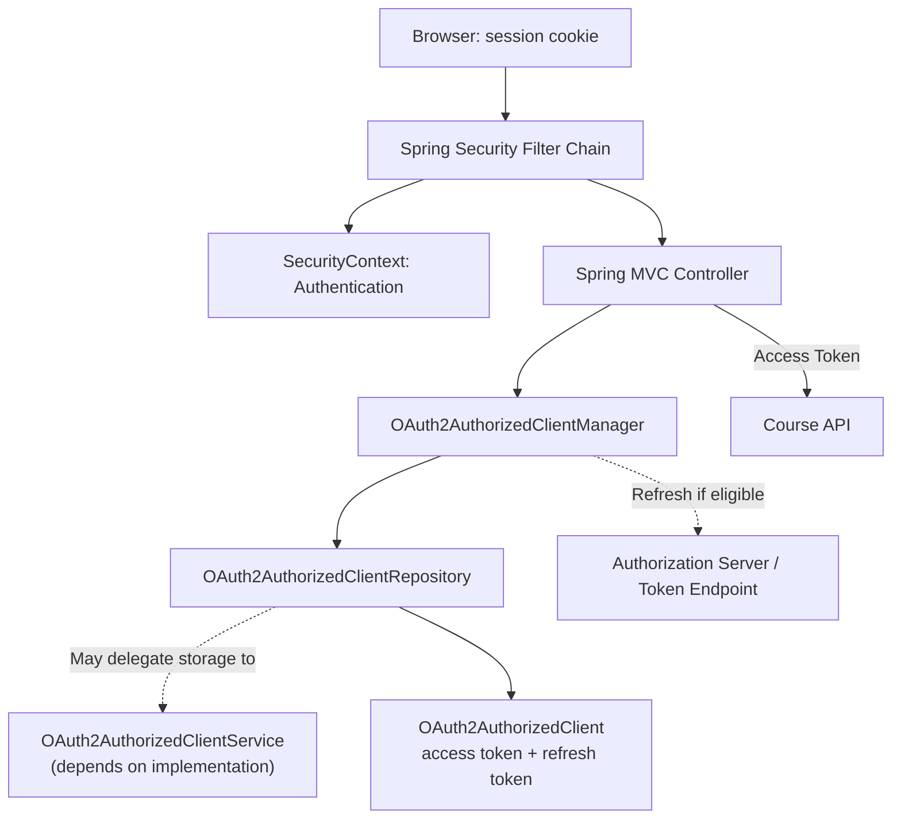
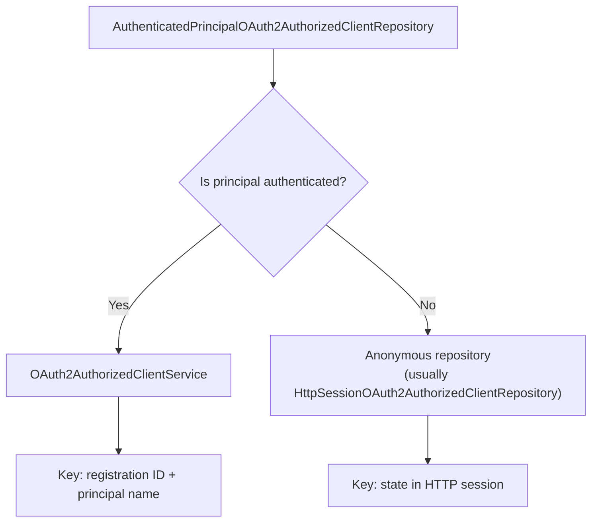
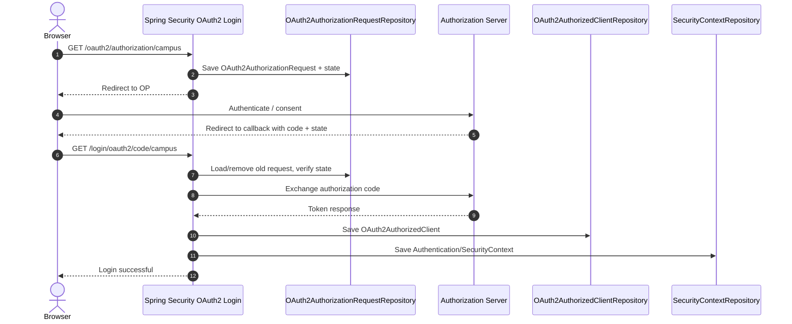

# 14.3. OAuth2AuthorizedClientRepository and the HTTP Request Context

## Learning Objectives

After this lesson, you will be able to:

- Explain the role of **`OAuth2AuthorizedClientRepository`** in **Spring Security OAuth2/OIDC Client applications using Servlet**.
- Distinguish `ClientRegistration`, `OAuth2AuthorizedClient`, `OAuth2AuthorizedClientRepository`, `OAuth2AuthorizedClientService`, and `OAuth2AuthorizationRequestRepository`.
- Understand the three operations `loadAuthorizedClient`, `saveAuthorizedClient`, and `removeAuthorizedClient` along with the `Authentication`, `HttpServletRequest`, and `HttpServletResponse` parameters.
- Understand why storing OAuth2 authorized client state can depend on the **HTTP session** or the **authenticated principal**, and the limitations of those choices.
- Use the repository or `@RegisteredOAuth2AuthorizedClient` when an access token is needed for a backend API call, while letting `OAuth2AuthorizedClientManager` participate in re-issuing tokens when appropriate.
- Configure Spring Security Servlet for OAuth2 Login, understand how the repository wires to the manager, and choose the right storage approach when deploying multiple instances.
- Avoid token leaks, cross-user data mixing, losing state on logout or token refresh, and confusing request context with background jobs.

## 1. Context: After OIDC Login Succeeds, Where Are the Tokens?

Suppose **Learning Portal** is a Spring Boot web application. Users sign in via **Campus Identity** (OpenID Provider) using the OpenID Connect Authorization Code Flow. After the callback, Spring Security has validated the ID Token and created a login session.

Learning Portal then needs to call the **Course API** on the user's behalf:

```http
GET /api/me/courses HTTP/1.1
Host: courses.example.org
Authorization: Bearer <access-token>
```

The Client must retrieve the right access token for the **current user** and the **authorized client registration**. If the token is near expiration, the application may need to refresh it via the Token Endpoint.

In Spring Security, a component responsible for **storing and loading authorized state within a Servlet request context** is:

```java
OAuth2AuthorizedClientRepository
```

The repository is not a standalone login mechanism and does not issue tokens. It helps answer:

> "In this HTTP request, for registration `campus` and the current principal, which `OAuth2AuthorizedClient` does the application currently have to use or update?"

An `OAuth2AuthorizedClient` contains the ClientRegistration, principal name, access token, and refresh token (if issued). The repository provides the mechanism to load/save/remove that object.

### 1.1. Distinguishing Registration, Login, and Authorization Information

| Object | Purpose | Example in Learning Portal |
| --- | --- | --- |
| `ClientRegistration` | Application configuration at the Authorization Server | Client ID, issuer, Token Endpoint, scopes, `registrationId=campus` |
| `Authentication` | Authenticated identity and authorities for the request | Student A's OIDC principal |
| `OAuth2AuthorizedClient` | Authorized OAuth2 client state for a principal | Registration `campus`, student A, access token A, refresh token A |
| `OAuth2AuthorizedClientRepository` | Saves/loads/removes authorized clients, **with HTTP request/response context** | Retrieves token A for student A's request |
| `OAuth2AuthorizedClientService` | Saves/loads/removes authorized clients by registration ID and principal name, **without HttpServletRequest** | Retrieves token from a service store |
| `OAuth2AuthorizedClientManager` | Coordinates authorization/re-authorization, can use refresh tokens | Returns a usable authorized client or refreshes when needed |

**Do not place an access token in a singleton variable or store user A's newly received token to reuse for every request.** Each user/grant has its own state and permissions.

### 1.2. Overall Architecture Diagram



This diagram shows components that can collaborate in an application; not every repository is required to use `OAuth2AuthorizedClientService`. With `HttpSessionOAuth2AuthorizedClientRepository`, authorized client state is managed via the HTTP session rather than a separate service store.

## 2. What Does `OAuth2AuthorizedClient` Contain?

An `OAuth2AuthorizedClient` object represents a **client registration authorized for a specific principal**.

Common APIs:

```java
OAuth2AuthorizedClient authorizedClient = ...;

String registrationId =
    authorizedClient.getClientRegistration().getRegistrationId();

String principalName = authorizedClient.getPrincipalName();

OAuth2AccessToken accessToken =
    authorizedClient.getAccessToken();

OAuth2RefreshToken refreshToken =
    authorizedClient.getRefreshToken();
```

Where:

- `getClientRegistration()` returns the client configuration used.
- `getPrincipalName()` indicates the principal name associated with the authorized client.
- `getAccessToken()` returns the access token for the client to use with the appropriate Resource Server.
- `getRefreshToken()` may return `null`; providers are not required to issue a refresh token for every grant/registration.

Conceptual representation:

```text
OAuth2AuthorizedClient
  |
  +-- ClientRegistration: "campus"
  |     +-- clientId = "learning-portal-web"
  |     +-- grantType = authorization_code
  |
  +-- principalName = "student-9b71"
  |
  +-- accessToken
  |     +-- tokenValue = [SENSITIVE]
  |     +-- issuedAt
  |     +-- expiresAt
  |
  +-- refreshToken (optional)
        +-- tokenValue = [VERY SENSITIVE]
```

**Token values are sensitive credentials.** Do not serialize the raw `OAuth2AuthorizedClient` to the browser, log `getTokenValue()`, or include the refresh token in requests to the Course API.

### 2.1. One User Can Have Multiple Authorized Clients

Suppose Portal supports two registrations:

```text
campus
partner
```

The same user may have authorized the `campus` client to call one API while also authorizing `partner` for another API. In that case:

```text
Principal A + registration "campus"  -> authorized client A/campus
Principal A + registration "partner" -> authorized client A/partner
Principal B + registration "campus"  -> authorized client B/campus
```

These objects must not be substituted or shared arbitrarily. `registrationId` should be treated as an **OAuth Client configuration selector key**, not a way to infer user permissions.

## 3. The `OAuth2AuthorizedClientRepository` Interface

In Spring Security Servlet:

```java
import org.springframework.security.oauth2.client.web
    .OAuth2AuthorizedClientRepository;
```

The interface has three core operations (shown with typical signatures):

```java
public interface OAuth2AuthorizedClientRepository {

    <T extends OAuth2AuthorizedClient> T loadAuthorizedClient(
        String clientRegistrationId,
        Authentication principal,
        HttpServletRequest request
    );

    void saveAuthorizedClient(
        OAuth2AuthorizedClient authorizedClient,
        Authentication principal,
        HttpServletRequest request,
        HttpServletResponse response
    );

    void removeAuthorizedClient(
        String clientRegistrationId,
        Authentication principal,
        HttpServletRequest request,
        HttpServletResponse response
    );
}
```

The request/response types belong to the **Servlet API** for the Spring version in use. In modern Spring Security with Spring Framework 6+, the imports are `jakarta.servlet.http.*`; projects on older generations may use the `javax.servlet.*` namespace.

### 3.1. Meaning of Each Parameter

| Parameter | What Is It Used For? |
| --- | --- |
| `clientRegistrationId` | Selects the authorized client corresponding to a registration, e.g., `campus` |
| `Authentication principal` | Provides the authenticated identity or anonymous state for the repository to apply its load/save policy |
| `HttpServletRequest request` | Provides Servlet context: session, request attributes, or metadata needed by the implementation |
| `HttpServletResponse response` | Allows the implementation to update HTTP/session/cookie state when saving or removing |
| `OAuth2AuthorizedClient authorizedClient` | The object to save, including the current token and optional refresh token |

**The defining characteristic of this repository is its HTTP request/response context.** It is not designed for every call to run inside a worker without a Servlet request.

### 3.2. `loadAuthorizedClient`: Loading the Right State

Example:

```java
OAuth2AuthorizedClient current =
    authorizedClientRepository.loadAuthorizedClient(
        "campus",
        authentication,
        request
    );
```

If no authorized client is stored for that context, the result may be `null`. Do not infer that `null` means the user is not signed in: a valid `Authentication` may simply have never authorized the `campus` registration, or the OAuth state may have been removed/expired.

### 3.3. `saveAuthorizedClient`: Saving Tokens and New Versions

After a successful authorization or refresh, the client may need to save a new `OAuth2AuthorizedClient`, especially when the token endpoint returns a new access token and a **new refresh token due to rotation**:

```java
authorizedClientRepository.saveAuthorizedClient(
    updatedAuthorizedClient,
    authentication,
    request,
    response
);
```

Applications must avoid overwriting newer token data with stale state across concurrent requests. A repository is a storage interface; it **does not automatically provide distributed locking** or resolve all race conditions across instances.

### 3.4. `removeAuthorizedClient`: Removing Authorized State

Example:

```java
authorizedClientRepository.removeAuthorizedClient(
    "campus",
    authentication,
    request,
    response
);
```

This operation **deletes the local record** of the authorized client. It **does not automatically mean** the Authorization Server has revoked the refresh token or access token.

If the product requirement is to revoke access at the provider, check whether the Authorization Server supports token revocation, OIDC logout, or an appropriate grant management mechanism.

## 4. Why Does the Repository Need `HttpServletRequest` and `HttpServletResponse`?

In a Servlet application, request state may be tied to:

- The **HTTP session** maintained by the browser via a session cookie.
- The **SecurityContext/Authentication** of the signed-in user.
- The **Client registration** currently in use.
- The application's **custom storage mechanism** (database, cache, or service).
- The **Response** to update session/cookies when required by the implementation.

For example, two browsers signed in with two accounts:

```text
Browser A
  Cookie: JSESSIONID=AAA
  Principal: student A

Browser B
  Cookie: JSESSIONID=BBB
  Principal: student B
```

When controller A loads the authorized client, the repository uses the corresponding principal and/or session to locate state A. Passing the request is one way the implementation accesses the exact session of the current request.

**Never treat `JSESSIONID` as an access token.** The session cookie only helps the browser maintain the application session. Access tokens are stored/read through the repository and do not necessarily appear in cookies.

### 4.1. `Authentication` and HTTP Session Are Not the Same Thing

An `Authentication` represents the **current identity**; `HttpSession` is a mechanism for **storing HTTP session state**.

They may accompany each other, but they are not identical:

| Scenario | `Authentication` | HTTP Session |
| --- | --- | --- |
| Typical web OIDC Login | Authenticated OIDC principal | Usually has a session |
| Anonymous user | May be anonymous authentication or lack suitable authentication | May or may not have a session |
| Stateless Bearer JWT Resource Server | Authentication per Bearer request | Usually does not need a session |
| Background job | May use a service principal by design | No Servlet request/session |
| User logs out | Local authentication ends | Session may be invalidated |

The fact that a repository can store in the session **does not mean every application chooses that approach**.

### 4.2. `HttpServletResponse` Is Passed Even When an Implementation Does Not Need It

`saveAuthorizedClient(...)` and `removeAuthorizedClient(...)` take a response parameter because the interface supports diverse implementations within a Servlet context. An implementation storing entirely in a service may not need to write cookies or headers. Do not assume every save writes a new cookie.

## 5. Two Important Implementation Approaches

Spring Security provides useful repository implementations for Servlet web applications.

### 5.1. `HttpSessionOAuth2AuthorizedClientRepository`

The implementation:

```java
HttpSessionOAuth2AuthorizedClientRepository
```

stores authorized clients in the **HTTP session**. It fits when OAuth state only needs to live for the browser session and the application accepts the corresponding session/storage characteristics.

Example bean declaration (choose this only when it matches your architectural intent):

```java
@Bean
OAuth2AuthorizedClientRepository authorizedClientRepository() {
    return new HttpSessionOAuth2AuthorizedClientRepository();
}
```

Characteristics:

- Depends on the browser/request session.
- When the session is deleted or expires, authorized clients stored only in that session can no longer be loaded from the old session.
- In multi-node deployments, you must understand session replication/clustering or sticky sessions.
- Not suitable for background jobs without an HTTP request.
- Can be simple for a stateful Servlet application, though storing refresh tokens in the session store must be evaluated.

### 5.2. `AuthenticatedPrincipalOAuth2AuthorizedClientRepository`

The implementation:

```java
AuthenticatedPrincipalOAuth2AuthorizedClientRepository
```

chooses storage based on **Authentication status**. For authenticated principals, it delegates load/save/remove operations to an `OAuth2AuthorizedClientService`. When the principal is not authenticated, the implementation can use a fallback repository, defaulting typically to an HTTP-session-based repository.

Diagram:



Explicit configuration example:

```java
@Configuration
class AuthorizedClientRepositoryConfig {

    @Bean
    OAuth2AuthorizedClientRepository authorizedClientRepository(
            OAuth2AuthorizedClientService authorizedClientService) {

        return new AuthenticatedPrincipalOAuth2AuthorizedClientRepository(
            authorizedClientService
        );
    }
}
```

In a Spring Boot application with suitable OAuth2 Client configuration, the framework may auto-create default beans; it is **not mandatory** to declare the repository manually when defaults meet your needs. The code above only illustrates explicit implementation selection.

You can also replace the fallback repository for anonymous principals if your product has specific requirements, though you should understand the authorization and session lifecycle before doing so.

### 5.3. What Is the Accompanying `OAuth2AuthorizedClientService`?

`OAuth2AuthorizedClientService` operates by `clientRegistrationId` and `principalName`, without taking `HttpServletRequest`/`HttpServletResponse`:

```java
OAuth2AuthorizedClient client =
    authorizedClientService.loadAuthorizedClient(
        "campus",
        principalName
    );
```

Common implementations:

| Service | Usage Characteristics |
| --- | --- |
| `InMemoryOAuth2AuthorizedClientService` | Stores in process memory; useful for demos, tests, or simple applications |
| `JdbcOAuth2AuthorizedClientService` | Stores via JDBC; better suited when state must survive outside a single JVM's memory |
| Custom service | Uses another store or custom tenant/persistence rules, with responsibility for token security and consistency |

**In-memory is not a distributed store.** When running multiple instances, restarting, or routing requests to another node, you cannot assume a token record in JVM A exists in JVM B.

### 5.4. Comparing Repository and Service

| Aspect | `OAuth2AuthorizedClientRepository` | `OAuth2AuthorizedClientService` |
| --- | --- | --- |
| Design context | Servlet HTTP request/response | Not directly tied to Servlet requests |
| Lookup parameters | Registration ID, `Authentication`, request | Registration ID and principal name |
| Save signature | `saveAuthorizedClient(..., request, response)` | `saveAuthorizedClient(..., principal)` |
| Can bind to session | Yes, depending on implementation | Does not accept session in its API |
| Use outside HTTP requests | Not a direct fit | Can fit when the exact principal and storage are known |
| Refreshes tokens automatically? | No | No |
| Paired with | `DefaultOAuth2AuthorizedClientManager` | `AuthorizedClientServiceOAuth2AuthorizedClientManager` or delegating repository |

If token refreshing is needed, a corresponding manager/provider must be involved. Do not call the service/repository expecting `load` to mint a new token by itself.

## 6. Distinguishing from `OAuth2AuthorizationRequestRepository`

These two interfaces are easily confused because both contain "repository" and both can use the HTTP session:

```text
OAuth2AuthorizationRequestRepository
OAuth2AuthorizedClientRepository
```

However, their function and timing are completely different.

| Component | What Data Does It Store? | Timing |
| --- | --- | --- |
| `OAuth2AuthorizationRequestRepository` | Initiated **authorization request**: `state`, redirect URI, related PKCE data, data needed to correlate callback | Before and while the browser redirects to the Authorization Server |
| `OAuth2AuthorizedClientRepository` | **Authorized client** after obtaining access/refresh tokens | After token exchange/authorization succeeds and during subsequent usage |
| `SecurityContextRepository` | Authenticated **Authentication/SecurityContext** | During or after login processing, and on subsequent requests |

Flow:



The two storage steps have distinct responsibilities:

- Before the callback, the client needs to know which request was initiated to verify `state`.
- After the callback, the client needs to keep the authorization state to call downstream APIs.

Do not swap `OAuth2AuthorizationRequestRepository` with `OAuth2AuthorizedClientRepository` when trying to troubleshoot `state` errors in OAuth login.

## 7. Spring Security Saves the Authorized Client After Login

With `oauth2Login()` in a Servlet application, the process typically includes:

1. `OAuth2AuthorizationRequestRedirectFilter` initiates the authorization request and redirects the browser.
2. The callback is handled by `OAuth2LoginAuthenticationFilter`.
3. Spring exchanges the authorization code for tokens.
4. If using OIDC, Spring verifies the ID Token and constructs the OIDC principal.
5. An `OAuth2AuthorizedClient` is created and saved via OAuth2 Login's authorized client mechanism.
6. `Authentication`/`SecurityContext` is saved per configuration, allowing subsequent requests to access the user's identity.

Example configuration:

```yaml
spring:
  security:
    oauth2:
      client:
        registration:
          campus:
            provider: campus
            client-id: ${CAMPUS_CLIENT_ID}
            client-secret: ${CAMPUS_CLIENT_SECRET}
            client-authentication-method: client_secret_basic
            authorization-grant-type: authorization_code
            redirect-uri: "{baseUrl}/login/oauth2/code/{registrationId}"
            scope:
              - openid
              - profile
              - courses.read

        provider:
          campus:
            issuer-uri: https://login.example.org/realms/campus
```

SecurityFilterChain:

```java
@Configuration
class WebSecurityConfig {

    @Bean
    SecurityFilterChain webSecurity(HttpSecurity http) throws Exception {
        http
            .authorizeHttpRequests(auth -> auth
                .requestMatchers("/", "/error", "/assets/**").permitAll()
                .anyRequest().authenticated()
            )
            .oauth2Login(Customizer.withDefaults())
            .oauth2Client(Customizer.withDefaults());

        return http.build();
    }
}
```

This is an example of a backend confidential client. Endpoints/domains are illustrative; a real application must register the OAuth Client/redirect URI at the OP and manage secrets securely. Depending on version/configuration, several OAuth2 Client beans and behaviors are auto-configured by Boot.

### 7.1. Why Might an Authorized Client Be Missing Even Though the User Is Logged In?

An **authenticated** user does not necessarily have authorized state for **every client registration**. Scenarios:

- The user logged in via `campus`, while the code tries to load registration `partner`.
- The token store was cleared, the session expired, or the application restarted.
- The application's primary login/UserInfo uses a different principal than the token storage key.
- A repository in a service/manager is configured differently from OAuth2 Login's repository.
- The registration's token was rejected, removed, or never issued.
- The application only configures `oauth2ResourceServer()` without the corresponding OAuth2 Client flow.

Separate **login authentication** from **OAuth2 authorization**. Never grab an arbitrary `OAuth2AuthorizedClient` and assume it belongs to the current principal.

## 8. Reading the Authorized Client Directly from the Repository in a Controller

A Spring MVC controller can accept `Authentication` along with `HttpServletRequest`, then call the repository:

```java
@RestController
class AuthorizedClientStatusController {

    private final OAuth2AuthorizedClientRepository authorizedClients;

    AuthorizedClientStatusController(
            OAuth2AuthorizedClientRepository authorizedClients) {
        this.authorizedClients = authorizedClients;
    }

    @GetMapping("/internal/oauth2/client-status")
    Map<String, Object> status(
            Authentication authentication,
            HttpServletRequest request) {

        OAuth2AuthorizedClient client =
            authorizedClients.loadAuthorizedClient(
                "campus",
                authentication,
                request
            );

        if (client == null) {
            return Map.of(
                "registrationId", "campus",
                "authorized", false
            );
        }

        Map<String, Object> response = new LinkedHashMap<>();
        response.put("registrationId",
            client.getClientRegistration().getRegistrationId());
        response.put("authorized", true);
        response.put("hasRefreshToken",
            client.getRefreshToken() != null);

        if (client.getAccessToken().getExpiresAt() != null) {
            response.put("accessTokenExpiresAt",
                client.getAccessToken().getExpiresAt().toString());
        }

        return response;
    }
}
```

This endpoint is **for illustration only**; protect it with admin/debug privileges or omit it in production. Even metadata such as expiry/token status should be controlled according to your threat model.

Key points:

- The repository looks up based on the current `authentication` and `request`.
- Missing authorized client is handled explicitly.
- Neither `client.getAccessToken().getTokenValue()` nor the refresh token is returned in JSON.
- `loadAuthorizedClient` **only loads**; it does not automatically refresh an expired access token.

### 8.1. Avoid Manually Building Keys Using Only `authentication.getName()`

One repository may be session-based, while another is backed by a service keyed by principal name. Writing your own token lookup logic using `getName()` while bypassing the repository abstraction can lead to inconsistent behavior, especially when the application uses custom principals or multiple providers.

Use the repository/manager APIs according to a unified configuration, and strictly scope tenant/identity to avoid colliding principal names.

### 8.2. Do Not Log Tokens for Debugging

You may log:

```text
registrationId=campus
authorized=true
hasRefreshToken=true
accessTokenExpiresAt=<timestamp>
```

But never log:

```text
accessToken=<bearer-token-value>
refreshToken=<refresh-token-value>
clientSecret=<secret>
```

Tokens can grant direct access or the ability to mint new tokens. Logging tokens into tracing or crash reports widens the credential exposure surface.

## 9. Using `@RegisteredOAuth2AuthorizedClient` in Servlet Requests

In many controllers, the application does not need to call `loadAuthorizedClient` manually. Spring Security supports:

```java
@RegisteredOAuth2AuthorizedClient("campus")
```

to resolve the appropriate authorized client in a web request context. The resolver can work with `OAuth2AuthorizedClientManager`, so it **can authorize/re-authorize** per configuration rather than acting as a pure lookup.

Example:

```java
@RestController
class CourseController {

    private final RestClient restClient;

    CourseController(RestClient.Builder builder) {
        this.restClient = builder.build();
    }

    @GetMapping("/api/my-courses")
    String myCourses(
            @RegisteredOAuth2AuthorizedClient("campus")
            OAuth2AuthorizedClient authorizedClient) {

        String accessToken =
            authorizedClient.getAccessToken().getTokenValue();

        return restClient.get()
            .uri("https://courses.example.org/api/me/courses")
            .headers(h -> h.setBearerAuth(accessToken))
            .retrieve()
            .body(String.class);
    }
}
```

This is illustrative code; real applications must handle exceptions, timeouts, DTOs, and proper token audience/scope constraints. Never return the access token to the browser. If the authorized client cannot be resolved/authorized, the failure path must be handled cleanly according to your application's login architecture.

### 9.1. Differences Between Repository and Annotation

| Usage | Typical Effect | What to Watch Out For |
| --- | --- | --- |
| `repository.loadAuthorizedClient(...)` | Loads stored state | Does not request new tokens automatically |
| `@RegisteredOAuth2AuthorizedClient(...)` | Resolves authorized client for controller | Depending on configuration, may go through manager and refresh |
| `authorizedClientManager.authorize(...)` | Requests authorize/re-authorize | Can use providers/grants and save updated state |
| `OAuth2AuthorizedClientService.loadAuthorizedClient(...)` | Loads by registration ID and principal name | No request context, does not refresh automatically |

If you need to ensure a token is still usable before calling an API, prefer a **manager or integrated HTTP client** with token management support rather than grabbing an object from the repository and reusing a stale token indefinitely.

## 10. `DefaultOAuth2AuthorizedClientManager` and HTTP Requests

This is the manager commonly used for **Servlet applications in a request context**.

```java
@Configuration
class AuthorizedClientManagerConfig {

    @Bean
    OAuth2AuthorizedClientManager authorizedClientManager(
            ClientRegistrationRepository registrations,
            OAuth2AuthorizedClientRepository repository) {

        OAuth2AuthorizedClientProvider provider =
            OAuth2AuthorizedClientProviderBuilder.builder()
                .authorizationCode()
                .refreshToken()
                .build();

        DefaultOAuth2AuthorizedClientManager manager =
            new DefaultOAuth2AuthorizedClientManager(
                registrations,
                repository
            );

        manager.setAuthorizedClientProvider(provider);
        return manager;
    }
}
```

Conceptual usage flow:

```text
Controller/HTTP Client
  -> AuthorizedClientManager.authorize(...)
     -> load OAuth2AuthorizedClient via repository
     -> access token still valid: reuse it
     -> token needs refresh + refresh token present: call Token Endpoint if provider permits
     -> update token state and save via repository
```

**The manager is not a background timer** that automatically refreshes every token when no requests occur. Normally it evaluates state when the application invokes `authorize(...)` in an appropriate context.

### 10.1. Why Does the Manager Need the Repository?

The manager must know which authorized client currently exists for a principal, and where to store the new version after refreshing. The repository provides those operations inside a Servlet request.

A caller can build an authorize request:

```java
OAuth2AuthorizeRequest request =
    OAuth2AuthorizeRequest
        .withClientRegistrationId("campus")
        .principal(authentication)
        .build();

OAuth2AuthorizedClient authorizedClient =
    authorizedClientManager.authorize(request);
```

This assumes execution within a **Servlet request context** accessible to the manager. When used outside a controller or in another context, pass the appropriate request/response attributes per your API version or choose a service/background manager.

If the manager cannot determine the required HTTP request context, never try to pass a fake request just to use the Servlet manager in a scheduled job.

### 10.2. Configuring Success/Failure Handlers

`DefaultOAuth2AuthorizedClientManager` supports handlers when authorization succeeds or fails.

Depending on configuration, the default mechanism can save the new authorized client via the repository and remove invalid state on appropriate OAuth errors (e.g., `invalid_grant` per the configured handler).

This explains why after a failed refresh, the authorized client may disappear from the repository. However, do not assume **every** HTTP 5xx or timeout should delete the grant: distinguish recoverable transient errors from errors indicating the token/grant is no longer valid.

### 10.3. One Request Can Mutate the Token Store

When refresh-token rotation is enabled:

```text
Before request:
  Access Token AT1
  Refresh Token RT1

During authorize():
  Client sends RT1 to Token Endpoint
  OP returns AT2 + RT2

After request:
  Repository must save AT2 + RT2
```

If another thread/instance still holds RT1 and overwrites the newer record, the client can lose the grant or trigger reuse detection at the provider. Synchronizing updates across concurrent requests is not solved automatically merely by using the repository interface.

## 11. Background Jobs: When There Is No HTTP Request

A scheduled task may need an access token to call an API, but it has no `HttpServletRequest` or browser session.

Example:

```text
@Scheduled job
    -> no DispatcherServlet request
    -> no browser cookie
    -> no natural session principal
```

In that case, Spring Security provides a service-based manager:

```java
AuthorizedClientServiceOAuth2AuthorizedClientManager
```

Example for a workload using Client Credentials:

```java
@Bean
OAuth2AuthorizedClientManager backgroundManager(
        ClientRegistrationRepository registrations,
        OAuth2AuthorizedClientService authorizedClients) {

    OAuth2AuthorizedClientProvider provider =
        OAuth2AuthorizedClientProviderBuilder.builder()
            .clientCredentials()
            .build();

    AuthorizedClientServiceOAuth2AuthorizedClientManager manager =
        new AuthorizedClientServiceOAuth2AuthorizedClientManager(
            registrations, authorizedClients
        );

    manager.setAuthorizedClientProvider(provider);
    return manager;
}
```

Caller:

```java
OAuth2AuthorizeRequest authorizeRequest =
    OAuth2AuthorizeRequest
        .withClientRegistrationId("course-sync")
        .principal("scheduled-course-sync")
        .build();

OAuth2AuthorizedClient client =
    backgroundManager.authorize(authorizeRequest);
```

This is a machine-to-machine example using `client_credentials`; it does not sign in a user. Registration, grant, and Token Endpoint must be configured according to provider policy.

If a background job genuinely needs to run on behalf of a user using a previously authorized grant, you must select the exact principal, service store, and expiry/refresh policy; never borrow an arbitrary user's `SecurityContext` or fake a browser session.

### 11.1. Choosing a Manager by Environment

| Environment | Typically Appropriate Component | State Source |
| --- | --- | --- |
| Servlet controller with OIDC Login and session | `DefaultOAuth2AuthorizedClientManager` | `OAuth2AuthorizedClientRepository` |
| Outbound API call inside HTTP request | Repository/manager or integrated HTTP client | Has request principal and authorized client |
| Worker/scheduled job without Servlet request | `AuthorizedClientServiceOAuth2AuthorizedClientManager` | `OAuth2AuthorizedClientService` |
| Resource Server only verifying Bearer tokens | Usually does not need authorized client repository | Token in inbound request |
| Reactive WebFlux application | Corresponding **reactive** repository/manager | `ServerOAuth2AuthorizedClientRepository`, not Servlet repository |

**Do not use Servlet interfaces in WebFlux just because their names look similar.** The reactive stack has different APIs and its own request model.

## 12. Session-Based vs. Service-Based Repository in Production

### 12.1. Choosing Based on Authorized Client Lifetime

Some applications only need tokens while the user has an active browser session. Upon logout or session expiration, local tokens can disappear with the session.

Other applications need to keep grants after the HTTP session ends to run deferred business processing, when allowed by the provider and consented to by the user. In that case, the authorized client may need a **persistent service store** with appropriate security and revocation policies.

| Criterion | Stored in HTTP Session | Stored via Authorized Client Service |
| --- | --- | --- |
| Lifecycle | Typically tied to session | Based on principal/registration key and storage policy |
| Survives browser session | Usually not, if session-only | Possible, depending on service and cleanup |
| Shared across multiple nodes | Requires session clustering/distributed session | Requires persistent/shared service store |
| Suited for background processing | Not directly | Better suited |
| Protecting refresh tokens | Protect session store and cookie/session ID | Protect database/secret store, access controls, encryption |
| Logout | Session invalidation can clear local state | May need explicit removal/revocation from service |
| Principal isolation audit | By request session | By principal name and registration ID |

No single default suits every system. Design according to token lifetime, instance count, UX, consent, security requirements, and whether APIs must be called after the browser closes.

### 12.2. When Deploying Multiple Instances

Suppose Learning Portal has two nodes:

```text
Browser -> Load Balancer
         |-- Node A
         |-- Node B
```

If authorized clients are stored only in Node A's memory, a subsequent request hitting Node B may fail to find the token.

Options include:

- Using shared sessions if choosing a session-backed repository.
- Using a JDBC/shared authorized client service if choosing principal-based persistence.
- Designing refresh token synchronization when concurrent requests read the same grant.
- Ensuring all instances use the same principal/tenant identifier keys.
- Defining clear retention periods and cleanup when grants expire or become invalid.

**Sticky sessions are merely an operational choice**, not a recovery plan when a node restarts or requests fail over to another node.

### 12.3. Storage Keys and Multi-Tenancy

If the service store uses the logical key:

```text
(registrationId, principalName)
```

then principal names must be managed so users from different issuers/tenants never collide. For example, two different OPs both emit `sub="123"`; if application code constructs `principalName="123"` and shares the same registration ID in a custom store, records can collide.

Design unified identifiers based on OIDC issuer and subject, together with tenant and registration as needed, or enforce clear key rules in custom repositories. Never rely solely on a mutable email address to identify users.

## 13. Logout and Revoking Access

There are three distinct actions:

1. **Application logout:** ends local `Authentication`/session.
2. **Remove authorized client:** deletes token state stored in the client's repository/service.
3. **Token revocation or OP logout:** asks the Authorization Server to revoke tokens/grants or end the SSO session via a provider-supported protocol.

These three actions **are not automatically identical**.

### 13.1. With a Session-Based Repository

When the session is invalidated, authorized clients stored solely in that session can no longer be retrieved from it. However, the Authorization Server may still accept the refresh token if it has not been revoked.

### 13.2. With a Principal-Based Service

If authorized clients are stored in JDBC or another backing store, logging out from the browser may **not automatically delete token records**. Define clearly:

- Should logout remove the authorized client from the service?
- When a user withdraws consent, should the revocation endpoint be called?
- Should grants be retained to perform authorized offline tasks?
- Who is authorized to view/delete a principal's authorized clients?
- What is the retention and deletion policy for sensitive tokens in the database?

A controller calling `removeAuthorizedClient(...)` alone does not guarantee the OP revoked the token. Revocation must occur at the endpoint and method supported by the provider.

### 13.3. Never Use GET for Sensitive Deletion Actions

For example, deleting an authorized client should be a controlled operation (POST/DELETE depending on design) with authentication, authorization, and proper CSRF protection when using cookie sessions.

Never expose a public GET URL like:

```text
GET /oauth/remove-all-tokens
```

allowing any external page to trigger deletion of a user's tokens via a simple link.

## 14. Securing the Token Store and HTTP Context

Key requirements:

| Threat | Mitigation |
| --- | --- |
| Access/refresh tokens leaked in logs or HTTP responses | Never log raw tokens, never serialize the raw `OAuth2AuthorizedClient` |
| Browser JavaScript reads refresh token | Keep tokens in backend/BFF and use session cookies only when architecture permits |
| Attacker hijacks session cookie | HTTPS, proper `Secure`, `HttpOnly`, `SameSite`, session and CSRF protection |
| User A's token used for request B | Enforce principal/session/registration binding; never use global variables |
| Token store read by unauthorized services | Restrict database credentials, read privileges, encryption at rest where needed |
| Refresh-token rotation race | Synchronize updates per grant, versioning/compare-and-swap |
| Tokens unintentionally survive logout | Clear removal, revocation, and retention policies |
| Authorization fails yet app keeps using old token | Handle `invalid_grant`/expired token errors; never retry blindly |
| Multi-tenant principal name collisions | Keys scoped with proper issuer/tenant and registration |

### 14.1. A Session Cookie Is Not a Browser Token Store

In server-side OIDC Login, the browser typically only carries a session cookie. Tokens can remain server-side in the HTTP session or service.

This reduces exposure of tokens to JavaScript, but the session cookie itself remains highly sensitive: anyone who hijacks the session can issue requests with the user's privileges. Thus, a secure token store does not replace CSRF/session protection.

### 14.2. Never Build a Global Repository Sharing One Token

Architecturally broken example:

```java
@Component
class UnsafeTokenCache {
    private OAuth2AuthorizedClient lastAuthorizedClient;
}
```

If a controller writes user A's authorized client into this field, user B's request may receive the wrong token. A proper `OAuth2AuthorizedClientRepository` isolates state by principal/session to prevent such state mixing.

### 14.3. When Caching or Encrypting Tokens

Caches must have appropriate keys and expirations; never cache solely by `registrationId` for user-delegated tokens. For long-term storage, consider encryption at rest, separately managed encryption keys, least-privilege access, rotation, and deletion.

Do not cache an access token beyond its validity window just to avoid calling the Token Endpoint. If a refresh token is revoked by the provider, the repository must also handle unusable records.

## 15. Handling Errors When Loading or Refreshing an Authorized Client

### 15.1. `loadAuthorizedClient(...)` Returns `null`

Possible reasons:

- No matching authorization has occurred yet.
- Wrong registration ID.
- Current `Authentication`/principal differs from when it was saved.
- HTTP session expired.
- Service store has no record or another instance does not share the store.
- Authorized client was removed after a grant error or logout.

The application may need to initiate an interactive authorization flow if the user has not granted access. Never fabricate a fake access token or borrow a token from another principal.

### 15.2. Access Token Already Expired

The repository **can still return an object containing an expired access token**. It stores state; it does not guarantee every loaded token is still valid.

In that case:

```text
repository.loadAuthorizedClient(...)
   -> returns object
   -> access token may already be expired
```

Only a manager/provider such as `refreshToken()` evaluates issuing a new access token under actual conditions. If there is no refresh token or the grant is no longer valid, the application must handle re-authorization.

### 15.3. Provider Rejects Refresh with `invalid_grant`

A refresh token may be expired, revoked, or flagged for reuse. Stop using the invalid token and handle removal/re-authorization per policy. Never retry indefinitely with the same old refresh token.

### 15.4. Network Errors or Token Endpoint Temporarily Unavailable

Not every error means the grant was revoked. For timeouts/5xx responses, bounded retries with backoff may be applied per policy, while keeping in mind the case where the token endpoint already processed the refresh and rotated the token before the client timed out. Retrying with the old refresh token can trigger reuse detection.

## 16. Practice Exercises

### Exercise 1 — How Does the Repository Use the Request Context?

Given the controller:

```java
@GetMapping("/oauth-status")
String oauthStatus(
        Authentication auth,
        HttpServletRequest request) {

    OAuth2AuthorizedClient client =
        repository.loadAuthorizedClient(
            "campus",
            auth,
            request
        );

    return client == null ? "not-authorized" : "authorized";
}
```

**Question:** Why not pass only `"campus"`?

**Answer:** Because token state can differ across principals and sessions. The repository needs `Authentication` and `HttpServletRequest` to locate the right authorized client according to its implementation.

### Exercise 2 — Distinguishing Two Repositories

A developer uses `HttpSessionOAuth2AuthorizationRequestRepository` to look up the access token after login.

**Question:** What is wrong here?

**Answer:** That repository is for **authorization requests awaiting callback**, not authorized clients that have already received tokens. Use `OAuth2AuthorizedClientRepository` or the appropriate service/manager.

### Exercise 3 — Session Storage vs. Service Storage?

Portal only needs tokens while the browser session is active; on logout, local tokens should no longer be usable. Another application needs a scheduled worker to run after the user leaves the page and is permitted to perform offline access.

**Suggested answer:** For the session-bound Portal, consider a session repository; for the offline worker, consider a persistent `OAuth2AuthorizedClientService` and a manager for non-HTTP contexts, with explicit consent/expiry/revocation policies.

### Exercise 4 — A `load` Result Does Not Mean a Valid Token

The repository returns an authorized client with:

```text
accessToken.expiresAt = 09:00
currentTime           = 09:10
refreshToken          = RT1
```

**Question:** Can the API be called immediately with the old access token?

**Answer:** No, you should not. The repository only returns stored state. Use an appropriate manager/provider to refresh when permitted and obtain a new access token; if that fails, handle re-authorization.

### Exercise 5 — Checking Behavior After Logout

An application uses `AuthenticatedPrincipalOAuth2AuthorizedClientRepository` and `JdbcOAuth2AuthorizedClientService`. A user logs out, the HTTP session is invalidated, yet the token record remains in the database.

**Question:** Is this definitely a framework bug?

**Answer:** Not necessarily. A service-backed authorized client store has a lifecycle independent of the HTTP session. The application must explicitly define whether logout deletes/revokes tokens stored in the service.

### Exercise 6 — Two Concurrent Refresh Requests

A and B both read RT1. A receives RT2; B still sends RT1.

**Question:** Does the repository automatically resolve this race just because it has a `saveAuthorizedClient` method?

**Answer:** No. Concurrency control per grant is required, such as a single-flight lock and optimistic versioning in the shared store, to avoid losing the new token or triggering replay detection.

## 17. Self-Check Questions

**1. How does `OAuth2AuthorizedClientRepository` differ from `ClientRegistrationRepository`?**

> The registration repository holds **client configuration**; the authorized client repository holds **authorized client state and tokens** for a principal in a Servlet context.

**2. Why does `loadAuthorizedClient` accept both `Authentication` and `HttpServletRequest`?**

> Because implementations can isolate tokens by principal, session, or request-bound storage; the registration ID alone is insufficient to identify the right token.

**3. Where does `HttpSessionOAuth2AuthorizedClientRepository` store data?**

> In the HTTP session; the data lifecycle is tied to the session and how the system implements its session store.

**4. How does `AuthenticatedPrincipalOAuth2AuthorizedClientRepository` handle authenticated principals?**

> It typically delegates to an `OAuth2AuthorizedClientService` to load/save by registration ID and principal name; anonymous principals can use a session-based fallback repository.

**5. How does `OAuth2AuthorizedClientService` differ from the Servlet repository?**

> The service does not take `HttpServletRequest`/`HttpServletResponse`, making it better suited for principal-based storage/lookup outside request contexts when properly configured.

**6. Does calling `loadAuthorizedClient(...)` alone refresh an expired access token?**

> No. Use `OAuth2AuthorizedClientManager` with appropriate providers if you want to authorize/re-authorize and save updated tokens.

**7. Does removing an authorized client mean the token is revoked at the Authorization Server?**

> No. Deleting local state differs from token revocation or OIDC provider logout.

**8. Should the entire `OAuth2AuthorizedClient` object be returned to the frontend?**

> No. It contains sensitive credentials; APIs should return only minimal metadata and never expose tokens.

**9. Which manager should a scheduled task without a Servlet request use?**

> Typically `AuthorizedClientServiceOAuth2AuthorizedClientManager` and an authorized-client service, with the exact principal and grant for that workload.

**10. When multiple browsers and users are active concurrently, how do you avoid using the wrong token?**

> Use a repository/store properly partitioned by registration, authenticated principal/session, and tenant; never store tokens in a singleton or cache keyed solely by registration ID.

---

## Key Takeaways

In **Spring Security OAuth2/OIDC Client applications using Servlet**, **`OAuth2AuthorizedClientRepository`** saves, loads, and removes **`OAuth2AuthorizedClient`** instances by combining `ClientRegistration` with **`Authentication` and the HTTP request/response context**. Depending on the implementation, data can be stored in the **HTTP session** or via **`OAuth2AuthorizedClientService`** for authenticated principals. The repository differs from `OAuth2AuthorizationRequestRepository` (which holds pre-callback authorization requests) and from `OAuth2AuthorizedClientManager` (which coordinates authorization/refresh). In production systems, keep tokens on the backend, clearly isolate principals/tenants, protect sessions and stores, handle concurrent refreshes and logout/revocation, and use the appropriate manager when calling APIs outside an HTTP request context.
