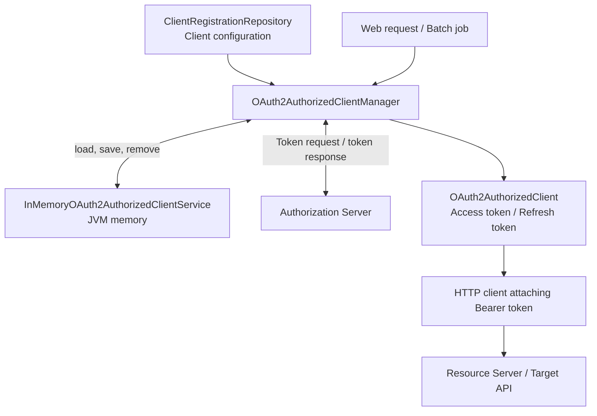
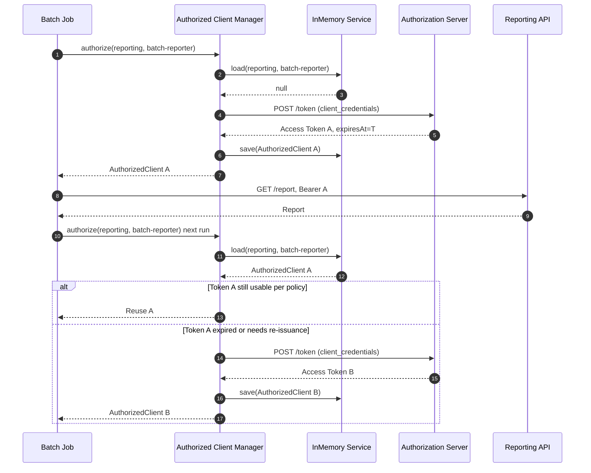

# 14.4. InMemoryOAuth2AuthorizedClientService and Data Lifecycle

## 1. Why Store OAuth2AuthorizedClient?

In **Spring Security OAuth 2.0/OIDC Client**, an application can obtain an access token from an Authorization Server to call a protected API. Once it has a token, the application typically calls the API repeatedly; requesting a new token every time would increase latency, add load to the Token Endpoint, and risk hitting rate limits. Conversely, keeping tokens only in temporary controller variables makes managing tokens per user or per client registration difficult to keep consistent.

Spring Security represents an authorization result with **`OAuth2AuthorizedClient`**. This object binds together:

- `ClientRegistration`: the OAuth2 client configuration, including client ID, grant type, scopes, provider, and endpoints.
- `principalName`: identifier of the subject the issued token belongs to, which may be a user's principal name or a stable name for a service-to-service job.
- `OAuth2AccessToken`: the access token along with issued/expiration timestamps and the scopes represented on the token object.
- `OAuth2RefreshToken`: optionally present, depending on the grant and Authorization Server policy.

`InMemoryOAuth2AuthorizedClientService` is an `OAuth2AuthorizedClientService` implementation that **stores authorized clients with their tokens in JVM memory**. It is useful when survival across restarts or sharing across multiple instances is not required. It is a *client-side token store*, not an Authorization Server, not the place that holds pre-callback authorization requests with `state`/PKCE, and not a Resource Server validating incoming API access tokens.

**Key distinction:** this service is responsible for **load, save, and remove**. **Requesting new tokens, refreshing tokens, and deciding whether the current token needs re-issuance** belong to components such as `OAuth2AuthorizedClientManager` and `OAuth2AuthorizedClientProvider`.

### 1.1. Position in the Architecture



An application might use OAuth2 Client solely to run jobs with `client_credentials`, or combine OAuth2 Login to sign in users and then call APIs using tokens issued on their behalf.

## 2. Do Not Confuse Different Data Stores

| Type/Component | What Does It Store? | When Is It Used? |
| --- | --- | --- |
| `ClientRegistration` | Client ID, secret/auth method, grant, scopes, endpoints | Configuring how tokens are requested |
| `ClientRegistrationRepository` | Client registrations by `registrationId` | Before and during authorization |
| `OAuth2AuthorizationRequest` | Authorization URL, `state`, PKCE, per-authorization metadata | Before the authorization-code callback |
| `AuthorizationRequestRepository` | Authorization request awaiting callback | Correlating redirect with callback |
| `OAuth2AuthorizedClient` | Registration + principal name + access/refresh token | After tokens have been issued |
| `OAuth2AuthorizedClientService` | API to save/load/remove authorized clients | Client-side token lifecycle |
| `InMemoryOAuth2AuthorizedClientService` | Authorized clients in the JVM | Concrete storage choice |
| `OAuth2AuthorizedClientRepository` | API to save/load authorized clients in a Servlet request context | Inside web HTTP requests |
| `OAuth2AuthorizedClientManager` | Coordinates authorization/re-authorization using providers and storage | When the application needs a token |
| `SecurityContext` | The user's `Authentication` | Securing application requests |

For example: a user signs in successfully via OpenID Connect, so the application has an `OidcUser` in `Authentication`. That **does not mean** `OidcUser` is an authorized client, or that the ID Token from `OidcUser` is an access token for calling a REST API. To call an API, the application needs an **access token from the appropriate authorized client**.

## 3. API of OAuth2AuthorizedClientService

The interface is in package:

```java
org.springframework.security.oauth2.client.OAuth2AuthorizedClientService
```

Primary methods, simplified from JavaDoc:

```java
public interface OAuth2AuthorizedClientService {

    <T extends OAuth2AuthorizedClient> T loadAuthorizedClient(
        String clientRegistrationId,
        String principalName);

    void saveAuthorizedClient(
        OAuth2AuthorizedClient authorizedClient,
        Authentication principal);

    void removeAuthorizedClient(
        String clientRegistrationId,
        String principalName);
}
```

### 3.1. loadAuthorizedClient

This operation looks up by the **key pair** `(clientRegistrationId, principalName)`:

```java
OAuth2AuthorizedClient client =
    authorizedClientService.loadAuthorizedClient(
        "reporting", "batch-reporter");

if (client == null) {
    // No authorized client stored under this key yet.
}
```

- `clientRegistrationId` is the configuration key in Spring Security, such as `reporting`.
- `principalName` is the subject name used when the authorized client was saved.
- When no matching data exists, the Servlet interface typically returns `null`.

**The `load` method does not call the Token Endpoint to request a new token** and does not check whether the access token is still usable. It only retrieves stored data.

### 3.2. saveAuthorizedClient

`saveAuthorizedClient(authorizedClient, principal)` saves the authorized client bound to the `Authentication`'s principal name. Any previous entry under the same key can be replaced with the new one:

```text
save(
    registrationId = "reporting",
    principalName  = "batch-reporter",
    accessToken    = A
)

Map[("reporting", "batch-reporter")] = OAuth2AuthorizedClient(A)
```

When a new token is issued, the manager can call `save` to replace the record. However, a successful save **does not prove** the token has the right audience/scope for the target API. And using the wrong `Authentication.getName()` when saving can cause subsequent lookups to miss the entry.

### 3.3. removeAuthorizedClient

`removeAuthorizedClient(registrationId, principalName)` removes the copy stored on the client side:

```java
authorizedClientService.removeAuthorizedClient(
    "reporting", "batch-reporter");
```

**Removing from RAM differs from revoking the token at the Authorization Server.** The token can still be accepted by the Resource Server until it expires or is revoked via a mechanism/policy supported by the provider (e.g., Token Revocation Endpoint per RFC 7009).

### 3.4. Capabilities the Interface Does Not Guarantee

`OAuth2AuthorizedClientService` does not provide a general contract for enumerating all tokens, deleting all tokens for a user, automatic TTL cleanup, multi-instance synchronization, or built-in audit trails. If the system needs those behaviors, you must design the appropriate storage and lifecycle policies.

## 4. In-RAM Storage: Fast but Limited

Implementation class:

```java
org.springframework.security.oauth2.client.InMemoryOAuth2AuthorizedClientService
```

You can picture it as:

```text
JVM process A
└── InMemoryOAuth2AuthorizedClientService
    ├── (corporate, user-101) -> Authorized Client A
    ├── (corporate, user-202) -> Authorized Client B
    ├── (crm, user-101)       -> Authorized Client C
    └── (reporting, batch)    -> Authorized Client D

JVM process B
└── InMemoryOAuth2AuthorizedClientService
    └── Separate map, not automatically synchronized with process A
```

The implementation stores by composite key, typically involving `OAuth2AuthorizedClientId`, to distinguish client registration and principal. This allows the same provider to serve many users with different tokens and the same user to hold multiple authorized clients.

| Characteristic | Consequence |
| --- | --- |
| Inside JVM heap | Fast lookup, no database needed |
| Per-process | Pod A does not automatically share with Pod B |
| Non-persistent | Restarts or pod replacements lose existing entries |
| Concurrent map in-process | Does not guarantee atomic refresh across requests/nodes |
| Token has `expiresAt` | Does not automatically remove the entry from the map at that time |
| May hold refresh tokens | Must protect heap dumps, debuggers, logs, and process access |
| No durable audit | Unsuitable if business rules require token storage history |
| Entries grow with keys | Consider retention when many principals never return |

A map being thread-safe under concurrent access **is not equivalent** to a distributed synchronized token refresh system. Two tasks can still observe an expired access token at the same time and concurrently request a new token, especially with refresh token rotation.

## 5. Spring Boot Servlet Configuration

### 5.1. Dependencies

Gradle example:

```gradle
dependencies {
    implementation 'org.springframework.boot:spring-boot-starter-web'
    implementation 'org.springframework.boot:spring-boot-starter-security'
    implementation 'org.springframework.boot:spring-boot-starter-oauth2-client'
}
```

### 5.2. Explicit Service Declaration

```java
@Configuration
class AuthorizedClientStorageConfiguration {

    @Bean
    OAuth2AuthorizedClientService authorizedClientService(
            ClientRegistrationRepository clientRegistrations) {

        return new InMemoryOAuth2AuthorizedClientService(
            clientRegistrations);
    }
}
```

Here `ClientRegistrationRepository` supplies the configured OAuth2 clients. `InMemoryOAuth2AuthorizedClientService` holds the tokens issued for those clients.

Spring Boot/Spring Security can auto-create default beans based on auto-configuration and existing beans. When declaring a service explicitly, verify **which authorized-client repository/manager actually uses that bean**. Do not assume every OAuth2 flow will save into the service you declared if the application already configured a different repository.

Java examples in this lesson omit common Spring Security and Spring Framework `import` statements.

### 5.3. Registration for client_credentials

```yaml
spring:
  security:
    oauth2:
      client:
        registration:
          reporting:
            provider: company-auth
            client-id: ${REPORTING_CLIENT_ID}
            client-secret: ${REPORTING_CLIENT_SECRET}
            authorization-grant-type: client_credentials
            scope:
              - report.read
        provider:
          company-auth:
            token-uri: https://auth.example.com/oauth2/token
```

`reporting` is Spring's internal `registrationId`. Client ID/secret are issued by the Authorization Server and must be managed via environment variables or a secret manager rather than committed to the repository.

`client_credentials` represents **service** permissions, does not create a user login, and does not need a browser authorization callback.

## 6. Lifecycle of an Authorized Client in a Batch Job

Suppose a job uses `client_credentials` to call the Reporting API every 15 minutes.



The service performs saving and reading. **The manager/provider** evaluates whether a token can be reused, needs re-issuance, or has an appropriate grant for refreshing.

With `client_credentials`, the Authorization Server normally does not issue a refresh token; the client can use its client credentials again to request a new access token. With Authorization Code/OIDC login, the provider may issue a refresh token, resulting in a different lifecycle.

### 6.1. Creating a Manager Suitable for Background Jobs

```java
@Configuration
class ReportingAuthorizedClientConfiguration {

    @Bean
    OAuth2AuthorizedClientManager authorizedClientManager(
            ClientRegistrationRepository registrations,
            OAuth2AuthorizedClientService authorizedClients) {

        OAuth2AuthorizedClientProvider provider =
            OAuth2AuthorizedClientProviderBuilder.builder()
                .clientCredentials()
                .build();

        var manager =
            new AuthorizedClientServiceOAuth2AuthorizedClientManager(
                registrations, authorizedClients);

        manager.setAuthorizedClientProvider(provider);
        return manager;
    }
}
```

`AuthorizedClientServiceOAuth2AuthorizedClientManager` fits when there is no `HttpServletRequest`, such as a scheduler or background worker. Here only `clientCredentials()` is configured because the job does not need interactive login.

### 6.2. Using the Authorized Client to Call an API

```java
@Service
class ReportingGateway {

    private final OAuth2AuthorizedClientManager manager;
    private final RestClient reportingApi;

    ReportingGateway(
            OAuth2AuthorizedClientManager manager,
            RestClient.Builder restClientBuilder) {

        this.manager = manager;
        this.reportingApi = restClientBuilder
            .baseUrl("https://reporting-api.example.com")
            .build();
    }

    String dailySummary() {
        OAuth2AuthorizeRequest request =
            OAuth2AuthorizeRequest.withClientRegistrationId("reporting")
                .principal("batch-reporter")
                .build();

        OAuth2AuthorizedClient client = manager.authorize(request);

        if (client == null) {
            throw new IllegalStateException(
                "Reporting client could not be authorized");
        }

        return reportingApi.get()
            .uri("/api/reports/daily")
            .headers(headers -> headers.setBearerAuth(
                client.getAccessToken().getTokenValue()))
            .retrieve()
            .body(String.class);
    }
}
```

This example uses `RestClient` from Spring Framework 6.1+. In real applications you can configure OAuth2 integration for `RestClient` or `WebClient` to attach access tokens automatically, while always ensuring **the right registration is used for the right API**.

`principal("batch-reporter")` is the name used to store the job's authorized client. It does not prove that a user named `batch-reporter` logged in.

## 7. Load and Authorize Are Different

```java
// Only retrieves stored data:
OAuth2AuthorizedClient stored =
    authorizedClientService.loadAuthorizedClient(
        "reporting", "batch-reporter");

// May reuse or request a new token per configured providers/grants:
OAuth2AuthorizedClient current =
    authorizedClientManager.authorize(
        OAuth2AuthorizeRequest
            .withClientRegistrationId("reporting")
            .principal("batch-reporter")
            .build());
```

| Behavior | `loadAuthorizedClient` | `authorizedClientManager.authorize` |
| --- | --- | --- |
| Looks up entry by registration/principal | Yes | Typically yes |
| Requests new token when missing | No | Possible, if grant permits |
| Refreshes/re-issues expired token | No | Possible per configured providers |
| Writes new token back to service | No | Possible via success handler |
| Always contacts IdP every time | No | No; may reuse |
| Guarantees target API accepts token | No | No; Resource Server still validates |
| Can fail to find/issue | Yes | Yes |

A stored token is not guaranteed to be unexpired, and an unexpired token is not guaranteed to be unrevoked or authorized for the API. Therefore, business code should use **the manager or HTTP client integration** instead of calling `load` and sending raw tokens without lifecycle control.

### 7.1. ExpiresAt Differs from Entry TTL

Suppose:

```text
10:00  Save token A with expiresAt=10:30.
10:15  Manager can reuse A.
10:31  No new calls yet. Entry A may still remain in the map.
11:00  Manager runs, sees token is expired, requests token B.
11:01  Save B replacing A.
```

`OAuth2AccessToken.getExpiresAt()` is metadata for token usage, **not an automatic command to evict the entry from RAM**. If expired entries must be cleaned up to reduce memory footprint, the application needs a retention/cleanup policy or storage with corresponding expiration.

Some providers/managers treat a token as needing re-issuance **before** its expiration timestamp by a buffer window (clock skew). Do not assume a token with only a few seconds left is guaranteed enough time for a successful API call.

### 7.2. Refresh Token Rotation and Concurrency

In Authorization Code/OIDC Login, the provider may issue a refresh token. When **refresh token rotation** is enabled, a refresh may return a new refresh token R2 and invalidate R1. If two requests both read the old authorized client and concurrently use R1:

```text
Request A: refresh with R1 -> succeeds, receives access A2 + refresh R2
Request B: refresh with R1 -> may receive invalid_grant
```

A thread-safe map does not by itself guarantee only one refresh operation runs or that the latest update is persisted consistently across a cluster. If this is an important requirement, design appropriate coordination/transactions and verify provider policy.

## 8. With OAuth2 Login, Which User Owns the Token?

In a web app using `oauth2Login()`:

1. Browser goes to the OIDC Provider's Authorization Endpoint.
2. Provider redirects browser back to the callback with an authorization code.
3. Backend exchanges the code for tokens and verifies the ID Token per OIDC.
4. Spring Security creates the user's `Authentication`/principal.
5. The authorized client can be saved so the backend can use the access token to call APIs on the user's behalf.

Example web app:

```yaml
spring:
  security:
    oauth2:
      client:
        registration:
          corporate:
            provider: staff-oidc
            client-id: ${CORPORATE_CLIENT_ID}
            client-secret: ${CORPORATE_CLIENT_SECRET}
            authorization-grant-type: authorization_code
            redirect-uri: "{baseUrl}/login/oauth2/code/{registrationId}"
            scope: openid, profile, email, report.read
        provider:
          staff-oidc:
            issuer-uri: https://idp.example.com/realms/staff
```

```java
@Configuration
class LoginSecurityConfig {

    @Bean
    SecurityFilterChain webSecurity(HttpSecurity http) throws Exception {
        http
            .authorizeHttpRequests(auth -> auth
                .requestMatchers("/", "/assets/**").permitAll()
                .anyRequest().authenticated())
            .oauth2Login(Customizer.withDefaults())
            .oauth2Client(Customizer.withDefaults());

        return http.build();
    }
}
```

`oauth2Login()` handles login, while `oauth2Client()` supports related OAuth2 Client capabilities. The browser typically continues using a **session cookie** to access the web app, while the backend uses the **access token** to call APIs. The two credentials have different responsibilities and lifecycles.

### 8.1. Two Users Sharing One Registration Still Have Separate Tokens

```text
(corporate, sub-101) -> User A's OAuth2AuthorizedClient
(corporate, sub-202) -> User B's OAuth2AuthorizedClient
(reporting, batch)   -> Service job's OAuth2AuthorizedClient
```

The `(registrationId, principalName)` pair is the key. `principalName` is normally obtained from `Authentication.getName()` in user flows, though this name depends on principal configuration. If you switch from `sub` to email after deployment, previously stored entries may no longer be found.

**Do not habitually use email as an immutable identifier key** when your application uses OIDC; a trusted issuer + subject identifier is usually better suited for linking internal accounts. With multi-tenancy, ensure registration and principal naming do not collide across identity sources.

### 8.2. Reading Status Without Exposing Tokens

Example internal endpoint restricted to appropriately authorized callers:

```java
@RestController
class AuthorizedClientStatusController {

    private final OAuth2AuthorizedClientService clients;

    AuthorizedClientStatusController(
            OAuth2AuthorizedClientService clients) {
        this.clients = clients;
    }

    @GetMapping("/internal/oauth2/status")
    Map<String, Object> status(
            OAuth2AuthenticationToken authentication) {

        String registrationId =
            authentication.getAuthorizedClientRegistrationId();

        OAuth2AuthorizedClient client = clients.loadAuthorizedClient(
            registrationId, authentication.getName());

        if (client == null) {
            return Map.of("storedInThisService", false);
        }

        OAuth2AccessToken token = client.getAccessToken();

        return Map.of(
            "storedInThisService", true,
            "registrationId", registrationId,
            "expiresAt", token.getExpiresAt().toString()
        );
    }
}
```

This example returns metadata only, **never token values, refresh tokens, or client secrets**. Protect `/internal/**` with an appropriate authorization policy. If authorized clients are stored via another repository, `null` from this service does not prove the application lacks a token elsewhere.

## 9. OAuth2AuthorizedClientService Differs from OAuth2AuthorizedClientRepository

On the Servlet stack:

- **`OAuth2AuthorizedClientService`** has an API independent of `HttpServletRequest`/`HttpServletResponse`; it saves/loads/removes by registration/principal. Suitable for background tasks.
- **`OAuth2AuthorizedClientRepository`** serves operations inside HTTP requests, can use `Authentication`, request, and response, and may delegate to a service underneath.
- **`AuthorizationRequestRepository`** is a **different** component that stores authorization requests containing `state`/PKCE before callback completion. It does not store issued access tokens for calling APIs.

In a typical Servlet setup, `AuthenticatedPrincipalOAuth2AuthorizedClientRepository` uses `OAuth2AuthorizedClientService` for authenticated principals and may use an HTTP session repository when unauthenticated. Therefore, verify **which repository/manager is actually wired** before assuming the in-memory service holds all authorized clients of the web app.

| Context | Common Appropriate Manager |
| --- | --- |
| Servlet request with browser/user | `DefaultOAuth2AuthorizedClientManager` with `OAuth2AuthorizedClientRepository` |
| Batch/scheduler outside Servlet request | `AuthorizedClientServiceOAuth2AuthorizedClientManager` with `OAuth2AuthorizedClientService` |
| WebFlux request | `DefaultReactiveOAuth2AuthorizedClientManager` |
| WebFlux background task | `AuthorizedClientServiceReactiveOAuth2AuthorizedClientManager` |

Using a manager designed for HTTP requests in a scheduled job without a request context can fail or lack required context.

## 10. Logout Does Not Automatically Delete and Revoke Tokens

Different lifecycles:

| Event | Consequence |
| --- | --- |
| Browser logs out of web app | SecurityContext/session may be cleared |
| `removeAuthorizedClient` | Local authorized-client entry is removed |
| Token Revocation Endpoint | Authorization Server receives token revocation request if supported |
| OIDC RP-Initiated Logout | Provider handles SSO session; does not implicitly revoke all access tokens |
| JVM restart | In-memory entries disappear |
| Access token expires | Entry may stay in RAM until replaced/deleted |

Thus, **do not assume web logout automatically deletes every entry in `InMemoryOAuth2AuthorizedClientService`**, nor claim local removal invalidates tokens at the IdP.

Example of a logout handler that cleans up the authorized client for registration `corporate` only:

```java
@Bean
LogoutHandler authorizedClientCleanup(
        OAuth2AuthorizedClientService service) {

    return (request, response, authentication) -> {
        if (authentication != null) {
            service.removeAuthorizedClient(
                "corporate", authentication.getName());
        }
    };
}
```

Can be attached to the Servlet logout DSL:

```java
http.logout(logout -> logout
    .addLogoutHandler(authorizedClientCleanup));
```

This is an example of **local cleanup for one registration**, not a token revocation or clear-all solution for every user/tenant. If the application has multiple registrations, determine which entries need removal; the service interface provides no generic method to list all entries.

## 11. When Should You Use In-Memory?

**Suitable** when the application runs a single instance, has a small number of principals, tokens can be re-acquired after restart, sharing across pods is unnecessary, and persistent storage is not required. Typical cases are demos, local development, tests, or `client_credentials` batch services.

**Consider another storage** when the application runs multiple instances, refresh tokens must survive rolling deployments, TTL/cleanup is required, auditing is needed, per-user/tenant revocation is required, data sharing is needed, or consistent coordination for refresh token rotation is required.

In-memory is not inherently insecure. Suitability depends on grant type, topology, user count, and the impact of losing tokens or retaining them too long.

### 11.1. JDBC and Shared Storage

Spring Security provides `JdbcOAuth2AuthorizedClientService` for certain Servlet architectures:

```java
@Bean
OAuth2AuthorizedClientService jdbcAuthorizedClients(
        JdbcOperations jdbc,
        ClientRegistrationRepository registrations) {

    return new JdbcOAuth2AuthorizedClientService(jdbc, registrations);
}
```

This example only shows **how to create the bean**. You must configure the proper SQL schema, datasource, migrations, transactions, and secret protection mechanisms per the Spring Security version's documentation.

When using JDBC/Redis or custom storage:

1. Keep the `(registrationId, principalName)` key consistent, with clear tenant/issuer policies.
2. Protect access tokens and refresh tokens with access controls, TLS, and storage encryption where needed.
3. Preserve exact token values, scopes, issuedAt/expiresAt, and refresh tokens across serialization and reads.
4. Ensure concurrency/transactions do not overwrite a newer refresh token with stale data.
5. Define TTL/cleanup, distinguishing access-token expiry from authorized-client retention.
6. Handle storage outages without bypassing token validation or using the wrong token on storage failure.
7. Define appropriate session/logout/revocation rules and plan migrations when changing principal naming.

Shared Spring Session **does not mean** a shared authorized-client service if wiring still uses an in-memory service per pod.

## 12. WebFlux Uses Different Reactive Implementations

The classes studied here are Servlet/non-reactive APIs:

```java
OAuth2AuthorizedClientService
InMemoryOAuth2AuthorizedClientService
AuthorizedClientServiceOAuth2AuthorizedClientManager
ClientRegistrationRepository
```

In WebFlux, the corresponding classes are:

```java
ReactiveOAuth2AuthorizedClientService
InMemoryReactiveOAuth2AuthorizedClientService
AuthorizedClientServiceReactiveOAuth2AuthorizedClientManager
ReactiveClientRegistrationRepository
```

WebFlux example:

```java
@Configuration
class ReactiveStorageConfiguration {

    @Bean
    ReactiveOAuth2AuthorizedClientService reactiveAuthorizedClients(
            ReactiveClientRegistrationRepository registrations) {

        return new InMemoryReactiveOAuth2AuthorizedClientService(
            registrations);
    }
}
```

When using `ReactiveOAuth2AuthorizedClientManager`, the authorize result is `Mono<OAuth2AuthorizedClient>`:

```java
Mono<OAuth2AuthorizedClient> authorized =
    reactiveAuthorizedClientManager.authorize(authorizeRequest);
```

Above, `authorizeRequest` has been created with `OAuth2AuthorizeRequest`. Continue processing with `flatMap` and `WebClient`, avoiding `.block()` on the event loop. The reactive in-memory service **is still single-process memory** and does not automatically solve multi-instance sharing or refresh concurrency.

## 13. Handling Errors at the Right Layer

| Symptom | Possible Cause | Resolution |
| --- | --- | --- |
| `loadAuthorizedClient` returns `null` | Not saved yet, wrong registration/principal, or restarted | Check key and service/repository wiring |
| Token exists in store but API returns `401` | Expired, revoked, wrong audience, token not sent | Check manager, expiry, and Resource Server |
| API returns `403` | Missing scope/authority/permission | Check grant scopes and API policy |
| `invalid_client` at Token Endpoint | Wrong secret/client authentication method | Check ClientRegistration and IdP |
| `invalid_grant` on refresh | Refresh token expired, revoked, or rotation race | Check refresh flow/concurrency |
| Must request new token after restart | In-memory storage disappeared | Accept this property or use a persistent store |
| Some pods have token, others do not | Map lives per JVM | Use shared store or per-pod token design |
| Logout leaves token in service | Missing cleanup or another repository holds token | Check wiring/logout policy |
| Heap grows long-term | Many authorized clients not cleaned up | Retention, quotas, cleanup |
| Old tokens not found after changing username field | Principal name in key changed | Choose a stable identifier and migration |
| Two requests refresh token concurrently | Race condition/rotation policy | Coordination, atomic updates, provider behavior |
| Job does not reuse token | Principal name changes each run or wrong manager used | Use a stable key and the right service |
| WebFlux cannot inject service | Using Servlet interface instead of reactive | Choose the matching stack/API |

**Do not fix every API error by deleting the token.** If `403` is caused by missing permissions, requesting another token with the same scopes usually will not solve it. If `401` is caused by a wrong audience, fix the client/API configuration. For network errors, retries/backoff must follow HTTP and system rules, rather than being treated simply as token expiry.

## 14. Securing Tokens in RAM and Logs

Both access tokens and refresh tokens are credentials. In particular, bearer access tokens can be used by anyone holding them if the Resource Server imposes no additional binding.

- Never log raw access tokens, refresh tokens, client secrets, or `Authorization` headers.
- Never return the full `OAuth2AuthorizedClient` from diagnostic endpoints.
- Protect heap dumps, debuggers, process permissions, and diagnostic endpoints.
- Never pass refresh tokens to the frontend if the backend manages them.
- Send access tokens only to Resource Servers matching the intended audience/scopes.
- Never use an OIDC ID Token in place of an access token to call APIs.
- With multiple tenants, restrict authorized client access to the appropriate registration/principal.
- When moving to JDBC/Redis, use storage encryption, TLS, least privilege, and retention policies as needed.
- Do not retain tokens indefinitely just to boost cache hits; clean up data per policy.
- For auditing, log safe metadata (registration ID, timestamp/token status) instead of token values.

Encrypting tokens in RAM can help in some designs, though the application still has to decrypt them to use them. Protecting the process, secrets, and OS permissions remains foundational.

## 15. Practice Scenarios

### Scenario A — Single-Instance Batch Job

A job calls the Reports API every 15 minutes using `client_credentials`; tokens last one hour, and losing tokens on restart is acceptable.

**Implementation approach:** use `InMemoryOAuth2AuthorizedClientService` and `AuthorizedClientServiceOAuth2AuthorizedClientManager`. The manager can reuse tokens and request new ones as needed; monitor IdP rate limits.

### Scenario B — Ten Pods Running the Same Batch Job

Each pod initializes its own in-memory service, so after deployment all ten pods may request new tokens simultaneously.

**Analysis:** this behavior matches per-process storage. If the IdP rate-limits requests or token refreshes need coordination, consider shared storage/coordination, or a separate client credentials strategy per pod.

### Scenario C — User Logs Out but Token Remains in RAM

The application invalidates `JSESSIONID`, yet the service still holds `(corporate, sub-101)`.

**Analysis:** session logout and removing an authorized client are two separate things. If policy requires it, add an appropriate cleanup handler and consider token revocation.

### Scenario D — An Expired Token Can Still Be Loaded

A developer calls `loadAuthorizedClient`, grabs the token value, and sends it straight to the API.

**Analysis:** the service only reads the entry; it does not refresh tokens. Use the manager/HTTP client integration instead of working directly from stale records.

### Scenario E — Changing Principal Name from `sub` to Email

Old entries were saved under `(corporate, sub-101)`, while new code looks up `(corporate, user@example.com)`.

**Analysis:** the key pair changed. A stable principal naming/migration strategy is needed; avoid habitually treating email as an immutable identifier.

### Scenario F — Refresh Token Rotation and Two Concurrent Requests

Two requests use refresh token R1; the provider issues R2 to the first request and rejects the second.

**Analysis:** concurrency must be managed so the latest record is saved and R1 is not retried indefinitely. A thread-safe map alone does not completely solve refresh concurrency.

### Scenario G — Multi-Pod Portal Needs Refresh Tokens to Survive Rollouts

Users should not have to re-grant consent after every deployment.

**Implementation approach:** consider `JdbcOAuth2AuthorizedClientService` or a trusted shared store, verify that the authorized-client repository actually uses it, and design encryption, cleanup, transactions, and token rotation handling.

## 16. Review Questions

**1. What does InMemoryOAuth2AuthorizedClientService hold?**  
`OAuth2AuthorizedClient` objects containing client registration, principal name, access token, and refresh token (when issued), stored in JVM memory.

**2. By what key is an authorized client looked up?**  
By the `(clientRegistrationId, principalName)` pair.

**3. Does `loadAuthorizedClient` automatically call the Token Endpoint if the token is expired?**  
No. It only reads stored data; the manager/provider coordinates re-issuance.

**4. Do expired tokens automatically disappear from the map?**  
There is no such guarantee. Access token expiry and entry retention/TTL are two different concepts.

**5. Why are tokens lost after a restart?**  
Because the in-memory store lives in the heap of the stopped process.

**6. Is the same service bean automatically shared across multiple pods?**  
No. Each JVM has its own RAM.

**7. Does `removeAuthorizedClient` revoke the token at the IdP?**  
No. It deletes the local record; revocation is a separate mechanism.

**8. Why should a background `client_credentials` job use AuthorizedClientServiceOAuth2AuthorizedClientManager?**  
Because this manager fits contexts without a Servlet request and works with `OAuth2AuthorizedClientService`.

**9. How do OAuth2AuthorizedClientService and AuthorizationRequestRepository differ?**  
The service stores **issued tokens**, whereas the authorization-request repository stores requests **awaiting callback** with state/PKCE.

**10. What corresponding class does WebFlux use?**  
`InMemoryReactiveOAuth2AuthorizedClientService` and related reactive APIs.

**11. Does logout always delete all authorized clients?**  
No; it depends on logout handlers, repository/service wiring, and token policy.

**12. What should you do if the API returns `403` even though the token is unexpired?**  
Check scopes, roles/permissions, and Resource Server policies; do not assume re-requesting a token will fix it.

**13. When should you use persistent/shared storage?**  
When tokens must survive restarts, be shared across instances, support cleanup/auditing, per-user/tenant revocation, or coordinate refresh token rotation.

**14. Why must heap dumps be protected?**  
Because the in-memory service may hold usable access/refresh token credentials.

## 17. Official References

- [Spring Security — OAuth 2.0 Client (Servlet)](https://docs.spring.io/spring-security/reference/servlet/oauth2/client/index.html)
- [Spring Security — Authorized Clients](https://docs.spring.io/spring-security/reference/servlet/oauth2/client/authorized-clients.html)
- [Spring Security API — OAuth2AuthorizedClientService](https://docs.spring.io/spring-security/site/docs/current/api/org/springframework/security/oauth2/client/OAuth2AuthorizedClientService.html)
- [Spring Security API — InMemoryOAuth2AuthorizedClientService](https://docs.spring.io/spring-security/site/docs/current/api/org/springframework/security/oauth2/client/InMemoryOAuth2AuthorizedClientService.html)
- [Spring Security API — OAuth2AuthorizedClient](https://docs.spring.io/spring-security/site/docs/current/api/org/springframework/security/oauth2/client/OAuth2AuthorizedClient.html)
- [Spring Security API — AuthorizedClientServiceOAuth2AuthorizedClientManager](https://docs.spring.io/spring-security/site/docs/current/api/org/springframework/security/oauth2/client/AuthorizedClientServiceOAuth2AuthorizedClientManager.html)
- [Spring Security API — JdbcOAuth2AuthorizedClientService](https://docs.spring.io/spring-security/site/docs/current/api/org/springframework/security/oauth2/client/JdbcOAuth2AuthorizedClientService.html)
- [Spring Security — Reactive OAuth 2.0 Client](https://docs.spring.io/spring-security/reference/reactive/oauth2/client/index.html)
- [RFC 6749 — OAuth 2.0 Authorization Framework](https://www.rfc-editor.org/rfc/rfc6749)
- [RFC 7009 — OAuth 2.0 Token Revocation](https://www.rfc-editor.org/rfc/rfc7009)

**Key takeaway:** `InMemoryOAuth2AuthorizedClientService` stores **authorized clients by registration/principal pair inside a single JVM**. It handles only load/save/remove; requesting and refreshing tokens belongs to the manager/provider. An expired token does not automatically vanish from the map, local logout does not implicitly revoke tokens, and multiple pods do not share RAM. Use in-memory when those properties are acceptable; if you need persistence, cleanup, or refresh coordination, design appropriate storage and policies.
