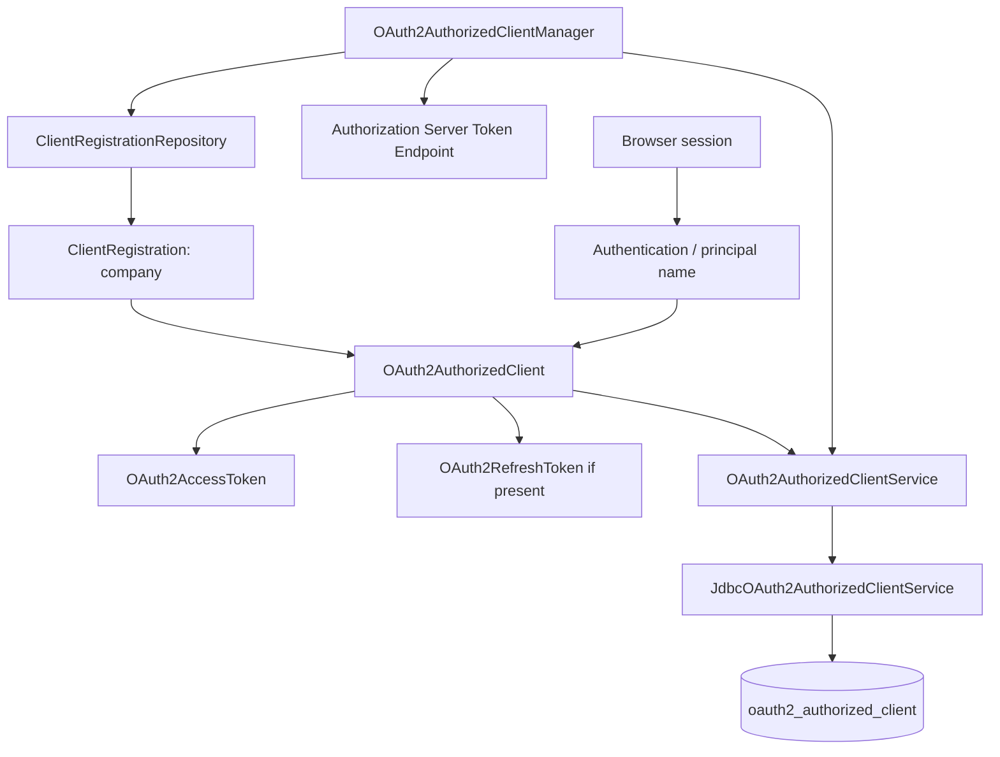
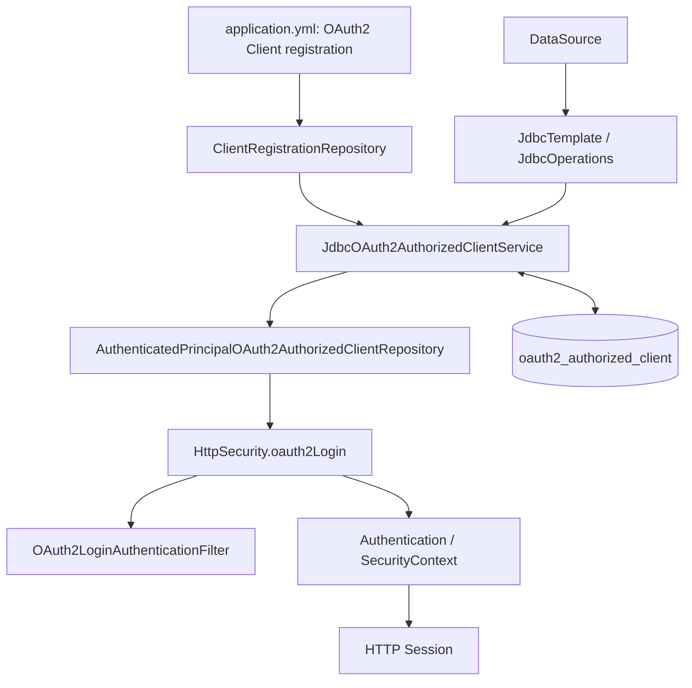
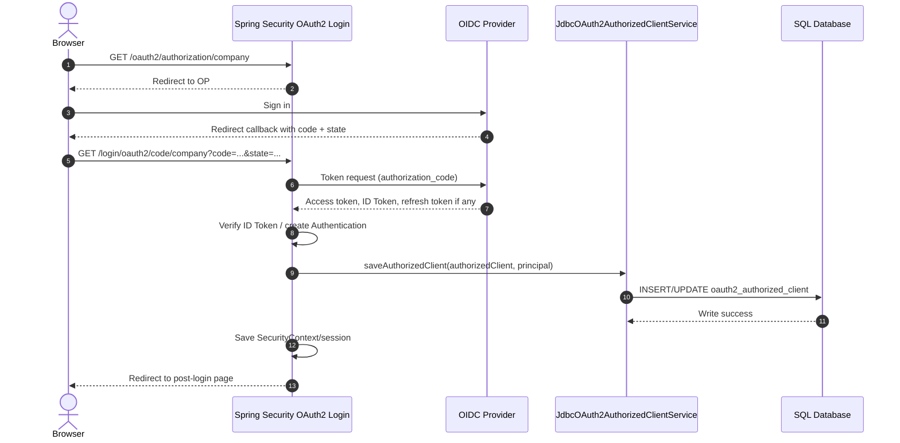
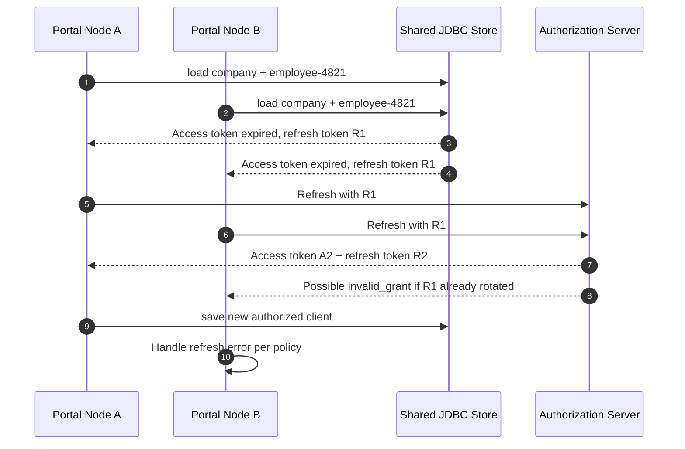

# 14.5. JdbcOAuth2AuthorizedClientService and Storage Requirements

## 1. The Problem: Where Should Access Tokens and Refresh Tokens Live?

In a **Spring Security OAuth 2.0 / OIDC Client** application, after a user signs in via the Authorization Code Flow, Spring Security can receive:

- An **Access token** used to call APIs/Resource Servers within the granted permissions.
- A **Refresh token**, if issued by the Authorization Server and permitted by policy.
- An **ID Token** for the OIDC Client application to verify the user's identity.

The application may need to use the access token on subsequent requests, or refresh the token when it expires. If authorized client state is stored only in a single process's memory, the application will run into operational issues across **restarts, multi-instance deployments, or when a shared token store is needed**.

For example, **Employee Portal** has three instances:

```text
Browser
   |
   v
Load Balancer
   |
   +---- Portal instance A
   |
   +---- Portal instance B
   |
   +---- Portal instance C
             |
             v
       Shared Database
```

When a user logs into instance A and a subsequent API request routes through instance B, the application needs a way to retrieve authorized client state for the same identity/context. One option for **Spring Security Servlet** is **`JdbcOAuth2AuthorizedClientService`**, which saves and reads `OAuth2AuthorizedClient` data from a relational database via JDBC.

This lesson focuses on:

1. The `OAuth2AuthorizedClientService` contract and the role of `JdbcOAuth2AuthorizedClientService`.
2. Which fields are stored, the identifier key, and relationships with `ClientRegistration`, `Authentication`, and sessions.
3. The `oauth2_authorized_client` table structure, migrations, and SQL dialect compatibility.
4. Configuration examples for Spring Boot 3.x / Spring Security 6.x with `JdbcTemplate`.
5. Usage in OAuth2 Login, OAuth2 Client, and service-to-service Client Credentials.
6. Securing access/refresh tokens in the database, backups, encryption keys, read permissions, and token lifecycle.
7. Handling restarts, multi-node deployments, refresh races, token rotation, cleanup, database failures, and observability.

> **Principle:** `JdbcOAuth2AuthorizedClientService` is a **service for storing token-issued OAuth2 client state**. It is **not** a users table, a ClientRegistration configuration store, a store for the entire HTTP session, or a component that automatically validates access tokens for an API.

## 2. Distinguishing ClientRegistration, Authorized Client, and Authentication

### 2.1. Similar-Sounding Objects

| Component | What Does It Store? | Where It Typically Lives |
| --- | --- | --- |
| **`ClientRegistration`** | `registrationId`, `clientId`, secret, authorization grant, scopes, issuer, token endpoint | Configuration / `ClientRegistrationRepository` |
| **`OAuth2AuthorizedClient`** | Authorized registration, principal name, **access token**, and optionally **refresh token** | `OAuth2AuthorizedClientService` or `OAuth2AuthorizedClientRepository` |
| **`OAuth2User` / `OidcUser`** | Principal information after OAuth2/OIDC login | `Authentication`, security context |
| **`Authentication`** | Principal, authorities, authenticated status | `SecurityContext` |
| **`HttpSession`** | Web session state, security context, and application data per configuration | Servlet session store / Spring Session |
| **`OAuth2AuthorizationRequest`** | Temporary request holding state, redirect, PKCE/nonce for an in-progress login | `AuthorizationRequestRepository`, usually session |
| **`OAuth2AccessTokenResponse`** | Token response just received from the Token Endpoint | Inside the token exchange pipeline |

These components are related, but do not replace one another:

- **`ClientRegistrationRepository`** tells Spring **which client**, token endpoint, and client ID/secret are registered at the provider.
- **`OAuth2AuthorizedClientService`** tells the application **which token a client registration has received for a given principal**.
- **`SecurityContext` / session** keeps the browser recognized as an authenticated user.
- The API's **Resource Server** is responsible for validating incoming access tokens from clients, not relying on the website's JDBC authorized client service data.

### 2.2. Relationship Diagram



Note: `OAuth2AuthorizedClient` holds a reference to `ClientRegistration` in Java, but **does not need to duplicate all client secrets/issuer/configuration into every token row**. When loading from JDBC, the service uses `ClientRegistrationRepository` to reconstruct the object with a valid registration.

## 3. What Is the `OAuth2AuthorizedClientService` Contract?

On the Servlet stack, `OAuth2AuthorizedClientService` provides these core operations:

```java
public interface OAuth2AuthorizedClientService {

    <T extends OAuth2AuthorizedClient> T loadAuthorizedClient(
            String clientRegistrationId,
            String principalName);

    void saveAuthorizedClient(
            OAuth2AuthorizedClient authorizedClient,
            Authentication principal);

    void removeAuthorizedClient(
            String clientRegistrationId,
            String principalName);
}
```

The snippet above illustrates the core contract for study; the actual interface is provided in package `org.springframework.security.oauth2.client`.

### 3.1. How Read, Write, and Delete Work

- **`loadAuthorizedClient(registrationId, principalName)`**: retrieves stored tokens for a client registration and principal pair; typically returns `null` if no record exists.
- **`saveAuthorizedClient(authorizedClient, principal)`**: saves or updates the authorized client corresponding to the authentication principal.
- **`removeAuthorizedClient(registrationId, principalName)`**: deletes the corresponding authorized client data.

`JdbcOAuth2AuthorizedClientService` is a **synchronous JDBC** implementation of this contract. It uses `JdbcOperations` and `ClientRegistrationRepository`.

### 3.2. Why Does the Storage Key Need Both Registration ID and Principal Name?

A user may sign in through multiple providers, or the same user may be authorized for multiple API registrations:

```text
(clientRegistrationId, principalName)
-------------------------------------
(company, employee-4821)
(reports-api, employee-4821)
(partner, employee-4821)
```

Using only `principalName` would let tokens from different providers overwrite each other. Using only `clientRegistrationId` would allow different users to share tokens outside their intended scope.

Therefore, the standard JDBC table uses a **composite primary key `(client_registration_id, principal_name)`**.

Understand the two fields:

- **`clientRegistrationId`**: local identifier such as `company`, `reports-api`.
- **`principalName`**: name taken from `Authentication` when saved. In OIDC, this is usually derived from the subject/user identifier per principal configuration; for service-to-service calls it can be a stable technical identifier.

**Do not assume `principalName` is an email**, nor assume it is always `sub` in every configuration. The actual value depends on principal naming and the application's claim mapping.

### 3.3. JDBC Implementation vs. InMemory Implementation

| Criterion | `InMemoryOAuth2AuthorizedClientService` | `JdbcOAuth2AuthorizedClientService` |
| --- | --- | --- |
| Storage location | JVM process memory | Database via JDBC |
| Data lost on restart? | Yes, without an external store | No, as long as DB data remains and schema is compatible |
| Shared across instances | Not automatically | Can use a shared database |
| Requires migrations/schema | No | Yes |
| Must protect tokens from DB readers | N/A for DB; still protect memory/logs | **Yes, especially refresh tokens** |
| Depends on database availability | No | Yes |
| Handles concurrent refresh across nodes | Not guaranteed | **No built-in distributed lock from JDBC alone** |
| Best suited for | Demos, development, small services with minimal persistence needs | Applications requiring controlled token persistence |

**JDBC does not automatically turn authorized clients into a shared login session.** It only solves token storage; sessions and `SecurityContext` are separate concerns.

## 4. Storage Model and the `oauth2_authorized_client` Table

### 4.1. Typical Columns in the Spring Security Schema

The standard JDBC schema typically includes the following columns:

| Column | Semantic Type | Required? | Contents |
| --- | --- | --- | --- |
| `client_registration_id` | String | Yes | Local Registration ID |
| `principal_name` | String | Yes | Principal name from `Authentication` |
| `access_token_type` | String | Yes | Access token type, usually `Bearer` |
| `access_token_value` | Binary/BLOB | Yes | **Sensitive access token value** |
| `access_token_issued_at` | Timestamp | Yes | Timestamp when access token was issued |
| `access_token_expires_at` | Timestamp | Yes | Timestamp when access token expires |
| `access_token_scopes` | Formatted string managed by mapper | Nullable | Scope list |
| `refresh_token_value` | Binary/BLOB | Nullable | **Sensitive refresh token**, if present |
| `refresh_token_issued_at` | Timestamp | Nullable | Timestamp when refresh token was issued |
| `created_at` | Timestamp | Yes | Timestamp when row was created, if used by schema |
| **Primary key** | Composite of two fields | Yes | `client_registration_id` + `principal_name` |

**Access tokens and refresh tokens are secrets.** Never treat these columns as ordinary metadata open to general database users or BI query tools.

### 4.2. Illustrative DDL for Databases Supporting `BLOB`

```sql
CREATE TABLE oauth2_authorized_client (
    client_registration_id VARCHAR(100) NOT NULL,
    principal_name VARCHAR(200) NOT NULL,
    access_token_type VARCHAR(100) NOT NULL,
    access_token_value BLOB NOT NULL,
    access_token_issued_at TIMESTAMP NOT NULL,
    access_token_expires_at TIMESTAMP NOT NULL,
    access_token_scopes VARCHAR(1000) DEFAULT NULL,
    refresh_token_value BLOB DEFAULT NULL,
    refresh_token_issued_at TIMESTAMP DEFAULT NULL,
    created_at TIMESTAMP DEFAULT CURRENT_TIMESTAMP NOT NULL,
    PRIMARY KEY (client_registration_id, principal_name)
);
```

This is a **reference structure for understanding**. In real projects, prefer the **official JDBC schema bundled with your exact Spring Security version** and adapt it to the **SQL dialect/driver** of your target database. Never copy this `BLOB` DDL verbatim to every RDBMS without checking compatibility.

For example:

- H2/MySQL/MariaDB have differing binary syntax and characteristics.
- PostgreSQL commonly uses `BYTEA` instead of standard `BLOB`; mapping between JDBC `Types.BLOB`, byte arrays, `BYTEA`, and the driver must be verified. Simply changing the column type from `BLOB` to `BYTEA` does not guarantee the default mapper always works as expected.
- Oracle, SQL Server, and other databases have their own binary types, timestamp types, and size limits.

**The schema must match the SQL queries and row/parameter mappers used by `JdbcOAuth2AuthorizedClientService`.** If you rename tables/columns or change binary storage, design official extensions/custom mappers per the API rather than assuming the JDBC service auto-discovers custom schemas.

### 4.3. Why Use `BLOB`/Binary for Tokens?

An access token may be:

- JWT text containing `.` separators and Base64URL segments.
- An opaque token without a public structure.
- A long string with provider-specific characters.

Refresh tokens can also be opaque or long strings. **Never assume tokens are always JWTs** or always fit within `VARCHAR(255)`.

The schema uses binary to store raw token bytes per Spring Security's mapping. When applying application-level encryption, account for ciphertext being larger than plaintext. Storage limits must be sized for actual token types and security mechanisms.

### 4.4. Do Not Arbitrarily Shrink Key or Scope Lengths

For example:

- A `registrationId` longer than the `client_registration_id` column can cause saves to fail.
- A principal name longer than `VARCHAR(200)` can cause truncation or SQL exceptions.
- A very long scope list can exceed `VARCHAR(1000)`.
- A large access token/JWT can exceed maximum binary sizes of the database or driver.

Set column lengths based on the **official schema, constraints, and real requirements**, while ensuring the mapper/driver handles them cleanly. Never silently truncate principal names, scopes, or tokens, as doing so corrupts lookup keys and data integrity.

## 5. Setting Up a Spring Boot Project for JDBC Persistence

This lesson uses **Spring Boot 3.x, Spring Security 6.x, Java 17+, and Servlet/MVC**. Endpoints/credentials are examples only, not a live OP environment.

### 5.1. Maven Dependencies

```xml
<dependencies>
    <dependency>
        <groupId>org.springframework.boot</groupId>
        <artifactId>spring-boot-starter-web</artifactId>
    </dependency>
    <dependency>
        <groupId>org.springframework.boot</groupId>
        <artifactId>spring-boot-starter-security</artifactId>
    </dependency>
    <dependency>
        <groupId>org.springframework.boot</groupId>
        <artifactId>spring-boot-starter-oauth2-client</artifactId>
    </dependency>

    <!-- JDBC / DataSource / JdbcTemplate -->
    <dependency>
        <groupId>org.springframework.boot</groupId>
        <artifactId>spring-boot-starter-jdbc</artifactId>
    </dependency>

    <!-- Illustrative database for local learning -->
    <dependency>
        <groupId>com.h2database</groupId>
        <artifactId>h2</artifactId>
        <scope>runtime</scope>
    </dependency>
</dependencies>
```

Production can replace H2 with PostgreSQL/MySQL/Oracle/SQL Server as appropriate. Migrations must target that database.

With Gradle Kotlin DSL:

```kotlin
dependencies {
    implementation("org.springframework.boot:spring-boot-starter-web")
    implementation("org.springframework.boot:spring-boot-starter-security")
    implementation("org.springframework.boot:spring-boot-starter-oauth2-client")
    implementation("org.springframework.boot:spring-boot-starter-jdbc")
    runtimeOnly("com.h2database:h2")
}
```

### 5.2. Local DataSource Configuration

```yaml
spring:
  datasource:
    url: jdbc:h2:file:./data/authorized-clients
    driver-class-name: org.h2.Driver
    username: sa
    password: ""

  security:
    oauth2:
      client:
        registration:
          company:
            provider: company-idp
            client-id: ${OIDC_CLIENT_ID}
            client-secret: ${OIDC_CLIENT_SECRET}
            authorization-grant-type: authorization_code
            client-authentication-method: client_secret_basic
            redirect-uri: "{baseUrl}/login/oauth2/code/{registrationId}"
            scope:
              - openid
              - profile
              - email
        provider:
          company-idp:
            issuer-uri: https://id.example.com/realms/company

server:
  port: 8080
```

`jdbc:h2:file:./data/authorized-clients` uses a file-backed H2 database to demonstrate data surviving restarts of **one** local process, unlike `jdbc:h2:mem:...` which is lost when the process exits.

**This is not a production configuration.** Never use a passwordless `sa` account or an application-directory DB file in production, and never share an H2 file across multiple nodes in an unsupported manner. Production requires a managed database server, least-privilege application accounts, and a secret manager.

### 5.3. Initializing the Schema with Migrations

Prefer **Flyway** or **Liquibase** and keep version-controlled migrations with dialect-appropriate DDL; locally, you can test Spring Security's standard schema.

Example simple migration for H2:

```sql
-- V1__create_oauth2_authorized_client.sql
CREATE TABLE oauth2_authorized_client (
    client_registration_id VARCHAR(100) NOT NULL,
    principal_name VARCHAR(200) NOT NULL,
    access_token_type VARCHAR(100) NOT NULL,
    access_token_value BLOB NOT NULL,
    access_token_issued_at TIMESTAMP NOT NULL,
    access_token_expires_at TIMESTAMP NOT NULL,
    access_token_scopes VARCHAR(1000),
    refresh_token_value BLOB,
    refresh_token_issued_at TIMESTAMP,
    created_at TIMESTAMP DEFAULT CURRENT_TIMESTAMP NOT NULL,
    PRIMARY KEY (client_registration_id, principal_name)
);
```

When using a migration tool, add the corresponding dependency, configure the migration runner, and ensure it executes **before code needs to read/write tokens**. If using Spring Boot `schema.sql` in a demo, decide when schema initialization runs and avoid conflicting with Flyway/Liquibase. **Never blindly run multiple table-creation mechanisms simultaneously for the same schema.**

Never write startup code like `DROP TABLE oauth2_authorized_client` to "reset tokens" in operational environments. Dropping the table wipes all authorized clients' refresh tokens and forces users/workers to re-authorize.

### 5.4. Registration Configuration and Token Data Have Different Lifecycles

- Client ID, secret, issuer, endpoints: managed via config/secret store; may require restart/refresh when changed.
- Access token, refresh token, issued/expires timestamps: change with each authorization/refresh and are stored via the JDBC service.

If you **rename the registration ID** from `company` to `company-oidc`, existing rows still have `client_registration_id=company`. New code looking up `company-oidc` will not find them. This change affects the storage key, requiring a migration plan or requiring users to sign in again per policy.

## 6. Creating the `JdbcOAuth2AuthorizedClientService` Bean in Java

### 6.1. Minimal Wiring

```java
package com.example.portal.security;

import org.springframework.context.annotation.Bean;
import org.springframework.context.annotation.Configuration;
import org.springframework.jdbc.core.JdbcOperations;
import org.springframework.security.oauth2.client.OAuth2AuthorizedClientService;
import org.springframework.security.oauth2.client.jdbc.JdbcOAuth2AuthorizedClientService;
import org.springframework.security.oauth2.client.registration.ClientRegistrationRepository;

@Configuration
public class AuthorizedClientPersistenceConfig {

    @Bean
    OAuth2AuthorizedClientService authorizedClientService(
            JdbcOperations jdbcOperations,
            ClientRegistrationRepository clientRegistrationRepository) {

        return new JdbcOAuth2AuthorizedClientService(
                jdbcOperations,
                clientRegistrationRepository);
    }
}
```

Constructor explanation:

- **`JdbcOperations`**: JDBC abstraction used to execute SQL and map results, typically provided by Spring Boot via `JdbcTemplate` when a suitable DataSource exists.
- **`ClientRegistrationRepository`**: repository of OAuth/OIDC client configurations. When reading token records from the DB, the JDBC service looks up the registration to reconstruct `OAuth2AuthorizedClient`.
- **`JdbcOAuth2AuthorizedClientService`**: implementation that saves/loads/removes authorized client data over JDBC.

This service object **does not create tables automatically**. The table must already exist and be compatible before any save/load operations run.

### 6.2. Connecting the Service to the HTTP Request Repository

In Servlet applications, Spring Security provides the **`OAuth2AuthorizedClientRepository`** abstraction for HTTP request/response contexts. You can use **`AuthenticatedPrincipalOAuth2AuthorizedClientRepository`** to connect the authorized client service for authenticated principals:

```java
package com.example.portal.security;

import org.springframework.context.annotation.Bean;
import org.springframework.context.annotation.Configuration;
import org.springframework.security.oauth2.client.OAuth2AuthorizedClientService;
import org.springframework.security.oauth2.client.web.AuthenticatedPrincipalOAuth2AuthorizedClientRepository;
import org.springframework.security.oauth2.client.web.OAuth2AuthorizedClientRepository;

@Configuration
public class AuthorizedClientHttpRepositoryConfig {

    @Bean
    OAuth2AuthorizedClientRepository authorizedClientRepository(
            OAuth2AuthorizedClientService authorizedClientService) {

        return new AuthenticatedPrincipalOAuth2AuthorizedClientRepository(
                authorizedClientService);
    }
}
```

This is an important bridge:

- `OAuth2AuthorizedClientService` is a storage API not directly bound to HTTP requests.
- `OAuth2AuthorizedClientRepository` understands the **`HttpServletRequest` / `HttpServletResponse` / `Authentication`** context.
- `AuthenticatedPrincipalOAuth2AuthorizedClientRepository` uses the service to store authorized clients for authenticated principals and has its own configurable mechanism for anonymous cases.

**Do not assume every authorized client in every scenario is written to JDBC.** For instance, an anonymous authorization flow may use an HTTP session repository instead. For successful OIDC login with an authenticated principal, verify the repository config routes to the JDBC service as intended.

### 6.3. Configuring `SecurityFilterChain`

```java
package com.example.portal.security;

import org.springframework.context.annotation.Bean;
import org.springframework.context.annotation.Configuration;
import org.springframework.security.config.annotation.web.builders.HttpSecurity;
import org.springframework.security.oauth2.client.web.OAuth2AuthorizedClientRepository;
import org.springframework.security.web.SecurityFilterChain;

@Configuration
public class WebSecurityConfig {

    @Bean
    SecurityFilterChain securityFilterChain(
            HttpSecurity http,
            OAuth2AuthorizedClientRepository authorizedClientRepository)
            throws Exception {

        http.authorizeHttpRequests(authorize -> authorize
                .requestMatchers("/", "/css/**", "/error").permitAll()
                .anyRequest().authenticated()
            )
            .oauth2Login(oauth2 -> oauth2
                .authorizedClientRepository(authorizedClientRepository)
            );

        return http.build();
    }
}
```

This is a **complete configuration for this lesson's purpose**, once the repository bean from Section 6.2 is defined. If the application also uses `oauth2Client` to initiate/authorize API calls, configure the authorized client repository/manager consistently for that flow. Do not declare another chain with the same default matcher unless multiple filter chains are intentionally needed.

When using only default Boot configuration, Spring can auto-provide an appropriate service/repository if auto-configuration conditions are met. In this lesson, we declare beans explicitly to show exactly **how the JDBC service is wired into OAuth2 Login**.

### 6.4. End-to-End Java Wiring



Note the separation of concerns:

- The JDBC service stores tokens, **not the entire `Authentication`**.
- The session maintains web login state, **and is not automatically shared across nodes merely because tokens share a DB**.
- The token database holds highly sensitive data, requiring its own operational/security model.

## 7. Testing Load, Save, and Remove Operations Through the Service

To understand the contract, imagine the application already holds a valid `OAuth2AuthorizedClient` from a token exchange and a matching principal. The examples below **do not create fake access tokens for production use**.

### 7.1. Saving an Authorized Client

```java
// Java pseudocode inside a service holding authorizedClient and authentication:
authorizedClientService.saveAuthorizedClient(
        authorizedClient,
        authentication);
```

When save succeeds, the JDBC service inserts or updates the record for the pair:

```text
client_registration_id = authorizedClient.getClientRegistration()
                                         .getRegistrationId()
principal_name          = authentication.getName()
```

Tokens and timestamps are extracted from `OAuth2AuthorizedClient`. Never use a browser-submitted username as an authority to attach tokens to another user.

### 7.2. Loading an Authorized Client

```java
OAuth2AuthorizedClient authorizedClient =
        authorizedClientService.loadAuthorizedClient(
                "company",
                authentication.getName());

if (authorizedClient != null) {
    Instant expiresAt =
            authorizedClient.getAccessToken().getExpiresAt();

    // Use this metadata to drive authorization flow / safe logging.
}
```

Corresponding imports include `OAuth2AuthorizedClient` and `java.time.Instant`. This snippet illustrates code inside a method with `authorizedClientService` injected and an `Authentication` available.

**Having a row in the database does not mean the access token is still usable.** Check expiration, refresh token presence, and the Authorized Client Manager's policy, while recognizing a token can be revoked before `expires_at`.

### 7.3. Removing an Authorized Client

```java
authorizedClientService.removeAuthorizedClient(
        "company",
        authentication.getName());
```

This **deletes the client-side token record**, but **does not automatically revoke the token at the Authorization Server**, clear the login session, or guarantee termination of the SSO session at the OP. If the product requires token revocation or OP logout, use a dedicated protocol/endpoint supported by the provider.

### 7.4. You Do Not Need to Call These Methods Manually After Every Login

In an application using `oauth2Login`, filters and the authorized client repository can **automatically save the authorized client on successful authentication**. Business code should normally use `OAuth2AuthorizedClientManager` or appropriate integrations to obtain tokens, rather than overwriting the DB with manually constructed token copies.

The load/save/remove methods are useful for understanding the contract, building integrations, and implementing explicit operations such as removing the local authorized client when a user disconnects an API.

## 8. JDBC Storage During OAuth2 Login and API Calls

### 8.1. OIDC Login Flow



Certain details regarding the exact ordering of saving the authorized client, creating `Authentication`, and success handling may vary by implementation/version. The key point here is that **the JDBC store persists issued tokens**, whereas **`SecurityContext`/session** has its own lifecycle.

### 8.2. Subsequent API Calls Needing a Token

Suppose Portal calls a protected API:

```text
GET /reports (Browser → Employee Portal)
    |
    v
Spring restores Authentication from session
    |
    v
Authorized Client Manager identifies registration "company"
    |
    v
JDBC loadAuthorizedClient("company", principalName)
    |
    +-- Access token still valid → use to call API
    |
    +-- Token expired/needs refresh
          |
          +-- Has refresh token + provider supports → refresh at Token Endpoint
          |
          +-- Success → update JDBC authorized client
          |
          +-- Cannot refresh → require re-authorization/re-login per policy
```

**`JdbcOAuth2AuthorizedClientService` does not call the Token Endpoint on its own when you merely invoke `loadAuthorizedClient`.** Deciding whether a refresh is needed and which grant to use belongs to `OAuth2AuthorizedClientManager`/provider components.

### 8.3. User Data vs. Service Account Data Differ

An application might store:

```text
(company, employee-4821)
(company, employee-9274)
(reports-api, reports-batch)
```

The first two rows belong to user principals. The third row may belong to a **`client_credentials` service account**, using a technical principal intentionally chosen by the application.

For machine-to-machine workloads, do not generate a random principal name on every run, as that creates unnecessary rows. Likewise, do not share a single principal name across tenants/business units **if token-isolation policies require separation**. The `registrationId` and `principalName` pair defines a storage key boundary, not a complete multi-tenant authorization mechanism.

## 9. Using the JDBC Service with `OAuth2AuthorizedClientManager`

In business code, rather than reading tokens from the database and handling every detail manually, use the appropriate **`OAuth2AuthorizedClientManager`**. The manager coordinates registrations, providers, token storage, and supported grants.

### 9.1. `DefaultOAuth2AuthorizedClientManager` for Servlet Requests

For user/Servlet-request-bound flows, you can configure a manager with `OAuth2AuthorizedClientRepository`:

```java
package com.example.portal.security;

import org.springframework.context.annotation.Bean;
import org.springframework.context.annotation.Configuration;
import org.springframework.security.oauth2.client.DefaultOAuth2AuthorizedClientManager;
import org.springframework.security.oauth2.client.OAuth2AuthorizedClientManager;
import org.springframework.security.oauth2.client.OAuth2AuthorizedClientProvider;
import org.springframework.security.oauth2.client.OAuth2AuthorizedClientProviderBuilder;
import org.springframework.security.oauth2.client.registration.ClientRegistrationRepository;
import org.springframework.security.oauth2.client.web.OAuth2AuthorizedClientRepository;

@Configuration
public class ServletAuthorizedClientManagerConfig {

    @Bean
    OAuth2AuthorizedClientManager authorizedClientManager(
            ClientRegistrationRepository registrations,
            OAuth2AuthorizedClientRepository repository) {

        OAuth2AuthorizedClientProvider provider =
                OAuth2AuthorizedClientProviderBuilder.builder()
                    .authorizationCode()
                    .refreshToken()
                    .build();

        var manager = new DefaultOAuth2AuthorizedClientManager(
                registrations, repository);
        manager.setAuthorizedClientProvider(provider);

        return manager;
    }
}
```

Here:

- `authorizationCode()` supports callback-based user authorization flows.
- `refreshToken()` supports refreshing when the authorized client has a refresh token and policy permits.
- `DefaultOAuth2AuthorizedClientManager` uses `OAuth2AuthorizedClientRepository` within the HTTP request context.
- Underneath, the repository delegates to `JdbcOAuth2AuthorizedClientService` as in Section 6.2 where applicable.

Depending on the real application, you may need additional providers/grants, failure/success handlers, or an `OAuth2AuthorizedClientContextAttributesMapper`. Do not treat this bean as a universal auto-refresh mechanism regardless of client/HTTP context.

### 9.2. Service-Tier Manager for Client Credentials and Background Jobs

A scheduled job has no browser session or `HttpServletRequest`. For **`client_credentials`**, use **`AuthorizedClientServiceOAuth2AuthorizedClientManager`**, which relies directly on `OAuth2AuthorizedClientService` instead of a Servlet-bound repository.

```java
package com.example.portal.security;

import org.springframework.context.annotation.Bean;
import org.springframework.context.annotation.Configuration;
import org.springframework.security.oauth2.client.AuthorizedClientServiceOAuth2AuthorizedClientManager;
import org.springframework.security.oauth2.client.OAuth2AuthorizedClientManager;
import org.springframework.security.oauth2.client.OAuth2AuthorizedClientProvider;
import org.springframework.security.oauth2.client.OAuth2AuthorizedClientProviderBuilder;
import org.springframework.security.oauth2.client.OAuth2AuthorizedClientService;
import org.springframework.security.oauth2.client.registration.ClientRegistrationRepository;

@Configuration
public class BackgroundTokenManagerConfig {

    @Bean("serviceTierAuthorizedClientManager")
    OAuth2AuthorizedClientManager serviceTierAuthorizedClientManager(
            ClientRegistrationRepository registrations,
            OAuth2AuthorizedClientService authorizedClientService) {

        OAuth2AuthorizedClientProvider provider =
                OAuth2AuthorizedClientProviderBuilder.builder()
                    .clientCredentials()
                    .build();

        var manager = new AuthorizedClientServiceOAuth2AuthorizedClientManager(
                registrations,
                authorizedClientService);
        manager.setAuthorizedClientProvider(provider);

        return manager;
    }
}
```

When the manager has `clientCredentials()`, it can request an access token under the application's identity without needing a user callback.

Example service demonstrating how to request an authorized client:

```java
package com.example.portal.reports;

import org.springframework.beans.factory.annotation.Qualifier;
import org.springframework.security.oauth2.client.OAuth2AuthorizeRequest;
import org.springframework.security.oauth2.client.OAuth2AuthorizedClient;
import org.springframework.security.oauth2.client.OAuth2AuthorizedClientManager;
import org.springframework.stereotype.Service;

@Service
public class ReportsTokenService {

    private final OAuth2AuthorizedClientManager manager;

    public ReportsTokenService(
            @Qualifier("serviceTierAuthorizedClientManager")
            OAuth2AuthorizedClientManager manager) {
        this.manager = manager;
    }

    public OAuth2AuthorizedClient getAuthorizedClient() {
        OAuth2AuthorizeRequest request = OAuth2AuthorizeRequest
                .withClientRegistrationId("reports-api")
                .principal("reports-batch")
                .build();

        OAuth2AuthorizedClient authorized = manager.authorize(request);

        if (authorized == null) {
            throw new IllegalStateException(
                    "Unable to authorize OAuth2 authorized client");
        }

        return authorized;
    }
}
```

The code assumes `reports-api` is a `ClientRegistration` with the `client_credentials` grant, valid client ID/secret, and token URI. `reports-batch` is a **stable technical principal** chosen by the application to identify the token in the store. In multi-tenant environments, establish naming rules aligned with each tenant's token boundaries.

**Do not log the access token** when calling `getAuthorizedClient()`. When calling the actual API, pass it via the HTTP client's Bearer token mechanism and protect destination URLs so tokens never leak to untrusted hosts.

### 9.3. The Two Manager Types Are Not Arbitrarily Interchangeable

| Manager | Context | Common Persistence Source |
| --- | --- | --- |
| `DefaultOAuth2AuthorizedClientManager` | Has Servlet HTTP request/response | `OAuth2AuthorizedClientRepository` |
| `AuthorizedClientServiceOAuth2AuthorizedClientManager` | Service tier/background, independent of HTTP request | `OAuth2AuthorizedClientService` |
| `JdbcOAuth2AuthorizedClientService` | JDBC persistence for authorized clients | `oauth2_authorized_client` table |

`JdbcOAuth2AuthorizedClientService` serves as the underlying persistence component, but it **does not resolve manager/provider selection or OIDC login**. Manager setup must match how the application acquires tokens.

## 10. Security Requirements When Storing Access Tokens and Refresh Tokens

This is the most critical area when moving from in-memory to JDBC.

### 10.1. Tokens Are Usable Credentials

A valid access token can be used to call APIs without the user re-entering a password. A refresh token is even more sensitive because it can mint new access tokens over an extended period according to Authorization Server policy.

Therefore, the columns:

```text
access_token_value
refresh_token_value
```

must be protected like **secrets**. Never treat them as ordinary profile data or business logs.

**`JdbcOAuth2AuthorizedClientService` does not by default provide application-level token encryption.** Storing tokens as binary/BLOB does not mean they are encrypted against anyone who can query the database.

### 10.2. Layers of Protection to Combine

| Layer | Measure | Goal |
| --- | --- | --- |
| **Network** | TLS between application and database, private network, firewall | Block eavesdropping and unintended access |
| **Database access** | Dedicated DB account, least privilege, schema/table permissions | Minimize who can read tokens |
| **Storage** | Disk/volume/database encryption at rest | Protect stolen disks and snapshots |
| **Application-level encryption** (when required) | Encrypt tokens before DB writes using AEAD/envelope encryption | Reduce risk of DB table readers directly using credentials |
| **Key management** | KMS/HSM/secret manager, rotation, separation of duties | Protect and govern decryption keys |
| **Logging** | Mask SQL parameters, HTTP headers, token payloads | Prevent token leaks in logs/tracing |
| **Backup** | Encrypted backups, retention, restore permissions, policy deletion | Avoid leaking tokens via backups |
| **Operations** | Alerting, access auditing, export/BI/admin controls | Detect and constrain abnormal queries |
| **Lifecycle** | Revoke, delete, TTL/retention, handle refresh token rotation | Avoid retaining unneeded credentials |

**Disk encryption at rest does not fully protect against database users with SELECT privileges on the table**, because the database decrypts data while serving queries. For sensitive token data, some environments require **application-layer encryption** and separating key usage permissions from DB read privileges.

### 10.3. Application-Layer Encryption Must Be Designed as Part of the Mapper

If policy requires encrypting tokens before writing:

1. Choose an appropriate **authenticated encryption** algorithm such as AES-GCM, following proper nonce/IV rules.
2. Use a KMS/secret manager for master or envelope keys; never store keys in source code or the same DB column.
3. Encrypt **token values** before the JDBC parameter mapper writes them.
4. Decrypt in the row mapper after reading, before constructing `OAuth2AccessToken` / `OAuth2RefreshToken`.
5. Store necessary metadata to identify key version/key ID/nonce in a safe format.
6. Plan key rotation and read-old/write-new so rotating keys does not render all existing rows unreadable.
7. Ensure ciphertext/binary tokens fit column limits without truncation.
8. Handle decryption errors strictly: **never return empty plaintext or fake token values**, and never accept tampered tokens.

`JdbcOAuth2AuthorizedClientService` offers row/parameter mapping extension points depending on the library version. When customizing, ensure schema, insert/update, and reads stay synchronized. A common design bug is **encrypting on save but forgetting to decrypt on load**, or introducing a new format with no plan to read legacy rows.

Never invent your own encryption scheme, use ECB mode, or reuse fixed IVs. For high-security projects, conduct a thorough security review before deploying token persistence to production.

### 10.4. Why Not Hash Tokens Before Storing?

User passwords are stored with one-way hashes because the application only needs to **verify password matches**, not recover the plaintext password.

By contrast, an OAuth2 Client usually needs to **read back the intact access token** to send to APIs, and **read back the intact refresh token** to call the Token Endpoint. Storing only a one-way hash would make those operations impossible.

Therefore:

- Use **tightly managed reversible encryption** if application-level token protection is needed.
- Never substitute password hashing for protecting tokens that must be retrieved intact.
- Limit storage duration and token privileges rather than relying on encryption as the sole defense.

### 10.5. Handling Identifier Data

`principal_name` may contain a subject, username, or user identifier. While not a token, it can still be **personal data / internal identifying data**.

Establish policies to:

- Restrict who can query identifier information.
- Keep `principalName` stable and avoid arbitrarily using mutable email addresses.
- Delete data when users disconnect or accounts reach end-of-life per regulations.
- Never export both `principal_name` and plaintext tokens together to BI/analytics.
- If multi-tenant, enforce identifier namespacing and cross-tenant read isolation.

## 11. Token Lifecycle Management and Data Cleanup

### 11.1. Access Token Expiration Time

The table contains `access_token_expires_at`, indicating the expected expiration of the access token. However:

- `expires_at` does not reliably reflect premature revocation by the OP.
- Clock skew between application, database, and Authorization Server can make tokens appear valid or expired slightly early/late.
- Managers usually apply a **clock skew** window to avoid sending tokens right at expiration.
- After an access token expires, the refresh token **may still be valid** and must be retained to obtain a new access token.

Therefore, **do not delete every row immediately when `access_token_expires_at < NOW()`**. Doing so destroys refresh capability and forces users to log in again.

### 11.2. Why Isn't `refresh_token_expires_at` in the Standard Schema?

The token schema may include `refresh_token_issued_at` and the refresh token value, yet **does not necessarily include a refresh token expiration timestamp**. Many OPs govern refresh tokens via rotation, idle timeouts, absolute lifetimes, or revocation policies without returning a standardized `exp` for refresh tokens.

Consequently, a cleanup job **cannot look solely at access token expiry to conclude a refresh token is definitely useless**.

Build retention policies based on:

- User/account status and provider disconnect events.
- OP refresh token policies and revocation signals where available.
- Age since row creation/last use per supported metadata mechanisms.
- Compliance requirements for data/backup retention.
- Whether the app still needs to make API calls on the user's behalf.

### 11.3. Example Aggregate Queries Without Exposing Tokens

To count authorized clients per registration:

```sql
SELECT client_registration_id, COUNT(*) AS authorized_client_count
FROM oauth2_authorized_client
GROUP BY client_registration_id
ORDER BY client_registration_id;
```

To count rows with a refresh token (without reading values):

```sql
SELECT client_registration_id,
       COUNT(*) AS total_clients,
       SUM(CASE WHEN refresh_token_value IS NULL THEN 0 ELSE 1 END)
           AS with_refresh_token
FROM oauth2_authorized_client
GROUP BY client_registration_id;
```

These queries are only for authorized operators. Never display `principal_name`/plaintext tokens on public dashboards. Database dialects may optimize these differently, but the idea is **metadata metrics**, never exporting credentials.

### 11.4. Example Cleanup When There Is No Refresh Token

A policy might purge rows that **have been expired long enough and have no refresh token**:

```sql
-- Illustrative example; :cutoff is bound via a prepared statement.
DELETE FROM oauth2_authorized_client
WHERE access_token_expires_at < :cutoff
  AND refresh_token_value IS NULL;
```

Rows with refresh tokens need separate rules rather than purging by access token expiry.

**`:cutoff` is not directly supported syntax in every SQL client.** It is a named-parameter convention common in `NamedParameterJdbcTemplate`. With standard JDBC prepared statements, use the `?` placeholder.

Before running real cleanup, design batching, retention, auditing, ensure minimal conflict with in-flight refreshes, and monitor deleted row counts. This is a policy example, **not a default command to run blindly** in every project.

### 11.5. Logout and Disconnecting Accounts

Logging the browser out of Employee Portal and deleting the authorized client are two separate decisions:

- **Local logout:** clears the website's Authentication/session.
- **Remove authorized client:** deletes tokens stored by the app for that registration/principal.
- **Revoke token:** sends a request to the Authorization Server if the provider supports token revocation.
- **OP logout:** requests ending the SSO session at the provider, if supported.

Some products want tokens to persist for background data sync after logout; others want immediate deletion/revocation for privacy. Therefore, define **clear product and security policies**, and never assume logout implies tokens were revoked.

Illustrative example of optionally **removing the local authorized client on logout**:

```java
import org.springframework.security.oauth2.client.OAuth2AuthorizedClientService;
import org.springframework.security.oauth2.client.authentication.OAuth2AuthenticationToken;
import org.springframework.security.web.authentication.logout.LogoutHandler;

LogoutHandler removeLocalTokenOnLogout(
        OAuth2AuthorizedClientService service) {

    return (request, response, authentication) -> {
        if (authentication instanceof OAuth2AuthenticationToken oauth) {
            service.removeAuthorizedClient(
                    oauth.getAuthorizedClientRegistrationId(),
                    oauth.getName());
        }
    };
}
```

This is only an **example method constructing a LogoutHandler** inside a class with the necessary imports and service. When attaching to `http.logout(...)`, clarify your actual logout policy and handle database errors appropriately. Deleting a local row **does not automatically revoke tokens at the OP** and may affect post-logout API calls.

## 12. Consistency When Refreshing Tokens Across Multiple Nodes

### 12.1. Common Race Condition

Suppose the access token for `(company, employee-4821)` expires. Two requests arrive at two different instances nearly simultaneously.



Depending on the provider, reusing a rotated refresh token can cause `invalid_grant`, revoke the entire token family, or trigger reuse alerts. **Shared JDBC storage does not automatically ensure a refresh occurs only once across instances.**

### 12.2. Concurrency Management Requirements

Strategies to evaluate:

- **Per-key lock**: lock by `(registrationId, principalName)` using an appropriate distributed lock/DB lock.
- **Double-check after acquiring lock**: re-read the row after acquiring the lock; another node may have already completed the refresh.
- **Optimistic concurrency**: use a version/conditional update so stale tokens never overwrite newer data; typically requires custom schema/mapper design.
- **Synchronized authorized client manager**: favor a single re-issuance path per principal/registration.
- **Bounded retries**: never retry a rotated refresh token as if it were an idempotent request.
- **Lock timeout/expiry configuration**: prevent a crashed node from holding a lock forever.
- **Monitor refresh failures** by registration and error type, without logging raw refresh tokens.

`JdbcOAuth2AuthorizedClientService` is a persistence solution, **not a complete distributed refresh coordination system**. If request volume is high or the OP enforces strict refresh-token reuse detection, design concurrency controls from the start.

### 12.3. Race Conditions on Insert/Update

Two threads may both fail to find a row, then both attempt to insert a row for the same key pair. The database primary key prevents duplicate records, though one thread may encounter a unique constraint violation or transaction rollback.

Do not assume having a primary key is enough for all concurrent saves to succeed. Use appropriate upsert/retry/idempotency policies and transactions if your workload grants tokens concurrently for the same principal.

### 12.4. Database Transactions Do Not Span the Authorization Server

A refresh operation typically consists of:

```text
(1) HTTP POST to OP
(2) OP issues new tokens, possibly rotating the refresh token
(3) App writes new tokens to JDBC database
```

**(1)–(3) do not form an automatic distributed ACID transaction.**

If the OP rotated the refresh token yet the DB save fails, the system may be left holding the unusable old refresh token. You need strategies to detect, alert, trigger re-authorization, and recover; you cannot simply roll back the database and expect the OP to roll back token rotation.

## 13. What Happens When the Database Is Unavailable?

The JDBC service depends on the database. When connectivity is lost or the schema has errors, read/write operations may throw `DataAccessException` or driver exceptions.

Scenarios:

| Database Failure | Impact on Authorized Client |
| --- | --- |
| Cannot connect to DB | Cannot load/save/remove authorized clients via JDBC |
| Connection pool exhausted | Login/API calls slow down or time out at the persistence layer |
| Missing `oauth2_authorized_client` table | SQL errors on access |
| Wrong column names/BLOB types | Row/parameter mapping errors |
| Unique constraint conflict | One save may fail |
| DB is read-only | Can load but cannot save refreshed tokens |
| DB replication lag | Instances may read stale token versions |
| DB restored from old backup | May restore rotated/revoked refresh tokens |
| Loss of token decryption key | Cannot read application-encrypted tokens |

### 13.1. Should You Fall Back to InMemory When JDBC Fails?

Do not do so automatically without strict controls. Falling back from JDBC to memory can create:

- Divergent token state across instances.
- New refresh tokens living on only one node.
- Inconsistent behavior when instances restart.
- Difficulty revoking or updating authorized clients later.
- Inability to satisfy token retention/audit policies.
- Risk of silently issuing grants that operations cannot track.

If a product requires a degraded mode, explicitly design **risks, scope limits, lifetimes, and token resynchronization**. For workflows requiring strict token persistence security, the right choice may be to **fail closed** and report that login/API integration is temporarily unavailable.

### 13.2. Proper Error Classification

Distinguish clearly between:

- **OIDC authentication failure**: invalid ID Token, bad state, OP rejects user.
- **Token Endpoint failure**: `invalid_client`, `invalid_grant`, OP timeout.
- **JDBC persistence failure**: unable to save/read authorized client due to DB.
- **API authorization failure**: access token lacks audience/scope/permissions.
- **Session failure**: browser lost SecurityContext/cookie, even though token row remains in DB.

Never "fix" JDBC issues by disabling `state`/`nonce` validation or disabling CSRF. Those protections are unrelated to DB token storage, and disabling them introduces serious vulnerabilities.

## 14. Database Schema Migrations and Version Upgrades

### 14.1. Use Controlled Migrations

A long-lived system must manage table structure with versioned migrations:

```text
V1__create_oauth2_authorized_client.sql
V2__adjust_token_binary_storage.sql
V3__add_operational_indexes.sql
...
```

These names are merely examples of organizing migrations. When upgrading Spring Security, verify the **SQL schema and mapper contract of the new version**. Never assume a schema from Spring Security 5.x will remain seamlessly compatible with all 6.x/7.x releases.

Specifically verify:

- Table/column names and primary key.
- Binary types for access/refresh tokens.
- Column lengths for principal, registration ID, and scopes.
- Timestamp precision/time zones.
- Insert/update/save behavior and mappers.
- Token encryption extensions, key versions, algorithms.
- Rolling upgrade compatibility when two application versions read/write concurrently.

### 14.2. Changing the Principal Naming Strategy

If the key used to be email and later switches to `sub`, every old row with `principal_name=email` will no longer be found by `principal_name=sub`.

Possible solutions:

- Controlled migration when a trustworthy email → subject mapping is available.
- Requiring users to reauthorize/re-login, purging old rows per retention policy.
- Keeping the principal naming strategy stable across the data lifecycle whenever feasible.

Never convert emails to subjects by guessing names, as that can hand one user's token to another user.

### 14.3. Changing Registration ID or Issuer

JDBC records only store `client_registration_id`, not historical issuer validation. If a new configuration reuses the same `company` ID while pointing to a different issuer/tenant, old token rows could be loaded under the new registration ID.

That poses operational and security risks. When changing a registration's issuer, client ID, tenant, or meaning:

1. Decide whether to **change the registration ID** to isolate old tokens.
2. Decide whether old rows should be revoked, deleted, or temporarily retained.
3. Ensure old tokens cannot be sent to the new API/OP.
4. Assess impact on refresh tokens, principal names, and grants.
5. Plan rolling deployments and notify users if reauthorization is required.

## 15. Performance and Capacity of Token Persistence

### 15.1. Load Model

Each API call through the authorized client manager may require:

- Looking up the token by registration/principal.
- Checking expiration and refreshing if needed.
- Saving new tokens when issued/refreshed.
- In certain flows, removing invalid tokens.

Database load scales with the **number of application requests needing an authorized client**, not just the number of signed-in users. An application with 10,000 users where each request calls multiple APIs can generate heavy read pressure without proper caching/manager strategies.

### 15.2. Primary Key and Indexes

The primary key `(client_registration_id, principal_name)` serves the primary `loadAuthorizedClient` query. Cleanup and reporting queries may need dedicated indexes on `access_token_expires_at` or `created_at` at large scale.

Do not add an index on plaintext token values; there is rarely any use case to search tokens by value, and such an index increases exposure/overhead. Indexes should align with real metadata queries.

### 15.3. Pools and Timeouts

- JDBC connections should use a managed pool (e.g., HikariCP in typical Boot setups).
- Configure pool bounds, connection timeouts, and query timeouts per capacity needs.
- Monitor p95/p99 latency for `load/save/remove`.
- Handle database errors per policy; never retry indefinitely inside login callbacks.
- Avoid logging SQL bind parameters containing access/refresh tokens.

### 15.4. Token Caching: Benefits and Risks

Application-level caching can reduce JDBC queries, but introduces issues:

- Tokens revoked or refreshed on another node while the cache still holds stale copies.
- Refresh token rotation invalidating cached records.
- Cache TTL must align with access token expiry, refresh policy, and user permissions.
- Cached token data is also a sensitive credential and must be protected like the database.
- When multiple nodes maintain local caches, invalidation/coherence or consistency rules are needed.

Thus, caching is not just query speedup—it requires a **token consistency and security** design.

## 16. System Observability Without Exposing Tokens

### 16.1. Useful Metrics

| Illustrative Metric | Purpose |
| --- | --- |
| `oauth2.authorized_client.load.count` | Number of authorized client loads |
| `oauth2.authorized_client.load.duration` | Token query latency |
| `oauth2.authorized_client.save.count` | Number of token saves/updates |
| `oauth2.authorized_client.save.failures` | JDBC write failures |
| `oauth2.authorized_client.remove.count` | Number of removals |
| `oauth2.refresh.success` / `failure` | Token refresh success/failure rate |
| `oauth2.refresh.invalid_grant` | Signal of expired/rotated/reused refresh tokens |
| `db.connection.pool.wait` | Connection acquisition wait time |
| `oauth2.authorized_client.rows` | Table size by registration |
| `oauth2.authorized_client.cleanup.deleted` | Rows purged per retention |

These are **suggested metric names**, not claims that Spring Security emits them automatically. You can instrument them via Micrometer/OpenTelemetry or your operational stack.

### 16.2. What Logs Are Relatively Safe?

```text
INFO authorized_client.saved
     registration_id=company
     result=success
     latency_ms=24

WARN authorized_client.refresh_failed
     registration_id=reports-api
     oauth_error=invalid_grant

ERROR authorized_client.jdbc_error
      operation=save
      sql_state_class=23
      registration_id=company
```

Never log:

- `access_token_value` or `refresh_token_value`.
- Raw SQL parameter lists from prepared statements.
- `Authorization: Bearer ...` / `Authorization: Basic ...` headers.
- Client secrets, ID Tokens, authorization codes, PKCE verifiers.
- Full `OAuth2AuthorizedClient.toString()` if it might contain sensitive data.
- Individual user principal names/subjects in high-cardinality metric labels where privacy concerns apply.

When tracing an incident, use controlled correlation IDs and policy-compliant access audits. When querying the DB via admin tools, avoid taking screenshots displaying token columns.

## 17. Difference Between JDBC Authorized Client and Session Store

A common question: "If tokens are stored in JDBC, do multiple nodes still need shared session storage?"

**Possibly yes**, depending on the application model.

| State | Example Store | Reason |
| --- | --- | --- |
| **Authorized client access/refresh token** | `JdbcOAuth2AuthorizedClientService` | Calling APIs or refreshing tokens post-login |
| **Authentication / SecurityContext** | HTTP session, Spring Session, or another auth mechanism | Recognizing the browser on subsequent requests |
| **Authorization request/state/nonce/PKCE** | `AuthorizationRequestRepository`, usually HTTP session | Handling the initial login callback properly |
| **ClientRegistration** | YAML/Java/configuration, repository in Spring | Identifying issuer, client ID, endpoints |
| **Business user profile** | Business database | Display name, settings, internal roles per policy |

Suppose a browser logs in at node A, tokens are saved to shared JDBC, yet node B cannot restore `SecurityContext` because sessions are not shared. The user can still be treated as anonymous even though the JDBC table holds a token row. That is not a bug in `JdbcOAuth2AuthorizedClientService`.

Possible solutions include:

- Load-balancer session affinity if architecture and HA requirements permit.
- Spring Session with Redis/JDBC or a suitable shared store.
- A stateless architecture without server-side sessions using a different authentication strategy, if designed that way.

**Never treat an authorized client row as sole proof to establish `Authentication`.** Knowing that `(company, employee-4821)` has an access token in the DB does not prove the current HTTP request came from employee-4821.

## 18. Common Errors and Troubleshooting

| Symptom | Possible Cause | Resolution |
| --- | --- | --- |
| `Table "OAUTH2_AUTHORIZED_CLIENT" not found` | Schema migration not run or wrong schema/database | Verify migrations, DataSource, and DB schema |
| SQL error when saving token | Wrong column name/type, incompatible BLOB mapping | Compare schema with Spring version, driver/dialect |
| PostgreSQL binary type error | `BYTEA` vs. JDBC BLOB mapping mismatch | Evaluate driver, row/parameter mapper, dialect |
| Duplicate key / primary key violation | Two threads concurrently insert the same registration/principal | Design appropriate upsert/concurrency/transaction handling |
| `loadAuthorizedClient` returns `null` | Wrong registration ID or principal name, row deleted/unsaved | Check key pair from SecurityContext and service |
| Token lost after restart | Still using InMemory service, in-memory H2 DB, or wrong datasource | Check beans, database URL, and schema |
| Token exists in DB yet user must log in again | HTTP session/authentication missing | Check session store/SecurityContext; do not confuse tokens with login |
| Access token expires without refreshing | Manager lacks refresh support, no refresh token, or token revoked | Check authorized client provider and OP policy |
| Refresh returns `invalid_grant` | Refresh token expired/rotated/reused, multi-node race | Analyze refresh concurrency and provider behavior |
| New token written to DB yet another node uses old token | Caching, replica lag, or race | Control cache invalidation and consistency |
| DB is read-only | Save/update of new token fails | Check DB user privileges and cluster state |
| Principal name longer than column | Truncation or insert failure | Update schema/strategy safely; never silently truncate |
| Scope list too long | Exceeds scopes column limit | Evaluate limits/migration/mapper |
| Token fails to decrypt after key rotation | Lost ability to read prior key versions | Plan envelope encryption key rotation |
| Row remains after logout | Missing remove/revoke policy | Distinguish local logout from token lifecycle |
| DB backup restore causes refresh failures | Token was rotated/revoked at OP after backup | Reauthorization or recovery policy |
| Intermittent multi-node login | Shared JDBC yet unshared session/cookies | Spring Session or session affinity |
| 401 from Resource Server | Access token wrong audience/issuer/expired | Check API token contract, not just DB row |
| 403 from Resource Server | Valid token but insufficient scope/permissions | Check API authorization |

### Quick Diagnostic Flow

```text
Need to use access token for registration + principal
        |
        v
AuthorizedClientManager / Repository
        |
        v
JdbcOAuth2AuthorizedClientService.loadAuthorizedClient()
        |
        +-- SQL error? → schema / DB availability / mapper / permissions
        |
        +-- No row? → principal name / registration ID / not yet saved
        |
        v
Authorized client found
        |
        +-- Token still valid? → call Resource Server
        |
        +-- Token expired? → refresh via manager/provider
                                   |
                                   +-- Refresh failed? → OP / race / secret / grant
                                   |
                                   +-- Refresh succeeded? → JDBC save/update
                                                           |
                                                           +-- DB error? → recover/reauthorize policy
        |
        v
API receives access token
        |
        +-- 401/403? → audience / scopes / Resource Server authorization
```

## 19. Practice Scenarios for Understanding Persistence

The scenarios below are **learning exercises and expected behaviors**, not outputs executed against a live database or OP.

### 19.1. Case A — Saving and Reading Back an Authorized Client

Suppose a user has completed OIDC login for registration `company`:

1. Spring constructs `OAuth2AuthorizedClient` from the token response.
2. The authorized client repository delegates saving to the JDBC service for the authenticated principal.
3. The database has a row `(company, employee-4821)`.
4. Next time, the manager loads the same key to get the access token.
5. The access token is unexpired and valid → used for the appropriate API.

Key takeaway: **a record is meaningful only when bound to the right registration and verified principal**.

### 19.2. Case B — Application Restart

Suppose the local file-backed H2 database retains data and the app uses the same DataSource again:

1. Spring Boot restarts.
2. Registration beans and the JDBC service are recreated.
3. The `oauth2_authorized_client` table still exists.
4. The client can load the authorized client using the same registration/principal.
5. The browser session may have been lost and still require login; token persistence **does not mean session persistence**.

### 19.3. Case C — Refresh Token Rotation in a Cluster

Two nodes both see the access token expired. Node A refreshes successfully and receives R2; Node B using R1 may be rejected by the OP. This is a **refresh coordination** issue, not a schema bug. Keep token state consistent and avoid replaying rotated refresh tokens.

### 19.4. Case D — DB Has a Token, Yet Config Changed Client ID

If `company` in config points to a new client ID, old tokens may no longer match the expected audience/client. The row remains in the database, but cannot be assumed valid. Apply an appropriate migration/revoke/reauthorize policy.

### 19.5. Case E — Logout and Revocation

User logs out locally. If the product only clears the session, the token row may remain. If the product wants to disconnect the OAuth client, delete the local row and perform revocation with the OP if supported/required. The difference lies in **token lifecycle policy**.

### 19.6. Case F — Database Unavailable After Token Refresh

The Authorization Server issued R2, yet `saveAuthorizedClient` failed because the database went down. The application may lose access to R2 on the next request while the old row R1 is no longer valid. This is a failure mode between a **side effect at the provider** and a **side effect in SQL**, requiring a recovery runbook.

## 20. Frequently Asked Questions

**1. Is `JdbcOAuth2AuthorizedClientService` where the ID Token is stored?**

Its purpose is storing `OAuth2AuthorizedClient`, primarily containing the access token and refresh token along with registration/principal. The OIDC principal's ID Token belongs to authentication and `Authentication`; do not treat the JDBC authorized client table as an ID Token store.

**2. Does merely adding the JDBC dependency make Spring automatically store authorized clients in the database?**

Not necessarily. You need a DataSource, the right schema, and a `JdbcOAuth2AuthorizedClientService`/repository bean wired into Spring Security. If an InMemory service remains active, tokens may still stay in memory.

**3. When should I use JDBC instead of InMemory?**

When the application needs token state persisted across restarts, runs multiple instances, or needs database-backed token/lifecycle management. In return, you must handle token security, migrations, concurrency, database availability, and backups.

**4. Once the database stores tokens, is Spring Session still needed?**

Possibly yes, if the Servlet web app needs to share `SecurityContext`/sessions across nodes. The JDBC authorized client service only stores tokens; it does not automatically share HTTP sessions.

**5. Should tokens be stored in the database as plaintext JWTs?**

Sensitive tokens should not be broadly readable. Protect access/refresh tokens with least privilege, TLS, encryption at rest, and consider application-level encryption per your threat model. Binary/BLOB **does not mean encryption**.

**6. Why is the storage key `registrationId + principalName`?**

Because the same principal can receive tokens across multiple client registrations, and each registration serves many principals. A composite key prevents those pairs from overwriting each other.

**7. Once an access token expires, should the row be deleted immediately?**

Not by default. The row may hold a valid refresh token to obtain a new token. Cleanup must follow token lifecycle and retention policies, not access token expiry alone.

**8. Does `JdbcOAuth2AuthorizedClientService` refresh tokens automatically?**

No. It handles load/save/remove. `OAuth2AuthorizedClientManager` and authorized client providers coordinate refreshing/token acquisition.

**9. Can the JDBC service be used for Client Credentials?**

Yes, via `AuthorizedClientServiceOAuth2AuthorizedClientManager` and the `client_credentials` provider, using a stable technical principal. No HTTP session or authorization callback is needed for machine-to-machine flows.

**10. Does JDBC guarantee only one node refreshes a token at a time?**

Not automatically. You must design key-based synchronization, locking, optimistic concurrency, or an equivalent mechanism whenever concurrent refreshes can occur.

**11. Does removing an authorized client revoke the token at the Authorization Server?**

Not automatically. Deleting a row is a local operation. To revoke at the OP, use a supported revocation mechanism, and note that SSO logout is also a separate process.

**12. Should SQL logging be disabled to avoid leaking tokens?**

Configure logging per policy and **never enable logging of SQL bind parameters/token values**. You can still retain metadata logs, load/save counts, latency, and sanitized SQL error types.

**13. Can PostgreSQL be used with `BYTEA`?**

Yes, persistence can be deployed on PostgreSQL, provided **the schema, JDBC driver, BLOB/binary mapping, and the service's SQL** all align. Do not treat the illustrative H2 `BLOB` DDL as runnable verbatim on PostgreSQL.

**14. Does changing the principal name from email to subject have an impact?**

Yes. `principal_name` is part of the primary key. Changing the strategy causes old rows to become unfindable without a migration, and untrusted mapping can mix tokens across users.

**15. Should every user's tokens be stored forever?**

No. Define retention, cleanup, revocation, and deletion based on access policies, account lifecycles, data regulations, and how the OP manages refresh tokens.

## 21. Summary

**`JdbcOAuth2AuthorizedClientService`** is the JDBC implementation of **`OAuth2AuthorizedClientService`** for **Spring Security Servlet** applications, allowing `OAuth2AuthorizedClient` instances to be saved and loaded by the **`(clientRegistrationId, principalName)`** pair.

Key points:

1. **Right data:** the service stores authorized clients and access/refresh tokens; it does not replace `ClientRegistrationRepository`, `SecurityContext`, or HTTP sessions.
2. **Right schema:** prepare the `oauth2_authorized_client` table matching your Spring Security version and SQL dialect; manage it with controlled migrations.
3. **Right wiring:** create the `JdbcOAuth2AuthorizedClientService(JdbcOperations, ClientRegistrationRepository)` bean, and integrate it with `OAuth2AuthorizedClientRepository` and managers for Servlet/service-tier contexts.
4. **Right security:** protect tokens using least privilege, TLS, appropriate encryption, secret/key management, backup policies, and credential-free logging.
5. **Right lifecycle:** understand token expiry, refresh, revocation, logout, retention, and deletion; do not purge every row as soon as an access token expires.
6. **Right consistency:** a shared database does not by itself resolve races during refresh token rotation, share sessions, or form an ACID transaction with the Token Endpoint.
7. **Right operations:** monitor SQL errors, latency, pools, concurrency, schema changes, and recovery when token data becomes stale or undecryptable.

When these requirements are met, JDBC persistence makes an OAuth2 Client more resilient across multi-instance deployments and restarts, while needing to be treated as a **sensitive credential management system** rather than merely adding a table of token strings to a database.

### References

- [Spring Security — OAuth2 Client Core Interfaces and Classes (Servlet)](https://docs.spring.io/spring-security/reference/servlet/oauth2/client/core.html)
- [Spring Security — OAuth2 Client, Authorized Clients (Servlet)](https://docs.spring.io/spring-security/reference/servlet/oauth2/client/authorized-clients.html)
- [Spring Security — OAuth2 Client Authorization Grants (Servlet)](https://docs.spring.io/spring-security/reference/servlet/oauth2/client/authorization-grants.html)
- [Spring Security API — JdbcOAuth2AuthorizedClientService](https://docs.spring.io/spring-security/reference/api/java/org/springframework/security/oauth2/client/jdbc/JdbcOAuth2AuthorizedClientService.html)
- [Spring Security — JDBC Schema for OAuth2 Authorized Client](https://docs.spring.io/spring-security/reference/servlet/appendix/database-schema.html)
- [OAuth 2.0 Authorization Framework — RFC 6749](https://www.rfc-editor.org/rfc/rfc6749)
- [OAuth 2.0 Token Revocation — RFC 7009](https://www.rfc-editor.org/rfc/rfc7009)
- [OAuth 2.0 Security Best Current Practice — RFC 9700](https://www.rfc-editor.org/rfc/rfc9700)
