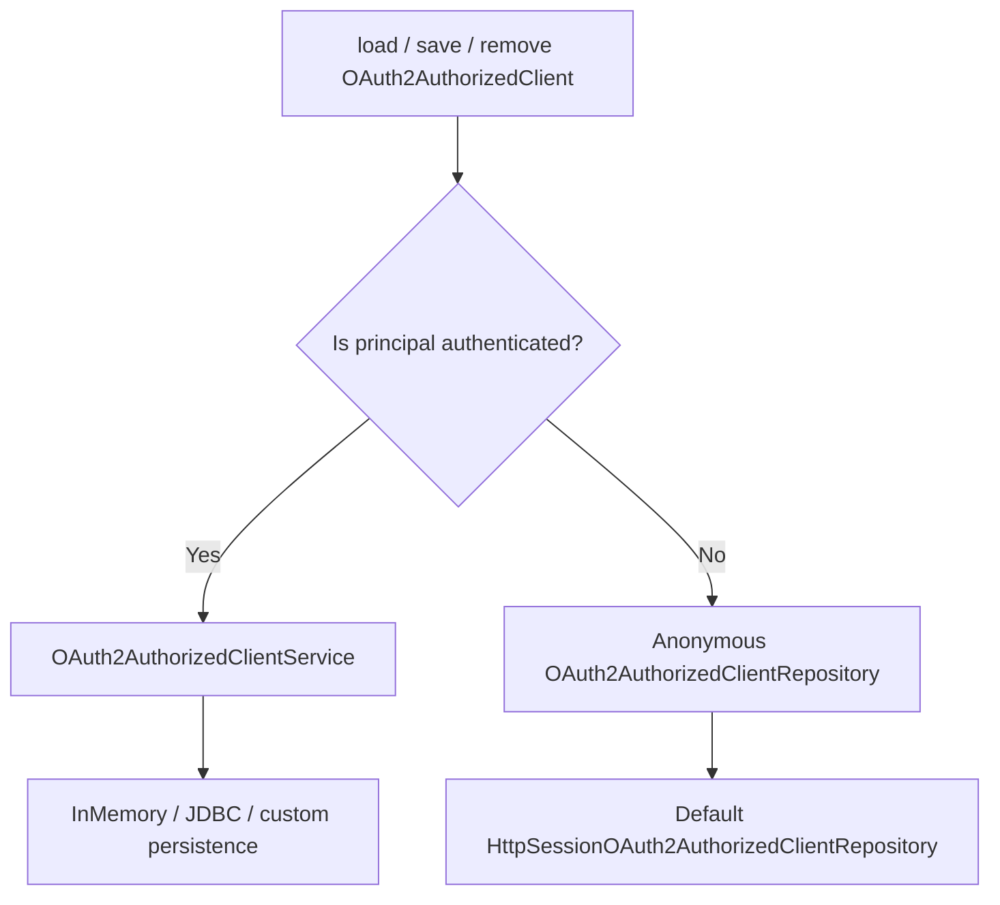

# 14.7. AuthenticatedPrincipalOAuth2AuthorizedClientRepository and Choosing Storage

## 1. Why Does an OAuth2 Authorized Client Need Storage?

In **Spring Security OAuth 2.0/OIDC Client**, after the application completes an Authorization Code Grant, it receives an **access token** and possibly a **refresh token**. Spring Security needs to know which **OAuth2 client registration** these tokens belong to and which **principal** context they were issued in, so subsequent API calls do not force the user to log in every time.

For example, an internal portal uses an OIDC Provider for sign-in and a profile management API:

```text
User Alice
    |
    +-- Signs in with registrationId = "corporate"
    |
    +-- Token Endpoint issues access token and possibly refresh token
    |
    +-- Spring Security builds OAuth2AuthorizedClient
    |      clientRegistration = "corporate"
    |      principalName      = "alice-uid"
    |      accessToken        = ...
    |      refreshToken       = ... (if issued)
    |
    +-- Application must save / retrieve Authorized Client
    |
    +-- Subsequent requests can use valid token to call API
```

Storage is not just a minor technical detail. It determines:

- Whether tokens survive after the **HTTP request ends**.
- Whether tokens survive **session expiration** or **application restarts**.
- Whether multiple instances of the application see the same tokens.
- Whether tokens are properly bound to the right **user**, **client registration**, **tenant**, and **authentication context**.
- How secret tokens are protected, expired, refreshed, revoked, and deleted.
- How the system behaves when a user is still **anonymous** or when running background tasks without an HTTP request.

The **`AuthenticatedPrincipalOAuth2AuthorizedClientRepository`** class is an essential component for answering **where to store an authorized client once the principal is known**.

Key point to remember right away:

> `AuthenticatedPrincipalOAuth2AuthorizedClientRepository` is a **routing storage repository**: for authenticated principals, it uses `OAuth2AuthorizedClientService`; for unauthenticated/anonymous principals, by default it delegates to `HttpSessionOAuth2AuthorizedClientRepository`.

It is the **delegated service or repository** that implements the concrete token storage mechanism. `AuthenticatedPrincipalOAuth2AuthorizedClientRepository` itself is not a database and does not encrypt tokens on its own.

### Learning Objectives

After this lesson, you will be able to:

1. Distinguish `ClientRegistration`, `OAuth2AuthorizedClient`, `OAuth2AuthorizedClientRepository`, and `OAuth2AuthorizedClientService`.
2. Understand how `AuthenticatedPrincipalOAuth2AuthorizedClientRepository` chooses between the authenticated and anonymous branches.
3. Know when to use `InMemoryOAuth2AuthorizedClientService`, `JdbcOAuth2AuthorizedClientService`, or `HttpSessionOAuth2AuthorizedClientRepository`.
4. Configure the repository in a **Spring Security Servlet/MVC** application.
5. Understand the role of `DefaultOAuth2AuthorizedClientManager` in loading, saving, and refreshing tokens.
6. Avoid confusing storage for **authorization requests**, **security context**, **client registrations**, and **authorized clients**.
7. Design token storage appropriate for single-instance, multi-instance, multi-tenant, and background job workloads.
8. Identify security risks, token deletion issues, and common mistakes when choosing the wrong storage.

## 2. Four Easily Confused Objects

Before choosing a repository, properly distinguish what is being stored.

### 2.1. ClientRegistration: OAuth2 Client Configuration

A `ClientRegistration` describes **how the client application is registered**:

```text
registrationId      = corporate
clientId            = portal-web
authorizationUri    = https://id.example.com/authorize
tokenUri            = https://id.example.com/token
redirectUri         = {baseUrl}/login/oauth2/code/{registrationId}
scopes              = openid profile api.read
```

It is configuration metadata, usually kept in `ClientRegistrationRepository`, not a user's token data.

### 2.2. OAuth2AuthorizedClient: Granted Authorization

An `OAuth2AuthorizedClient` carries:

```java
org.springframework.security.oauth2.client.OAuth2AuthorizedClient
```

Think of it as:

```text
OAuth2AuthorizedClient
    ├─ ClientRegistration
    ├─ principalName
    ├─ OAuth2AccessToken
    └─ OAuth2RefreshToken (depends on provider)
```

Example:

```java
OAuth2AuthorizedClient client = ...;

String registrationId =
    client.getClientRegistration().getRegistrationId();

String principalName = client.getPrincipalName();
OAuth2AccessToken accessToken = client.getAccessToken();
OAuth2RefreshToken refreshToken = client.getRefreshToken();
```

These methods help the application work with the authorized client, which **never means you may print access/refresh tokens to logs**. `getRefreshToken()` may return `null` if the AS did not issue a refresh token.

### 2.3. OAuth2AuthorizedClientService: Storing Tokens by Registration and Principal

Interface:

```java
org.springframework.security.oauth2.client.OAuth2AuthorizedClientService
```

Provides core operations:

```java
<T extends OAuth2AuthorizedClient> T loadAuthorizedClient(
    String clientRegistrationId,
    String principalName
);

void saveAuthorizedClient(
    OAuth2AuthorizedClient authorizedClient,
    Authentication principal
);

void removeAuthorizedClient(
    String clientRegistrationId,
    String principalName
);
```

The service uses **`clientRegistrationId` + `principalName`** to look up an authorized client, without requiring `HttpServletRequest` and `HttpServletResponse`.

This fits memory-based or database-based implementations, as well as flows that need to retrieve authorized clients outside a web request.

### 2.4. OAuth2AuthorizedClientRepository: Integrating HTTP Servlet Context

Interface:

```java
org.springframework.security.oauth2.client.web.OAuth2AuthorizedClientRepository
```

Conceptual contract:

```java
<T extends OAuth2AuthorizedClient> T loadAuthorizedClient(
    String clientRegistrationId,
    Authentication principal,
    HttpServletRequest request
);

void saveAuthorizedClient(
    OAuth2AuthorizedClient authorizedClient,
    Authentication principal,
    HttpServletRequest request,
    HttpServletResponse response
);

void removeAuthorizedClient(
    String clientRegistrationId,
    Authentication principal,
    HttpServletRequest request,
    HttpServletResponse response
);
```

Unlike the service, this repository receives both **`Authentication`** and **HTTP servlet request/response**. Thus, an implementation can choose the session, handle anonymous contexts, or delegate to another store based on the principal.

### 2.5. Summary Table

| Component | What Does It Hold? | What Key Does It Use? | Requires HTTP Request? |
|---|---|---|---|
| `ClientRegistrationRepository` | Client/provider metadata | `registrationId` | No |
| `OAuth2AuthorizedClient` | Registration + access token + refresh token + principal name | Value object | No |
| `OAuth2AuthorizedClientService` | Issued authorized clients | `clientRegistrationId` + `principalName` | No |
| `OAuth2AuthorizedClientRepository` | Accesses authorized client storage in a web context | `registrationId`, `Authentication`, request | Yes in Servlet contract |
| `AuthorizationRequestRepository` | Authorization request awaiting callback, including `state`/PKCE correlation | Authorization request data and session/request | Yes |
| `SecurityContextRepository` | Current Authentication for the session | Security context/session | Possibly |

Do not use `ClientRegistrationRepository` to store access tokens. Do not use `AuthorizationRequestRepository` as a long-term refresh token store.

## 3. What Is AuthenticatedPrincipalOAuth2AuthorizedClientRepository?

The class resides in package:

```java
org.springframework.security.oauth2.client.web.AuthenticatedPrincipalOAuth2AuthorizedClientRepository
```

It implements:

```java
OAuth2AuthorizedClientRepository
```

And has a constructor accepting:

```java
AuthenticatedPrincipalOAuth2AuthorizedClientRepository(
    OAuth2AuthorizedClientService authorizedClientService
)
```

Design idea: authorized clients bound to an **authenticated principal** can be saved via `OAuth2AuthorizedClientService`—which can store by principal—while **anonymous** requests are saved via another repository bound to the HTTP request/session.

### 3.1. Branching Diagram



Behavior table:

| Scenario | Component Used | Consequence |
|---|---|---|
| User Alice is signed in | `OAuth2AuthorizedClientService` | Can store by `registrationId` + principal name. |
| User Bob is signed in | `OAuth2AuthorizedClientService` | Has a separate entry under Bob's name. |
| Anonymous / unauthenticated request | `anonymousAuthorizedClientRepository` | Defaults to storing in HTTP session. |
| Application replaces anonymous repository | Your configured repository | Behavior depends on the substituted implementation. |
| You switch `OAuth2AuthorizedClientService` from InMemory to JDBC | Still the authenticated branch | Authenticated users' tokens can be stored persistently in the database. |

Thus, this class **does not hardcode two fixed storage locations**. It **delegates**; where data is actually stored depends on the delegates provided by the application.

### 3.2. Why Not Just Use principal.isAuthenticated()?

In Spring Security, an `AnonymousAuthenticationToken` can return `isAuthenticated() == true` because the object was validly constructed in the security pipeline, yet that **does not mean the user logged in**.

Therefore, the implementation must distinguish anonymous authentication from a genuinely authenticated user using an appropriate recognizer such as `AuthenticationTrustResolver`, rather than simply relying on a boolean checked manually by application code.

This matters when writing custom services, tests, or custom repositories. Do not write code like this and treat the result as proof of login:

```java
// Not a sufficient check for every type of Authentication.
if (authentication != null && authentication.isAuthenticated()) {
    // Could still be anonymous authentication.
}
```

Use mechanisms that distinguish anonymous/remember-me/fully-authenticated according to your business policy, or let Spring Security manage the default repository's conditions.

### 3.3. All Three Operations Go Through the Same Routing Logic

`AuthenticatedPrincipalOAuth2AuthorizedClientRepository` does not route **save** alone. It also routes:

- `loadAuthorizedClient(...)`: reads from the corresponding store.
- `saveAuthorizedClient(...)`: writes to the corresponding store.
- `removeAuthorizedClient(...)`: deletes from the corresponding store.

Consequently, **a change in authentication state** can cause the same `registrationId` to be looked up in two different places.

For example:

```text
While anonymous:
    load("partner") --> HttpSession repository

After authenticating as Alice:
    load("partner") --> OAuth2AuthorizedClientService
```

An authorized client previously saved in the anonymous session is **not automatically migrated** to Alice's service store simply because the principal transitioned to authenticated. Depending on the flow, the framework may create and save an authorized client after login; if you have a custom flow transferring authorization from anonymous to authenticated, design that data transfer explicitly and safely.

## 4. Default Setup: Authenticated via Service, Anonymous via Session

Common constructor:

```java
OAuth2AuthorizedClientRepository repository =
    new AuthenticatedPrincipalOAuth2AuthorizedClientRepository(
        authorizedClientService
    );
```

In this class's default configuration:

- `authorizedClientService` is used when the principal is authenticated.
- `HttpSessionOAuth2AuthorizedClientRepository` is normally the delegate for anonymous principals.

You can swap the repository used for anonymous principals via:

```java
repository.setAnonymousAuthorizedClientRepository(
    anotherRepository
);
```

### 4.1. Why Does Session Fit Anonymous Requests?

Before authentication, the application has no stable, trustworthy principal ID to serve as a long-term authorization storage key. The HTTP session ties the authorized client to **one specific web interaction** without sharing it with other anonymous sessions.

For example, two unauthenticated browsers:

```text
Anonymous session S1:
    registrationId = demo
    authorized client = A1

Anonymous session S2:
    registrationId = demo
    authorized client = A2
```

If a single global key `"anonymousUser"` were used in the database, tokens from different anonymous users could **overwrite or leak across sessions**. A session-based repository prevents all anonymous requests from collapsing into one principal name.

### 4.2. Session Is Not a Permanent Token Vault

`HttpSessionOAuth2AuthorizedClientRepository` binds authorized clients to the HTTP session. Depending on session configuration:

- Session expiration can lose the authorized client.
- Application restarts can lose local sessions.
- Multiple instances without a shared session store cannot see data when requests hit another node.
- Session serialization/cookie policies/TTL affect durability.
- Tokens can increase session payload size.

If using **Spring Session** with Redis or JDBC, multiple instances can share HTTP sessions; even then, **durability and security of tokens in the session** must still be evaluated—do not automatically equate Redis sessions with a long-term token vault.

### 4.3. Authenticated Does Not Automatically Mean Durable Either

On the authenticated branch, the repository delegates to `OAuth2AuthorizedClientService`. If that service is `InMemoryOAuth2AuthorizedClientService`, tokens still reside in **one instance's RAM**, not persisted durably. To persist across restarts, change the **service** implementation, such as JDBC or custom persistence with secret protection.

This is the key answer to "choosing storage": **swap the delegate implementation**, rather than merely creating another `AuthenticatedPrincipalOAuth2AuthorizedClientRepository`.

## 5. InMemoryOAuth2AuthorizedClientService

Class:

```java
org.springframework.security.oauth2.client.InMemoryOAuth2AuthorizedClientService
```

Example creating the service and repository:

```java
import org.springframework.context.annotation.Bean;
import org.springframework.context.annotation.Configuration;

import org.springframework.security.oauth2.client.OAuth2AuthorizedClientService;
import org.springframework.security.oauth2.client.InMemoryOAuth2AuthorizedClientService;
import org.springframework.security.oauth2.client.registration.ClientRegistrationRepository;
import org.springframework.security.oauth2.client.web.AuthenticatedPrincipalOAuth2AuthorizedClientRepository;
import org.springframework.security.oauth2.client.web.OAuth2AuthorizedClientRepository;

@Configuration
public class InMemoryAuthorizedClientConfig {

    @Bean
    OAuth2AuthorizedClientService authorizedClientService(
            ClientRegistrationRepository registrations) {

        return new InMemoryOAuth2AuthorizedClientService(registrations);
    }

    @Bean
    OAuth2AuthorizedClientRepository authorizedClientRepository(
            OAuth2AuthorizedClientService service) {

        return new AuthenticatedPrincipalOAuth2AuthorizedClientRepository(
            service
        );
    }
}
```

Key points to understand:

1. `ClientRegistrationRepository` supplies metadata when the service builds or looks up authorized clients.
2. `InMemoryOAuth2AuthorizedClientService` is the store for **authenticated** principals in this example.
3. `AuthenticatedPrincipalOAuth2AuthorizedClientRepository` picks the service or anonymous repository based on `Authentication`.
4. Anonymous requests still default to using the session.

### 5.1. When Is InMemory Appropriate?

- Learning and local experimentation.
- Single-instance deployments with simple requirements where losing tokens on restart is acceptable.
- Short-lived tokens that do not need sharing across nodes.
- Test environments needing straightforward setup.

### 5.2. Limitations in Production

- Does not automatically share data across multiple pods/instances.
- Tokens are lost if the process restarts.
- RAM usage grows with the number of authorized clients.
- Difficult to coordinate refresh token rotation across independent nodes.
- Unsuitable if business requirements demand preserving account links across deployments.

**InMemory does not mean tokens are non-sensitive.** Tokens still live in memory and must be protected in diagnostic heap dumps, logs, monitoring, and process access controls.

## 6. JDBC OAuth2AuthorizedClientService

Spring Security provides:

```java
org.springframework.security.oauth2.client.JdbcOAuth2AuthorizedClientService
```

It uses JDBC to store authorized clients in a database. Common constructor accepts:

```java
JdbcOAuth2AuthorizedClientService(
    JdbcOperations jdbcOperations,
    ClientRegistrationRepository clientRegistrationRepository
)
```

Example wiring in Spring Boot Servlet:

```java
import org.springframework.context.annotation.Bean;
import org.springframework.context.annotation.Configuration;
import org.springframework.jdbc.core.JdbcOperations;
import org.springframework.security.oauth2.client.JdbcOAuth2AuthorizedClientService;
import org.springframework.security.oauth2.client.OAuth2AuthorizedClientService;
import org.springframework.security.oauth2.client.registration.ClientRegistrationRepository;

@Configuration
public class JdbcAuthorizedClientConfig {

    @Bean
    OAuth2AuthorizedClientService authorizedClientService(
            JdbcOperations jdbc,
            ClientRegistrationRepository registrations) {

        return new JdbcOAuth2AuthorizedClientService(jdbc, registrations);
    }
}
```

Note: this example **replaces the InMemory service from the previous section**. Do not keep two beans with the same name/type in one application without an explicit selection mechanism.

If the application still uses `AuthenticatedPrincipalOAuth2AuthorizedClientRepository`, the authenticated branch will call this JDBC service. Anonymous requests still route to the session unless you replace the anonymous repository.

### 6.1. JDBC Schema and Storage Keys

Spring Security ships a reference SQL schema for `JdbcOAuth2AuthorizedClientService`; the structure typically includes a table like:

```text
oauth2_authorized_client
  client_registration_id
  principal_name
  access_token_type
  access_token_value
  access_token_issued_at
  access_token_expires_at
  access_token_scopes
  refresh_token_value
  refresh_token_issued_at
  created_at
```

The typical identifier key is the pair:

```text
(client_registration_id, principal_name)
```

Do not invent an arbitrary table layout and expect `JdbcOAuth2AuthorizedClientService` to work with it. Use the schema/SQL matching your **Spring Security version** or configure custom mappers/SQL via the APIs provided by that version.

### 6.2. When to Choose JDBC?

- When authorized clients must survive restarts/deployments.
- When multiple instances access tokens for the same principal.
- When retention, deletion, auditing, and backups must be managed in a database system.
- When token retention must align with account linking lifecycles.

However, JDBC **does not automatically make refresh tokens secure**. Evaluate encryption at rest, restricted data read privileges, TLS to the database, secret key management, and auditing.

### 6.3. The Database Must Treat Token Data as Credentials

Access tokens and especially refresh tokens can grant access to user resources. Requirements to consider:

- Encrypt data at the storage layer and, if required, at the application/column level.
- Restrict database service accounts to only the reads/writes needed.
- Never log raw SQL parameters containing tokens.
- Protect backups, replicas, exports, and technical support access.
- Design TTL/cleanup policies for expired entries or deleted accounts.
- Manage encryption keys independently from the database when required.
- Establish a policy to delete tokens when users unlink accounts.

## 7. HttpSessionOAuth2AuthorizedClientRepository

Implementation:

```java
org.springframework.security.oauth2.client.web.HttpSessionOAuth2AuthorizedClientRepository
```

It stores authorized clients inside the **HTTP session**.

Example replacing the anonymous delegate:

```java
import org.springframework.context.annotation.Bean;
import org.springframework.context.annotation.Configuration;

import org.springframework.security.oauth2.client.OAuth2AuthorizedClientService;
import org.springframework.security.oauth2.client.web.AuthenticatedPrincipalOAuth2AuthorizedClientRepository;
import org.springframework.security.oauth2.client.web.HttpSessionOAuth2AuthorizedClientRepository;
import org.springframework.security.oauth2.client.web.OAuth2AuthorizedClientRepository;

@Configuration
public class HybridAuthorizedClientConfig {

    @Bean
    OAuth2AuthorizedClientRepository authorizedClientRepository(
            OAuth2AuthorizedClientService service) {

        AuthenticatedPrincipalOAuth2AuthorizedClientRepository repository =
            new AuthenticatedPrincipalOAuth2AuthorizedClientRepository(
                service
            );

        repository.setAnonymousAuthorizedClientRepository(
            new HttpSessionOAuth2AuthorizedClientRepository()
        );

        return repository;
    }
}
```

Calling the setter above demonstrates the extension point, though in typical setups **the default anonymous delegate is already HTTP session**, so there is no need to set it explicitly unless customizing it.

### 7.1. What If You Want to Store All Authorized Clients in the Session?

You can explicitly provide an `HttpSessionOAuth2AuthorizedClientRepository` as the repository for all Servlet flows:

```java
@Bean
OAuth2AuthorizedClientRepository authorizedClientRepository() {
    return new HttpSessionOAuth2AuthorizedClientRepository();
}
```

In that model, **both authenticated and anonymous** flows use the session per that implementation, without branching via `AuthenticatedPrincipalOAuth2AuthorizedClientRepository`.

However, that is an architectural trade-off:

- Tokens are tightly bound to the current session.
- Session expiration removes access to the authorized client.
- If using distributed sessions, serialized token data may be written to a Redis/JDBC session store.
- After logout, understand the HTTP session lifecycle and whether tokens are revoked at the AS or merely dropped from the app.
- Unsuitable for service-to-service background processes without an HTTP session.

## 8. Comparing Storage Options: InMemory, JDBC, Session, and Custom Store

| Criterion | InMemoryAuthorizedClientService | JdbcAuthorizedClientService | HttpSessionAuthorizedClientRepository | Custom Store |
|---|---|---|---|---|
| Stored by user principal | Yes | Yes | By session | Depends on design |
| Survives restart | No | Yes if DB persists | Depends on session backend | Depends on storage |
| Shared across multiple instances | Not by default | Yes | If shared session store | Depends on implementation |
| Requires HTTP session | Not required | Not required | **Required** | Depends on design |
| Suitable for background jobs | Limited by InMemory | Possible, with right manager | Unsuitable | Possible |
| Operational overhead | Low | DB and schema | Session infrastructure | Depends on storage |
| Requires token encryption/controls | Yes | **Yes** | **Yes** | **Yes** |
| Easy local testing | Very good | Needs DB | Good for web | Depends |
| Manages refresh token rotation across nodes | Not built in | Needs concurrency policy | Needs session concurrency policy | Needs design |

There is no single best choice for every system. A portal needing tokens only during a session may use session storage. An application with linked accounts and background jobs needing API access post-login typically needs a persistent service.

### 8.1. Choose by Requirements, Not by Class Name

Ask yourself:

1. **Are tokens still needed after the user closes the browser?**
2. **Do background tasks need tokens without an HTTP request?**
3. **How many instances does the application run?**
4. **Are refresh tokens and refresh-token rotation involved?**
5. **Is the principal name stable?**
6. **Are there multiple OAuth2 registrations, issuers, or tenants?**
7. **Must logout/disconnect delete tokens?**
8. **Are auditing, encryption, data retention, and backups required?**
9. **Must rollbacks/deployments avoid breaking tokens for active links?**
10. **Is the operational cost of a database/session store acceptable?**

Answers to these questions matter far more than picking a class named "repository" vs. "service".

## 9. Configuring Spring Security OAuth2 Login to Use the Repository

In a Servlet application, you can attach the repository directly to `HttpSecurity`:

```java
import org.springframework.context.annotation.Bean;
import org.springframework.context.annotation.Configuration;
import org.springframework.security.config.annotation.web.builders.HttpSecurity;
import org.springframework.security.oauth2.client.web.OAuth2AuthorizedClientRepository;
import org.springframework.security.web.SecurityFilterChain;

@Configuration
public class OAuth2SecurityConfiguration {

    @Bean
    SecurityFilterChain securityFilterChain(
            HttpSecurity http,
            OAuth2AuthorizedClientRepository repository)
            throws Exception {

        http
            .authorizeHttpRequests(authorize -> authorize
                .requestMatchers("/", "/public/**").permitAll()
                .anyRequest().authenticated()
            )
            .oauth2Login(login -> login
                .authorizedClientRepository(repository)
            )
            .oauth2Client(client -> client
                .authorizedClientRepository(repository)
            );

        return http.build();
    }
}
```

Two related but distinct configuration points:

- `oauth2Login()` handles user login via OAuth2/OIDC.
- `oauth2Client()` configures OAuth2 Client support when the application needs authorized clients to call APIs.

If the project does not call external APIs, `oauth2Login()` alone may suffice depending on architecture. If tokens are used to call APIs, consider the authorized client manager, repository, and token refresh mechanism.

### 9.1. When Are Custom Beans Unnecessary?

Spring Boot/Spring Security can auto-provide default beans and repositories/services when dependencies and auto-configuration conditions match. If the defaults satisfy your needs, manually creating an `AuthenticatedPrincipalOAuth2AuthorizedClientRepository` is not required.

When creating custom beans, your application may override defaults normally provided by Boot. Therefore, **pick one clear configuration source**: if switching the service to JDBC, verify the repository/manager actually uses that exact service.

Do not assume **declaring a new bean is always picked up by the framework** if you also have multiple beans of the same type, multiple `SecurityFilterChain`s, or custom authorized client managers. Manually constructed components may still point to the old store.

## 10. Using OAuth2AuthorizedClient in a Servlet Controller

Spring MVC provides the annotation:

```java
org.springframework.security.oauth2.client.annotation.RegisteredOAuth2AuthorizedClient
```

Illustrative controller:

```java
import java.util.Map;

import org.springframework.security.oauth2.client.OAuth2AuthorizedClient;
import org.springframework.security.oauth2.client.annotation.RegisteredOAuth2AuthorizedClient;
import org.springframework.web.bind.annotation.GetMapping;
import org.springframework.web.bind.annotation.RestController;

@RestController
public class ConnectionController {

    @GetMapping("/connection")
    Map<String, String> connection(
            @RegisteredOAuth2AuthorizedClient("corporate")
            OAuth2AuthorizedClient client) {

        if (client == null) {
            return Map.of("status", "not-authorized");
        }

        return Map.of(
            "status", "authorized",
            "registrationId",
            client.getClientRegistration().getRegistrationId()
        );
    }
}
```

The endpoint reveals only status and registration ID, never returning the access token. In real applications, enforce endpoint access authorization and handle unauthorized states cleanly (e.g., initiating the appropriate authorization flow or returning a standard error).

`@RegisteredOAuth2AuthorizedClient` is resolved by Spring Security OAuth2 Client infrastructure and the configured authorized client manager/repository. The annotation does not magically know which database to read unless the application properly configures the store.

### 10.1. Never Expose the Raw Authorized Client in an API

Avoid:

```java
// Never do this in a public API.
@GetMapping("/debug")
OAuth2AuthorizedClient debug(
        @RegisteredOAuth2AuthorizedClient("corporate")
        OAuth2AuthorizedClient client) {
    return client;
}
```

An `OAuth2AuthorizedClient` holds the access token and possibly a refresh token. Serializing it to JSON or logging it risks exposing credentials.

## 11. DefaultOAuth2AuthorizedClientManager and the Repository's Role

In a Servlet application, `DefaultOAuth2AuthorizedClientManager` manages authorizing/re-authorizing OAuth2 clients using configured providers and stored data.

Class:

```java
org.springframework.security.oauth2.client.web.DefaultOAuth2AuthorizedClientManager
```

Constructor:

```java
DefaultOAuth2AuthorizedClientManager(
    ClientRegistrationRepository clientRegistrationRepository,
    OAuth2AuthorizedClientRepository authorizedClientRepository
)
```

Sample configuration:

```java
import org.springframework.context.annotation.Bean;
import org.springframework.context.annotation.Configuration;

import org.springframework.security.oauth2.client.OAuth2AuthorizedClientManager;
import org.springframework.security.oauth2.client.OAuth2AuthorizedClientProvider;
import org.springframework.security.oauth2.client.OAuth2AuthorizedClientProviderBuilder;
import org.springframework.security.oauth2.client.registration.ClientRegistrationRepository;
import org.springframework.security.oauth2.client.web.DefaultOAuth2AuthorizedClientManager;
import org.springframework.security.oauth2.client.web.OAuth2AuthorizedClientRepository;

@Configuration
public class AuthorizedClientManagerConfig {

    @Bean
    OAuth2AuthorizedClientManager authorizedClientManager(
            ClientRegistrationRepository registrations,
            OAuth2AuthorizedClientRepository repository) {

        DefaultOAuth2AuthorizedClientManager manager =
            new DefaultOAuth2AuthorizedClientManager(
                registrations, repository
            );

        OAuth2AuthorizedClientProvider provider =
            OAuth2AuthorizedClientProviderBuilder.builder()
                .authorizationCode()
                .refreshToken()
                .build();

        manager.setAuthorizedClientProvider(provider);

        return manager;
    }
}
```

Meaning:

- The manager looks up the registration and current authorized client.
- The provider can authorize or refresh the access token if the grant/refresh token permits.
- The manager uses success/failure handlers to save/remove the authorized client via the configured mechanism.
- The repository is the manager's storage boundary in a **Servlet request context**.

The configuration above only illustrates a provider set with authorization code and refresh token. An application may need `clientCredentials()` or other providers matching its registered grants. Do not unconditionally enable every provider for a client not authorized by the AS.

### 11.1. When Must You Pay Attention to HTTP Request/Response?

`DefaultOAuth2AuthorizedClientManager` is designed to operate within a **Servlet `HttpServletRequest`** context. The repository may rely on the HTTP session, response, or web request authentication.

In a scheduled job without an HTTP request, never try to fake a user session to make the manager work. Spring Security provides a **different manager** for environments outside Servlet requests.

## 12. Background Jobs and Service-to-Service: Choosing AuthorizedClientServiceOAuth2AuthorizedClientManager

A batch job, scheduler, or service calling APIs from a worker thread usually lacks `HttpServletRequest`/`HttpServletResponse`.

In that case, use:

```java
org.springframework.security.oauth2.client.AuthorizedClientServiceOAuth2AuthorizedClientManager
```

Constructor:

```java
AuthorizedClientServiceOAuth2AuthorizedClientManager(
    ClientRegistrationRepository clientRegistrationRepository,
    OAuth2AuthorizedClientService authorizedClientService
)
```

Bean example for `client_credentials`:

```java
import org.springframework.context.annotation.Bean;
import org.springframework.context.annotation.Configuration;
import org.springframework.security.oauth2.client.AuthorizedClientServiceOAuth2AuthorizedClientManager;
import org.springframework.security.oauth2.client.OAuth2AuthorizedClientManager;
import org.springframework.security.oauth2.client.OAuth2AuthorizedClientProviderBuilder;
import org.springframework.security.oauth2.client.OAuth2AuthorizedClientService;
import org.springframework.security.oauth2.client.registration.ClientRegistrationRepository;

@Configuration
public class BackgroundTokenManagerConfig {

    @Bean("backgroundAuthorizedClientManager")
    OAuth2AuthorizedClientManager backgroundAuthorizedClientManager(
            ClientRegistrationRepository registrations,
            OAuth2AuthorizedClientService service) {

        AuthorizedClientServiceOAuth2AuthorizedClientManager manager =
            new AuthorizedClientServiceOAuth2AuthorizedClientManager(
                registrations, service
            );

        manager.setAuthorizedClientProvider(
            OAuth2AuthorizedClientProviderBuilder.builder()
                .clientCredentials()
                .build()
        );

        return manager;
    }
}
```

This is an **intentional alternative/complement** to the Servlet manager; if the same application has two beans of type `OAuth2AuthorizedClientManager`, use bean names/qualifiers when injecting.

When using a manager outside HTTP:

- Choose a stable, meaningful `principalName` as the service's authorized client key, such as a service identity.
- Never share a principal name across workloads that are not permitted to share tokens.
- Never assume `client_credentials` creates a user principal.
- Consider refresh or re-authorization according to the grant; many client credentials tokens do not have a refresh token.
- Ensure the store is accessible from the node executing the background job.

### 12.1. Background Jobs Using a User's Token Are a Different Case

If a scheduler truly needs to call an API **on behalf of user Alice**, the system needs authorization previously granted by Alice, an appropriate refresh token storage policy, and conditions permitting offline access.

Never obtain a service `client_credentials` token and assume it carries Alice's permissions. Conversely, never take Alice's token to use for Bob just because both signed in via the `corporate` registration.

## 13. Principal Name Is a Crucial Key

An authorized client service normally looks up data by:

```text
(client_registration_id, principal_name)
```

Examples:

| registrationId | principalName | Meaning |
|---|---|---|
| `corporate` | `alice-uid` | Token for Alice via Corporate IdP |
| `corporate` | `bob-uid` | Token for Bob via Corporate IdP |
| `partner` | `alice-uid` | Token for Alice via another provider |
| `batch-api` | `inventory-worker` | Token for a service identity |

### 13.1. Principal Name Must Be Stable

If `Authentication.getName()` is based on the user's email, and the email changes after login, the service may fail to find the authorized client under the new name.

With OIDC, external user identification should rely on **issuer + subject (`iss`, `sub`)** or a managed stable local account ID mapping. Never use unverified emails, display names, or nicknames as the sole key.

### 13.2. Avoid Name Collisions Across Tenants

Suppose two tenants both have a user named `admin` and share `registrationId = enterprise`. If the service only takes `(registrationId, principalName)`, the two users can collide on the key.

A multi-tenant design requires namespace binding:

```text
tenantA + enterprise + user-001
tenantB + enterprise + user-001
```

You can use per-tenant registration IDs, namespaced principal names, or a custom store with a tenant key, depending on your trust model. Most importantly, **never allow two principals with different privileges to look up the same authorized client**.

### 13.3. Principal Changing State During the Login Flow

`AuthenticatedPrincipalOAuth2AuthorizedClientRepository` can read from the session while anonymous and then switch to the service after authentication. This means:

```text
Anonymous request:
  lookup -> session

Authenticated request:
  lookup -> OAuth2AuthorizedClientService
```

If a custom flow creates an authorized client while anonymous and wants to continue using it after authentication, explicitly design how that data binds to the new principal. Never automatically copy every anonymous token from the session onto whichever user logs in afterward.

## 14. Token Refresh and Concurrency Issues

An access token has a limited lifetime; if a refresh token exists, the manager can call the AS for a new access token. The authorized client store must support updating the refreshed result.

Example:

```text
Alice + corporate -> access_token_A, refresh_token_R1

Token nearly expired:
    Manager refreshes -> access_token_B, refresh_token_R2 (if rotated)

Store must persist updated authorized client:
    Alice + corporate -> access_token_B, refresh_token_R2
```

### 14.1. Refresh Token Rotation Across Multiple Instances

Suppose Alice sends two concurrent HTTP requests:

```text
Node 1 reads R1
Node 2 reads R1

Node 1 refreshes with R1 successfully -> R2
Node 2 refreshes with R1 -> invalid_grant / reuse detection
```

This is a real concurrency problem, especially when the AS enforces **refresh token rotation**.

Choosing JDBC/custom persistence lets nodes see shared data, yet **does not completely solve race conditions on its own**. Depending on the system, you may need:

- Per-principal/registration locking.
- Compare-and-set or optimistic concurrency control.
- Single-flight rules allowing only one in-flight refresh per authorized client.
- Re-reading fresh data after another node completes a refresh.
- Avoiding infinite retries of an old refresh token when the AS enforces reuse detection.

Never assume every refresh only swaps the access token while keeping the refresh token unchanged.

### 14.2. Removing the Authorized Client When Refresh Fails

`OAuth2AuthorizedClientManager` and its success/failure handlers can save an authorized client on successful authorization or remove it on certain errors. If you replace the default handlers, understand the impact on stored refresh tokens and user state.

Do not delete every token on transient network blips, yet do not keep retrying a token already revoked by the AS forever. Distinguish transport errors from OAuth2 protocol errors such as `invalid_grant`.

## 15. Logout, Disconnect, and Token Lifecycle

A common misconception:

> A user logging out of the application does not mean the Authorization Server has revoked the access token/refresh token.

There are several distinct actions:

| Action | Meaning |
|---|---|
| Delete application session | The user is no longer signed into that web app. |
| Clear SecurityContext | No Authentication remains for the corresponding request/session. |
| Delete `OAuth2AuthorizedClient` | The app no longer holds a token record in the store managed by the repository/service. |
| Revoke access/refresh token at AS | Provider is asked to invalidate the token per policy/support. |
| OIDC RP-Initiated Logout | Ends or updates the SSO session at the OpenID Provider when supported. |

They are not automatically equivalent.

### 15.1. With Session-Based Stores

When the HTTP session is invalidated, authorized clients stored only in that session are no longer retrievable from that session. However, tokens at the AS may remain valid until expiration or revocation.

### 15.2. With JDBC Stores for Authenticated Principals

Web logout does not necessarily delete database rows holding authorized clients. If the product requires "logout disconnects the provider", perform the deletion and, where appropriate, revoke tokens at the AS.

Example removing an authorized client via service:

```java
authorizedClientService.removeAuthorizedClient(
    "corporate",
    principalName
);
```

With the repository inside an HTTP request, you can use:

```java
authorizedClientRepository.removeAuthorizedClient(
    "corporate",
    authentication,
    request,
    response
);
```

Use the right contract for the context and verify the caller is only allowed to delete tokens for a valid principal. Never accept an arbitrary `principalName` from a query parameter to delete someone else's tokens.

### 15.3. Retention Policies

Depending on the store, define rules for:

- How long to retain records whose access token expired while a refresh token may still be valid.
- Which tokens to delete when a user unlinks an account.
- How to handle tokens when a user is deleted, disabled, or changes tenants.
- How long token copies in backups/logs/snapshots are retained and how they are protected.
- Ensuring periodic cleanup jobs do not accidentally delete tokens mid-refresh.

## 16. Security Checklist for Token Storage

### 16.1. Access Tokens and Refresh Tokens Are Secrets

Never:

- Log `authorizedClient.getAccessToken().getTokenValue()`.
- Serialize the raw `OAuth2AuthorizedClient` into HTTP responses.
- Put refresh tokens into browser cookies without strict protective design.
- Store plaintext tokens in logs, trace spans, or analytics events.
- Send tokens to APIs/hosts outside authorized resource targets.
- Share tokens across different users/tenants.

### 16.2. If Storing in a Database

Consider:

1. TLS for database connections.
2. Encryption at rest and backup protection.
3. If your threat model requires it, encrypting token values at the application layer or column encryption.
4. Restricting database roles to only the minimum reads/writes needed.
5. Never logging raw SQL parameters containing tokens.
6. Managing encryption keys separately from data when needed.
7. Enforcing access controls by user/tenant.
8. Proper token cleanup and auditing per data policy.

`JdbcOAuth2AuthorizedClientService` provides basic persistence; **do not assume it automatically satisfies all organizational storage security requirements**.

### 16.3. If Storing in HttpSession

Protect the session:

- Unpredictable session IDs and secure cookies (`HttpOnly`, `Secure`, appropriate `SameSite` policy).
- Protection against session fixation, logout, CSRF, and callback routes.
- Use HTTPS and configure session timeouts.
- If using a shared session store, protect Redis/JDBC with auth/TLS/network policies.
- Never send token-bearing session contents to the frontend.
- Never assume tokens are automatically revoked when a session is deleted.

### 16.4. If Storing InMemory

Protect process memory, heap dumps, debugger access, and logs; account for restarts/deployments wiping tokens. InMemory fits certain use cases, yet is not inherently safer than a database across all threat models.

## 17. Anonymous vs. Authenticated: Scenarios to Distinguish

### Scenario A: User Is Signed In and Wants to Call an API

Alice has a stable authenticated principal. The repository calls `OAuth2AuthorizedClientService` by `registrationId` + principal name. If using the JDBC service, Alice's token can be retrieved from the DB.

### Scenario B: User Has Not Logged In, Yet Authorization Occurs in a Separate Flow

The default anonymous repository uses the session, binding the token to the current request/session rather than storing all tokens under a shared `anonymousUser` key.

### Scenario C: Anonymous Session Already Has a Token, Then Alice Logs In

After login, `AuthenticatedPrincipalOAuth2AuthorizedClientRepository` selects the service branch instead of the session. Tokens stored while anonymous do not automatically appear in the service under Alice's name. Design a controlled migration flow if your product truly requires it.

### Scenario D: Alice's Session Expires

If the authorized client lived only in the session, data may be lost. If the authorized client lives in a JDBC service, the token may still exist, yet using it must go through the application's authentication and authorization policies—**never allow an anonymous request to fetch Alice's token merely because the DB still has a row**.

### Scenario E: Application Runs Three Pods Using InMemory

Alice signs in on Pod 1, so the token sits in Pod 1's memory. A subsequent request hitting Pod 2 may not find the token. This is a storage/distribution issue, not necessarily an AS failure.

### Scenario F: Refresh Token Rotation Encounters a Race

Two nodes concurrently refresh using the old refresh token. One request succeeds; the other returns `invalid_grant`. A shared DB alone is not enough: per-principal/registration concurrency control is needed.

## 18. Common Mistakes

| Symptom | Likely Cause | Resolution |
|---|---|---|
| Login succeeds, next request misses authorized client | Lost session, principal name changed, mismatched repo/service | Check authenticated/anonymous routing and actual storage |
| Token lost after restart | InMemory service or local session | Choose appropriate persistence |
| Token missing when request hits another node | No shared store/session | Use JDBC/custom service or shared session |
| Anonymous requests share a token | Custom store keys all of them as `anonymousUser` | Isolate by session; never share tokens |
| Principal `isAuthenticated()` is true yet still anonymous | Misunderstanding `AnonymousAuthenticationToken`'s boolean | Use trust resolver / Spring Security mechanism |
| Created JDBC service yet tokens still live in RAM | Repository/manager still references old service | Check bean wiring and `SecurityFilterChain` |
| Token refresh fails randomly across multiple pods | Race and token rotation | Add concurrency policy |
| Token gone after logout | Session invalidated with session-based store | Clarify lifecycle requirements |
| Token remains in DB after logout | Logout does not automatically delete authorized clients | Configure disconnect/remove/revoke policy |
| Tenant A's token retrieved for Tenant B | Principal/registration key lacks namespacing | Design clear tenant keys and authz |
| Authorization code callback `state` mismatch | Lost `AuthorizationRequestRepository`/session | Do not confuse with `AuthorizedClientRepository` |
| ID Token verification fails | Issuer/JWKS/audience/nonce | Do not tweak token storage as if it were a repository error |
| API returns `401` despite existing authorized client | Token expired/wrong audience/scope | Check token lifecycle and API policy |
| Worker lacks HTTP request yet uses `DefaultOAuth2AuthorizedClientManager` | Wrong manager type for background context | Use `AuthorizedClientServiceOAuth2AuthorizedClientManager` |

### 18.1. Distinguishing AuthorizationRequestRepository from AuthorizedClientRepository

This is the easiest mix-up in the Authorization Code Flow:

```text
Before callback:
    AuthorizationRequestRepository
      -> state
      -> PKCE verifier
      -> authorization request metadata

After token exchange succeeds:
    OAuth2AuthorizedClientRepository / Service
      -> ClientRegistration
      -> principalName
      -> accessToken
      -> refreshToken (if any)
```

An `authorization_request_not_found` or `invalid_state` error usually involves session/callback correlation and **cannot be fixed by switching `OAuth2AuthorizedClientService` to JDBC**.

### 18.2. Distinguishing Having a Token from Having a Usable Token

`loadAuthorizedClient()` finding an object does not automatically guarantee:

- The access token is unexpired.
- The token has not been revoked by the AS.
- The scope/audience matches the target API.
- The current principal is still permitted to use the token.
- The refresh token is still valid.

The OAuth2 Authorized Client Manager and the application must handle lifecycle rules per grant, provider, and policy.

## 19. Recommended Choices by Application Architecture

### 19.1. Single-Instance Learning Application

Choose:

```text
AuthenticatedPrincipalOAuth2AuthorizedClientRepository
    ├─ Authenticated -> InMemoryOAuth2AuthorizedClientService
    └─ Anonymous     -> HttpSessionOAuth2AuthorizedClientRepository
```

Pros: minimal setup, easy to learn. Limitation: tokens are lost on restart and not shared across instances.

### 19.2. Web Portal Where Tokens Are Only Needed During the Session

Consider `HttpSessionOAuth2AuthorizedClientRepository` for the entire flow if tokens do not need to outlive the session and session architecture is properly secured.

If the application runs multiple instances, use a shared session store or reliable routing strategy. Do not rely on sticky sessions as a long-term durable persistence mechanism.

### 19.3. Application Requiring Long-Lived Account Links

Choose:

```text
AuthenticatedPrincipalOAuth2AuthorizedClientRepository
    ├─ Authenticated -> JdbcOAuth2AuthorizedClientService
    └─ Anonymous     -> HttpSessionOAuth2AuthorizedClientRepository
```

Fits when tokens are needed across restarts, shared across nodes, or used for per-user background synchronization. Also design encryption, token deletion, principal namespacing, and refresh rotation concurrency.

### 19.4. Service-to-Service Systems

A Servlet repository is not necessarily needed. When running in the background with `client_credentials`, choose:

```text
AuthorizedClientServiceOAuth2AuthorizedClientManager
    |
    +-- ClientRegistrationRepository
    +-- OAuth2AuthorizedClientService
```

The service can be InMemory or persistent depending on caching and operational requirements. The token represents the client/service, not a browser-signed-in user.

### 19.5. Multi-Tenant Enterprise

Consider:

- Whether registrations are separated per tenant or use a dynamic repository.
- Trusted issuer and subject for identity.
- Principal name namespacing.
- Token isolation across tenants.
- Storage encryption and key rotation.
- Refresh token races across multiple nodes.
- Whether tenant offboarding properly deletes scoped tokens/credentials.

A custom `OAuth2AuthorizedClientService`/repository may be warranted, though you should not write one from scratch solely to swap InMemory for JDBC when Spring Security already provides it.

## 20. A Complete Servlet Architecture Example

Suppose a portal uses `registrationId = corporate` and wants to store user authorized clients in JDBC while keeping default session storage for anonymous requests.

### 20.1. OAuth2 Client Registration Configuration

```yaml
spring:
  security:
    oauth2:
      client:
        registration:
          corporate:
            provider: company-oidc
            client-id: ${OIDC_CLIENT_ID}
            client-secret: ${OIDC_CLIENT_SECRET}
            authorization-grant-type: authorization_code
            client-authentication-method: client_secret_basic
            redirect-uri: "{baseUrl}/login/oauth2/code/{registrationId}"
            scope:
              - openid
              - profile
              - api.read
        provider:
          company-oidc:
            issuer-uri: https://id.example.com
```

### 20.2. DataSource and JDBC Schema

The application needs a valid DataSource and `JdbcOperations`, plus the **authorized client schema** matching your Spring Security version. Apply the schema through managed migrations (Flyway/Liquibase or equivalent); never let the application arbitrarily drop/create tables in production.

Deployment structure example:

```text
Spring Boot DataSource
    |
    v
JdbcTemplate (JdbcOperations)
    |
    v
JdbcOAuth2AuthorizedClientService
    |
    v
AuthenticatedPrincipalOAuth2AuthorizedClientRepository
    |
    v
Spring Security OAuth2 Login / Client
```

### 20.3. Service + Repository Beans

```java
import org.springframework.context.annotation.Bean;
import org.springframework.context.annotation.Configuration;
import org.springframework.jdbc.core.JdbcOperations;
import org.springframework.security.oauth2.client.JdbcOAuth2AuthorizedClientService;
import org.springframework.security.oauth2.client.OAuth2AuthorizedClientService;
import org.springframework.security.oauth2.client.registration.ClientRegistrationRepository;
import org.springframework.security.oauth2.client.web.AuthenticatedPrincipalOAuth2AuthorizedClientRepository;
import org.springframework.security.oauth2.client.web.OAuth2AuthorizedClientRepository;

@Configuration
public class AuthorizedClientStorageConfig {

    @Bean
    OAuth2AuthorizedClientService authorizedClientService(
            JdbcOperations jdbc,
            ClientRegistrationRepository registrations) {

        return new JdbcOAuth2AuthorizedClientService(jdbc, registrations);
    }

    @Bean
    OAuth2AuthorizedClientRepository authorizedClientRepository(
            OAuth2AuthorizedClientService service) {

        return new AuthenticatedPrincipalOAuth2AuthorizedClientRepository(
            service
        );
    }
}
```

When signing in with OIDC, Spring Security still verifies the ID Token and creates `Authentication`; the repository selects the JDBC service for the authenticated principal. The authorized client is stored by registration/principal for subsequent API access.

### 20.4. SecurityFilterChain

```java
import org.springframework.context.annotation.Bean;
import org.springframework.context.annotation.Configuration;
import org.springframework.security.config.annotation.web.builders.HttpSecurity;
import org.springframework.security.oauth2.client.web.OAuth2AuthorizedClientRepository;
import org.springframework.security.web.SecurityFilterChain;

@Configuration
public class SecurityConfig {

    @Bean
    SecurityFilterChain securityFilterChain(
            HttpSecurity http,
            OAuth2AuthorizedClientRepository authorizedClients)
            throws Exception {

        http
            .authorizeHttpRequests(authorize -> authorize
                .requestMatchers("/", "/public/**").permitAll()
                .anyRequest().authenticated()
            )
            .oauth2Login(login -> login
                .authorizedClientRepository(authorizedClients)
            )
            .oauth2Client(client -> client
                .authorizedClientRepository(authorizedClients)
            );

        return http.build();
    }
}
```

This is a Servlet example. Do not mix `ReactiveOAuth2AuthorizedClientService` or reactive repositories into the same configuration without switching to the WebFlux stack.

### 20.5. Expected Behavior

```text
Successful login:
    principal = alice-uid
    registration = corporate

    authorizedClientRepository.saveAuthorizedClient(...)
       |
       +-- principal authenticated?
              |
              +-- yes -> JdbcOAuth2AuthorizedClientService.save(...)

Subsequent request:
    authorizedClientRepository.loadAuthorizedClient(
        "corporate", aliceAuthentication, request
    )
       |
       +-- JDBC lookup by ("corporate", "alice-uid")

Anonymous request:
    authorizedClientRepository.loadAuthorizedClient(
        "corporate", anonymousAuthentication, request
    )
       |
       +-- HttpSessionOAuth2AuthorizedClientRepository
```

The application must never allow an anonymous caller to arbitrarily fetch a token under `alice-uid` just by knowing that name. Identity/authentication must be verified first, and business authorization must still enforce access rules.

## 21. Frequently Asked Questions

### 21.1. Does AuthenticatedPrincipalOAuth2AuthorizedClientRepository Automatically Save to a Database?

No. It delegates to `OAuth2AuthorizedClientService`. Only when that service is a JDBC or custom persistent store does the authenticated branch gain corresponding persistence.

### 21.2. Why Does Anonymous Default to HttpSession?

Because prior to authentication there is no trustworthy, stable principal name to store per user. The session isolates authorized clients per browser session, avoiding sharing tokens across every `anonymousUser`.

### 21.3. Once Logged In, Does the Token Still Sit in the Session?

It depends on the repository actually configured. With the default `AuthenticatedPrincipalOAuth2AuthorizedClientRepository`, the authenticated branch uses the service. If the application replaces the entire repository with `HttpSessionOAuth2AuthorizedClientRepository`, tokens are stored in the session per that implementation.

### 21.4. Does Logout Automatically Delete JDBC Tokens?

Do not assume so. Logout, deleting stored authorized clients, and revoking tokens at the provider are separate actions. Implement the lifecycle according to product requirements.

### 21.5. Can Email Be Used as principalName?

Only if you understand and accept all risks around mutability, reuse, and verification status. Usually a stable local ID or trustworthy OIDC `(iss, sub)` mapping is preferred.

### 21.6. Can the AuthenticatedPrincipal Repository Be Used in a Scheduled Job?

It is built for the Servlet request contract. For work running outside HTTP requests, use `AuthorizedClientServiceOAuth2AuthorizedClientManager` and an appropriate service.

### 21.7. If a Token Is Saved in the Database, Is an API Call Guaranteed to Succeed?

No. The token may be expired, have the wrong scope/audience, be revoked, or lack permissions. Token storage and API authorization are two separate concerns.

### 21.8. If Redis Holds HTTP Sessions, Can It Serve as a Long-Term Token Store?

Shared sessions work for some architectures, though you must evaluate TTL, serialization, security, and data loss risks. Storing tokens inside sessions is not automatically equivalent to designing a persistent `OAuth2AuthorizedClientService`.

## 22. Thought Exercises

**Question 1.** Alice and Bob both use `registrationId = corporate`. Why shouldn't their authorized clients be stored under a single `corporate` key?

**Answer:** Because each token is bound to a specific principal. At minimum you must distinguish registration and principal to prevent cross-user token leakage.

**Question 2.** For an anonymous principal, what does `AuthenticatedPrincipalOAuth2AuthorizedClientRepository` call by default?

**Answer:** The anonymous authorized client repository, usually `HttpSessionOAuth2AuthorizedClientRepository`.

**Question 3.** For an authenticated principal, what does that class call?

**Answer:** The `OAuth2AuthorizedClientService` passed into its constructor.

**Question 4.** Why can an InMemory service fail when deployed across multiple pods?

**Answer:** Each pod has its own memory; authorized clients saved on one pod are not automatically available on other pods.

**Question 5.** Does the JDBC service automatically encrypt all tokens at the application layer?

**Answer:** Do not assume so. Evaluate and implement storage security measures according to your threat model.

**Question 6.** Switching the session storing authorization requests to a JDBC authorized client service—will that fix an `invalid_state` error?

**Answer:** Unlikely, and usually no. `invalid_state` involves authorization request/callback correlation, not post-exchange token storage.

**Question 7.** Which manager does a background task calling an API with client credentials need?

**Answer:** `AuthorizedClientServiceOAuth2AuthorizedClientManager` fits because it does not depend on a Servlet HTTP request.

**Question 8.** If refresh token rotation runs across two nodes, is a shared DB enough to prevent races?

**Answer:** Not yet. A concurrency policy for refreshing/updating authorized clients is required.

**Question 9.** When a user logs out of the web app, has the token been revoked at the IdP?

**Answer:** Not implicitly. Local logout, store deletion, and revocation are separate actions.

**Question 10.** At which layer should the token storage mechanism be swapped?

**Answer:** Usually by swapping `OAuth2AuthorizedClientService` in the authenticated branch or swapping the repository/anonymous delegate per architecture; never modify `ClientRegistrationRepository`, which holds only metadata.

## 23. Core Takeaways

| Term | Key Meaning to Remember |
|---|---|
| `OAuth2AuthorizedClient` | Registration + principal name + access token + optional refresh token. |
| `OAuth2AuthorizedClientService` | Saves/loads tokens by registration ID and principal name, without needing an HTTP request. |
| `OAuth2AuthorizedClientRepository` | Contract for retrieving tokens in a Servlet web request context. |
| `AuthenticatedPrincipalOAuth2AuthorizedClientRepository` | **Router:** authenticated -> service; anonymous -> anonymous repository. |
| `InMemoryOAuth2AuthorizedClientService` | RAM store, easy to learn, lost on restart, not shared across nodes. |
| `JdbcOAuth2AuthorizedClientService` | Database store, requires schema and token security policies. |
| `HttpSessionOAuth2AuthorizedClientRepository` | HTTP session store; default for the anonymous branch. |
| `DefaultOAuth2AuthorizedClientManager` | Manager using the repository in a Servlet web request context. |
| `AuthorizedClientServiceOAuth2AuthorizedClientManager` | Manager using the service in tasks outside Servlet requests. |
| `ClientRegistrationRepository` | Stores client/provider config only, never user tokens. |
| `AuthorizationRequestRepository` | Holds state/PKCE correlation before callback, distinct from authorized clients. |
| `principalName` | Key must be stable and properly namespaced per user/tenant. |
| Refresh token rotation | Requires concurrent refresh control, not just shared persistence. |
| Logout/disconnect | Distinguish local session, deleting stored tokens, and revoking tokens at the AS. |

**Conclusion:** `AuthenticatedPrincipalOAuth2AuthorizedClientRepository` is not a standalone store, but a layer that **routes delegation based on the principal's authentication state**. For signed-in users, it uses `OAuth2AuthorizedClientService`; for anonymous users, it defaults to `HttpSessionOAuth2AuthorizedClientRepository`. To choose **where to store** tokens, start from your requirements for sessions, restarts, multi-instance scaling, background jobs, and security, then pick `InMemoryOAuth2AuthorizedClientService`, `JdbcOAuth2AuthorizedClientService`, a session repository, or a custom store accordingly. Whichever option you use, keep tokens bound to the right principal/registration and design refresh, logout, and data deletion lifecycles safely.

## Official References

- [Spring Security — OAuth 2.0 Client (Servlet)](https://docs.spring.io/spring-security/reference/servlet/oauth2/client/index.html): overview of authorized clients, repositories, and managers.
- [Spring Security — OAuth2AuthorizedClientRepository API](https://docs.spring.io/spring-security/reference/api/java/org/springframework/security/oauth2/client/web/OAuth2AuthorizedClientRepository.html): load/save/remove contract in Servlet.
- [Spring Security — AuthenticatedPrincipalOAuth2AuthorizedClientRepository API](https://docs.spring.io/spring-security/reference/api/java/org/springframework/security/oauth2/client/web/AuthenticatedPrincipalOAuth2AuthorizedClientRepository.html): delegation by authenticated principal and anonymous repository.
- [Spring Security — OAuth2AuthorizedClientService API](https://docs.spring.io/spring-security/reference/api/java/org/springframework/security/oauth2/client/OAuth2AuthorizedClientService.html): service contract for storage.
- [Spring Security — JdbcOAuth2AuthorizedClientService API](https://docs.spring.io/spring-security/reference/api/java/org/springframework/security/oauth2/client/JdbcOAuth2AuthorizedClientService.html): JDBC implementation for storing authorized clients.
- [Spring Security — OAuth2AuthorizedClientManager API](https://docs.spring.io/spring-security/reference/api/java/org/springframework/security/oauth2/client/OAuth2AuthorizedClientManager.html): contract for managing authorization and token lifecycle.
