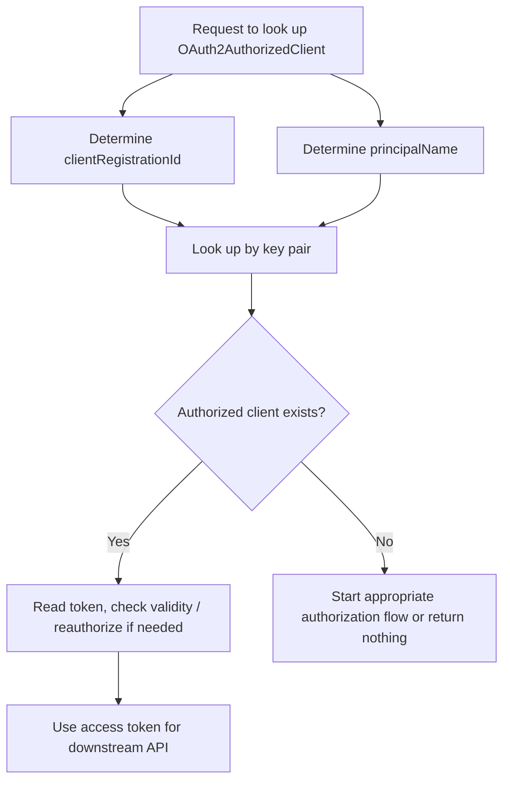
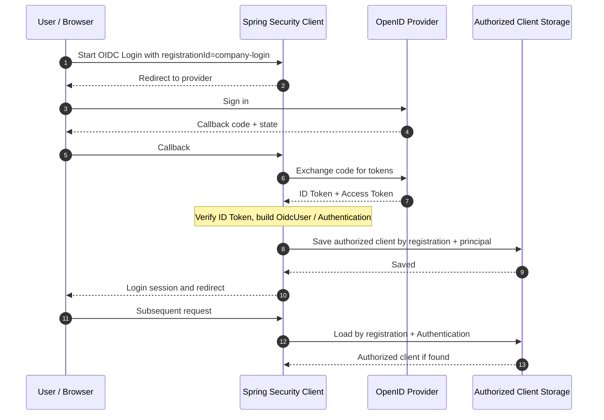
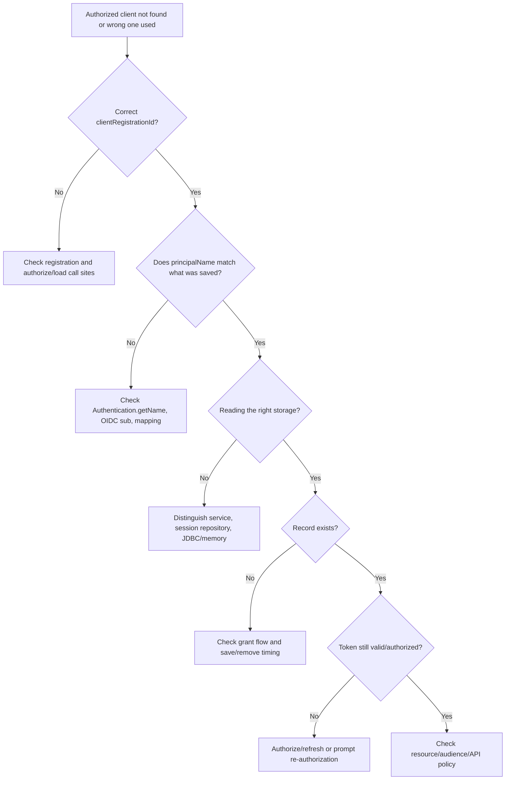

# 14.8. Lookup Key by Registration ID and Principal Name

In **Spring Security OAuth 2.0 / OpenID Connect (OIDC) Client**, after an application receives an access token from an Authorization Server, the framework needs to know **which client that token belongs to and which subject it is bound to** so it can find, use, refresh, or remove it later. That is the purpose of the key pair:

```text
(clientRegistrationId, principalName)
```

For example, an admin portal has two client registrations: `company-login` and `reports-api`. User Alice logs in, and the application is issued a token to call an API. If tokens were stored solely by username `alice`, the application could pick the wrong client's token; if stored solely by `registrationId`, Alice and Bob could accidentally use each other's tokens. **Combining both dimensions of information** separates the authorized clients Spring Security must manage.

This lesson explains how the lookup key is used in `OAuth2AuthorizedClientService`, the role of `OAuth2AuthorizedClientRepository` in Servlet applications, and how to choose a stable principal name across OIDC login, multiple providers, background jobs, or multi-instance deployments. The focus is on understanding **the identity used as the key**, rather than confusing it with `client-id`, `sub`, `registrationId`, session ID, or scope.

## 1. What Is an Authorized Client Object?

`OAuth2AuthorizedClient` represents a client registration **that has been authorized by an Authorization Server**. It holds key information:

- `ClientRegistration`: OAuth2 client registration containing `registrationId`, `clientId`, grant type, and provider details.
- `principalName`: the subject name to which the authorized client is attached within the application context.
- `accessToken`: the current access token, scopes, and expiration timestamp.
- `refreshToken`: the refresh token if issued by the provider and permitted to be stored by the application.

Conceptual model:

```text
OAuth2AuthorizedClient
  |
  +-- clientRegistration
  |     +-- registrationId = "reports-api"
  |     +-- clientId       = "portal-reports-client"
  |     +-- provider       = "company-idp"
  |
  +-- principalName = "employee-42"
  |
  +-- accessToken
  |     +-- scopes
  |     +-- issuedAt, expiresAt
  |     +-- tokenValue (SECRET)
  |
  +-- refreshToken (if present, SECRET)
```

**Note:** `OAuth2AuthorizedClient` is not `Authentication` or `OidcUser`. `Authentication` describes the currently authenticated subject in `SecurityContext`; `OAuth2AuthorizedClient` describes **an OAuth2 client's authorization** and the tokens usable to call downstream APIs.

### 1.1. Distinguishing Easily Confused Strings

| Value | Example | Meaning |
|---|---|---|
| `registrationId` | `company-login` | Application-internal key selecting `ClientRegistration`. |
| `clientId` | `portal-web-prod` | Client identifier issued by the Authorization Server. |
| `providerId` | `company` | Spring Boot provider configuration key, not the authorized client lookup key. |
| `principalName` | `employee-42` | Subject name under which Spring stores the authorized client. |
| OIDC `sub` | `employee-42` | Subject identifier issued by **one issuer** in the ID Token. |
| OIDC `iss` | `https://idp.example.org/realms/company` | The issuer asserting that subject. |
| Session ID | A cookie/session identifying a session | Browser and session state, not the standard key of `OAuth2AuthorizedClientService`. |
| Scope | `reports.read` | Requested/granted OAuth2 permission, not part of the default lookup key. |

In simple cases, `principalName` may equal OIDC `sub`. However, never assume the two values are always identical: `Authentication`'s name can be configured differently, such as via a user-name attribute or an internal user-linking mechanism.

## 2. Why Is a Composite Key Needed?

Consider an application with two client registrations and two users:

| `registrationId` | `principalName` | Corresponding Authorized Client/Token |
|---|---|---|
| `company-login` | `alice` | Token issued for Alice during the login flow. |
| `reports-api` | `alice` | Alice's token for the Reports API under this registration. |
| `company-login` | `bob` | Token issued for Bob during the login flow. |
| `reports-api` | `bob` | Bob's token for the Reports API. |

Two records can share a principal with different registrations, or share a registration with different principals. The (`registrationId`, `principalName`) pair distinguishes both cases.



**Do not** design a store with only one token per `registrationId` if the application uses tokens representing multiple users. Doing so can cause user A to mistakenly use user B's token—a critical security flaw.

Conversely, with `client_credentials`, the token usually represents **the client/service itself**, not an end user. In that scenario there is still a `principalName` as a technical key, representing a logical subject designated by the application rather than an OIDC subject.

## 3. OAuth2AuthorizedClientService: API Explicitly Showing Two Keys

`OAuth2AuthorizedClientService` is the abstraction to **save, load, and remove** authorized clients. Its key Servlet-side methods:

```java
<T extends OAuth2AuthorizedClient> T loadAuthorizedClient(
        String clientRegistrationId,
        String principalName);

void saveAuthorizedClient(
        OAuth2AuthorizedClient authorizedClient,
        Authentication principal);

void removeAuthorizedClient(
        String clientRegistrationId,
        String principalName);
```

The snippet above simplifies API signatures to highlight parameters. Note the difference:

- **`loadAuthorizedClient`** directly takes `clientRegistrationId` and `principalName`.
- **`removeAuthorizedClient`** also takes that exact pair.
- **`saveAuthorizedClient`** takes an `OAuth2AuthorizedClient` and an `Authentication`. The registration ID comes from the authorized client; the principal name used for saving must match the provided `Authentication`.

A record in the repository can be represented conceptually as:

```text
key:
    (client_registration_id = "company-login",
     principal_name = "employee-42")

value:
    access_token, access_token_type, token_scopes,
    access_token_issued_at, access_token_expires_at,
    refresh_token (if any), ...
```

`InMemoryOAuth2AuthorizedClientService` stores in process memory; `JdbcOAuth2AuthorizedClientService` is a JDBC-backed persistent implementation. Spring versions and configurations may allow other implementations; how data is preserved/synchronized depends on the service the application actually uses.

### 3.1. Example Reading the Current User's Authorized Client

In a Servlet controller, you can retrieve the principal name from the `Authentication` provided by Spring Security:

```java
import org.springframework.security.core.Authentication;
import org.springframework.security.oauth2.client.OAuth2AuthorizedClient;
import org.springframework.security.oauth2.client.OAuth2AuthorizedClientService;
import org.springframework.web.bind.annotation.GetMapping;
import org.springframework.web.bind.annotation.RestController;

@RestController
class ClientStatusController {

    private final OAuth2AuthorizedClientService authorizedClientService;

    ClientStatusController(OAuth2AuthorizedClientService service) {
        this.authorizedClientService = service;
    }

    @GetMapping("/internal/client-status")
    ClientStatus status(Authentication authentication) {
        String registrationId = "company-login";
        String principalName = authentication.getName();

        OAuth2AuthorizedClient client =
                authorizedClientService.loadAuthorizedClient(
                        registrationId, principalName);

        return new ClientStatus(
                registrationId,
                client != null,
                client != null ? client.getAccessToken().getExpiresAt() : null);
    }

    record ClientStatus(
            String registrationId,
            boolean authorized,
            java.time.Instant expiresAt) {}
}
```

This example is meant for a test environment or a protected internal endpoint. **Never return token values, refresh tokens, secrets, or the entire client object to the browser.** `loadAuthorizedClient(...)` only reads the record by key and does not guarantee the current access token is unexpired; token usage logic must evaluate expiration and proper re-authorization mechanisms.

An important caveat: in an application whose repository stores authorized clients **in the session** rather than via the service, reading `OAuth2AuthorizedClientService` directly may not find tokens even though login succeeded. Know which component stores the records before choosing a read API.

### 3.2. Example Removing an Authorized Client by Key

```java
String registrationId = "company-login";
String principalName = authentication.getName();

authorizedClientService.removeAuthorizedClient(
        registrationId, principalName);
```

This deletes the authorized client from **the invoked storage service**. It **does not automatically revoke the token at the Authorization Server**, clear the web session, or sign the user out of the OpenID Provider.

If the application requires logout, revocation, session invalidation, or severing downstream access, design each corresponding step. An issued token may remain valid until it expires or is revoked via a supported provider mechanism.

## 4. OAuth2AuthorizedClientRepository: Lookup Key in the HTTP Context

In Servlet apps, `OAuth2AuthorizedClientRepository` saves and loads authorized clients by **HTTP request, principal, and registration**. Its API looks like:

```java
<T extends OAuth2AuthorizedClient> T loadAuthorizedClient(
        String clientRegistrationId,
        Authentication principal,
        HttpServletRequest request);

void saveAuthorizedClient(
        OAuth2AuthorizedClient authorizedClient,
        Authentication principal,
        HttpServletRequest request,
        HttpServletResponse response);

void removeAuthorizedClient(
        String clientRegistrationId,
        Authentication principal,
        HttpServletRequest request,
        HttpServletResponse response);
```

Differences from `OAuth2AuthorizedClientService`:

| Characteristic | `OAuth2AuthorizedClientService` | `OAuth2AuthorizedClientRepository` |
|---|---|---|
| Scope | Authorized client storage service independent of Servlet requests | Storage/lookup within Servlet request/response context |
| Lookup inputs | `registrationId` + **`principalName`** (String) | `registrationId` + **`Authentication`** + `HttpServletRequest` |
| Usable outside web requests | Yes | Requires or must simulate matching HTTP context |
| Typical implementations | `InMemoryOAuth2AuthorizedClientService`, `JdbcOAuth2AuthorizedClientService` | `HttpSessionOAuth2AuthorizedClientRepository`, `AuthenticatedPrincipalOAuth2AuthorizedClientRepository` |
| Common usage | Service-tier client management, subject-scoped persistence | OAuth2 Login/authorization in Servlet web flows |

`AuthenticatedPrincipalOAuth2AuthorizedClientRepository` can delegate saving for authenticated principals to an `OAuth2AuthorizedClientService`, while using `HttpSessionOAuth2AuthorizedClientRepository` for anonymous cases depending on configuration. This is why many applications observe the `registrationId` + `principalName` key pair effect even when code calls the repository instead of the service.

**Not every repository stores using the same strategy.** When using `HttpSessionOAuth2AuthorizedClientRepository`, data is attached to the HTTP session; lookup by principal string in a database does not behave like `JdbcOAuth2AuthorizedClientService`. Understand the **exact repository** in use.

### 4.1. Example Lookup from an HTTP Request

```java
import jakarta.servlet.http.HttpServletRequest;
import org.springframework.security.core.Authentication;
import org.springframework.security.oauth2.client.OAuth2AuthorizedClient;
import org.springframework.security.oauth2.client.web.OAuth2AuthorizedClientRepository;

OAuth2AuthorizedClient client =
        authorizedClientRepository.loadAuthorizedClient(
                "company-login",
                authentication,
                httpServletRequest);
```

This illustrates a call when the objects are already present in the Servlet context. With a session-based repository, the outcome also depends on the session in `httpServletRequest`; with a service-based repository, the principal name and service storage become central.

### 4.2. Distinguishing Authorization Request Repository

Three easily confused concepts:

| Component | What Does It Store? | When Is It Used? |
|---|---|---|
| `OAuth2AuthorizationRequestRepository<OAuth2AuthorizationRequest>` | Original Authorization Request (including `state` and PKCE/OIDC data needed for callback) | **Before and during the callback** of the Authorization Code Flow |
| `OAuth2AuthorizedClientRepository` | Authorized client and tokens in HTTP request/session context | **After authorization is granted**, for web client accesses |
| `OAuth2AuthorizedClientService` | Authorized client in service storage by registration/principal | After authorization is granted, including contexts without a Servlet request |

By default, Servlet OAuth2 Login typically uses `HttpSessionOAuth2AuthorizationRequestRepository` for **authorization requests**. That is not `HttpSessionOAuth2AuthorizedClientRepository`, and certainly not the JDBC authorized client table. Losing `state` during callback and failing to find an access token after login are two completely different errors.

## 5. Where Does Principal Name Come From?

Normally `Authentication.getName()` is the name Spring Security exposes for the current principal. In an OIDC Login application, this name is usually drawn from `OidcUser.getName()`, which may default to the ID Token's `sub`; however, it can change if the application configures a different principal name.

```java
String principalName = authentication.getName();
Object principal = authentication.getPrincipal();

if (principal instanceof OidcUser oidcUser) {
    String subject = oidcUser.getIdToken().getSubject();
    String issuer = oidcUser.getIdToken().getIssuer().toString();

    // authentication.getName() may match subject,
    // but do not assume it always holds across all configs.
}
```

Values that can be chosen as principal name:

- **OIDC `sub`**: typically stable within an issuer's domain and well suited for single-provider OIDC Login.
- **A user-name attribute**: e.g., `preferred_username` or a provider-defined field; convenient for display but mutable.
- **Local user ID**: mapped from the external identity; requires a consistent `Authentication`/principal construction strategy.
- **Logical service principal**: e.g., `report-sync-job`, used in `client_credentials` when there is no browser user.

### 5.1. Why Is Choosing a Stable Principal Name Important?

Suppose on the first login:

```text
registrationId = company-login
principalName  = alice
```

The application saves the authorized client under `(company-login, alice)`. Later, the provider changes `preferred_username` to `alice.nguyen`, and the application has configured `Authentication.getName()` based on this attribute.

The next lookup uses:

```text
(company-login, alice.nguyen)
```

The store fails to find the old record **even though the token may still exist in storage**. Consequently, the user is forced to re-authorize, the old token becomes orphaned data, or the application must perform migration/cleanup.

Therefore, avoid using mutable attributes such as email, display name, or username as token storage keys without clear transformation and migration rules.

### 5.2. OIDC Subject Must Be Paired with Issuer

OIDC `sub` is only guaranteed unique within an issuer's scope. Two issuers can both emit:

```text
iss = https://idp.example.org/realms/staff
sub = 00042

iss = https://idp.partner.example.org/realms/partners
sub = 00042
```

Two subjects with the same string `00042` do not automatically belong to the same person. The (`iss`, `sub`) pair is a safer external identifier for internal account-linking workflows.

If each issuer always uses **a distinct registration ID**, the authorized client key pair `(registrationId, principalName)` can separate the two cases. However, if the application routes multiple issuers/tenants through one logical registration or merges logins itself, relying solely on `sub` as the principal name can cause **key collisions and token leakage**.

A sound design uses an `external_identity(issuer, subject) -> local_user_id` model, then determines the storage principal name using a consistent, validated, collision-free rule.

### 5.3. Be Careful When Changing the Name Attribute

In OAuth2/OIDC Login, an application can change the attribute used as the principal name via configuration or a custom principal. For example, reading a display name from `preferred_username` looks convenient, yet that value can change or fail to be unique.

Before changing the naming strategy in a running system:

1. Identify which names existing authorized clients are currently stored under.
2. Evaluate whether old tokens can be migrated to new keys or require re-login/re-authorization.
3. Ensure no two distinct users share the same principal name within the same registration.
4. Manage legacy tokens in the repository/service and cleanup/revocation procedures.
5. Synchronize updates across all `load`, `save`, `remove` call sites and authorized client managers.

Never alter `Authentication.getName()` by concatenating untrusted user data just to make tokens "easy to look up". It is a security-sensitive key.

## 6. JDBC: How Does the Key Pair Become a Record Key?

When using `JdbcOAuth2AuthorizedClientService`, storage typically resides in the `oauth2_authorized_client` table. In Spring Security's sample schema, the key columns look like:

```sql
CREATE TABLE oauth2_authorized_client (
    client_registration_id varchar(100) NOT NULL,
    principal_name varchar(200) NOT NULL,
    access_token_type varchar(100) NOT NULL,
    access_token_value blob NOT NULL,
    access_token_issued_at timestamp NOT NULL,
    access_token_expires_at timestamp NOT NULL,
    access_token_scopes varchar(1000) DEFAULT NULL,
    refresh_token_value blob DEFAULT NULL,
    refresh_token_issued_at timestamp DEFAULT NULL,
    created_at timestamp DEFAULT CURRENT_TIMESTAMP NOT NULL,
    PRIMARY KEY (client_registration_id, principal_name)
);
```

This is a **simulated schema to illustrate the key**; actual data types, lengths, columns, and DDL statements must be taken from your Spring Security version and target database. Never run this snippet verbatim in production without verifying the official schema and current migrations.

Composite key model:

```text
PRIMARY KEY (client_registration_id, principal_name)
                       |
             each registration + principal
             maps to at most one record
```

What matters is how uniqueness applies: one user across multiple registrations yields multiple rows; one registration across multiple principals yields multiple rows.

### 6.1. Security Impact of Key Design

If an app accidentally uses the same `principalName` for everyone—such as `"default-user"`—tokens can **overwrite** each other under the same registration, creating the risk of one user using another user's token.

If an app uses email as the principal name and an email address is reassigned to someone else, old token records under that email could be retrieved mistakenly when the new user signs in with that name. Key selection must rely on verified, stable, and unique identity within the registration's domain.

Storage holding access tokens and refresh tokens contains **sensitive data**. Enforce database access controls, encryption per policy, backup/log restrictions, service account protection, and deletion plans for unneeded data. A composite key ensures looking up the right record, yet by itself does not protect token contents if the database is breached.

### 6.2. Lifecycle Differences Between InMemory and JDBC

| Criterion | `InMemoryOAuth2AuthorizedClientService` | `JdbcOAuth2AuthorizedClientService` |
|---|---|---|
| Storage location | Memory inside one process | Configured database |
| After restart | Usually loses data | Can retain data if database preserves it |
| Multi-instance | Each instance has its own store unless synchronized | Instances can share data |
| Lookup by key pair | Yes | Yes |
| Token/backup governance | In memory, process-dependent | Requires DB, backup, encryption, privilege policies |
| Concurrency considerations | Yes, within process scope | Yes, especially for concurrent refresh/update across instances |

A shared JDBC store does not automatically solve all multi-instance issues. Concurrent requests can simultaneously detect an expired token and run refreshes; evaluate retry strategies, optimistic locking/serialization, or provider-compliant failure handling under high load.

## 7. Using AuthorizedClientManager for Lookup and Re-Authorization

Reading `OAuth2AuthorizedClientService` directly is useful when querying a record, yet real application flows typically need to **acquire or refresh tokens**. `OAuth2AuthorizedClientManager` exposes the authorize API and coordinates with `OAuth2AuthorizedClientProvider` instances to handle configured grants.

For service-tier workloads or background jobs without an `HttpServletRequest`, the appropriate choice is usually `AuthorizedClientServiceOAuth2AuthorizedClientManager`.

### 7.1. Client Credentials Example for a Background Job

`application.yml`:

```yaml
spring:
  security:
    oauth2:
      client:
        registration:
          inventory-service:
            provider: company
            client-id: "${INVENTORY_CLIENT_ID}"
            client-secret: "${INVENTORY_CLIENT_SECRET}"
            client-authentication-method: client_secret_basic
            authorization-grant-type: client_credentials
            scope:
              - inventory.read
        provider:
          company:
            token-uri: "https://idp.example.org/realms/company/protocol/openid-connect/token"
```

Authorized client manager bean:

```java
import org.springframework.context.annotation.Bean;
import org.springframework.context.annotation.Configuration;
import org.springframework.security.oauth2.client.AuthorizedClientServiceOAuth2AuthorizedClientManager;
import org.springframework.security.oauth2.client.OAuth2AuthorizedClientManager;
import org.springframework.security.oauth2.client.OAuth2AuthorizedClientProvider;
import org.springframework.security.oauth2.client.OAuth2AuthorizedClientProviderBuilder;
import org.springframework.security.oauth2.client.OAuth2AuthorizedClientService;
import org.springframework.security.oauth2.client.registration.ClientRegistrationRepository;

@Configuration
class BackgroundOAuth2Config {

    @Bean
    OAuth2AuthorizedClientManager backgroundAuthorizedClientManager(
            ClientRegistrationRepository registrations,
            OAuth2AuthorizedClientService authorizedClientService) {

        OAuth2AuthorizedClientProvider provider =
                OAuth2AuthorizedClientProviderBuilder.builder()
                        .clientCredentials()
                        .build();

        var manager = new AuthorizedClientServiceOAuth2AuthorizedClientManager(
                registrations, authorizedClientService);

        manager.setAuthorizedClientProvider(provider);
        return manager;
    }
}
```

In the background job:

```java
import org.springframework.security.oauth2.client.OAuth2AuthorizeRequest;
import org.springframework.security.oauth2.client.OAuth2AuthorizedClient;
import org.springframework.security.oauth2.client.OAuth2AuthorizedClientManager;

OAuth2AuthorizeRequest request = OAuth2AuthorizeRequest
        .withClientRegistrationId("inventory-service")
        .principal("service:inventory-import")
        .build();

OAuth2AuthorizedClient authorized = manager.authorize(request);
if (authorized == null) {
    throw new IllegalStateException(
            "No authorized client for inventory-service");
}

// Pass the access token only to authorized APIs; never log tokenValue.
String tokenValue = authorized.getAccessToken().getTokenValue();
```

`manager` is an injected `OAuth2AuthorizedClientManager` instance; the example shows how to invoke it in the job/service layer. `tokenValue` should be used inside a controlled HTTP client calling the proper Resource Server; never return it to the browser or log it.

Here the logical key is:

```text
registrationId = "inventory-service"
principalName  = "service:inventory-import"
```

There is no end-user OIDC subject because `client_credentials` does not represent a signed-in user. `principal("service:inventory-import")` is simply a logical subject name so the manager and service can locate the record across runs.

### 7.2. Why Must a Job's Principal Name Be Consistent?

If the first run uses `"service:inventory-import"` while the second run uses `"job-2026-11-16-001"`, the service looks up **two different keys**. That creates multiple records/tokens for the same client instead of reusing the appropriate authorized client.

Pick a stable, semantically clear name defined in one place. Avoid embedding timestamps, request IDs, or random UUIDs into the principal name unless deliberately isolating tokens.

However, **never share a service principal across two contexts with different isolation requirements** merely to reduce token endpoint calls. If tokens differ in permissions, environment, tenant, or owner, partition those contexts properly by registration and principal in accordance with system policy.

### 7.3. Distinguishing Web Manager and Service Manager

| Manager | Suitable Context | Typical Storage Source |
|---|---|---|
| `DefaultOAuth2AuthorizedClientManager` | Servlet web request with `HttpServletRequest` and `HttpServletResponse` | `OAuth2AuthorizedClientRepository` |
| `AuthorizedClientServiceOAuth2AuthorizedClientManager` | Service/background job independent of Servlet requests | `OAuth2AuthorizedClientService` |

Do not switch to a non-web service manager and expect tokens stored in an HTTP session to automatically appear in service storage. If two components use different repositories/services, they may not see the same authorized client even when supplying identical `registrationId` and principal name.

For the authorization-code flow, the manager may need to redirect the user via browser to obtain an initial grant; a background job without a browser cannot generate a user authorization code merely by calling `authorize(...)`. Choose the grant type matching your application model.

## 8. OIDC Login: Principal Name and Authorized Client

In a Servlet OIDC flow:



In a single-provider example, the default principal name may come from OIDC `sub`; yet the application must still use **the actual value used by security context/authorized client storage**, instead of guessing from email or an arbitrary claim.

### 8.1. Obtaining the Authorized Client via Argument Resolver

In a Servlet controller, Spring Security supports `@RegisteredOAuth2AuthorizedClient`:

```java
import org.springframework.security.oauth2.client.OAuth2AuthorizedClient;
import org.springframework.security.oauth2.client.annotation.RegisteredOAuth2AuthorizedClient;
import org.springframework.web.bind.annotation.GetMapping;
import org.springframework.web.bind.annotation.RestController;

@RestController
class ReportsController {

    @GetMapping("/reports/client-info")
    String clientInfo(
            @RegisteredOAuth2AuthorizedClient("reports-api")
            OAuth2AuthorizedClient client) {

        return "registration="
                + client.getClientRegistration().getRegistrationId();
    }
}
```

This example requests the authorized client for `reports-api` in the current request context; this registration must actually be configured and the user must have gone through the required authorization. The annotation integrates with Spring's authorized client resolution/authorization mechanism; behavior when no client exists yet also depends on grant type and configuration.

Do not assume that because a user logged in via `company-login`, registration `reports-api` automatically has a token. The two registrations are two distinct key values.

### 8.2. When Changing the Principal Name After Login

An application may use a custom `OidcUserService` or `GrantedAuthoritiesMapper`. Mapping authorities does not necessarily alter `Authentication.getName()`; however, changing `OidcUser`'s name attribute or changing the principal type can change the lookup key.

If a service stores tokens under principal `employee-42` while a controller looks up `alice@example.org`, the lookup will fail to find the record. Align the principal strategy at **both the save site and the token usage site** rather than fixing it by grabbing any token matching the client ID for the current request.

## 9. When One User Has Multiple Providers or Multiple Tenants

An application may support:

```text
/oauth2/authorization/corporate
/oauth2/authorization/partner
```

The two registrations typically point to two different issuers. Table:

| registrationId | principalName | Source Identity | Authorized Client |
|---|---|---|---|
| `corporate` | `user-42` | `(issuer=corporate, sub=user-42)` | Corporate token |
| `partner` | `user-42` | `(issuer=partner, sub=user-42)` | Partner token |

Key pairs with different registrations can tell the two authorized clients apart. However, in a system that needs to **link one local user to multiple external identities**, never rely solely on `principalName` to conclude two rows belong to the same person. Use an explicit internal identity-mapping mechanism.

### 9.1. When Tenant Needs to Be Part of the Key Model

If multiple tenants share a logical registration with overlapping principal strings, the key pair risks failing to separate authorization domains. Design partitioning properly:

- Dedicated registration IDs per tenant/provider when policy requires.
- A principal name constructed from an internal ID that is **verified and unique** across the storage domain.
- Per-tenant isolated stores with appropriate isolation where architecture supports it.
- An identity-mapping layer from (`issuer`, `subject`) to local user and tenant.

Never take `tenantId` from a browser-supplied query parameter and concatenate it directly into the principal name to decide which token to retrieve. Tenant and identity must be verified by server policy.

### 9.2. Normalizing and Encoding Principal Names

If the application wants to combine issuer and subject into one string, use an **unambiguous** representation, such as a stable internal identity ID. Naive concatenation:

```java
// Prone to ambiguity without escaping/encoding conventions:
String principalName = issuer + ":" + subject;
```

can run into issues if components contain delimiter characters or change format. A more manageable approach is storing (`issuer`, `subject`) in an external identity table and using an **immutable local user ID** as the application key, if your security context architecture permits. Never alter the principal key of a live system without a migration plan.

## 10. Errors When Looking Up an Authorized Client

| Symptom | Possible Cause | How to Diagnose |
|---|---|---|
| `loadAuthorizedClient(...)` returns `null` | Wrong `registrationId`, wrong `principalName`, token never saved, or different storage | Compare keys at save/load, repository/service type, and grant flow. |
| Just logged in yet service cannot find token | Authorized client was stored in HTTP session repository, not that service | Check `OAuth2AuthorizedClientRepository` and actual implementation. |
| User changes name/email and loses old token | Principal name used a mutable attribute | Pick a stable name; plan migration/reauthorization. |
| Two users accidentally use each other's tokens | Shared principal name or lookup not bound to actual user | Review key strategy, issuer/tenant isolation, and storage access controls. |
| Background job keeps fetching new tokens | New principal generated each run, or client/service storage does not persist across runs | Use a stable logical principal and appropriate persistence. |
| Restart loses authorized clients | Stored via InMemory service | Use persistence if tokens must survive restarts; protect refresh tokens. |
| Multi-instance fails to find tokens | Instances use separate memory/session stores | Use shared storage/session or a consistent architectural model. |
| Access token is expired despite successful load | `load` only fetches the record; it does not ensure token validity | Use authorized client manager to reauthorize/refresh per configuration. |
| After removing client, token still calls APIs | `removeAuthorizedClient` only deletes local storage | Use revocation/provider logout if supported and required. |
| One client has multiple tokens for the same user | Multiple registration IDs or inconsistent principal names | Check registration list and identity mapping. |
| Token sent to API returns 401/403 | Wrong audience/scope, revoked token, wrong registration or user | Inspect API contract and selected token, not just storage keys. |
| Refresh token remains in database after logout | Session logout does not integrate cleanup/revocation on the right store | Design logout policy, authorized client deletion, and token revocation accordingly. |

### 10.1. Step-by-Step Debugging Flow



Diagnosis should begin with **registration name, storage type, and principal naming strategy**, never by dumping access tokens. When debugging production, log only approved technical identifiers, transaction/correlation IDs, and record presence flags; never log tokens or sensitive data.

## 11. Security Considerations When Designing Keys

### 11.1. The Key Pair Is Not the Sole Authorization Mechanism

Merely knowing (`registrationId`, `principalName`) should never cause a service to return tokens to any caller supplying those two strings. The application must bind requests to a **verified `Authentication`**, API call permissions, and authorized client ownership logic.

Specifically, never build an endpoint like:

```java
// UNSAFE: lets the browser arbitrarily choose principalName to fetch a token.
@GetMapping("/tokens")
String token(@RequestParam String registrationId,
             @RequestParam String principalName) {
    OAuth2AuthorizedClient client =
            service.loadAuthorizedClient(registrationId, principalName);
    return client.getAccessToken().getTokenValue();
}
```

This example both allows accessing another user's token without authorization and leaks the access token. **Never use such a pattern in real applications.** The backend should obtain the principal from a verified security context/service source and keep tokens on the server.

### 11.2. Principles for Safeguarding Tokens

- Grant read/write access on the token store only to required components; separate database admin duties.
- Never let client secrets, access tokens, refresh tokens, or Authorization headers appear in logs/responses.
- Consider encrypting tokens at rest, protecting backups, and establishing key rotation procedures.
- Apply policies to delete unneeded authorized clients and revoke tokens when supported by the provider.
- In multi-tenant systems, enforce tenant isolation across registrations, principals, and storage.
- Never use display names, emails, or frontend parameters as principal keys without normalization and verification.
- For tokens with sensitive scopes/audiences, never share authorized clients across jobs or users solely because they share a registration ID.

### 11.3. When Should Tokens Be Stored in the Session?

A small web app can use a session repository to keep authorized clients aligned with the session lifecycle; suitable when sessions are tightly managed. However, when the application needs background jobs, multiple instances, cross-request reauthorization, or persistence across restarts, evaluate an appropriate service storage and manager.

Do not pick JDBC just because you "want tokens to live forever": refresh tokens have their own lifetimes and revocation policies, while retaining tokens too long increases credential exposure risk. Design retention according to business needs and provider policies.

## 12. Reactive WebFlux: Same Key Idea, Different APIs

In Spring WebFlux, `ReactiveOAuth2AuthorizedClientService` and `ServerOAuth2AuthorizedClientRepository` serve similar purposes using Reactor.

| Servlet | Reactive |
|---|---|
| `OAuth2AuthorizedClientService` | `ReactiveOAuth2AuthorizedClientService` |
| `OAuth2AuthorizedClientRepository` | `ServerOAuth2AuthorizedClientRepository` |
| `OAuth2AuthorizedClientManager` | `ReactiveOAuth2AuthorizedClientManager` |
| `AuthorizedClientServiceOAuth2AuthorizedClientManager` | `AuthorizedClientServiceReactiveOAuth2AuthorizedClientManager` |
| `HttpServletRequest` | `ServerWebExchange` |

The Reactive service has a corresponding API:

```java
Mono<OAuth2AuthorizedClient> clientMono =
        reactiveAuthorizedClientService.loadAuthorizedClient(
                "company-login", principalName);
```

The Reactive repository uses `Authentication` and `ServerWebExchange` in the reactive server context. When no client is found, the result can be `Mono.empty()` rather than `null` as in synchronous APIs.

Never call `block()` on the WebFlux event loop to use a Servlet service; doing so can stall or block the application. Choose the manager, repository, and HTTP client matching the reactive stack.

Conceptually, **registration ID and principal name remain the two dimensions separating authorized clients**. Issues of principal stability, multi-issuer identification, privacy, and tenant isolation apply equally on WebFlux.

## 13. Comprehensive Scenario: BFF, Two Users, and One Background Worker

Suppose a system has:

- `company-login`: OIDC sign-in for employees via browser.
- `reports-api`: authorization code client using the employee's token to call the Reports API.
- `inventory-service`: client credentials for a background worker.

Stored authorized clients:

```text
("company-login",    "employee-42")         -> login tokens
("reports-api",      "employee-42")         -> delegated reports token
("company-login",    "employee-99")         -> login tokens
("reports-api",      "employee-99")         -> delegated reports token
("inventory-service","service:inventory")   -> service access token
```

In this scenario:

1. Employee 42 must not receive Employee 99's token: same registration, different principal.
2. For Employee 42, the `company-login` token must not be treated as the `reports-api` token: different registration.
3. The background worker has no `OidcUser`; it uses a stable logical `principalName` to look up its `client_credentials` token.
4. When an employee changes email, the authorized client should not be lost due to key drift if the system uses a stable subject or local user ID.
5. If the application adds tenants, ensure key pairs do not collide across tenants and prevent users/workers from retrieving tokens outside their ownership domain.
6. Loaded tokens must still be checked for expiry and permissions: retrieving the right record does not mean the access token will be accepted by the API.

### 13.1. System Design Checklist

Before building an authorized client store, the engineering team should align on:

1. How are registration IDs named and managed across environments, providers, and tenants?
2. Does `principalName` come from `Authentication.getName()`, OIDC `sub`, local user ID, or a service principal?
3. Is there a strategy to prevent collisions and handle principal name changes?
4. Are authorized clients stored in session, memory, JDBC, or a custom store?
5. Must they be shared across instances or used outside HTTP requests?
6. Which service/manager performs token acquisition and refresh?
7. On logout, permission revocation, or client secret rotation, who handles cleanup and revocation?
8. How is access to storage controlled and how are tokens protected?

## 14. Review Questions

1. Why can using only `registrationId` or only `principalName` as an authorized client key cause bugs?
2. Is `clientId` part of `OAuth2AuthorizedClientService`'s lookup key pair? Why or why not?
3. What parameters do `loadAuthorizedClient` and `removeAuthorizedClient` accept? How does `saveAuthorizedClient` use `Authentication`?
4. Why does `OAuth2AuthorizedClientRepository` take `HttpServletRequest` while `OAuth2AuthorizedClientService` does not?
5. How do `HttpSessionOAuth2AuthorizationRequestRepository` and `HttpSessionOAuth2AuthorizedClientRepository` differ in timing and stored data?
6. When `OidcUser.getName()` changes from `sub` to email, what can happen to existing stored authorized clients?
7. Why must multi-issuer applications distinguish `(iss, sub)` instead of relying solely on `sub`?
8. Why must a background job using `client_credentials` still specify a `principalName` even without an end user?
9. Does calling `removeAuthorizedClient` revoke the access token at the Authorization Server and automatically log out the browser?
10. Why might an authorized client present in JDBC still fail to call the Reports API?

## References

- [Spring Security Reference — OAuth2 Client (Servlet)](https://docs.spring.io/spring-security/reference/servlet/oauth2/client/index.html)
- [Spring Security Reference — OAuth2 Client Core Model (Servlet)](https://docs.spring.io/spring-security/reference/servlet/oauth2/client/core.html)
- [Spring Security Reference — OAuth2 Client (Reactive)](https://docs.spring.io/spring-security/reference/reactive/oauth2/client/index.html)
- [Spring Security API — OAuth2AuthorizedClient](https://docs.spring.io/spring-security/reference/api/java/org/springframework/security/oauth2/client/OAuth2AuthorizedClient.html)
- [Spring Security API — OAuth2AuthorizedClientService](https://docs.spring.io/spring-security/reference/api/java/org/springframework/security/oauth2/client/OAuth2AuthorizedClientService.html)
- [Spring Security API — OAuth2AuthorizedClientRepository](https://docs.spring.io/spring-security/reference/api/java/org/springframework/security/oauth2/client/web/OAuth2AuthorizedClientRepository.html)
- [Spring Security API — AuthorizedClientServiceOAuth2AuthorizedClientManager](https://docs.spring.io/spring-security/reference/api/java/org/springframework/security/oauth2/client/AuthorizedClientServiceOAuth2AuthorizedClientManager.html)
- [Spring Security API — JdbcOAuth2AuthorizedClientService](https://docs.spring.io/spring-security/reference/api/java/org/springframework/security/oauth2/client/JdbcOAuth2AuthorizedClientService.html)
- [Spring Security API — ReactiveOAuth2AuthorizedClientService](https://docs.spring.io/spring-security/reference/api/java/org/springframework/security/oauth2/client/ReactiveOAuth2AuthorizedClientService.html)
- [OpenID Connect Core 1.0 — ID Token subject identifier](https://openid.net/specs/openid-connect-core-1_0.html#IDToken)
