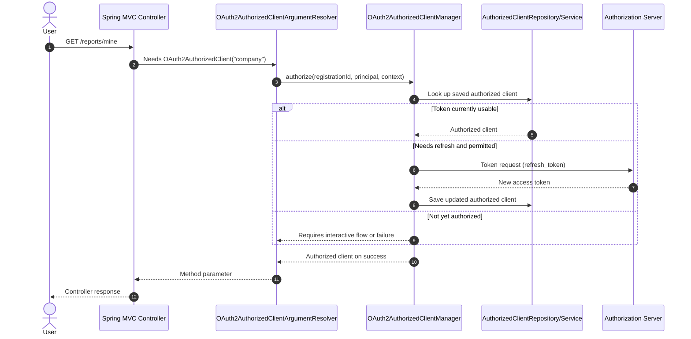

# 14.10. @RegisteredOAuth2AuthorizedClient in Servlet Controllers

When a Spring MVC application signs users in with OAuth 2.0 or OpenID Connect (OIDC), after login succeeds, the application often needs to call an API on the user's behalf. For example, a user signs in via SSO and opens the `/dashboard` page; the backend must call a profile API or business API using **the access token issued for the right client registration and current user**.

In Spring Security OAuth 2.0 Client on the **Servlet stack**, the **`@RegisteredOAuth2AuthorizedClient`** annotation lets a controller receive an **`OAuth2AuthorizedClient`** directly as a method parameter instead of manually reading the session or querying a token store.

Shortest example:

```java
@GetMapping("/account")
String account(
        @RegisteredOAuth2AuthorizedClient("company")
        OAuth2AuthorizedClient authorizedClient) {

    String registrationId =
        authorizedClient.getClientRegistration().getRegistrationId();

    // The access token is in authorizedClient.getAccessToken().
    // Only use the token to call an API with matching permissions.
    return "account";
}
```

This lesson explains how the annotation works in Spring MVC, how to distinguish **ClientRegistration**, **OAuth2AuthorizedClient**, **principal**, and **tokens**, how it pairs with `oauth2Login()`/`oauth2Client()`, API-calling examples, handling missing authorizations or expired tokens, and security risks.

> Scope: **Spring Boot 3.x / Spring Security 6.x, Servlet (Spring MVC)** applications. Classes and mechanisms can be refined across versions; when working with a specific version, check its accompanying API. Hosts like `example.test` are illustrative only.

## 1. What Is an Authorized Client?

In OAuth 2.0, **ClientRegistration** describes an application registered with an Authorization Server. It includes the client ID, client authentication method, grant type, redirect URI, scopes, and provider details.

Once a client has been issued tokens successfully, Spring Security represents the result with **`OAuth2AuthorizedClient`**.

An authorized client binds together three parts:

```text
ClientRegistration
    +
Principal name (authorized context)
    +
Access token, and optionally Refresh token
    =
OAuth2AuthorizedClient
```

Common methods:

| API | Returned Value | Meaning |
| --- | --- | --- |
| `getClientRegistration()` | `ClientRegistration` | Which client and provider were used |
| `getPrincipalName()` | `String` | The principal name the authorized client is bound to |
| `getAccessToken()` | `OAuth2AccessToken` | Token used to access the Resource Server |
| `getRefreshToken()` | `OAuth2RefreshToken` or `null` | Token usable when issued to obtain a new access token |

From `OAuth2AccessToken`, you can read:

```java
OAuth2AccessToken accessToken = authorizedClient.getAccessToken();

String tokenValue = accessToken.getTokenValue();
Set<String> scopes = accessToken.getScopes();
Instant issuedAt = accessToken.getIssuedAt();
Instant expiresAt = accessToken.getExpiresAt();
```

**`tokenValue` is a secret bearer credential.** Never print it in logs, HTML, JSON APIs returned to the browser, metrics, or exceptions. The presence of `OAuth2AuthorizedClient` on the backend does not mean the frontend should receive the token.

### 1.1. Distinguishing Four Important Objects

| Object | Question It Answers | Example |
| --- | --- | --- |
| **`ClientRegistration`** | How is this application registered with the OP/AS? | `registrationId="company"` |
| **`OAuth2AuthorizedClient`** | Which tokens has this registration received in which principal's context? | `company + alice + access token` |
| **`Authentication`** | Which user/subject did the current request authenticate? | `OAuth2AuthenticationToken` |
| **`OidcUser`** | Which identity did OIDC verify and which claims were returned? | `sub`, `iss`, `email` |

**`OidcUser` is not `OAuth2AuthorizedClient`.** One represents the signed-in principal; the other holds tokens bound to a client registration. Therefore, when calling an API with an access token, the dedicated authorized-client annotation is more appropriate than looking for a token inside `OidcUser`.

## 2. What Does @RegisteredOAuth2AuthorizedClient Do?

The annotation resides in package:

```java
import org.springframework.security.oauth2.client.annotation.RegisteredOAuth2AuthorizedClient;
```

And is typically placed on an `OAuth2AuthorizedClient` parameter of an MVC handler method:

```java
@GetMapping("/dashboard")
ResponseEntity<?> dashboard(
    @RegisteredOAuth2AuthorizedClient("company")
    OAuth2AuthorizedClient client) {
    // ...
}
```

When Spring MVC prepares to invoke the handler, an **argument resolver** provided by Spring Security looks up or performs authorization for the authorized client matching `registrationId` and the current principal, per the application's supporting configuration.

Key points:

- The annotation **does not contain an access token**. The string `company` is a **registration ID**, not a bearer token value.
- Spring MVC **does not mint tokens by reflection**; it delegates to Spring Security's OAuth2 Client infrastructure.
- The authorized client is retrieved or created through the appropriate manager/repository/service mechanism and the grant type the client is allowed to use.
- If user interaction is required to grant access, the framework may initiate an authorization flow or be unable to complete the current controller request.
- The resolver is not a mechanism for decoding ID Tokens or checking business roles; those belong to other parts of Spring Security.

### 2.1. MVC Argument Resolution Diagram

```mermaid
flowchart TD
    A["Browser GET /dashboard"] --> B["Servlet filter chain"]
    B --> C["SecurityContext / Authentication"]
    C --> D["DispatcherServlet selects MVC handler"]
    D --> E["Method parameter:<br/>@RegisteredOAuth2AuthorizedClient(\"company\")"]
    E --> F["OAuth2AuthorizedClientArgumentResolver"]
    F --> G["OAuth2AuthorizedClientManager / client storage"]
    G --> H{"Valid authorized client?"}
    H -->|Yes| I["Pass OAuth2AuthorizedClient to controller"]
    H -->|Needs authorize/refresh| J["AuthorizedClientProvider and OAuth2 flow"]
    J --> K{"Can complete?"}
    K -->|Yes| I
    K -->|No| L["Redirect/exception or authorization failure"]
    I --> M["Controller calls the right Resource Server"]
```

This diagram illustrates logical responsibilities. Exact details when the manager needs to re-authorize depend on the grant type, user state, authorization request repository, filter chain, and Spring Security version. Do not assume every failure delivers `null` to the handler or every controller invocation triggers an HTTP redirect.

## 3. Why Is the Annotation Better Than Manually Reading Tokens from Session?

Without the annotation, a controller might attempt to:

1. Extract username from `SecurityContext`.
2. Build a `clientRegistrationId` string manually.
3. Read the HTTP session.
4. Query a separate token store.
5. Manually handle expired tokens and refresh tokens.

That approach is error-prone because a user can have multiple OAuth2 client registrations, tokens must bind to the exact principal, and refresh lifecycles depend on Authorization Server policies.

With the annotation, the controller simply declares a **dependency**:

```java
@RegisteredOAuth2AuthorizedClient("company")
OAuth2AuthorizedClient authorizedClient
```

The framework handles authorized client management per configuration; the controller focuses on business logic using the token.

**However:** the controller must still enforce the application's own authorization, choose **the right downstream API**, and handle errors from that API. No annotation turns any bearer token into unrestricted access.

## 4. Configuring Spring Boot OAuth2/OIDC Client

### 4.1. Dependencies

With Maven:

```xml
<dependencies>
    <dependency>
        <groupId>org.springframework.boot</groupId>
        <artifactId>spring-boot-starter-web</artifactId>
    </dependency>
    <dependency>
        <groupId>org.springframework.boot</groupId>
        <artifactId>spring-boot-starter-security</artifactId>
    </dependency>
    <dependency>
        <groupId>org.springframework.boot</groupId>
        <artifactId>spring-boot-starter-oauth2-client</artifactId>
    </dependency>
</dependencies>
```

`spring-boot-starter-web` builds a Servlet MVC application; `spring-boot-starter-oauth2-client` provides client configuration, OAuth2 Login, and authorized client infrastructure.

### 4.2. Client Registration in application.yml

```yaml
spring:
  security:
    oauth2:
      client:
        registration:
          company:
            provider: company
            client-id: ${OIDC_CLIENT_ID}
            client-secret: ${OIDC_CLIENT_SECRET}
            authorization-grant-type: authorization_code
            redirect-uri: "{baseUrl}/login/oauth2/code/{registrationId}"
            scope:
              - openid
              - profile
              - email
              - profile.read

        provider:
          company:
            issuer-uri: https://id.example.test/realms/company
```

This configuration illustrates a `company` registration with Authorization Code Flow + OIDC. It assumes the OP supports the listed scopes; `profile.read` is an illustrative API scope name, not a default OIDC scope.

How values map to the annotation:

```text
registration:
  company:             <-- @RegisteredOAuth2AuthorizedClient("company")
    client-id: ...      <-- Actual ID issued by OP, may differ from "company"
    ...
```

If configured under key `company-oidc`, the annotation must use `"company-oidc"`, not a display name like `Company SSO` or the `client-id` value.

### 4.3. SecurityFilterChain for Servlet Login

```java
import org.springframework.context.annotation.Bean;
import org.springframework.context.annotation.Configuration;
import org.springframework.security.config.Customizer;
import org.springframework.security.config.annotation.web.builders.HttpSecurity;
import org.springframework.security.web.SecurityFilterChain;

@Configuration
class SecurityConfig {

    @Bean
    SecurityFilterChain securityFilterChain(HttpSecurity http) throws Exception {
        return http
            .authorizeHttpRequests(auth -> auth
                .requestMatchers("/", "/error", "/public/**").permitAll()
                .anyRequest().authenticated())
            .oauth2Login(Customizer.withDefaults())
            .oauth2Client(Customizer.withDefaults())
            .build();
    }
}
```

- **`oauth2Login()`** initiates/completes login via OAuth2 or OIDC and establishes `Authentication` for the browser session.
- **`oauth2Client()`** enables OAuth2 Client authorization support in the filter chain per configuration.
- **`anyRequest().authenticated()`** protects controller endpoints so only authenticated users can call them.

Depending on Boot version and config, OAuth2 Client components may be auto-configured when `oauth2Login()` is enabled; declaring both in the example highlights that the application both signs users in and uses authorized clients to call APIs.

**You do not need to write a callback controller** for `/login/oauth2/code/company`. In the default setup, a Spring Security filter handles the authorization response.

### 4.4. Initiating Login

The user navigates to:

```text
/oauth2/authorization/company
```

The OP authenticates and redirects the browser back to the default callback:

```text
/login/oauth2/code/company?code=...&state=...
```

After exchanging the code for tokens and completing OIDC verification, Spring Security creates `Authentication` and saves the authorized client via the appropriate repository/service mechanism. When the user hits a controller with the annotation, the resolver can retrieve this authorized client.

## 5. Controller Examples Accessing the Authorized Client

### 5.1. Reading Safe Metadata Only

An illustrative endpoint:

```java
import java.time.Instant;
import java.util.Map;

import org.springframework.security.oauth2.client.OAuth2AuthorizedClient;
import org.springframework.security.oauth2.client.annotation.RegisteredOAuth2AuthorizedClient;
import org.springframework.web.bind.annotation.GetMapping;
import org.springframework.web.bind.annotation.RestController;

@RestController
class AuthorizedClientInfoController {

    @GetMapping("/client/status")
    Map<String, Object> status(
            @RegisteredOAuth2AuthorizedClient("company")
            OAuth2AuthorizedClient authorizedClient) {

        String registrationId =
            authorizedClient.getClientRegistration().getRegistrationId();

        Instant expiresAt =
            authorizedClient.getAccessToken().getExpiresAt();

        return Map.of(
            "registrationId", registrationId,
            "accessTokenPresent", true,
            "expiresAt", expiresAt == null ? "unknown" : expiresAt.toString()
        );
    }
}
```

**Never return `authorizedClient` directly as JSON.** This object contains the access token and may contain a refresh token. Include only necessary metadata approved for exposure. Diagnostic endpoints like the one above should be protected by policy, never left public by default.

`expiresAt` shows how long the token remains valid, yet **it is not a token refresh mechanism**. Controllers should let the authorized client manager infrastructure perform refreshes per configuration, rather than building manual refresh loops calling the token endpoint from an MVC handler.

### 5.2. Reading the Principal Simultaneously

You can receive both `OidcUser` and `OAuth2AuthorizedClient`:

```java
import java.util.Map;

import org.springframework.security.core.annotation.AuthenticationPrincipal;
import org.springframework.security.oauth2.client.OAuth2AuthorizedClient;
import org.springframework.security.oauth2.client.annotation.RegisteredOAuth2AuthorizedClient;
import org.springframework.security.oauth2.core.oidc.user.OidcUser;
import org.springframework.web.bind.annotation.GetMapping;
import org.springframework.web.bind.annotation.RestController;

@RestController
class AccountController {

    @GetMapping("/account/me")
    Map<String, Object> me(
            @AuthenticationPrincipal OidcUser principal,
            @RegisteredOAuth2AuthorizedClient("company")
            OAuth2AuthorizedClient client) {

        return Map.of(
            "subject", principal.getSubject(),
            "registrationId",
                client.getClientRegistration().getRegistrationId(),
            "authorizedClientPrincipal", client.getPrincipalName()
        );
    }
}
```

In this technical example, returning `subject` illustrates the relationship. In production, exposing user identifiers and principal names must comply with privacy/API policies; do not return that data if the frontend does not use it.

Note that `OidcUser.getSubject()` is an OIDC claim within the issuer's namespace, whereas `OAuth2AuthorizedClient.getPrincipalName()` is the principal name the authorized client is bound to. **Do not assume the two strings are always identical**: the principal name can be configured differently. Binding the authorized client to the current `Authentication` is managed by Spring Security infrastructure.

## 6. Complete Example: Controller Calling a Resource Server with the Access Token

A common flow is a web app signing in via an OP and using the token to call a profile API:

```text
Browser --> Spring MVC /reports
              |
              | @RegisteredOAuth2AuthorizedClient("company")
              v
        OAuth2AuthorizedClient
              |
              | Bearer access token
              v
        Resource Server /api/reports
              |
              v
           Response
```

### 6.1. API-Calling Service

Separate the HTTP client from the MVC controller for maintainability:

```java
import org.springframework.http.HttpHeaders;
import org.springframework.stereotype.Service;
import org.springframework.web.client.RestClient;

@Service
class ReportApiClient {

    private final RestClient restClient;

    ReportApiClient(RestClient.Builder builder) {
        this.restClient = builder
            .baseUrl("https://api.example.test")
            .build();
    }

    String loadMyReports(String accessToken) {
        return restClient.get()
            .uri("/v1/reports/mine")
            .headers(headers -> headers.setBearerAuth(accessToken))
            .retrieve()
            .body(String.class);
    }
}
```

Here, `https://api.example.test` is a trusted Resource Server configured by the application. **Never build destination URLs from arbitrary user input** and attach an access token to them. Bearer tokens must only be sent to the authorized API/audience.

### 6.2. Controller Receiving the Authorized Client

```java
import org.springframework.http.MediaType;
import org.springframework.http.ResponseEntity;
import org.springframework.security.oauth2.client.OAuth2AuthorizedClient;
import org.springframework.security.oauth2.client.annotation.RegisteredOAuth2AuthorizedClient;
import org.springframework.web.bind.annotation.GetMapping;
import org.springframework.web.bind.annotation.RestController;

@RestController
class ReportController {

    private final ReportApiClient reportApiClient;

    ReportController(ReportApiClient reportApiClient) {
        this.reportApiClient = reportApiClient;
    }

    @GetMapping(value = "/reports/mine",
                produces = MediaType.APPLICATION_JSON_VALUE)
    ResponseEntity<String> reports(
            @RegisteredOAuth2AuthorizedClient("company")
            OAuth2AuthorizedClient authorizedClient) {

        String token = authorizedClient.getAccessToken().getTokenValue();

        String json = reportApiClient.loadMyReports(token);

        return ResponseEntity.ok()
            .contentType(MediaType.APPLICATION_JSON)
            .body(json);
    }
}
```

The controller extracts the token **solely to send it to the right downstream API**; the response returned is controlled API data, not the token itself. In real systems, use defined DTOs instead of forwarding raw JSON strings when schema validation, data filtering, and authorization are required.

**Key distinction:** `@RegisteredOAuth2AuthorizedClient` retrieves the token; whether the API accepts the token still depends on the Resource Server: issuer, audience, scope, token expiry, consent, and authorization policies.

### 6.3. Why Not Return the Access Token for JavaScript to Call APIs Directly?

Dangerous example:

```java
// Never use in real apps: returns bearer token to the browser.
@GetMapping("/token")
String token(
    @RegisteredOAuth2AuthorizedClient("company")
    OAuth2AuthorizedClient client) {

    return client.getAccessToken().getTokenValue();
}
```

If the frontend does not need the token, returning it expands the attack surface: XSS, browser extensions, browser storage, logging tools, or accidental copy/paste. With a web backend, it is usually best to keep tokens server-side and let the backend call APIs on the user's behalf.

If an architecture requires a browser-based client to call APIs directly, design a dedicated OAuth2 public-client flow and token storage strategy; never treat a "dump token from session" endpoint as a default solution.

## 7. How Is the Annotation's registrationId Determined?

The safest, clearest approach:

```java
@RegisteredOAuth2AuthorizedClient("company")
OAuth2AuthorizedClient companyClient
```

The value `"company"` matches the exact key:

```yaml
spring:
  security:
    oauth2:
      client:
        registration:
          company:
            # ...
```

**It is not the client ID from the OP.** For example:

```yaml
registration:
  company:
    client-id: production-portal-oauth-client-8732
```

the annotation must still use `"company"`.

### 7.1. Can registrationId Be Omitted?

Spring Security supports using the annotation without specifying a registration ID in certain cases, such as:

```java
@GetMapping("/default-client")
String load(
        @RegisteredOAuth2AuthorizedClient
        OAuth2AuthorizedClient authorizedClient) {
    return authorizedClient.getClientRegistration().getRegistrationId();
}
```

When the current request was authenticated via OAuth2 Login, the framework can infer the registration from the current user's **`OAuth2AuthenticationToken`**. However, this **should not be assumed in every situation**:

- The user might have authenticated via form login, HTTP Basic, or another mechanism without an OAuth2 registration attached to `Authentication`.
- The application may support multiple registrations while the API needs a token from one specific registration.
- A user signed in via OP A yet granted access to an API on OP B; the "login registration" and the "API-calling registration" are not necessarily the same.

Therefore, when a controller needs to call **a specific provider's API**, explicitly specify `clientRegistrationId` on the annotation to avoid ambiguity.

### 7.2. Two Registrations Do Not Mean Two Interchangeable Tokens

Suppose:

```yaml
registration:
  company-login:
    # OIDC login
  calendar-api:
    # OAuth2 client used to call calendar
```

A user signed in via `company-login` has not necessarily authorized `calendar-api`. If a controller declares:

```java
@RegisteredOAuth2AuthorizedClient("calendar-api")
OAuth2AuthorizedClient calendarClient
```

Spring Security must find/authorize the matching `calendar-api` client. If not yet authorized, another Authorization Code Flow or an application-level failure may result. Never send `company-login`'s access token to the calendar API simply because both belong to the same user.

## 8. Argument Resolver, Authorized Client Manager, and Repository

The shared infrastructure behind the annotation involves these abstractions:

| Component | Role |
| --- | --- |
| **`OAuth2AuthorizedClientArgumentResolver`** | Resolves annotated parameters in Spring MVC controllers |
| **`OAuth2AuthorizedClientManager`** | Coordinates finding/acquiring/refreshing authorized clients by `registrationId` and principal |
| **`OAuth2AuthorizedClientProvider`** | Supports appropriate grants such as authorization code, refresh token, client credentials |
| **`OAuth2AuthorizedClientRepository`** | Saves/loads authorized clients by HTTP request, response, and principal in Servlet apps |
| **`OAuth2AuthorizedClientService`** | Saves/loads authorized clients by registration ID and principal name, typically service-side |
| **`ClientRegistrationRepository`** | Source of configured `ClientRegistration`s |

You can picture argument resolution as:



This diagram is a **responsibility model**, not a guarantee that every argument resolver implementation always calls the token endpoint or responds identically. The user may be redirected to a login/authorization page before the handler executes.

### 8.1. Why Is principalName Needed?

An `OAuth2AuthorizedClient` is not keyed by registration alone. For example:

```text
(company, alice) -> Alice's access token
(company, bob)   -> Bob's access token
```

If a controller read a token from a static variable like `latestAccessToken`, User B could accidentally use User A's token. Spring Security binds authorized clients to the principal and request context to prevent that mix-up.

### 8.2. Is Data Stored in Session or Database?

This depends on the configured repository/service. A basic Servlet app may use an HTTP-session-backed repository; a production app may use a more durable persistence mechanism.

- **Session-based:** data ties to the browser session; manage cookies, session expiry, and multiple instances.
- **Persistent service:** tokens can be stored by registration/principal; requires encryption at rest, access controls, retention, and revocation.
- **Distributed session:** multiple instances access shared sessions; protect serialized data and prevent session fixation/theft.

Never assume the annotation automatically creates a database table for tokens or encrypts tokens across all deployment setups.

## 9. Access Token and Refresh Token Lifecycles

An access token has a limited lifetime. If a controller is called when the token is near or past expiration, the key question is **which providers the authorized client manager is configured with**.

Lifecycle example:

```text
T0: Authorization Code Flow succeeds
    -> access token #1, possibly refresh token

T1: Controller uses @RegisteredOAuth2AuthorizedClient
    -> token #1 still valid -> calls API

T2: Token #1 nearly/already expired
    -> manager/provider may refresh with refresh token

T3: Authorization Server issues token #2
    -> new authorized client is saved

T4: Controller calls API with token #2
```

**There is no guarantee every annotation invocation refreshes the token**:

- The Authorization Server might **not issue refresh tokens**.
- The client registration or authorized client provider may not support refreshing in that scenario.
- The refresh token may have been revoked, expired, or rotated via token rotation.
- The manager may consider the access token still valid within its configured clock skew.
- A stale authorized client or revoked token can also be rejected by the downstream API before the client notices.

### 9.1. Configuring the Manager for Servlet

When explicit control over grants and refresh is needed, a reference configuration:

```java
import org.springframework.context.annotation.Bean;
import org.springframework.context.annotation.Configuration;
import org.springframework.security.oauth2.client.OAuth2AuthorizedClientManager;
import org.springframework.security.oauth2.client.OAuth2AuthorizedClientProvider;
import org.springframework.security.oauth2.client.OAuth2AuthorizedClientProviderBuilder;
import org.springframework.security.oauth2.client.registration.ClientRegistrationRepository;
import org.springframework.security.oauth2.client.web.DefaultOAuth2AuthorizedClientManager;
import org.springframework.security.oauth2.client.web.OAuth2AuthorizedClientRepository;

@Configuration
class AuthorizedClientManagerConfig {

    @Bean
    OAuth2AuthorizedClientManager authorizedClientManager(
            ClientRegistrationRepository registrations,
            OAuth2AuthorizedClientRepository authorizedClients) {

        OAuth2AuthorizedClientProvider provider =
            OAuth2AuthorizedClientProviderBuilder.builder()
                .authorizationCode()
                .refreshToken()
                .clientCredentials()
                .build();

        DefaultOAuth2AuthorizedClientManager manager =
            new DefaultOAuth2AuthorizedClientManager(
                registrations, authorizedClients);

        manager.setAuthorizedClientProvider(provider);

        return manager;
    }
}
```

The example above **illustrates capabilities** that can be supported in Servlet infrastructure: Authorization Code, Refresh Token, and Client Credentials. Not every registration uses every grant. `registration.authorization-grant-type` and permissions at the Authorization Server determine valid flows.

Spring Boot/Spring Security mechanisms auto-configure a manager for typical cases. Only declare a custom manager when you have specific needs for grants, failure/success handlers, authorized client storage, or clock skew.

### 9.2. The Annotation Should Not Replace API Error Handling Logic

If an API returns 401 because the access token was revoked, the controller/service must handle the error cleanly. Do not keep resending the old token indefinitely, never log the token, and do not translate a 401 from an API into "user entered the wrong password".

Depending on architecture, you may need a mechanism to purge broken authorized clients, re-authorize, or prompt the user for consent again. Retries must be bounded and must avoid replaying non-idempotent write operations.

## 10. Distinguishing OAuth2 Login and OAuth2 Client

Two features often combined yet not identical:

### 10.1. oauth2Login(): Authenticating Users

`oauth2Login()` sends the browser through the Authorization Server/OP, processes the callback, and creates an `Authentication`, typically `OAuth2AuthenticationToken`. With the `openid` scope, the principal can be `OidcUser`.

Login answers: **"Who is the current user?"**

### 10.2. oauth2Client(): Authorizing API Calls

`oauth2Client()` covers using a client registration to acquire tokens, manage authorized clients, and handle authorization when needed.

OAuth2 Client answers: **"Which valid token does the application have to call this API in an authorized context?"**

An app can:

- Use `oauth2Login()` to sign in via `company-login`.
- Use a separate `ClientRegistration` named `calendar-api` to request permission to read the user's calendar.
- Use `@RegisteredOAuth2AuthorizedClient("calendar-api")` in a controller once the client has been authorized through the appropriate flow.

**Not every OAuth2 login automatically grants every scope/API of every registration in the application.**

## 11. Client Credentials: Does the Annotation Belong in a Controller?

You can have a registration for **`client_credentials`**:

```yaml
spring:
  security:
    oauth2:
      client:
        registration:
          backend-api:
            provider: company
            client-id: ${SERVICE_CLIENT_ID}
            client-secret: ${SERVICE_CLIENT_SECRET}
            authorization-grant-type: client_credentials
            scope:
              - service.read
        provider:
          company:
            token-uri: https://id.example.test/oauth2/token
```

Client Credentials represents **application identity**, not a user. In workloads tied to a user request, a properly configured `OAuth2AuthorizedClientManager` can issue tokens under this grant.

However, when calling an API from a **scheduled job, event consumer, or service without a Servlet request**, the cleaner approach is to use:

- **`AuthorizedClientServiceOAuth2AuthorizedClientManager`** with `OAuth2AuthorizedClientService`.
- An explicitly named technical principal following the machine-to-machine model.
- An API client service responsible for managing tokens and destinations.

Never force a batch job through an MVC controller just to use the annotation. `@RegisteredOAuth2AuthorizedClient` is a **web handler argument resolution** convenience, not a universal interface for every thread and background task.

### 11.1. Example Proactive Authorization in a Service

Concept for a service using a properly configured manager:

```java
OAuth2AuthorizeRequest request =
    OAuth2AuthorizeRequest.withClientRegistrationId("backend-api")
        .principal("scheduled-report-worker")
        .build();

OAuth2AuthorizedClient authorizedClient =
    authorizedClientManager.authorize(request);

if (authorizedClient == null) {
    throw new IllegalStateException(
        "Cannot authorize backend-api client");
}

String token = authorizedClient.getAccessToken().getTokenValue();
```

This assumes `authorizedClientManager` is injected and has a matching `clientCredentials()` provider. For non-servlet tasks, pick the context-appropriate manager/service implementation; never misuse an HTTP-session repository.

## 12. When the User Has Not Authorized the Client Yet

Cases to distinguish:

**A. User has not logged in.** A request to an endpoint requiring authentication triggers the `AuthenticationEntryPoint` or corresponding security rule. The controller may not even be invoked, and the annotation has no chance to resolve parameters.

**B. User is logged in, yet has not authorized the needed registration.** For instance, the user signed in with `company-login`, while the calendar endpoint requires `calendar-api`. The resolver/manager may trigger supplemental authorization or return an error to handle, depending on grant and framework support.

**C. Registration is misconfigured.** `clientRegistrationId` does not exist, client ID is wrong, scope is disallowed, or redirect URI mismatches the OP. That is a configuration or authorization error, not "no token yet, so just borrow another token".

**D. Token once existed but was revoked.** The token may still sit in the repository, yet the Resource Server rejects it. Handle unauthorized responses and re-authorization policies.

### 12.1. Do You Always Get null When a Token Is Missing?

Do not rely on that. Depending on the resolver/manager and protocol branch, you may see:

- A redirect starting authorization.
- An exception related to client authorization.
- A login error or failure handler invocation.
- An empty/missing authorized client state per API contract.
- Returning a newly refreshed client.

In real applications, design the **"authorization required" state** as an explicit UI flow rather than letting a `NullPointerException` happen in a controller.

## 13. Multiple Registrations and Multiple Accounts

### 13.1. Two Registrations in the Same Application

Suppose the application has:

```yaml
spring:
  security:
    oauth2:
      client:
        registration:
          company:
            # login
          calendar:
            # calendar read
```

A controller dedicated to reading calendars should state explicitly:

```java
@RegisteredOAuth2AuthorizedClient("calendar")
OAuth2AuthorizedClient calendarClient
```

Do not use the annotation without specifying a registration when the business purpose is always calling the Calendar API.

### 13.2. Two Accounts from the Same Provider

A person might link two accounts from the same OP across different business workflows. The standard authorized client model binds a registration to a **principal**; if the product must store multiple independent account connections concurrently for one principal and one registration, design an additional account-connection ID, token storage, and account-selection logic. Do not expect the annotation to automatically tell "Account A" from "Account B" solely from `registrationId`.

### 13.3. Difference Between Principal Name and OIDC sub

OIDC subjects are unique per **issuer**, whereas authorized clients are bound to principal names per `Authentication` configuration. If the application uses `email` or username as the principal name, changing email or using multiple providers introduces risks.

Never swap the principal name with arbitrary data to look up another user's token. When identifying users system-wide, design account linking based on verified `(iss, sub)` mapped to an internal user ID.

## 14. Security When Using Authorized Clients in Controllers

### 14.1. Never Expose Access Tokens and Refresh Tokens

`OAuth2AuthorizedClient` holds credentials that any bearer holder can use to access the Resource Server. Never return the entire object via JSON serialization or log `toString()` unless guaranteed redacted. The safe approach is retrieving the token on the backend and sending it only to configured trusted endpoints.

### 14.2. Never Confuse Access Tokens with ID Tokens

- **Access token**: used for APIs matching the granted audience/scopes.
- **ID Token**: verifies identity for the OAuth2/OIDC Client; never used as an API-calling token.
- **Refresh token**: used at the token endpoint to obtain new tokens when permitted; never sent as a bearer token to APIs.

Never pass an ID Token to an internal API expecting it to carry the same permissions as an access token.

### 14.3. Do Not Treat OAuth Scopes as Business Roles

Scopes like `profile` or `reports.read` describe permissions granted to the client for resources. If a portal has a business rule that only `ROLE_ADMIN` may approve reports, still enforce that role on the backend.

Conversely, a user holding `ROLE_ADMIN` in the portal session does not mean the token was issued with the `reports.write` scope for downstream APIs.

### 14.4. Prevent Token Leakage via User-Controlled URLs

Broken example:

```java
// Dangerous: user can choose the destination.
String url = request.getParameter("targetUrl");
restClient.get()
    .uri(url)
    .headers(h -> h.setBearerAuth(accessToken))
    .retrieve()
    .body(String.class);
```

If `targetUrl` points to an attacker's domain, the token can be exfiltrated. Use fixed Resource Server base URLs, allowlist endpoints, and never automatically forward `Authorization` headers across untrusted redirects.

### 14.5. Protecting Sessions and Repositories

If authorized clients are stored in a session or database:

- Protect cookies with `Secure`, `HttpOnly`, and `SameSite` aligned with the login flow.
- Evaluate CSRF protection for state-changing operations in browser apps.
- With multiple application instances, keep sessions or authorized client repositories consistent.
- Manage access controls on the token store and encrypt at rest per security requirements.
- Define policies to delete tokens/authorized clients on logout, consent revocation, or account deletion.

**Logging out of the application does not automatically revoke tokens at the OP.** If token revocation is required, design a dedicated step based on the provider's capabilities.

### 14.6. Distinguishing Authorization Errors from Business Errors

A `403 Forbidden` from a downstream API can be due to missing scopes or API policy, not necessarily because the user is unauthenticated. Controllers should present a properly classified error and never leak messages containing tokens.

## 15. Challenge When a Token Expires Mid-Request

Suppose the resolver provides an authorized client whose token is about to expire. The controller calls the API a few seconds later; the Resource Server returns 401.

This does not necessarily mean the manager is broken:

- The token may have expired between resolution time and API verification time.
- The Resource Server may apply a different clock skew.
- The token may have been revoked at the AS.
- The token's scope or audience may be invalid for the target API.
- The downstream client may have sent a token from the wrong registration.

How to handle:

1. Inspect expiration metadata server-side without logging the token.
2. Verify whether the provider supports refresh and whether the manager is configured for it.
3. Ensure the API call sends the right token for the right resource/audience.
4. If the authorization is no longer valid, remove the stale authorized client where appropriate and guide the user to re-authorize.
5. Retry only when safe, with bounded attempts, and never replay non-idempotent writes.

**Do not add manual loops like "if 401, call /token with refresh token" in every controller.** Centralize refresh policy in the authorized client manager or a dedicated HTTP client integration.

## 16. Designing the HTTP Client at the Service Layer

A controller example passing a token down to a service is easy to follow when learning the annotation, yet in larger systems you can centralize token propagation in HTTP client configuration instead of repeating:

```java
.headers(h -> h.setBearerAuth(token))
```

across many places.

Spring Security offers OAuth2 Client integrations for HTTP clients such as `RestClient` or `WebClient` depending on version and stack. These integrations can select authorized clients, attach bearer tokens, handle authorization via the manager, and reduce boilerplate.

Still, you must explicitly verify:

- **Which registration** the HTTP client uses.
- **Which principal** the token was issued for.
- **Whether the destination API shares the intended audience/is permitted to receive that token**.
- Whether token failures are handled, purged, or re-authorized properly.
- Whether API calls execute inside a **Servlet request** or inside a background worker.

In Servlet MVC, `@RegisteredOAuth2AuthorizedClient` remains useful when a controller wants to express **the exact authorized client this request depends on**. In standalone services, injecting `OAuth2AuthorizedClientManager` and configuring an integrated HTTP client may fit better.

## 17. Distinguishing from Reactive WebFlux

The `@RegisteredOAuth2AuthorizedClient` annotation also appears in OAuth2 Client docs for reactive apps, though this lesson places it in **Spring MVC Servlet**:

```text
Servlet:
  DispatcherServlet
  SecurityFilterChain / HttpSecurity
  OAuth2AuthorizedClientArgumentResolver
  HttpServletRequest / HttpSession

Reactive:
  DispatcherHandler
  SecurityWebFilterChain / ServerHttpSecurity
  ReactiveOAuth2AuthorizedClientManager
  Mono / WebFlux request context
```

Never copy a servlet manager config, HTTP session repository, or blocking controller straight into WebFlux. If the application is reactive, use the corresponding reactive components.

**`@AuthenticationPrincipal` also does not replace `@RegisteredOAuth2AuthorizedClient`**: the former resolves the user principal; the latter resolves the authorized client (tokens and registration).

## 18. Common Mistakes

| Symptom | Causes to Check | Resolution |
| --- | --- | --- |
| Controller does not receive authorized client | Wrong registration ID, not yet authorized, OAuth2 Client misconfigured | Compare `@RegisteredOAuth2AuthorizedClient("...")` with registration key and actual flow |
| Annotation uses actual client-id value and fails | Confusing `client-id` with `registrationId` | Use config key `registration.<registrationId>` |
| User logged in yet second API demands authorization | Login registration differs from API registration | Guide user to grant separate consent if API requires it |
| Token expired | No refresh token or manager/provider does not support refresh | Check grant, refresh policy, and authorized client manager |
| Downstream API returns 401 | Token expired/revoked, wrong audience, wrong issuer, wrong token sent | Diagnose Resource Server, exact registration, and token lifecycle |
| Downstream API returns 403 | Valid token yet missing scope/permission | Check scopes, consent, and API policies |
| Application returns 302 loop when hitting endpoint | Incomplete authorization, lost session/cookie/state | Check login flow, callback, session persistence, and proxy |
| Multi-instance server "loses" tokens | Repository/session not consistently shared | Use distributed session/service persistence where appropriate |
| User A sees User B's data | Token cache uses global key or wrong principal | Bind authorized client to exact principal; remove global static tokens |
| `@RegisteredOAuth2AuthorizedClient` fails in batch job | No Spring MVC handler/request for argument resolver to run | Use service-level authorized client manager |
| Controller compile error on annotation import | Wrong package import or missing OAuth2 Client starter | Use `org.springframework.security.oauth2.client.annotation.RegisteredOAuth2AuthorizedClient` |
| Spring MVC cannot find argument resolver | Custom MVC config disabled integration or missing OAuth2 Client | Check MVC/Spring Security auto-config, dependencies, and `SecurityFilterChain` |
| Token exposed in HTTP response | Returning authorized client object or token value | Return only allowed business data and metadata |
| Has `ROLE_ADMIN` yet downstream rejects API call | App session role does not become token scope/audience | Check Resource Server policies and actual token scopes |

### 18.1. Wrong Registration ID

Configuration:

```yaml
registration:
  company-oidc:
    client-id: portal-prod
```

Code:

```java
@RegisteredOAuth2AuthorizedClient("portal-prod")
OAuth2AuthorizedClient client
```

Wrong because `portal-prod` is the client ID, not the registration ID. Fix:

```java
@RegisteredOAuth2AuthorizedClient("company-oidc")
OAuth2AuthorizedClient client
```

### 18.2. Login Succeeds Without API Scopes

User signs in with:

```text
scope=openid profile email
```

The controller calls an API requiring `orders.read`. If the OP did not grant this scope, tokens may be issued cleanly for login yet rejected by the API. Fix by registering/requesting the appropriate scope, verifying consent, and checking resource audience. **Do not fix by manually adding `SCOPE_orders.read` to Spring Security `Authentication`**: that does not alter the actual token contents.

### 18.3. Controller Calls API Using `id_token` Instead of `access_token`

This is a token-model mistake. The ID Token authenticates identity to the client, whereas the access token serves APIs. `OAuth2AuthorizedClient.getAccessToken()` is the proper token source for Resource Server calls under the granted authorization.

### 18.4. Manually Refreshing with a Refresh Token Obtained in a Controller

A controller can see `OAuth2AuthorizedClient.getRefreshToken()`, yet it should not send the raw refresh token via ad-hoc HTTP calls and write the new token to a global variable. Refreshing must stay coordinated with the repository, principal, token rotation, and failure handling. Use the authorized client manager per your architecture.

## 19. Safe Observability and Logging

To know which registration the annotation resolved, log fixed metadata:

```java
logger.debug(
    "OAuth2 authorized client resolved: registration={}",
    authorizedClient.getClientRegistration().getRegistrationId());
```

If token expiry must be diagnosed, log the **expiration timestamp** in a controlled environment, never the token value.

Never log:

```java
// DO NOT DO THIS:
logger.info("token={}",
    authorizedClient.getAccessToken().getTokenValue());

logger.info("authorizedClient={}", authorizedClient);
```

Exceptions or HTTP client interceptors may include request headers; verify how logging redacts `Authorization` and cookies. Never enable TRACE request/response body logging for the token endpoint in production.

Minimal event schema:

```json
{
  "event": "authorized_client_resolution",
  "registration_id": "company",
  "result": "resolved",
  "environment": "staging",
  "trace_id": "internal-trace-id"
}
```

Never include bearer tokens, refresh tokens, client secrets, authorization codes, state, or unnecessary personal data in this schema.

## 20. Practice Exercises

### Exercise 1 — Finding the Right Registration

```yaml
spring:
  security:
    oauth2:
      client:
        registration:
          employee-login:
            client-id: employee-portal-2026
```

**Question:** what should the annotation specify to obtain this registration's authorized client?

> `@RegisteredOAuth2AuthorizedClient("employee-login")`, because `employee-login` is the registration ID. Never use `employee-portal-2026`, which is the Authorization Server's client ID.

### Exercise 2 — Getting the Access Token Correctly

```java
@GetMapping("/tasks")
String tasks(
    @RegisteredOAuth2AuthorizedClient("company")
    OAuth2AuthorizedClient client) {
    // ...
}
```

**Question:** if the backend needs to call the Task API on the user's behalf, which token is used?

> Use `client.getAccessToken().getTokenValue()` to set the Bearer Authorization header to the **trusted configured Task API**. Never use the ID Token or refresh token.

### Exercise 3 — User Logs In via OP A, API Needs OP B

**Question:** why might an already signed-in user still have to authorize `calendar-api`?

> Signing in via `company-login` only authenticates the user and grants access for that registration. `calendar-api` is a different OAuth2 client registration; the API may require its own scopes, consent, and token. The annotation selects the matching registration rather than substituting the login token.

### Exercise 4 — Token Exists in Repository Yet API Returns 401

**Question:** can we conclude the annotation is broken?

> No. The authorized client may have been resolved cleanly, yet the token was revoked, expired mid-request, or belongs to the wrong audience/API. Investigate the Resource Server and token lifecycle, and configure refresh/re-authorization via the manager.

### Exercise 5 — Getting an Authorized Client in a Scheduled Job

**Question:** should you place the annotation on a `@Scheduled` method?

> No. This annotation is resolved as an MVC handler argument inside a Servlet request. Scheduled jobs should use `AuthorizedClientServiceOAuth2AuthorizedClientManager` or an appropriate service-level OAuth2 client mechanism.

### Exercise 6 — Omitting registration ID

```java
@RegisteredOAuth2AuthorizedClient
OAuth2AuthorizedClient client
```

**Question:** when should this style be avoided?

> When a controller needs a token for a specific API registration, or when requests can authenticate via multiple mechanisms without an `OAuth2AuthenticationToken` from which to infer the registration. Naming the ID explicitly avoids ambiguity.

### Exercise 7 — Returning Authorized Client via REST

```java
@GetMapping("/debug")
OAuth2AuthorizedClient debug(
    @RegisteredOAuth2AuthorizedClient("company")
    OAuth2AuthorizedClient client) {
    return client;
}
```

**Question:** should this endpoint be deployed?

> No. The object can contain access tokens and refresh tokens. Return only necessary filtered metadata, and protect diagnostic endpoints.

### Exercise 8 — Revoking Consent at the OP

**Question:** the user revoked consent at the OP, yet the controller still reads an old authorized client. How should this be handled?

> The repository may still hold the saved token. Handle rejection errors from the Resource Server/AS, delete or invalidate the authorized client per policy, and initiate fresh authorization when appropriate. Never keep replaying old tokens or ignore revocation.

### Exercise 9 — Multi-Instance and Sessions

**Question:** why does the same user log in on one pod, yet a controller request hitting another pod fails to find the authorized client?

> If the session/repository stores locally and is not shared across pods, the second request lacks the stored state. Use session persistence, sticky sessions, or an authorized client store matching your topology, while protecting token data.

### Exercise 10 — Business Authorization

**Question:** the controller received an access token with the `profile` scope. Is the user allowed to edit all reports?

> No. OAuth scopes only describe permissions granted to the client. The application and Resource Server must still enforce business roles, resource permissions, and matching scopes/audiences.

## 21. Key Takeaways

```text
Spring MVC request
        |
        v
Authenticated principal / SecurityContext
        |
        v
Controller parameter:
@RegisteredOAuth2AuthorizedClient("company")
OAuth2AuthorizedClient client
        |
        v
Spring Security OAuth2AuthorizedClientArgumentResolver
        |
        v
OAuth2AuthorizedClientManager
    + ClientRegistrationRepository
    + AuthorizedClientRepository / Service
    + AuthorizedClientProvider
        |
        v
OAuth2AuthorizedClient
    - ClientRegistration
    - Principal name
    - Access token
    - Optional refresh token
        |
        v
Backend sends Bearer access token to matching Resource Server
        |
        v
Controller returns BUSINESS DATA, never the token
```

Points to remember:

- **`@RegisteredOAuth2AuthorizedClient`** lets a Spring MVC controller receive an authorized client by `registrationId` in a Servlet request.
- **`registrationId` differs from the OP's `client-id`**; always specify the registration ID explicitly when calling a specific API.
- **`OAuth2AuthorizedClient` is not `OidcUser`**: the principal describes the user, while the authorized client holds tokens bound to the client/principal.
- **Access tokens are for calling Resource Servers**, not ID Tokens or refresh tokens; never leak tokens to browsers or logs.
- **Manager/repository/provider** manage the authorized client lifecycle per configuration; controllers should not manage refreshes manually.
- **Authentication does not replace authorization**: enforce roles, scopes, audiences, and resource policies on the appropriate side.
- **The annotation is a convenience for MVC handlers**; background jobs or services without HTTP requests should use an appropriate authorized client manager.

### References

- [Spring Security — OAuth 2.0 Client (Servlet)](https://docs.spring.io/spring-security/reference/servlet/oauth2/client/index.html)
- [Spring Security API — RegisteredOAuth2AuthorizedClient](https://docs.spring.io/spring-security/reference/api/java/org/springframework/security/oauth2/client/annotation/RegisteredOAuth2AuthorizedClient.html)
- [Spring Security API — OAuth2AuthorizedClient](https://docs.spring.io/spring-security/reference/api/java/org/springframework/security/oauth2/client/OAuth2AuthorizedClient.html)
- [Spring Security API — OAuth2AuthorizedClientArgumentResolver](https://docs.spring.io/spring-security/reference/api/java/org/springframework/security/oauth2/client/web/method/annotation/OAuth2AuthorizedClientArgumentResolver.html)
- [Spring Security API — OAuth2AuthorizedClientManager](https://docs.spring.io/spring-security/reference/api/java/org/springframework/security/oauth2/client/OAuth2AuthorizedClientManager.html)
- [Spring Security — OAuth 2.0 Login Advanced Configuration](https://docs.spring.io/spring-security/reference/servlet/oauth2/login/advanced.html)
