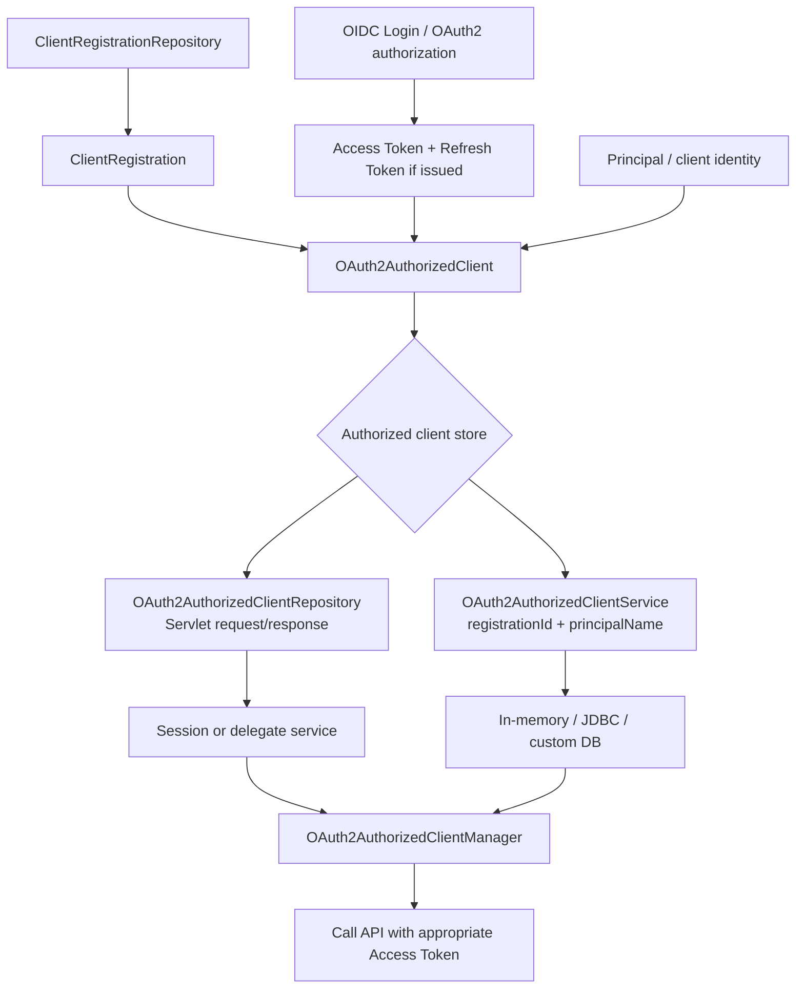
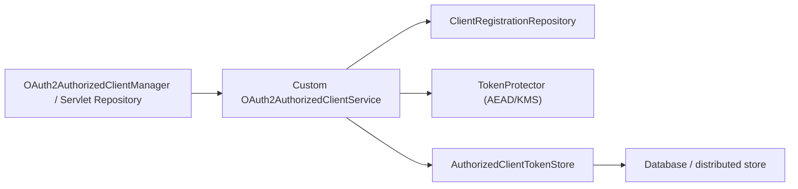

# 14.12. Custom Repository or Service for Your Application's Data Store

When a **Spring Security OAuth 2.0 / OpenID Connect (OIDC) Client** application signs a user in or calls an API on a client's behalf, Spring Security needs to manage the authorization result it received: the **Access Token**, **Refresh Token** if present, corresponding client registration, and identity/context bound to the token. The object responsible for representing this result is `OAuth2AuthorizedClient`.

In simple examples, tokens can be stored in memory or bound to the HTTP session. However, real-world systems may need **a dedicated database, distributed storage, encryption of tokens at rest, tenant isolation, data deletion policies, refresh monitoring, and concurrency control**. At that point, you must pick the right extension point:

- **`OAuth2AuthorizedClientRepository`**: API tied to **HTTP request/response and `Authentication`** in Servlet applications.
- **`OAuth2AuthorizedClientService`**: API saving/loading authorized clients by **registration ID and principal name**, without directly depending on HTTP requests.

This lesson focuses on deciding **when to use a repository, when to use a service, when to customize both**, and how to wire them into Spring Security without mixing up token data, login sessions, and authorization policies.

## 1. Context: Why Do We Need an `OAuth2AuthorizedClient` Store?

An OIDC web application may perform:

1. User signs in via `oauth2Login()`.
2. Backend receives an Access Token and possibly a Refresh Token from the token endpoint.
3. When calling the provider's API, the application uses the corresponding Access Token.
4. When the Access Token expires and a valid Refresh Token exists, Spring Security can obtain a new Access Token per the OAuth2 authorized client manager/provider configuration.
5. If the user withdraws consent, the token is revoked, or the account is deleted, the application needs a policy to clean up the authorized client.

A backend application using `client_credentials` has slightly different needs: the token represents **the application/service itself**, with no browser user login. Even so, the application can still use `OAuth2AuthorizedClient` to hold the Access Token alongside its registration/technical context.



This diagram illustrates responsibilities and storage options; not every application uses both branches simultaneously. The key point is that **tokens are managed under the authorized client's identity**, not in a global variable holding "the system's latest token".

### 1.1. What Does `OAuth2AuthorizedClient` Contain?

In Spring Security, an authorized client typically contains:

| Component | Meaning |
|---|---|
| `ClientRegistration` | Client/provider/grant type info the token is bound to. |
| `principalName` | Principal/context name used by Spring Security to attach the authorized client. |
| `OAuth2AccessToken` | Access Token value, token type (usually Bearer), issued/expiration timestamps, and scopes. |
| `OAuth2RefreshToken` (may be `null`) | Refresh Token if issued; used to request new tokens when permitted by the provider. |

**Do not confuse** an authorized client with:

- **`OidcUser` / `OidcIdToken`**: verified OIDC identity information.
- **`SecurityContext`**: the user's authentication/authorities state across HTTP requests.
- **`HttpSession`**: a mechanism storing state across browser requests.
- **Authorization Server token store**: the provider-side system issuing/managing tokens, not where the OAuth2 Client keeps its own copy.

`OAuth2AuthorizedClient` does not itself hold full SSO history, business roles, or the ID Token for an application to reconstruct a login from the token store. The authorized client store serves **client-side token management**, not session/authentication replacement.

### 1.2. Why Not Store One Single Access Token System-Wide?

Suppose users A and B both sign in via registration `company`. They may have:

```text
registrationId = company
principalName  = user-A
Access Token   = token-A

registrationId = company
principalName  = user-B
Access Token   = token-B
```

If stored under a single `company` key, token A could be overwritten by token B. When the application calls the UserInfo API or a business API, that introduces a risk of **identity mix-ups and cross-user data leakage**.

Consequently, the minimum storage key per service API is usually **`(clientRegistrationId, principalName)`**. In multi-tenant applications, `principalName` must be designed so independent contexts never collide.

## 2. Distinguishing `OAuth2AuthorizedClientRepository` and `OAuth2AuthorizedClientService`

These two interfaces serve similar purposes in different contexts.

### 2.1. `OAuth2AuthorizedClientRepository`: For HTTP Servlet

The interface's primary API operations:

```java
<T extends OAuth2AuthorizedClient> T loadAuthorizedClient(
    String clientRegistrationId,
    Authentication principal,
    HttpServletRequest request
);

void saveAuthorizedClient(
    OAuth2AuthorizedClient authorizedClient,
    Authentication principal,
    HttpServletRequest request,
    HttpServletResponse response
);

void removeAuthorizedClient(
    String clientRegistrationId,
    Authentication principal,
    HttpServletRequest request,
    HttpServletResponse response
);
```

It receives **`HttpServletRequest`/`HttpServletResponse`**, making it suitable when storing authorized clients based on the current request, cookies/session, or a specific Servlet context.

Examples:

- User just completed `oauth2Login()`.
- An MVC controller needs to call a downstream API on the user's behalf.
- The application wants to store tokens in the session or bind them to the user authenticated on the current request.
- There is a Servlet-specific policy on where to store tokens/tenants.

### 2.2. `OAuth2AuthorizedClientService`: HTTP-Independent

The interface's primary operations:

```java
<T extends OAuth2AuthorizedClient> T loadAuthorizedClient(
    String clientRegistrationId,
    String principalName
);

void saveAuthorizedClient(
    OAuth2AuthorizedClient authorizedClient,
    Authentication principal
);

void removeAuthorizedClient(
    String clientRegistrationId,
    String principalName
);
```

It does not take Servlet request/response. It is better suited for:

- Storing authorized clients in a **database** or storage service.
- Background jobs, scheduled tasks, event consumers, and service-to-service integrations.
- Scenarios requiring token reuse across multiple requests or instances.
- An authorized client manager operating outside an HTTP context.

However, **the service does not perform authentication or decide who may read tokens**. It must still be called with the proper principal/registration, and the store must enforce access control, isolation, and encryption.

### 2.3. Selection Table

| Requirement | Repository | Service |
|---|---|---|
| Needs `HttpServletRequest`/`HttpServletResponse` to choose storage | Directly suited | Lacks those two parameters |
| OAuth2 login in a Servlet application | Can be used directly by Spring Security | Can be delegated to by the repository |
| Storing in JDBC/Redis/custom DB | Can implement directly, but must handle Servlet context | Usually a cleaner extension point |
| Background job without HTTP request | Inconvenient | Suitable |
| Needs tenant partitioning from request | Can be resolved at repository boundary | Must pass verified tenant safely into principal key or store model |
| Sharing authorized clients across instances | Depends on implementation | Suitable when backed by shared storage |
| Mapping a principal to stored tokens | Based on `Authentication` and request | Based on `registrationId` and `principalName` |
| Managing HTTP login sessions | Not its primary job | Not its job |
| Automatic token refresh | Does not refresh on its own | Does not refresh on its own |

**Do not confuse "having a repository" with "automatic refresh".** Authorization/refresh depends on `OAuth2AuthorizedClientManager` and `OAuth2AuthorizedClientProvider`. Repositories/services store and retrieve authorized clients; token exchange/refresh is a separate responsibility.

## 3. Common Spring Security Implementations

Spring Security offers built-in options before you need to write custom code.

| Implementation | Type | Primary Behavior |
|---|---|---|
| `InMemoryOAuth2AuthorizedClientService` | Service | Stores authorized clients in process memory. |
| `JdbcOAuth2AuthorizedClientService` | Service | Stores authorized clients via JDBC in a table/schema per Spring Security's implementation. |
| `HttpSessionOAuth2AuthorizedClientRepository` | Repository | Stores authorized clients in the Servlet application's HTTP session. |
| `AuthenticatedPrincipalOAuth2AuthorizedClientRepository` | Repository | Uses a service for authenticated principals and a session repository for anonymous contexts per implementation. |

The "in-memory" option is helpful for local runs/demos but has limitations:

- Data is lost on process restart.
- Instances do not see each other's tokens.
- No durability/backup mechanism.
- Can surprise you if the system needs to refresh tokens after a restart.

`JdbcOAuth2AuthorizedClientService` is a sensible starting point when you want JDBC persistence without specialized storage requirements. **Do not write a brand-new implementation solely to swap an in-memory Map for a DB table** if the JDBC service already meets your environment and credential-protection policies.

### 3.1. JDBC Does Not Mean Token Data Is Encrypted

A JDBC service may store tokens as blobs/byte strings per the framework schema. Do not automatically infer that it:

- Encrypts Access Tokens/Refresh Tokens with application-managed keys.
- Isolates tenants on every query.
- Recreates local login sessions after restart.
- Deletes/revokes tokens when an account is disabled.
- Resolves race conditions when multiple nodes refresh tokens concurrently.

Those requirements must be evaluated and added via **storage-layer encryption, key policies, DB privileges, session lifecycles, token cleanup, and concurrency control**.

## 4. Choosing a Storage Strategy by Architecture

### 4.1. Small Single-Instance Web Application

If tokens are only needed while the user's session is alive and the application does not require durability across restarts, a session-based repository can suffice.

Pros: easy to reason about token lifecycles tied to browser sessions.

Risks: restarts/session timeouts lose authorized clients; with multiple replicas not sharing sessions, callbacks/logins/authorized clients can behave inconsistently.

### 4.2. Multi-Instance Web Application

If deployed across multiple nodes, you may need:

- **Shared session store** if the HTTP session carries authorized clients and `SecurityContext`.
- **Persistent authorized client service** if tokens are stored by principal for all nodes to access.
- **Separation** between HTTP session lifetime and Access/Refresh Token lifetimes.
- **Concurrency control** when two requests/nodes simultaneously detect an expired Access Token.

Do not keep Refresh Tokens longer than sessions without an explicit policy. Multi-instance persistence improves availability while increasing blast radius if the database is compromised.

### 4.3. Background Jobs / Integration Services

If a job calls an API via `client_credentials`, use `OAuth2AuthorizedClientService` and `AuthorizedClientServiceOAuth2AuthorizedClientManager`. Stored data usually binds to a fixed technical principal for that workload or service.

Never use a browser-signed-in user's principal when the token represents a **service**, and never borrow one user's token to run a job for another user without proper delegation/authorization.

### 4.4. Multi-Tenant or Multi-Provider

With multiple tenants/providers, storage keys must prevent mixing:

```text
(tenant, issuer/registration, principal identity) -> authorized client
```

The default service interface takes two parameters: `(registrationId, principalName)`. Therefore, if storage requires tenant separation, encode the tenant into a **trusted identity key context** or design a clearly partitioned adapter/repository—never accept an unverified tenant from HTTP parameters.

## 5. Spring Boot OIDC Client Example Using Authorized Client

In `application.yml`:

```yaml
spring:
  security:
    oauth2:
      client:
        registration:
          company:
            provider: company-oidc
            client-id: ${OIDC_CLIENT_ID}
            client-secret: ${OIDC_CLIENT_SECRET}
            authorization-grant-type: authorization_code
            client-authentication-method: client_secret_basic
            redirect-uri: "{baseUrl}/login/oauth2/code/{registrationId}"
            scope:
              - openid
              - profile
              - email
        provider:
          company-oidc:
            issuer-uri: https://id.example.org/realms/company
```

When a user signs in, Spring Security can create an `OAuth2AuthorizedClient` for registration `company`. The Access Token inside the authorized client can be used when the backend calls authorized APIs.

Example MVC controller using `@RegisteredOAuth2AuthorizedClient` when the app has appropriate OAuth2 Client configuration:

```java
import java.time.Instant;
import java.util.Map;

import org.springframework.security.oauth2.client.OAuth2AuthorizedClient;
import org.springframework.security.oauth2.client.annotation.RegisteredOAuth2AuthorizedClient;
import org.springframework.web.bind.annotation.GetMapping;
import org.springframework.web.bind.annotation.RestController;

@RestController
public class TokenMetadataController {

    @GetMapping("/token-metadata")
    public Map<String, Object> metadata(
            @RegisteredOAuth2AuthorizedClient("company")
            OAuth2AuthorizedClient authorizedClient) {

        Instant expiry = authorizedClient
            .getAccessToken().getExpiresAt();

        return Map.of(
            "registrationId",
            authorizedClient.getClientRegistration().getRegistrationId(),
            "expiresAt",
            expiry == null ? "unknown" : expiry.toString()
        );
    }
}
```

The example returns metadata only to demonstrate injection; **never return token values** through APIs or logs. In real products, the controller can hand the Access Token to a server-side HTTP client to call APIs, while keeping the token on the backend and targeting the right audience/scope.

### 5.1. Refresh Tokens Are Not Required in Every Flow

`OAuth2AuthorizedClient.getRefreshToken()` can be `null`.

- The provider may not issue Refresh Tokens.
- The Client Credentials Grant typically does not use Refresh Tokens.
- Some registrations issue only short-lived Access Tokens and require re-requesting tokens via the grant.
- `offline_access` policies and OP consent affect whether a refresh token is issued in OIDC.

A custom store must support an **absent refresh token** instead of assuming it is always present. Never attempt to fabricate a "refresh token" from an Access Token or ID Token.

## 6. Try `JdbcOAuth2AuthorizedClientService` Before Writing Your Own

With Spring JDBC, you can instantiate `JdbcOAuth2AuthorizedClientService` and connect it to the servlet repository.

Example Gradle dependencies:

```gradle
dependencies {
    implementation("org.springframework.boot:spring-boot-starter-web")
    implementation("org.springframework.boot:spring-boot-starter-security")
    implementation("org.springframework.boot:spring-boot-starter-oauth2-client")
    implementation("org.springframework.boot:spring-boot-starter-jdbc")
    runtimeOnly("org.postgresql:postgresql")
}
```

Bean example:

```java
import org.springframework.context.annotation.Bean;
import org.springframework.context.annotation.Configuration;
import org.springframework.jdbc.core.JdbcOperations;
import org.springframework.security.oauth2.client.OAuth2AuthorizedClientService;
import org.springframework.security.oauth2.client.JdbcOAuth2AuthorizedClientService;
import org.springframework.security.oauth2.client.registration.ClientRegistrationRepository;

@Configuration
public class AuthorizedClientStorageConfiguration {

    @Bean
    OAuth2AuthorizedClientService authorizedClientService(
            JdbcOperations jdbc,
            ClientRegistrationRepository registrations) {

        return new JdbcOAuth2AuthorizedClientService(
            jdbc,
            registrations
        );
    }
}
```

Prepare a **database schema matching your exact Spring Security version**. Do not copy column names from a homemade snippet and expect `JdbcOAuth2AuthorizedClientService` to understand them. Use the schema/migrations matching the installed implementation.

In addition:

- Configure DataSource/JDBC connections per environment.
- Never put DB credentials or client secrets in source code.
- Grant least-privilege permissions to the DB account.
- Check retention/cleanup and backups.
- Evaluate encryption at rest, key rotation, and token access policies.
- When customizations like per-tenant token encryption are needed, write a dedicated service or a suitable JDBC-wrapping storage layer.

### 6.1. Wiring the Service into the Servlet Repository

Illustrative repository bean:

```java
import org.springframework.context.annotation.Bean;
import org.springframework.context.annotation.Configuration;
import org.springframework.security.oauth2.client.OAuth2AuthorizedClientService;
import org.springframework.security.oauth2.client.web.AuthenticatedPrincipalOAuth2AuthorizedClientRepository;
import org.springframework.security.oauth2.client.web.OAuth2AuthorizedClientRepository;

@Configuration
public class AuthorizedClientRepositoryConfiguration {

    @Bean
    OAuth2AuthorizedClientRepository authorizedClientRepository(
            OAuth2AuthorizedClientService authorizedClientService) {

        return new AuthenticatedPrincipalOAuth2AuthorizedClientRepository(
            authorizedClientService
        );
    }
}
```

`AuthenticatedPrincipalOAuth2AuthorizedClientRepository` typically delegates to the service when the principal is authenticated; for anonymous contexts, it has a session-based strategy by default.

In a Security Filter Chain configuration, specify the repository to use for related mechanisms:

```java
import org.springframework.context.annotation.Bean;
import org.springframework.context.annotation.Configuration;
import org.springframework.security.config.annotation.web.builders.HttpSecurity;
import org.springframework.security.oauth2.client.web.OAuth2AuthorizedClientRepository;
import org.springframework.security.web.SecurityFilterChain;

@Configuration
public class WebSecurityConfiguration {

    @Bean
    SecurityFilterChain webChain(
            HttpSecurity http,
            OAuth2AuthorizedClientRepository authorizedClients)
            throws Exception {

        http
            .authorizeHttpRequests(auth -> auth
                .requestMatchers("/", "/public/**").permitAll()
                .anyRequest().authenticated()
            )
            .oauth2Login(login ->
                login.authorizedClientRepository(authorizedClients)
            )
            .oauth2Client(client ->
                client.authorizedClientRepository(authorizedClients)
            );

        return http.build();
    }
}
```

Configuration examples in this section are designed to combine into one Spring Boot application. If the project already has a `SecurityFilterChain`, add the settings to the existing chain rather than **copying multiple beans with overlapping matchers**.

Also note: the repository is used in Servlet mechanisms, yet not every background job or HTTP client automatically uses that repository bean. They may need a separately configured authorized client manager/service.

## 7. When Should You Write a Custom `OAuth2AuthorizedClientService`?

A custom service usually makes sense when one or more of these requirements apply:

- Storing tokens in a database with an existing custom schema/ORM.
- Encrypting tokens at the application layer using KMS/envelope encryption.
- Isolating tenants via separate schemas/partitions and access control policies.
- Using Redis or a distributed store with suitable TTL and eviction policies.
- Needing soft-delete/audit metadata without logging raw tokens.
- Requiring lifecycle and token cleanup rules differing from the default JDBC service.
- Controlling race conditions, versioning, or optimistic locking during refresh.
- Managing user sessions/tokens via a domain service.

Keep the **Spring Security interface contract** clean so the remaining OAuth2 Client components continue to function. A custom service must fully reconstruct `OAuth2AuthorizedClient`: matching registration, principal name, Access Token timestamps/scopes, and Refresh Token if present.

### 7.1. Example Custom Storage Schema

An **illustrative** table, not the schema required by default `JdbcOAuth2AuthorizedClientService`:

```sql
CREATE TABLE app_oauth2_authorized_client (
    registration_id           VARCHAR(128) NOT NULL,
    principal_key             VARCHAR(512) NOT NULL,
    access_token_ciphertext   TEXT NOT NULL,
    access_issued_at          TIMESTAMP NOT NULL,
    access_expires_at         TIMESTAMP NOT NULL,
    access_scopes             TEXT,
    refresh_token_ciphertext  TEXT,
    refresh_issued_at         TIMESTAMP,
    refresh_expires_at        TIMESTAMP,
    token_version             BIGINT NOT NULL DEFAULT 0,
    updated_at                TIMESTAMP NOT NULL,
    PRIMARY KEY (registration_id, principal_key)
);
```

Each `(registration_id, principal_key)` pair holds at most one stored authorized client under this model. If business logic needs multiple records for the same key (e.g., multiple grants/scopes/tenants), define explicit partitions or identifiers while remaining compatible with the Spring Security interface.

Columns:

| Column | Purpose |
|---|---|
| `registration_id` | Registered `ClientRegistration` key. |
| `principal_key` | Stable identity key for the principal or workload, per application policy. |
| `access_token_ciphertext` | Access Token encrypted at rest. |
| `access_issued_at` / `access_expires_at` | Token issued/expiration timestamps, used when deciding refresh. |
| `access_scopes` | Actual scopes granted on the Access Token. |
| `refresh_token_ciphertext` | Encrypted Refresh Token if present. |
| `refresh_issued_at` / `refresh_expires_at` | Refresh Token metadata; may be absent. |
| `token_version` | Version used for conditional updates/concurrency. |
| `updated_at` | Timestamp when the record was last saved. |

When using a real schema, account for DBMS, timestamp/time zone formats, ciphertext sizes, indexes, retention, and deletion policies. **Never store Access Tokens/Refresh Tokens in plaintext just to make debugging easier.**

## 8. Designing a Custom Service Using Separation of Concerns

For illustration, we separate into:

1. `OAuth2AuthorizedClientService`: Spring Security-compatible adapter.
2. `AuthorizedClientTokenStore`: interface manipulating application records.
3. `TokenProtector`: API encrypting/decrypting tokens.
4. `ClientRegistrationRepository`: source of registration configs when reconstructing objects.



This separation lets you swap storage technology without mixing SQL and encryption logic into the Security Filter Chain. `TokenProtector` should be built using established cryptographic standards and key management systems—never invent custom algorithms.

### 8.1. Storage Model and Contracts

Java 17+ example (each `public` top-level type must live in its own source file in real implementations):

```java
import java.time.Instant;
import java.util.Optional;
import java.util.Set;

public record StoredAuthorizedClient(
    String registrationId,
    String principalName,
    String accessTokenCiphertext,
    Instant accessIssuedAt,
    Instant accessExpiresAt,
    Set<String> accessScopes,
    String refreshTokenCiphertext,
    Instant refreshIssuedAt,
    Instant refreshExpiresAt,
    long version
) { }

public interface AuthorizedClientTokenStore {

    Optional<StoredAuthorizedClient> find(
        String registrationId,
        String principalName
    );

    void upsert(StoredAuthorizedClient value);

    void delete(String registrationId, String principalName);
}

public interface TokenProtector {

    String encrypt(
        String plaintext,
        String registrationId,
        String principalName
    );

    String decrypt(
        String ciphertext,
        String registrationId,
        String principalName
    );
}
```

In this example, `TokenProtector` accepts registration ID and principal name so implementations can bind them as **associated data** (AAD) in authenticated encryption, tying ciphertext to its storage context.

The types above are **illustrative contracts**; this lesson does not implement full JDBC, transactions, or AES-GCM/KMS. In real systems, implement those with trusted libraries and secure key operations. Never treat `encrypt` as Base64 encoding or one-way hashing: tokens must be **decrypted** when the client sends them to the provider/API, requiring a protected, reversible encryption mechanism.

### 8.2. Service Implementing load/save/remove

Example adapter focusing on data conversion steps:

```java
import java.util.Set;

import org.springframework.security.core.Authentication;
import org.springframework.security.oauth2.client.OAuth2AuthorizedClient;
import org.springframework.security.oauth2.client.OAuth2AuthorizedClientService;
import org.springframework.security.oauth2.client.registration.ClientRegistration;
import org.springframework.security.oauth2.client.registration.ClientRegistrationRepository;
import org.springframework.security.oauth2.core.OAuth2AccessToken;
import org.springframework.security.oauth2.core.OAuth2RefreshToken;

public final class EncryptedAuthorizedClientService
        implements OAuth2AuthorizedClientService {

    private final ClientRegistrationRepository registrations;
    private final AuthorizedClientTokenStore store;
    private final TokenProtector protector;

    public EncryptedAuthorizedClientService(
            ClientRegistrationRepository registrations,
            AuthorizedClientTokenStore store,
            TokenProtector protector) {

        this.registrations = registrations;
        this.store = store;
        this.protector = protector;
    }

    @Override
    @SuppressWarnings("unchecked")
    public <T extends OAuth2AuthorizedClient> T loadAuthorizedClient(
            String registrationId,
            String principalName) {

        StoredAuthorizedClient row = store
            .find(registrationId, principalName)
            .orElse(null);

        if (row == null) {
            return null;
        }

        ClientRegistration registration =
            registrations.findByRegistrationId(registrationId);

        if (registration == null) {
            throw new IllegalStateException(
                "Unknown client registration: " + registrationId
            );
        }

        String accessValue = protector.decrypt(
            row.accessTokenCiphertext(),
            registrationId,
            principalName
        );

        OAuth2AccessToken access = new OAuth2AccessToken(
            OAuth2AccessToken.TokenType.BEARER,
            accessValue,
            row.accessIssuedAt(),
            row.accessExpiresAt(),
            row.accessScopes()
        );

        OAuth2RefreshToken refresh = null;
        if (row.refreshTokenCiphertext() != null) {
            String refreshValue = protector.decrypt(
                row.refreshTokenCiphertext(),
                registrationId,
                principalName
            );

            refresh = new OAuth2RefreshToken(
                refreshValue,
                row.refreshIssuedAt(),
                row.refreshExpiresAt()
            );
        }

        return (T) new OAuth2AuthorizedClient(
            registration,
            principalName,
            access,
            refresh
        );
    }

    @Override
    public void saveAuthorizedClient(
            OAuth2AuthorizedClient client,
            Authentication principal) {

        String registrationId =
            client.getClientRegistration().getRegistrationId();
        String principalName = principal.getName();

        if (!principalName.equals(client.getPrincipalName())) {
            throw new IllegalArgumentException(
                "Principal does not match authorized client"
            );
        }

        OAuth2AccessToken access = client.getAccessToken();

        if (!OAuth2AccessToken.TokenType.BEARER.equals(
                access.getTokenType())) {
            throw new IllegalArgumentException(
                "This store supports bearer access tokens only"
            );
        }

        OAuth2RefreshToken refresh = client.getRefreshToken();

        StoredAuthorizedClient row = new StoredAuthorizedClient(
            registrationId,
            principalName,
            protector.encrypt(
                access.getTokenValue(), registrationId, principalName),
            access.getIssuedAt(),
            access.getExpiresAt(),
            Set.copyOf(access.getScopes()),
            refresh == null ? null : protector.encrypt(
                refresh.getTokenValue(), registrationId, principalName),
            refresh == null ? null : refresh.getIssuedAt(),
            refresh == null ? null : refresh.getExpiresAt(),
            0L // Real store must manage version and concurrency
        );

        store.upsert(row);
    }

    @Override
    public void removeAuthorizedClient(
            String registrationId,
            String principalName) {

        store.delete(registrationId, principalName);
    }
}
```

**This is an illustrative adapter showing conversion and component separation, not a complete production implementation.** Specifically:

- `AuthorizedClientTokenStore` must be backed by JDBC/JPA/Redis or another technology with transactions and contention control.
- `TokenProtector` must use authenticated encryption with proper key/nonce management.
- `version=0L` is a placeholder only; never claim optimistic locking based on it.
- The example saves bearer tokens as that is the standard token type in OAuth2 Client; other types require compatible schemas/codecs.
- Define null timestamp handling per actual token contracts and your application's DBMS.
- `Authentication.getName()` must be a stable principal key consistent with load sites and multi-tenancy strategy.
- Never log `accessValue`, `refreshValue`, or `StoredAuthorizedClient` containing sensitive ciphertext/metadata.

Token encryption **does not by itself enforce authorization**: callers of the service must control who may load which principal's authorized client. If a public API lets users arbitrarily pass `principalName` into `loadAuthorizedClient`, that creates a cross-user token theft vulnerability.

### 8.3. Registering the Custom Service

Example bean:

```java
import org.springframework.context.annotation.Bean;
import org.springframework.context.annotation.Configuration;
import org.springframework.security.oauth2.client.OAuth2AuthorizedClientService;
import org.springframework.security.oauth2.client.registration.ClientRegistrationRepository;

@Configuration
public class CustomAuthorizedClientConfiguration {

    @Bean
    OAuth2AuthorizedClientService authorizedClientService(
            ClientRegistrationRepository registrations,
            AuthorizedClientTokenStore store,
            TokenProtector protector) {

        return new EncryptedAuthorizedClientService(
            registrations,
            store,
            protector
        );
    }
}
```

Once this bean is registered, you can pair it with `AuthenticatedPrincipalOAuth2AuthorizedClientRepository` and a compatible authorized client manager as shown earlier. **Never declare two `OAuth2AuthorizedClientService` beans simultaneously without qualifiers** and expect Spring to guess which one to pick.

## 9. Designing Consistent `principalName` and Avoiding Identity Collisions

An often overlooked question is: **what is `principalName` in the application's authorized client?**

In many default OIDC flows, `Authentication.getName()` may derive from the OIDC principal's `sub`. In a system with multiple issuers or multiple tenants, the same `sub` string can appear from two different sources.

Example:

```text
Issuer A:
  sub = 12345

Issuer B:
  sub = 12345
```

If there are two distinct registrations, the `(registrationId, principalName)` pair distinguishes them when each registration maps to a specific issuer. However, when one registration has dynamic tenant/provider logic, or the application uses an unstable principal name, collisions can occur.

### 9.1. A Stable Key Strategy

Options to consider:

- Use an **internal immutable user ID** already linked to `(issuer, sub)`.
- Use a normalized principal key combining issuer/tenant/subject unambiguously, if supported by your system.
- Keep each tenant/provider as a separate registration if that fits the design contract.
- In a custom store, use a verified partition/tenant ID outside the default interface key pair.

Conceptual examples:

```text
principal_key = "app-user:4107"
registration  = "company-login"

principal_key = "service:shipping-worker"
registration  = "shipping-api"
```

If you change `Authentication.getName()` to an internal user ID, configure principal/Authentication and authorized client storage **consistently**. Never change the key in the DB while letting Spring Security load by the old `sub`, as new tokens will save under one key while subsequent requests search under another.

### 9.2. Do Not Use Email as a Token Storage Key

Emails can change, be reassigned, or collide across providers. Using email as `principalName` risks:

- Authorized clients getting "lost" when emails change, orphaning old tokens.
- Two identities sharing an email getting mixed up.
- Storing token data under an unnecessary personal identifier.

Use a stable ID with no reassignable semantics, and manage account linking/identity migrations via authorized workflows.

### 9.3. Technical Principal for Client Credentials

With `client_credentials`, there is no browser user. A service-based manager still needs a `principal` to form the token storage key. You can use a fixed technical name for the workload:

```text
registrationId = shipping-api
principalName  = service:shipping-worker
```

Never use that technical principal to imply a specific user's permissions. A Client Credentials token represents the client per the scopes/audience granted by the Authorization Server; APIs must still validate the token.

## 10. Connecting the Service with `AuthorizedClientServiceOAuth2AuthorizedClientManager`

For jobs or service-to-service calls without an HTTP request, Spring Security provides `AuthorizedClientServiceOAuth2AuthorizedClientManager`. It fits when authorized clients are stored via `OAuth2AuthorizedClientService`.

Example registration:

```yaml
spring:
  security:
    oauth2:
      client:
        registration:
          shipping-api:
            provider: internal-auth
            client-id: ${SHIPPING_CLIENT_ID}
            client-secret: ${SHIPPING_CLIENT_SECRET}
            client-authentication-method: client_secret_basic
            authorization-grant-type: client_credentials
            scope:
              - shipping.read
        provider:
          internal-auth:
            token-uri: https://auth.example.org/oauth2/token
```

Authorized client manager bean:

```java
import org.springframework.context.annotation.Bean;
import org.springframework.context.annotation.Configuration;
import org.springframework.security.oauth2.client.AuthorizedClientServiceOAuth2AuthorizedClientManager;
import org.springframework.security.oauth2.client.OAuth2AuthorizedClientManager;
import org.springframework.security.oauth2.client.OAuth2AuthorizedClientProvider;
import org.springframework.security.oauth2.client.OAuth2AuthorizedClientProviderBuilder;
import org.springframework.security.oauth2.client.OAuth2AuthorizedClientService;
import org.springframework.security.oauth2.client.registration.ClientRegistrationRepository;

@Configuration
public class ServiceOAuth2ClientConfiguration {

    @Bean
    OAuth2AuthorizedClientManager serviceAuthorizedClientManager(
            ClientRegistrationRepository registrations,
            OAuth2AuthorizedClientService service) {

        OAuth2AuthorizedClientProvider provider =
            OAuth2AuthorizedClientProviderBuilder.builder()
                .clientCredentials()
                .build();

        AuthorizedClientServiceOAuth2AuthorizedClientManager manager =
            new AuthorizedClientServiceOAuth2AuthorizedClientManager(
                registrations,
                service
            );

        manager.setAuthorizedClientProvider(provider);
        return manager;
    }
}
```

A service using the manager:

```java
import org.springframework.security.oauth2.client.OAuth2AuthorizeRequest;
import org.springframework.security.oauth2.client.OAuth2AuthorizedClient;
import org.springframework.security.oauth2.client.OAuth2AuthorizedClientManager;
import org.springframework.stereotype.Service;

@Service
public class ShippingAccessTokenService {

    private final OAuth2AuthorizedClientManager manager;

    public ShippingAccessTokenService(
            OAuth2AuthorizedClientManager manager) {
        this.manager = manager;
    }

    public String accessTokenForShippingApi() {
        OAuth2AuthorizeRequest request =
            OAuth2AuthorizeRequest
                .withClientRegistrationId("shipping-api")
                .principal("service:shipping-worker")
                .build();

        OAuth2AuthorizedClient client = manager.authorize(request);

        if (client == null) {
            throw new IllegalStateException(
                "Shipping API authorization is unavailable"
            );
        }

        return client.getAccessToken().getTokenValue();
    }
}
```

This example returns the raw token **inside a backend service** so a trusted HTTP client can attach the Bearer header. Never return this method's output directly from a public controller, log the token, or place it in a URL. In real applications, integrate token injection into `RestClient`/`WebClient` or an appropriate HTTP client to avoid passing raw tokens through multiple layers.

With `client_credentials`, when the Access Token expires, the provider can issue a new token via the grant; Refresh Tokens are normally not used. Re-authorization must go through the configured manager, never reusing an expired token from the DB.

### 10.1. Do Not Use the Wrong Manager Type in Background Jobs

`DefaultOAuth2AuthorizedClientManager` is primarily aimed at Servlet contexts with `OAuth2AuthorizedClientRepository`. If a service runs inside a scheduled job without an `HttpServletRequest`, choose a non-Servlet manager/service such as `AuthorizedClientServiceOAuth2AuthorizedClientManager`.

Never fabricate a fake HTTP session just to load authorized clients in a job; use the purpose-built abstraction.

## 11. Refresh Tokens and Consistency Under Concurrent Requests

Suppose two requests for the same principal concurrently read an authorized client whose Access Token has expired.

```text
Node A reads token version=5, sees expired
Node B reads token version=5, sees expired

Node A uses Refresh Token R5 -> receives Access Token A6, Refresh Token R6
Node B also uses R5 -> provider may reject or revoke token family

Node A saves version=6
Node B attempts to save a different result / overwrite
```

Some providers use **refresh token rotation**: each refresh issues a new Refresh Token and invalidates the old one. If two nodes reuse R5, consequences can be worse than a single failed request.

### 11.1. Persistence Does Not Automatically Solve Race Conditions

Even with a database and `upsert`, two refresh requests can run concurrently. Storage must be designed alongside **refresh coordination mechanisms**:

- Lock by `(registrationId, principalName)` or use single-flight logic where appropriate.
- Use a distributed lock across multiple instances.
- Use optimistic versioning to prevent stale results from overwriting newer tokens.
- After acquiring the lock, **re-read** token state before refreshing.
- Persist new Access Token and Refresh Token **atomically** when the provider issues both.
- Configure timeouts and failure handling when refreshes fail.
- Account for the case where the provider request succeeded yet the DB write failed: rotation may render the old Refresh Token unusable.

**Merely having `token_version` in the table is not enough**; update code must verify the version and accept only one valid update. Distributed locking and token endpoint behavior must be designed together as one unified system.

### 11.2. Never Log Refresh Tokens on Error

Refresh Tokens are sensitive credentials, often longer-lived than Access Tokens. Never write raw Refresh Tokens to SQL logs, APM, exception messages, or request traces. To inspect rotation, log an internal version/diagnostic ID that cannot be used to access resources.

### 11.3. Never Fall Back to Another User's Token

If refresh fails for principal A, never borrow a live token from principal B or another service principal to "maintain availability". Doing so breaks user/tenant boundaries and can cause unauthorized data access.

## 12. Storing Tokens Safely: Encryption at Rest, Key Management, and Auditing

Token values in `OAuth2AuthorizedClient` are **credentials**, not ordinary profile data.

### 12.1. Required Layers of Protection

| Layer | Recommended Controls |
|---|---|
| **Transport** | TLS between app and token endpoint/APIs; TLS to DB or store where applicable. |
| **Database permissions** | DB account restricted to required table operations only; no admin privileges. |
| **Encryption at rest** | Encrypt tokens with vetted mechanisms, e.g., AEAD and KMS/envelope encryption. |
| **Key management** | Key permissions, rotation, auditing; keep keys separate from ciphertext and source code. |
| **Principal isolation** | Read/write tokens only for verified/authorized registration and principal. |
| **Backups** | Encrypted backups; retention policies and data erasure capabilities. |
| **Logging** | Redact tokens, Authorization headers, Refresh Tokens, cookies, and credentials. |
| **Lifecycle** | Token cleanup, revocation when appropriate, handling account deletion/revoked consent. |

Never claim database encryption/TDE alone protects against every scenario. A compromised DB user with read privileges or a compromised application process can still access tokens through legitimate paths. Least privilege, secret isolation, and application-layer access controls are essential.

### 12.2. Encrypting Tokens Is Not Base64 or Hashing

Tokens must be reused to send to Authorization Servers/Resource Servers, so one-way hashing cannot be used if you still need to read the token. Base64 is merely encoding, providing zero security.

A sound design uses AEAD (such as AES-GCM) with unique/random nonces per algorithm rules, AAD bound to registration/principal, keys managed outside the DB, and versioned ciphertext formats. **Never invent custom ciphers or unsafely reuse nonces.**

### 12.3. Key Rotation and Encrypted Data

When rotating encryption keys, define:

- Which key version each ciphertext currently uses.
- How long old keys are retained to decrypt data not yet re-encrypted.
- When records are re-encrypted without disrupting logins/APIs.
- How undecryptable token records are handled.
- How ciphertext and backups are handled per retention policy when a user is deleted.

Never write a fallback like "if decryption fails, use raw ciphertext as Access Token"—that is both a security flaw and a protocol error. On decryption failure, fail safely and trigger fresh authorization when appropriate.

## 13. Authorized Client Lifecycle: Save, Refresh, Remove, and Revoke

Define clear policies for every event:

| Event | Considerations for Authorized Client |
|---|---|
| Login succeeds | Save token under right principal/registration if persistence is needed. |
| API call | Load and authorize/refresh via manager; use token with matching scope/audience. |
| Access Token expired | Refresh if valid Refresh Token exists; otherwise execute appropriate grant or prompt login. |
| Refresh rejected (`invalid_grant`) | May need to remove unusable authorized client and prompt re-authorization. |
| User logs out of app | Decide whether to remove local authorized client and/or revoke tokens at provider. |
| Account locked/deleted | Stop using tokens and delete/revoke per policy; invalidate sessions if needed. |
| User withdraws consent at OP | Tokens may be revoked; app must handle API/refresh failures and cleanup. |
| Registration deleted/changed | Legacy token data may no longer decrypt/reconstruct the client; migrate/clean up. |
| Backup/retention expired | Purge records and copies per data policy. |

**Logout does not mean token revocation.** Clearing a browser session or `SecurityContext` does not automatically invalidate issued Access Tokens across Resource Servers. Depending on the provider, the app may need the Token Revocation Endpoint or a dedicated policy. Conversely, deleting an authorized client in the DB only prevents the app from finding that token locally; it does not guarantee revocation at the provider.

### 13.1. Distinguishing Local Deletion from Remote Revocation

- `removeAuthorizedClient(registrationId, principalName)`: deletes the record on the **OAuth2 Client** side.
- Token revocation API at provider: asks the **Authorization Server** to invalidate tokens per policy.
- Invalidate HTTP session: clears or invalidates **browser login** state in the application.
- OIDC logout at OP: affects the **SSO session** per protocol/logout configuration.

An offboarding policy may require combining all four depending on sensitivity, OP capabilities, and revocation requirements.

### 13.2. Do Not Keep Refresh Tokens Indefinitely

A Refresh Token may have a TTL or be subject to revocation, rotation, consent changes, or provider policy. The token store needs retention/cleanup per rules, even for long-unused records.

Do not use `AccessToken.expiresAt` as "the maximum lifetime of every authorized client" while a valid Refresh Token remains usable; conversely, do not retain records forever simply because a Refresh Token exists. Cleanup policies must reflect **token lifecycles and actual application needs**.

## 14. Customizing the Repository When HTTP-Request-Specific Logic Is Needed

When storage needs Servlet context, implement a custom `OAuth2AuthorizedClientRepository` or wrap an existing repository/service.

Example needs:

- Different token storage policies between browser users and anonymous requests.
- Selecting a partition based on the tenant authenticated by the app in the request.
- Choosing a session store or persistent service per route/tenant, with clear security rules.
- Recording request audit metadata (without logging tokens) linked to a diagnostic ID.

### 14.1. Critical Boundaries of a Custom Repository

A custom repository must implement `load/save/remove` faithfully per `OAuth2AuthorizedClientRepository`. When implementing:

1. Never trust `tenantId` or `principalName` arbitrarily supplied by an HTTP client.
2. Verify valid `Authentication` and confirm the account may access the authorized client.
3. Ensure `save` and `load` produce the **exact same key**.
4. Never accidentally let an anonymous request read a signed-in user's persistent token.
5. Ensure removal targets the right principal/registration without wiping an entire tenant's tokens unintentionally.
6. Avoid writing tokens into request attributes or plaintext cookies.
7. If delegating to a service, use a consistent principal key between repository and service.

### 14.2. Using the Built-In Adapter Is Lower Risk

When the requirement is simply **DB storage instead of session**, you usually do not need to write a custom Servlet repository. You can use:

```text
Spring Security Servlet
    |
    v
AuthenticatedPrincipalOAuth2AuthorizedClientRepository
    |
    v
Custom OAuth2AuthorizedClientService
    |
    v
Encrypted DB Token Store
```

This adapter reuses framework behavior for authenticated principals while keeping persistence logic in the service. Only customize the repository when HTTP-context-dependent semantics are truly required.

## 15. Difference Between Authorized Client Store and HTTP Session Store

A common architectural mistake is assuming "since `OAuth2AuthorizedClient` is saved in the database, user logins survive restarts".

That is **false**.

| Data | Typical Store | Role |
|---|---|---|
| `OAuth2AuthorizedClient` | Service/repository, memory/JDBC/custom store | Stores tokens issued to client/principal. |
| `SecurityContext` | Session/security context repository | Identifies the authenticated user on application requests. |
| Pending-callback `OAuth2AuthorizationRequest` | Authorization request repository, usually HTTP session | Links `state` and original request in authorization code flow. |
| HTTP session | Servlet container/Spring Session | Maintains browser state across requests. |
| Business profile/roles | Database/domain service | Determines account status and application permissions. |

An application may store Refresh Tokens longer than sessions, yet **must never treat a token existing in the DB as proof the browser user is logged in**. Authentication must be established using protocol- and policy-appropriate mechanisms.

Conversely, an active session does not guarantee the Access Token is unexpired; to call APIs, use the authorized client manager/provider properly.

### 15.1. Distributed Sessions Are Not a Custom Authorized Client Service

Spring Session storing distributed session state is one capability. It can help nodes access the same `SecurityContext` and other session data per configuration, yet it does not automatically address requirements such as token encryption, independent TTLs, refresh concurrency, or authorized client auditing.

A custom service is another option, and an application may use both depending on architecture.

## 16. Multi-Tenancy: Designing Partitions and Controlling Token Access

In multi-tenant systems, the gravest risk is **Tenant A's token being used to call Tenant B's API**.

Example data:

```text
tenant=alpha
registration=crm-api
principal=app-user:4107
token=token-alpha-4107

tenant=beta
registration=crm-api
principal=app-user:4107
token=token-beta-4107
```

If the storage key is only `(crm-api, app-user:4107)` while two tenants share the registration, records can overwrite each other. The fix requires **clear key/partition design**:

- Per-tenant registrations if the OP/client contract requires strict separation.
- Principal keys embedding the tenant when that is a stable identity derived from a trusted context.
- Custom stores with a tenant column and appropriate row-level security policies.
- Separate databases/schemas per tenant when strict isolation is required.

**Do not merely add a tenant column in SQL and omit it when loading.** Query must use trusted tenant boundary. An authorization check in a controller is insufficient if the service can still load another tenant's token via an unpartitioned key.

### 16.1. Multi-Provider and Issuer Isolation

Similarly, two OPs can issue tokens for two subjects with the same name. In OIDC, identity should bind to `(issuer, sub)`. Authorized clients must link to the right registration/provider; never load a token by `sub` alone and send it to another issuer's API.

In particular, `ClientRegistration` holds `registrationId` and provider endpoints. When a registration changes its issuer or token endpoint, deliberately handle legacy token records; never silently send old Refresh Tokens to a new provider.

## 17. Common Errors and Categorization

| Symptom | Causes to Check | Resolution |
|---|---|---|
| Tokens gone after restart. | Using `InMemoryOAuth2AuthorizedClientService`. | Choose persistence or prompt re-authorization per design. |
| One node calls API fine, another fails. | Local session/store or inconsistent shared store. | Check distributed session/persistent service and keys. |
| `loadAuthorizedClient` always returns `null`. | Wrong `registrationId` or `principalName`, record unsaved, deleted/TTL. | Safely inspect keys and save/load flows. |
| User A's token used for User B. | Storage key lacks principal/tenant isolation or untrusted principal source. | Review keys, authorization checks, and partitioning. |
| `invalid_grant` on refresh. | Refresh Token expired, revoked, rotated, or refresh race. | Handle failure/removal and re-authorize properly. |
| Two nodes refresh simultaneously and lose token. | Missing coordination, optimistic locking, or atomic updates. | Single-flight/locking and key-scoped versioning. |
| Token read from DB cannot be used. | Ciphertext wrong key/AAD, corrupted timestamps, broken serialization. | Check encryption/key rotation, record codec; never fall back to plaintext. |
| OAuth2 Login succeeds yet next request is anonymous. | Session/`SecurityContext` not saved/restored. | Check cookies/sessions/security context, not just the authorized client DB. |
| Still able to call API with old token after logout. | Session cleared without removing/revoking authorized client. | Define clear logout/revocation lifecycle. |
| Access Token present yet API returns 403. | Insufficient API scope/audience/policy. | Check Resource Server and API permissions, not just storage. |
| Background job fails with no HTTP request. | Using Servlet-based manager/repository. | Switch to service-backed manager for background contexts. |
| Token key in DB missing after email change. | Using email as `principalName`. | Use stable keys; perform formal migration. |
| Refresh Token leaked in logs. | SQL/debug/HTTP tracing did not redact credentials. | Disable raw payload logging, redact, and handle incident. |
| Authorized client remains after registration deleted. | Token store and client config out of sync. | Migrate/clean up records; never reuse with another provider. |

### 17.1. `null` Is Not Always an Error

`loadAuthorizedClient(...)` can return `null` when authorization has never occurred for that principal/registration. For a manager supporting the right grant, that can signal performing a new authorization. However, if a new user login succeeded and tokens should have been saved, check the save flow, `principalName`, and active repository/service.

### 17.2. Finding a Record Does Not Mean the Token Is Valid

A token may be expired, revoked, or have the wrong audience/scope. Authorized client managers/providers and Resource Servers must still perform protocol-level validation.

### 17.3. Token Persistence and Logout Can Have Conflicting Requirements

One product wants user logout to delete all local tokens; another wants to preserve user-consented integrations across logins. Those two needs lead to different retention/revocation rules. Design based on product purpose and user permissions, rather than letting framework defaults accidentally become product policy.

## 18. System Observability Without Logging Raw Tokens

Safe normalized metadata to log:

- `registrationId`.
- Principal category: browser user/service, under an approved internal loggable identifier.
- Load/save/remove outcome: found/missing/success/failure.
- Token age, time until expiry, refresh status (without logging tokens).
- Refresh count, token rotation conflicts, DB latency, encryption/decryption error counts.
- Instance ID, correlation ID, and storage type.
- Normalized OAuth2 error codes from provider, without credentials.

Never log:

- Access Tokens, Refresh Tokens, authorization codes, ID Tokens.
- Client secrets, private keys, token decryption keys.
- `Authorization` headers, session cookies.
- Raw SQL parameters or full `OAuth2AuthorizedClient.toString()` if it may contain sensitive data.
- Unnecessary ciphertext/nonce/AAD in public logs.

Example metrics:

| Metric | Meaning |
|---|---|
| `authorized_client.load.hit/miss` | Detects storage key bugs or missing records. |
| `authorized_client.save.duration` | Persistence latency. |
| `authorized_client.refresh.success/failure` | Stability of token refreshes. |
| `authorized_client.refresh.conflict` | Contention across nodes refreshing concurrently. |
| `authorized_client.decrypt.failure` | Wrong key/rotation or corrupted record. |
| `authorized_client.cleanup.deleted` | Tracks retention and purging of stale records. |

Never use emails, raw subjects, tokens, or ciphertexts as metric labels; they inflate cardinality and leak data. Registration aliases or environments are far better analytical dimensions.

## 19. Test Scenarios Needed in a Custom Store Design

In real deployments, build a test strategy covering interfaces and security policies:

| Scenario | Expected Outcome |
|---|---|
| Save then load same registration/principal | Returns matching authorized client with full access/refresh metadata. |
| Load different principal | Does not find another principal's token. |
| Load different registration | Does not return token from the old registration. |
| Refresh Token not issued | Saves and restores cleanly with `null` refresh token. |
| Access Token with varied scopes | Preserves scopes accurately in DB codec. |
| Token expired | Manager/provider handles authorize/refresh; never blindly reuses expired token. |
| Remove record | Subsequent load returns `null`; optionally triggers remote revocation per policy. |
| Two nodes refresh same key | Does not overwrite new token with stale state per designed concurrency mechanism. |
| Rotation returns new Refresh Token | Access/Refresh Tokens update atomically with right version. |
| Wrong decryption key or AAD | Rejects token usage; never returns plaintext or corrupted ciphertext. |
| Client registration config changes | Legacy records handled per migration/cleanup policy. |
| Account deleted/locked | Stops token usage; cleans up/revokes per policy. |
| Browser logout | Session and authorized client behave per retention policy. |
| Multiple tenants sharing principal ID | Never cross-loads tokens across tenants. |
| Background job | Service-backed manager runs without needing an HTTP request. |
| DB/store unavailable | Never borrows another user's token or falls back unsafely. |

These scenarios are examples for authorized client storage architecture; test execution/Content QA is outside the scope of this STEP 4 storage guide.

## 20. Anti-Patterns to Avoid

### 20.1. Storing the Access Token in a Static Variable

```java
// WRONG: every user shares one token
static String currentAccessToken;
```

A global variable unbound to principal/registration mixes tokens across users, breaks thread/instance safety, and lacks proper lifecycle management.

### 20.2. Exposing `OAuth2AuthorizedClientService` as a Public Endpoint

Never build an API like:

```text
GET /tokens?principalName=someone-else
-> raw Access Token
```

Just because the service exposes `loadAuthorizedClient(registrationId, principalName)` does not mean any caller may pick an arbitrary principal. The API layer must authenticate and restrict access, typically never returning token values to the browser.

### 20.3. Storing Plaintext Refresh Tokens in DB/Logs

Refresh Tokens can mint new tokens, so leaks carry severe impact. Encrypt them in appropriate storage and never log raw tokens. UI masking does not protect a plaintext DB table.

### 20.4. Using a Shared Store Without Tenant Partitioning

If registration/principal keys do not distinguish tenants, Tenant A's token can be fetched by B. Build tenant boundaries into identity keys/partitions and enforce them on load/save/remove.

### 20.5. Treating Session Deletion as Token Revocation

Local logout does not implicitly revoke Access Tokens at the Authorization Server/Resource Server. Define token revocation and cleanup explicitly.

### 20.6. Assuming DB Persistence Restores `SecurityContext`

Authorized clients store tokens on the OAuth2 Client side; session authentication is separate data. If the HTTP session is lost, the browser does not automatically become authenticated merely because tokens remain in the DB.

### 20.7. Uncoordinated Refreshing

Two nodes using the same Refresh Token under rotation can break refresh capability or trigger token revocation. Implement coordination suited to your provider, storage, and contention level.

### 20.8. Automatically Retrying with Another Principal's Token

When refresh/authorize fails, retry only per the policy of the current registration/principal. Never switch to a service account or another token to bypass authorization.

## 21. Practical Implementation Roadmap

When starting to design an authorized client store:

1. **Identify the flow:** user-bound `authorization_code` or service-bound `client_credentials`? Are Refresh Tokens involved?
2. **Define the data:** registration ID, principal key, Access/Refresh Tokens, issued/expires, scopes, version.
3. **Select the extension point:** Servlet repository, service, or repository delegating to service.
4. **Prefer built-in implementations:** in-memory for demos, JDBC for general persistence.
5. **Choose stable principal/tenant keys:** never rely on email or unverified input.
6. **Design data security:** encryption, KMS/secret management, DB privileges, logging/redaction.
7. **Design lifecycle:** save/load/remove, refresh rotation, logout, revocation, account deletion, and retention.
8. **Handle multi-instance:** transactions, locking/versioning, session sharing if needed.
9. **Wire context-appropriate managers:** Servlet-backed or service-backed for background jobs.
10. **Monitor operations:** hit/miss, refresh conflicts, encryption failures, cleanup, and auditing.

### 21.1. A Reference Architecture

```text
             Spring Security OAuth2 Client
                        |
           +------------+-------------+
           |                          |
      Web Login / HTTP              Background Jobs
           |                          |
           v                          v
 OAuth2AuthorizedClientRepository   AuthorizedClientServiceOAuth2AuthorizedClientManager
           |                          |
           +------> OAuth2AuthorizedClientService <------+
                              |
                              v
                  Custom encrypted service
                              |
                  +-----------+-----------+
                  |                       |
                  v                       v
             TokenProtector          TokenStore
             (KMS / AEAD)           (JDBC / Redis)
                                          |
                                          v
                                  Principal / tenant
                                  isolation + versioning
```

This architecture keeps OAuth2/OIDC protocols inside Spring Security while concentrating customization in **persistence and token protection policies**.

## 22. References

- [Spring Security Reference — OAuth2 Client Core](https://docs.spring.io/spring-security/reference/servlet/oauth2/client/core.html)
- [Spring Security Reference — OAuth2 Login (Servlet)](https://docs.spring.io/spring-security/reference/servlet/oauth2/login/index.html)
- [Spring Security API — OAuth2AuthorizedClient](https://docs.spring.io/spring-security/site/docs/current/api/org/springframework/security/oauth2/client/OAuth2AuthorizedClient.html)
- [Spring Security API — OAuth2AuthorizedClientService](https://docs.spring.io/spring-security/site/docs/current/api/org/springframework/security/oauth2/client/OAuth2AuthorizedClientService.html)
- [Spring Security API — OAuth2AuthorizedClientRepository](https://docs.spring.io/spring-security/site/docs/current/api/org/springframework/security/oauth2/client/web/OAuth2AuthorizedClientRepository.html)
- [Spring Security API — JdbcOAuth2AuthorizedClientService](https://docs.spring.io/spring-security/site/docs/current/api/org/springframework/security/oauth2/client/JdbcOAuth2AuthorizedClientService.html)
- [Spring Security API — AuthorizedClientServiceOAuth2AuthorizedClientManager](https://docs.spring.io/spring-security/site/docs/current/api/org/springframework/security/oauth2/client/AuthorizedClientServiceOAuth2AuthorizedClientManager.html)
- [OAuth 2.0 — RFC 6749](https://www.rfc-editor.org/rfc/rfc6749)
- [OAuth 2.0 Token Revocation — RFC 7009](https://www.rfc-editor.org/rfc/rfc7009)
- [OAuth 2.0 Security Best Current Practice — RFC 9700](https://www.rfc-editor.org/rfc/rfc9700)

**Conclusion:** Choose `OAuth2AuthorizedClientRepository` when integrating with the HTTP Servlet context; choose `OAuth2AuthorizedClientService` when storing authorized clients independently of requests, especially in JDBC/custom databases or background jobs. Many applications can use a repository delegating to a service. Whichever option you choose, the token store must enforce **right registration, right principal, right tenant, Access/Refresh Token protection, lifecycle handling, and concurrency**, while never confusing authorized client persistence with login sessions, OIDC authentication, or business permissions.
