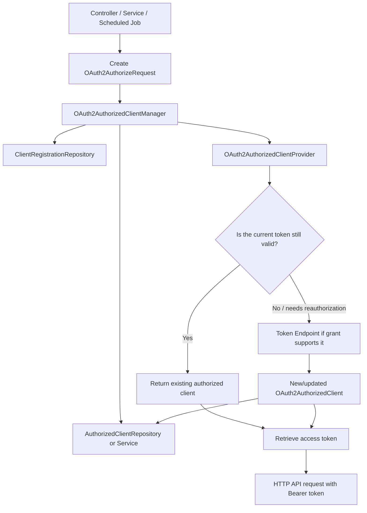

# 15.1. OAuth2AuthorizedClientManager and OAuth2AuthorizeRequest

In **Spring Security OAuth 2.0 / OpenID Connect (OIDC) Client**, logging in successfully and calling an API with an OAuth2 access token are **two related but distinct concerns**.

When a user logs in with `oauth2Login()`, Spring Security verifies the OIDC result and creates an `Authentication` representing the user in the `SecurityContext`. However, if the backend wants to call another API, it also needs a **valid access token issued for the right OAuth2 client and resource**. That token might have already been issued at login, might have expired, might need refreshing, or might not have been issued yet because it is a `client_credentials` flow running in a background task.

**`OAuth2AuthorizedClientManager`** is the component that orchestrates finding, obtaining, reauthorizing, and persisting the OAuth2 Client authorization result. Its input is **`OAuth2AuthorizeRequest`**: a request specifying the client registration or authorized client to use, the associated principal, and additional attributes. The successful result is an **`OAuth2AuthorizedClient`** containing the registration information along with the access token (and refresh token if present).

This lesson focuses on **Spring Boot 3.x, Spring Security 6.x**, with examples for both **Servlet/Spring MVC with an HTTP request** and **backend execution without an HTTP request**. The goal is to clearly understand **which manager to use when, how to create an `OAuth2AuthorizeRequest`, token lifecycle, how to distinguish between user identity and service account, and common mistakes when calling APIs**.

## 1. Position of the Client Manager in the OAuth2 Client Architecture

An application may need two types of actions:

- **User login:** Browser → OP → callback → `OAuth2AuthenticationToken` in `SecurityContext`.
- **Calling an API from the backend:** Application → Token Endpoint if a token is needed → API receives `Authorization: Bearer ...`.

`OAuth2AuthorizedClientManager` serves the second need and can be used after the first need.



Not every call to `authorize()` makes a new HTTP request to the Token Endpoint. The manager can look up an existing authorized client and return it when reauthorization is not yet needed. When a token expires or is about to expire, the provider may apply a refresh token or client credentials depending on the grant and configuration.

At the same time, **the manager is not an Authorization Server**: it does not issue tokens itself, does not replace access token validation at the API, and does not assign user permissions on its own.

## 2. Four Core Concepts to Separate

| Component | Responsibility | Example |
| --- | --- | --- |
| **`ClientRegistration`** | Definition of the OAuth2 client: client ID, secret, grant, token endpoint, scopes, provider | Registration ID `inventory-service`, grant `client_credentials` |
| **`OAuth2AuthorizedClient`** | A registration that already has an access token/refresh token associated with a principal | `inventory-service` issued a token expiring at 10:30 |
| **`OAuth2AuthorizeRequest`** | Input information for a single `authorize()` call, specifying the client/principal and attributes | Request token for `inventory-service` under principal name `inventory-job` |
| **`OAuth2AuthorizedClientManager`** | Orchestrates authorize/reauthorize, coordinating providers and persistence | `AuthorizedClientServiceOAuth2AuthorizedClientManager` for scheduled jobs |

### 2.1. A Client Registration Is Not an Authorized Client

`ClientRegistration` describes **how the application is registered with the provider**. It can exist right from startup even when no token exists yet:

```text
ClientRegistration
  registrationId: inventory-service
  clientId: inventory-backend
  grantType: client_credentials
  clientAuthenticationMethod: client_secret_basic
  tokenUri: https://idp.example.com/oauth2/token
  scopes: inventory.read
```

`OAuth2AuthorizedClient` is the state **after a token has been issued**:

```text
OAuth2AuthorizedClient
  clientRegistration: inventory-service
  principalName: inventory-job
  accessToken: Bearer <secret-token>
  accessTokenExpiresAt: ...
  refreshToken: present or absent depending on grant/provider
```

Do not put raw access tokens into logs or REST responses to inspect state. The example uses a placeholder; at runtime `OAuth2AuthorizedClient.getAccessToken()` returns an `OAuth2AccessToken` containing the sensitive token value.

### 2.2. `Authentication` Is Different from `OAuth2AuthorizedClient`

After OIDC Login:

```text
SecurityContext
  +-- OAuth2AuthenticationToken
        +-- principal = OidcUser
        +-- authorities = user permissions

OAuth2AuthorizedClientRepository / Service
  +-- (registration, principalName)
        +-- access token
        +-- refresh token if present
```

`OAuth2AuthenticationToken` tells Spring **who is logged in and what authorities they have**. `OAuth2AuthorizedClient` holds the token for the application to **access an external resource**. One user can have multiple authorized clients (multiple registrations or multiple permissions), while typically having a single current `Authentication` in the website's session.

Do not try to read the access token from `Authentication.getCredentials()` and use it as a Bearer token for an API. Obtain the token through the authorized client abstraction.

### 2.3. Is the Manager Request “Principal” Always a User?

No. `OAuth2AuthorizeRequest` needs a principal to associate the authorization state:

- For a browser user: use the authenticated user's `Authentication`.
- For `client_credentials` running from a job: you can use **a stable principal name representing the workload**, such as `inventory-job` or `internal-service`.

In `client_credentials`, this principal string **does not make the token belong to an end user**. The grant authenticates the client itself at the Authorization Server. The principal string is primarily the key linking the stored token in the authorized client service according to how the manager operates.

Do not use an arbitrary principal name sent by an HTTP client to impersonate a user in the system or to read another principal's token.

## 3. The `OAuth2AuthorizedClientManager` Interface

This is the central interface:

```java
import org.springframework.lang.Nullable;
import org.springframework.security.oauth2.client.OAuth2AuthorizedClient;
import org.springframework.security.oauth2.client.OAuth2AuthorizedClientManager;
import org.springframework.security.oauth2.client.OAuth2AuthorizeRequest;

// Conceptual signature:
// @Nullable
// OAuth2AuthorizedClient authorize(OAuth2AuthorizeRequest authorizeRequest);
```

When calling:

```java
OAuth2AuthorizedClient client = manager.authorize(authorizeRequest);
```

several outcomes are possible:

1. **Returns a new authorized client:** the grant provider performs authorization and obtains a token successfully.
2. **Returns an existing authorized client:** the client already has a token and does not yet need reauthorization.
3. **Returns `null`:** the manager/provider cannot or has no mechanism to authorize the current request, for example when no provider supports the specified grant.
4. **Throws `OAuth2AuthorizationException` or a related exception:** the authorize/reauthorize process was executed, but the Authorization Server returned an error or an applicable failure occurred.

**Do not assume `authorize()` always returns a new token or always throws an exception when unsupported.** Code calling the manager must handle `null` per the API contract and handle real errors appropriately.

### 3.1. What Does “Authorize” Mean Here?

In this API, `authorize` is the operation of **ensuring an appropriate authorized client is available**, not a direct call to the **Authorization Endpoint** in the browser.

For `client_credentials`, the manager can request a token directly at the Token Endpoint.

For the Authorization Code Flow, **the user must have already completed front-channel login/consent** or the application must already have a stored authorized client. Calling `manager.authorize(...)` from a job without a browser **does not automatically open a login window** or generate an authorization code on its own.

## 4. What Does `OAuth2AuthorizeRequest` Contain?

`OAuth2AuthorizeRequest` is a purposeful input object. Two common ways to construct it:

### 4.1. Selecting by Registration ID

```java
OAuth2AuthorizeRequest request =
        OAuth2AuthorizeRequest
                .withClientRegistrationId("inventory-service")
                .principal("inventory-job")
                .build();
```

The manager looks up the `ClientRegistration` with this ID in `ClientRegistrationRepository`, then looks up the existing authorized client for the corresponding principal in the repository/service.

This form is typically appropriate when the caller knows a **stable registration ID** and does not need to directly hold the previous token instance.

### 4.2. Selecting by Existing Authorized Client

```java
OAuth2AuthorizeRequest request =
        OAuth2AuthorizeRequest
                .withAuthorizedClient(existingAuthorizedClient)
                .principal(authentication)
                .build();
```

This form is useful when you already have an `OAuth2AuthorizedClient` object and need to pass it to the manager to evaluate reauthorization. You still need the contextually correct principal; never take person A's authorized client and pass person B's principal as a way to transfer tokens between accounts.

### 4.3. Principal Can Be `Authentication` or String

In web code:

```java
Authentication authentication =
        SecurityContextHolder.getContext().getAuthentication();

OAuth2AuthorizeRequest request = OAuth2AuthorizeRequest
        .withClientRegistrationId("calendar-login")
        .principal(authentication)
        .build();
```

In service-to-service code:

```java
OAuth2AuthorizeRequest request = OAuth2AuthorizeRequest
        .withClientRegistrationId("inventory-service")
        .principal("inventory-job")
        .build();
```

The difference **is not merely syntactic**:

- For a web user, the principal represents the logged-in user.
- For client credentials, the principal is a stable key to distinguish backend authorized client state, and does not imply user delegation.

If the same registration can be authorized for multiple users, do not use a shared generic principal name `"user"` to store everyone's tokens. Doing so could cause one user's token to be retrieved for another user depending on the persistence implementation and caller.

### 4.4. Additional Request Attributes

`OAuth2AuthorizeRequest` also has **attributes** for specific contexts, which the manager maps into `OAuth2AuthorizationContext` attributes when providers need them. Advanced examples may use attributes to describe username/password for legacy grants, authorization-related parameters, or custom data for a designed provider.

An illustrative example containing no credentials:

```java
OAuth2AuthorizeRequest request =
        OAuth2AuthorizeRequest
                .withClientRegistrationId("inventory-service")
                .principal("inventory-job")
                .attributes(attributes -> attributes.put(
                        "request-purpose", "nightly-sync"))
                .build();
```

**Note:** putting an attribute into the request does not automatically make the OP change scopes or attach it to the HTTP token request. Only when a provider or `contextAttributesMapper` has a mechanism to use that attribute will it have a corresponding effect.

Do not use `attributes` to smuggle arbitrary unverified tokens/secrets/issuers from HTTP input into the authorize process.

## 5. Underlying Components Coordinated by the Manager

`OAuth2AuthorizedClientManager` is the orchestration layer; it does not define every grant itself. Common components:

| Component | Responsibility |
| --- | --- |
| `ClientRegistrationRepository` | Looks up `ClientRegistration` by registration ID. |
| `OAuth2AuthorizedClientRepository` | Saves/finds authorized clients in an HTTP request/response context; suitable for Servlet applications. |
| `OAuth2AuthorizedClientService` | Saves/finds authorized clients without depending directly on HTTP request/response; suitable for background tasks or systems with custom storage. |
| `OAuth2AuthorizedClientProvider` | Handles grant/reauthorization according to `OAuth2AuthorizationContext`. |
| `OAuth2AuthorizationContext` | Internal context containing registration, principal, existing authorized client, and attributes needed by providers. |
| `OAuth2AuthorizationSuccessHandler` | Can persist the authorized client after successful authorization. |
| `OAuth2AuthorizationFailureHandler` | Can remove an authorized client that is no longer valid under appropriate failure conditions. |

```text
OAuth2AuthorizeRequest
    |
    v
OAuth2AuthorizedClientManager
    +--> resolve ClientRegistration
    +--> resolve existing OAuth2AuthorizedClient
    +--> build OAuth2AuthorizationContext
    |       client registration + principal + attributes
    |
    +--> OAuth2AuthorizedClientProvider.authorize(context)
    |       - authorization_code (when appropriate context exists)
    |       - refresh_token
    |       - client_credentials
    |       - custom grant (if configured/supported)
    |
    +--> success/failure handling
    +--> persist/remove authorized client
    |
    v
OAuth2AuthorizedClient or null
```

`OAuth2AuthorizedClientProvider` decides whether authorization is needed and possible. If the provider does not support the grant or reauthorization conditions are not met, depending on the case the manager may return the existing client or `null`. Do not call the HTTP token endpoint manually from every service, because the manager is designed to coordinate those steps.

## 6. Two Important Manager Implementations

In a Spring Security Servlet application, you will encounter two main implementations.

| Implementation | Appropriate Context | Associated Storage |
| --- | --- | --- |
| **`DefaultOAuth2AuthorizedClientManager`** | Processing inside a **Servlet HTTP request** and flows tied to web principal/session | `ClientRegistrationRepository` + `OAuth2AuthorizedClientRepository` |
| **`AuthorizedClientServiceOAuth2AuthorizedClientManager`** | Processing **without a Servlet HTTP request**, e.g. scheduled jobs, message consumers, service-to-service | `ClientRegistrationRepository` + `OAuth2AuthorizedClientService` |

### 6.1. `DefaultOAuth2AuthorizedClientManager` for HTTP Requests

This manager integrates with `OAuth2AuthorizedClientRepository`, using HTTP request/response information when needed to look up/save the user's authorized client. It is well suited when a controller is handling a request that has an `Authentication` from `oauth2Login()`.

It is **not a good choice for a scheduled task** with no Servlet request at all. If called in an independent job, you may encounter errors due to missing servlet request context or inappropriate token storage behavior.

### 6.2. `AuthorizedClientServiceOAuth2AuthorizedClientManager` for Backend Jobs

This manager uses `OAuth2AuthorizedClientService` and does not need an HTTP request to save/look up tokens. Examples:

- An inventory sync job running every 5 minutes.
- A message consumer sending data to an internal API.
- A batch process executing `client_credentials`.
- A background service that needs to obtain a token under a predefined principal/service identity.

Even though it does not depend on an HTTP request, it still needs the **correct client registration, grant, client authentication, and storage**.

### 6.3. Do Not Arbitrarily “Switch” Tokens Between the Two Managers

An authorized client saved via the web session's `OAuth2AuthorizedClientRepository` **does not appear by default** in the background manager's `OAuth2AuthorizedClientService`, and vice versa. They can share the same underlying service if configured that way, but you must not assume it.

In an application that has both web user logins and machine-to-machine calls, explicitly define **two managers** or corresponding authorization branches to avoid mixing user tokens with service tokens.

## 7. `OAuth2AuthorizedClientProvider`: Selecting Grants and Refreshing Tokens

A manager does not automatically “know” how to request a token without the right provider. Providers can be configured using a builder:

```java
import org.springframework.security.oauth2.client.OAuth2AuthorizedClientProvider;
import org.springframework.security.oauth2.client.OAuth2AuthorizedClientProviderBuilder;

OAuth2AuthorizedClientProvider provider =
        OAuth2AuthorizedClientProviderBuilder.builder()
                .authorizationCode()
                .refreshToken()
                .clientCredentials()
                .build();
```

Summary table:

| Provider | When It Is Useful | Behavior to Understand |
| --- | --- | --- |
| `authorizationCode()` | Authorization Code Flow involving a browser and callback | Does not display a consent/login page from the background; requires a front-channel flow and properly handled state. |
| `refreshToken()` | The authorized client already has a refresh token and the access token needs reissuing | Calls the Token Endpoint with the refresh token according to provider conditions; not every grant has a refresh token. |
| `clientCredentials()` | A backend client calls an API using the application's own identity | Can request a new access token when absent or when reauthorization is needed; does not represent an end user. |

Other extension grants/providers may exist depending on version and custom implementations. Do not use the legacy password grant as a default choice for new applications; most modern scenarios should use Authorization Code + PKCE for end users or client credentials for machine-to-machine.

### 7.1. Does Provider Order Matter?

A composite provider tries its constituent implementations according to how it is configured. Each provider decides whether it can handle the `OAuth2AuthorizationContext`. When no provider is applicable or reauthorization is unnecessary, the result may be `null` at the provider layer and interpreted by the manager according to context.

For ease of operation, **configure only the grants the application actually needs**. For a service running only `client_credentials`, a builder with `clientCredentials()` is enough; do not add `authorizationCode()` just because it is OAuth2.

### 7.2. When Does an Access Token Expire?

An `OAuth2AccessToken` typically has timestamps:

```java
client.getAccessToken().getIssuedAt();
client.getAccessToken().getExpiresAt();
```

A provider may apply **clock skew** to avoid using a token right on the edge of expiration. The exact skew value and refresh behavior depend on the provider and configuration; do not manually truncate token validity by comparing the local clock against `exp` and bypassing the manager.

A manager can return an authorized client with a token, or request/refresh a token before the HTTP request is sent. However, it **does not guarantee the API will accept the token**: the API also checks issuer, audience, scope, permissions, and revocation status.

## 8. Example A — Web User Logs In via OIDC and Calls an API on Behalf of the User

Suppose a website has `calendar-login`, uses the Authorization Code Flow, and wants to call the Calendar API on behalf of the logged-in user.

### 8.1. OAuth2/OIDC Client Configuration

```yaml
spring:
  security:
    oauth2:
      client:
        registration:
          calendar-login:
            provider: calendar-oidc
            client-id: ${CALENDAR_CLIENT_ID}
            client-secret: ${CALENDAR_CLIENT_SECRET}
            client-authentication-method: client_secret_basic
            authorization-grant-type: authorization_code
            scope:
              - openid
              - profile
              - calendar.read
            redirect-uri: "{baseUrl}/login/oauth2/code/{registrationId}"
        provider:
          calendar-oidc:
            issuer-uri: ${CALENDAR_ISSUER_URI}
```

`calendar.read` is an illustrative scope: the real OP must advertise and accept the corresponding scope; it is not a standard scope name across all providers.

The browser initiates login:

```text
GET /oauth2/authorization/calendar-login
```

After a successful callback, Spring Security can save the `OAuth2AuthorizedClient` associated with the registration and principal. **Do not use `client_credentials` here if the requirement is an API acting on behalf of the user.**

### 8.2. Creating a Web Manager Using Repository

```java
import org.springframework.context.annotation.Bean;
import org.springframework.context.annotation.Configuration;
import org.springframework.security.oauth2.client.DefaultOAuth2AuthorizedClientManager;
import org.springframework.security.oauth2.client.OAuth2AuthorizedClientManager;
import org.springframework.security.oauth2.client.OAuth2AuthorizedClientProvider;
import org.springframework.security.oauth2.client.OAuth2AuthorizedClientProviderBuilder;
import org.springframework.security.oauth2.client.registration.ClientRegistrationRepository;
import org.springframework.security.oauth2.client.web.OAuth2AuthorizedClientRepository;

@Configuration
public class WebOAuth2ClientManagerConfig {

    @Bean
    OAuth2AuthorizedClientManager userAuthorizedClientManager(
            ClientRegistrationRepository registrations,
            OAuth2AuthorizedClientRepository authorizedClients) {

        OAuth2AuthorizedClientProvider provider =
                OAuth2AuthorizedClientProviderBuilder.builder()
                        .authorizationCode()
                        .refreshToken()
                        .build();

        DefaultOAuth2AuthorizedClientManager manager =
                new DefaultOAuth2AuthorizedClientManager(
                        registrations, authorizedClients);

        manager.setAuthorizedClientProvider(provider);
        return manager;
    }
}
```

This manager is meant for calls **with a Servlet request**. It does not trigger login automatically when the user has never authorized; the Authorization Code Flow must be initiated via the browser and completed through the corresponding callback.

### 8.3. `SecurityFilterChain` for the Website

```java
import org.springframework.context.annotation.Bean;
import org.springframework.context.annotation.Configuration;
import org.springframework.security.config.Customizer;
import org.springframework.security.config.annotation.web.builders.HttpSecurity;
import org.springframework.security.web.SecurityFilterChain;

@Configuration
class WebSecurityConfig {

    @Bean
    SecurityFilterChain webSecurityFilterChain(HttpSecurity http)
            throws Exception {

        http
            .authorizeHttpRequests(auth -> auth
                .requestMatchers("/", "/error", "/assets/**").permitAll()
                .anyRequest().authenticated()
            )
            .oauth2Login(Customizer.withDefaults());

        return http.build();
    }
}
```

This `SecurityFilterChain` snippet is an illustrative configuration for a **web application**. Defining `userAuthorizedClientManager` as a bean does not automatically alter the security chain; each component has its own responsibility.

### 8.4. Using the Manager in a Controller

Spring 6.1+ / Spring Boot 3.2+ example using `RestClient`:

```java
import org.springframework.beans.factory.annotation.Qualifier;
import org.springframework.security.core.Authentication;
import org.springframework.security.oauth2.client.OAuth2AuthorizedClient;
import org.springframework.security.oauth2.client.OAuth2AuthorizedClientManager;
import org.springframework.security.oauth2.client.OAuth2AuthorizeRequest;
import org.springframework.web.bind.annotation.GetMapping;
import org.springframework.web.bind.annotation.RestController;
import org.springframework.web.client.RestClient;

@RestController
class CalendarController {

    private final OAuth2AuthorizedClientManager manager;

    private final RestClient calendarApi =
            RestClient.create("https://calendar-api.example.com");

    CalendarController(
            @Qualifier("userAuthorizedClientManager")
            OAuth2AuthorizedClientManager manager) {
        this.manager = manager;
    }

    @GetMapping("/my-calendar")
    String myCalendar(Authentication authentication) {
        OAuth2AuthorizeRequest request =
                OAuth2AuthorizeRequest
                        .withClientRegistrationId("calendar-login")
                        .principal(authentication)
                        .build();

        OAuth2AuthorizedClient client = manager.authorize(request);

        if (client == null) {
            throw new IllegalStateException(
                    "Calendar client is not authorized for this user");
        }

        return calendarApi.get()
                .uri("/events")
                .headers(headers -> headers.setBearerAuth(
                        client.getAccessToken().getTokenValue()))
                .retrieve()
                .body(String.class);
    }
}
```

**Assumptions:** the OP has issued an access token with the appropriate audience and scopes for `calendar-api.example.com`, the user has completed the Authorization Code Flow, the controller runs inside an authenticated Servlet request, and the external service actually supports Bearer tokens. `RestClient` was introduced in Spring Framework 6.1; for Spring Boot 3.0/3.1, you can use another HTTP client or upgrade to a compatible version.

Do not return the token value to the browser and do not append the token to the API query string. Only send the Bearer token to a **configured trusted API host**, never deriving the URL freely from user input to avoid leaking tokens via SSRF/open redirects. For production, API calling logic should be placed in a service rather than a controller, with explicit backend/API error handling.

### 8.5. What If the Authorized Client Does Not Exist Yet?

Perhaps the browser logged in using a different registration, or has not yet consented to the `calendar.read` scope. In that case, calling:

```java
manager.authorize(
    OAuth2AuthorizeRequest.withClientRegistrationId("calendar-login")
        .principal(authentication).build()
);
```

**does not automatically display a consent screen**. `authorizationCode()` cannot conjure a valid code out of thin air. The result may be `null` if authorization preconditions are missing, or an error depending on the current context.

The application must design a flow to **initiate the authorization request from the browser** at `/oauth2/authorization/calendar-login`, then handle the callback and return to the operation in progress. For incremental authorization or feature-specific scopes, configure the consent/authorization request appropriately and ensure you verify the granted scopes, rather than assuming simply adding a scope to the manager request is enough.

### 8.6. Using `@RegisteredOAuth2AuthorizedClient` When Appropriate

Some controllers can use the argument resolver directly instead of calling the manager manually:

```java
import org.springframework.security.oauth2.client.OAuth2AuthorizedClient;
import org.springframework.security.oauth2.client.annotation.RegisteredOAuth2AuthorizedClient;
import org.springframework.web.bind.annotation.GetMapping;
import org.springframework.web.bind.annotation.RestController;

@RestController
class CalendarTokenStateController {

    @GetMapping("/calendar-token-state")
    String tokenState(
            @RegisteredOAuth2AuthorizedClient("calendar-login")
            OAuth2AuthorizedClient client) {

        return client.getClientRegistration().getRegistrationId();
    }
}
```

This approach is useful when the framework's resolver is already integrated and the authorized client exists or is handled appropriately. However, understanding `OAuth2AuthorizedClientManager` is still necessary for configuring refresh, service-to-service flows, and calling APIs in services that do not go through a controller argument resolver.

## 9. Example B — `client_credentials` for a Scheduled Job Without an HTTP Request

Suppose a backend fetches inventory data from an internal API every hour, **without acting on behalf of an end user**. This is an appropriate scenario for the `client_credentials` grant.

### 9.1. Registration for Machine-to-Machine

```yaml
spring:
  security:
    oauth2:
      client:
        registration:
          inventory-service:
            provider: inventory-auth
            client-id: ${INVENTORY_CLIENT_ID}
            client-secret: ${INVENTORY_CLIENT_SECRET}
            client-authentication-method: client_secret_basic
            authorization-grant-type: client_credentials
            scope:
              - inventory.read
        provider:
          inventory-auth:
            token-uri: ${INVENTORY_TOKEN_URI}
```

In this configuration:

- `inventory-service` is the client registration ID in Spring.
- `client_credentials` indicates that the token represents the **client application**.
- `token-uri` is the Token Endpoint used for machine-to-machine; no browser callback needs to be configured for this grant.
- `inventory.read` is an illustrative scope, which must be accepted by the Authorization Server and recognized by the API.
- There is no `openid`: this is not an OIDC end-user login flow.

Usually `client_credentials` **does not return a refresh token**; the manager can request a new access token when the old access token expires or needs reauthorization.

### 9.2. Configuring the Manager for a Service

```java
import org.springframework.context.annotation.Bean;
import org.springframework.context.annotation.Configuration;
import org.springframework.security.oauth2.client.AuthorizedClientServiceOAuth2AuthorizedClientManager;
import org.springframework.security.oauth2.client.OAuth2AuthorizedClientManager;
import org.springframework.security.oauth2.client.OAuth2AuthorizedClientProvider;
import org.springframework.security.oauth2.client.OAuth2AuthorizedClientProviderBuilder;
import org.springframework.security.oauth2.client.OAuth2AuthorizedClientService;
import org.springframework.security.oauth2.client.registration.ClientRegistrationRepository;

@Configuration
public class ServiceOAuth2ClientManagerConfig {

    @Bean
    OAuth2AuthorizedClientManager serviceAuthorizedClientManager(
            ClientRegistrationRepository registrations,
            OAuth2AuthorizedClientService authorizedClients) {

        OAuth2AuthorizedClientProvider provider =
                OAuth2AuthorizedClientProviderBuilder.builder()
                        .clientCredentials()
                        .build();

        AuthorizedClientServiceOAuth2AuthorizedClientManager manager =
                new AuthorizedClientServiceOAuth2AuthorizedClientManager(
                        registrations, authorizedClients);

        manager.setAuthorizedClientProvider(provider);
        return manager;
    }
}
```

This manager uses **`OAuth2AuthorizedClientService`**, requiring neither `HttpServletRequest` nor `HttpServletResponse`. For backend tasks, it is more suitable than `DefaultOAuth2AuthorizedClientManager`.

### 9.3. Calling the Manager in a Service

```java
import org.springframework.beans.factory.annotation.Qualifier;
import org.springframework.security.oauth2.client.OAuth2AuthorizedClient;
import org.springframework.security.oauth2.client.OAuth2AuthorizedClientManager;
import org.springframework.security.oauth2.client.OAuth2AuthorizeRequest;
import org.springframework.stereotype.Service;
import org.springframework.web.client.RestClient;

@Service
public class InventoryApiClient {

    private final OAuth2AuthorizedClientManager manager;

    private final RestClient inventoryApi =
            RestClient.create("https://inventory-api.example.com");

    public InventoryApiClient(
            @Qualifier("serviceAuthorizedClientManager")
            OAuth2AuthorizedClientManager manager) {
        this.manager = manager;
    }

    public String fetchStock() {
        OAuth2AuthorizeRequest request =
                OAuth2AuthorizeRequest
                        .withClientRegistrationId("inventory-service")
                        .principal("inventory-job")
                        .build();

        OAuth2AuthorizedClient client = manager.authorize(request);

        if (client == null) {
            throw new IllegalStateException(
                    "No OAuth2 client-credentials authorization available");
        }

        return inventoryApi.get()
                .uri("/stock")
                .headers(headers -> headers.setBearerAuth(
                        client.getAccessToken().getTokenValue()))
                .retrieve()
                .body(String.class);
    }
}
```

The example uses `RestClient` (Spring Framework 6.1+/Spring Boot 3.2+). For older versions, replace the HTTP client part with a compatible library; **the manager and `OAuth2AuthorizeRequest` do not depend on RestClient**.

Observations:

- `.principal("inventory-job")` is a **stable name for the workload**, not an `OidcUser`.
- The access token is issued for the `inventory-service` client, and does not by default carry the identity or permissions of a user.
- On repeated calls, the manager/provider can **reuse the existing authorized client**, and request a new token when needed.
- Only send the Bearer token to the designated **inventory API**; do not forward the token to an API with a different audience.

### 9.4. Wiring to a Scheduled Job

If you want to automate API calls in a Spring application:

```java
import org.springframework.scheduling.annotation.Scheduled;
import org.springframework.stereotype.Component;

@Component
class InventorySyncJob {

    private final InventoryApiClient inventoryApiClient;

    InventorySyncJob(InventoryApiClient inventoryApiClient) {
        this.inventoryApiClient = inventoryApiClient;
    }

    @Scheduled(fixedDelayString = "${INVENTORY_SYNC_DELAY_MS:3600000}")
    void sync() {
        String response = inventoryApiClient.fetchStock();

        // Illustrative service call only.
        // Production: parse/validate the response and update data in a controlled manner.
        // Do not log the response if it contains sensitive data.
    }
}
```

To run `@Scheduled`, the application also needs `@EnableScheduling` in an appropriate configuration class. Do not call `fetchStock()` on every HTTP request just to “keep the token alive”; let the job or event-driven service invoke it when actually needed.

### 9.5. Should the Principal Name Be Differentiated per Job?

If the same registration serves tasks that **truly share the same `client_credentials` permissions** and the same storage, a stable principal name allows reusing the authorized client state.

If different permissions are required, consider **separating registrations/scopes/credentials** instead of assigning arbitrary principal names and trusting the Authorization Server to grant different permissions based on that string. `principal("inventory-job")` **is not a standard OAuth2 parameter sent to the Token Endpoint to change permissions**.

## 10. Comparing User Login and Machine-to-Machine

| Criterion | OIDC User Login / Authorization Code | Client Credentials / Service-to-Service |
| --- | --- | --- |
| Who authenticates? | End user via OP; client can also authenticate at Token Endpoint | Client application at Token Endpoint |
| Requires browser redirect? | Yes in the standard flow | No |
| Has `OidcUser`? | Yes if OIDC login succeeds | No, the grant itself does not authenticate an end user |
| Registration grant | `authorization_code` | `client_credentials` |
| Principal in authorize request | User's `Authentication` | String/Authentication representing the service workload |
| Appropriate manager | `DefaultOAuth2AuthorizedClientManager` in Servlet request | `AuthorizedClientServiceOAuth2AuthorizedClientManager` |
| Typical persistence | Authorized client repository tied to web request/session or appropriate service | Authorized client service (in-memory/database/distributed) |
| Refresh token | Possible depending on OP/consent/scopes | Typically not issued; requests a new access token when needed |
| Whose permissions does the access token carry? | Token issued in the context of the end user/client and scopes/audience | Permissions of the registered client application |
| Interchangeable? | No | No |

**Do not obtain a `client_credentials` token to call an API on behalf of a specific user** if the API requires user delegation. And do not store an end user's token in a background job shared across all accounts.

## 11. `OAuth2AuthorizedClientRepository` and `OAuth2AuthorizedClientService`

A manager needs to know **where to store tokens** and **which key to use to retrieve existing tokens**.

### 11.1. Repository for Servlet Requests

`OAuth2AuthorizedClientRepository` has HTTP context to save/find authorized clients. One implementation may tie data to the session; another may delegate to an underlying service. Key factors when deciding where to store data:

- Registration ID.
- Principal name.
- Request/response and session if storage depends on the web layer.
- Logout/session expiration policy.
- Ability to run across multiple instances.

Do not assume by default that `OAuth2AuthorizedClientRepository` is “a map in the HTTP session”: this depends on the implementation and configuration.

### 11.2. Service for Tasks Without an HTTP Request

`OAuth2AuthorizedClientService` provides an API keyed by registration ID and principal name, without requiring a Servlet request. Common implementations:

- In-memory storage for simple cases.
- JDBC/custom storage storing tokens in a database.
- Distributed storage with appropriate credential protection mechanisms.

If the application runs across multiple instances, each JVM using an independent in-memory service may repeatedly request multiple tokens. This is not necessarily wrong for correctness, but affects cost, rate limits, and rotation/refresh behavior.

### 11.3. An Authorized Client Is Not a User Profile

`OAuth2AuthorizedClient` contains **sensitive credentials**. It should not be serialized into controller responses or written to a public cache because it carries an access token and potentially a refresh token.

Regarding logout:

- Clearing the Spring application session does not automatically guarantee that tokens in a database service are deleted.
- Removing an authorized client does not mean the OP has revoked the access/refresh token.
- Revoking tokens or logging out of the OP requires a dedicated workflow when supported by the provider.

Choosing storage must come with TTL/retention, encryption, access control, and token cleanup by principal/registration.

## 12. Token Lifecycle Across Multiple `authorize()` Calls

Suppose token `T1` for `inventory-service` is issued at 09:00 and expires around 10:00. Here is an illustrative sequence:

```text
09:00  authorize(inventory-service, inventory-job)
       -> no authorized client found
       -> client_credentials token request
       -> store authorized client with T1

09:15  authorize(...)
       -> finds T1 still valid
       -> can reuse T1, no call to Token Endpoint

09:59  authorize(...)
       -> provider evaluates T1 as expired/expiring per clock skew
       -> requests T2 via client_credentials
       -> updates authorized client

10:05  authorize(...)
       -> finds T2 still valid
       -> continues using T2
```

**There is no SLA guaranteeing that every call at the exact times above will reuse or refresh a token strictly according to this timeline.** Actual behavior depends on clock skew, the provider, the system clock, the grant, access-token lifetime, and storage. The timeline only illustrates the meaning of reauthorization.

### 12.1. Refresh Token Grant

In the Authorization Code Flow, if the OP has issued a refresh token and the client is allowed to use it:

```text
AuthorizedClient with old access token + refresh token
             |
             v
Manager/refreshToken provider detects reauthorization is needed
             |
             v
POST Token Endpoint with grant_type=refresh_token
             |
             v
OP issues new access token
             |
             +--> may rotate refresh token
             |
             v
Save new/updated OAuth2AuthorizedClient
```

Points to note:

- **Not every OIDC login has a refresh token.**
- Refresh tokens do not live forever; the OP can revoke or rotate them.
- Reauthorization can fail when a refresh token is revoked/expired, in which case the application may have to ask the user to log in again.
- If the OP rotates refresh tokens, the authorized client storage must safely persist the **new refresh token**.
- A non-expired token does not mean the API grants access to every endpoint; audience/scope/permissions are checked independently by the resource server.

### 12.2. When the API Returns 401, Does the Manager Know Automatically?

Suppose the manager just returned a non-expired token, but the resource server responds with `401 invalid_token` because the token was revoked, had the wrong audience, or policy changed.

**Merely calling `authorize()` does not inform the manager of the outcome of the request to the resource server.** The manager is not an API client interceptor unless you integrate it into an appropriate HTTP client. If you want to handle failure responses, you need an HTTP client or application-layer mechanism to:

1. Recognize the relevant Bearer token error.
2. Distinguish an expired/invalid token from missing scope (`403`) or a business error.
3. Notify the failure handler / authorized client management through a supported mechanism when appropriate.
4. Retry **with limits and only when safe**, avoiding infinite loops or replaying non-idempotent POST operations.

Do not create an infinite “API 401 → request new token → retry” loop. If the token has the wrong audience, requesting a new token of the same kind will not solve it.

## 13. Error Handling and `authorize() == null`

An implementation should distinguish between **authorization unsupported** and **authorization failed**.

### 13.1. Handling `null`

```java
OAuth2AuthorizedClient client = manager.authorize(request);

if (client == null) {
    throw new IllegalStateException(
            "Authorized client is unavailable for the requested registration");
}
```

`null` can occur when no provider supports the current grant/configuration, or when the required state to perform authorization is missing. Do not hastily translate `null` into an external API `401 Unauthorized`: no API request has necessarily been sent yet.

For a website, you can direct the user to start an appropriate authorization flow. For a batch job, `null` usually requires an operational alert regarding registration/provider configuration or principal/state.

### 13.2. Errors from the Token Endpoint

Some common errors:

| OAuth2 Error | Possible Cause | How to Handle |
| --- | --- | --- |
| `invalid_client` | Wrong client ID/secret, incompatible client authentication method | Compare client registration and OP policy; do not log credentials |
| `unauthorized_client` | Client is not allowed to use the grant or scope | Confirm the `client_credentials`/`authorization_code` grant is enabled |
| `invalid_scope` | Scope is not supported/permitted by the OP | Check registration `scope` and permissions at the OP |
| `invalid_grant` | Authorization code/refresh token is invalid, expired, or redirect URI / PKCE is wrong | Investigate the grant and correlation; do not blindly blame the manager |
| `temporarily_unavailable` | OP/Token Endpoint is experiencing a temporary outage | Use bounded retries, backoff, and system observability |
| TLS/DNS/proxy errors | Cannot reach the trusted endpoint | Fix certificates, trust store, network; do not disable TLS verification |

An `OAuth2AuthorizationException` contains the relevant OAuth2 error information; the application layer should handle it by error category and never return raw error descriptions containing tokens/secrets to the browser.

### 13.3. What Is Enough to Log?

Information should be logged at an appropriate level:

- Registration ID, grant type, calling component name.
- Token operation: `authorize` / `reauthorize` / `refresh` / `failed`.
- Internal request/correlation ID that is not used as a credential.
- Standardized error code, OP HTTP status if available.
- Latency, token request frequency, retry count.

**Do not log** client secrets, access tokens, refresh tokens, raw JWTs, authorization codes, session IDs, PKCE verifiers, `Authorization` headers, or URLs containing credentials. Token response bodies and exception stacks can contain sensitive data; redaction must be applied across the HTTP client, gateway, and tracing layers as well.

## 14. Multiple Client Registrations and Selecting the Right Token

A system might use three registrations:

```text
calendar-login    -> authorization_code (user calendar)
inventory-service -> client_credentials (inventory API)
billing-service   -> client_credentials (billing API)
```

You cannot use the `inventory-service` token to call the Billing API simply because both are Bearer tokens. The resource server may check:

- Issuer of the access token.
- Audience/resource indicator.
- Scope/permissions.
- Client identity.
- For user delegation: subject and permissions of the end user.

Correct token selection must start from **the API call's purpose and its corresponding registration**.

### 14.1. Registration ID Is a Configuration Key, Not an Arbitrary URL

Example:

```java
OAuth2AuthorizeRequest.withClientRegistrationId("billing-service")
        .principal("billing-worker")
        .build();
```

The application decides to use `billing-service` because it is calling the Billing API. Never accept an arbitrary `registrationId`, `issuer-uri`, or `token-uri` from a query parameter and let the manager request a token to send to a user-specified host. That can lead to **confused deputy/SSRF** or client credential leaks.

### 14.2. Principal Identity and Multi-Tenant

In a multi-tenant system, if each tenant has its own client registration/credentials, map the tenant **on the server side** to a managed registration. Do not simply pass `principal("tenant-" + request.getParameter("tenant"))` and assume permissions are isolated.

If the same registration is used to manage tokens for multiple users, authorized client storage must be keyed by the proper authenticated principal so user A's token is never returned to user B. With client credentials, permissions belong to the registration/OP; changing the principal string does not create tenant isolation at the Authorization Server.

## 15. Customizing Success/Failure Handling

Both manager implementations support hooks for handling authorization outcomes, such as `setAuthorizationSuccessHandler(...)` and `setAuthorizationFailureHandler(...)` per their respective APIs.

In terms of semantics:

- **Success handler:** determines how to persist the authorized client after successful authorization/reauthorization, which can serve custom storage.
- **Failure handler:** when authentication/reauthorization fails under appropriate conditions, can remove the stale authorized client from the repository/service to avoid reusing rejected credentials.

In typical configurations, managers have default handlers tailored to the storage type. **Do not replace the handler with logic that only logs and skips saving the token** if you still want the manager to maintain the authorized client. If configuring manually, clearly determine:

1. Which tokens are saved, and under which registration and principal.
2. When a refresh token rotates, whether the new value is saved.
3. When receiving `invalid_grant`, whether the authorized client should be removed.
4. When the token endpoint is temporarily unavailable, whether the existing authorized client should be kept for other purposes.
5. Whether there is a risk of overwriting a newer token with an older token when concurrent requests reauthorize together.

### 15.1. Why Not Delete the Token Whenever Any API Returns 403?

`403 Forbidden` may indicate that the access token **lacks the required permission** or the user is not allowed to perform the action, not necessarily that the token has expired. Deleting and re-requesting the token can cause a loop without fixing the policy. Only remove the authorized client when there is clear evidence of credential invalidation, such as a failure handler reacting to an applicable error.

### 15.2. Token Update Operations Must Be Consistent

Two workers detecting an expiring token at the same time may concurrently request a new token. With distributed storage, pay attention to:

- Consistency of authorized client save/load operations.
- Refresh token rotation and race conditions when two workers use the old refresh token simultaneously.
- Locking/coordinating reauthorization when required by the OP.
- Retry/backoff when encountering rate limits.
- Whether machine-to-machine tokens should be shared across instances or whether each instance should have its own token.

Do not assume the manager automatically provides distributed locking for every storage or grant. These concerns depend on the provider and the authorized client service/repository implementation.

## 16. Context Attributes and Extensibility

`OAuth2AuthorizeRequest` has `attributes`, while `OAuth2AuthorizationContext` is used by providers at authorization time. A manager can accept a `contextAttributesMapper` to translate request attributes into provider context attributes.

For example, attaching an internal purpose:

```java
OAuth2AuthorizeRequest request = OAuth2AuthorizeRequest
        .withClientRegistrationId("inventory-service")
        .principal("inventory-job")
        .attributes(map -> map.put("purpose", "sync-stock"))
        .build();
```

This **does not automatically send `purpose=sync-stock` to the OP**. It only becomes data that can be passed/read inside the pipeline if the manager/provider is configured to use it.

Specialized extension points can customize the token request, clock skew, grant handling, or context mapping; when needed, rely on your Spring Security version and official contracts. Do not forward raw user HTTP parameters into token endpoint parameters without a clear authentication/authorization policy.

### 16.1. Why Not Modify Scopes by Appending Arbitrary Strings?

Scopes are normally defined in `ClientRegistration` and granted at the OP. An application “wanting an extra scope” **does not mean** the Authorization Server has granted that scope, especially in the Authorization Code Flow which requires user consent.

If only a few API endpoints require different scopes, you can use a **separate registration** or an appropriate incremental authorization flow, ensuring the client always checks that the issued token has the required scopes/audience.

Do not try to obtain a token with broader permissions by forcing an attribute into the authorize request without updating the client registration and consent policy.

## 17. Common Misconceptions

### 17.1. “Calling the manager will pop up a login screen”

No. The manager coordinates authorized clients and grant providers. **Front-channel redirects to the OP** belong to the browser's OAuth2 Login / Authorization Request flow. A scheduled job without a browser cannot complete the Authorization Code Flow merely by calling `authorize()`.

### 17.2. “Every `authorize()` call makes an HTTP POST to the Token Endpoint”

No. Existing authorized clients can be reused. The provider evaluates token expiration and reauthorization conditions according to the grant/configuration.

### 17.3. “`principal("service")` is a service account authenticated by the OP”

Not in the OIDC end-user sense. In `client_credentials`, the Authorization Server authenticates the **client application** using the registration's credentials; the principal string in the Spring manager helps manage authorized client storage. It does not create a user at the OP.

### 17.4. “Having an access token means you are logged in to the website”

No. A token can be issued via `client_credentials` with no end user. Web login requires an appropriate `Authentication` in `SecurityContext` following the OIDC/authentication flow.

### 17.5. “If you have `OAuth2AuthenticationToken`, the access token is in `getCredentials()`”

No. Access tokens for calling APIs are managed via the authorized client abstraction. `Authentication` serves the application's principal and authorities.

### 17.6. “Using `DefaultOAuth2AuthorizedClientManager` inside `@Scheduled` works fine too”

Not recommended: this manager is designed for Servlet HTTP requests and the corresponding repository. Jobs without a request should use `AuthorizedClientServiceOAuth2AuthorizedClientManager`.

### 17.7. “One Bearer token can be sent to any API”

No. An access token carries scopes, audience, and permissions for the authorized resource. Do not reuse a token for another host/resource if it was not issued for that purpose.

### 17.8. “A refresh token is guaranteed to always exist”

No. It depends on the OP, grant, scopes, client type, and consent. With `client_credentials`, there is usually no refresh token; when the access token expires, the provider can request a new token using client credentials.

### 17.9. “`authorize() == null` means the secret is wrong”

Not necessarily. `null` can indicate the manager/provider cannot handle the current request. A wrong secret when the Token Endpoint actually receives a request is usually represented by an appropriate OAuth2 authorization error such as `invalid_client`.

### 17.10. “Just adding `OAuth2AuthorizedClientManager` makes every HTTP client attach a Bearer token automatically”

No. You must actively obtain the authorized client and attach the token, or configure Spring Security's **HTTP client integration**. A plain `RestClient` does not automatically look up tokens from the manager without a corresponding interceptor/filter.

## 18. Safe Operations and Token Security

### 18.1. Secret Management

Client ID and client secret must come from the runtime environment or a secret store:

```yaml
spring:
  security:
    oauth2:
      client:
        registration:
          inventory-service:
            client-id: ${INVENTORY_CLIENT_ID}
            client-secret: ${INVENTORY_CLIENT_SECRET}
```

Never commit real secrets to Git. Restrict access to secrets in CI/CD, containers, secret managers, and logging systems. When rotating a client secret, synchronize the OP and application runtime.

### 18.2. Token Storage

Access/refresh tokens are credentials that can grant access to APIs. At a minimum:

- Use HTTPS/TLS when calling the OP and APIs.
- Restrict read/write permissions on storage containing `OAuth2AuthorizedClient`.
- Protect backups, session replication, and tracing data.
- Never put raw tokens into logs, metric labels, exception responses, or the browser.
- Define TTL, cleanup, logout, and token revocation if needed.
- For distributed storage, consider consistency around refresh token rotation.

### 18.3. Preventing Token Leaks via Redirects and SSRF

Dangerous example:

```java
// Anti-pattern: target URL supplied by the user.
String target = request.getParameter("url");
httpClient.get(URI.create(target), bearerToken);
```

If a user controls `target`, the application may send the Bearer token to an unintended host. Use a controlled base URL, an allowlist of API hosts, never auto-follow redirects to third parties with an `Authorization` header, and never let clients arbitrarily override the issuer/token endpoint.

### 18.4. API Authorization Does Not Come from the Manager's Principal Name

For a Resource Server, final permissions are determined by the **access token and API policy**. Setting the principal name `"admin"` in `OAuth2AuthorizeRequest` does not grant admin permissions on the API. For user delegation, the API needs an access token with the right subject/client/scopes. For client credentials, the API needs to recognize the client application's permissions as issued by the Authorization Server.

## 19. Observability and Diagnostics in Real Applications

### 19.1. Symptom Table

| Symptom | Area to Check | Approach |
| --- | --- | --- |
| `authorize()` always returns `null` | Provider/grant, authorized client state | Check registration grant and configured manager providers; has the user completed the authorization flow? |
| `@Scheduled` throws missing Servlet request error | Chosen manager | Use `AuthorizedClientServiceOAuth2AuthorizedClientManager` and `OAuth2AuthorizedClientService`. |
| User A calls API with B's token | Principal name and storage key | Check authorization request principal, repository key, and ensure no shared principal is used for all users. |
| Web login succeeds but manager cannot find token | Repository/service not sharing storage or wrong registration | Compare login's `OAuth2AuthorizedClientRepository` with the manager; verify principal and registration. |
| Token Endpoint returns `invalid_client` | Client credentials/auth method | Check client ID/secret, `client-authentication-method`, issuer/token endpoint. |
| Token Endpoint returns `invalid_grant` | Authorization code/refresh token | Check expiration, single-use, redirect URI, PKCE, refresh token rotation. |
| Token returned but API gives `401` | Access token audience/issuer/expiry | Verify token is intended for the right API; does the Resource Server accept the issuer and audience? |
| API gives `403` | Scope/permissions | Does the token have the required permissions? Is the user/client denied by policy? |
| Multiple instances request tokens continuously | Local authorized client service storage | Evaluate shared storage or proper coordination of token acquisition. |
| Refresh token used twice | Concurrency/race | Design appropriate atomic update/locking when the provider rotates refresh tokens. |
| Job works first time, fails next time | Token expiry/refresh/retry | Check whether the provider supports reauthorization, token storage, clock skew, and error handling. |
| Client ID is right but manager does not work | Registration not bound | Check property prefix, registration ID name, and profile/environment. |
| Resource Server `JwtDecoder` is configured but manager gets no token | Confusing Resource Server and Client roles | OAuth2 Client registration/provider is required; Resource Server only validates incoming tokens. |
| Secret logged in HTTP logs | Logging/APM/proxy | Redact `Authorization` header and token request form body; do not dump raw requests/responses. |

### 19.2. Safe Logging

Example in a development environment:

```yaml
logging:
  level:
    org.springframework.security.oauth2.client: DEBUG
```

Do not use DEBUG as an excuse to write tokens into logs. Actual log output at this level may vary by version; monitor it and disable it after diagnostics.

Useful fields to record:

```text
registrationId = inventory-service
grantType      = client_credentials
operation      = authorize
outcome        = success / null / OAuth2 error
durationMs     = ...
requestId      = non-sensitive-correlation-id
```

Do not log raw `access_token`, `refresh_token`, client secrets, OAuth2 authorization codes, PKCE verifiers, session cookies, or full JWTs.

## 20. Practical Exercises

### Exercise 1 — Choosing the Right Manager

An application has a controller with an authenticated `OidcUser` and needs to call the Calendar API on behalf of the user.

**Question:** should you use `DefaultOAuth2AuthorizedClientManager` or `AuthorizedClientServiceOAuth2AuthorizedClientManager`? Which principal is appropriate?

**Hint:** Inside a Servlet request, `DefaultOAuth2AuthorizedClientManager` with `OAuth2AuthorizedClientRepository` is the natural choice. Create an `OAuth2AuthorizeRequest` for `calendar-login` and pass the current `Authentication`. The token must be tied to the authorized user.

### Exercise 2 — Background Task

A scheduled job fetches inventory data every hour; no user is interacting.

**Question:** should you invoke `oauth2Login()` or use `client_credentials`?

**Hint:** Use a `client_credentials` registration and `AuthorizedClientServiceOAuth2AuthorizedClientManager`. A stable principal name used to store the authorized client does not mean an end user.

### Exercise 3 — Distinguishing `null` from Token Issuance Errors

`manager.authorize(request)` returns `null` when the registration uses `authorization_code`, no authorized client exists yet, and the job has no browser.

**Question:** Should you retry continuously and report “wrong client secret”?

**Hint:** No. The manager cannot complete browser authorization/consent on its own. A front-channel flow is needed, or choose a grant suited for the task.

### Exercise 4 — Token Reissuance

A `client_credentials` job runs at 09:00, 09:10, and 09:50. The token is valid for one hour.

**Question:** Why do three calls not necessarily result in three token requests?

**Hint:** The manager can reuse the existing authorized client, then request a new token when needed based on expiration and clock skew.

### Exercise 5 — Changing the Principal Name

The backend has registration `inventory-service` and principal `inventory-job`. A developer changes it to `principal("ceo")` hoping to get admin scopes.

**Question:** Why is this wrong?

**Hint:** The `client_credentials` grant authenticates the client using its credentials. The manager request's principal name does not change the registered identity/permissions at the Authorization Server.

### Exercise 6 — Two Users Sharing One Registration

Users A and B both log in with `calendar-login`. A service always creates requests with `.principal("shared-user")` and stores tokens under the same key.

**Question:** What is the risk?

**Hint:** Users' authorized clients can get mixed up by storage key. Use the authenticated `Authentication` of the actual user and a repository/service capable of proper partitioning.

### Exercise 7 — Access Token Rejected by the API

The manager returns a non-expired token, but the Calendar API responds with `403 insufficient_scope`.

**Question:** Should you delete the token and keep re-requesting it?

**Hint:** No. The token may not have been granted the required scope, and reauthorizing the same registration does not create new permissions. You must update consent/registration or the permission policy at the OP/API.

### Exercise 8 — Multi-Instance Storage

Two application nodes use an in-memory `OAuth2AuthorizedClientService` for the same machine-to-machine registration.

**Question:** Why is the Token Endpoint called more frequently than expected?

**Hint:** Each node holds its own token state. Evaluate shared storage/distributed coordination if you need to avoid duplicate token issuance, while also handling rate limits and failures.

### Exercise 9 — Concurrent Token Refresh Race

Two parallel requests both see the access token about to expire and use the same refresh token. The OP has refresh token rotation enabled.

**Question:** What can happen?

**Hint:** One request refreshes successfully, while the other uses the old refresh token and may be rejected; the new token risks being overwritten by stale state. Appropriate consistency/locking mechanisms aligned with the storage and OP are needed.

### Exercise 10 — Connecting the HTTP Client

An application has `OAuth2AuthorizedClientManager` but creates `RestClient.create("https://api...")` without attaching the token.

**Question:** Why does the API return 401?

**Hint:** The manager does not automatically attach headers to arbitrary HTTP clients. You must actively obtain the authorized client and set the Bearer token, or configure an OAuth2 Client integrated interceptor/filter.

## 21. Key Takeaways

```text
Caller needs to call an OAuth2-protected API
           |
           v
Create OAuth2AuthorizeRequest
  - registrationId or authorizedClient
  - appropriate principal
  - attributes only when truly needed
           |
           v
Choose OAuth2AuthorizedClientManager
  - Servlet request -> DefaultOAuth2AuthorizedClientManager
  - Background/service -> AuthorizedClientServiceOAuth2AuthorizedClientManager
           |
           v
Manager coordinates:
  ClientRegistrationRepository
  AuthorizedClientRepository / Service
  OAuth2AuthorizedClientProvider
           |
           v
Valid token already exists? --- Yes ---> Reuse authorized client
           |
           No
           |
           v
Can grant authorize/reauthorize?
  - refresh_token, client_credentials, ...
           |
      +----+----+
      |         |
     No        Yes
      |         |
      v         v
    null      Token Endpoint
                |
                v
          Save authorized client
                |
                v
          Retrieve access token
                |
                v
     Send Bearer to trusted API
```

Core principles:

1. **`OAuth2AuthorizeRequest`** specifies *which authorized client is being requested* and *which principal it is associated with*.
2. **`OAuth2AuthorizedClientManager`** coordinates looking up/saving authorized clients, selecting grant providers, and reauthorization.
3. **`OAuth2AuthorizedClient`** carries the access token/refresh token for calling APIs; it **is not the `Authentication` in `SecurityContext`**.
4. **`DefaultOAuth2AuthorizedClientManager`** suits **Servlet HTTP requests**; **`AuthorizedClientServiceOAuth2AuthorizedClientManager`** suits **backends without an HTTP request**.
5. **`authorizationCode()`** does not open a browser login from the background. **`clientCredentials()`** uses the application's identity, and **`refreshToken()`** only works when a valid refresh token is present.
6. `authorize()` **does not guarantee always returning a new token**; it may return an existing client, return `null`, or throw a token issuance error.
7. **Principal identity is a critical security key for token storage**. Do not use a shared principal for multiple end users and do not treat the principal name as an OP permission.
8. **Never send Bearer tokens to arbitrary hosts**, never return tokens to the browser, and never log secrets/tokens.
9. **Token lifecycle, storage, multi-instance behavior, refresh rotation, and failure handling** are part of OAuth2 Client design, not just calling a single method.
10. **API authorization is the Resource Server's responsibility**, with the appropriate audience/scope/permissions; the manager cannot create permissions that the OP has not granted.

### References

- [Spring Security Reference — OAuth 2.0 Client](https://docs.spring.io/spring-security/reference/servlet/oauth2/client/index.html).
- [Spring Security Reference — Core Interfaces and Classes](https://docs.spring.io/spring-security/reference/servlet/oauth2/client/core.html).
- [Spring Security Reference — Authorized Clients](https://docs.spring.io/spring-security/reference/servlet/oauth2/client/authorized-clients.html).
- [Spring Security Reference — OAuth 2.0 Login](https://docs.spring.io/spring-security/reference/servlet/oauth2/login/index.html).
- [Spring Security API — OAuth2AuthorizedClientManager](https://docs.spring.io/spring-security/site/docs/current/api/org/springframework/security/oauth2/client/OAuth2AuthorizedClientManager.html).
- [Spring Security API — OAuth2AuthorizeRequest](https://docs.spring.io/spring-security/site/docs/current/api/org/springframework/security/oauth2/client/OAuth2AuthorizeRequest.html).
- [Spring Security API — DefaultOAuth2AuthorizedClientManager](https://docs.spring.io/spring-security/site/docs/current/api/org/springframework/security/oauth2/client/DefaultOAuth2AuthorizedClientManager.html).
- [Spring Security API — AuthorizedClientServiceOAuth2AuthorizedClientManager](https://docs.spring.io/spring-security/site/docs/current/api/org/springframework/security/oauth2/client/AuthorizedClientServiceOAuth2AuthorizedClientManager.html).
- [Spring Security API — OAuth2AuthorizedClientProviderBuilder](https://docs.spring.io/spring-security/site/docs/current/api/org/springframework/security/oauth2/client/OAuth2AuthorizedClientProviderBuilder.html).
- [RFC 6749 — The OAuth 2.0 Authorization Framework](https://www.rfc-editor.org/rfc/rfc6749).
- [RFC 9700 — Best Current Practice for OAuth 2.0 Security](https://www.rfc-editor.org/rfc/rfc9700).
