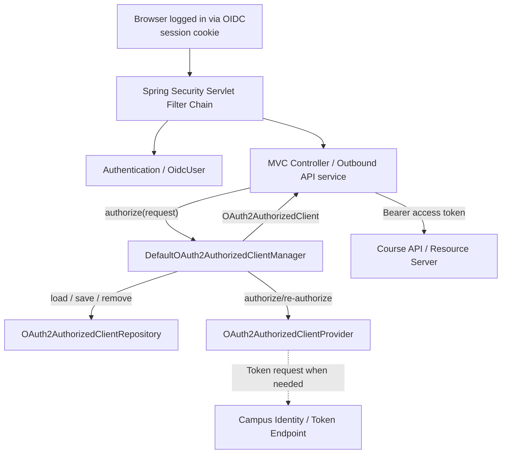
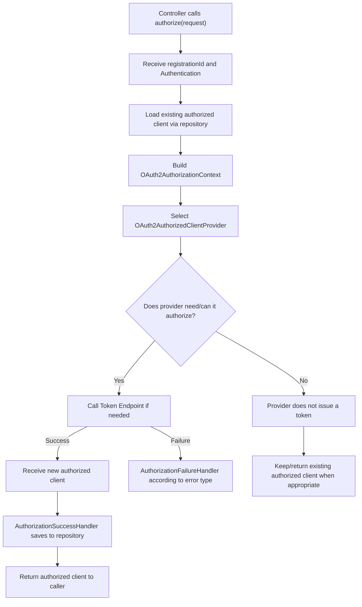
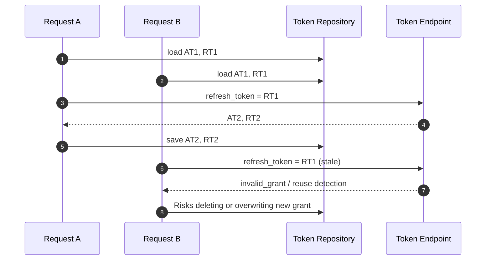

# 15.2. DefaultOAuth2AuthorizedClientManager in a Servlet Context

## Lesson Objectives

After this lesson, you will be able to:

- Explain what problem **`DefaultOAuth2AuthorizedClientManager`** solves in Spring Security OAuth 2.0/OIDC Client on the **Servlet stack**.
- Clearly distinguish `ClientRegistration`, `OAuth2AuthorizedClient`, `OAuth2AuthorizedClientRepository`, `OAuth2AuthorizedClientProvider`, `OAuth2AuthorizeRequest`, and `OAuth2AuthorizedClientManager`.
- Describe the complete flow of **looking up a saved authorized client → checking whether token issuance/reauthorization is needed → selecting the appropriate provider → persisting state on success or handling failure**.
- Create a `DefaultOAuth2AuthorizedClientManager` bean with `authorization_code`, `refresh_token`, and `client_credentials` providers as needed.
- Call the manager from a **Spring MVC controller** or outbound HTTP client layer with an authenticated request context, and obtain the access token for the right user/registration.
- Understand why a Servlet-based manager needs **`HttpServletRequest` and `HttpServletResponse`** and should not be used directly inside a `@Scheduled` job without a request.
- Design authorized client storage, refresh token rotation, concurrent requests, success/failure handlers, and token protection.
- Identify common causes of `null`, `ClientAuthorizationRequiredException`, `invalid_grant`, wrong principal, and missing request context errors.

## 1. Context: One Login Is Not Enough for Every API Call

Suppose **Learning Portal** is a Spring Boot MVC application using **Campus Identity** as its OpenID Provider. Students log in via the Authorization Code Flow, and Spring Security verifies the ID Token and creates a web login session.

Afterwards, the Portal needs to call the **Course API** on behalf of the student:

```http
GET /api/me/courses HTTP/1.1
Host: courses.example.org
Authorization: Bearer <access-token>
```

Access tokens have a lifetime. A user might stay on the site throughout a class session, while the access token is valid for only a few minutes. The application needs to solve these questions:

1. Does the current user already have an **authorized client** for registration `campus`?
2. If so, is the access token still usable?
3. If the access token is expired or about to expire and a valid refresh token is present, can the Token Endpoint be called to obtain a new token?
4. If a new token is issued, **where** must the updated state be saved?
5. If refreshing fails, how should the application handle the stored token?

Spring Security provides an abstraction:

```java
OAuth2AuthorizedClientManager
```

For a Servlet application handling HTTP requests, a key implementation is:

```java
DefaultOAuth2AuthorizedClientManager
```

It **orchestrates OAuth2 Client authorization state** within a request context, coordinating the repository and appropriate providers. It is not an Authorization Server, does not authenticate End-User passwords itself, is not a Resource Server, and does not replace API protection rules.

> **Core idea:** `DefaultOAuth2AuthorizedClientManager` is the orchestrator that lets a Servlet application **obtain the appropriate `OAuth2AuthorizedClient`** when it needs to call an OAuth2-protected resource, including using stored tokens and, when configured, reissuing tokens.

### 1.1. Role in the Architecture



Not every request needs to call the Token Endpoint. If the existing authorized client state is still valid, the manager can return the existing client without making a new token-issuance HTTP call.

## 2. Objects to Distinguish

| Object | Primary Responsibility | Stores an Access Token? |
| --- | --- | --- |
| `ClientRegistration` | OAuth2 Client configuration: client ID, provider, grant, scopes, endpoints | No |
| `ClientRegistrationRepository` | Looks up `ClientRegistration` by `registrationId` | No |
| `Authentication` | Authenticated identity/authorities in the request | Not an OAuth2 token store |
| `OAuth2AuthorizedClient` | State of a client authorized for a principal: access token, optional refresh token | **Yes** |
| `OAuth2AuthorizedClientRepository` | Saves/loads/removes authorized clients in a **Servlet HTTP request context** | Manages the object holding tokens |
| `OAuth2AuthorizedClientProvider` | Executes grant/reauthorization when conditions are met | Can produce a new authorized client |
| `OAuth2AuthorizeRequest` | Input for the manager: registration/authorized client, principal, and attributes | Not a token store |
| `DefaultOAuth2AuthorizedClientManager` | Coordinates providers, repository, saving results, and handling failures | Not a store itself |
| `OAuth2AuthorizedClientService` | Saves/loads authorized clients by principal name and registration ID without needing a Servlet request | Manages the object holding tokens |

An authorized client can be pictured as:

```text
OAuth2AuthorizedClient
  registration = campus
  principalName = student-9b71
  accessToken = AT1 (issuedAt / expiresAt / scopes)
  refreshToken = RT1 (if issued by OP)
```

It differs from `OidcUser`:

```text
OidcUser
  subject = student-9b71
  idToken = user authentication result
  claims = shared profile claims
```

**An ID Token proves the authentication result to the OIDC Client; an Access Token is used to call a Resource Server.** Do not send an ID Token as a Bearer access token just because both are JWTs.

### 2.1. Registration ID Is Different from Client ID

Example:

```yaml
registration:
  campus:
    client-id: learning-portal-web
```

- `campus` is **Spring's registration ID**.
- `learning-portal-web` is the **OAuth Client ID issued by the OP**.

`OAuth2AuthorizeRequest.withClientRegistrationId("campus")` selects the registration by its **internal key**. The manager then uses the actual OAuth Client details from that registration.

### 2.2. Authorized Clients Are Tied to a Principal

In a multi-user application:

```text
student A + campus -> AuthorizedClient A (AT-A / RT-A)
student B + campus -> AuthorizedClient B (AT-B / RT-B)
student A + partner -> AuthorizedClient A/partner
```

You cannot key a cache solely by `"campus"` and share tokens between two people. The repository/service must partition properly by authentication, session, or principal, accounting for tenant when required by the architecture.

## 3. The `OAuth2AuthorizedClientManager` Interface

Main API:

```java
public interface OAuth2AuthorizedClientManager {

    OAuth2AuthorizedClient authorize(
        OAuth2AuthorizeRequest authorizeRequest
    );
}
```

Depending on the API and version, the result can be `null` when no provider supports or can perform the appropriate authorization; errors during grant execution may also be thrown.

The manager accepts an `OAuth2AuthorizeRequest`, typically constructed with a builder:

```java
OAuth2AuthorizeRequest request =
    OAuth2AuthorizeRequest
        .withClientRegistrationId("campus")
        .principal(authentication)
        .build();

OAuth2AuthorizedClient authorizedClient =
    authorizedClientManager.authorize(request);
```

Here, `authentication` represents the **current user** in the request, for instance the result of OIDC Login. For machine-to-machine workloads, the principal can be a service identity designed by the application.

### 3.1. Two Ways to Specify Input

The manager can receive a request with:

- **`clientRegistrationId`**: looks up the registration and existing authorized client to decide whether to issue/reissue a token.
- **Existing `OAuth2AuthorizedClient`**: reprocesses an already-held state via the appropriate builder API.

In an MVC app, most cases use:

```java
.withClientRegistrationId("campus")
```

because the repository manages the authorized client corresponding to the registration and principal.

### 3.2. `principal` in an Authorize Request Is Not the API Audience

A request:

```java
OAuth2AuthorizeRequest.withClientRegistrationId("campus")
    .principal(authentication)
    .build();
```

does not mean `authentication.getName()` will be placed into the `aud` claim of the access token. The principal identifies the **authorization subject / storage key**; the Authorization Server determines the token, scopes, and audience according to the grant and policy.

## 4. `DefaultOAuth2AuthorizedClientManager` for Servlet HTTP Requests

Key constructor:

```java
new DefaultOAuth2AuthorizedClientManager(
    ClientRegistrationRepository clientRegistrationRepository,
    OAuth2AuthorizedClientRepository authorizedClientRepository
);
```

The two dependencies have distinct responsibilities:

- **ClientRegistrationRepository:** knows how to look up client configuration when a `registrationId` is requested.
- **OAuth2AuthorizedClientRepository:** knows how to load, save, or remove an authorized client keyed by **Authentication and HTTP request/response**.

This makes `DefaultOAuth2AuthorizedClientManager` suitable for:

- Spring MVC controllers.
- Services handling a request passing through the Servlet filter chain.
- HTTP client components integrated with Spring Security within the current request context.

It is not a natural fit for:

- `@Scheduled` jobs running without an HTTP request.
- Message consumers without an `HttpServletRequest`.
- Independent workloads running after the browser/session has ended.
- WebFlux applications with reactive APIs.

In situations without a Servlet context, use `AuthorizedClientServiceOAuth2AuthorizedClientManager` with `OAuth2AuthorizedClientService`, or the abstraction suited to your application type.

### 4.1. Why Are HTTP Request/Response Needed?

In Spring MVC, the HTTP request carries context related to:

- `SecurityContext` and `Authentication`.
- HTTP session (when used).
- Session cookies and current request metadata.
- Repository implementations that may store tokens per session or per principal.
- `HttpServletResponse` to support response-dependent save/remove operations.

Example repository method:

```java
OAuth2AuthorizedClient client =
    repository.loadAuthorizedClient(
        "campus",
        authentication,
        httpServletRequest
    );
```

And when saving:

```java
repository.saveAuthorizedClient(
    authorizedClient,
    authentication,
    httpServletRequest,
    httpServletResponse
);
```

The manager uses these operations so every caller does not have to manage token lifecycles manually.

### 4.2. Request Context Does Not Equal HTTP Session

For a logged-in user:

```text
Browser cookie -> request -> SecurityContext -> Authentication
```

The repository may choose to store in the **HTTP session**, or in a service store keyed by principal. Therefore, the manager **needs the request context to talk to the repository**, but that does not mean it always stores the token directly in a session attribute.

## 5. Configuring the Manager in Spring Boot

An example Servlet OAuth2 Client configuration:

```java
@Configuration
class OAuth2ClientManagerConfig {

    @Bean
    OAuth2AuthorizedClientManager authorizedClientManager(
            ClientRegistrationRepository registrations,
            OAuth2AuthorizedClientRepository authorizedClients) {

        OAuth2AuthorizedClientProvider provider =
            OAuth2AuthorizedClientProviderBuilder.builder()
                .authorizationCode()
                .refreshToken()
                .clientCredentials()
                .build();

        DefaultOAuth2AuthorizedClientManager manager =
            new DefaultOAuth2AuthorizedClientManager(
                registrations, authorizedClients
            );

        manager.setAuthorizedClientProvider(provider);
        return manager;
    }
}
```

Imports and dependencies are omitted to focus on the API. The code aligns with modern Spring Security OAuth2 Client APIs; real projects must use compatible Spring Boot/Spring Security versions.

Here:

1. `authorizationCode()` lets the provider handle Authorization Code Grant cases when the context is appropriate.
2. `refreshToken()` enables reauthorization using a refresh token when conditions are met.
3. `clientCredentials()` supports client credentials workloads if the application has such registrations.
4. `setAuthorizedClientProvider` explicitly specifies the set of providers the manager can use.
5. The constructor wires the manager with the Servlet repository for saving/retrieving state.

**Only enable the grants actually needed and permitted by the provider.** If the web Portal only uses Authorization Code + Refresh Token, configuring client credentials is unnecessary.

### 5.1. Note on Bean Auto-Configuration

In Spring Boot, many beans such as `ClientRegistrationRepository`, `OAuth2AuthorizedClientRepository`, `OAuth2AuthorizedClientService`, or manager components can be auto-configured depending on the version and configuration.

Do not declare an extra bean just because an example has `@Bean` if the project already has a manager meeting its needs. When overriding, verify which bean is used by:

- OAuth2 Login.
- `@RegisteredOAuth2AuthorizedClient` argument resolver.
- `RestClient`, `WebClient`, or other HTTP client integrations.
- Custom services calling `authorize()`.

One common source of bugs is having **multiple different managers/repositories** where components do not share the same authorized client store.

### 5.2. Corresponding OIDC Registration Configuration

Example `application.yml`:

```yaml
spring:
  security:
    oauth2:
      client:
        registration:
          campus:
            provider: campus
            client-id: ${CAMPUS_CLIENT_ID}
            client-secret: ${CAMPUS_CLIENT_SECRET}
            client-authentication-method: client_secret_basic
            authorization-grant-type: authorization_code
            redirect-uri: "{baseUrl}/login/oauth2/code/{registrationId}"
            scope:
              - openid
              - profile
              - courses.read
        provider:
          campus:
            issuer-uri: https://login.example.org/realms/campus
```

This assumes Campus Identity actually supports OIDC Discovery, has issued a client ID/secret to the backend, and allows the required scopes/API. URLs in this lesson are illustrative only. Secrets must come from environment variables or a secret manager and never be committed directly into source control.

Portal's `SecurityFilterChain`:

```java
@Configuration
class WebSecurityConfiguration {

    @Bean
    SecurityFilterChain securityFilterChain(HttpSecurity http) throws Exception {
        http
            .authorizeHttpRequests(auth -> auth
                .requestMatchers("/", "/error", "/assets/**").permitAll()
                .anyRequest().authenticated()
            )
            .oauth2Login(Customizer.withDefaults())
            .oauth2Client(Customizer.withDefaults());

        return http.build();
    }
}
```

`oauth2Login()` implements interactive login, while `oauth2Client()` enables the integrated OAuth2 Client features supporting authorized clients. The manager handles using/reissuing authorized clients after login.

### 5.3. `oauth2Login()` and the Manager Have Different Roles

| Task to Perform | Primary Component |
| --- | --- |
| Redirect user to OP | OAuth2 Authorization Request Redirect Filter |
| Receive callback with authorization code | OAuth2 Login Authentication Filter |
| Exchange code for tokens and create OIDC principal | OAuth2/OIDC Login authentication |
| Save initial authorized client | OAuth2 Client/Login authorized client mechanism |
| Retrieve authorized client when calling an API | Repository or manager |
| Refresh access token when needed | Manager + `refreshToken()` provider + Token Endpoint |
| Enforce permissions on Course API | Resource Server and business authorization |

Do not use `DefaultOAuth2AuthorizedClientManager` as a “log user in” function to replace the entire Authorization Code Flow.

## 6. Inside `authorize()`: What Steps Does the Manager Take?

A typical journey when a caller requests `campus`:



The diagram is an explanatory model: exact code details depend on the Spring Security version and provider chain. For example, the refresh token provider typically **does not refresh** if the token has not reached the refresh threshold or has no refresh token. The manager does not “unconditionally” call the Token Endpoint on every request.

### 6.1. Loading the Existing Authorized Client

The manager uses the registration ID, principal, and HTTP request to look up state:

```text
registrationId = campus
principal      = student A
repository     = A/campus authorized client if present
```

If user A has never authorized `campus`, the repository may return `null`. The configured provider determines whether authorization can be initiated.

If user A has already logged in via OIDC, the authorized client saved after the token exchange is usually available. However, if the user logged in via a different provider, there is no guarantee `campus` has been authorized.

### 6.2. Building the Authorization Context

The manager builds the context from:

- The requested `ClientRegistration` or one from an existing authorized client.
- `Authentication`/principal.
- Attributes supplied by the request or context attributes mapper.
- Current access token/refresh token state.

An `OAuth2AuthorizedClientProvider` uses the context to decide whether it can authorize, refresh, or issue a token and under which grant.

### 6.3. Delegating to Providers

`OAuth2AuthorizedClientProvider` is the abstraction that executes one or more grants. A composite provider built from the builder can choose behavior based on the registration and current state.

Examples:

```text
Authorized client exists, access token is still valid
  -> refreshToken provider may do nothing.

Authorized client exists, access token is near expiry, has refresh token
  -> refreshToken provider may call Token Endpoint.

Registration uses client_credentials, no authorized client exists yet
  -> clientCredentials provider may request an initial token.

Registration uses authorization_code but no browser authorization occurred
  -> cannot synthesize an authorization code with just an HTTP POST.
```

If no provider can perform authorization, do not treat the manager as an “issue tokens regardless of conditions” service. Interactive browser login or re-consent may be required.

### 6.4. Saving on Success

When the manager succeeds in authorizing/reauthorizing, the default success handler typically persists the authorized client via the repository.

Example before refresh:

```text
authorized client A/campus
  accessToken = AT1
  refreshToken = RT1
```

After the Token Endpoint returns new tokens:

```text
authorized client A/campus
  accessToken = AT2
  refreshToken = RT2 (if provider rotates)
```

The updated object must be saved so subsequent requests do not continue using the old token.

### 6.5. Handling Failures

When authorization fails, the manager can invoke `OAuth2AuthorizationFailureHandler`. Under common default configurations, errors like `invalid_grant` can cause the stored authorized client to be removed to avoid reusing an invalid grant.

**Not every error warrants deleting the token.** Timeouts or HTTP 5xx errors may be temporary; deleting the grant could force users to log in again unnecessarily. Customizing the failure handler requires classifying errors and preserving an appropriate storage policy.

## 7. Example Controller Calling the Manager to Obtain an Access Token

A typical usage is having the backend call an API using the current user's access token:

```java
@RestController
class CourseProxyController {

    private final OAuth2AuthorizedClientManager clientManager;
    private final RestClient restClient;

    CourseProxyController(
            OAuth2AuthorizedClientManager clientManager,
            RestClient.Builder restClientBuilder) {
        this.clientManager = clientManager;
        this.restClient = restClientBuilder.build();
    }

    @GetMapping("/api/my-courses")
    String myCourses(Authentication authentication) {

        OAuth2AuthorizeRequest request =
            OAuth2AuthorizeRequest.withClientRegistrationId("campus")
                .principal(authentication)
                .build();

        OAuth2AuthorizedClient client =
            clientManager.authorize(request);

        if (client == null) {
            throw new IllegalStateException(
                "OAuth2 client is not authorized for this request"
            );
        }

        String accessToken =
            client.getAccessToken().getTokenValue();

        return restClient.get()
            .uri("https://courses.example.org/api/me/courses")
            .headers(headers -> headers.setBearerAuth(accessToken))
            .retrieve()
            .body(String.class);
    }
}
```

Example assumptions:

- `/api/my-courses` is already protected by Spring Security.
- The current request has an `Authentication` for an OIDC-logged-in user.
- Registration `campus` has been granted scopes and tokens suitable for the Course API.
- `DefaultOAuth2AuthorizedClientManager` is being called **inside a Servlet request context**.
- Imports/dependencies and timeout/exception mappings are added in a real application.

**Never return the access token to the browser client** just because the controller obtained it. A Portal acting as a backend/BFF can call the Course API on the server and return filtered DTOs to the frontend.

### 7.1. What Does a `null` Result Mean?

The manager may return no authorized client when authorization cannot be performed given the provider/context. Some grant errors appear as exceptions rather than `null`.

In a real application, distinguish between:

- Missing required grant → redirect the user to the appropriate authorization flow.
- Refresh token rejected → re-login / re-consent required.
- Token Endpoint temporarily failing → report a downstream system error, with appropriate retries if applicable.
- Registration does not exist → configuration error.
- Missing Servlet request context → using the wrong manager for the environment.

Never write logic like “if the manager returns null, fall back to another user's access token”.

### 7.2. Why Not Get the Token Directly from the OIDC Principal?

`OidcUser` is the authenticated identity. An `OidcUser` holds an `OidcIdToken` and claims, and is not the place to manage the full lifecycle of access tokens meant for a Resource Server.

The manager and authorized client store handle authorization tokens. Separation of concerns:

```text
@AuthenticationPrincipal OidcUser
  -> logged-in identity (iss, sub, claims)

OAuth2AuthorizedClientManager
  -> access token/refresh token for registration + principal

Course API
  -> validates Bearer access token and API access permissions
```

## 8. Spring MVC and `@RegisteredOAuth2AuthorizedClient`

Spring Security provides a concise shorthand in controllers:

```java
@RegisteredOAuth2AuthorizedClient("campus")
OAuth2AuthorizedClient authorizedClient
```

Example:

```java
@GetMapping("/api/me/token-status")
Map<String, Object> status(
        @RegisteredOAuth2AuthorizedClient("campus")
        OAuth2AuthorizedClient authorizedClient) {

    return Map.of(
        "registrationId",
        authorizedClient.getClientRegistration().getRegistrationId(),
        "expiresAt",
        String.valueOf(
            authorizedClient.getAccessToken().getExpiresAt()
        )
    );
}
```

This is an illustrative endpoint only; do not expose token metadata unnecessarily, and **never** return `getTokenValue()` from a debug API.

The argument resolver for this annotation can use the authorized client manager to find or authorize the client according to configuration. Therefore, it is not necessarily identical to just calling `repository.loadAuthorizedClient(...)`.

| Access Method | Key Behavior |
| --- | --- |
| `repository.loadAuthorizedClient(...)` | Only **loads the already-saved object** |
| `manager.authorize(...)` | Can **authorize/refresh**, run providers/handlers, and persist the result |
| `@RegisteredOAuth2AuthorizedClient` | Resolves the client for a controller, potentially using the manager as configured |
| `AuthorizedClientService.loadAuthorizedClient(...)` | Loads solely by principal name and registration, without needing a request |

If the system needs explicit control over refresh errors and API calls, invoking the manager in a dedicated service usually keeps logic cleaner than putting everything inside controllers.

## 9. `OAuth2AuthorizedClientProvider`: Choosing the Right Grants

The manager does not automatically know which grants you want to support. `OAuth2AuthorizedClientProviderBuilder` lets you compose the appropriate providers.

Example:

```java
OAuth2AuthorizedClientProvider provider =
    OAuth2AuthorizedClientProviderBuilder.builder()
        .authorizationCode()
        .refreshToken()
        .build();
```

### 9.1. Authorization Code Provider

The Authorization Code Grant requires a browser authorization step:

```text
Browser -> Authorization Server
      -> Callback with authorization code
      -> Client exchanges code for token
```

You cannot simply call:

```java
manager.authorize(
    OAuth2AuthorizeRequest.withClientRegistrationId("campus")
        .principal(authentication)
        .build()
);
```

in an arbitrary job and expect an authorization code token for an unlogged-in user. Without prior authorization, the system requires browser interaction / an authorization request and Spring Security's redirect mechanisms.

With OIDC Login, the initial code exchange is usually already handled by `oauth2Login()`, and the authorized client is saved upon login.

### 9.2. Refresh Token Provider

The `refreshToken()` provider can use a refresh token to obtain a new access token when needed:

```text
Before:
  AT1 expired / near expiry
  RT1 valid

Token Endpoint:
  grant_type=refresh_token
  refresh_token=RT1
  client authentication per registration

After:
  AT2 and possibly RT2
```

A refresh token is not necessarily issued to every client. An OIDC provider may require `offline_access` or a specific policy to issue a refresh token; requesting a scope does not guarantee the provider will grant it.

Some token responses return only a new access token without a new refresh token; in that case, the management logic must retain the appropriate refresh token according to provider behavior. With rotation, `RT2` must be saved accurately.

### 9.3. Client Credentials Provider

The `clientCredentials()` provider supports the **application's** grant, not a token on behalf of an End-User:

```yaml
registration:
  course-sync:
    authorization-grant-type: client_credentials
    client-id: ${SYNC_CLIENT_ID}
    client-secret: ${SYNC_CLIENT_SECRET}
    scope:
      - courses.sync
```

Client Credentials is typically suited for backend-to-backend communication. A data sync service without a browser is better served by **`AuthorizedClientServiceOAuth2AuthorizedClientManager`** instead of relying on a Servlet request.

### 9.4. Do Not Confuse `refreshToken()` with an Automatic Timer

The provider normally evaluates state when the manager **is called**. It does not mean Spring spawns a background timer scanning every token and refreshing them before a user visits a page.

```text
09:00: Login, AT1 issued
09:04: No requests, manager is not called
09:10: Browser calls /api/my-courses
09:10: authorize() detects refresh is needed if provider/config allows
```

Deferring refresh until a request arrives is generally appropriate for web apps; proactive/background refresh needs a different design.

## 10. HTTP Request Context: The Most Commonly Misused Part

`DefaultOAuth2AuthorizedClientManager` uses a Servlet repository with the signature:

```java
OAuth2AuthorizedClient loadAuthorizedClient(
    String clientRegistrationId,
    Authentication principal,
    HttpServletRequest request
);
```

When running under `DispatcherServlet` with Spring Security, the request/response can be obtained from the Servlet request context or supplied via context attributes depending on your version's API.

However, inside:

```java
@Scheduled
void pollCourses() {
    // No browser request.
}
```

no corresponding request/response exists. Calling the Servlet manager without providing or having the necessary context can result in missing-request errors or failure to load the authorized client.

**Never fabricate a fake `HttpServletRequest` for a background job just to force the Servlet manager to work.** Choose the manager/service designed for scenarios without an HTTP request.

### 10.1. Context Attributes Mapper

The manager provides a hook:

```java
manager.setContextAttributesMapper(...);
```

This hook transforms attributes from `OAuth2AuthorizeRequest` into the attribute map used in `OAuth2AuthorizationContext`, allowing providers to read needed values.

Attributes can support certain grants or context-dependent providers/customizations. This is **not** a mechanism to change the issuer, bypass authentication, or self-grant permissions.

If you customize the mapping, know which providers read which keys and preserve the values required for default behavior. Misconfiguration can prevent a provider from performing authorization.

### 10.2. Passing Request/Response Directly

Some APIs/integrations allow attaching `HttpServletRequest` and `HttpServletResponse` to `OAuth2AuthorizeRequest` attributes when using the manager in logic not directly inside a controller but **still** within a valid Servlet request.

Since APIs/constants can differ across Spring Security versions, the safe approach is to use the official integration for your current version rather than hardcoding arbitrary attribute key strings.

Principles:

- Request/response must belong to the **real HTTP transaction** currently executing.
- Principal must match the right user/grant.
- Repository must use the same store as the login flow.
- Do not cache or retain request/response objects beyond the request.

## 11. Choosing an `OAuth2AuthorizedClientRepository`

The manager needs a repository, but **does not enforce** a single storage strategy.

### 11.1. `HttpSessionOAuth2AuthorizedClientRepository`

Stores authorized clients in the HTTP session:

```java
@Bean
OAuth2AuthorizedClientRepository authorizedClientRepository() {
    return new HttpSessionOAuth2AuthorizedClientRepository();
}
```

Useful when the grant only needs to live for the browser session.

Notes:

- When the session expires or is invalidated, authorized clients in the old session are no longer accessible.
- In a multi-instance environment, you need shared sessions, sticky sessions, or a suitable strategy.
- The session store contains sensitive tokens and must be protected.
- Clearing the local session does not necessarily revoke tokens at the Authorization Server.

### 11.2. `AuthenticatedPrincipalOAuth2AuthorizedClientRepository`

This implementation typically uses:

- **`OAuth2AuthorizedClientService`** for authenticated principals.
- Another repository, usually session-based, when the principal is not authenticated according to the implementation's criteria.

Example:

```java
@Bean
OAuth2AuthorizedClientRepository authorizedClientRepository(
        OAuth2AuthorizedClientService service) {

    return new AuthenticatedPrincipalOAuth2AuthorizedClientRepository(service);
}
```

Key characteristic: tokens for authenticated principals can be stored by **registration ID and principal name** in a service store, rather than solely in the browser's session.

If using `JdbcOAuth2AuthorizedClientService`, token state can outlive the web session depending on data and cleanup policies. Logging out of the browser does not automatically guarantee tokens in the service store are deleted.

### 11.3. Comparing Storage Strategies

| Criterion | HTTP Session Repository | Principal + Authorized Client Service |
| --- | --- | --- |
| Primary key | Session context | Registration ID + principal name |
| Suitable for | Web logins using tokens only while session is active | Tokens needing lifecycle management decoupled from session where permitted |
| Multi-instance | Requires shared session/sticky routing per model | Requires shared service store, e.g. JDBC |
| Logout | Invalidating session can clear local token | May require explicit remove/revoke calls |
| Background access | Not direct | Service manager can leverage it with the right grant |
| Risks | Session hijacking, session store exposure | Database token leakage, principal name collisions, retention |

Never blindly use email as the principal key: emails can change and can collide across different OPs. In OIDC, an identity typically needs `(issuer, subject)` to link safely to an internal user.

## 12. Success Handler and Failure Handler

`DefaultOAuth2AuthorizedClientManager` provides hooks for handling authorization success/failure.

### 12.1. Success

When a provider produces a new authorized client, the success handler can save it to the repository. The manager's default behavior usually handles this already.

Potential customization needs:

- Recording a `refresh_success` metric by registration.
- Auditing which grant type was used without logging tokens.
- Adding special persistence rules in a multi-tenant store.

**Warning:** When replacing the authorization success handler, make sure it **still saves the updated authorized client**. If you only log success and forget persistence, subsequent requests may keep reading the old access token or a rotated refresh token.

### 12.2. Failure

An authorization failure handler can:

- Remove an authorized client that is no longer valid if the grant was rejected by the OP.
- Record metrics by error type.
- Signal the caller that re-authorization is required.
- Preserve state during transient network errors.

Example classification:

| Error | Likelihood | Handling Approach |
| --- | --- | --- |
| `invalid_grant` on refresh | Refresh token expired, revoked, or reused | Remove/stop using old grant, require re-authorization |
| `invalid_client` | Wrong client ID/secret/method | Fix registration and Token Endpoint client authentication |
| HTTP 5xx | Temporary Token Endpoint error | Bounded retry / circuit breaker per policy |
| Timeout after refresh request | Server may have rotated token without client receiving response | Handle uncertain state; avoid blind retries with old token |
| Missing authorized client | No authorization yet or store cannot find it | Initiate appropriate authorization or notify login needed |
| Missing Servlet context | Manager called in wrong environment | Switch to service manager or integration with a real request |

Do not configure “delete the authorized client on every exception” if transient network drops would force mass user re-logins.

## 13. Refresh Token Rotation and Concurrent Requests

A common web app scenario: a user opens multiple tabs, and each tab calls the API simultaneously just as the access token is about to expire.

Initial state:

```text
Authorized client:
  accessToken = AT1 (expired)
  refreshToken = RT1
```

Two requests A and B both read the token from the repository:



Depending on the provider, refresh token rotation and reuse detection may invalidate `RT1` immediately after A succeeds. Request B using the stale `RT1` may be rejected; under some policies, the entire token family may be revoked.

`DefaultOAuth2AuthorizedClientManager` provides authorization and persistence abstractions, **not a distributed lock** guaranteeing only one request refreshes each grant across all JVMs.

### 13.1. Design Solutions

Consider:

- **Single-flight refresh** per registration + principal/tenant: concurrent requests await one shared refresh operation.
- **Optimistic concurrency/versioning** when writing to the token store: prevent overwriting newer state with older state.
- **Distributed locking** when running multiple instances sharing a token store.
- **Re-reading the latest token version** after an `invalid_grant` race error if safely supported by policy.
- Controlling retries on token endpoint timeouts.
- Never extending refresh token lifetimes or disabling reuse detection just to avoid concurrency handling.

These techniques are the responsibility of the application architecture and authorized client store. Do not assume every repository/service implementation includes multi-node synchronization out of the box.

### 13.2. Do Not Drop the New Refresh Token

If the OP returns:

```text
AT2 + RT2
```

and the application only saves `AT2` while keeping `RT1`, the next refresh will fail. Ensure the updated authorized client is persisted intact according to the library and provider's policy.

## 14. When to Use `AuthorizedClientServiceOAuth2AuthorizedClientManager`?

Comparing the two implementations:

| Criterion | `DefaultOAuth2AuthorizedClientManager` | `AuthorizedClientServiceOAuth2AuthorizedClientManager` |
| --- | --- | --- |
| Context | **Servlet request context** | Outside an HTTP request or service-level |
| State store | `OAuth2AuthorizedClientRepository` | `OAuth2AuthorizedClientService` |
| Depends on `HttpServletRequest/Response` | Yes, via repository/context | No |
| Suitable for | MVC controllers, web requests, user-initiated outbound API calls | Scheduled jobs, message listeners, batches, services |
| Supports refresh/token grants | Via configured providers | Via configured providers |
| Principal | Request's `Authentication` or properly specified principal | Principal name/identity managed by caller |
| Requires secure token management | Yes | Yes |

Example manager for background jobs:

```java
@Bean
OAuth2AuthorizedClientManager backgroundClientManager(
        ClientRegistrationRepository registrations,
        OAuth2AuthorizedClientService service) {

    OAuth2AuthorizedClientProvider provider =
        OAuth2AuthorizedClientProviderBuilder.builder()
            .clientCredentials()
            .build();

    AuthorizedClientServiceOAuth2AuthorizedClientManager manager =
        new AuthorizedClientServiceOAuth2AuthorizedClientManager(
            registrations, service
        );

    manager.setAuthorizedClientProvider(provider);
    return manager;
}
```

In a `@Scheduled` job, a stable principal can be used for the workload:

```java
OAuth2AuthorizeRequest request =
    OAuth2AuthorizeRequest.withClientRegistrationId("course-sync")
        .principal("course-sync-job")
        .build();

OAuth2AuthorizedClient client =
    backgroundClientManager.authorize(request);
```

This example is only appropriate when registration `course-sync` permits `client_credentials` and the corresponding permissions. It is not a way to simulate an End-User OIDC login.

### 14.1. Do Not Transfer User Tokens to Background Jobs via Arbitrary Shared Principals

An application may want to perform offline processing on behalf of a user; if the OP allows offline access/refresh tokens, this requires consent, durable storage under the exact identity, a revocation policy, and grant protection.

Never use:

```text
principal = "admin"
```

for all user-delegated tokens just so a job can load an authorized client. This can misassign authorization subjects and leak data. Use a specific, trustedly mapped principal identity and an appropriate policy.

## 15. Login, Logout, and Authorized Clients Are Three Related but Distinct Lifecycles

In an OIDC application:

```text
OIDC Login
    -> Spring Security Authentication
    -> Session/SecurityContext
    -> OAuth2AuthorizedClient saved

Later:
    -> Manager obtains/refreshes OAuth2AuthorizedClient
    -> Uses Access Token to call Course API
```

On logout:

- The local session may be destroyed.
- Local `Authentication`/`SecurityContext` may be cleared.
- If tokens are stored in the session, the authorized client may disappear with the session.
- If tokens are stored in a persistent service, token records may still remain until deleted by policy.
- The OP may still hold an SSO session and refresh tokens without an appropriate logout/revocation workflow.

**Removing an authorized client from the repository is different from token revocation at the Authorization Server.** If grants need to be revoked, integrate the revocation endpoint or an OP-provided mechanism with proper authorization and error handling.

### 15.1. Do Not Use the Manager as a Logout Tool

`authorize()` is designed to obtain an authorized client, not to revoke grants. Use repository/service removal and OP revocation as needed. Avoid accidentally calling `authorize()` to “check the token” inside a logout endpoint, as that could refresh the token right before deleting it.

## 16. Security: What the Manager Does and Does Not Do

`DefaultOAuth2AuthorizedClientManager` helps orchestrate **OAuth2 Client authorization**. It cannot replace:

- Authentication filters and OIDC ID Token validation for the login session.
- Access token validation at the Resource Server.
- `@PreAuthorize`, roles/scopes, and resource ownership rules on the Course API.
- Cookie security, CSRF protection, and session fixation protection.
- Protecting secrets/refresh tokens in the database, KMS, or secret manager.
- Distributed locking when refresh tokens are rotated.
- Tenant isolation and audit design.

### 16.1. Tokens Should Only Go to the Right Resource Server

An access token obtained via the manager is not automatically valid for every API.

Example:

```text
AT for Course API
  scopes: courses.read
  audience: course-api
```

Do not use this token to call another API without authorization. The target API is responsible for checking signature/introspection, issuer, audience, expiration, and permissions according to its profile.

### 16.2. Never Return Tokens to the Frontend

Avoid:

```java
@GetMapping("/api/token")
String token(...) {
    return authorizedClient.getAccessToken().getTokenValue();
}
```

A BFF/server-side client should use the token **on the backend** to call APIs and return filtered business data. If the frontend is a direct public client, that is a different OAuth architecture requiring dedicated token and browser security design.

### 16.3. Data to Protect in Logs

Some metadata can be logged safely:

```text
registrationId = campus
principalReference = hashed/internal-id
authorizationAttempt = refresh
result = success
accessTokenExpiry = <timestamp>
correlationId = <safe-id>
```

Never log:

```text
access_token
refresh_token
client_secret
raw ID Token
client_assertion
authorization code
HTTP Authorization header
session cookie
```

Even if an access token expires, leaking a refresh token can allow obtaining new access tokens. The token store must be protected as a credential store, not merely as a performance cache.

## 17. Diagnosing Common Errors

| Symptom | Possible Cause | Resolution |
| --- | --- | --- |
| `manager.authorize()` returns `null` | Provider does not support grant/state, registration not yet authorized | Check provider chain, grant, and whether flow completed |
| Registration not found | `registrationId` does not exist or `clientId` was used by mistake | Check key under `spring.security.oauth2.client.registration` |
| No authorized client after login | Different repository/store, different principal name, or lost session | Cross-check login config, repository, and `Authentication` |
| Access token expired without refreshing | Missing `refreshToken()` provider, no refresh token, or threshold not met | Check providers and Token Endpoint response |
| `ClientAuthorizationRequiredException` | Interactive authorization code flow required | Redirect user to authorization flow; never fabricate codes |
| `invalid_grant` on refresh | Refresh token expired, revoked, rotated/reused | Re-authorize, handle new state, and synchronize concurrency |
| `invalid_client` at Token Endpoint | Wrong secret, private key, or client authentication method | Check `ClientRegistration` and OP policy |
| Background job fails due to missing servlet request | Using `DefaultOAuth2AuthorizedClientManager` outside HTTP request | Use `AuthorizedClientServiceOAuth2AuthorizedClientManager` |
| User A calls API with User B's token | Incorrect principal partitioning in cache/store | Check user/tenant/registration binding and concurrency |
| Request A refreshes successfully, B deletes token | Refresh token rotation race and failure handler | Single-flight/locking/versioning; classify errors |
| Token still in DB after logout | Stored in service store with lifecycle independent of session | Define remove/revocation policy |
| New token not used on subsequent requests | Custom success handler forgot to save or instances use different stores | Check persistence and multi-node store |
| `@RegisteredOAuth2AuthorizedClient` has no token | Mismatched request principal/registration/provider | Check resolver, manager bean, and OAuth2 login |
| `403` on Resource Server even though manager returns token | Token lacks required scope/role/ownership | Fix permissions/consent/API authorization, do not weaken manager |
| `401` on Resource Server | Wrong issuer/audience, expired, or invalid token | Check token issued for target API and Resource Server validation |

### 17.1. Layer-by-Layer Investigation Process

1. **Registration:** Are `registrationId`, `clientId`, grant type, Token Endpoint, and scopes correct?
2. **Authentication:** Which user/service principal does the request belong to? Is it on the right security chain?
3. **Repository:** Where is the authorized client for that registration and principal stored?
4. **Provider:** Which grants are configured? Has the access token expired? Is a refresh token present?
5. **Token Endpoint:** What category of error did the Authorization Server return?
6. **Persistence:** Was the new access/refresh token saved? Are there multiple instances?
7. **Resource Server:** Is the access token accepted, and does the user have business-level permission?

Avoid fixing manager issues by disabling token verification at the API or borrowing another account's client secret/token.

## 18. Practical Exercises

### Exercise 1 — Choosing the Right Manager

A system has:

- A Servlet controller `/api/my-courses` receiving a student's browser session.
- A scheduled job `course-sync` running hourly using Client Credentials.

**Question:** Which manager should be used?

**Answer:** `DefaultOAuth2AuthorizedClientManager` with a Servlet repository for the controller; `AuthorizedClientServiceOAuth2AuthorizedClientManager` with a service store for the background job.

### Exercise 2 — Distinguishing Repository and Manager

Given:

```java
OAuth2AuthorizedClient client =
    repository.loadAuthorizedClient("campus", auth, request);
```

**Question:** If the access token has expired, does the call above request a new token automatically?

**Answer:** No. The repository only loads state. You need a manager/provider capable of refreshing per the grant and saving the updated version.

### Exercise 3 — Why Is `refreshToken()` Needed?

Configuration only has:

```java
OAuth2AuthorizedClientProviderBuilder.builder()
    .authorizationCode()
    .build();
```

After login, the Portal has a refresh token, but the access token expires.

**Question:** Should you expect the manager to refresh automatically?

**Answer:** No. You must configure the refresh token provider or another appropriate refresh mechanism, and the OP must permit the refresh grant.

### Exercise 4 — Results from the Manager

There are two users A and B sharing registration `campus`. The controller calls:

```java
manager.authorize(
    OAuth2AuthorizeRequest.withClientRegistrationId("campus")
        .principal(authentication)
        .build()
);
```

**Question:** Who must `authentication` represent?

**Answer:** The authenticated principal of the **current request**. Never use another user's `Authentication` or a shared generic service principal for delegated user grants.

### Exercise 5 — Refresh Token Rotation

Two requests both hold `RT1`. A exchanges it for `RT2`, while B still sends `RT1` and gets `invalid_grant`.

**Question:** Is simply replacing the manager bean enough to eliminate the race?

**Answer:** No. You need concurrency control in the application/token store, error classification, and accurate token version updates.

### Exercise 6 — Background Job Calling the Servlet Manager

A `@Scheduled` method uses `DefaultOAuth2AuthorizedClientManager` without an `HttpServletRequest`.

**Question:** How should this be handled?

**Answer:** Use a manager backed by `OAuth2AuthorizedClientService`, with the registration/grant/principal suited to the job, rather than faking a browser request.

### Exercise 7 — Removing Authorized Clients After Logout

The Portal stores authorized clients in a JDBC service store; logout destroys the HTTP session, yet the refresh token remains in the DB.

**Question:** Did Spring Security fail to log out?

**Answer:** Not necessarily. Local session, authorized client persistence, and OP revocation are separate lifecycles. An explicit deletion/revocation policy must be designed.

### Exercise 8 — Avoiding Token Exposure

A developer wants to return:

```json
{
  "accessToken": "<raw-token>",
  "refreshToken": "<raw-refresh-token>"
}
```

from a controller so the frontend can call the API.

**Question:** In a backend/BFF model, what is the better approach?

**Answer:** Keep tokens on the backend, let the manager issue/refresh per request, have the backend call the Resource Server with the Bearer token, and return filtered business DTOs. Never use a debug API to expose credentials.

## 19. Self-Check Questions

**1. Is `DefaultOAuth2AuthorizedClientManager` the Authorization Server's Token Endpoint?**

> No. It is a client-side Spring Security component that orchestrates finding/issuing/reissuing authorized clients.

**2. Why does the constructor take `ClientRegistrationRepository` and `OAuth2AuthorizedClientRepository`?**

> One supplies client configuration, while the other supplies saved authorized client state associated with a principal and HTTP request.

**3. Does `authorize()` always call the Token Endpoint?**

> No. If the existing token is still valid or no provider needs/can perform authorization, an HTTP token request is not necessarily made.

**4. What is the role of `OAuth2AuthorizedClientProvider`?**

> To handle configured grants/reauthorization, such as authorization code, refresh token, or client credentials.

**5. Does the manager refresh tokens automatically when no requests arrive?**

> Not via a default background timer. It typically evaluates and reissues tokens when a caller invokes `authorize()`.

**6. Why is the Servlet manager unsuitable for scheduled jobs?**

> Because it is designed to use an authorized client repository with an HTTP request/response context, whereas scheduled jobs normally lack a Servlet request.

**7. How does `OAuth2AuthorizedClient` differ from `OidcUser`?**

> An authorized client holds OAuth2 token state; `OidcUser` represents the authenticated OIDC identity and claims.

**8. When a refresh succeeds and the OP returns a new refresh token, what is critical?**

> The new authorized client must be saved properly, avoiding retaining the stale refresh token and resolving races when concurrent requests occur.

**9. Can you call `repository.loadAuthorizedClient(...)` to refresh automatically?**

> No. The repository only manages save/load/remove; the manager coordinates providers to issue/reissue tokens.

**10. Does the manager guarantee the user has permission to read a record in the Course API?**

> No. The Resource Server and business services must validate the access token, scopes, roles, and resource ownership.

---

## Summary

**`DefaultOAuth2AuthorizedClientManager`** is the **`OAuth2AuthorizedClientManager`** implementation for **Spring Security OAuth2/OIDC Client in a Servlet HTTP request context**. It coordinates `ClientRegistrationRepository`, `OAuth2AuthorizedClientRepository`, and a chain of `OAuth2AuthorizedClientProvider`s to **retrieve existing authorized clients, perform reauthorization when needed, persist new tokens, and handle errors**. For web controllers already logged in via OIDC, use the manager to obtain the appropriate access token for APIs while keeping tokens on the backend; for background jobs without an HTTP request, choose **`AuthorizedClientServiceOAuth2AuthorizedClientManager`**. In production, protect the repository, isolate principals/tenants, handle refresh token rotation, success/failure handlers, logout/revocation, and enforce resource permissions independently of successful token issuance.
