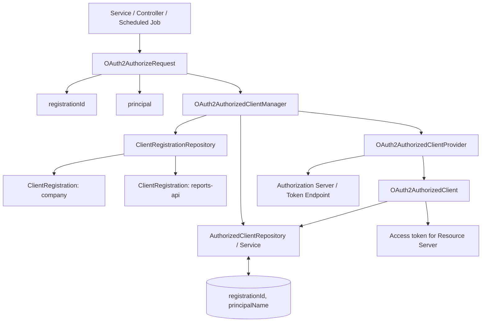

# 15.6. Choosing Registration ID and Principal When Requesting Authorization

## 1. The Problem: One Client Manager, but for Whom and Which Application Are We Fetching a Token?

In **Spring Security OAuth 2.0 / OIDC Client**, a system may manage multiple OAuth2 Client registrations (`ClientRegistration`) and multiple identities requesting authorization. When obtaining, using, or refreshing an access token, the application cannot simply call a generic “get latest token” method. It must specify:

1. **`registrationId`:** selects which OAuth2 Client configuration to use, e.g., `company`, `partner`, or `reports-api`.
2. **`principal`:** specifies which identity/context the authorized client belongs to, such as a logged-in employee or a stable technical principal for a background job.

Spring Security puts these two choices into **`OAuth2AuthorizeRequest`**, which is passed to **`OAuth2AuthorizedClientManager.authorize(...)`**.

Suppose the **Employee Portal** application has three flows:

- Employees log in via OIDC at the company OP, after which the backend calls APIs on their behalf via registration `company`.
- Partner users log in via OIDC at another OP, using registration `partner`.
- A scheduled job calls the Reports API using `client_credentials`, registration `reports-api`, and technical principal `reports-batch`.

Each flow can request access tokens, yet **tokens from different providers, principals, or purposes must never be mixed**.

> **Core takeaway:** `registrationId` selects the **OAuth2 Client configuration**, while `principal` is the **identity context** that the manager/service uses to look up, persist, and reissue the authorized client. Both must originate from trusted sources and remain stable according to the application's policy.

This lesson belongs to chapter **“15. Client Manager”**, focusing on how to construct authorize requests accurately and avoid confusing `OAuth2AuthorizeRequest` with the browser authorization request sent to the Authorization Endpoint.

## 2. Foundational Concepts

### 2.1. What Does `OAuth2AuthorizedClientManager` Do?

`OAuth2AuthorizedClientManager` is the abstraction that orchestrates the lifecycle of an **authorized client** when the application needs permission to access a resource. It coordinates:

- `ClientRegistrationRepository` to locate the registration.
- `OAuth2AuthorizedClientRepository` or `OAuth2AuthorizedClientService` to look up stored tokens.
- `OAuth2AuthorizedClientProvider` to execute supported grants, such as Authorization Code, Client Credentials, or Refresh Token.
- Success/failure handlers to save or handle the authorized client when authorization succeeds/fails.

An authorize call can result in:

- Returning an existing, still-valid `OAuth2AuthorizedClient`.
- Obtaining a new token from the Authorization Server when the grant is supported and preconditions are met.
- Refreshing the token when the access token is expired or near expiry and a valid refresh token exists.
- Returning `null` when no provider can perform authorization for the current context.
- Throwing an exception if authorization fails or the request/configuration is invalid.

**“Authorize” here does not mean “log a user in”.** Especially with `client_credentials`, there is no user/browser login, yet the manager still needs a principal to identify the authorized client record.

### 2.2. Distinguishing Requests That Share the Word “Authorization”

| Object | When Used? | Notable Data |
| --- | --- | --- |
| **`OAuth2AuthorizationRequest`** | When the browser is about to be redirected to the Authorization Endpoint | `client_id`, `redirect_uri`, `scope`, `state`, PKCE, `nonce` |
| **`OAuth2AuthorizeRequest`** | When application code calls `OAuth2AuthorizedClientManager.authorize(...)` | **`clientRegistrationId` or authorized client**, **`principal`**, context-dependent attributes |
| **`OAuth2AuthorizationCodeGrantRequest`** | When exchanging an authorization code for tokens at the Token Endpoint | Registration and authorization exchange |
| **`OAuth2AuthorizedClient`** | Once the client has been issued a token | Registration, principal name, access token, refresh token if present |

Example:

```java
OAuth2AuthorizeRequest request = OAuth2AuthorizeRequest
        .withClientRegistrationId("reports-api")
        .principal("reports-batch")
        .build();

OAuth2AuthorizedClient authorizedClient =
        authorizedClientManager.authorize(request);
```

This snippet **does not generate an HTTP redirect to the OP**. With `reports-api` configured for `client_credentials` and an appropriate manager/provider, it can make a **backend-to-backend token request** to obtain an access token for the service account. With an unauthorized `authorization_code` registration, the process may require a browser authorization flow rather than merely calling the manager in the background.

### 2.3. Component Diagram



The diagram illustrates responsibilities; exact lookup/persistence order depends on manager type, token state, grant, and Spring Security version.

## 3. Selecting `registrationId`: Determining Which Client and Provider Are Used

### 3.1. Where Does the Registration ID Come From?

A Spring Boot application may declare in `application.yml`:

```yaml
spring:
  security:
    oauth2:
      client:
        registration:
          company:
            provider: company-idp
            client-id: ${COMPANY_OIDC_CLIENT_ID}
            client-secret: ${COMPANY_OIDC_CLIENT_SECRET}
            authorization-grant-type: authorization_code
            redirect-uri: "{baseUrl}/login/oauth2/code/{registrationId}"
            scope:
              - openid
              - profile
              - email

          reports-api:
            provider: reports-as
            client-id: ${REPORTS_CLIENT_ID}
            client-secret: ${REPORTS_CLIENT_SECRET}
            authorization-grant-type: client_credentials
            scope:
              - reports.read

        provider:
          company-idp:
            issuer-uri: https://login.example.com/realms/company
          reports-as:
            token-uri: https://auth.example.com/oauth2/token
```

Hosts and credentials are examples only. In real deployments, use metadata/issuer/endpoints of a trusted Authorization Server and load secrets from a secure configuration system.

The keys under `registration` are:

```text
company
reports-api
```

Those are the **registration IDs** that Java code passes into `OAuth2AuthorizeRequest.withClientRegistrationId(...)`.

### 3.2. `registrationId` Differs from `clientId` and `issuer`

| Field | Example | Meaning |
| --- | --- | --- |
| **`registrationId`** | `company` | Spring internal key used to select `ClientRegistration` |
| **`clientId`** | `employee-portal-web` | Client identifier registered at the Authorization Server |
| **`issuerUri`** | `https://login.example.com/realms/company` | Trusted OP identifier for OIDC |
| **`tokenUri`** | `https://auth.example.com/oauth2/token` | Backend endpoint used to request/refresh tokens |
| **`principalName`** | `employee-4821` | Identity/context key of the authorized client |
| **`grantType`** | `authorization_code` or `client_credentials` | How the client is issued tokens |

Do not write:

```java
// WRONG by intent if "employee-portal-web" is the client_id at the OP:
OAuth2AuthorizeRequest.withClientRegistrationId("employee-portal-web");
```

when the repository only contains registration `company`. The argument must be **Spring's registration key**, not the `client_id`.

### 3.3. Consequences of Choosing the Wrong Registration

If you fetch `reports-api` instead of `company`:

- The token may be issued via **Client Credentials**, not representing the logged-in employee.
- The token endpoint/issuer differs.
- The scopes may be `reports.read` instead of user login scopes.
- The access token's audience may target a different API.
- The Resource Server may reject the token with `401`/`403`.
- Worse, if the application sends a valid Bearer token to the wrong place, it can expose access or cause incorrect authorization behavior.

Therefore, choosing a registration ID is a **security architecture decision**, not just a configuration parameter name.

## 4. Selecting `principal`: Which Context Does the Authorized Client Belong To?

### 4.1. `principal` Is an `Authentication`

In an authorize request, the `principal(...)` API accepts an **`Authentication`**. Spring Security uses this principal context to determine the principal name and data required for authorization.

In an application with logged-in users:

```java
public OAuth2AuthorizedClient authorizeForUser(
        Authentication authentication,
        OAuth2AuthorizedClientManager manager) {

    OAuth2AuthorizeRequest request = OAuth2AuthorizeRequest
            .withClientRegistrationId("company")
            .principal(authentication)
            .build();

    return manager.authorize(request);
}
```

This example assumes `authentication` is an object **already authenticated by Spring Security** on the current request and a manager suited to the Servlet HTTP context is configured. Never manually fabricate a fake `Authentication` with arbitrary authorities just to pull another user's token.

### 4.2. `principal(String)` Is for Stable Technical Identifiers

The `OAuth2AuthorizeRequest` builder also provides a convenience method accepting a `String` principal name. This is useful in the service tier / background where there is no authenticated browser user:

```java
OAuth2AuthorizeRequest request = OAuth2AuthorizeRequest
        .withClientRegistrationId("reports-api")
        .principal("reports-batch")
        .build();
```

In this example:

- `reports-api` is a client credentials registration.
- `reports-batch` is a **technical identifier governed by the backend**.
- The principal name is stable so subsequent runs load/save the same authorized client.
- This name is not a user email, not a client secret, and not an account that interactively logged in at the OP.

**`principal("reports-batch")` does not prove the caller owns the “reports-batch” identity.** It is a way to supply context to the manager. Authorization and permission to invoke the application's own service must be protected by a separate authentication/authorization layer.

### 4.3. Principal Directly Affects the Token Storage Key

With `OAuth2AuthorizedClientService`, records are typically identified by the pair:

```text
(clientRegistrationId, principalName)
```

Examples:

| Registration ID | Principal Name | Meaning |
| --- | --- | --- |
| `company` | `employee-4821` | Token tied to employee 4821 on the company client |
| `company` | `employee-9274` | Different token, belonging to employee 9274 |
| `partner` | `partner-user-14` | Partner user's token |
| `reports-api` | `reports-batch` | Token for a service-to-service job |
| `reports-api` | `reports-manual` | Another intentional principal namespace |

Two authorized clients with the same `registrationId` but **different principal names** are normally not looked up from the same row. If they share the same principal name yet have **different `registrationId`s**, they are also two distinct key pairs.

> **Critical risk:** If code takes an arbitrary `principalName` from a user's URL/body and calls the manager/service with that name, an attacker can attempt to load an authorized client belonging to another user. The principal name used to select a token **is not a client-declared permission**.

### 4.4. Differences Between `Authentication.getName()` and OIDC `sub`

With OIDC Login, the `OidcUser` principal may derive its name from `sub` under default configuration; however, applications can customize `userNameAttributeName` or the principal name strategy.

Therefore:

- Do not assume `Authentication.getName()` always equals email.
- Do not assume `Authentication.getName()` always equals `sub` in every app.
- With multiple issuers, `sub` is only unique **within an issuer**. Principal namespace design must avoid collisions across tenants/issuers when sharing registrations or stores.
- If you change the principal naming strategy, old tokens in `OAuth2AuthorizedClientService` may no longer be found under the new name.

In a multi-tenant application, maintain **stable and properly partitioned identifiers** per the storage contract. For instance, you cannot mix users with the same username string from two tenants under a shared registration and principal key if they must stay isolated.

## 5. Constructing `OAuth2AuthorizeRequest` Properly

### 5.1. Using `withClientRegistrationId(...)`

This is the most common approach:

```java
OAuth2AuthorizeRequest authorizeRequest =
        OAuth2AuthorizeRequest
            .withClientRegistrationId("company")
            .principal(authentication)
            .build();

OAuth2AuthorizedClient authorizedClient =
        authorizedClientManager.authorize(authorizeRequest);
```

Meaning:

1. The manager looks up the `company` configuration from `ClientRegistrationRepository`.
2. The manager/repository looks up the authorized client matching the principal.
3. If an authorized client exists and is eligible for use, it can be returned.
4. If needed and a matching provider exists, the manager can authorize/refresh.
5. The result is returned as `OAuth2AuthorizedClient`, or handled per contract when impossible.

**Do not call `authorizeRequest.getPrincipal()` as a way to infer an authenticated user**; valid `Authentication` sources must come from the application's security layer.

### 5.2. Using `withAuthorizedClient(...)`

If code already holds a previously issued `OAuth2AuthorizedClient` and wants the manager to reprocess it in the matching context, it can pass that object directly:

```java
OAuth2AuthorizeRequest authorizeRequest =
        OAuth2AuthorizeRequest
            .withAuthorizedClient(existingAuthorizedClient)
            .principal(authentication)
            .build();

OAuth2AuthorizedClient result =
        authorizedClientManager.authorize(authorizeRequest);
```

This assumes `existingAuthorizedClient` came from a trusted source for the **exact principal/registration**. The builder extracts the registration ID from the passed authorized client.

This option is useful in integrations that already obtained an authorized client via a Spring Security resolver/repository. **Never accept an arbitrary user-constructed authorized client object and treat it as proof of permission to use the token.**

### 5.3. Across Multiple Request Types, Always Pass a Consistent Principal

An `OAuth2AuthorizeRequest` can be constructed by controllers, services, framework argument resolvers, or `WebClient` integrations. If each place uses a different principal name for the same token, the system may:

- Fail to load the saved authorized client.
- Unnecessarily request new authorizations/tokens.
- Create duplicate rows serving the same purpose.
- Hit refresh token rotation races when two keys inadvertently share the same credentials.
- Fail to delete the right token when the user disconnects.
- Misroute permissions across users/tenants.

Hence, define a **principal naming policy** per use case rather than letting each controller pick a different string.

## 6. Distinguishing Servlet and Service-Tier Managers

### 6.1. `DefaultOAuth2AuthorizedClientManager`

This is the manager suited to **HTTP Servlet requests**, using `OAuth2AuthorizedClientRepository`:

```java
import org.springframework.context.annotation.Bean;
import org.springframework.context.annotation.Configuration;
import org.springframework.security.oauth2.client.DefaultOAuth2AuthorizedClientManager;
import org.springframework.security.oauth2.client.OAuth2AuthorizedClientManager;
import org.springframework.security.oauth2.client.OAuth2AuthorizedClientProvider;
import org.springframework.security.oauth2.client.OAuth2AuthorizedClientProviderBuilder;
import org.springframework.security.oauth2.client.registration.ClientRegistrationRepository;
import org.springframework.security.oauth2.client.web.OAuth2AuthorizedClientRepository;

@Configuration
public class ServletAuthorizedClientConfig {

    @Bean("servletAuthorizedClientManager")
    OAuth2AuthorizedClientManager servletAuthorizedClientManager(
            ClientRegistrationRepository registrations,
            OAuth2AuthorizedClientRepository authorizedClients) {

        OAuth2AuthorizedClientProvider provider =
                OAuth2AuthorizedClientProviderBuilder.builder()
                    .authorizationCode()
                    .refreshToken()
                    .build();

        var manager = new DefaultOAuth2AuthorizedClientManager(
                registrations,
                authorizedClients);
        manager.setAuthorizedClientProvider(provider);
        return manager;
    }
}
```

This manager uses the request/response and `Authentication` from the Servlet context when loading/saving authorized clients. It can be used in controllers/services **invoked during an HTTP request**.

Notes:

- `authorizationCode()` does not turn a plain Java service into a browser login flow. If no authorized client exists yet and user authorization is required, Spring Security may need to initiate a redirect and handle callbacks via the corresponding OAuth2 mechanism.
- `refreshToken()` works when an authorized client and a refresh token matching the grant/provider already exist.
- Merely declaring the manager bean does not automatically wire every `WebClient`/`RestClient` endpoint to use it; it must be configured into the HTTP client.

### 6.2. `AuthorizedClientServiceOAuth2AuthorizedClientManager`

For scheduled jobs, queue consumers, or background services **without an `HttpServletRequest`**, Spring Security provides the **service-tier manager** working with `OAuth2AuthorizedClientService`:

```java
import org.springframework.context.annotation.Bean;
import org.springframework.context.annotation.Configuration;
import org.springframework.security.oauth2.client.AuthorizedClientServiceOAuth2AuthorizedClientManager;
import org.springframework.security.oauth2.client.OAuth2AuthorizedClientManager;
import org.springframework.security.oauth2.client.OAuth2AuthorizedClientProvider;
import org.springframework.security.oauth2.client.OAuth2AuthorizedClientProviderBuilder;
import org.springframework.security.oauth2.client.OAuth2AuthorizedClientService;
import org.springframework.security.oauth2.client.registration.ClientRegistrationRepository;

@Configuration
public class ServiceTierOAuth2Config {

    @Bean("serviceTierAuthorizedClientManager")
    OAuth2AuthorizedClientManager serviceTierAuthorizedClientManager(
            ClientRegistrationRepository registrations,
            OAuth2AuthorizedClientService authorizedClients) {

        OAuth2AuthorizedClientProvider provider =
                OAuth2AuthorizedClientProviderBuilder.builder()
                    .clientCredentials()
                    .build();

        var manager = new AuthorizedClientServiceOAuth2AuthorizedClientManager(
                registrations,
                authorizedClients);
        manager.setAuthorizedClientProvider(provider);
        return manager;
    }
}
```

With a `client_credentials` `ClientRegistration`, this manager can obtain tokens in a scheduled job without a browser.

**Do not switch from the Servlet manager to the service-tier manager just to dodge a “no HTTP request” error** if the real business requirement needs Authorization Code user consent. Respect the nature of the grant. A background job needing permissions on behalf of a user must rely on an authorized client previously granted by that user and an appropriate retention/refresh mechanism, never accepting a user principal from untrusted input.

### 6.3. Quick Comparison

| Feature | Servlet Manager | Service-Tier Manager |
| --- | --- | --- |
| Class | `DefaultOAuth2AuthorizedClientManager` | `AuthorizedClientServiceOAuth2AuthorizedClientManager` |
| Token store | `OAuth2AuthorizedClientRepository` | `OAuth2AuthorizedClientService` |
| Can use HTTP request/response | Yes, this is its primary context | Not required |
| Suitable for | Web controllers, MVC integrations, user sessions | Scheduled jobs, background consumers, services |
| Typical grants | Authorization Code and Refresh Token | Client Credentials, Refresh Token per configuration |
| Principal | Authenticated user in the request | Technical principal or an explicitly authorized auth object |
| How tokens are stored | Repository may use session or service | Service stores by registration/principal |

Do not mix Servlet APIs with reactive WebFlux. The reactive stack has `ReactiveOAuth2AuthorizedClientManager`, returns `Mono<OAuth2AuthorizedClient>`, and uses dedicated reactive repositories/services.

## 7. Practical Example A: Obtaining an Authorized Client for a Logged-In User

### 7.1. Goal

Employee Portal has users logged in via OIDC using registration `company`. A controller needs an access token so the backend can call an API permitted on that user's behalf.

Prerequisites:

- The user has been authenticated by Spring Security; never use a user ID from a query parameter in place of `Authentication`.
- `ClientRegistration` `company` is configured.
- The manager uses a store consistent with login/repository so it can load the saved authorized client.
- The token must have scopes/audience matching the target API. Successful OIDC login **does not automatically guarantee the access token works for every API**.

### 7.2. Service Using Principal from `Authentication`

```java
package com.example.portal.api;

import org.springframework.beans.factory.annotation.Qualifier;
import org.springframework.security.authentication.AnonymousAuthenticationToken;
import org.springframework.security.core.Authentication;
import org.springframework.security.oauth2.client.OAuth2AuthorizeRequest;
import org.springframework.security.oauth2.client.OAuth2AuthorizedClient;
import org.springframework.security.oauth2.client.OAuth2AuthorizedClientManager;
import org.springframework.stereotype.Service;

@Service
public class EmployeeApiTokenService {

    private final OAuth2AuthorizedClientManager manager;

    public EmployeeApiTokenService(
            @Qualifier("servletAuthorizedClientManager")
            OAuth2AuthorizedClientManager manager) {
        this.manager = manager;
    }

    public OAuth2AuthorizedClient authorizeForCurrentUser(
            Authentication authentication) {

        if (authentication == null
                || !authentication.isAuthenticated()
                || authentication instanceof AnonymousAuthenticationToken) {
            throw new IllegalStateException(
                    "Authenticated user is required");
        }

        OAuth2AuthorizeRequest authorizeRequest =
                OAuth2AuthorizeRequest
                    .withClientRegistrationId("company")
                    .principal(authentication)
                    .build();

        OAuth2AuthorizedClient client = manager.authorize(authorizeRequest);

        if (client == null) {
            throw new IllegalStateException(
                    "OAuth2 client is not authorized for this user");
        }

        return client;
    }
}
```

### 7.3. Controller Using Real `Authentication` from Spring Security

```java
package com.example.portal.web;

import java.util.Map;

import org.springframework.security.core.Authentication;
import org.springframework.web.bind.annotation.GetMapping;
import org.springframework.web.bind.annotation.RestController;

import com.example.portal.api.EmployeeApiTokenService;

@RestController
public class EmployeeController {

    private final EmployeeApiTokenService tokenService;

    public EmployeeController(EmployeeApiTokenService tokenService) {
        this.tokenService = tokenService;
    }

    @GetMapping("/employee/token-status")
    public Map<String, String> tokenStatus(Authentication authentication) {
        var authorizedClient =
                tokenService.authorizeForCurrentUser(authentication);

        return Map.of(
                "registrationId",
                authorizedClient.getClientRegistration().getRegistrationId(),
                "principalName",
                authorizedClient.getPrincipalName(),
                "expiresAt",
                authorizedClient.getAccessToken().getExpiresAt().toString()
        );
    }
}
```

This example endpoint returns **metadata**, not the access token value. In a real product, consider not exposing `principalName` if it constitutes personal data or an internal identifier. When calling APIs, attach the token to **outbound requests targeting a trusted API host**, never returning raw tokens to the browser.

The most important point is that **`Authentication` is injected into the controller by Spring Security**, and that exact context is passed to the manager. Never do this:

```java
// Unsafe approach: browser client picks principalName itself.
String principalName = request.getParameter("principal");
OAuth2AuthorizeRequest.withClientRegistrationId("company")
        .principal(principalName)
        .build();
```

An arbitrary principal string **does not prove** the caller's identity. When the system stores tokens keyed by principal, using unverified input to select the key risks privilege confusion.

### 7.4. What If No Authorized Client Exists Yet?

In the example where the user logged in via OIDC, `OAuth2AuthorizedClient` may already have been saved by Spring Security upon a successful callback. If it is absent:

- With Authorization Code, the manager may signal that browser authorization is needed or fail to complete in the current context; proper login/`oauth2Client` configuration is required to take the user through the consent/authorization flow.
- With only a `refreshToken` provider, without an existing token/refresh token, a new token cannot be issued on the user's behalf.
- With Client Credentials, a new token can be issued if the registration/provider supports it and the backend holds client credentials.

**Never fabricate a fake `OAuth2AuthorizedClient` or substitute someone else's access token** just to make `authorize(...)` “succeed”.

## 8. Practical Example B: Client Credentials in a Background Job

### 8.1. Stable Principal Needed, No User Login Needed

A scheduled job calls the Reports API every hour. Registration `reports-api` has the `client_credentials` grant. We choose a meaningful technical principal, such as `reports-batch`, and use it consistently.

```java
package com.example.portal.reports;

import org.springframework.beans.factory.annotation.Qualifier;
import org.springframework.security.oauth2.client.OAuth2AuthorizeRequest;
import org.springframework.security.oauth2.client.OAuth2AuthorizedClient;
import org.springframework.security.oauth2.client.OAuth2AuthorizedClientManager;
import org.springframework.stereotype.Service;

@Service
public class ReportsAuthorizationService {

    private final OAuth2AuthorizedClientManager manager;

    public ReportsAuthorizationService(
            @Qualifier("serviceTierAuthorizedClientManager")
            OAuth2AuthorizedClientManager manager) {
        this.manager = manager;
    }

    public OAuth2AuthorizedClient getClientForReportsJob() {
        OAuth2AuthorizeRequest request = OAuth2AuthorizeRequest
                .withClientRegistrationId("reports-api")
                .principal("reports-batch")
                .build();

        OAuth2AuthorizedClient authorizedClient = manager.authorize(request);

        if (authorizedClient == null) {
            throw new IllegalStateException(
                    "reports-api could not be authorized");
        }

        return authorizedClient;
    }
}
```

In the example above:

- `reports-api` selects the **token endpoint, client ID/secret, grant, and scopes**.
- `reports-batch` identifies the **token record for the job**. It is not a real human user and does not replace protecting who may trigger the job.
- The service-tier manager can use a JDBC/in-memory authorized client service to reuse still-valid tokens.
- If a new token is needed, the manager coordinates the `clientCredentials` provider and the Token Endpoint.
- The access token typically represents the **application/service**, not a specific employee.

### 8.2. What Happens If the Principal Changes on Every Run?

Suppose code generates the principal using a timestamp:

```java
// Do not do this for the same stable service client.
String principalName = "reports-batch-" + System.nanoTime();
```

Each `authorize(...)` call uses a different principal key. Consequences:

- Previously saved tokens are not found under the old key.
- Unnecessary new access token requests may be made.
- The JDBC table/cache accumulates duplicate authorized clients for the same purpose.
- Cleanup and observability become harder.
- Rate limits/token quotas at the Authorization Server may be hit sooner.

**Use a stable technical principal** for a stable authorization scope. When isolation by tenant or workload is genuinely needed, pick an intentional name/namespace and control the allowed values.

### 8.3. Share Tokens Across Multiple Jobs or Separate Them?

If two background jobs use the same registration `reports-api` and principal `reports-batch`, they can share the authorized client state in the store. This is only reasonable if:

- Both jobs share the same trust boundary.
- They share the same client ID, scopes, audience, and access permissions.
- Doing so does not violate audit/isolation requirements.
- Concurrent token issuance and caching/refresh are handled properly.

If two workloads need different permissions, use separate **`ClientRegistration` entries** or separate principal namespaces paired with matching token policies. **A distinct principal name alone does not give a token fewer scopes**: scopes and grants still depend on the `ClientRegistration` and Authorization Server.

## 9. Why Cannot `principal` Be Chosen Arbitrarily for an Authorization Code User Token?

### 9.1. Principal Is a Lookup Key for Potentially Very Sensitive Tokens

In a JDBC authorized client store, rows might look like:

```text
oauth2_authorized_client
  client_registration_id | principal_name
  ---------------------------------------
  company                | employee-4821
  company                | employee-9274
  reports-api            | reports-batch
```

If an API does not verify the current user and accepts a request:

```http
GET /internal/token?registrationId=company&principalName=employee-9274
```

and automatically calls the manager with `principalName=employee-9274`, it can retrieve or use a token **outside the caller's authority**. That is an object-level access vulnerability (IDOR / confused deputy) in application design.

### 9.2. Safety Principles

1. **User principal:** obtain from the `Authentication` verified by Spring Security, never from arbitrary query parameters/headers.
2. **Service principal:** a constant/config controlled by the backend, never a “self-declared caller username”.
3. **Registration:** select from a business-tied allowlist, never exposing an open “choose any client” API to all callers.
4. **API permission:** check independently; a token may be valid while the caller is unauthorized to ask the server to use it.
5. **Tenant boundary:** never let untrusted tenant input choose both registration and principal without prior authentication/authorization.
6. **Logging:** never log access/refresh tokens when an invalid key or manager error occurs.

### 9.3. Can a Principal Name String Be Passed Instead of a Real `Authentication`?

At the API level, `OAuth2AuthorizeRequest.Builder.principal(String)` supports this. However, that only means **the manager receives a principal name to associate the token with**. It **does not authenticate the caller**, does not guarantee the principal is currently logged in, and does not permit impersonation.

Distinguish these situations:

| Situation | Proper Way to Choose Principal |
| --- | --- |
| Browser user logged in and calling an API on their own behalf | `principal(authentication)` with verified `Authentication` |
| Background Client Credentials job | `principal("stable-service-name")` |
| Scheduled sync on behalf of a previously consented user | Use the user identity/token store via a governed delegation workflow; the service must be authorized to act for that user |
| External client sends `principalName` wanting the server to use someone else's token | **Reject** unless explicit separate authorization exists |
| A tenant selects an arbitrary `tenantId` in a query parameter | Verify membership/authorization before mapping to registration/principal |

In real implementations, a service authorized to act on a user's behalf may deliberately use the principal name of a previously consented user, but that requires **the system's own verified proof of delegation**, never a raw string from an incoming request.

## 10. Selecting a Registration When Calling APIs with `WebClient`

### 10.1. Why Does an HTTP Client Also Need Explicit Selection?

Applications rarely call `OAuth2AuthorizedClientManager.authorize(...)` directly inside every controller. Instead, they use an HTTP client integrated with Spring Security OAuth2 Client to fetch the access token automatically and set:

```http
Authorization: Bearer <access-token>
```

on outbound requests.

When multiple registrations exist, the HTTP client needs to know **which registration ID** to use and **which principal** is making the call. Avoid configurations that automatically attach a user's token to every outbound HTTP request, especially requests to untrusted hostnames.

### 10.2. `WebClient` Example on the Servlet Stack

`WebClient` belongs to the Spring WebFlux HTTP client module, yet can still be used in a **Spring MVC/Servlet** application when the right dependency is present. Example using `ServletOAuth2AuthorizedClientExchangeFilterFunction` and a configured manager:

```java
package com.example.portal.api;

import org.springframework.beans.factory.annotation.Qualifier;
import org.springframework.context.annotation.Bean;
import org.springframework.context.annotation.Configuration;
import org.springframework.security.oauth2.client.OAuth2AuthorizedClientManager;
import org.springframework.security.oauth2.client.web.reactive.function.client.ServletOAuth2AuthorizedClientExchangeFilterFunction;
import org.springframework.web.reactive.function.client.WebClient;

@Configuration
public class UserApiWebClientConfig {

    @Bean
    WebClient userApiWebClient(
            @Qualifier("servletAuthorizedClientManager")
            OAuth2AuthorizedClientManager manager) {

        var oauth2 =
                new ServletOAuth2AuthorizedClientExchangeFilterFunction(manager);

        return WebClient.builder()
                .baseUrl("https://user-api.example.com")
                .apply(oauth2.oauth2Configuration())
                .build();
    }
}
```

If using Spring Boot Servlet with `spring-boot-starter-web`, add the `spring-webflux` module (or compatible dependency) to use `WebClient`. This example still uses the **Servlet security manager** and does not convert `SecurityFilterChain` to reactive.

When calling an API on behalf of an authenticated user, you can specify both registration and `Authentication` in request attributes:

```java
import static org.springframework.security.oauth2.client.web.reactive.function.client
        .ServletOAuth2AuthorizedClientExchangeFilterFunction.authentication;
import static org.springframework.security.oauth2.client.web.reactive.function.client
        .ServletOAuth2AuthorizedClientExchangeFilterFunction.clientRegistrationId;

import org.springframework.security.core.Authentication;
import org.springframework.web.reactive.function.client.WebClient;
import reactor.core.publisher.Mono;

public Mono<String> userProfileFromApi(
        WebClient userApiWebClient,
        Authentication authentication) {

    return userApiWebClient.get()
            .uri("/api/me")
            .attributes(clientRegistrationId("company"))
            .attributes(authentication(authentication))
            .retrieve()
            .bodyToMono(String.class);
}
```

This snippet is an **illustrative method**; in a real application, `WebClient` is injected into a service and `Authentication` comes from an authenticated request. With **`DefaultOAuth2AuthorizedClientManager`**, the HTTP servlet request/response must be supplied or present in the appropriate context. When logic runs via a scheduler or async thread that does not preserve request context, do not assume the Servlet manager will work; use the service-tier manager if the use case allows.

Most importantly:

- `clientRegistrationId("company")` selects the **registration**.
- `authentication(authentication)` specifies the **principal/security context of the request**.
- `WebClient` integrates with the manager to look up/obtain tokens and attach the Bearer token.
- The target URL is an API host controlled by the application. Never use an OAuth-filtered HTTP client to call arbitrary browser-supplied URLs without an allowlist.

### 10.3. Selecting an Existing Authorized Client Instead of Registration ID

If the controller already holds a contextually valid `OAuth2AuthorizedClient`, it can pass that client directly into the request:

```java
import static org.springframework.security.oauth2.client.web.reactive.function.client
        .ServletOAuth2AuthorizedClientExchangeFilterFunction.oauth2AuthorizedClient;

Mono<String> response = userApiWebClient.get()
        .uri("/api/me")
        .attributes(oauth2AuthorizedClient(authorizedClient))
        .retrieve()
        .bodyToMono(String.class);
```

`authorizedClient` must come from a trusted source and belong to the current user. This approach is clean when the API/controller has already used an argument resolver or manager to obtain a specific authorized client.

**Avoid setting `setDefaultOAuth2AuthorizedClient(true)` by default on a `WebClient` used across arbitrary URLs.** Implicit token selection can attach a user's token to unintended outbound requests. Prefer explicit selection by registration or authorized client.

### 10.4. MVC Argument Resolver: Another Option

Spring Security Servlet supports injecting an authorized client into MVC handlers when appropriately configured:

```java
import org.springframework.security.oauth2.client.OAuth2AuthorizedClient;
import org.springframework.security.oauth2.client.annotation.RegisteredOAuth2AuthorizedClient;
import org.springframework.web.bind.annotation.GetMapping;
import org.springframework.web.bind.annotation.RestController;

@RestController
public class AccountsController {

    @GetMapping("/accounts/info")
    public String info(
            @RegisteredOAuth2AuthorizedClient("company")
            OAuth2AuthorizedClient authorizedClient) {

        return "Using client registration: "
                + authorizedClient.getClientRegistration().getRegistrationId();
    }
}
```

This makes the **registration ID explicit right in the signature**, and Spring Security uses the authorized client mechanism appropriate for the request. It does not automatically guarantee the user has been granted every scope/audience of the target API, and should never be used to return raw tokens to the browser.

For applications with explicit principal requirements and complex token-selection logic, constructing `OAuth2AuthorizeRequest` explicitly makes control and observability easier.

## 11. Choosing Registration and Principal in Multi-Provider / Multi-Tenant Systems

### 11.1. The Multi-Provider Problem

Suppose Employee Portal accepts:

- `company`: company employees' OIDC issuer.
- `partner`: partners' OIDC issuer.
- `reports-api`: Client Credentials for an internal API.

A user logged in via `partner` **does not automatically have a token for `company`**. When a controller calls the manager:

```java
OAuth2AuthorizeRequest.withClientRegistrationId("company")
        .principal(partnerAuthentication)
        .build();
```

the manager may not find a matching authorized client. If the Authorization Code flow for `company` requires user consent, a `partner` login session does not automatically grant consent at `company`.

Never take `registrationId` from a browser-sent query parameter to switch dynamically to arbitrary issuers. If a product has a “Connect another account” feature, it must have an explicit authorization flow handling consent/callbacks for approved providers.

### 11.2. Mapping Tenant to Registration via an Allowlist

A multi-tenant architecture may need to select a registration based on the user's tenant. For example, a service managing a trusted mapping:

```java
public String registrationForAuthorizedTenant(String tenantId) {
    return switch (tenantId) {
        case "north" -> "north-oidc";
        case "south" -> "south-oidc";
        default -> throw new IllegalArgumentException(
                "Unsupported tenant");
    };
}
```

**Critical precondition:** `tenantId` must already be authenticated/authorized for the current user. The mapping function above only illustrates an **allowlist**; it does not replace verifying that the user belongs to the selected tenant.

Safe flow:

```text
Request selects tenant
       |
       v
Verified Authentication
       |
       v
Verify user has access to that tenant
       |
       +-- No -> 403 Forbidden
       |
       v
Governed tenant -> registrationId mapping
       |
       v
OAuth2AuthorizeRequest.principal(authentication)
       |
       v
OAuth2AuthorizedClientManager.authorize(...)
```

Never populate `issuer_uri`, `token_uri`, or `client_secret` from untrusted input into a dynamic `ClientRegistration`. Beyond secret leaks, that can cause SSRF or provider mix-up.

### 11.3. Boundaries of the Authorized Client Key Pair

In a storage service, a pair:

```text
(clientRegistrationId, principalName)
```

does not automatically represent every multi-tenant case. If two tenants share the same `clientRegistrationId` and users in both tenants have the same `principalName`, a collision can happen.

Design options depending on architecture:

1. Use **separate registration IDs per tenant/issuer**, when the number of registrations is manageable.
2. Use a **stable principal name namespaced by issuer/tenant**, if normalized at the same storage layer without skewing `Authentication`.
3. Use a custom token repository/service with a **tenant-aware key**, if dynamic multi-tenancy demands it.
4. Ensure all load/save/remove operations follow the exact same key rules.
5. Avoid mapping users by email if emails can collide, change, or be unverified.

Do not merely prepend a tenant prefix to a string in one controller while login/callbacks still save the authorized client under a different principal. The manager will fail to find the row, and the privilege-mixing risk remains unresolved.

### 11.4. Client Credentials Also Needs Workload Isolation

If the same `client_credentials` client serves multiple tenants, sharing one access token may violate isolation, audit, or scope policies. Decide:

- Does each tenant use a separate client registration?
- Is there one shared client registration whose token carries tenant-specific claims/audience?
- Must tokens be fetched per workload or under a single service identity?
- Is the principal name in the token store sufficiently partitioned per policy?

**Changing the principal name does not alter the `scope` or `audience` issued by the Authorization Server.** If tokens with different permissions are required, the registration/request and Authorization Server policy must actually issue distinct permissions.

## 12. Selecting Registration and Principal Across Different Grants

| Grant Type | Typical Registration | Principal to Use | How Tokens Are Obtained |
| --- | --- | --- | --- |
| `authorization_code` | `company`, `partner` | Authenticated user's `Authentication` or an explicitly authorized principal | User authorization via browser, callback, and token exchange |
| `client_credentials` | `reports-api` | Stable service/workload principal | Backend calls token endpoint using client credentials |
| `refresh_token` | Original registration of the authorized client | **Keep the exact principal under which the authorized client was saved** | Uses refresh token bound to the existing authorized client |
| `password` (legacy) | Only in legacy systems with special justification | Principal per dedicated policy | Legacy grant unsuitable for modern OAuth design; avoid in new systems |
| JWT bearer / token exchange (if supported) | Registration designed for that grant | Verified principal/context per contract | Depends on extension and provider |

**Grant type is a property of the registration**, whereas principal is the context the manager uses for storage/lookup. You cannot “switch to Client Credentials” merely by passing `principal("service")` for an `authorization_code` registration.

### 12.1. When Refreshing Tokens, Principal Must Be Consistent

Suppose the initial OIDC login saves the authorized client under:

```text
(company, employee-4821)
```

Later, code calls:

```java
OAuth2AuthorizeRequest.withClientRegistrationId("company")
        .principal("employee-4821@example.com")
        .build();
```

Because the new name does not match `employee-4821`, the manager may fail to find the existing authorized client even though the access/refresh tokens sit in the database. The result may be forced re-authorization or failure to refresh as expected.

Keep a **consistent principal naming strategy from login through subsequent usage/refresh**. If migrating principal names, migrate the token store or apply a planned reauthorization policy rather than randomly patching callers.

### 12.2. When Client Credentials Uses a User Principal

Sometimes code writes:

```java
OAuth2AuthorizeRequest.withClientRegistrationId("reports-api")
        .principal(userAuthentication)
        .build();
```

where `reports-api` uses `client_credentials`. This API can still fetch a token under the application's client identity; however, if the service persists by user principal, the same client token gets duplicated across many user keys.

That is usually **unnecessary** if the token represents the application and shares the same scopes/audience. Prefer a stable technical principal. If business requirements mandate separating authorized clients per user/tenant for audit or policy, design it explicitly so **client identity** is not conflated with **user authorization**.

## 13. When to Use `withAuthorizedClient(...)` Instead of `withClientRegistrationId(...)`?

### 13.1. `withClientRegistrationId`

Appropriate when code knows **which registration to use** but does not hold the authorized client object:

```java
OAuth2AuthorizeRequest.withClientRegistrationId("reports-api")
        .principal("reports-batch")
        .build();
```

The manager can load an existing token itself or request a new one if supported by a provider.

### 13.2. `withAuthorizedClient`

Appropriate when code already has a trusted authorized client (e.g., returned by an MVC argument resolver) and wants to reuse that exact registration and context:

```java
OAuth2AuthorizeRequest.withAuthorizedClient(existingAuthorizedClient)
        .principal(authentication)
        .build();
```

The manager can use the supplied authorized client state while coordinating providers, depending on registration, token expiry, and manager configuration.

### 13.3. Selection Table

| What You Have | Appropriate Choice |
| --- | --- |
| Only know registration ID and principal | `withClientRegistrationId(id)` |
| Already have an authorized client retrieved from the repository for the current user | `withAuthorizedClient(client)` |
| Need Client Credentials in the background | `withClientRegistrationId(id).principal(stableServiceName)` |
| User logged in and needs an access token for an API | `withClientRegistrationId(id).principal(authentication)` or securely resolved authorized client |
| Have an `OAuth2AuthorizedClient` constructed from external input | **Never trust by default**; must come from a trusted source |
| Want to transfer user A's token to user B | **Cannot** be solved by changing principal; requires valid permission/delegation |

## 14. Additional Attributes on `OAuth2AuthorizeRequest`

Beyond registration and principal, the builder also allows adding **attributes** to support providers/managers needing extra context.

Structural example:

```java
OAuth2AuthorizeRequest request =
        OAuth2AuthorizeRequest
            .withClientRegistrationId("reports-api")
            .principal("reports-batch")
            .attributes(attributes -> {
                attributes.put("operation", "scheduled-report");
            })
            .build();
```

A custom attribute like `operation` **does not automatically become a token request parameter**, a claim in the token, or a scope at the OP. It is only used if the application's manager/context attributes mapper/provider has logic to interpret and process that key.

In the Servlet manager, `HttpServletRequest` and `HttpServletResponse` may also be needed context for loading/saving in `OAuth2AuthorizedClientRepository`. Spring Security usually obtains them from the HTTP request context or attributes passed through the corresponding mechanism.

If code runs outside a request thread, do not inject a fake request into attributes to trick the Servlet manager. Choose the **service-tier manager**, or design the flow according to the authorization's nature.

### 14.1. Never Use Attributes to Spoof Authentication

`attributes` does not replace `principal(authentication)` and does not grant permissions to the caller. For example:

```java
.attributes(attrs -> attrs.put("username", "admin"))
```

must never be interpreted as the user being logged in with an admin role. If an application writes a `contextAttributesMapper` that uses untrusted data to determine users/scopes, that is a **vulnerability in custom code**, not an automatic feature of OAuth2 Client.

### 14.2. When Dynamic Scopes Are Needed

Some use cases require incremental authorization or dynamic scopes per operation. Never assume “changing the principal or an arbitrary attribute is enough to ask for higher scopes”.

Actual scopes still depend on:

- `ClientRegistration.scope` and the provider.
- Authorization request/consent.
- The set of scopes granted by the Authorization Server.
- Whether the existing authorized client satisfies the new scopes.
- Resource Server policy when validating the access token.

When dynamic scopes are needed, use properly supported APIs/flows and govern permission requests; do not overwrite a stored authorized client for the same principal/registration with a narrower or differently scoped token without an explicit policy.

## 15. Handling `authorize(...)` Results Properly

### 15.1. Returned `OAuth2AuthorizedClient`

A successful authorize call can return:

```java
OAuth2AuthorizedClient client = manager.authorize(request);

if (client == null) {
    throw new IllegalStateException(
            "Authorization was not available for the current context");
}

String registrationId =
        client.getClientRegistration().getRegistrationId();

String principalName = client.getPrincipalName();

var accessToken = client.getAccessToken();
```

Distinguish clearly:

- `registrationId` from the returned object should match the registration the application intended.
- `principalName` is the owner/context of the authorized client.
- `accessToken` is a **sensitive credential**; use it only to call appropriate resource endpoints.
- `client.getRefreshToken()` can be `null`, especially for `client_credentials` or providers that do not issue refresh tokens.

### 15.2. Does `null` Always Mean an Authorization Server Connection Error?

No. By contract, the manager can return `null` when authorization cannot be performed in the current context, such as when the provider chain does not support the grant or preconditions are absent. HTTP timeouts/token errors are typically reported via exceptions rather than `null`.

Therefore:

- `null` → check whether the provider/grant/context can perform authorization.
- OAuth2 exception → identify the error code and token/authorization stage.
- No authorized client in the store → check registration, principal, persistence, and the authorization flow.
- Resource Server later returning 401/403 → may be a token audience/scope error or API permission issue, not necessarily the manager failing to work.

### 15.3. Common Exceptions

| Symptom | Causes to Check |
| --- | --- |
| Registration ID does not exist | Wrong ID, client missing from config, wrong provider |
| `invalid_client` | Wrong client ID/secret, client authentication method, or app registration |
| `invalid_grant` | Authorization code/refresh token expired, already used, PKCE/redirect mismatch, or rotation |
| `unauthorized_client` | Client is not permitted to use the grant |
| `invalid_scope` | Scope not granted by the Authorization Server |
| Session/callback error in Authorization Code | Interactive authorization incomplete, wrong state/cookie/redirect |
| No HTTP request in Servlet manager | Wrong manager type / execution context chosen |
| Store cannot find authorized client | Principal name / registration ID differs from the key used when saving |
| DB error loading/saving token | Authorized client service error, not OIDC token signature failure |
| Token exists yet API returns 401/403 | Token has wrong audience/scope/expiry, or API denies permission |

In OIDC login, having a token issued does not automatically prove API authorization. The Resource Server must validate the access token and authorization policy separately.

## 16. Operational Principles for Token Stores: Principal Is Part of the Data Key

### 16.1. Both In-Memory and JDBC Need Consistent Keys

In the Servlet stack, two common `OAuth2AuthorizedClientService` implementations are:

- `InMemoryOAuth2AuthorizedClientService`.
- `JdbcOAuth2AuthorizedClientService`.

Whether stored in memory or JDBC, principal name semantics still matter. In the JDBC schema, the primary key is typically:

```sql
PRIMARY KEY (client_registration_id, principal_name)
```

If two requests use different `principalName` values, the service treats them as two different authorized clients. If they improperly share a `principalName`, the system may share tokens outside their intended scope.

### 16.2. Changing the Principal Naming Strategy

For example, previously user tokens were stored under:

```text
(company, user@example.com)
```

After changing OIDC mapping, `Authentication.getName()` becomes:

```text
(company, employee-4821)
```

Old tokens under the email key will not be found by the new subject key. If the application wants to preserve granted authorizations, perform a controlled migration or have users re-authorize. Never write a fallback that looks up unverified emails and transfers tokens to another subject.

### 16.3. Changing the Registration ID

Renaming `company` to `company-oidc` affects:

- `OAuth2AuthorizeRequest.withClientRegistrationId(...)`.
- The browser authorization initiation endpoint `/oauth2/authorization/{registrationId}`.
- The default callback `/login/oauth2/code/{registrationId}` when using that template.
- Authorized client storage keys.
- All `WebClient`/`RestClient` or service code selecting the registration.

Renaming a registration is not just a variable refactor. You must synchronize configuration, provider callbacks, token stores, and call sites; otherwise, the manager will fail to locate old tokens or fail to run the expected flow.

### 16.4. Concurrent Authorize and Refresh Token Rotation

If multiple workers/nodes call `authorize(...)` concurrently for the same `(registrationId, principalName)` pair when an access token expires, they may simultaneously use the same old refresh token. With a provider enabling refresh token rotation, one request may succeed while the other gets `invalid_grant` or triggers token-family revocation under reuse detection.

Choosing a stable principal keeps storage consistent, **yet does not synchronize refreshes across nodes automatically**. In multi-instance deployments, consider:

- Synchronizing `authorize` per key pair (distributed lock or suitable mechanism).
- Re-reading the authorized client after acquiring the lock.
- Optimistic concurrency/versioning on save.
- Bounding retries and never blindly reusing a rotated refresh token.
- Metrics by registration and error type, without logging tokens.

### 16.5. Logout and Removing Authorized Clients

When a user logs out, clearing `SecurityContext`/session **does not automatically guarantee** every authorized client in the service has been deleted or revoked. To remove tokens, use the exact **registration ID and principal name pair** per policy.

Example:

```java
authorizedClientService.removeAuthorizedClient(
        "company",
        authentication.getName());
```

Do not use a different `principalName` from the stored key, as that will delete the wrong row or nothing at all. Deleting a local token also **does not automatically revoke** access/refresh tokens at the Authorization Server.

## 17. Security: Preventing Token Mix-Up and Confused Deputy

### 17.1. Sources You Should Not Trust Directly

| Source | Risk If Used Directly as Registration/Principal |
| --- | --- |
| `?clientRegistrationId=...` from browser | Caller picks an unauthorized OAuth client |
| `?principalName=...` from browser | Caller tries to retrieve another user's token |
| HTTP header `X-User-Id` unverified by gateway | User/tenant spoofing |
| Unverified email | User mix-up if email changes or collides |
| `sub` read from an unverified JWT | Payload is readable without proving signature |
| `issuer-uri` from arbitrary input | SSRF, sending token requests/secrets to untrusted hosts |
| Random principal name per request | Prevents token reuse, bloats token store |
| Registration ID always defaults regardless of API destination | Sends token to the wrong Resource Server or tenant |

### 17.2. Least-Privilege Selection Principles

- The backend determines **allowed registrations** by business logic, never from arbitrary caller strings.
- Use **verified `Authentication`** for user-bound authorized clients.
- Use **stable technical principals** for background Client Credentials.
- Separate registrations whenever client IDs, scopes, audiences, issuers, or trust boundaries differ.
- Check user/tenant permissions **before** asking the server to use a token on their behalf.
- Only attach Bearer tokens to controlled API hostnames/paths, restricting outbound redirects that could leak headers.
- Never log, export, or display access tokens/refresh tokens, `Authorization` headers, or client secrets.
- Separate **permission to invoke the application's Client Manager** from **permissions granted by the Authorization Server**; both must be enforced.

### 17.3. A Token Issued to a Client Is Not Automatically Usable by Every User

For example, an access token with `scope=reports.read` obtained via `reports-api` client credentials proves the Authorization Server granted permissions to the corresponding **client identity**; it **does not automatically allow every Employee Portal user to invoke reporting features**.

The `/reports` endpoint still requires authentication and authorization per application policy. If user A is allowed to view data while user B is not, the backend must check B's permissions **before using its own M2M token** to query resources on B's behalf.

## 18. Observability and Safe Logging

### 18.1. What to Record

```text
oauth2.authorize
  registration_id=company
  principal_type=interactive_user
  result=existing_token
  elapsed_ms=11

oauth2.authorize
  registration_id=reports-api
  principal_type=service
  result=token_acquired
  elapsed_ms=216

oauth2.authorize
  registration_id=reports-api
  principal_type=service
  result=failure
  oauth_error=invalid_client
```

This is an illustrative format, not a built-in default metric/log emitted automatically by Spring Security.

Useful measurements:

- Number of `authorize(...)` calls per registration.
- Ratio of existing authorized client hits, new issuances, refreshes, and unable-to-authorize outcomes.
- Token Endpoint call duration.
- Errors by grant, registration, and category.
- Row counts in the authorized client store per registration.
- Load/save failures and concurrent refresh occurrences.

### 18.2. What Never to Log

- Raw access tokens, refresh tokens, or ID Tokens.
- `client_secret`, Basic Authorization headers, or client assertions.
- Authorization codes, PKCE code verifiers, or OIDC nonces.
- Specific principal names, emails, or subjects in public metric labels, due to privacy and cardinality concerns.
- Full `OAuth2AuthorizeRequest` or `OAuth2AuthorizedClient` dumps if serializers might include tokens in output.
- Arbitrary URLs containing sensitive data.

Instead of logging a specific `principalName`, log a **principal category** such as `service` or `interactive_user`, along with a non-token correlation ID for tracing requests inside controlled logging systems.

## 19. Practical Scenarios and Expectations

The scenarios below are **behavioral examples to understand**, not actual outputs run against a live Authorization Server or database.

### 19.1. Case A: User Already Has a Token for `company`

```text
Input:
  registrationId = company
  principal      = Authentication of employee-4821

Store:
  (company, employee-4821) -> valid access token

Expected:
  Manager can return the corresponding OAuth2AuthorizedClient.
  Does not automatically switch to reports-api.
```

If the access token is still valid per manager/provider policy, there is no need to force the user to log in again just to get the same token.

### 19.2. Case B: Same User, Different `partner` Registration

```text
Input:
  registrationId = partner
  principal      = Authentication of employee-4821

Store:
  (company, employee-4821) has a row
  (partner, employee-4821) has no row

Expected:
  Does not use the company token as a partner token.
  If Authorization Code is needed, a valid authorization flow is required.
```

Changing registrations can mean a different Authorization Server and client ID.

### 19.3. Case C: Client Credentials Using a Fixed Principal

```text
Input:
  registrationId = reports-api
  principal      = reports-batch
  grant          = client_credentials

Store:
  (reports-api, reports-batch) has a still-valid token

Expected:
  Can reuse the token under the same key and provider policy.
```

If the principal is changed to `reports-batch-1699999999`, the manager treats it as a different key, creating extra tokens/rows.

### 19.4. Case D: Browser Sends Someone Else's Principal

```text
Request:
  GET /api/reports?principalName=employee-9274

Current Authentication:
  employee-4821

Expected:
  Never use principalName from query to fetch employee-9274's token.
  Only use verified Authentication and policy-permitted access.
```

This is an application authorization check before calling the manager. Never infer that because the backend “can load a token”, the caller is allowed to use it.

### 19.5. Case E: Background Job Calling the Servlet Manager

```text
Context:
  Scheduled job, no HttpServletRequest.

Manager:
  DefaultOAuth2AuthorizedClientManager

Expected:
  Can lack HTTP request/response context and fail.
  Use AuthorizedClientServiceOAuth2AuthorizedClientManager
  for the service tier with the appropriate grant.
```

Do not build a `MockHttpServletRequest` in production just to run a scheduled task.

### 19.6. Case F: Principal Renamed After Migration

```text
Before:
  (company, user@example.com) -> token

After:
  authentication.getName() = employee-4821

Expected:
  Lookup with the new key does not find the token stored under the old key.
  Requires a designed migration/re-authorization policy.
```

### 19.7. Case G: Manager Does Not Support the Registration's Grant

```text
Registration:
  reports-api -> client_credentials

Provider chain:
  only authorizationCode() and refreshToken() enabled

Expected:
  Cannot issue a new token via client_credentials from this provider chain.
  Must configure clientCredentials() when permitted by the use case.
```

### 19.8. Case H: Valid M2M Token, Insufficient User Permissions

```text
User:
  authenticated, role=viewer

Backend:
  reports-api client credentials has scope reports.read

App policy:
  /admin/reports requires ROLE_ADMIN

Expected:
  User is denied by application authorization.
  Never use the service token's scope to elevate user privileges.
```

## 20. Troubleshooting Table

| Symptom | Possible Cause | How to Handle |
| --- | --- | --- |
| `ClientRegistration` not found | Used `clientId` instead of registration ID, or registration unconfigured | Check `spring.security.oauth2.client.registration.*` |
| `authorize(...)` returns `null` | Provider does not support grant / insufficient context | Check provider chain, grant, authorization preconditions |
| `invalid_client` | Wrong client ID/secret/client authentication method | Check registration and OP |
| `invalid_grant` | Code/refresh token expired, rotation, PKCE/redirect mismatch | Identify grant and token lifecycle |
| Manager fails to load saved token | `principalName`/registration ID differs from save key | Cross-check storage keys |
| User logged in yet manager finds no authorized client | Login/repository and manager use different stores | Check `OAuth2AuthorizedClientRepository`/service |
| Browser forced to log in again after restart | Session lost, token persistence does not replace session | Check HTTP session/`SecurityContext` |
| Background job reports missing request context | Using Servlet manager outside HTTP request | Use service-tier manager |
| Every job run creates a new token/row | `principalName` changes on each run | Use a stable service principal |
| User A retrieves User B's token | Principal taken from input or missing authorization | Use verified `Authentication`, enforce permissions |
| Partner API returns 401 on company token | Wrong registration/token audience used | Pick the right registration, check issuer/audience |
| API returns 403 despite valid token | Scope/role/authorization policy unmet | Check permissions on the Resource Server |
| OAuth2 Login needs browser yet code calls manager in background | Confusing Authorization Code with Client Credentials | Design authorization flow for the right grant |
| Random refresh token errors across multiple nodes | Concurrent refresh/rotation, stale cache | Synchronize by key, review token lifecycle |
| Cannot delete token on logout | Used different principal name or missing cleanup policy | Remove exact `(registrationId, principalName)` |
| `WebClient` sends Bearer token to unintended host | Default authorized client configured too broadly | Select tokens explicitly and restrict destinations |
| Renaming registration ID “loses” old tokens | Storage key changed | Migrate or require re-authorization |

### 20.1. Investigation Flowchart

```text
Application needs an access token
        |
        v
Select registrationId from configuration/allowlist
        |
        +-- Wrong ID? -> no ClientRegistration found
        |
        v
Select principal from trusted Authentication or service identity
        |
        +-- Wrong principal? -> wrong load / token not found
        |
        v
Choose manager by HTTP context
        |
        +-- Servlet request -> DefaultOAuth2AuthorizedClientManager
        |
        +-- Background job  -> AuthorizedClientServiceOAuth2AuthorizedClientManager
        |
        v
Manager loads existing authorized client
        |
        +-- Absent? -> does the grant support requesting a new token?
        |
        +-- Present? -> is the token still valid or does it need refresh?
        |
        v
Can the selected provider authorize?
        |
        +-- No -> null / error to classify
        |
        v
OAuth2AuthorizedClient returned
        |
        v
Verify API destination, scope/audience, and business permissions
        |
        v
Send Bearer access token to permitted API
```

## 21. Frequently Asked Questions

### 21.1. Is `principal` in `OAuth2AuthorizeRequest` mandatory?

Yes, the builder requires a principal to establish the authorization context. For user-bound flows, pass the **verified `Authentication`**. For Client Credentials in the service tier, use a stable technical principal.

### 21.2. Is `registrationId` the client ID issued by the OP?

No. `registrationId` is the key in Spring's `ClientRegistrationRepository`. `clientId` is the identifier at the Authorization Server. They can happen to have the same value if you choose, but there is no requirement that they match.

### 21.3. Does calling `principal("employee-4821")` log in as employee-4821?

No. It does not create a user login session and does not prove the caller is that user. It is merely the principal context for authorization/token storage; the application must enforce authorization controlling who can use it.

### 21.4. Why does changing the principal for the same registration request a new token?

Because principal name is part of the authorized client storage key. When the key changes, the manager/service cannot find the previously saved token. With Client Credentials, use a stable service principal if you want to reuse the same token.

### 21.5. If I already have an `OAuth2AuthorizedClient`, do I still need to pass registration ID?

You can use `OAuth2AuthorizeRequest.withAuthorizedClient(existingClient)` to supply an existing authorized client instead of `withClientRegistrationId(...)`. However, you must still pass the right principal and ensure the client came from a trusted source.

### 21.6. When should `DefaultOAuth2AuthorizedClientManager` be used?

When working inside a **Servlet HTTP request** with `OAuth2AuthorizedClientRepository`, such as MVC controllers, Servlet-integrated `WebClient` calls, or user-bound API calls during a request.

### 21.7. When should `AuthorizedClientServiceOAuth2AuthorizedClientManager` be used?

When working in the **service tier / background** without an HTTP request, especially with `client_credentials` and an `OAuth2AuthorizedClientService` storing tokens appropriately.

### 21.8. Why did `oauth2Login` succeed yet the manager has no token?

The login repository and manager may use different stores; the principal name may have changed; the registration ID may not match; or the authorized client may have been removed or become invalid. The login session and the authorized client token store are two separate layers.

### 21.9. Is it safe for an API client to specify one default registration for all requests?

Only when every outbound request shares the exact same destination and a clear trust boundary. For an HTTP client talking to multiple hosts/tenants, overly broad default token selection can leak Bearer tokens. Prefer explicit selection.

### 21.10. Can registration be selected dynamically by tenant?

Yes, provided the tenant is authenticated/authorized and the mapping relies on a trusted allowlist/configuration. Ensure principal keys and authorized client stores never mix across tenants.

### 21.11. Does `authorize(...)` refresh tokens automatically?

If the manager/provider is configured with `refreshToken()`, the authorized client has a valid refresh token, and refresh conditions are met, the manager can refresh the token. It is not guaranteed behavior for every grant or provider.

### 21.12. Does `authorize(...)` returning `null` mean the access token is wrong?

Not necessarily. The manager may be unable to authorize for the current grant/context. Bad tokens or OP failures typically surface as exceptions. Distinguish the `null` contract from OAuth2 errors and Resource Server responses.

## 22. Summary

To call **`OAuth2AuthorizedClientManager.authorize(...)`** properly in Spring Security OAuth 2.0/OIDC Client, choose **two independent yet tightly coupled inputs**:

1. **`registrationId`** — selects the configured OAuth2 Client, including grant type, client credentials, scopes, issuer/token endpoint, and provider.
2. **`principal`** — identifies the identity/context to which the authorized client belongs, and usually forms part of the token lookup/storage key alongside registration ID.

Core code pattern:

```java
// User-bound OAuth2 Client in an HTTP request:
OAuth2AuthorizeRequest userRequest = OAuth2AuthorizeRequest
        .withClientRegistrationId("company")
        .principal(authentication)
        .build();

OAuth2AuthorizedClient userClient =
        servletAuthorizedClientManager.authorize(userRequest);

// Client Credentials in the background:
OAuth2AuthorizeRequest serviceRequest = OAuth2AuthorizeRequest
        .withClientRegistrationId("reports-api")
        .principal("reports-batch")
        .build();

OAuth2AuthorizedClient serviceClient =
        serviceTierAuthorizedClientManager.authorize(serviceRequest);
```

The `authentication` variable and both managers in this snippet must be created/injected according to the context-appropriate configurations shown earlier.

Principles to remember:

- **Do not confuse** registration ID with client ID.
- **Never use browser input** as principal to select another user's token.
- **Never use a random user principal** for a fixed Client Credentials job.
- **Do not confuse** `OAuth2AuthorizeRequest` with the browser redirect's `OAuth2AuthorizationRequest`.
- **Do not confuse** token storage with `SecurityContext`/session; both have separate lifecycles.
- **Choose the right manager** for Servlet requests vs. the service tier.
- **Restrict permissions** by registration/tenant/API and avoid sending Bearer tokens to unintended destinations.
- **Handle `null`, exceptions, refresh, and concurrency** per grant, version, and Authorization Server policy.

Understanding registration and principal clearly prevents subtle bugs such as tokens not being reused, authorized clients missing after login, duplicate token records, or—far worse—**using the wrong user's or tenant's token** when calling APIs.

### References

- [Spring Security — OAuth2 Client, Authorized Client Manager (Servlet)](https://docs.spring.io/spring-security/reference/servlet/oauth2/client/authorized-clients.html)
- [Spring Security — Core Interfaces and Classes of OAuth2 Client](https://docs.spring.io/spring-security/reference/servlet/oauth2/client/core.html)
- [Spring Security — OAuth2 Client Authorization Grants](https://docs.spring.io/spring-security/reference/servlet/oauth2/client/authorization-grants.html)
- [Spring Security — OAuth2 Login (Servlet)](https://docs.spring.io/spring-security/reference/servlet/oauth2/login/index.html)
- [Spring Security API — OAuth2AuthorizeRequest](https://docs.spring.io/spring-security/reference/api/java/org/springframework/security/oauth2/client/OAuth2AuthorizeRequest.html)
- [Spring Security API — OAuth2AuthorizedClientManager](https://docs.spring.io/spring-security/reference/api/java/org/springframework/security/oauth2/client/OAuth2AuthorizedClientManager.html)
- [Spring Security API — DefaultOAuth2AuthorizedClientManager](https://docs.spring.io/spring-security/reference/api/java/org/springframework/security/oauth2/client/DefaultOAuth2AuthorizedClientManager.html)
- [Spring Security API — AuthorizedClientServiceOAuth2AuthorizedClientManager](https://docs.spring.io/spring-security/reference/api/java/org/springframework/security/oauth2/client/AuthorizedClientServiceOAuth2AuthorizedClientManager.html)
- [RFC 6749 — The OAuth 2.0 Authorization Framework](https://www.rfc-editor.org/rfc/rfc6749)
- [RFC 9700 — Best Current Practice for OAuth 2.0 Security](https://www.rfc-editor.org/rfc/rfc9700)
