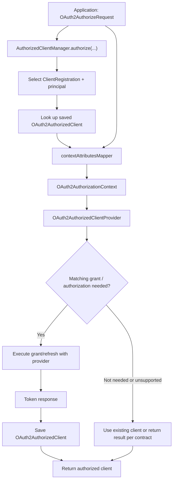
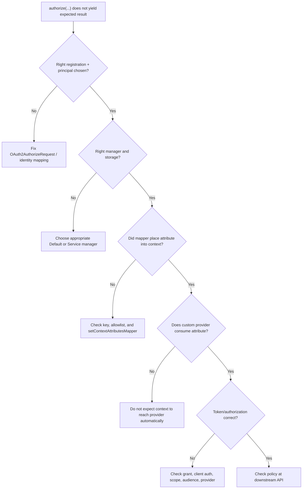

# 15.7. Context Attributes and Providing Additional Information for Authorization

In **Spring Security OAuth 2.0 / OpenID Connect (OIDC) Client**, `OAuth2AuthorizedClientManager` coordinates looking up existing authorized clients, initial authorization, or reauthorization when needed—such as refreshing an access token. In most cases, the manager only needs **`clientRegistrationId`** and **principal**. However, real systems also have call-specific context: which job is running, which tenant, which business operation, which correlation ID to record, or which policy must be checked before requesting a token.

Spring Security provides **context attributes** to carry that additional information through the `authorize(...)` flow. The core of this mechanism is:

1. The caller creates an `OAuth2AuthorizeRequest` and attaches attributes.
2. `OAuth2AuthorizedClientManager` receives the request, looks up the `ClientRegistration` and associated authorized client.
3. A **context attributes mapper** translates information from the authorize request into attributes on `OAuth2AuthorizationContext`.
4. `OAuth2AuthorizedClientProvider` can read those attributes in the context to decide how to handle authorization.
5. The manager returns `OAuth2AuthorizedClient` when appropriate and coordinates saving/removing state as configured.

**Important principle:** context attributes are **internal data within the Spring Security flow**, not a mandatory part of the OAuth 2.0 protocol, and **are not automatically sent to the authorization endpoint or token endpoint**. To add scopes, `resource`, `audience`, `login_hint`, or other parameters to the provider's HTTP request, the application must customize the **exact corresponding extension point**; merely calling `put(...)` on the context will not produce that effect.

## 1. Why Add Information to the Authorization Process?

Suppose an inventory management system has three tasks:

| Scenario | Grant / Client Type | Useful Additional Context |
|---|---|---|
| User logs in via OIDC | `authorization_code` | Registration to use, browser session, appropriate authentication request; largely managed by the framework. |
| Inventory sync job calls Inventory API | `client_credentials` | Task code, verified tenant, job correlation ID, service policy. |
| Backend calls Reports API on behalf of user | Previously granted `authorization_code` and possibly `refresh_token` | User identity, API operation, internal tenant, permitted token policy. |
| Multi-provider integration | Multiple `ClientRegistration` entries | Selected registration ID, API target, and binding rules between provider/tenant. |

For example, a sync job might pass:

```text
clientRegistrationId = inventory-service
principal             = service:inventory-sync
attributes:
  app.tenantId         = tenant-north
  app.operation        = inventory.import
  app.correlationId    = job-c7e5
```

The values above **do not automatically grant the token permissions for `tenant-north`**. They allow application-written components to verify that a job is permitted to use this registration, or support non-sensitive correlation. Actual token permissions depend on the Authorization Server; the Resource Server must still validate the token and permissions for the tenant/resource.

### 1.1. Distinguishing Three Questions

- **Which authorized client am I requesting/retrieving?** Selected by registration ID, principal, and storage/manager type.
- **What extra information do I want the authorize component to know?** Put into context attributes, which a mapper/provider can then use.
- **Which extra protocol parameters do I want the Authorization Server to receive?** Customize the Authorization Request Resolver, token response client, or grant-type extension point. This is **different** from setting a context attribute.

Good design explicitly identifies the purpose of each piece of data, instead of dumping all request information into one large map and hoping Spring handles it automatically.

## 2. Objects and Data Boundaries

| Object / API | Primary Data | Who Uses It? |
|---|---|---|
| `OAuth2AuthorizeRequest` | `clientRegistrationId` or existing authorized client, `principal`, call `attributes` | Input to `OAuth2AuthorizedClientManager.authorize(...)`. |
| `OAuth2AuthorizationContext` | `ClientRegistration`, principal, existing authorized client, and attributes built by manager | Input received by `OAuth2AuthorizedClientProvider`. |
| `contextAttributesMapper` | Function transforming `OAuth2AuthorizeRequest` into `Map<String,Object>` for the context | Called by the manager to prepare context for providers. |
| `OAuth2AuthorizedClientProvider` | Inspects grant, token state, and context attributes | Decides whether authorization/reauthorization can occur and returns authorized client. |
| `ClientRegistration` | `registrationId`, `clientId`, grant type, default scopes, token/authorization URI, authentication method | OAuth2 client configuration; **never mutates just because context attributes differ**. |
| `OAuth2AuthorizedClient` | Registration, principal name, access/refresh tokens, validity timestamps | Managed/stored authorization result. |
| `OAuth2AuthorizationRequest` | `state`, `redirectUri`, scopes, `additionalParameters`, PKCE/OIDC data | **Browser authorization redirect**; distinct from `OAuth2AuthorizeRequest` sent to the manager. |

The two most easily confused class names:

```text
OAuth2AuthorizeRequest
  -> request from application code sent to AuthorizedClientManager

OAuth2AuthorizationRequest
  -> protocol request used when redirecting the browser to the Authorization Server
```

These two objects operate at different layers. `OAuth2AuthorizeRequest.attributes` do not automatically turn into `OAuth2AuthorizationRequest.additionalParameters`.

Similarly, an attribute named `"scope"` in the context **does not automatically alter** `ClientRegistration.getScopes()`, the stored access token, or the `scope` parameter of the HTTP token request.

## 3. Data Flow Through `OAuth2AuthorizedClientManager`



This flow is conceptual. Exact details of when a provider returns `null`, when the manager returns an existing client, persistence behavior, and exception/failure handling depend on the manager type, grant provider, and Spring Security version.

### 3.1. Context Exists Only for the Scope of One Authorize Call

`OAuth2AuthorizationContext` is created so a provider can process one specific authorize invocation. It is **not** a durable store for tenant context, business codes, or session data.

On the next authorize call, the application must supply any attributes that task needs again, or have a trusted mapper derive them from another source. Never assume context from a prior call is persisted inside `OAuth2AuthorizedClient` or the database.

### 3.2. Not Every Attribute Affects Standard Providers

Built-in providers such as `clientCredentials()`, `refreshToken()`, or `authorizationCode()` operate according to the protocol and their own rules. A custom attribute `app.correlationId` **has no default effect** if nothing reads it.

For example, setting `app.tenantId` only helps when a **custom `OAuth2AuthorizedClientProvider`**, custom manager/converter, or business layer actively consumes that value. It is a context extension mechanism, not an automatic feature that injects tenants into tokens.

## 4. Creating `OAuth2AuthorizeRequest` with Attributes

The builder supports attaching attributes using a consumer:

```java
import org.springframework.security.oauth2.client.OAuth2AuthorizeRequest;

OAuth2AuthorizeRequest authorizeRequest =
        OAuth2AuthorizeRequest
                .withClientRegistrationId("inventory-service")
                .principal("service:inventory-sync")
                .attributes(attributes -> {
                    attributes.put("app.tenantId", "tenant-north");
                    attributes.put("app.operation", "inventory.import");
                    attributes.put("app.correlationId", "job-c7e5");
                })
                .build();
```

Meaning:

- `withClientRegistrationId("inventory-service")` tells the manager to select this registration.
- `principal("service:inventory-sync")` provides the logical subject of the call. With `client_credentials`, this is **not** a browser-logged-in user.
- `attributes(...)` writes extra key/value pairs onto the authorize request.

In practice, `principal` can also be an `Authentication` verified by Spring Security. Inside a web request, take the principal from `SecurityContext` or an authenticated `Authentication` parameter; never construct an arbitrary principal from a browser-supplied username.

### 4.1. Use Key Constants Instead of Scattered Literals

When multiple modules collaborate, use namespaced key names to avoid collisions:

```java
public final class BusinessAuthorizeAttributes {
    public static final String TENANT_ID = "app.tenantId";
    public static final String OPERATION = "app.operation";
    public static final String CORRELATION_ID = "app.correlationId";

    private BusinessAuthorizeAttributes() {}
}
```

Then:

```java
OAuth2AuthorizeRequest request =
        OAuth2AuthorizeRequest.withClientRegistrationId("inventory-service")
                .principal("service:inventory-sync")
                .attributes(attributes -> {
                    attributes.put(
                            BusinessAuthorizeAttributes.TENANT_ID,
                            validatedTenantId);
                    attributes.put(
                            BusinessAuthorizeAttributes.OPERATION,
                            "inventory.import");
                })
                .build();
```

`validatedTenantId` must be data already verified by the system; never read `?tenantId=...` directly from a URL or request body and use it as a token-selection policy.

### 4.2. When an `OAuth2AuthorizedClient` Already Exists

Besides building from a registration ID, the application can construct an authorize request from an existing authorized client if supported by your version's API. The manager still needs the associated registration and principal to handle token state.

When reusing an authorized client, context attributes still describe only **the current invocation**. They cannot alter the `principalName` of a saved client or grant new scopes to an existing access token.

## 5. What Is `ContextAttributesMapper`?

Managers like `DefaultOAuth2AuthorizedClientManager` and `AuthorizedClientServiceOAuth2AuthorizedClientManager` provide the method:

```java
setContextAttributesMapper(
        Function<OAuth2AuthorizeRequest, Map<String, Object>> mapper);
```

Conceptually, the mapper takes an authorize request and returns a map of attributes attached to `OAuth2AuthorizationContext`. Rather than letting arbitrary untrusted caller data flow straight into providers, the mapper is the right place to **filter, normalize, and pick only the fields a custom provider is permitted to see**.

Example:

```text
OAuth2AuthorizeRequest.attributes:
    app.tenantId       = tenant-north
    app.operation      = inventory.import
    app.correlationId  = job-c7e5
    debug.secret       = <untrusted-or-sensitive>

contextAttributesMapper:
    extracts only app.tenantId, app.operation, app.correlationId

OAuth2AuthorizationContext.attributes:
    app.tenantId       = tenant-north
    app.operation      = inventory.import
    app.correlationId  = job-c7e5
```

### 5.1. Example Mapper with an Allowlist

```java
import java.util.HashMap;
import java.util.Map;
import org.springframework.security.oauth2.client.OAuth2AuthorizeRequest;

static Map<String, Object> mapBusinessContext(
        OAuth2AuthorizeRequest request) {

    Map<String, Object> mapped = new HashMap<>();

    Object tenant = request.getAttributes().get(
            BusinessAuthorizeAttributes.TENANT_ID);
    if (tenant instanceof String id
            && id.matches("[a-z0-9-]{1,50}")) {
        mapped.put(BusinessAuthorizeAttributes.TENANT_ID, id);
    }

    Object operation = request.getAttributes().get(
            BusinessAuthorizeAttributes.OPERATION);
    if ("inventory.import".equals(operation)
            || "inventory.reconcile".equals(operation)) {
        mapped.put(
                BusinessAuthorizeAttributes.OPERATION, operation);
    }

    Object correlationId = request.getAttributes().get(
            BusinessAuthorizeAttributes.CORRELATION_ID);
    if (correlationId instanceof String value
            && value.length() <= 64) {
        mapped.put(
                BusinessAuthorizeAttributes.CORRELATION_ID, value);
    }

    return mapped;
}
```

This is an illustrative method to place in an application class alongside `BusinessAuthorizeAttributes`. Matching a syntax regex **does not prove a user has access to a tenant**: identity and tenant access must be verified by server-side business logic before constructing the authorize request.

**Be careful when replacing the default mapper:** `setContextAttributesMapper(...)` replaces the mapper logic used by the manager. If a grant/provider relies on standard attributes or the default mapper of your Spring Security version, the new mapper must preserve that required behavior. Do not blindly copy the entire request map just “so nothing gets lost”; explicitly determine which values the current flow actually needs.

## 6. Complete Example: Service Manager and `client_credentials`

A synchronization task running outside an HTTP request should use a manager suited to the **service context**, such as `AuthorizedClientServiceOAuth2AuthorizedClientManager`. Below is how context attributes integrate across configuration pieces.

### 6.1. `ClientRegistration` Configuration

```yaml
spring:
  security:
    oauth2:
      client:
        registration:
          inventory-service:
            provider: company
            client-id: "${INVENTORY_CLIENT_ID}"
            client-secret: "${INVENTORY_CLIENT_SECRET}"
            client-authentication-method: client_secret_basic
            authorization-grant-type: client_credentials
            scope:
              - inventory.read
              - inventory.write
        provider:
          company:
            token-uri: "https://idp.example.org/realms/company/protocol/openid-connect/token"
```

`client_credentials` obtains a token on behalf of the **client/service** identity without authenticating an end user via a browser. The token receives the actual scopes granted by the Authorization Server and needs the right audience/Resource Server. The two scopes `inventory.read` and `inventory.write` are examples depending on the API contract.

### 6.2. Declaring `AuthorizedClientManager`

```java
import java.util.HashMap;
import java.util.Map;

import org.springframework.context.annotation.Bean;
import org.springframework.context.annotation.Configuration;
import org.springframework.security.oauth2.client.AuthorizedClientServiceOAuth2AuthorizedClientManager;
import org.springframework.security.oauth2.client.OAuth2AuthorizedClientManager;
import org.springframework.security.oauth2.client.OAuth2AuthorizedClientProvider;
import org.springframework.security.oauth2.client.OAuth2AuthorizedClientProviderBuilder;
import org.springframework.security.oauth2.client.OAuth2AuthorizedClientService;
import org.springframework.security.oauth2.client.registration.ClientRegistrationRepository;

@Configuration
class InventoryOAuth2Config {

    @Bean
    OAuth2AuthorizedClientManager inventoryAuthorizedClientManager(
            ClientRegistrationRepository registrations,
            OAuth2AuthorizedClientService authorizedClientService) {

        OAuth2AuthorizedClientProvider provider =
                OAuth2AuthorizedClientProviderBuilder.builder()
                        .clientCredentials()
                        .build();

        var manager =
                new AuthorizedClientServiceOAuth2AuthorizedClientManager(
                        registrations, authorizedClientService);

        manager.setAuthorizedClientProvider(provider);

        // Mapper selects only allowed business attributes.
        manager.setContextAttributesMapper(authorizeRequest -> {
            Map<String, Object> mapped = new HashMap<>();
            Object tenant = authorizeRequest.getAttributes()
                    .get(BusinessAuthorizeAttributes.TENANT_ID);

            if (tenant instanceof String id
                    && id.matches("[a-z0-9-]{1,50}")) {
                mapped.put(BusinessAuthorizeAttributes.TENANT_ID, id);
            }

            Object operation = authorizeRequest.getAttributes()
                    .get(BusinessAuthorizeAttributes.OPERATION);

            if ("inventory.import".equals(operation)
                    || "inventory.reconcile".equals(operation)) {
                mapped.put(BusinessAuthorizeAttributes.OPERATION, operation);
            }

            return mapped;
        });

        return manager;
    }
}
```

In this snippet, the default `clientCredentials()` provider is used to request/refresh access tokens per the grant. The mapper prepares the context, yet **the default provider does not automatically append `app.tenantId` to the HTTP POST to the token endpoint**. To enforce tenant policy during authorization, you need application logic or a custom provider that reads that attribute.

An application with multiple flows—such as adding `refreshToken()` or `authorizationCode()`—must configure the provider chain for the grants it needs to support. Do not enable grants just “in case we need them later”; each grant has different preconditions.

### 6.3. Calling the Manager from a Background Worker

```java
import org.springframework.security.oauth2.client.OAuth2AuthorizeRequest;
import org.springframework.security.oauth2.client.OAuth2AuthorizedClient;
import org.springframework.security.oauth2.client.OAuth2AuthorizedClientManager;

class InventorySyncJob {

    private final OAuth2AuthorizedClientManager manager;
    private final TenantPolicy tenantPolicy;

    InventorySyncJob(
            OAuth2AuthorizedClientManager manager,
            TenantPolicy tenantPolicy) {
        this.manager = manager;
        this.tenantPolicy = tenantPolicy;
    }

    OAuth2AuthorizedClient authorizedClientFor(String tenantId) {
        // Permission to use the tenant must be verified by server-side policy.
        String approvedTenant = tenantPolicy.requireAllowed(tenantId);

        OAuth2AuthorizeRequest request =
                OAuth2AuthorizeRequest
                        .withClientRegistrationId("inventory-service")
                        .principal("service:inventory-sync:" + approvedTenant)
                        .attributes(attributes -> {
                            attributes.put(
                                    BusinessAuthorizeAttributes.TENANT_ID,
                                    approvedTenant);
                            attributes.put(
                                    BusinessAuthorizeAttributes.OPERATION,
                                    "inventory.import");
                        })
                        .build();

        OAuth2AuthorizedClient client = manager.authorize(request);

        if (client == null) {
            throw new IllegalStateException(
                    "Could not authorize inventory-service");
        }
        return client;
    }
}
```

`TenantPolicy` is a hypothetical business service that must be implemented. Including the tenant in the principal name here helps **partition the authorized client storage key** across verified tenants. It **does not force the Authorization Server to issue a tenant-bound token**: to obtain a token with matching audience/tenant/permissions, configure the provider, registration, or token request according to its own contract and policy.

When using `clientCredentials`, if the provider's token already grants access to all tenants and the app merely changes the principal name to create multiple stored rows, those are still multiple records holding **the same token permissions**, not isolation at the provider. Do not mistake storage separation for access boundaries enforced by the Authorization Server.

### 6.4. What Gets Saved?

`AuthorizedClientServiceOAuth2AuthorizedClientManager` can persist `OAuth2AuthorizedClient` by `registrationId` and principal name through the service. Custom context attributes such as `app.operation` or `app.correlationId` **are not standard fields persisted inside `OAuth2AuthorizedClient`**.

Therefore:

- Passing `app.operation=inventory.import` on the first call does not guarantee the next call sees that attribute unless the application passes it again.
- Changing `app.operation` does not create a new client registration.
- If long-term auditing is needed, store a separate audit event per policy instead of treating `OAuth2AuthorizedClient` storage as a business database.

## 7. Custom Provider Reading Context Attributes

A primary reason to use context attributes is so a **custom `OAuth2AuthorizedClientProvider`** can read business data. The provider has the API:

```java
OAuth2AuthorizedClient authorize(
        OAuth2AuthorizationContext context);
```

Inside the provider, attributes can be read:

```java
String tenantId = context.getAttribute(
        BusinessAuthorizeAttributes.TENANT_ID);
String operation = context.getAttribute(
        BusinessAuthorizeAttributes.OPERATION);
```

A custom provider can enforce a policy before delegating to a standard OAuth2 provider, or participate in a grant supported by the Authorization Server. The example below only guards calling client credentials; it **does not invent a new grant type**.

### 7.1. Wrapper Checking Context Before Delegating

```java
import org.springframework.security.oauth2.client.OAuth2AuthorizedClient;
import org.springframework.security.oauth2.client.OAuth2AuthorizedClientProvider;
import org.springframework.security.oauth2.client.OAuth2AuthorizedClientProviderBuilder;
import org.springframework.security.oauth2.client.OAuth2AuthorizationContext;

final class TenantAwareClientProvider
        implements OAuth2AuthorizedClientProvider {

    private final OAuth2AuthorizedClientProvider delegate =
            OAuth2AuthorizedClientProviderBuilder.builder()
                    .clientCredentials()
                    .build();

    private final TenantPolicy tenantPolicy;

    TenantAwareClientProvider(TenantPolicy tenantPolicy) {
        this.tenantPolicy = tenantPolicy;
    }

    @Override
    public OAuth2AuthorizedClient authorize(
            OAuth2AuthorizationContext context) {

        if (!"inventory-service".equals(
                context.getClientRegistration().getRegistrationId())) {
            return null;
        }

        String tenantId = context.getAttribute(
                BusinessAuthorizeAttributes.TENANT_ID);
        String operation = context.getAttribute(
                BusinessAuthorizeAttributes.OPERATION);

        // Server policy: never trust solely because context contains a tenant string.
        tenantPolicy.requireAllowedOperation(
                context.getPrincipal(), tenantId, operation);

        return delegate.authorize(context);
    }
}
```

`TenantPolicy` remains an application component you must implement. In a real application, determine **when policy checks occur**, including when the manager returns an existing client without requesting a new token. If a policy guards an API action, re-verify the policy **at the moment the action executes**; checking only inside the provider is insufficient because the provider may not run on every branch that uses a token.

To wire the wrapper:

```java
var manager = new AuthorizedClientServiceOAuth2AuthorizedClientManager(
        registrations, authorizedClientService);

manager.setAuthorizedClientProvider(
        new TenantAwareClientProvider(tenantPolicy));

manager.setContextAttributesMapper(
        InventoryOAuth2Context::mapBusinessContext);
```

`InventoryOAuth2Context.mapBusinessContext` is a **hypothetical** mapper method with logic similar to section 5.1. These snippets illustrate configuration patterns, not standalone Java files with all dependencies.

### 7.2. What Does a Custom Provider Return?

Per the contract, a provider can:

- Return `OAuth2AuthorizedClient` when it handled authorization/reauthorization.
- Return `null` when it does not support or does not need to proceed with authorization for the current context.
- Throw an OAuth2 exception when authorization genuinely fails, according to error type and application policy.

**Do not treat `null` as always being an error.** The manager may retain the existing authorized client per contract. Checking that a usable token exists and API access is permitted must still happen at the appropriate place.

When building a custom provider, you do not need to replace the entire pipeline just to observe extra metadata: you can wrap a standard provider, preserving expiration, refresh, and grant rules supported by Spring Security.

## 8. Web Manager: Context Attributes in Servlet Requests

In a Spring MVC application running within HTTP requests, `DefaultOAuth2AuthorizedClientManager` collaborates with `OAuth2AuthorizedClientRepository` instead of service-only storage.

Illustrative configuration example:

```java
import java.util.HashMap;
import java.util.Map;
import org.springframework.context.annotation.Bean;
import org.springframework.security.oauth2.client.DefaultOAuth2AuthorizedClientManager;
import org.springframework.security.oauth2.client.OAuth2AuthorizedClientManager;
import org.springframework.security.oauth2.client.OAuth2AuthorizedClientProviderBuilder;
import org.springframework.security.oauth2.client.registration.ClientRegistrationRepository;
import org.springframework.security.oauth2.client.web.OAuth2AuthorizedClientRepository;

@Bean
OAuth2AuthorizedClientManager webAuthorizedClientManager(
        ClientRegistrationRepository registrations,
        OAuth2AuthorizedClientRepository repository) {

    var manager = new DefaultOAuth2AuthorizedClientManager(
            registrations, repository);

    manager.setAuthorizedClientProvider(
            OAuth2AuthorizedClientProviderBuilder.builder()
                    .authorizationCode()
                    .refreshToken()
                    .clientCredentials()
                    .build());

    manager.setContextAttributesMapper(authorizeRequest -> {
        Map<String, Object> attributes = new HashMap<>();

        Object operation = authorizeRequest.getAttributes()
                .get(BusinessAuthorizeAttributes.OPERATION);

        if ("reports.read".equals(operation)) {
            attributes.put(
                    BusinessAuthorizeAttributes.OPERATION, operation);
        }
        return attributes;
    });

    return manager;
}
```

This is an alternative example to the service manager in section 6; do not declare two `OAuth2AuthorizedClientManager` beans of the same type without qualifiers or explicit disambiguation. With `DefaultOAuth2AuthorizedClientManager`, the Servlet request/response must be present in the proper context whenever the repository needs them; the manager API also has HTTP request/response context attributes managed by the framework.

### 8.1. Never Read Tenant from Request Parameters and Trust It Blindly

Dangerous example:

```java
// DO NOT DO THIS: browser-declared tenant is trusted immediately.
String tenant = httpServletRequest.getParameter("tenant");

OAuth2AuthorizeRequest request =
        OAuth2AuthorizeRequest.withClientRegistrationId("reports-api")
                .principal(authentication)
                .attributes(attributes -> {
                    attributes.put("app.tenantId", tenant);
                })
                .build();
```

The browser can alter `tenant` in the URL. If the application uses that value to select a token store, client registration, or API permissions without verification, cross-tenant confusion and data leaks can occur.

The right way is to obtain a tenant authenticated and verified by the server as belonging to the principal's scope:

```java
String trustedTenantId =
        tenantResolver.requireAuthorizedTenant(
                authentication, requestedTenantId);
```

`tenantResolver` is an application business service; it should check membership/permissions, not merely regex-check the tenant name.

### 8.2. Differs from MVC Request Attributes

In Servlet APIs, `request.setAttribute("key", value)` sets an attribute on `HttpServletRequest`. In Spring Security OAuth2 Client, `OAuth2AuthorizeRequest.attributes(...)` places data on the **authorize request object**. These two maps are not automatically the same.

If you want to read context from `HttpServletRequest` and feed it into `OAuth2AuthorizationContext`, the application must control the data flow, go through an appropriate API/mapper, and avoid copying all request attributes wholesale into the authorization context.

### 8.3. Do Not Confuse with `WebClient` OAuth2 Attributes

Some outbound HTTP integrations allow specifying a registration or authorized client via request attributes on `WebClient`/`RestClient`. That is yet another layer of context: metadata for a filter/interceptor to pick an authorized client. Do not assume custom attribute names on an HTTP client automatically appear inside `OAuth2AuthorizationContext` unless the corresponding adapter forwards them.

When using an integrated OAuth2 HTTP client, use the API provided by your Spring Security version to pass registration/authorized client details, rather than stuffing arbitrary data into request attributes hoping the mapper understands them.

## 9. What Information Can Context Attributes Supply?

A pragmatic rule is to use context attributes for **authorization-orchestration metadata**, without sensitive secrets.

| Information | Can Be Passed via Context? | Notes |
|---|---|---|
| `app.operation` | Yes | Use an enum/allowlist for business operations. |
| `app.tenantId` | Yes, if already verified | Does not automatically create a tenant-specific token via the attribute alone. |
| `app.correlationId` | Yes | Keep format bounded; use only for safe tracing. |
| `app.jobType` | Yes | Useful for custom policies distinguishing scheduled jobs. |
| `app.resourceCode` | Yes, if contracted | Internal code only; does not automatically become an HTTP `resource` parameter. |
| `client-secret` | No | Managed in `ClientRegistration`/secret store and client authentication config. |
| `access_token` / `refresh_token` | No | `OAuth2AuthorizedClient` and dedicated token storage already handle these. |
| `code_verifier` / `state` / `nonce` | Do not inject arbitrarily | Security data of the Authorization Code/OIDC flow must be maintained per request by the framework. |
| Arbitrary scopes from browser | No | Requires an allowlist, client permissions, and proper protocol mechanisms. |
| Unverified username | Should not be used as authorization source | Obtain principal from a valid `Authentication` or verified service identity. |

Never place an entire `HttpServletRequest`, a user-created mutable `Authentication`, ORM objects containing personal data, or large payloads into the context just because the mapper accepts `Object`. Keeping the context concise reduces secret exposure, request-lifecycle coupling, and serialization errors across layers.

## 10. Scope, Resource, Audience: Context Is Not OAuth2 Parameters

A common business requirement:

> When calling API A, request scope `reports.read`; when calling API B, request scope `reports.export` and the matching audience.

Merely adding:

```java
attributes.put("scope", "reports.export");
attributes.put("audience", "https://reports.example.org");
```

**does not guarantee the token endpoint receives these two values.** Depending on the grant and provider, the right approach can be:

1. **Separate `ClientRegistration` entries** with provider-registered scopes, token URIs, and client IDs.
2. **Customizing the Authorization Request Resolver** when the browser starts `authorization_code` to add scopes or appropriate OIDC/provider parameters.
3. **Customizing the token response client or grant provider** when the provider supports extra parameters at the token endpoint.
4. **Using an extension with an explicit contract** for requested scopes/resources if supported by your Spring Security version; do not assume all versions behave identically.

### 10.1. Example with Multiple `ClientRegistration` Entries

```yaml
spring:
  security:
    oauth2:
      client:
        registration:
          reports-read:
            provider: company
            client-id: "${REPORT_READ_CLIENT_ID}"
            client-secret: "${REPORT_READ_CLIENT_SECRET}"
            authorization-grant-type: client_credentials
            scope: [reports.read]
          reports-export:
            provider: company
            client-id: "${REPORT_EXPORT_CLIENT_ID}"
            client-secret: "${REPORT_EXPORT_CLIENT_SECRET}"
            authorization-grant-type: client_credentials
            scope: [reports.export]
        provider:
          company:
            token-uri: "https://idp.example.org/oauth2/token"
```

Selecting `reports-read` or `reports-export` by registration ID lets the client manager use the corresponding scope configuration. The provider must be configured to grant the right permissions to each client. A context attribute `app.operation` is still useful so policies know which task is requesting a token, yet the **registration** is what carries the defined OAuth2 settings.

### 10.2. Example Custom Parameter at the Token Endpoint

If the Authorization Server requires a `resource` parameter for client credentials by contract, in Spring Security versions supporting `RestClientClientCredentialsTokenResponseClient` you can customize the parameters converter:

```java
import org.springframework.http.LinkedMultiValueMap;
import org.springframework.http.MultiValueMap;
import org.springframework.security.oauth2.client.endpoint.RestClientClientCredentialsTokenResponseClient;

var tokenClient = new RestClientClientCredentialsTokenResponseClient();

tokenClient.addParametersConverter(grantRequest -> {
    MultiValueMap<String, String> extras = new LinkedMultiValueMap<>();
    extras.add("resource", "https://inventory-api.example.org");
    return extras;
});
```

This snippet illustrates **customizing the token request at the HTTP boundary**, without showing wiring the token client into `ClientCredentialsOAuth2AuthorizedClientProvider` and the manager. For complete behavior, configure the provider to use this token response client per your Spring Security version's API.

Never take `resource` directly from the browser or an unchecked context attribute to send to the provider. Resources/audiences must belong to an allowlist and match the client's registered permissions. How resources are requested depends on protocol extensions and the provider; `resource` is not a mandatory parameter of every OAuth2 token request.

### 10.3. Context Does Not Automatically Upgrade Already-Granted Permissions

If an access token was saved with scope `reports.read`, a later authorize call adding `app.operation=reports.export` may still receive the **existing authorized client** if the manager considers it still valid. Never treat new context as proof that the token gained `reports.export`.

If a feature requires new permissions or a different audience, establish an appropriate authorization strategy, choose the right registration/token, and verify actual permissions at the Resource Server. Refresh tokens normally do not expand scopes beyond what was originally granted.

## 11. Context Attributes and the `OAuth2AuthorizedClient` Storage Key

In `OAuth2AuthorizedClientService`, authorized clients are looked up by **`(clientRegistrationId, principalName)`**. Attributes like `app.tenantId` or `app.operation` **do not automatically become part of this key**.

Example of two calls:

```text
Call A:
  registrationId = inventory-service
  principal      = service:inventory
  app.tenantId   = tenant-north

Call B:
  registrationId = inventory-service
  principal      = service:inventory
  app.tenantId   = tenant-south
```

In the default storage service, both calls share **the exact same key pair**. If `tenant-north`'s token actually differs from `tenant-south`'s token, changing only an attribute is insufficient to ensure isolation.

Design an authentic partitioning mechanism:

- Separate registration IDs when clients, issuers, or scopes differ.
- Separate server-verified logical principal names when authorized clients must be split by tenant.
- Tenant-separated token stores or custom keys with proper isolation.
- Policies verifying token audience/tenant/scopes at the Resource Server.

Merely embedding the tenant into the principal name separates **stored records**; it does not make the token issued for that tenant. The relationship between token and tenant must be understood by the Authorization Server/Resource Server, or enforced by server-side application policies.

### 11.1. Never Use a Request ID as the Principal Name

An anti-pattern:

```java
OAuth2AuthorizeRequest.withClientRegistrationId("inventory-service")
        .principal("job:" + java.util.UUID.randomUUID())
        .build();
```

Unless intentionally isolating authorizations, every call uses a different principal and may generate unnecessary authorized clients/tokens. `app.correlationId` is the right place for a diagnostic request/job ID; the principal name should stay stable for the logical subject.

### 11.2. When Principal Comes from OIDC Login

In a Servlet web flow, `Authentication.getName()` typically reflects the `OidcUser`'s name. That value may be derived from `sub` or a configured name attribute. If the application changes the principal from `sub` to email, previously saved authorized clients may no longer be found.

With multiple issuers, `sub` is only unique within an issuer; never use `sub` alone to infer the same local user. The pair (`iss`, `sub`) is useful for identity mapping, while the storage `principalName` strategy must remain consistent and collision-free across tenants/registrations.

## 12. Refresh Tokens and Existing Clients: How Far Do Attributes Reach?

A manager can perform several actions depending on context:

1. Look up an existing authorized client.
2. Return the client if reauthorization is unnecessary.
3. Use a refresh token to obtain a new access token when the grant/provider allows.
4. Request a token via `client_credentials` when needed.
5. For the authorization code flow, coordinate browser-based authorization flows when user authorization is needed.

Custom attributes only take effect if components along the processing path **actually read and use them**.

Example:

```text
Attempt 1:
  app.operation = inventory.import
  -> manager requests token for inventory-service

Attempt 2:
  app.operation = inventory.reconcile
  -> manager may reuse the still-valid authorized client
```

If the service must forbid the `inventory.reconcile` business operation, enforce that policy **before the API operation**, not solely when the token provider is called. A custom provider may only run in certain branches; never rely on it as the sole authorization layer for all API requests.

### 12.1. How Should Retries Work When the Token Endpoint Fails?

The context attribute `app.correlationId` can help trace a timed-out token request, yet it is not a reason to retry infinitely. With `authorization_code`, codes may be single-use; retrying after a timeout can hit `invalid_grant` because the provider already consumed the code.

With `client_credentials`, retry policies must account for rate limits, transient errors, duplicate token issuance, backoff, and provider guidance. Never log tokens, client secrets, or credentials just to track retries.

## 13. Comparing Extension Points to Match the Need

| Need | Extension Point to Consider | What Not to Misunderstand |
|---|---|---|
| Pass verified job/tenant code for a custom provider to read | `OAuth2AuthorizeRequest.attributes` + `setContextAttributesMapper` | Does not automatically create OAuth2 HTTP parameters. |
| Validate metadata before a custom grant runs | Custom `OAuth2AuthorizedClientProvider` | Does not replace authorization at the Resource Server. |
| Request different scopes during browser login | `ClientRegistration` or `OAuth2AuthorizationRequestResolver` | Context attributes do not alter redirect `scope`. |
| Send custom parameters to the token endpoint | Grant-specific token response client / parameters converter | Never pass arbitrary browser data into token requests. |
| Switch client/provider/audience | Registration, provider config, or supported extension | `app.audience` does not alter `issuer`/`token-uri`. |
| Look up/save tokens for background jobs | `AuthorizedClientServiceOAuth2AuthorizedClientManager` and `OAuth2AuthorizedClientService` | Never fake an `HttpServletRequest`. |
| Obtain tokens in Servlet requests | `DefaultOAuth2AuthorizedClientManager` and `OAuth2AuthorizedClientRepository` | Do not assume it shares storage with the service manager. |
| Long-term business tracking | Dedicated audit events with data minimization | Context attributes are not an audit database. |
| Authorize viewing tenant reports | API/service policy, tenant-aware identity | Having an access token does not grant access to all data. |

### 13.1. Do Not Confuse with `Authentication.details`

`Authentication.getDetails()` can hold mechanism-specific information, such as web request details. However, `Authentication.details` and `OAuth2AuthorizationContext.attributes` are two separate structures. A value inside `details` is not automatically mapped into a context attribute, and you should not stuff sensitive tenant data everywhere just so layers “can find it”.

### 13.2. Do Not Confuse with Authorization Request `additionalParameters`

An OIDC example:

```java
// Customizing the redirect request when the browser starts login:
resolver.setAuthorizationRequestCustomizer(builder ->
        builder.additionalParameters(params ->
                params.put("prompt", "select_account")));
```

This customizes `OAuth2AuthorizationRequest`, not the manager's `OAuth2AuthorizeRequest`. `prompt` is sent to the **authorization endpoint** if supported by the provider; it is not equivalent to a custom `app.operation` attribute used while selecting/refreshing an authorized client.

## 14. Testing and Observing Context Propagation

A system using a custom context mapper/provider should define test cases for:

| Scenario | What to Verify |
|---|---|
| Authorize request with valid tenant | Mapper transfers `app.tenantId` properly into `OAuth2AuthorizationContext`. |
| Malformed or missing tenant | Mapper drops values outside allowlist; policy handles it properly. |
| Browser spoofs another tenant | Server-side service rejects before obtaining tokens or calling APIs. |
| Same registration/principal, operation changes | Do not assume the authorized client/token gained new scopes. |
| Manager holds a still-valid client | Business operation is still authorized before calling the API, even without a new token request. |
| Two tenants share a registration | Storage and token permissions maintain designed isolation. |
| Refresh/retry | Required context is re-supplied; tokens/secrets are never logged and protocol-unsafe retries are avoided. |
| Service manager and web manager | Each reads/writes the storage suited to its environment. |

### 14.1. Conceptual Unit Test Example for a Mapper

You can unit test context translation **without calling the token endpoint**:

```java
OAuth2AuthorizeRequest request =
        OAuth2AuthorizeRequest.withClientRegistrationId("inventory-service")
                .principal("service:inventory")
                .attributes(attributes -> {
                    attributes.put("app.tenantId", "tenant-north");
                    attributes.put("app.operation", "inventory.import");
                    attributes.put("untrusted", "should-not-pass");
                })
                .build();

Map<String, Object> mapped =
        InventoryOAuth2Context.mapBusinessContext(request);

// In the unit test, assert:
// mapped.get("app.tenantId") == "tenant-north"
// mapped.get("app.operation") == "inventory.import"
// !mapped.containsKey("untrusted")
```

`InventoryOAuth2Context` is an application-written class from the earlier mapper example. This unit test only proves data is filtered/transferred through the map; it **does not prove** the Authorization Server receives `tenant` or that the access token carries specific scopes.

### 14.2. Safe Business-Level Tracing

Controlled logging might record:

```text
authorize.operation=inventory.import
authorize.registrationId=inventory-service
authorize.correlationId=job-c7e5
authorize.result=success
```

Limit logging tenant IDs/principals according to data policies and avoid recording:

- `client_secret`, access tokens, refresh tokens, ID Tokens.
- Authorization codes, `code_verifier`, session cookies.
- `Authorization` headers, token endpoint HTTP bodies.
- The full attributes map if it could contain personal data or secrets.

Correlation IDs can be generated server-side to avoid malicious or oversized browser-supplied values. Tracing should be useful without exposing credentials.

## 15. Diagnosing Common Errors

| Symptom | Possible Cause | How to Investigate |
|---|---|---|
| `context.getAttribute("app.tenantId")` returns `null` | Mapper did not forward key, wrong key name, caller omitted it, or manager uses a different mapper | Cross-check builder, mapper, and provider in the same authorize flow. |
| Added `put("scope", ...)` yet token scope did not change | Context does not modify protocol requests | Pick a registration or customize the right authorization/token endpoint hook. |
| Custom provider is not invoked | Manager uses another provider chain, or client is still valid so flow skips provider as expected | Check manager bean, grant, authorized client, and chain order. |
| Operation changed yet old token is still used | Token is still valid; context does not alter storage key/scope | Separate business policy from token lifecycle; check at the API. |
| Two tenants use each other's tokens | Shared registration/principal key or non-tenant-aware tokens | Redesign key/registration/policy; verify issuer/audience/tenant at the API. |
| Service manager cannot see web session token | Storage is Servlet's `OAuth2AuthorizedClientRepository`, not a non-web service store | Check manager and storage implementation. |
| Background job creates many tokens | Principal contains UUID/timestamp or non-persistent storage | Use a stable service principal and required persistence. |
| Adding custom mapper breaks a grant | Replaced default mapper logic without preserving required attributes | Check the provider/grant contract for your Spring version. |
| Token endpoint reports `invalid_client` | Wrong client credentials or authentication method | Check `ClientRegistration`/provider, do not tweak business context randomly. |
| Token endpoint reports `invalid_scope` | Scope not permitted or requested via wrong mechanism | Check registration, actual redirect/token request, and provider policy. |
| OIDC-logged-in user has access yet API returns 403 | Access token has wrong audience/scope or user lacks resource permission | Check the token sent to the API and Resource Server authorization. |
| Context leaks confidential data | Logged full map or placed tokens/secrets into attributes | Remove sensitive data, restrict logging, use dedicated secret stores/token storage. |

### 15.1. Ordered Diagnostic Flowchart



If the problem is `invalid_grant`, lost session, or PKCE mismatch in the authorization-code flow, do not look solely at the client manager's context mapper. Those errors may belong to the browser Authorization Request, callback, or token exchange stages, which are separate security data boundaries.

## 16. Synthesis Example: Orchestrating a Multi-Tenant Job Within Boundaries

Suppose a company operates an inventory sync service for multiple stores. Each task must use the exact tenant and Inventory API.

```text
Job Scheduler
    |
    | jobId, tenantId, operation
    v
TenantPolicy.requireAllowed(...)
    |
    | approved tenant
    v
OAuth2AuthorizeRequest
    | registrationId = inventory-service
    | principal      = service:inventory-sync:<trustedTenant>
    | attributes:
    |    app.tenantId
    |    app.operation
    |    app.correlationId
    v
AuthorizedClientServiceOAuth2AuthorizedClientManager
    |
    +--> ClientRegistrationRepository
    +--> OAuth2AuthorizedClientService
    +--> contextAttributesMapper
    +--> OAuth2AuthorizedClientProvider
    |
    v
OAuth2AuthorizedClient
    |
    | Access Token
    v
Inventory Resource Server
    |
    +--> Verify token (issuer, audience, exp, scope)
    +--> Verify tenant / resource ownership
    v
Allowed inventory operation
```

Safeguards:

1. The job's `tenantId` is checked by server-side policy, never relying on unchecked query parameters.
2. `registrationId` points to a client registered with a provider holding the appropriate permissions.
3. `principal` uses a stable value partitioning the exact logical subject; never a random ID just for a key.
4. The mapper transfers only necessary metadata; never secrets.
5. Providers/custom policies can read context to enforce orchestration checks, while the Resource Server still decides resource access.
6. Issued tokens carry only permissions/audience decided by the Authorization Server; context attributes never add tenants or scopes themselves.
7. Audit trails and correlation go to appropriate monitoring systems, not into `OAuth2AuthorizedClient` as a business database.
8. When an existing valid token is reused, policies at the action execution point must still be enforced.

This pattern illustrates the real value of context attributes: **carrying controlled metadata through the authorize pipeline so extension components can collaborate**, while preserving boundaries between authentication, token issuance, and business authorization.

## 17. Review Questions

1. How do `OAuth2AuthorizeRequest` and `OAuth2AuthorizationRequest` differ in purpose and timing?
2. Where are context attributes created and by which component are they converted into `OAuth2AuthorizationContext`?
3. Why does adding `app.tenantId` to `OAuth2AuthorizeRequest.attributes` not automatically bind the access token to that tenant?
4. What input and output types does `setContextAttributesMapper(...)` take and return? What must you watch out for when replacing the default mapper?
5. When should `DefaultOAuth2AuthorizedClientManager` be used versus `AuthorizedClientServiceOAuth2AuthorizedClientManager`?
6. If you want to add `resource` to the token endpoint, why must you locate the right token response client / provider extension?
7. Why do context attributes not automatically become part of the `(registrationId, principalName)` storage key?
8. Why is a custom provider checking permissions at authorize time insufficient to protect every request to a Resource Server?
9. In background `client_credentials`, why should you use a stable logical principal instead of a random UUID?
10. How can you test a mapper forwarding tenant/operation without needing real tokens or logging secrets?

## References

- [Spring Security Reference — OAuth2 Client (Servlet)](https://docs.spring.io/spring-security/reference/servlet/oauth2/client/index.html)
- [Spring Security Reference — OAuth2 Client Core Model](https://docs.spring.io/spring-security/reference/servlet/oauth2/client/core.html)
- [Spring Security Reference — OAuth2 Client Authorized Client Manager](https://docs.spring.io/spring-security/reference/servlet/oauth2/client/authorized-clients.html)
- [Spring Security Reference — OAuth2 Client (Reactive)](https://docs.spring.io/spring-security/reference/reactive/oauth2/client/index.html)
- [Spring Security API — OAuth2AuthorizeRequest](https://docs.spring.io/spring-security/reference/api/java/org/springframework/security/oauth2/client/OAuth2AuthorizeRequest.html)
- [Spring Security API — OAuth2AuthorizationContext](https://docs.spring.io/spring-security/reference/api/java/org/springframework/security/oauth2/client/OAuth2AuthorizationContext.html)
- [Spring Security API — OAuth2AuthorizedClientProvider](https://docs.spring.io/spring-security/reference/api/java/org/springframework/security/oauth2/client/OAuth2AuthorizedClientProvider.html)
- [Spring Security API — DefaultOAuth2AuthorizedClientManager](https://docs.spring.io/spring-security/reference/api/java/org/springframework/security/oauth2/client/web/DefaultOAuth2AuthorizedClientManager.html)
- [Spring Security API — AuthorizedClientServiceOAuth2AuthorizedClientManager](https://docs.spring.io/spring-security/reference/api/java/org/springframework/security/oauth2/client/AuthorizedClientServiceOAuth2AuthorizedClientManager.html)
- [RFC 6749 — OAuth 2.0 Authorization Framework](https://datatracker.ietf.org/doc/html/rfc6749)
