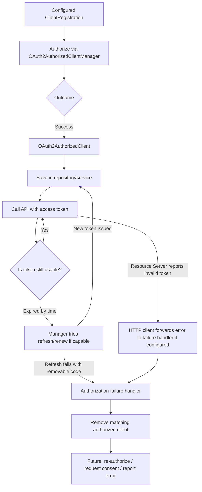
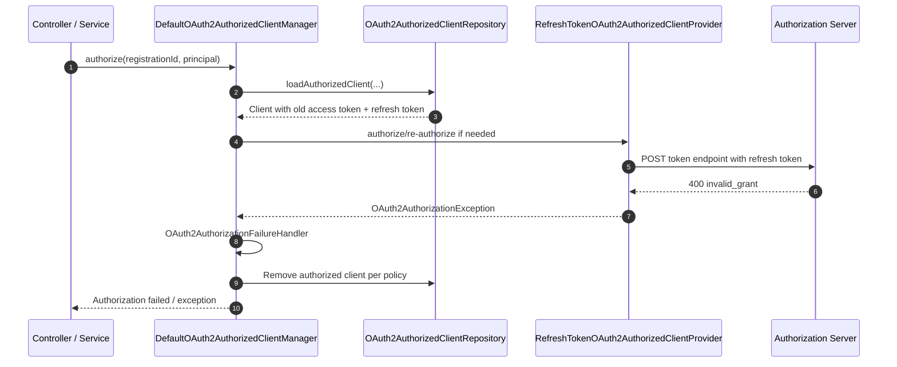
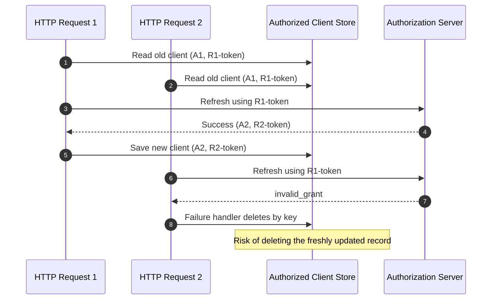

# 15.9. Authorization Failure Handler and Handling Invalid Authorized Clients

In **Spring Security OAuth 2.0 / OIDC Client**, an `OAuth2AuthorizedClient` holds `ClientRegistration` details, a principal, and the issued tokens. It can be kept in an HTTP session or an independent store for reuse when the application calls a Resource Server.

However, an authorized client does not remain valid forever. A user can revoke consent; a refresh token can expire, be rotated, or be revoked; the Authorization Server can return `invalid_grant`; a Resource Server can reject the access token with `invalid_token`. If the application keeps reusing the stale record, subsequent calls will fail repeatedly.

Spring Security provides **`OAuth2AuthorizationFailureHandler`** and the **`RemoveAuthorizedClientOAuth2AuthorizationFailureHandler`** implementation to handle this in a controlled way: detect applicable authorization failures, remove the invalidated authorized client from the right store, and allow subsequent usage to perform authorization or re-authorization as configured.

This lesson explains **when the failure handler runs**, **what removing an authorized client means**, **why Authorization Server errors differ from Resource Server 401/403 responses**, how to configure it in Servlet and service-level managers, as well as strategies to avoid redirect loops, infinite retries, and accidentally deleting another user's token.

> Primary context: Spring Boot 3.x, Spring Security 6.x on the Servlet stack, including `DefaultOAuth2AuthorizedClientManager`, `AuthorizedClientServiceOAuth2AuthorizedClientManager`, and integrated HTTP clients. Verify APIs against your actual Spring Security version; example domains like `example.test` are illustrative only.

## 1. Summary of the Authorized Client Lifecycle

**`ClientRegistration`** describes client configuration: `registrationId`, `clientId`, client secret where applicable, grant type, scopes, token endpoint, and provider metadata.

**`OAuth2AuthorizedClient`** represents state after successful authorization:

```text
ClientRegistration: company
Principal:          alice
Access token:       <opaque-or-jwt>
Expires at:         2026-11-16T10:00:00Z
Refresh token:      <optional>
```

In Java, you can inspect these fields:

```java
OAuth2AuthorizedClient client = /* managed by Spring Security */;
String registrationId =
    client.getClientRegistration().getRegistrationId();
String principalName = client.getPrincipalName();
OAuth2AccessToken accessToken = client.getAccessToken();
OAuth2RefreshToken refreshToken = client.getRefreshToken(); // May be null
```

**Access tokens and refresh tokens are sensitive credentials**. Never print token values into logs, HTML/JSON responses, URLs, or support tickets.

A typical lifecycle:



**A token reaching its expiration time is not necessarily an authorization failure**: the manager can proactively refresh successfully and save the new authorized client. The failure handler matters when *reissuing or using the token actually fails* and the application must avoid reusing invalid state.

## 2. Three Error Categories Not to Conflate

### 2.1. Authorization Server Refuses to Issue or Reissue a Token

Example during refresh:

```http
POST /oauth2/token HTTP/1.1
Host: id.example.test
Content-Type: application/x-www-form-urlencoded

grant_type=refresh_token&refresh_token=<redacted>
```

Authorization Server responds:

```http
HTTP/1.1 400 Bad Request
Content-Type: application/json

{
  "error": "invalid_grant",
  "error_description": "Refresh token is invalid or revoked"
}
```

`invalid_grant` is an error **at the token endpoint**. When a refresh token is revoked/expired or no longer matches the client, the authorized client record storing that old token is typically no longer usable to re-authorize via that refresh token.

Both `DefaultOAuth2AuthorizedClientManager` and `AuthorizedClientServiceOAuth2AuthorizedClientManager` have default failure handler behavior that removes the saved authorized client on applicable failures, typically `invalid_grant`.

### 2.2. Resource Server Rejects the Access Token

The application uses the token to call an API:

```http
GET /v1/reports HTTP/1.1
Host: api.example.test
Authorization: Bearer <redacted>
```

The API may respond:

```http
HTTP/1.1 401 Unauthorized
WWW-Authenticate: Bearer error="invalid_token"
```

This is an error **from the Resource Server**, not from the token endpoint. `OAuth2AuthorizedClientManager` does not automatically know about every API HTTP response if you create a standalone `RestClient`/`HttpURLConnection` that does not forward errors to it.

If you use Spring Security's `OAuth2ClientHttpRequestInterceptor` and configure `authorizationFailureHandler(...)`, the HTTP client can forward recognized authentication/authorization errors from the Resource Server to the failure handler to consider removing the unusable authorized client.

### 2.3. API Returns 403 Due to Insufficient Permissions

Example:

```http
HTTP/1.1 403 Forbidden
WWW-Authenticate: Bearer error="insufficient_scope", scope="reports.write"
```

The token may be **valid for authentication** yet lack permission to call this API. Deleting the token and re-requesting **the same old scopes** may just lead to another failure loop.

Hence, 401/403 is not a blanket signal to “delete every authorized client”. Evaluate **error code, request context, registration, principal, and API policy**. With `insufficient_scope`, review scopes, consent, and permissions instead of assuming refreshing will grant extra scopes.

| Error Source | Example | Primary Meaning | Reasonable Action |
| --- | --- | --- | --- |
| Token endpoint | `invalid_grant` | Refresh token or grant is invalid | Remove stale authorized client when appropriate; obtain new authorization |
| Token endpoint | `invalid_client` | Wrong client authentication/configuration | Alert on config issue; do not infinitely retry old tokens |
| Resource Server | 401 + `invalid_token` | Access token rejected | Remove broken token/client if error recognized; re-request token when allowed |
| Resource Server | 403 + `insufficient_scope` | Missing permissions/scope | Fix scopes/consent/policy; do not treat as broken token |
| Resource Server | 503 / timeout | Transient infrastructure outage | Bounded retry if safe; do not auto-delete client |
| Browser authorization | `access_denied` | User/OP denied authorization | Inform user; do not force another redirect |
| Client-side correlation | `invalid_state` | Callback does not match transaction | Reject flow, check session; unrelated to old token cache |

## 3. What Is `OAuth2AuthorizationFailureHandler`?

Spring Security defines the functional interface:

```java
package org.springframework.security.oauth2.client;

@FunctionalInterface
public interface OAuth2AuthorizationFailureHandler {

    void onAuthorizationFailure(
        OAuth2AuthorizationException authorizationException,
        Authentication principal,
        Map<String, Object> attributes);
}
```

This is an illustrative signature per the Spring Security API. The three parameters carry context:

- **`OAuth2AuthorizationException`**: the OAuth2 error, from which `getError().getErrorCode()` can be read.
- **`Authentication principal`**: the identity for which authorization/re-authorization was being performed. Not a raw access token.
- **`Map<String, Object> attributes`**: context attributes, which may include `HttpServletRequest`/`HttpServletResponse` when running in a Servlet environment.

The handler can record an internal event, remove the authorized client per policy, update metrics, or coordinate security actions. It is **not** the `AuthenticationFailureHandler` of a login form/OIDC callback, nor is it a global handler for all HTTP exceptions.

### 3.1. The `OAuth2Error` Object

An authorization exception carries an `OAuth2Error`:

```java
String errorCode = authorizationException.getError().getErrorCode();
String description = authorizationException.getError().getDescription();
String errorUri = authorizationException.getError().getUri();
```

In practice:

- Use **`errorCode`** to classify via an allowlist.
- `description` may come from an external provider; never render or log it verbatim without sanitization.
- `errorUri` is an optional documentation URL, **not a safe URL to auto-redirect to or fetch from the backend**.

The handler should rely on error codes and safe metadata, never logging credentials or untrusted data.

### 3.2. When Is the Handler Invoked?

The handler is triggered when a configured component recognizes an **authorization failure**. Examples:

1. The manager is refreshing a token and the token endpoint returns `invalid_grant`.
2. An HTTP client interceptor forwards a token error from the Resource Server to a registered handler.
3. A manager/provider implementation detects an authorization failure and invokes the handler per its contract.

Conversely, a REST controller manually sending a bearer token and receiving 401 **does not automatically trigger the manager's failure handler**. Wiring between the HTTP client and the handler—or corresponding application logic—is required.

## 4. `RemoveAuthorizedClientOAuth2AuthorizationFailureHandler`

Spring Security provides the **`RemoveAuthorizedClientOAuth2AuthorizationFailureHandler`** implementation.

It uses an `OAuth2AuthorizedClientRemover` strategy to delete the authorized client **only when the error code belongs to the configured set of error codes**.

Concept:

```text
OAuth2AuthorizationException
    |
    v
Is errorCode in configured remove codes?
    |
    +--- No ----> Do not remove authorized client via this handler
    |
    +--- Yes ---> Identify registration ID + principal
                    |
                    v
                 Remover
                    |
                    +-- OAuth2AuthorizedClientRepository (Servlet)
                    |
                    +-- OAuth2AuthorizedClientService (service-level)
```

This implementation can be constructed with:

```java
new RemoveAuthorizedClientOAuth2AuthorizationFailureHandler(remover);
```

or specifying a custom set of error codes:

```java
new RemoveAuthorizedClientOAuth2AuthorizationFailureHandler(
    remover,
    Set.of("invalid_grant", "invalid_token"));
```

This is an illustrative pattern; adding/removing codes in the removal set must be grounded in the protocol and application policy, not treated as a generic “fix-all”.

**Never delete the client by default for every exception.** A network timeout does not prove the refresh token was revoked. Indiscriminate deletion can force users to log in repeatedly or overload the OP.

### 4.1. Default Error Code Set

The class defines the constant:

```java
RemoveAuthorizedClientOAuth2AuthorizationFailureHandler
    .DEFAULT_REMOVE_AUTHORIZED_CLIENT_ERROR_CODES
```

This constant represents the default set of OAuth 2.0 error codes triggering removal. **Verify the contents of this set for your deployed Spring Security version** instead of guessing that every 401 or 403 is included.

The manager documentation confirms the baseline case: **`invalid_grant` during refresh is a reason to remove the previous authorized client**.

### 4.2. Constructor Takes a Remover, Not a Repository Directly

In Spring Security 6.x, the constructor accepts:

```java
RemoveAuthorizedClientOAuth2AuthorizationFailureHandler(
    RemoveAuthorizedClientOAuth2AuthorizationFailureHandler
        .OAuth2AuthorizedClientRemover remover)
```

`OAuth2AuthorizedClientRemover` is a functional interface taking registration ID, `Authentication`, and attributes.

Do not write code assuming `new RemoveAuthorizedClientOAuth2AuthorizationFailureHandler(repository)` exists if your version's API has no such constructor. For the HTTP client interceptor, Spring Security provides **factory methods** accepting a repository/service to create the appropriate failure handler, shown in section 8.

## 5. `DefaultOAuth2AuthorizedClientManager` in Servlet

`DefaultOAuth2AuthorizedClientManager` is the standard manager in an **`HttpServletRequest` context**. It uses:

- **`ClientRegistrationRepository`**: finds client configuration by registration ID.
- **`OAuth2AuthorizedClientRepository`**: saves, loads, and removes authorized clients with request/response/principal.
- **`OAuth2AuthorizedClientProvider`**: executes enabled grants, such as authorization code, refresh token, client credentials.
- **Success/failure handlers**: govern client persistence when authorization succeeds or fails.

Flow during token refresh:



This illustrates logical responsibilities; you do not call `onAuthorizationFailure(...)` manually in a controller. With the default manager, the components coordinate this already.

### 5.1. Basic Manager Configuration

```java
import org.springframework.context.annotation.Bean;
import org.springframework.context.annotation.Configuration;
import org.springframework.security.oauth2.client.OAuth2AuthorizedClientManager;
import org.springframework.security.oauth2.client.OAuth2AuthorizedClientProvider;
import org.springframework.security.oauth2.client.OAuth2AuthorizedClientProviderBuilder;
import org.springframework.security.oauth2.client.registration.ClientRegistrationRepository;
import org.springframework.security.oauth2.client.web.DefaultOAuth2AuthorizedClientManager;
import org.springframework.security.oauth2.client.web.OAuth2AuthorizedClientRepository;

@Configuration
class ServletAuthorizedClientConfig {

    @Bean
    OAuth2AuthorizedClientManager authorizedClientManager(
            ClientRegistrationRepository registrations,
            OAuth2AuthorizedClientRepository authorizedClients) {

        OAuth2AuthorizedClientProvider provider =
            OAuth2AuthorizedClientProviderBuilder.builder()
                .authorizationCode()
                .refreshToken()
                .clientCredentials()
                .build();

        DefaultOAuth2AuthorizedClientManager manager =
            new DefaultOAuth2AuthorizedClientManager(
                registrations, authorizedClients);

        manager.setAuthorizedClientProvider(provider);

        // Do not call setAuthorizationFailureHandler if you want
        // default behavior: removal on invalid_grant...
        return manager;
    }
}
```

This is a reference configuration for a Servlet app. In some Spring Boot setups, an appropriate manager bean is already auto-configured and need not be redefined unless customization is required.

**Important note:** if you call `manager.setAuthorizationFailureHandler(customHandler)`, you **replace the default handler**. If your custom handler only logs without invoking corresponding cleanup, you can accidentally lose removal of authorized clients hitting `invalid_grant`.

### 5.2. Do Not Fix Refresh Errors by Updating `expiresAt`

An expired access token can be refreshed; however, if the refresh token was revoked, setting `expiresAt` to tomorrow or skipping expiration checks will not make the token valid at the Authorization Server or Resource Server.

The proper handling is to acknowledge the grant is no longer valid, remove the unusable state, and **perform a new authorization** if permitted by the user or business flow.

## 6. Manager for Services or Background Tasks

Not every flow runs inside a Servlet request. Examples:

- `@Scheduled` jobs calling APIs using `client_credentials`.
- Queue consumers calling a Resource Server on behalf of the application.
- Service workers without an `HttpServletRequest`.
- Batch imports needing machine-to-machine tokens.

In this context, typically use:

**`AuthorizedClientServiceOAuth2AuthorizedClientManager`** with **`OAuth2AuthorizedClientService`**.

Unlike the Servlet manager, the service-level manager stores tokens by registration ID and principal name in the service, requiring no HTTP request/response to operate.

### 6.1. Configuring a Service-Level Manager

```java
import org.springframework.context.annotation.Bean;
import org.springframework.context.annotation.Configuration;
import org.springframework.security.oauth2.client.AuthorizedClientServiceOAuth2AuthorizedClientManager;
import org.springframework.security.oauth2.client.OAuth2AuthorizedClientManager;
import org.springframework.security.oauth2.client.OAuth2AuthorizedClientProvider;
import org.springframework.security.oauth2.client.OAuth2AuthorizedClientProviderBuilder;
import org.springframework.security.oauth2.client.OAuth2AuthorizedClientService;
import org.springframework.security.oauth2.client.registration.ClientRegistrationRepository;

@Configuration
class ServiceClientManagerConfig {

    @Bean
    OAuth2AuthorizedClientManager machineAuthorizedClientManager(
            ClientRegistrationRepository registrations,
            OAuth2AuthorizedClientService authorizedClientService) {

        OAuth2AuthorizedClientProvider provider =
            OAuth2AuthorizedClientProviderBuilder.builder()
                .clientCredentials()
                .refreshToken()
                .build();

        AuthorizedClientServiceOAuth2AuthorizedClientManager manager =
            new AuthorizedClientServiceOAuth2AuthorizedClientManager(
                registrations,
                authorizedClientService);

        manager.setAuthorizedClientProvider(provider);

        // By default also has a failure handler to remove
        // authorized clients on applicable errors.
        return manager;
    }
}
```

Each client registration only uses a grant that is genuinely configured and accepted by the Authorization Server. **`client_credentials` is not a user login**; the service uses a stable technical principal.

### 6.2. Example Calling `authorize` in a Job

```java
import org.springframework.security.oauth2.client.OAuth2AuthorizeRequest;
import org.springframework.security.oauth2.client.OAuth2AuthorizedClient;
import org.springframework.security.oauth2.client.OAuth2AuthorizedClientManager;

class BillingJob {

    private final OAuth2AuthorizedClientManager manager;

    BillingJob(OAuth2AuthorizedClientManager manager) {
        this.manager = manager;
    }

    OAuth2AuthorizedClient getBillingClient() {
        OAuth2AuthorizeRequest request =
            OAuth2AuthorizeRequest.withClientRegistrationId("billing-service")
                .principal("billing-worker")
                .build();

        OAuth2AuthorizedClient client = manager.authorize(request);

        if (client == null) {
            throw new IllegalStateException(
                "Client authorization not supported or unavailable");
        }

        return client;
    }
}
```

To wire the right manager when multiple beans exist, configure `@Qualifier`/bean names per project convention. Never pick the Servlet manager by mistake for a background thread with no HTTP request.

**Note:** `manager.authorize(...)` returns `null` when the grant is unsupported or authorization does not need to run in certain cases per the API contract; many token endpoint failures surface as exceptions. Never assume every error returns `null`.

## 7. Customizing the Authorization Failure Handler Without Losing Cleanup

In real deployments, you might want to:

1. Record invalid refresh token events.
2. Categorize errors to render UX or trigger alerts.
3. **Preserve the behavior of deleting the stale authorized client** when the error code warrants removal.

The sound approach is to **delegate to `RemoveAuthorizedClientOAuth2AuthorizationFailureHandler`** instead of replacing the handler with just a logger.

### 7.1. Service-Level Example: Logging + Removal

```java
import org.slf4j.Logger;
import org.slf4j.LoggerFactory;
import org.springframework.context.annotation.Bean;
import org.springframework.context.annotation.Configuration;
import org.springframework.security.oauth2.client.AuthorizedClientServiceOAuth2AuthorizedClientManager;
import org.springframework.security.oauth2.client.OAuth2AuthorizationFailureHandler;
import org.springframework.security.oauth2.client.OAuth2AuthorizedClientManager;
import org.springframework.security.oauth2.client.OAuth2AuthorizedClientProviderBuilder;
import org.springframework.security.oauth2.client.OAuth2AuthorizedClientService;
import org.springframework.security.oauth2.client.RemoveAuthorizedClientOAuth2AuthorizationFailureHandler;
import org.springframework.security.oauth2.client.registration.ClientRegistrationRepository;

@Configuration
class ObservedClientManagerConfig {

    private static final Logger log =
        LoggerFactory.getLogger(ObservedClientManagerConfig.class);

    @Bean
    OAuth2AuthorizedClientManager observedMachineClientManager(
            ClientRegistrationRepository registrations,
            OAuth2AuthorizedClientService storage) {

        AuthorizedClientServiceOAuth2AuthorizedClientManager manager =
            new AuthorizedClientServiceOAuth2AuthorizedClientManager(
                registrations, storage);

        manager.setAuthorizedClientProvider(
            OAuth2AuthorizedClientProviderBuilder.builder()
                .clientCredentials()
                .refreshToken()
                .build());

        // Remover receives registrationId, Authentication, context attributes.
        OAuth2AuthorizationFailureHandler removeOnKnownError =
            new RemoveAuthorizedClientOAuth2AuthorizationFailureHandler(
                (registrationId, principal, attributes) ->
                    storage.removeAuthorizedClient(
                        registrationId, principal.getName()));

        manager.setAuthorizationFailureHandler(
            (exception, principal, attributes) -> {
                String category =
                    classify(exception.getError().getErrorCode());

                // Never log exception/description/raw tokens.
                log.warn("OAuth2 client authorization failed: category={}",
                    category);

                // Preserve removal behavior per Spring Security's default error set.
                removeOnKnownError.onAuthorizationFailure(
                    exception, principal, attributes);
            });

        return manager;
    }

    private static String classify(String code) {
        if ("invalid_grant".equals(code)) {
            return "invalid_grant";
        }
        if ("invalid_client".equals(code)) {
            return "client_configuration";
        }
        if ("temporarily_unavailable".equals(code)) {
            return "provider_unavailable";
        }
        return "authorization_failed";
    }
}
```

This example illustrates service-level persistence and delegation. `RemoveAuthorizedClientOAuth2AuthorizationFailureHandler` decides **when an error code requires removal**, while the remover lambda knows **where to remove**: `storage.removeAuthorizedClient(registrationId, principal.getName())`.

If the application uses a repository tied to Servlet requests, use a remover matching the repository and HTTP context (or built-in helper APIs); **do not apply a service-level remover to a different store**.

### 7.2. Why Not Delete on Every Error?

A common mistaken handler:

```java
// DO NOT DO THIS: deleting the token on every error regardless of cause.
manager.setAuthorizationFailureHandler((exception, principal, attrs) -> {
    authorizedClientService.removeAuthorizedClient(
        "company", principal.getName());
});
```

Problems:

- Hardcoding registration `company` can delete the wrong client in a multi-provider app.
- Timeout errors can wipe out a still-valid token.
- Deleting immediately on all error types can cause repeated login/consent prompts.
- Does not account for concurrent refreshes.
- Ambiguous whether the active store is a repository or a service.

**Replace this with a policy handler based on error codes and context**, and let the remover use the registration ID passed by the framework.

### 7.3. If a Custom Set of Removal Codes Is Needed

The constructor allows configuring the code set:

```java
new RemoveAuthorizedClientOAuth2AuthorizationFailureHandler(
    remover,
    Set.of("invalid_grant", "invalid_token"));
```

Do not copy this snippet mechanically: examine the actual error codes returned during authorization or by the Resource Server, when deletion is desired, and the consequences of each. Use Spring Security's default code set when there is no specific reason to differ.

## 8. Errors from the Resource Server: Wiring the Failure Handler to the HTTP Client

This is the crucial difference between **“refresh at the token endpoint failed”** and **“access token sent to the API was rejected”**.

When using Spring Framework's `RestClient` with Spring Security, **`OAuth2ClientHttpRequestInterceptor`** supports:

- Attaching the appropriate bearer access token to outbound requests.
- Using `OAuth2AuthorizedClientManager` to look up/issue/refresh authorized clients per configuration.
- Forwarding authentication/authorization errors from the Resource Server to an `OAuth2AuthorizationFailureHandler` if registered.

The `OAuth2ClientHttpRequestInterceptor` class is available in Spring Security starting in version **6.4**. Projects on older Spring Security versions must use the matching HTTP client integration or controlled custom handling.

### 8.1. Configuring `RestClient` in Servlet with a Repository

```java
import org.springframework.context.annotation.Bean;
import org.springframework.context.annotation.Configuration;
import org.springframework.security.oauth2.client.OAuth2AuthorizationFailureHandler;
import org.springframework.security.oauth2.client.OAuth2AuthorizedClientManager;
import org.springframework.security.oauth2.client.web.OAuth2AuthorizedClientRepository;
import org.springframework.security.oauth2.client.web.client.OAuth2ClientHttpRequestInterceptor;
import org.springframework.web.client.RestClient;

@Configuration
class ReportsRestClientConfig {

    @Bean
    RestClient reportsRestClient(
            OAuth2AuthorizedClientManager manager,
            OAuth2AuthorizedClientRepository storage) {

        OAuth2ClientHttpRequestInterceptor interceptor =
            new OAuth2ClientHttpRequestInterceptor(manager);

        OAuth2AuthorizationFailureHandler failureHandler =
            OAuth2ClientHttpRequestInterceptor
                .authorizationFailureHandler(storage);

        interceptor.setAuthorizationFailureHandler(failureHandler);

        return RestClient.builder()
            .baseUrl("https://api.example.test")
            .requestInterceptor(interceptor)
            .build();
    }
}
```

In this example:

1. The manager fetches the token for the client.
2. The interceptor attaches the Bearer `Authorization` header to the API request.
3. The API may return 401/403 with an OAuth2 Bearer error.
4. The interceptor passes recognized errors to the failure handler.
5. The failure handler can remove the authorized client in **`OAuth2AuthorizedClientRepository`**, depending on the error code.

**There is no guarantee that every HTTP 403 deletes the authorized client.** The interceptor forwards error details; the handler decides whether to delete based on its configured error code set.

### 8.2. Specifying Registration in an API Call

```java
import static org.springframework.security.oauth2.client.web.client
    .RequestAttributeClientRegistrationIdResolver.clientRegistrationId;

// A service running inside a request with a matching Authentication.
String body = reportsRestClient.get()
    .uri("/v1/reports")
    .attributes(clientRegistrationId("company"))
    .retrieve()
    .body(String.class);
```

In real Java code, a static import must appear on **one single line**:

```java
import static org.springframework.security.oauth2.client.web.client.RequestAttributeClientRegistrationIdResolver.clientRegistrationId;
```

With `clientRegistrationId("company")`, the interceptor knows which registration to obtain a token for. If an HTTP client calls multiple APIs, ensure every call specifies the right registration to avoid sending tokens to mismatched APIs.

### 8.3. When Using `OAuth2AuthorizedClientService`

For a service-level client or separate token store, Spring Security provides a similar factory method:

```java
OAuth2AuthorizationFailureHandler handler =
    OAuth2ClientHttpRequestInterceptor
        .authorizationFailureHandler(authorizedClientService);

interceptor.setAuthorizationFailureHandler(handler);
```

Choose **the repository or service matching where the manager actually saves authorized clients**. If the manager writes to service A while the failure handler deletes from repository B, the broken token can remain in A and continue being reused.

### 8.4. Why Configure Both the Client Manager and the HTTP Interceptor?

The two error sources travel through two different paths:

```text
[Authorization Server]
    |
    | refresh token -> invalid_grant
    v
OAuth2AuthorizedClientManager
    |
    v
Authorization failure handler
    |
    v
Remove authorized client if applicable

[Resource Server]
    |
    | Bearer access token -> 401 invalid_token
    v
OAuth2ClientHttpRequestInterceptor
    |
    v
Configured OAuth2AuthorizationFailureHandler
    |
    v
Remove authorized client if applicable
```

**Configuring a failure handler on the manager does not automatically make arbitrary `RestClient` instances forward Resource Server errors to the handler.** The second path requires HTTP client integration.

## 9. Distinguishing HTTP Status from OAuth2 Error Code

A few illustrative cases:

### 9.1. 401 + `invalid_token`

```http
HTTP/1.1 401 Unauthorized
WWW-Authenticate: Bearer realm="reports", error="invalid_token"
```

This is a classic signal that the access token is unusable: expired, revoked, malformed, or rejected for another reason. With an HTTP client configured with a handler, the authorized client can be evicted from cache; the next call can fetch a new token or request re-authorization.

### 9.2. 403 + `insufficient_scope`

```http
HTTP/1.1 403 Forbidden
WWW-Authenticate: Bearer error="insufficient_scope",
                  scope="reports.write"
```

The token may still authenticate validly, yet lacks permission to write reports. You must grant the right scope/consent or update API policy. If you keep deleting the client and re-requesting a token with the same scopes, the error will recur.

### 9.3. 401 Without a Valid Bearer Challenge

```http
HTTP/1.1 401 Unauthorized
Content-Type: text/plain

Upstream authentication failed
```

This response may come from an API gateway, proxy, or another authentication mechanism. Do not automatically assume this is an OAuth2 Resource Server `invalid_token`. Inspect `WWW-Authenticate`, response type, origin, and API documentation.

### 9.4. 500, 502, 503, and Timeouts

These are typically infrastructure or API-side application issues. They do not prove the refresh token was revoked. Classify them under retry/circuit-breaker policies rather than deleting the authorized client on any arbitrary exception.

## 10. What Actually Happens After Removing an Authorized Client?

**Deleting an internal record** does not mean any of the following:

- Does not automatically revoke access tokens or refresh tokens at the Authorization Server.
- Does not automatically log the user out of the OpenID Provider.
- Does not automatically clear `SecurityContext` or the login HTTP session.
- Does not automatically grant new permissions or consent.
- Does not guarantee the next API call will succeed.
- Does not remove all other authorized clients belonging to the same user.

An example in an application:

```text
Before:
  company + alice -> { access_token=A1, refresh_token=R1 }

Refresh:
  R1 -> token endpoint -> invalid_grant

Failure handler:
  remove(company, alice)

After:
  company + alice -> no record remains in storage

Next use:
  manager must re-authorize if grant/flow supports it
```

In `authorization_code`, reissuance may require **sending the browser through the OP**; if the user lacks a suitable session/consent, the UI must let them log in or re-consent.

In `client_credentials`, the manager can obtain a new application token directly from the token endpoint as long as client credentials remain valid.

### 10.1. Do Not Wipe the Entire User Session Because One API Token Broke

A user may log in via `company-login` while also holding an authorized client `calendar-api`. If the calendar token is revoked, normally only the corresponding calendar record needs handling.

```text
(company-login, alice) -> OIDC login session
(calendar-api, alice)  -> OAuth2 token to read calendar
(reports-api, alice)   -> OAuth2 token to view reports
```

If `calendar-api` gets `invalid_grant`, do not accidentally delete `reports-api` or the entire `SecurityContext` without an explicit logout/authorization policy requiring it.

### 10.2. When You Truly Want to Revoke Tokens

If the product requires revoking tokens at the OP upon logout/account disconnection, use the **token revocation endpoint** when supported by the Authorization Server, with proper authentication and error handling. That operation differs from `RemoveAuthorizedClientOAuth2AuthorizationFailureHandler`, which mainly **cleans up client-side state**.

## 11. Distinguishing `AuthorizedClientRepository` and `AuthorizedClientService`

Both abstractions store authorized clients, yet their operational scopes differ:

| Component | Common Context | Removal Method Signature |
| --- | --- | --- |
| **`OAuth2AuthorizedClientRepository`** | Servlet request/response | `removeAuthorizedClient(registrationId, principal, request, response)` |
| **`OAuth2AuthorizedClientService`** | Service/background, independent of Servlet request | `removeAuthorizedClient(registrationId, principalName)` |

For the Servlet manager, the handler needs the right HTTP context if the repository requires it. For the service-level manager, only the resolved registration ID and principal name are needed.

### 11.1. Be Careful with Multiple Managers in the Same Application

A system might have:

```text
Web manager:
  DefaultOAuth2AuthorizedClientManager
  OAuth2AuthorizedClientRepository (session)

Job manager:
  AuthorizedClientServiceOAuth2AuthorizedClientManager
  OAuth2AuthorizedClientService (database)
```

If a broken token lives in the database while the handler deletes from the session repository, the next authorize call can still load the stale token from the database. Managers, stores, and failure handlers must form a consistent configuration set.

### 11.2. Token Storage Must Be Protected

When storing authorized clients in a database/Redis:

- Encrypt sensitive data at rest per policy and protect keys.
- Restrict service read/write permissions and operator access.
- Maintain appropriate retention, TTL, or cleanup strategies.
- Separate registration, principal, tenant, and environment to prevent data mixing.
- Never log full `OAuth2AuthorizedClient` objects or token values.
- Design update/delete protocols when multiple instances operate concurrently.

## 12. Multiple Requests Refreshing Simultaneously: Race Conditions

A scenario rare under light load yet critical in production:

1. Access token A1 has expired.
2. Two HTTP requests R1 and R2 for the same user/registration run nearly concurrently.
3. Both read the old authorized client containing refresh token R1.
4. R1 refreshes successfully; the OP issues access token A2 and refresh token R2 under rotation.
5. R2 tries to use the already-consumed refresh token R1; the token endpoint returns `invalid_grant`.
6. R2's handler deletes the authorized client by key, potentially wiping out the fresh A2/R2 record just saved by the first request.



**Default handler behavior does not automatically guarantee resolving all race conditions in custom stores**. If your application has high traffic and refresh token rotation, consider:

- **Single-flight/locking per `(registrationId, principal)`** for refreshes.
- **Optimistic locking** or a version field on token records.
- **Compare-and-delete**: only delete when the record in the store still matches the token generation that failed.
- Coordination across multiple instances or shared storage.
- Bounded early-refresh policies, TTLs, and appropriate token rotation handling.
- Never replaying an old refresh token once the token endpoint has returned `invalid_grant`.

These are operational strategies for concurrent systems; depending on the persistence implementation, they should be designed at the store/manager layer rather than patched into controllers.

## 13. Handling UX After an Authorized Client Is Removed

When removal occurs, the application should not hide it behind a redirect loop.

### 13.1. For Users Logged In via Browser

If a third-party API token is revoked:

- Preserve the application login session if it is still valid and policy allows.
- Display “Service connection has expired; please reconnect”.
- Provide a button to start a new authorization for the **exact registration**.
- Only auto-retry the flow when you know it can complete non-interactively without overriding user consent choices.
- If the OP returns `access_denied`, respect the user's refusal; never redirect infinitely back to the OP.

Example UI logic:

```text
Reports page
  |
  +-- Has authorized client -> call API
  |
  +-- invalid_grant -> delete reports-api record
                        |
                        v
               "Reports connection has expired"
                        |
                        v
               "Reconnect Reports" button
                        |
                        v
               /oauth2/authorization/reports-api
```

Never embed raw `error_description` from the provider into HTML or redirect URLs. UI messages should be controlled by the application.

### 13.2. For Machine-to-Machine

If a `client_credentials` token becomes invalid while client ID/secret remain correct, the manager can fetch a new token via the configured provider. If the token endpoint returns `invalid_client` due to a bad secret, trigger operational alerts and stop infinite retries; browser re-login cannot fix it.

### 13.3. For Sensitive POST/PUT Operations

Suppose a user submits `POST /payments`, the HTTP client calls a downstream API, and gets a bearer token error. Do not automatically replay write requests without an idempotency key or guarantees against partial execution.

A sound handling pattern:

1. Clean up the broken authorized client per policy.
2. Return an actionable error to the caller.
3. Once a new token is obtained, allow the user or workflow to retry only under idempotency rules.
4. Prevent duplicate payment or order creation.

## 14. Do Not Replace `AuthorizationFailureHandler` with `AuthenticationFailureHandler`

Two similar names residing at two different layers:

| Component | What Errors Does It Handle? | Typical Location |
| --- | --- | --- |
| **`OAuth2AuthorizationFailureHandler`** | OAuth2 Client authorization or re-authorization failure, e.g., rejected refresh token | `OAuth2AuthorizedClientManager` or integrated HTTP client |
| **`AuthenticationFailureHandler`** | Filter-level user authentication failure, e.g., OIDC login callback error | `oauth2Login().failureHandler(...)` |
| **HTTP exception handler / error handler** | Downstream API returns 4xx/5xx or controller throws exception | REST client / controller / service |

An application can use all three, yet they do not replace one another.

For example, `oauth2Login().failureHandler(...)` can send a user back to the login page after a callback error. It **cannot know** that a refresh token was revoked three hours later when a background job calls an API.

Conversely, a manager failure handler can remove an old authorized client, yet **does not render HTML pages** for users. UX must be handled at the web/controller/service layer.

## 15. What Happens When There Is No Refresh Token?

In the Authorization Code Flow, the OP is not required to issue a refresh token. If the access token expires and the authorized client has no `getRefreshToken()`, the manager cannot execute a refresh token grant with that data.

Depending on configuration:

- The user may need to initiate the authorization flow again.
- For `client_credentials`, the client obtains a new token directly when needed.
- If the app uses an extension grant, an appropriate provider is required.
- The manager may return the old authorized client when reauthorization is unsupported/unnecessary per contract; the HTTP client must still handle API rejections.

Never try to forge a dummy refresh token or use an ID Token to ask for a new access token if the Authorization Server does not support such a flow.

## 16. Token Expiry Is Not the Same as Token Revocation

Both situations can make a token unusable, yet how they are detected differs:

### 16.1. Predictable Expiration

`OAuth2AccessToken.getExpiresAt()` indicates when expiration occurs. The manager/provider can use this along with clock skew to decide to refresh before calling an API.

### 16.2. Revocation Usually Must Be Detected Externally

The Authorization Server can revoke a token prior to expiration. The client cannot deduce that from `expiresAt` alone. The Resource Server may report `invalid_token`; some architectures use introspection, revocation events, or provider signals to detect it.

**Setting `expiresAt` into the future does not make a revoked token valid again.** Likewise, a token not yet expired according to the client's clock can still be rejected by the Resource Server.

### 16.3. Refresh Token Rotation

Some providers return a new refresh token upon refresh and immediately revoke the old one. The client must persist the **updated authorized client** holding the new token. Saving only the access token and dropping the new refresh token causes the next refresh to send the old `R` and fail with `invalid_grant`.

Success handlers and persistence strategies are just as vital as failure handlers: after successful issuance, persist the **entire new token set** in the exact repository/service.

## 17. End-to-End Servlet Example

Suppose a portal lets users log in with OIDC registration `company` and then calls the Reports API via registration `reports-api`. When the API returns an invalid-token error, the application wants to clean up `reports-api` state.

### 17.1. Registration

```yaml
spring:
  security:
    oauth2:
      client:
        registration:
          company:
            provider: company
            client-id: ${LOGIN_CLIENT_ID}
            client-secret: ${LOGIN_CLIENT_SECRET}
            authorization-grant-type: authorization_code
            redirect-uri: "{baseUrl}/login/oauth2/code/{registrationId}"
            scope: openid, profile

          reports-api:
            provider: company
            client-id: ${REPORTS_CLIENT_ID}
            client-secret: ${REPORTS_CLIENT_SECRET}
            authorization-grant-type: authorization_code
            redirect-uri: "{baseUrl}/login/oauth2/code/{registrationId}"
            scope: reports.read

        provider:
          company:
            issuer-uri: https://id.example.test/realms/company
```

This illustrates two registrations sharing the same OP. Scope `reports.read` is a hypothetical API scope that must be granted by the OP to `reports-api`. A user logging in via `company` does not automatically have a token for `reports-api`; additional authorization may be needed.

### 17.2. `SecurityFilterChain`

```java
import org.springframework.context.annotation.Bean;
import org.springframework.context.annotation.Configuration;
import org.springframework.security.config.Customizer;
import org.springframework.security.config.annotation.web.builders.HttpSecurity;
import org.springframework.security.web.SecurityFilterChain;

@Configuration
class SecurityConfig {

    @Bean
    SecurityFilterChain securityFilterChain(HttpSecurity http) throws Exception {
        return http
            .authorizeHttpRequests(auth -> auth
                .requestMatchers("/", "/error", "/public/**").permitAll()
                .anyRequest().authenticated())
            .oauth2Login(Customizer.withDefaults())
            .oauth2Client(Customizer.withDefaults())
            .build();
    }
}
```

### 17.3. `RestClient` with Failure Handler

```java
import org.springframework.context.annotation.Bean;
import org.springframework.context.annotation.Configuration;
import org.springframework.security.oauth2.client.OAuth2AuthorizedClientManager;
import org.springframework.security.oauth2.client.web.OAuth2AuthorizedClientRepository;
import org.springframework.security.oauth2.client.web.client.OAuth2ClientHttpRequestInterceptor;
import org.springframework.web.client.RestClient;

@Configuration
class ReportsApiConfig {

    @Bean
    RestClient reportsApiRestClient(
            OAuth2AuthorizedClientManager authorizedClientManager,
            OAuth2AuthorizedClientRepository authorizedClients) {

        OAuth2ClientHttpRequestInterceptor interceptor =
            new OAuth2ClientHttpRequestInterceptor(authorizedClientManager);

        interceptor.setAuthorizationFailureHandler(
            OAuth2ClientHttpRequestInterceptor
                .authorizationFailureHandler(authorizedClients));

        return RestClient.builder()
            .baseUrl("https://api.example.test")
            .requestInterceptor(interceptor)
            .build();
    }
}
```

### 17.4. Service Specifying the Exact Registration

```java
import static org.springframework.security.oauth2.client.web.client.RequestAttributeClientRegistrationIdResolver.clientRegistrationId;

import org.springframework.stereotype.Service;
import org.springframework.web.client.RestClient;

@Service
class ReportsService {

    private final RestClient reportsApiRestClient;

    ReportsService(RestClient reportsApiRestClient) {
        this.reportsApiRestClient = reportsApiRestClient;
    }

    String loadReports() {
        return reportsApiRestClient.get()
            .uri("/v1/reports/mine")
            .attributes(clientRegistrationId("reports-api"))
            .retrieve()
            .body(String.class);
    }
}
```

When the Reports API returns an OAuth2 Bearer token error recognized and forwarded by the interceptor, the failure handler can remove the corresponding `reports-api` record. The next invocation will have to re-authorize or obtain a new token if supported.

### 17.5. Controller Without Manual Refresh Token Management

```java
import org.springframework.http.ResponseEntity;
import org.springframework.web.bind.annotation.GetMapping;
import org.springframework.web.bind.annotation.RestController;

@RestController
class ReportsController {

    private final ReportsService reportsService;

    ReportsController(ReportsService reportsService) {
        this.reportsService = reportsService;
    }

    @GetMapping("/reports")
    ResponseEntity<String> reports() {
        String data = reportsService.loadReports();
        return ResponseEntity.ok(data);
    }
}
```

The controller focuses on the business response. A real system needs an appropriate exception handler to turn “reconnection required”, “missing scope”, or “API temporarily unavailable” errors into stable UX/API responses. Never return raw access tokens or exceptions containing provider data to the browser.

## 18. Testing Scenarios Based on Protocol Logic

To understand what the failure handler actually handles, consider these scenarios in a local/staging environment.

| Scenario | Signal | Expected Behavior |
| --- | --- | --- |
| Access token expired, refresh token valid | Token endpoint returns new token | Manager saves new authorized client; not treated as failure |
| Refresh token revoked | Token endpoint returns `invalid_grant` | Failure handler removes old record when applicable; next call re-authorizes |
| Resource Server rejects access token | 401 Bearer `invalid_token` | HTTP interceptor forwards error to handler; record may be removed |
| Resource Server missing scope | 403 `insufficient_scope` | Report insufficient permissions; do not auto-delete and retry infinitely |
| Network to OP times out | `IOException` / timeout | Classify network failure; do not assume token was revoked |
| API returns 503 | Service unavailable | Bounded retry if idempotent; do not delete token |
| User denies consent | `access_denied` | Display error / let user restart when desired; avoid redirect loops |
| Authorized client lacks refresh token | Access token expired | Requires new authorization or another grant if permitted |
| Two requests refresh same token | Race / rotation | Prevent deleting new record via compare-and-delete, locking, or versioning |
| Multiple registrations | Only `reports-api` fails | Remove only the matching client; do not delete user's `company` |
| `client_credentials` job has wrong secret | `invalid_client` | Alert on config/secret; do not spam infinite retries |
| Access token revoked while app session active | Resource Server reports invalid token | May require re-authorizing API access; does not necessarily require SSO logout |

**Never run token revocation actions in production just to “test the handler”**. Use a test Authorization Server with short-lived tokens, test accounts, a mock provider, or appropriate mock HTTP responses in your project's dedicated test suite.

## 19. Safe Monitoring and Logging

An authorization failure normally contains enough context for operations to classify without **logging raw tokens**.

An event schema might look like:

```json
{
  "event": "oauth2_authorization_failure",
  "category": "invalid_grant",
  "registration_id": "reports-api",
  "stage": "token_refresh",
  "environment": "staging",
  "trace_id": "internal-request-trace",
  "action": "remove_authorized_client"
}
```

This is an illustrative application-defined schema, not JSON automatically emitted by Spring Security.

Fields to use in a controlled manner:

- `registration_id` from trusted client registration config.
- Error category code from a bounded set of values.
- Logical stage: authorization, refresh, Resource Server request.
- Outcome: kept, removed, retry scheduled, reauthorization required.
- Internal trace ID generated by the system.

Never log:

- Access tokens or refresh tokens, not even “just the first few characters”.
- Client secrets, passwords, authorization codes, or PKCE `code_verifier`s.
- Raw `Authorization` / `Cookie` / `Set-Cookie` headers.
- Unfiltered `error_description` or `error_uri` from the provider without sanitization and control.
- ID Token / UserInfo payloads containing personally identifiable data.
- Full token request URLs or responses containing credentials.

### 19.1. Metrics Should Group by Category, Not Raw Description

A dashboard might track:

```text
oauth2_authorization_failure_total{registration="reports-api",category="invalid_grant"}
oauth2_authorization_failure_total{registration="company",category="provider_unavailable"}
oauth2_authorized_client_removed_total{registration="reports-api"}
```

Metric labels must have bounded cardinality. Never put raw `error_description`, email, or arbitrary principals into metric labels because that causes high cardinality and potential data leaks.

### 19.2. Distinguishing Failure Rate from Removal Rate

Not every failure should delete a token. If authorization failures spike while removals stay near zero, it may be a network or scope configuration issue. If removals spike suddenly after an OP changes refresh policy, investigate token rotation, clock skew, revoked refresh tokens, and concurrent refreshes.

## 20. Common Troubleshooting

| Symptom | Possible Cause | Resolution |
| --- | --- | --- |
| `invalid_grant` repeats on every request | Default handler replaced by custom handler without cleanup | Delegate to `RemoveAuthorizedClientOAuth2AuthorizationFailureHandler` |
| Authorized client deleted yet API still uses old token | Manager writes to store A, handler deletes from store B; HTTP client caches separately | Align manager/repository/service and verify where tokens are actually fetched |
| 401 from API does not trigger handler | HTTP client does not wire Resource Server errors to handler | Configure `OAuth2ClientHttpRequestInterceptor.setAuthorizationFailureHandler(...)` |
| 403 deletes token and triggers repeated consent | Overly broad removal policy or failing to distinguish `insufficient_scope` | Classify error codes; fix scopes/permissions |
| Refresh succeeds yet another request gets `invalid_grant` | Rotation with concurrent refresh requests | Locking / CAS / versioning for token persistence |
| Network error wipes all tokens | Overly broad cleanup inside `catch(Exception)` | Delete only on justified errors and matching error codes |
| App logout leaves API tokens alive | Deleting local tokens is not revocation at the AS | Use revocation flow if needed; distinguish SSO logout |
| User still logged in yet one API asks to reconnect | API authorized client removed, SSO session still valid | UI guides re-authorizing the exact registration |
| Background job fails due to missing HTTP context | Using Servlet manager in a non-request thread | Use `AuthorizedClientServiceOAuth2AuthorizedClientManager` |
| Multi-tenant User A accidentally uses User B's token | Wrong storage key or principal resolution | Scope tokens by exact principal/tenant/registration |
| After secret rotation all jobs get `invalid_client` | AS secret/deployment config out of sync | Check secret rotation and deployment configuration |
| API does not emit `invalid_token` when token isn't expired | Token revoked / wrong audience / wrong issuer | Check resource challenge, API policy, and token claims |

### 20.1. No Cleanup After Writing a Custom Failure Handler

Wrong example:

```java
manager.setAuthorizationFailureHandler(
    (exception, principal, attributes) -> {
        log.warn("OAuth client failed"); // Only logs, never removes.
    });
```

Once set, default behavior is replaced. Make the custom handler **invoke a cleanup handler** as shown in section 7, or explicitly implement removal for the exact registration/principal/store.

### 20.2. Removing the Wrong Registration or Principal

Wrong idea:

```java
authorizedClientService.removeAuthorizedClient("company", "alice");
```

If you are handling an error for `reports-api` and principal `bob`, this removal will not fix the error and may affect someone else.

Always obtain registration and principal from the verified authorization context; never hardcode them or trust raw query parameters.

### 20.3. Resource Server Returns 401 Due to Wrong Audience

The API expects an access token with audience `reports-api`, yet the client sends a token issued only for `userinfo`. The API may return `invalid_token` or a similar message.

Even if the handler deletes the record, a new token from **the same registration with the wrong audience** will still be rejected. Fix the registration, scopes, token audience, or AS policy instead of repeatedly re-issuing tokens.

## 21. Self-Check Questions

**Question 1.** A refresh token is revoked and the token endpoint returns `invalid_grant`. What should the Spring Security manager do with the old authorized client?

> This is the classic situation for the failure handler to remove the stored authorized client, avoiding reuse of an invalid refresh token. Future usage must authorize according to the appropriate grant/flow.

**Question 2.** You wrote a custom `setAuthorizationFailureHandler(...)` just to log. Why does `invalid_grant` repeat forever afterwards?

> Because the custom handler replaced the default cleanup handler. Delegate to `RemoveAuthorizedClientOAuth2AuthorizationFailureHandler` or implement removal under the same policy.

**Question 3.** An API returns HTTP 403 with `error="insufficient_scope"`. Does that definitely mean the token was revoked?

> No. The token may still be valid yet lack the required scopes/permissions. Investigate consent, scopes, and authorization policy; do not delete the token and retry infinitely with the same configuration.

**Question 4.** You configured a failure handler on `DefaultOAuth2AuthorizedClientManager`, yet the Resource Server returns 401 and no cleanup happens. Why?

> Because the manager handles authorization/re-authorization; the outbound HTTP client must be integrated to forward Resource Server failures to the handler. With Spring Security 6.4+, use `OAuth2ClientHttpRequestInterceptor` configured with an authorization failure handler.

**Question 5.** In a `@Scheduled` job without an `HttpServletRequest`, which manager is typically appropriate?

> `AuthorizedClientServiceOAuth2AuthorizedClientManager` with `OAuth2AuthorizedClientService`, rather than a manager/repository dependent on HTTP requests.

**Question 6.** Does deleting `OAuth2AuthorizedClient` mean the user has been logged out of the OP?

> No. It is a client-side state/token cleanup operation. SSO logout and token revocation at the OP are separate flows.

**Question 7.** Two concurrent refresh requests use the same old refresh token; one succeeds and the other receives `invalid_grant`. Why is there a risk?

> The failing request may delete the newly saved authorized client written by the other request. Address concurrency control, optimistic versioning, or compare-and-delete for token persistence.

**Question 8.** Should you automatically call the token endpoint 10 times after receiving `invalid_grant`?

> No. This code usually indicates an invalid grant/refresh token; retrying with the same credentials multiple times will not succeed and increases load. Remove the broken state, trigger fresh authorization, or fix configuration.

**Question 9.** An access token expires per `expiresAt`, yet refresh succeeds. Must the failure handler run?

> No. This is a successful re-authorization: the manager persists the new token via success behavior. The failure handler is for applicable failures.

**Question 10.** An app has authorized clients `calendar-api` and `reports-api`. Should a reports token error delete the calendar token?

> No, if the error belongs solely to `reports-api`. Deletion must be scoped to the exact registration and principal; each authorized client has an independent lifecycle.

## 22. Summary

```text
OAuth2AuthorizedClientManager
    |
    +-- Token issuance / refresh SUCCEEDS
    |       |
    |       v
    |   Success handler -> save new authorized client
    |
    +-- Token issuance / refresh FAILS
            |
            v
       OAuth2AuthorizationFailureHandler
            |
            v
       RemoveAuthorizedClientOAuth2AuthorizationFailureHandler
            |
            +-- Error code in removal set?
                    |
                    +-- No  -> Keep state, handle error appropriately
                    |
                    +-- Yes -> Remove exact authorized client
                                 |
                                 v
                           Re-authorize when permitted

Resource Server 401/403
    |
    v
OAuth2ClientHttpRequestInterceptor
    |
    v
Failure handler (must be wired)
    |
    v
Evaluate error code before removing authorized client
```

Core principles:

- **`OAuth2AuthorizationFailureHandler`** handles failures when the OAuth2 Client authorizes/re-authorizes; by default, managers include a handler that cleans up authorized clients on applicable errors such as `invalid_grant`.
- **`RemoveAuthorizedClientOAuth2AuthorizationFailureHandler`** deletes by error code, registration, and principal; never delete every token for every exception.
- **Token endpoint errors differ from Resource Server errors**. To handle 401/403 on outbound API calls, the HTTP client must forward errors to the handler via a supported integration.
- **Servlet and service-level managers use different stores**: pick the repository/service matching where tokens are actually stored.
- **Removal is neither logout nor revocation at the Authorization Server**; it only removes the authorized client from the application's cache/store.
- **Never retry infinitely or auto-replay write operations**. When a grant is no longer valid, perform controlled re-authorization or prompt the user to reconnect.
- **Watch out for token rotation and concurrent refreshes** to prevent a failed request from deleting a newly saved valid token record.

### Official References

- [Spring Security — OAuth2 Client: Core Interfaces and Classes (Servlet)](https://docs.spring.io/spring-security/reference/6.5/servlet/oauth2/client/core.html)
- [Spring Security API — OAuth2AuthorizationFailureHandler](https://docs.spring.io/spring-security/reference/6.5/api/java/org/springframework/security/oauth2/client/OAuth2AuthorizationFailureHandler.html)
- [Spring Security API — RemoveAuthorizedClientOAuth2AuthorizationFailureHandler](https://docs.spring.io/spring-security/reference/6.5/api/java/org/springframework/security/oauth2/client/RemoveAuthorizedClientOAuth2AuthorizationFailureHandler.html)
- [Spring Security API — DefaultOAuth2AuthorizedClientManager](https://docs.spring.io/spring-security/reference/6.5/api/java/org/springframework/security/oauth2/client/web/DefaultOAuth2AuthorizedClientManager.html)
- [Spring Security API — AuthorizedClientServiceOAuth2AuthorizedClientManager](https://docs.spring.io/spring-security/reference/6.5/api/java/org/springframework/security/oauth2/client/AuthorizedClientServiceOAuth2AuthorizedClientManager.html)
- [Spring Security API — OAuth2ClientHttpRequestInterceptor](https://docs.spring.io/spring-security/reference/6.5/api/java/org/springframework/security/oauth2/client/web/client/OAuth2ClientHttpRequestInterceptor.html)
- [RFC 6749 — OAuth 2.0 Error Response](https://www.rfc-editor.org/rfc/rfc6749#section-5.2)
- [RFC 6750 — Bearer Token Error Codes](https://www.rfc-editor.org/rfc/rfc6750#section-3.1)
