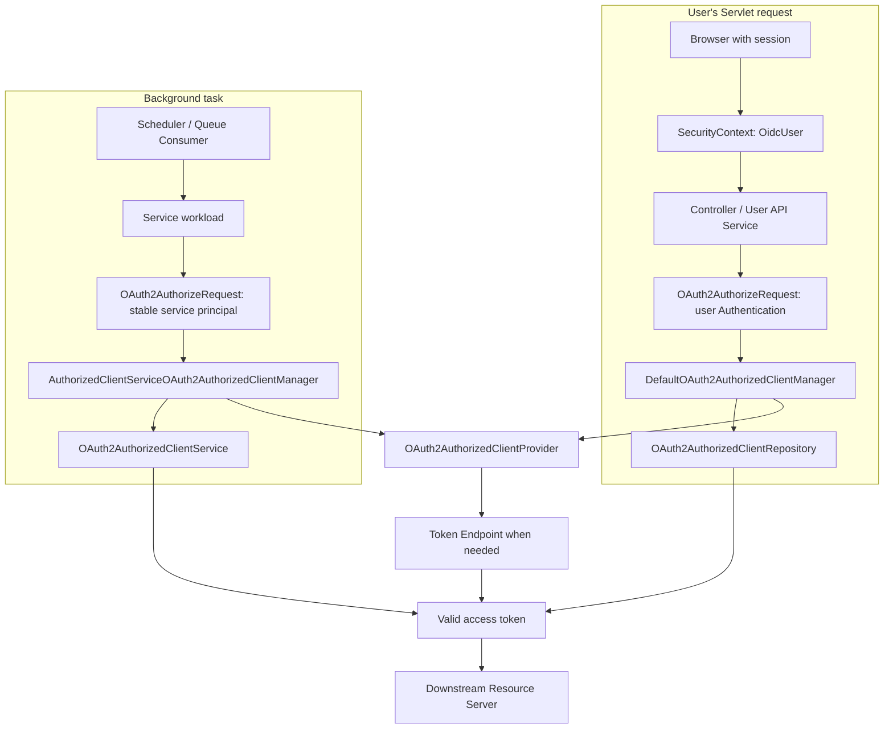
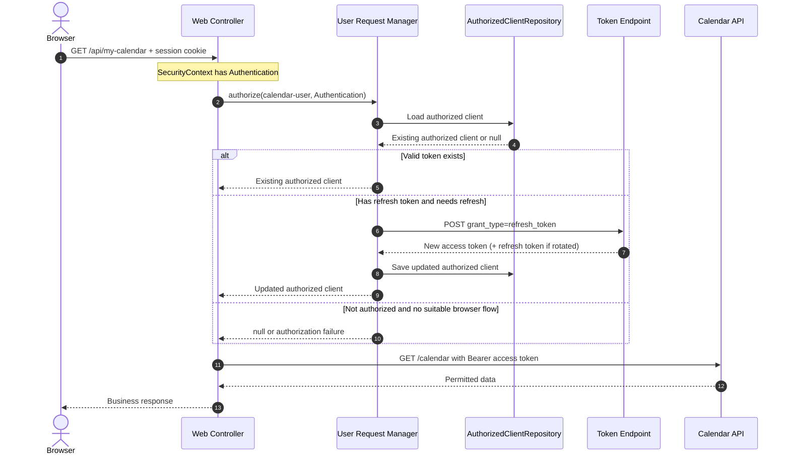
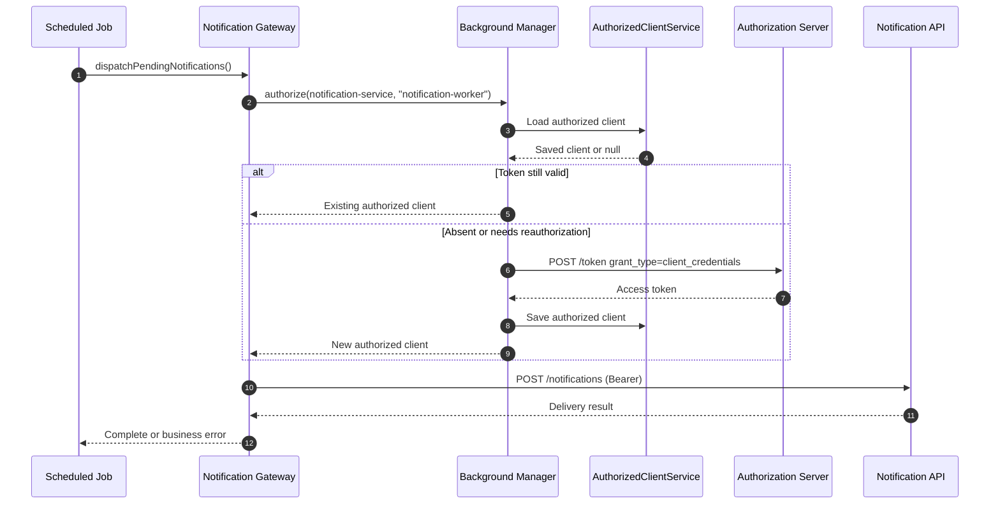
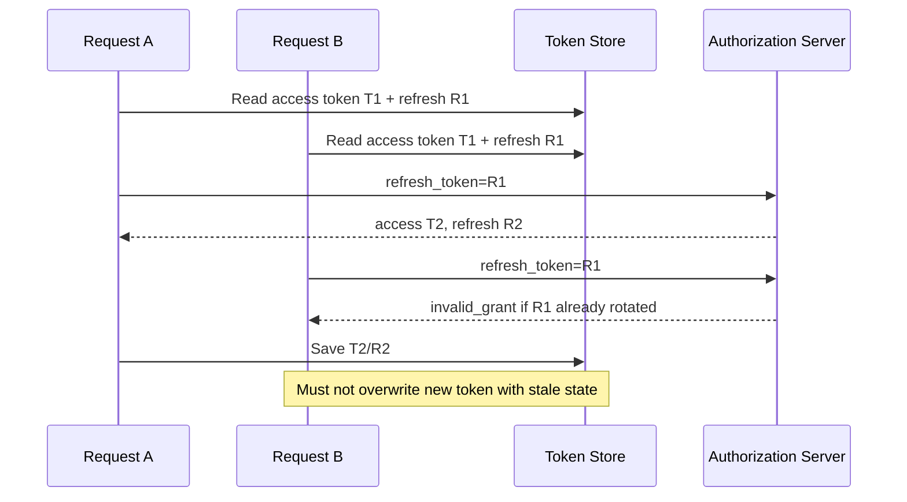

# 15.12. Designing Managers for User Requests and Background Tasks

In a **Spring Security OAuth 2.0 / OpenID Connect (OIDC) Client** system, the same application often has two very different needs:

1. **User requests:** a user logs in via browser with OIDC, then opens a page or calls an application API; the backend needs an access token to call an external API **on behalf of that user**.
2. **Background tasks:** a scheduler, queue consumer, or batch process runs automatically **without an HTTP request or user login session**; the backend needs an access token to call an API using **the application's own identity**.

Both needs can use the `OAuth2AuthorizedClientManager` interface, yet **you should not default to one manager, one principal, and one token store for every case**. The HTTP context, token permissions, principal determination, OAuth2 grant type, and storage lifecycle differ.

This lesson builds a purposeful design for **Spring Boot 3.x / Spring Security 6.x, Servlet, and `oauth2Login()`**, covering:

- Separating **`DefaultOAuth2AuthorizedClientManager`** for user requests from **`AuthorizedClientServiceOAuth2AuthorizedClientManager`** for background tasks.
- Declaring `ClientRegistration` entries with matching grant types, scopes, credentials, and target APIs.
- Building `OAuth2AuthorizeRequest` with the right principal and registration.
- Using authorized client repositories/services to load, refresh, and persist tokens.
- Preventing token leakage across users, tenants, providers, and workflows.
- Handling token refresh, concurrency, errors, logout, rate limits, and multi-instance operations.
- Designing for when a background task **genuinely must act on behalf of a user** instead of using `client_credentials`.

Hostnames, scopes, and credentials in the examples are illustrative only. Replace them with values issued by your real Authorization Server and API; never use placeholder strings as secrets in production.

## 1. Why Not Share One Way of Requesting Tokens Across Everything?

A user's HTTP request may be tied to:

```text
Browser
  -> session cookie
  -> SecurityContext
  -> Authentication (OidcUser)
  -> User's OAuth2AuthorizedClient
```

Whereas a scheduled job may only have:

```text
Scheduler
  -> application/service identity
  -> ClientRegistration using client_credentials
  -> Workload's OAuth2AuthorizedClient
```

If the same service tries to read `SecurityContextHolder` in both environments, the job typically has no browser authentication. If you instead hardcode a shared principal `"user"` to read user tokens, you risk **using person A's token for person B**. If you use `client_credentials` for an API that requires user-level permissions, the API will reject it because the token **has no end-user delegation**.

Architectural principle:

> **Every token request must explicitly state who the authorized subject is, which client registration is being used, which grant applies, and under which key the token is stored.**

“Having a token” is not enough. The token must be issued for the right **issuer, audience/resource, scopes, and principal/client context**.

## 2. Components of a Proper OAuth2 Client Design

| Component | Role | Design Note |
| --- | --- | --- |
| `ClientRegistration` | Describes an OAuth2 client registered at the Authorization Server | Grant type, ID, secret, token endpoint, scopes must be accurate |
| `OAuth2AuthorizeRequest` | Input to one manager `authorize` call | Selects registration/authorized client and principal |
| `OAuth2AuthorizedClientManager` | Coordinates reusing existing tokens / initial issuance / reauthorization | Pick implementation by HTTP context |
| `OAuth2AuthorizedClientProvider` | Executes matching grant/reauthorization | E.g., authorization code, refresh token, client credentials |
| `OAuth2AuthorizedClientRepository` | Finds/saves authorized clients in a Servlet environment | Can use request, response, and session |
| `OAuth2AuthorizedClientService` | Finds/saves authorized clients independently of Servlet requests | Fits scheduled jobs and custom storage |
| `OAuth2AuthorizedClient` | Authorized state holding access/refresh tokens | Sensitive credentials; never return to frontend |
| `Authentication` | Current user's identity and authorities | Not identical to `OAuth2AuthorizedClient` |

### 2.1. Distinguishing `Authentication` and `OAuth2AuthorizedClient`

A successful OIDC login typically creates an `OAuth2AuthenticationToken` containing `OidcUser` and authorities for website authorization. In parallel, Spring Security OAuth2 Client can save an `OAuth2AuthorizedClient` keyed by registration and principal, holding the access token / refresh token if issued.

```text
SecurityContext                          Authorized Client Storage
+--------------------------------+      +----------------------------------+
| Authentication                 |      | OAuth2AuthorizedClient           |
|  - OidcUser                    |      |  - ClientRegistration            |
|  - authorities                 |      |  - principalName                 |
|  - authenticated = true        |      |  - accessToken                   |
|                                |      |  - refreshToken (if present)     |
+--------------------------------+      +----------------------------------+
   Used to protect app endpoints            Used to call downstream APIs
```

A client credentials token **does not create a user's `OidcUser`**. Conversely, a logged-in user **does not automatically have a token for every API**.

### 2.2. `authorize()` Does Not Mean “Always POST /token”

A call:

```java
OAuth2AuthorizedClient client = manager.authorize(request);
```

can:

- Return an existing authorized client that does not yet need reissuance.
- Request an initial token for a supported grant and save the authorized client.
- Reauthorize, e.g., refresh a token or re-request a client credentials token when needed.
- Return `null` if no authorization mechanism matches the context/providers.
- Throw an appropriate OAuth2 error if authorization ran and the Authorization Server rejected it.

Therefore, do not design code as if every incoming HTTP request makes a call to the Token Endpoint. Also always plan for handling `null` and errors.

## 3. Architecture Diagram: Two Separated Flows



The diagram shows **two distinct managers sharing the same interface** and potentially using different providers/grants. Token storage is separated by **authorization context**; it does not necessarily require two physical databases, yet must strictly partition principals, registrations, lifecycles, and access policies.

## 4. Choosing Manager Type by Execution Context

### 4.1. `DefaultOAuth2AuthorizedClientManager` — Servlet Flow

This manager coordinates:

```text
ClientRegistrationRepository
+
OAuth2AuthorizedClientRepository
+
OAuth2AuthorizedClientProvider
```

It suits **web requests with `HttpServletRequest` and `HttpServletResponse`**, where authorized clients can associate with the user's session and principal. It is designed to work inside a Servlet request context.

Typical scenario:

1. User logs in via `oauth2Login()`.
2. `SecurityContext` holds the user's `Authentication`.
3. A controller/service within the request calls `manager.authorize(...)`.
4. The manager looks up the authorized client matching the registration and principal.
5. If needed and capable, the provider refreshes the token; otherwise the existing client is reused.
6. The backend sends the access token to the trusted target API.

**Do not use this manager in a `@Scheduled` job running without a Servlet request**, because it relies on HTTP/repository context. Job code attempting to access the current request may fail or exhibit undesirable token persistence behavior.

### 4.2. `AuthorizedClientServiceOAuth2AuthorizedClientManager` — Requestless Tasks

This manager coordinates:

```text
ClientRegistrationRepository
+
OAuth2AuthorizedClientService
+
OAuth2AuthorizedClientProvider
```

It requires no HTTP request/response to look up and save authorized clients. Suitable for:

- `@Scheduled` jobs.
- Kafka/RabbitMQ consumers.
- Batch imports/exports.
- Service-to-service integrations.
- Async processing flows decoupled from the HTTP lifecycle.

A typical background task uses `client_credentials` when **the application operates as itself**, not on behalf of a user. The manager can find a still-valid access token or request a new one from the Token Endpoint.

### 4.3. Never Pick a Manager Solely by Controller or Service Class Name

The decision must be based on **authorization context**, not class names. A service may be called from both a controller **and** a scheduler. If that service implicitly pulls the manager from the current request, scheduled invocations will break.

A cleaner design separates them:

- **`UserCalendarGateway`**: requires the logged-in user's `Authentication`.
- **`SystemNotificationGateway`**: requires a fixed service principal and a client credentials registration.

If both flows call the same API, they can share underlying HTTP client/serialization/business logic, yet **should never blindly share the same token-acquisition method**.

## 5. Comparing Grant Types Across Both Business Lines

| Property | User Request | Background Workload |
| --- | --- | --- |
| Common grant type | `authorization_code` | `client_credentials` |
| Needs browser redirect? | Yes, in standard OIDC login | No |
| Has end-user principal? | Has `Authentication` from `SecurityContext` | Usually no |
| Whose permissions are in the access token? | Per user/client authorization and OP | Per permissions granted to client application |
| Appropriate manager | `DefaultOAuth2AuthorizedClientManager` | `AuthorizedClientServiceOAuth2AuthorizedClientManager` |
| Obtains authorization code via manager? | No; requires front-channel flow | Not applicable |
| Renewing tokens | `refresh_token` if issued | Typically requests a new access token via `client_credentials` |
| Storage key | Registration + appropriate user principal | Registration + stable workload principal |
| When user logs out | Review session / authorized client / token revocation | Never delete service tokens just because one user logged out |

**`client_credentials` is not a way to bypass end-user consent.** If an API requires a user-delegated token, an application grant may lack access or have different privilege scope. Design the proper authorization model.

## 6. Configuring Two Client Registrations in Spring Boot

Suppose an application has:

- `calendar-user`: users log in via OIDC and allow the backend to read their personal calendar.
- `notification-service`: backend sends notifications from a scheduled job using the application's identity.

### 6.1. `application.yml`

```yaml
spring:
  security:
    oauth2:
      client:
        registration:
          calendar-user:
            provider: calendar-oidc
            client-id: ${CALENDAR_OIDC_CLIENT_ID}
            client-secret: ${CALENDAR_OIDC_CLIENT_SECRET}
            client-authentication-method: client_secret_basic
            authorization-grant-type: authorization_code
            scope:
              - openid
              - profile
              - calendar.read
            redirect-uri: "{baseUrl}/login/oauth2/code/{registrationId}"

          notification-service:
            provider: notification-as
            client-id: ${NOTIFY_CLIENT_ID}
            client-secret: ${NOTIFY_CLIENT_SECRET}
            client-authentication-method: client_secret_basic
            authorization-grant-type: client_credentials
            scope:
              - notifications.send

        provider:
          calendar-oidc:
            issuer-uri: ${CALENDAR_ISSUER_URI}
          notification-as:
            token-uri: ${NOTIFY_TOKEN_URI}
```

The scopes `calendar.read` and `notifications.send` are illustrative only. The real Authorization Server must support and grant them to the right client, and the target API must recognize them. If the notification Authorization Server supports OIDC/OAuth2 discovery, you can configure appropriate metadata; in this example, only the token endpoint is needed for client credentials.

**Do not reuse one shared secret for both registrations** unless required by Authorization Server policy; issue separate credentials to isolate lifecycle, permissions, and rotation.

### 6.2. Equivalent `application.properties`

```properties
spring.security.oauth2.client.registration.calendar-user.provider=calendar-oidc
spring.security.oauth2.client.registration.calendar-user.client-id=${CALENDAR_OIDC_CLIENT_ID}
spring.security.oauth2.client.registration.calendar-user.client-secret=${CALENDAR_OIDC_CLIENT_SECRET}
spring.security.oauth2.client.registration.calendar-user.client-authentication-method=client_secret_basic
spring.security.oauth2.client.registration.calendar-user.authorization-grant-type=authorization_code
spring.security.oauth2.client.registration.calendar-user.scope=openid,profile,calendar.read
spring.security.oauth2.client.registration.calendar-user.redirect-uri={baseUrl}/login/oauth2/code/{registrationId}
spring.security.oauth2.client.provider.calendar-oidc.issuer-uri=${CALENDAR_ISSUER_URI}

spring.security.oauth2.client.registration.notification-service.provider=notification-as
spring.security.oauth2.client.registration.notification-service.client-id=${NOTIFY_CLIENT_ID}
spring.security.oauth2.client.registration.notification-service.client-secret=${NOTIFY_CLIENT_SECRET}
spring.security.oauth2.client.registration.notification-service.client-authentication-method=client_secret_basic
spring.security.oauth2.client.registration.notification-service.authorization-grant-type=client_credentials
spring.security.oauth2.client.registration.notification-service.scope=notifications.send
spring.security.oauth2.client.provider.notification-as.token-uri=${NOTIFY_TOKEN_URI}
```

Pick YAML **or** properties according to project convention. Never commit real credentials to source control. Environment variables must be injected by the runtime/secret manager; do not assume Spring reads a `.env` file automatically without a loader.

### 6.3. URLs Serve Different Roles

For `calendar-user`:

```text
Browser initiates login:
GET /oauth2/authorization/calendar-user

OIDC callback:
GET /login/oauth2/code/calendar-user?code=...&state=...
```

For `notification-service`:

```text
Backend -> POST Token Endpoint with grant_type=client_credentials
No browser redirect or callback.
```

Never attempt to start user login for `notification-service` via `/oauth2/authorization/notification-service`, because that grant is not the Authorization Code Flow.

## 7. Configuring Two Managers as Two Separate Beans

With Spring Security 6 on Servlet, a Java configuration can declare:

```java
import org.springframework.context.annotation.Bean;
import org.springframework.context.annotation.Configuration;
import org.springframework.security.oauth2.client.AuthorizedClientServiceOAuth2AuthorizedClientManager;
import org.springframework.security.oauth2.client.DefaultOAuth2AuthorizedClientManager;
import org.springframework.security.oauth2.client.OAuth2AuthorizedClientManager;
import org.springframework.security.oauth2.client.OAuth2AuthorizedClientProvider;
import org.springframework.security.oauth2.client.OAuth2AuthorizedClientProviderBuilder;
import org.springframework.security.oauth2.client.OAuth2AuthorizedClientService;
import org.springframework.security.oauth2.client.registration.ClientRegistrationRepository;
import org.springframework.security.oauth2.client.web.OAuth2AuthorizedClientRepository;

@Configuration
public class OAuth2ClientManagersConfig {

    @Bean("userRequestClientManager")
    OAuth2AuthorizedClientManager userRequestClientManager(
            ClientRegistrationRepository registrations,
            OAuth2AuthorizedClientRepository authorizedClientRepository) {

        OAuth2AuthorizedClientProvider userProvider =
                OAuth2AuthorizedClientProviderBuilder.builder()
                        .authorizationCode()
                        .refreshToken()
                        .build();

        DefaultOAuth2AuthorizedClientManager manager =
                new DefaultOAuth2AuthorizedClientManager(
                        registrations, authorizedClientRepository);
        manager.setAuthorizedClientProvider(userProvider);

        return manager;
    }

    @Bean("backgroundClientManager")
    OAuth2AuthorizedClientManager backgroundClientManager(
            ClientRegistrationRepository registrations,
            OAuth2AuthorizedClientService authorizedClientService) {

        OAuth2AuthorizedClientProvider backgroundProvider =
                OAuth2AuthorizedClientProviderBuilder.builder()
                        .clientCredentials()
                        .build();

        AuthorizedClientServiceOAuth2AuthorizedClientManager manager =
                new AuthorizedClientServiceOAuth2AuthorizedClientManager(
                        registrations, authorizedClientService);
        manager.setAuthorizedClientProvider(backgroundProvider);

        return manager;
    }
}
```

**Meaning:** both beans implement `OAuth2AuthorizedClientManager`, yet use **two different storage abstractions** and **two different sets of grant providers**. This prevents choosing the wrong manager type or accidentally letting a background job touch a user session.

In Spring Boot, `ClientRegistrationRepository`, `OAuth2AuthorizedClientRepository`, and `OAuth2AuthorizedClientService` can be auto-configured depending on starters and declared beans. If the application replaces default storage, supply the right implementation for each matching manager; never create an “empty” dummy service just to satisfy bean wiring.

### 7.1. Why Use Explicit Bean Names?

Because there are **two beans of the same type**, unqualified injection is ambiguous. Specify explicitly:

```java
public CalendarApiGateway(
        @Qualifier("userRequestClientManager")
        OAuth2AuthorizedClientManager manager) {
    this.manager = manager;
}
```

And for the job:

```java
public NotificationApiGateway(
        @Qualifier("backgroundClientManager")
        OAuth2AuthorizedClientManager manager) {
    this.manager = manager;
}
```

The examples below use constructor injection + `@Qualifier` to prevent miswiring. Do not blindly add `@Primary` when two managers truly serve distinct roles; a mistakenly injected default bean can cause subtle bugs.

### 7.2. Providers for Each Manager Do Not Need to Be Identical

The user manager may need:

```java
OAuth2AuthorizedClientProviderBuilder.builder()
        .authorizationCode()
        .refreshToken()
        .build();
```

The workload manager usually only needs:

```java
OAuth2AuthorizedClientProviderBuilder.builder()
        .clientCredentials()
        .build();
```

Omitting `clientCredentials()` from the user manager helps prevent issuing application tokens in code paths meant only to call APIs on behalf of users. Conversely, the background manager does not need `authorizationCode()` if there is no browser flow.

This is **defense in depth at the configuration layer**, and does not replace protecting service APIs and checking registration IDs at call sites.

## 8. `SecurityFilterChain` for the User Login Flow

So browsers can log in via OIDC using `calendar-user`:

```java
import org.springframework.context.annotation.Bean;
import org.springframework.context.annotation.Configuration;
import org.springframework.security.config.Customizer;
import org.springframework.security.config.annotation.web.builders.HttpSecurity;
import org.springframework.security.web.SecurityFilterChain;

@Configuration
public class WebSecurityConfig {

    @Bean
    SecurityFilterChain webSecurityFilterChain(HttpSecurity http)
            throws Exception {

        http
            .authorizeHttpRequests(authorize -> authorize
                .requestMatchers("/", "/login", "/error", "/assets/**")
                    .permitAll()
                .anyRequest()
                    .authenticated()
            )
            .oauth2Login(Customizer.withDefaults());

        return http.build();
    }
}
```

`oauth2Login()` handles browser redirect/callback, OIDC ID Token validation, creating `Authentication`, and saving the authorized client via default/configured components. **`userRequestClientManager` does not replace login filters**: it uses the authorized client later when the backend needs an access token.

A production application may add appropriate URL authorization, method security, and CSRF protection; this example only illustrates login placement and basic access restrictions.

### 8.1. When Multiple Registrations Exist, Pick the Right Login Registration

If multiple OIDC registrations exist, users start the flow at:

```text
/oauth2/authorization/{registrationId}
```

In this example, the user chooses `calendar-user`. Once the callback succeeds, the `OAuth2AuthorizedClient` for `calendar-user` is saved for the corresponding principal. Declaring `notification-service` in the same YAML file **does not make client credentials tokens belong to the user**.

## 9. User Request Flow: From `Authentication` to Bearer Token

### 9.1. Step-by-Step Flow



Points to remember:

- The current `Authentication` **must belong to the user making the request**.
- The client registration must match the API/scopes the user authorized.
- Tokens may only be sent to **trusted API hosts**, never via arbitrary browser-supplied URLs.
- If no authorized client exists yet, `authorize()` does not invent browser authorization codes or consent.
- When the user logs out or loses their session, never silently use another principal's token to call the API.

### 9.2. Using `OAuth2AuthorizeRequest` with the Right Principal

```java
import org.springframework.security.core.Authentication;
import org.springframework.security.oauth2.client.OAuth2AuthorizedClient;
import org.springframework.security.oauth2.client.OAuth2AuthorizeRequest;

OAuth2AuthorizeRequest authorizeRequest =
        OAuth2AuthorizeRequest
                .withClientRegistrationId("calendar-user")
                .principal(authentication)
                .build();

OAuth2AuthorizedClient authorizedClient =
        userRequestClientManager.authorize(authorizeRequest);

if (authorizedClient == null) {
    throw new IllegalStateException(
            "Current user has no usable calendar authorization");
}
```

**Never use**:

```java
// Anti-pattern when serving multiple users:
.principal("shared-user")
```

Since persistence keys rely on registration and principal name, a shared name can mix two users' tokens when storage/callers are misdesigned.

### 9.3. Service Calling the Calendar API

Example using Spring Framework 6.1+'s `RestClient` (typically in Spring Boot 3.2+):

```java
import org.springframework.beans.factory.annotation.Qualifier;
import org.springframework.security.core.Authentication;
import org.springframework.security.oauth2.client.OAuth2AuthorizeRequest;
import org.springframework.security.oauth2.client.OAuth2AuthorizedClient;
import org.springframework.security.oauth2.client.OAuth2AuthorizedClientManager;
import org.springframework.stereotype.Service;
import org.springframework.web.client.RestClient;

@Service
public class UserCalendarGateway {

    private final OAuth2AuthorizedClientManager manager;
    private final RestClient calendarApi =
            RestClient.create("https://calendar-api.example.com");

    public UserCalendarGateway(
            @Qualifier("userRequestClientManager")
            OAuth2AuthorizedClientManager manager) {
        this.manager = manager;
    }

    public String loadMyCalendar(Authentication authentication) {
        OAuth2AuthorizeRequest authorizeRequest =
                OAuth2AuthorizeRequest
                        .withClientRegistrationId("calendar-user")
                        .principal(authentication)
                        .build();

        OAuth2AuthorizedClient client =
                manager.authorize(authorizeRequest);

        if (client == null) {
            throw new IllegalStateException(
                    "Calendar account is not authorized");
        }

        return calendarApi.get()
                .uri("/v1/events")
                .headers(headers -> headers.setBearerAuth(
                        client.getAccessToken().getTokenValue()))
                .retrieve()
                .body(String.class);
    }
}
```

Real applications should handle `null` / authorization failures with a controlled “Reconnect account” flow and appropriate error mapping instead of leaking `IllegalStateException` to the browser. This example only illustrates token retrieval logic.

**Never return raw access tokens in responses** and never put them in logs. An API may reject a token due to audience/scope/authorization even when unexpired; the manager does not replace resource-server policy.

### 9.4. Controller Passing Current `Authentication`

```java
import org.springframework.security.core.Authentication;
import org.springframework.web.bind.annotation.GetMapping;
import org.springframework.web.bind.annotation.RestController;

@RestController
public class MyCalendarController {

    private final UserCalendarGateway gateway;

    public MyCalendarController(UserCalendarGateway gateway) {
        this.gateway = gateway;
    }

    @GetMapping("/api/my-calendar")
    String myCalendar(Authentication authentication) {
        return gateway.loadMyCalendar(authentication);
    }
}
```

When the endpoint is protected by Spring Security, `Authentication` comes from the exact request's `SecurityContext`. The controller should never accept an arbitrary `username` from the browser to look up another user's authorized client.

### 9.5. What If the User Logged In with a Different OP?

Suppose a user logged into the website using registration `corporate-login`, yet has not authorized `calendar-user`. Calling the manager with `calendar-user` will not find a matching authorized client for the current principal.

The system must design an explicit **account linking / consent flow** so the user initiates `/oauth2/authorization/calendar-user`, verifies the callback, and saves the authorized client for the right user. Never treat a user session authenticated by OP A as automatic permission to use tokens from OP B.

In multi-OP applications, verify how `(issuer, subject)` maps to internal accounts; never rely on email alone to conclude two principals are the same person.

## 10. Background Task Flow: From Service Principal to Token

Background tasks normally have no `HttpServletRequest` and should not depend on a browser's `SecurityContextHolder`.

### 10.1. Client Credentials Flow Diagram



The Authorization Server authenticates the **client application** from `client_id`, `client_secret`, or the registered client authentication method. The string `"notification-worker"` is not used to grant permissions like an end user; it lets the manager identify the authorized client state in storage.

### 10.2. Service Calling Notification API

```java
import org.springframework.beans.factory.annotation.Qualifier;
import org.springframework.security.oauth2.client.OAuth2AuthorizeRequest;
import org.springframework.security.oauth2.client.OAuth2AuthorizedClient;
import org.springframework.security.oauth2.client.OAuth2AuthorizedClientManager;
import org.springframework.stereotype.Service;
import org.springframework.web.client.RestClient;

@Service
public class SystemNotificationGateway {

    private static final String WORKLOAD_PRINCIPAL =
            "notification-worker";

    private final OAuth2AuthorizedClientManager manager;
    private final RestClient notificationApi =
            RestClient.create("https://notify-api.example.com");

    public SystemNotificationGateway(
            @Qualifier("backgroundClientManager")
            OAuth2AuthorizedClientManager manager) {
        this.manager = manager;
    }

    public String sendSystemNotice(String payload) {
        OAuth2AuthorizeRequest authorizeRequest =
                OAuth2AuthorizeRequest
                        .withClientRegistrationId("notification-service")
                        .principal(WORKLOAD_PRINCIPAL)
                        .build();

        OAuth2AuthorizedClient client =
                manager.authorize(authorizeRequest);

        if (client == null) {
            throw new IllegalStateException(
                    "Notification service authorization unavailable");
        }

        return notificationApi.post()
                .uri("/v1/notifications")
                .headers(headers -> headers.setBearerAuth(
                        client.getAccessToken().getTokenValue()))
                .body(payload)
                .retrieve()
                .body(String.class);
    }
}
```

This is a minimal example. In production, payloads must be validated and size-bounded, with proper handling of API results, timeouts/retries, and idempotency; never store sensitive data in payloads/logs. If the API expects JSON, set `Content-Type: application/json` and use typed DTOs with clear contracts instead of an ambiguous raw `String`.

### 10.3. Scheduler Triggering the Service

```java
import org.springframework.scheduling.annotation.Scheduled;
import org.springframework.stereotype.Component;

@Component
public class NotificationDispatchJob {

    private final SystemNotificationGateway gateway;

    public NotificationDispatchJob(SystemNotificationGateway gateway) {
        this.gateway = gateway;
    }

    @Scheduled(fixedDelayString = "${NOTIFY_DELAY_MS:300000}")
    public void dispatch() {
        // Illustrative action: in practice, payloads come from a queue/database.
        gateway.sendSystemNotice("{\"kind\":\"system-heartbeat\"}");
    }
}
```

To enable scheduling, add `@EnableScheduling` to an appropriate Spring configuration class. This example only illustrates using the manager inside a job; **never deploy a fake heartbeat into production without a real business purpose**.

Never call `SecurityContextHolder.getContext().getAuthentication()` in a job hoping to get the most recent page visitor: `SecurityContext` on a request thread is **not a global session** and does not automatically propagate to background threads.

### 10.4. Why Use a Stable Principal Name?

`AuthorizedClientServiceOAuth2AuthorizedClientManager` typically uses registration and principal name to find saved authorized clients. Generating a new principal like `"job-" + currentTimeMillis()` on every run makes the manager treat each run as a separate state and request new tokens needlessly.

Use a stable name:

```text
registrationId = notification-service
principalName  = notification-worker
```

However, if a system has **multiple clients with different permissions**, separate registrations/credentials/scopes. You cannot obtain extra permissions at the OP merely by renaming the principal to `admin`.

## 11. Designing to Prevent Token Leakage Between Users and Workloads

A severe bug can occur when the same service layer handles both user requests and background jobs while keeping “the current token” in a mutable/global field:

```java
// Anti-pattern: DO NOT USE
private String currentAccessToken;

public void onUserRequest(String userToken) {
    currentAccessToken = userToken;
}

public void scheduledWork() {
    callApi(currentAccessToken);
}
```

Under concurrent requests, the job can send an arbitrary user's token, causing data leaks or privilege violations. Never store tokens in a mutable singleton field as a “current session”.

### 11.1. Boundaries to Preserve

| Boundary | How to Enforce |
| --- | --- |
| **User vs. service** | Separate registrations and managers; never use service tokens when API demands user delegation |
| **User A vs. User B** | Bind authorized clients to trusted user principals; never use `"shared-user"` |
| **Provider A vs. Provider B** | Each registration has its own issuer/client credentials; verify exact issuer and audience |
| **Tenant A vs. Tenant B** | Derive tenant identity server-side, mapped to approved registrations/policies |
| **API X vs. API Y** | Send tokens only to APIs matching the token's audience/resource/scopes |
| **Web session vs. background store** | Repository/service aligned with lifecycle and access control |
| **Test vs. production** | Never use production client secrets/tokens in fixtures, logs, or test containers |

### 11.2. User Tokens Should Not Live in Shared Jobs

Even when a job is triggered by a user (e.g., “export report”), the job itself may run after the HTTP request ends. If the job needs **the user's own token** at execution time, the design must clarify:

- Who authorized and allowed storing/refreshing the token?
- Under which internal user identity and registration is the token stored?
- Which permissions may be used when the job runs later?
- What happens if the user logs out, revokes consent, or is disabled?
- How do we prevent User A from triggering a job that pulls User B's token?
- Is a refresh token or a token-exchange/delegation mechanism required?

**Never solve this by switching the principal to `"system"` and using `client_credentials`**, because that grants application permissions, not user permissions.

## 12. Background Jobs Needing “On-Behalf-Of User”: Three Options

Not every background task uses `client_credentials`. A personal calendar sync or file upload on a user's behalf may need a **delegated access token**.

### 12.1. Option A — Use the User's Authorized Client with Persistent Storage

General flow:

1. User completes OAuth2 Authorization Code + consent.
2. Application saves `OAuth2AuthorizedClient` for the **exact internal user/registration**, with token protection.
3. Job is queued with **internal user ID / tenant / work item ID**, without the raw token.
4. Worker verifies execution permission and retrieves that user's token via an authorized storage/service.
5. Worker uses matching manager/service logic to refresh when a refresh token was issued; if authorization is lost, prompt the user to reconnect.

```text
Browser user consent
    |
    v
User's authorized client (protected store)
    |
    v
Job message: internalUserId + taskId (contains no token)
    |
    v
Worker verifies task owner and current permissions
    |
    v
Load/reauthorize user token for exact registration
    |
    v
Call API under delegated permissions
```

In this model, the background worker will typically need **`AuthorizedClientServiceOAuth2AuthorizedClientManager`** or an equivalent decoupled mechanism, since there is no Servlet request. A key requirement is that **the user's authorized client is actually stored in a service accessible to the worker**; session-backed repositories may fail once the session ends.

**Do not assume that putting a service manager in a job lets it read tokens that `oauth2Login()` saved in the session.** Actively design repository/service persistence and identity mapping.

### 12.2. Option B — Token Exchange / On-Behalf-Of If Supported by the Authorization Server

Some systems support **OAuth 2.0 Token Exchange (RFC 8693)** or a specialized delegation/on-behalf-of flow. The client presents valid credentials per Authorization Server rules to obtain a token scoped to the downstream resource/identity.

This is **a different grant/workflow**—it does not happen just by passing `.principal(userName)` into `OAuth2AuthorizeRequest`. It requires:

- Official support from the Authorization Server and matching Spring/HTTP client integration.
- Explicit audience/resource, scopes, and subject-delegation policies.
- Validation of source tokens, lifetimes, actor/subject claims, and trust conditions.
- Scoping the new token strictly to the API and task actually required.

### 12.3. Option C — Convert the Operation to True Service Permissions

If the business action does not require user-delegated authorization (e.g., sending a system alert), change the contract to **service-to-service** with `client_credentials`. Then the job's audit actor is the service; the user who requested the job (if any) is only **business audit context**, never turning a service token into a user token.

Choose based on the **authorization semantics of the API**, not whether fetching a token looks easier in code.

## 13. Repository vs. Service: Where Should Tokens Be Stored?

### 13.1. User Request Context

An `OAuth2AuthorizedClientRepository` may bind tokens to the web principal/session or delegate persistence to `OAuth2AuthorizedClientService` depending on implementation. Determine:

- Which user principal name partitions data.
- Which registration ID binds to the provider and scopes.
- How session timeouts and logouts affect tokens.
- When the browser session expires, should tokens be deleted?
- Do background workers need access to tokens?
- Do multiple nodes/instances serve the same user?

**Do not conclude “tokens are already in Redis” just because HTTP sessions use Spring Session Redis**: the authorized client repository may store elsewhere depending on configuration.

### 13.2. Background Task Context

`OAuth2AuthorizedClientService` is usually designed to store by registration/principal, with implementations:

- **In-memory:** simple, yet each instance has isolated state and restarts wipe tokens.
- **JDBC/database:** enables sharing/persistence, yet requires credential protection, concurrency handling, and cleanup.
- **Custom distributed store:** supports TTL, atomic updates, and access control per architecture.

With `client_credentials`, losing cached access tokens is usually recoverable by requesting a new one, though it can increase Token Endpoint load or hit rate limits. With **end-user refresh tokens**, losing tokens or overwriting via races can force users to re-consent/re-login.

### 13.3. Do Not Accidentally Merge Session Store and Token Store

`SecurityContext` is designed for the authenticated principal on a request. `OAuth2AuthorizedClient` holds bearer credentials. They have different lifecycles; dumping all tokens arbitrarily into user sessions for later jobs blurs security boundaries.

Token management must address:

- Encryption at rest and TLS to storage.
- Token read permissions per service/tenant.
- Appropriate TTL or retention policies.
- Cleanup when users disconnect or revoke consent.
- Auditing token access **without logging raw tokens**.
- Protecting backups, snapshots, and replication.
- Handling key rotation and refresh token rotation consistently.

## 14. Token Reuse, Refresh, and Client Credentials Reauthorization

### 14.1. One Authorized Client Can Be Reused Multiple Times

Suppose a token for `notification-service` is issued at 09:00 and expires at 10:00.

```text
09:00  Job calls authorize()
       -> no authorized client yet
       -> POST grant_type=client_credentials
       -> receives access token T1, saves it

09:15  Job calls authorize()
       -> authorized client T1 still valid
       -> can return T1, no POST /token needed

09:59  Job calls authorize()
       -> T1 near expiry per clock skew
       -> provider can issue T2 and save it

10:05  Job calls authorize()
       -> uses T2 if still valid
```

Exact timestamps are illustrative only. Clock skew, expiry, concurrency, providers, and Authorization Server policy determine when the manager reauthorizes. **Never assume every manager call issues a new token.**

### 14.2. User Refresh Token

For `calendar-user`, if the OP issues a refresh token and the manager has a `refreshToken()` provider:

```text
Authorized client has:
  access token (expired / near expiry)
  refresh token (still valid)
          |
          v
Manager reauthorizes via refresh_token grant
          |
          v
Authorization Server returns new token
          |
          v
Save updated OAuth2AuthorizedClient
```

Not every OIDC client receives a refresh token. `offline_access` or OP/consent settings can affect refresh token issuance, and OPs follow different rules. **Refresh tokens are highly sensitive credentials** and can be rotated or revoked.

If refresh fails, the user may have to log in / consent again. A job acting on a user's behalf needs a dedicated “authorization required” strategy—never borrowing another user's token or hiding the failure with a service token.

### 14.3. Client Credentials Usually Requests a New Token Instead of Refreshing

By standard design, Authorization Servers do not issue refresh tokens for `client_credentials`. When the access token expires, the provider can simply re-run `grant_type=client_credentials` with the application's credentials.

This is independent of `oauth2Login()` and requires no browser. However, the backend must handle OP rate limits, expired credentials, certificate errors, or changed scope policies.

## 15. Concurrency and Multiple Instances: Races to Design For

Two requests for the same user can concurrently see a token nearing expiry. Likewise, two job workers can simultaneously try to obtain a token for one registration.

### 15.1. Two User Requests Refreshing Together



Some OPs rotate single-use refresh tokens; the second request may fail. Worse, a concurrency-unaware failure handler might delete the authorized client **that Request A just updated**.

Architectural options:

- In-process single-flight refresh (where sufficient).
- Distributed lock/lease per registration + principal with TTL and safe release.
- Compare-and-swap / versioned storage to avoid overwriting newer results.
- After a race-induced refresh failure, re-read the store before deciding to delete state.
- Bound retries and apply backoff on OP rate limits.
- Monitor token refresh failure rates without logging tokens.

**`OAuth2AuthorizedClientManager` does not promise distributed locking across every storage implementation**. Those guarantees belong to storage/provider design and additional orchestration logic.

### 15.2. Multiple Workers Requesting Client Credentials Simultaneously

For `notification-service`, two workers may both find no token and call the Token Endpoint concurrently. That may be acceptable if the OP and load limits allow it, or may need a shared store / coordination mechanism at high scale.

Do not sacrifice overall system availability just to “guarantee only one token exists at a time”. Balance rate limits, token lifetimes, cache consistency, process restarts, and retry capability.

### 15.3. Never Use `ThreadLocal` as a Long-Lived Token Store

`SecurityContextHolder` normally binds context to the current processing thread. Executors, async processors, or schedulers run on different threads and do not automatically inherit all request-thread attributes. Blindly copying `SecurityContext` into background jobs risks using stale permissions or the wrong actor.

When a job needs delegated user access, **persist a work item linked to a verified internal identity** and access the authorized client via secure storage; never pass raw `SecurityContext` or access tokens inside queue messages without explicit justification and safeguards.

## 16. HTTP Client Design and API Boundaries

A manager retrieves tokens, yet **does not automatically attach Bearer tokens to arbitrary `RestClient` instances**. With a `RestClient` created via `RestClient.create(...)`, you must:

1. Call the manager to get the authorized client.
2. Select the right token.
3. Attach `Authorization: Bearer <token>` on requests to a trusted API.
4. Distinguish API network/HTTP errors from authorize/token endpoint errors.

Spring Security can integrate with `RestClient`/`WebClient` via appropriate interceptors/filters in supported versions, provided you configure the right manager and registration; never assume having a manager bean equips every HTTP client with OAuth2 automatically.

### 16.1. Preventing SSRF or Sending Tokens to the Wrong Host

Do not do:

```java
// WRONG: URL controlled by untrusted caller.
String url = request.getParameter("target");
client.get().uri(url)
        .headers(h -> h.setBearerAuth(accessToken))
        .retrieve();
```

If users can choose the target, the app can easily send tokens to an attacker-controlled host. Use server-managed base URLs / host allowlists, and never auto-follow cross-origin redirects with an `Authorization` header.

### 16.2. What to Do When the API Returns 401/403?

| API Response | What It May Indicate | Handling Approach |
| --- | --- | --- |
| `401 invalid_token` | Wrong audience, expired, revoked, signature/issuer rejected | Check token policy; run failure/re-authorization handling if invalid token |
| `403 insufficient_scope` | Token valid yet lacks permissions/scopes | Never retry infinitely with same scopes; check consent/registration/authorization policy |
| `429 Too Many Requests` | API rate limit | Backoff and bounded retry; respect response policy |
| `5xx` | API backend failure | Retry only when safe/idempotent, with circuit breaker if needed |
| Network timeout | Unclear whether API processed the action | For POSTs, use idempotency keys or anti-duplication logic |

The manager cannot automatically know the resource server returned `401` without HTTP-client integration or application-layer failure handling. In particular, **never infinitely retry a POST sending notifications**, as that can create duplicate notifications.

## 17. Security Boundary Between Principal and Authorized Client Storage

An `OAuth2AuthorizeRequest` can be constructed via:

```java
OAuth2AuthorizeRequest.withClientRegistrationId("calendar-user")
        .principal(authentication)
        .build();
```

or:

```java
OAuth2AuthorizeRequest.withClientRegistrationId("notification-service")
        .principal("notification-worker")
        .build();
```

These two look alike in the builder API, yet have different **trust boundaries**.

### 17.1. Principles for User Requests

- Obtain principal from the verified `SecurityContext`, never from `?user=...` query parameters.
- Registration ID must belong to the feature's allowlist, never arbitrary client input.
- If a user has multiple OP accounts, maintain an explicit account-linking policy.
- Storage must never return another user's authorized client due to insufficiently partitioned `principalName` collisions.
- When a user disconnects, revoke/clean up the corresponding authorized client.

### 17.2. Principles for Service Workloads

- Principal name is stably defined by the application, such as `notification-worker`.
- Never vary the workload principal by user input to alter privileges.
- `client_credentials` grants must be registered separately with minimal scopes.
- Never place a service account token into a browser `SecurityContext` as if a human user logged in.
- Never let users modify `client_id`, `token-uri`, `issuer-uri`, or API host from HTTP input.

### 17.3. Principles for Multi-Tenant Systems

If each tenant has separate client credentials, map the **authenticated internal tenant** to a managed registration:

```text
Authenticated tenant + operation
        |
        v
Server-side tenant-to-registration mapping
        |
        v
Approved ClientRegistration
        |
        v
OAuth2AuthorizeRequest (stable workload principal)
        |
        v
Token for the right tenant / API audience
```

Never treat `tenantId` in a URL as sufficient proof of authority to pick a registration. If using dynamic registrations, protect both metadata sources and credential paths against confused deputy / SSRF attacks.

## 18. Logout, Session Timeout, and Background Job Lifecycle

### 18.1. User Logout

When a user logs out of the website:

- `SecurityContext` and session may be cleared as configured.
- Authorized clients stored in the session may disappear with the session.
- Tokens in `OAuth2AuthorizedClientService` or another database may still persist.
- Logout at the OP is a separate OIDC flow.
- Token revocation requires additional implementation when supported by the OP.

**Never assume “logout deletes every OAuth2 token across all systems”**. Decide explicitly whether the user disconnected their calendar, only logged out of the web session, or revoked consent completely.

### 18.2. Background Tokens Must Not Depend on a Single User's Logout

`notification-service` uses application client credentials. One user logging out **should not arbitrarily cancel** the scheduled job's shared token unless business logic genuinely ties it to that account's lifecycle.

Conversely, if a job runs with delegated user access, logout or consent revocation may require canceling the job, stopping retries, or deleting the user's authorized client. Document the policy explicitly rather than relying on whatever happens to remain in storage.

### 18.3. Session Timeout Differs from Token Expiry

HTTP sessions, ID Tokens, access tokens, refresh tokens, and job queues have **different lifetimes**. The manager should not assume a token expired just because the browser session timed out, nor let a job run forever just because a refresh token still exists.

For background tasks acting on behalf of a user, define:

- Task deadline.
- Duration and scope of user consent.
- Reauthorization conditions.
- Cancellation policy on logout or account disablement.
- Data permissions at the moment the job executes.

## 19. Configuring Failure/Success Handling When Extensibility Is Needed

Both managers allow customizing `OAuth2AuthorizedClientProvider` and authorization result handlers per their APIs. Handlers can decide how to persist new/updated authorized clients or handle removing stale clients on specific errors.

Semantic flow:

```text
authorize()
  |
  +-- newly succeeded / reauthorized
  |     -> success handler saves authorized client
  |
  +-- authorization error (e.g., refresh token invalid_grant)
  |     -> failure handler per policy
  |
  +-- cannot execute grant in context
        -> result may be null / existing client per manager semantics
```

Never override the success handler with “log-only” code that loses persistence. Never delete every authorized client regardless of error type; a transient network error differs from `invalid_grant` due to a revoked refresh token.

With concurrent storage, consider **atomic conditional delete** if a stale request's failure could delete a fresh token just saved by another request.

## 20. Designing Tests Across Both Contexts

Tests must distinguish **authorization orchestration** from **API business behavior**. Not every test needs a live OP, yet mocking only the manager does not prove the real token flow works.

### 20.1. Testing the User Request Flow

Scenarios worth testing:

1. User A logged in with `calendar-user` → manager receives User A's exact `Authentication` and registration.
2. User B has another session → never reads User A's token.
3. User logged in via another provider without calendar consent → application handles missing authorized client cleanly.
4. Token near expiry with valid refresh token → authorized client updates properly.
5. Invalid refresh token → prompts to reconnect/re-login, never substitutes a service token.
6. User belongs to multiple tenants → API call accesses only resources the user is authorized for.
7. Browser logs out → new requests cannot reuse the old authorized client without valid re-authentication.

### 20.2. Testing the Background Flow

1. Job running **without an `HttpServletRequest`** still obtains client credentials tokens.
2. Still-valid tokens are reused properly; Token Endpoint is not called endlessly.
3. Expired token → provider re-requests per grant; never waits for a browser redirect.
4. Wrong client secret → authorize error handled without logging secrets.
5. OP timeout/rate limit → bounded retry/backoff.
6. Two workers requesting tokens concurrently → storage does not overwrite sensitive state unexpectedly.
7. API returns `403` → never switches to a user token or escalates scopes.
8. Job uses registration `notification-service` rather than `calendar-user` despite similar names.

### 20.3. Testing the User-vs-Service Boundary

A vital test suite must prove **boundaries cannot be crossed**:

| Test | Expected Outcome |
| --- | --- |
| Browser user calls endpoint requiring Notification Service token without business permission | Blocked by URL/method authorization |
| HTTP client sends `registrationId=notification-service` to request a token | Application ignores or rejects unauthorized choice |
| User A sets `principalName` to User B in request | No code path accepts this input from users |
| Background job runs after web session A expires | Still runs if app-only job; never uses A's token |
| Delegated user job has consent revoked | Stops or transitions to “authorization required”, never borrows another user's token |
| Target API redirects to another host | Never forwards Bearer token to a host outside the allowlist |

## 21. Example Code Organization by Responsibility

A clean conceptual package structure for a module:

```text
com.example.integration
  |
  +-- config/
  |    +-- OAuth2ClientManagersConfig
  |    +-- WebSecurityConfig
  |
  +-- user/
  |    +-- MyCalendarController
  |    +-- UserCalendarGateway
  |
  +-- system/
  |    +-- NotificationDispatchJob
  |    +-- SystemNotificationGateway
  |
  +-- policy/
  |    +-- ApiAudiencePolicy
  |    +-- TenantRegistrationPolicy
  |
  +-- persistence/
       +-- AuthorizedClientStorageConfig
```

You do not need these exact package names. What matters is that **user-delegated and app-only code paths have distinct APIs**, managers are injected via qualifiers, and storage/policies are cleanly separated.

### 21.1. Avoid a “Universal Token Helper” Taking Arbitrary Inputs

An anti-pattern:

```java
// WRONG if inputs come directly from untrusted HTTP/queues:
String getToken(String registrationId,
                String principalName,
                String tokenEndpoint,
                String scope);
```

This lets callers swap providers, principals, token endpoints, or scopes. Without strict boundary enforcement, it becomes a **confused deputy**.

A better design exposes two purposeful APIs:

```java
String getUserCalendar(Authentication userAuthentication);

String sendSystemNotification(NotificationCommand command);
```

Each API fixes its own registration, selects the right manager, and enforces business policies. If multi-provider support is needed, use server-approved mapping tables rather than accepting arbitrary URLs/credentials.

### 21.2. Should Token Acquisition Be Separated from the HTTP Client?

Yes, once an application grows, calling the manager can live inside dedicated adapter classes such as `UserAccessTokenProvider` and `ServiceAccessTokenProvider`. However, **avoid turning providers into methods returning raw tokens to every caller** when an HTTP client interceptor can attach tokens directly. Keep credentials inside the smallest possible code boundary.

The lesson's examples expose `getTokenValue()` inside adapters to explain the mechanics, whereas production code should restrict access to raw tokens and keep them out of tracing.

## 22. Troubleshooting: Pinpointing Errors by Layer

| Symptom | Common Cause Layer | Investigation Path |
| --- | --- | --- |
| `@Scheduled` reports missing servlet request | Using `DefaultOAuth2AuthorizedClientManager` outside HTTP | Use `AuthorizedClientServiceOAuth2AuthorizedClientManager` |
| User login succeeds yet `authorize()` returns `null` | No authorized client for registration; cannot run authorization code automatically | Check login/consent flow and repository |
| Manager cannot find token after callback | Repository/service differs from where login saved | Verify actual integration and storage |
| User A calls Calendar API with B's token | Principal/storage isolation | Avoid shared principals; verify session/account/registration |
| Job works initially, re-requests token on restart | In-memory storage lost state | Normal; consider persistent/distributed storage based on load |
| Multiple instances hit token endpoint too often | Unshared cache or principal changes per run | Stable workload principal, shared storage, rate-limit strategy |
| Token endpoint returns `invalid_client` | Wrong ID/secret/auth method/client registration | Check secrets and OP policy without logging credentials |
| Token endpoint returns `invalid_grant` | Refresh token expired/rotated or wrong code/PKCE | Distinguish actual grant; do not blame manager for every failure |
| Backend has token yet API returns `401` | Wrong issuer/audience/expiry or revoked token | Verify Resource Server contract |
| API returns `403 insufficient_scope` | Token lacks scope/permission | Do not retry indefinitely; review scopes/consent/policy |
| Delegated job keeps running after logout | Unclear delegated token lifecycle | Define retention/revocation/consent and job policies |
| Refresh race causes sporadic `invalid_grant` | Two requests used the same rotated refresh token | Atomic updates/locking and controlled retries |
| `RestClient` sends request without `Authorization` header | Manager not integrated into HTTP client | Attach Bearer token or configure interceptor |
| Token exposed in HTTP logs | Logger/APM/proxy dumping requests | Redact `Authorization` headers and token endpoint form bodies |
| Browser login stuck in redirect loop | OAuth2 Login/callback/session config, not necessarily manager | Check callback URLs, `state`, session, and security chain |
| Behavior changes after Spring Security upgrade | API/auto-config/default provider changes | Check version-specific docs and controlled tests |

### 22.1. Minimal Yet Useful Logging

Example metadata safe to record in the app:

```text
operation=oauth2_authorize
registrationId=notification-service
grantType=client_credentials
caller=NotificationDispatchJob
outcome=success
durationMs=...
requestId=non-sensitive-internal-id
```

For user requests, avoid logging emails, raw `sub`s, and session cookies unless necessary. When user-level correlation is required, use an audit reference with dedicated access control and retention.

**Never log** access tokens, refresh tokens, client secrets, authorization codes, PKCE verifiers, full ID Tokens, or `Authorization` headers.

## 23. Common Mistakes When Designing Managers

### 23.1. Using One Default Manager for Both Web and Jobs

It looks convenient because both share the same interface type, yet their HTTP contexts and repository/service requirements differ. Consequences include missing-request errors or saving tokens where jobs cannot reach them.

**Fix:** register two beans by purpose, inject with `@Qualifier`, and test without a Servlet request.

### 23.2. Hardcoding a Bearer Token in Configuration

```properties
external.api.token=eyJ...
```

Tokens have expiration/audience/scopes and are sensitive credentials. Hardcoding tokens breaks refresh/rotation lifecycles and invites leaks. Use registrations + managers/authorized client storage.

### 23.3. Grabbing a User Token for a System Job

If the job only needs application permissions, an arbitrary user's token can expire, lack permissions, be revoked, or falsify the audit actor. Use `client_credentials` with a dedicated registration.

### 23.4. Substituting a Service Token for a Delegated User Token

Conversely, if business rules require user permissions, a service token may fail to represent the user and bypass consent constraints. Use delegated authorization or OP-supported token exchange.

### 23.5. Taking Principal from URL Parameters

```text
GET /api/calendar?principal=another-user
```

If the backend uses this string to look up tokens, User A can request User B's token. Principal must come from verified authentication and trusted internal account mapping.

### 23.6. Using One Registration for All APIs

Scopes, audiences, and client credentials may differ. Never use a token issued for the Notification API to call the Calendar API or Billing API without authorization. Separate registrations by trust boundary and permission model.

### 23.7. Retrying Every Error by Requesting a New Token

`403 insufficient_scope` or `401 invalid_audience` cannot be fixed by re-requesting the exact same token. Only reauthorize when justified by token lifecycle/`invalid_token` and permitted by policy. For POSTs with side effects, avoid non-idempotent retries.

### 23.8. Treating `authorize() == null` as Proof the Token Endpoint Errored

`null` can mean no matching grant/provider exists or authorization is impossible in the current context. Distinguish it from `OAuth2AuthorizationException` when the Token Endpoint actively rejects a request.

### 23.9. Storing User Tokens in a Singleton Mutable Field

No. Singleton services handle multiple concurrent requests and threads. Manage tokens in authorized client storage bound to the exact principal and registration.

### 23.10. Assuming Spring Session Automatically Solves All Races

Spring Session distributes HTTP sessions, yet does not automatically provide atomic refresh, refresh token rotation coordination, or uniqueness of principal/storage keys. Design concurrency separately.

## 24. Practical Exercises

### Exercise 1 — Choosing the Manager

A user has logged in via `calendar-user` and calls `GET /api/my-calendar`. A `NotificationDispatchJob` runs every five minutes.

**Question:** Which manager should each flow use?

**Hint:** Controller/service running inside a Servlet request → `DefaultOAuth2AuthorizedClientManager`. Job without a request → `AuthorizedClientServiceOAuth2AuthorizedClientManager`.

### Exercise 2 — What Does Principal Mean?

A job uses:

```java
OAuth2AuthorizeRequest.withClientRegistrationId("notification-service")
        .principal("system-admin")
        .build();
```

**Question:** Does that grant an admin role on the API?

**Hint:** No. `client_credentials` is issued by the Authorization Server based on the client registration's permissions; the principal string is Spring's storage key.

### Exercise 3 — Missing User Token

A user logged in with `corporate-login` yet has not authorized `calendar-user`. The user manager returns `null`.

**Question:** Should you use the notification service token to call the Calendar API instead?

**Hint:** No. You need browser authorization/consent for `calendar-user` or an appropriate API contract. A service token does not automatically represent a user.

### Exercise 4 — Job Acting on Behalf of a User

A user clicks “Sync calendar tonight”, and a worker runs six hours later when the web session is gone.

**Question:** Can you store the request's `Authentication` in a static field for the job?

**Hint:** No. Use an internal user/work item reference, secure authorized client storage, consent/retention policies, and appropriate refresh/delegation mechanisms.

### Exercise 5 — Shared Principal Name

Two users A and B both trigger manager calls with `.principal("shared")`.

**Question:** What bug can appear?

**Hint:** Tokens are saved/retrieved under one shared key; Risk of sending A's token to B. Use the verified principal and properly partitioned storage.

### Exercise 6 — Token Unexpired Yet API Returns 401

The manager returns a token with `expiresAt` in the future, yet the API rejects it due to wrong `aud`.

**Question:** Will requesting a new token from the same registration solve it?

**Hint:** Not if the OP keeps issuing the wrong audience. Configure resource indicators/audience/client registration and API policy properly.

### Exercise 7 — Multiple Instances

Two replicas run `notification-service`, and each uses an in-memory authorized client service.

**Question:** Why might the Token Endpoint see two token issuance requests within the same minute?

**Hint:** Each process maintains separate storage. Evaluate shared storage or accept the request count within rate limits and design goals.

### Exercise 8 — Refresh Token Rotation

Two HTTP requests for the same user see the access token nearing expiry; Request A refreshes successfully, while Request B gets `invalid_grant`.

**Question:** Should you delete the authorized client Request A just saved?

**Hint:** Never delete blindly. Use re-read/versioning/atomic conditional removal or locking so the fresh state is not lost.

### Exercise 9 — Application Has a Manager Yet Sends No Bearer Header

A `RestClient` is created with `RestClient.create("https://calendar-api.example.com")` and calls `.get()` without setting `Authorization`.

**Question:** Why does the API return 401?

**Hint:** The manager does not attach tokens to every HTTP client automatically. Integrate an interceptor or set the Bearer token properly.

### Exercise 10 — Logout Differs from Token Revocation

A user logs out of the website, yet a delegated job still has a refresh token stored in the database.

**Question:** Is this valid?

**Hint:** Depends on consent, product policy, and retention. Explicitly specify whether web session logout cancels background delegated authorization; never rely on tokens lingering by accident.

### Exercise 11 — Choosing Registration from HTTP Input

The browser sends `?registrationId=notification-service` to an API-calling endpoint.

**Question:** Should you pass this raw string straight into the manager?

**Hint:** No. The backend must determine the registration from verified features/authorizations, never letting clients pick credentials or token endpoints.

### Exercise 12 — Temporary Provider Outage

The Token Endpoint returns `temporarily_unavailable` while a job is sending idempotent notifications.

**Question:** How should retries work?

**Hint:** Backoff, max retry cap, dead-letter/reconciliation when needed, idempotency keys, and never logging secrets/tokens. Avoid infinite loops or duplicate notifications.

## 25. Conclusion: Rules for Choosing a Manager

```text
Need an access token to call an API
           |
           v
Whose permissions does the API require?
           |
     +-----+--------------------------+
     |                                |
 User already authorized         Application running itself
     |                                |
 Has Servlet request?            No Servlet request
     |                                |
     v                                v
DefaultOAuth2Authorized-      AuthorizedClientService-
ClientManager                 OAuth2AuthorizedClientManager
     |                                |
OAuth2AuthorizeRequest         OAuth2AuthorizeRequest
  registrationId = user client   registrationId = service client
  principal = Authentication     principal = stable workload name
     |                                |
OAuth2AuthorizedClient-        OAuth2AuthorizedClient-
Repository                     Service
     |                                |
authorization_code             client_credentials
+ refresh_token when present   + reauthorize when needed
     |                                |
     +--------------+-----------------+
                    |
                    v
          OAuth2AuthorizedClient
                    |
                    v
          Bearer token for matching-audience API
```

Principles to remember:

1. **Choose the manager by HTTP context and authorized client storage model**: `DefaultOAuth2AuthorizedClientManager` for Servlet requests; `AuthorizedClientServiceOAuth2AuthorizedClientManager` for requestless tasks.
2. **Separate registrations and grant providers by purpose**: Authorization Code/OIDC for end users, client credentials for app-only workloads.
3. **`OAuth2AuthorizeRequest` must carry a trusted principal**: user's `Authentication` in requests; stable workload name for services.
4. **An authorized client is credential-bearing state**, distinct from `SecurityContext`/`Authentication`. Never copy raw tokens arbitrarily into sessions or global fields.
5. **Background jobs needing delegated user access are a different problem from `client_credentials`**: they require explicit consent, token storage, delegation policy, and lifecycle design.
6. **The manager does not open browser logins itself**; `authorizationCode()` cannot obtain codes without a front-channel flow.
7. **`authorize()` may return an existing client, a new client, `null`, or an error**. Callers must handle each case.
8. **Token refresh and multi-instance storage require concurrency control**, especially around refresh token rotation and atomic updates.
9. **Send tokens only to trusted APIs with matching audience/scopes**, never letting clients control token endpoints or registrations arbitrarily.
10. **Build failure handling, logout, retention, and separate user/service testing into the architecture from the start**, rather than treating token acquisition as a stateless utility function.

### References

- [Spring Security Reference — OAuth 2.0 Client](https://docs.spring.io/spring-security/reference/servlet/oauth2/client/index.html).
- [Spring Security Reference — OAuth 2.0 Client Core Interfaces](https://docs.spring.io/spring-security/reference/servlet/oauth2/client/core.html).
- [Spring Security Reference — Authorized Clients](https://docs.spring.io/spring-security/reference/servlet/oauth2/client/authorized-clients.html).
- [Spring Security Reference — OAuth 2.0 Login](https://docs.spring.io/spring-security/reference/servlet/oauth2/login/index.html).
- [Spring Security API — OAuth2AuthorizedClientManager](https://docs.spring.io/spring-security/site/docs/current/api/org/springframework/security/oauth2/client/OAuth2AuthorizedClientManager.html).
- [Spring Security API — OAuth2AuthorizeRequest](https://docs.spring.io/spring-security/site/docs/current/api/org/springframework/security/oauth2/client/OAuth2AuthorizeRequest.html).
- [Spring Security API — DefaultOAuth2AuthorizedClientManager](https://docs.spring.io/spring-security/site/docs/current/api/org/springframework/security/oauth2/client/DefaultOAuth2AuthorizedClientManager.html).
- [Spring Security API — AuthorizedClientServiceOAuth2AuthorizedClientManager](https://docs.spring.io/spring-security/site/docs/current/api/org/springframework/security/oauth2/client/AuthorizedClientServiceOAuth2AuthorizedClientManager.html).
- [Spring Security API — OAuth2AuthorizedClientProviderBuilder](https://docs.spring.io/spring-security/site/docs/current/api/org/springframework/security/oauth2/client/OAuth2AuthorizedClientProviderBuilder.html).
- [Spring Security Reference — CSRF Protection](https://docs.spring.io/spring-security/reference/servlet/exploits/csrf.html).
- [OpenID Connect Core 1.0](https://openid.net/specs/openid-connect-core-1_0.html).
- [RFC 6749 — OAuth 2.0 Authorization Framework](https://www.rfc-editor.org/rfc/rfc6749).
- [RFC 8693 — OAuth 2.0 Token Exchange](https://www.rfc-editor.org/rfc/rfc8693).
- [RFC 9700 — OAuth 2.0 Security Best Current Practice](https://www.rfc-editor.org/rfc/rfc9700).
