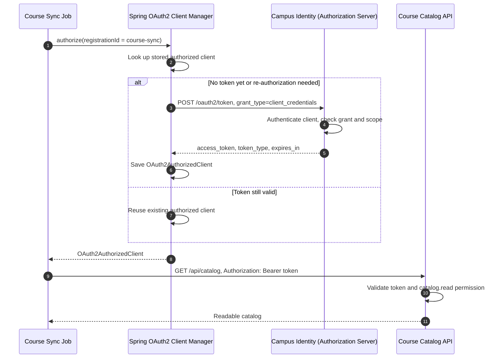
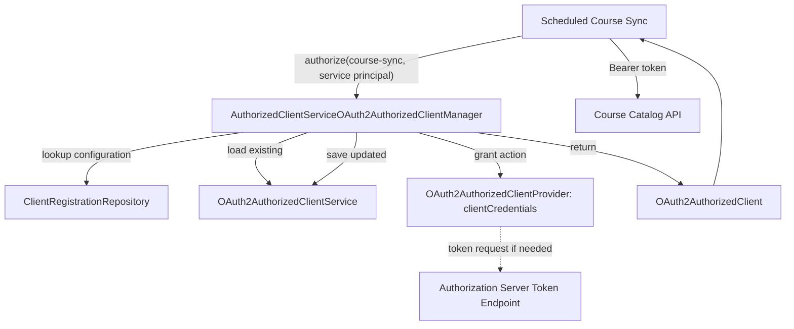
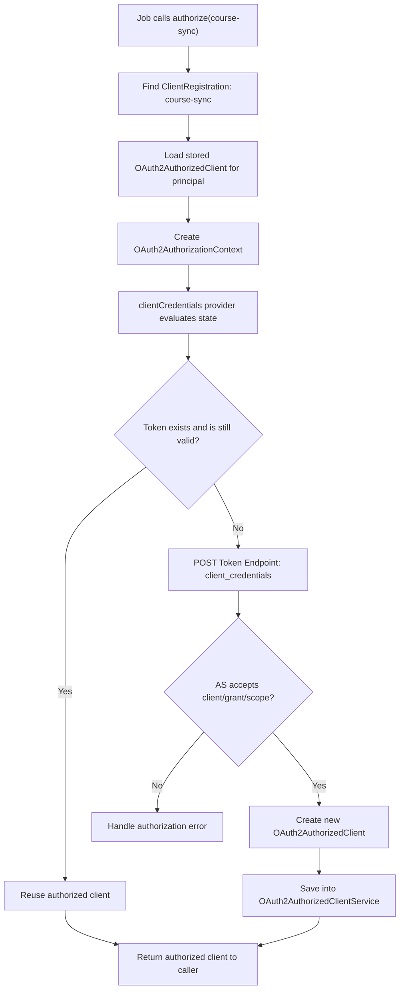

# 16.1. Client Credentials Flow in Spring Security

## Lesson Objectives

After this lesson, you will be able to:

- Explain what the **OAuth 2.0 Client Credentials Grant** is and when it should be used in **machine-to-machine (M2M)** integrations.
- Distinguish the `client_credentials` flow from **Authorization Code + OIDC Login**: no browser, authorization code, redirect URI, ID Token, or End-User sign-in.
- Read an HTTP token request containing `grant_type=client_credentials`, understand how the client authenticates at the Token Endpoint, and how the access token is used to call a Resource Server.
- Configure a Spring Boot/Spring Security **OAuth2 Client** with `authorization-grant-type: client_credentials`, Client ID/secret, Token Endpoint, and scopes.
- Use **`AuthorizedClientServiceOAuth2AuthorizedClientManager`** together with `OAuth2AuthorizedClientProvider` to obtain and reuse access tokens in a service or scheduled job without a Servlet request.
- Understand the roles of `ClientRegistration`, `OAuth2AuthorizedClient`, `OAuth2AuthorizedClientService`, principal name, and client authentication methods.
- Distinguish **client authorization** from **business authorization at the API**; recognize `invalid_client`, `unauthorized_client`, `invalid_scope`, expired token, and insufficient permission errors.
- Design token lifecycle, caching, secret rotation, multi-instance deployment, and sensitive data protection in real-world integrations.

## 1. Context: One Service Needs to Call Another Service

Suppose the **Learning Platform** system has:

- **Course Sync Service**: a Spring Boot service running on a schedule to synchronize the course catalog.
- **Campus Identity**: the Authorization Server (AS) that issues access tokens to registered clients.
- **Course Catalog API**: the Resource Server that accepts access tokens to allow reading the catalog.

No student or instructor needs to open a browser or log in when the sync job runs. The service needs to prove that **it itself** is allowed to call the API.

A simple flow:

```text
Course Sync Service
  |
  | POST Token Endpoint
  | grant_type=client_credentials
  | authenticates client using ID/secret or registered method
  v
Campus Identity / Authorization Server
  |
  | access_token + token_type + expires_in
  v
Course Sync Service
  |
  | Authorization: Bearer <access-token>
  v
Course Catalog API / Resource Server
  |
  | validates token + scope/authority + access policy
  v
Readable course catalog list
```

This is the **OAuth 2.0 Client Credentials Grant**. It is appropriate when access is granted to an **application/service**, not to a user present in a browser.

> **Key principle:** With `client_credentials`, the client **authenticates itself with the Authorization Server to request an access token**, then uses that token to access the API within the granted scope. This token **does not prove the identity of an End-User**.

### 1.1. Entities in the Flow

| Entity | Role | Example |
| --- | --- | --- |
| OAuth Client | Application requesting the token | Course Sync Service |
| Authorization Server | Authenticates the client, decides scopes/permissions, and issues tokens | Campus Identity |
| Resource Server | Validates tokens and enforces API policies | Course Catalog API |
| Resource Owner | Owner of the resource in the OAuth model | In client credentials, the client acts based on its own permissions; there is no interactive user consent step |
| Access Token | Credential allowing API calls | Token with scope `catalog.read` |
| Client Credentials | Credentials the client uses to authenticate at the AS | Client ID + secret, or private-key JWT/mTLS depending on support |

In OAuth 2.0, the Client Credentials Grant is used when the client acts **on its own behalf** or accesses pre-arranged resources according to granted permissions. Do not attach the permissions of a specific user to an M2M token just because the service happens to know that email or user ID.

### 1.2. Sequence Diagram



The manager frees the application from **having to manually construct an HTTP token request every time the job runs** and from storing access tokens in arbitrary global variables.

## 2. Distinguishing Client Credentials from Authorization Code and OIDC Login

| Criterion | Client Credentials | Authorization Code / OIDC Login |
| --- | --- | --- |
| Principal being authenticated to request a token | **OAuth Client** | User authenticates at the OP; the client may also need to authenticate at the Token Endpoint |
| Requires browser redirect to the Authorization Server? | **No** | Yes, in typical interactive web flows |
| Has an Authorization Code? | No | Yes |
| Has a `redirect_uri`/callback? | Not used for this grant | Yes |
| Token request | `grant_type=client_credentials` | `grant_type=authorization_code`, `code`, `redirect_uri`... |
| Has an OIDC Login ID Token? | **No** | Yes when the flow performs OIDC and includes the `openid` scope |
| Has an End-User principal `OidcUser`? | Not a result of client credentials | Can exist after OIDC Login |
| Permissions represented by token | Permissions **of the application/service** | Permissions granted to the client in the user's context |
| Typical use cases | Scheduled sync, batch, backend-to-backend | Website for user sign-in, calling APIs on behalf of the user |
| Refresh token | Per RFC 6749, **SHOULD NOT** be issued in client credentials | May be issued according to policy |

Example of a request in the Authorization Code Flow:

```text
POST /oauth2/token
grant_type=authorization_code
code=<code-from-browser-callback>
redirect_uri=https://portal.example.org/login/oauth2/code/campus
```

Whereas Client Credentials:

```text
POST /oauth2/token
grant_type=client_credentials
scope=catalog.read
```

Client Credentials **has no step that sends the user to `/oauth2/authorization/{registrationId}`** to obtain an authorization code. Most configurations do not need `redirect-uri`, `authorization-uri`, or `oauth2Login()` just to obtain an M2M token.

### 2.1. Is Client Credentials “Logging In with a Service Account”?

Informally, people might say “the service logs in to the AS,” but in OAuth 2.0 terms this is **client authentication + token grant**, not a user login session.

After obtaining the token, Spring Security does not automatically create an `OidcUser` or an HTTP session for a user. A web controller method using `@AuthenticationPrincipal OidcUser user` is not the way to retrieve the identity of a client credentials token.

### 2.2. Is the `openid` Scope Needed?

Usually **no**. `openid` triggers an OpenID Connect Authentication request to receive an ID Token in appropriate OIDC flows. Client Credentials aims to obtain an **access token** for an API and has no End-User to authenticate.

Scopes should describe the API permissions agreed upon by the Authorization Server and Resource Server, for example:

```text
catalog.read
catalog.sync
reports.generate
```

Do not treat adding `openid`, `profile`, or `email` as a way to automatically obtain user identity through client credentials.

## 3. HTTP Token Request in the Client Credentials Grant

According to OAuth 2.0, the client sends a token request to the Authorization Server's **Token Endpoint** over HTTPS using form URL-encoding.

Example:

```http
POST /oauth2/token HTTP/1.1
Host: identity.example.org
Content-Type: application/x-www-form-urlencoded
Authorization: Basic <base64-of-encoded-client-id-and-secret>
Accept: application/json

grant_type=client_credentials&scope=catalog.read
```

Components:

- `grant_type=client_credentials`: specifies the grant type to execute.
- `scope=catalog.read`: the scope requested by the client, optional in the protocol but constrained by server configuration/permissions.
- `Authorization: Basic ...`: a method of **authenticating a confidential client** at the Token Endpoint, if the registration allows `client_secret_basic`.
- HTTPS: protects credentials and access tokens in transit.

**Client ID is not a secret.** The client secret is the sensitive credential; the received token must also be protected like a credential.

### 3.1. `curl` Example for Testing Environments

When the AS accepts `client_secret_basic`, you can illustrate it with:

```bash
curl --fail-with-body --request POST \
  'https://identity.example.org/oauth2/token' \
  --header 'Content-Type: application/x-www-form-urlencoded' \
  --user "${SYNC_CLIENT_ID}:${SYNC_CLIENT_SECRET}" \
  --data-urlencode 'grant_type=client_credentials' \
  --data-urlencode 'scope=catalog.read'
```

This is only a protocol-testing tool, not a pattern for putting secrets into logs, build scripts, or shell history in production. `curl --user` handles Basic authentication, but passing secrets on the command line can expose them via the environment or process list depending on the OS; use your infrastructure's secure secret management mechanism.

According to RFC 6749, the client ID/secret in HTTP Basic have form-encoding rules applied before combining them into the credential. If there are special characters, use a standard library rather than concatenating and Base64-encoding manually.

### 3.2. Typical Token Response

The Authorization Server may return:

```http
HTTP/1.1 200 OK
Content-Type: application/json
Cache-Control: no-store
Pragma: no-cache

{
  "access_token": "<opaque-or-jwt-access-token>",
  "token_type": "Bearer",
  "expires_in": 3600,
  "scope": "catalog.read"
}
```

The values are illustrative.

- `access_token`: the credential used to call the API.
- `token_type`: for example `Bearer`.
- `expires_in`: validity duration in seconds from issuance according to the protocol.
- `scope`: may be present to describe the scope actually granted.

**An access token does not have to be a JWT.** An Authorization Server may issue an opaque token, and the Resource Server may use introspection or another mechanism according to the integration contract. The client does not need to parse a JWT itself just to know which Bearer token to send.

### 3.3. Refresh Tokens Are Usually Not Issued

For the Client Credentials Grant, RFC 6749 states that a refresh token **SHOULD NOT** be issued. Common integration practice is:

```text
Access token AT1 expires
    -> Client authenticates again at Token Endpoint
    -> grant_type=client_credentials
    -> New access token AT2
```

Do not design your system to depend on a refresh token in this flow. If a provider behaves differently under a custom extension/profile, read the provider's policy and configure Spring accordingly; do not assume having a refresh token is the default.

### 3.4. The Token Endpoint Can Reject Requests

Example error response:

```http
HTTP/1.1 401 Unauthorized
Content-Type: application/json

{
  "error": "invalid_client"
}
```

Possible causes include an incorrect Client ID/secret, an unaccepted authentication method, or an unregistered client.

Another error:

```json
{
  "error": "invalid_scope"
}
```

may appear when the client requests a scope that does not exist or is not allowed. Do not work around this error by arbitrarily widening permissions on the Resource Server.

## 4. Client Authentication Is Different from the Client Credentials Grant

Both concepts contain the word “client,” but they are two independent axes.

**Grant type** describes the basis for requesting an access token:

```text
grant_type=client_credentials
```

**Client authentication method** describes how the Token Endpoint authenticates the calling application:

```text
client_secret_basic
client_secret_post
private_key_jwt
client_secret_jwt
tls_client_auth / self_signed_tls_client_auth (if supported by the provider)
```

Example registration:

```yaml
authorization-grant-type: client_credentials
client-authentication-method: client_secret_basic
```

There is no contradiction: the grant is `client_credentials`, while the method for proving the client's identity is HTTP Basic.

| Configuration Pair | Meaning |
| --- | --- |
| `client_credentials` + `client_secret_basic` | Use ID/secret authenticated via HTTP Basic to request an M2M access token |
| `client_credentials` + `private_key_jwt` | Use a JWT signed with a private key as proof of client authentication to request an M2M token |
| `client_credentials` + `client_secret_jwt` | Use an HMAC JWT based on a shared secret to authenticate the client |
| `authorization_code` + `client_secret_basic` | Client authenticates with Basic when exchanging the code from a browser-based flow |
| `refresh_token` + `private_key_jwt` | Client can use JWT client authentication when refreshing an allowed grant |

Advanced methods require provider support and corresponding token HTTP client / signing key configuration. Simply changing the `client-authentication-method` name in YAML does not guarantee every Spring version will automatically generate a client assertion JWT.

### 4.1. Confidential Clients Are Better Suited Than Public Clients

The Client Credentials Grant is used with **confidential clients** capable of keeping credentials secure on the backend. Do not place client secrets in:

- JavaScript running in a browser.
- Mobile application binaries without a proper backend mechanism.
- Publicly downloaded HTML pages or source maps.
- Git repositories, Docker images, or system logs.

If a frontend needs to call an API on behalf of a user, choose an appropriate OAuth architecture (such as Authorization Code with PKCE or a backend/BFF), rather than embedding a Client Credentials secret to request tokens directly in the browser.

## 5. Spring Boot Configuration: A `ClientRegistration` Using `client_credentials`

A minimal configuration for Course Sync Service:

```yaml
spring:
  security:
    oauth2:
      client:
        registration:
          course-sync:
            provider: campus-auth
            client-id: ${COURSE_SYNC_CLIENT_ID}
            client-secret: ${COURSE_SYNC_CLIENT_SECRET}
            client-authentication-method: client_secret_basic
            authorization-grant-type: client_credentials
            scope:
              - catalog.read

        provider:
          campus-auth:
            token-uri: https://identity.example.org/oauth2/token
```

The hosts and credentials in this lesson are illustrative only; you must register an actual client with the Authorization Server, enable the `client_credentials` grant, and assign the `catalog.read` scope according to policy.

Explanation:

- `course-sync`: Spring Security's **internal registration ID**.
- `campus-auth`: **provider alias** linking the registration to the Token Endpoint.
- `${COURSE_SYNC_CLIENT_ID}`: the Client ID issued by the AS to the service.
- `${COURSE_SYNC_CLIENT_SECRET}`: the secret stored in the environment or secret manager.
- `client_secret_basic`: the client authentication method at the Token Endpoint.
- `client_credentials`: the grant type, allowing the service to request a token without an End-User.
- `catalog.read`: the requested scope, which does not automatically guarantee the permission will be granted.

### 5.1. Why Is There No `redirect-uri`?

The Client Credentials Grant **has no browser callback**; the service calls the Token Endpoint directly. Therefore, you do not need:

```yaml
redirect-uri: "{baseUrl}/login/oauth2/code/{registrationId}"
```

It is also not mandatory to declare `authorization-uri`, `user-info-uri`, `jwk-set-uri`, or an OIDC `issuer-uri` solely to execute an M2M grant against a directly configured Token Endpoint.

If the provider supports Authorization Server Metadata or OIDC Discovery, you can use the corresponding metadata depending on the integration, but **do not confuse OIDC Login with Client Credentials**.

### 5.2. Is `oauth2Login()` Needed?

No. A service that only calls APIs via `client_credentials` does not need a login page:

```java
http.oauth2Login(Customizer.withDefaults());
```

`oauth2Login()` serves interactive End-User login flows. Service-to-service client credentials can work solely through OAuth2 Client configuration and a manager/service, without a Servlet login filter.

### 5.3. Dependencies in Spring Boot

In a Maven Spring Boot project, the OAuth2 Client dependency is typically:

```xml
<dependency>
    <groupId>org.springframework.boot</groupId>
    <artifactId>spring-boot-starter-oauth2-client</artifactId>
</dependency>
```

If the application is a Web MVC app, an appropriate web starter may be needed:

```xml
<dependency>
    <groupId>org.springframework.boot</groupId>
    <artifactId>spring-boot-starter-web</artifactId>
</dependency>
```

Specific versions are managed by the Spring Boot BOM or build configuration. Examples in this lesson avoid pinning a single version to prevent mixing APIs across Spring Security generations.

## 6. Spring Security Objects Involved in the Flow

| Component | Role |
| --- | --- |
| `ClientRegistration` | Describes Client ID, secret/auth method, grant type, scopes, and Token Endpoint |
| `ClientRegistrationRepository` | Looks up a registration by `registrationId`, e.g., `course-sync` |
| `OAuth2AuthorizeRequest` | Input to the manager: registration ID, principal used as context key, and attributes |
| `OAuth2AuthorizedClientManager` | Coordinates obtaining, authorizing, and re-authorizing an authorized client |
| `OAuth2AuthorizedClientProvider` | Executes the corresponding grant when needed; here it is `clientCredentials()` |
| `AuthorizedClientServiceOAuth2AuthorizedClientManager` | Manager suited for services or jobs **without a Servlet request** |
| `OAuth2AuthorizedClientService` | Saves/loads authorized clients by registration and principal name |
| `OAuth2AuthorizedClient` | Holds the registration, principal name, access token, and optional refresh token |
| `OAuth2AccessTokenResponseClient<OAuth2ClientCredentialsGrantRequest>` | HTTP Token Endpoint client for the Client Credentials Grant, when custom configuration is needed |
| `DefaultOAuth2AuthorizedClientManager` | Manager using a repository within a **Servlet request context**, usually not the choice for scheduled jobs |

A logical path:



### 6.1. The Principal Name in Client Credentials Is Not an End-User

Even though `OAuth2AuthorizeRequest` requires a principal, that does not mean a user is logged in. For an M2M service, the caller can use a stable name such as:

```text
course-sync-service
```

Spring uses the principal name to **partition keys in the authorized-client store**. The token issued by the Authorization Server is still based on client credentials, scopes, and client policies—not on a virtual user with that name.

Do not pass a different random principal name on each call if you want the authorized client to be cached. Conversely, if the same registration is used across isolated tenants/contexts, manage the principal/tenant key explicitly so tokens are not shared unintentionally.

## 7. Why Use a Service-Based Manager for Scheduled Jobs?

A Spring application has two types of contexts:

**Servlet HTTP request:**

```text
Browser request
  -> SecurityFilterChain
  -> HttpServletRequest / HttpServletResponse
  -> Authentication
  -> Controller
```

**Background execution:**

```text
@Scheduled job
  -> No browser request
  -> No natural HttpServletRequest/Response
  -> Possibly no End-User Authentication
```

`DefaultOAuth2AuthorizedClientManager` is designed to collaborate with `OAuth2AuthorizedClientRepository` which relies on an HTTP request/response context; it fits when executing inside a Servlet request.

For jobs without a request, use:

```java
AuthorizedClientServiceOAuth2AuthorizedClientManager
```

and:

```java
OAuth2AuthorizedClientService
```

This allows the manager to obtain and store tokens by registration ID and a stable principal name **without simulating an HTTP session**.

### 7.1. Comparing the Two Managers

| Criterion | `DefaultOAuth2AuthorizedClientManager` | `AuthorizedClientServiceOAuth2AuthorizedClientManager` |
| --- | --- | --- |
| Primary context | Servlet request | Scheduled job, service/background |
| State store | `OAuth2AuthorizedClientRepository` | `OAuth2AuthorizedClientService` |
| Requires HTTP request/response context? | Yes in the repository mechanism | No |
| Supports Client Credentials? | Yes if provider is configured | Yes if provider is configured |
| Can reuse tokens? | Yes, via repository | Yes, via service store |
| Suitable for request-less jobs? | Should not be the default | **Suitable** |
| Automatically checks API permissions? | No | No |

**Note:** A service-based manager can also be used inside a Servlet application if that is the right architectural choice. The difference is not whether the service runs on Tomcat, but whether **an HTTP request context is needed** for OAuth state.

## 8. Creating an `OAuth2AuthorizedClientManager` for Client Credentials

Java example configuring a manager for M2M:

```java
@Configuration
class MachineToMachineOAuth2Configuration {

    @Bean
    OAuth2AuthorizedClientManager serviceAuthorizedClientManager(
            ClientRegistrationRepository registrations,
            OAuth2AuthorizedClientService authorizedClients) {

        OAuth2AuthorizedClientProvider provider =
            OAuth2AuthorizedClientProviderBuilder.builder()
                .clientCredentials()
                .build();

        AuthorizedClientServiceOAuth2AuthorizedClientManager manager =
            new AuthorizedClientServiceOAuth2AuthorizedClientManager(
                registrations, authorizedClients
            );

        manager.setAuthorizedClientProvider(provider);
        return manager;
    }
}
```

Step by step:

1. `ClientRegistrationRepository` provides the Token Endpoint, client auth method, and grant type for the `course-sync` registration.
2. `OAuth2AuthorizedClientService` stores token state for the registration and service principal.
3. `clientCredentials()` enables the provider that performs the Client Credentials Grant when needed.
4. `AuthorizedClientServiceOAuth2AuthorizedClientManager` coordinates loading, issuing, and updating the authorized client.
5. The bean is exposed as `OAuth2AuthorizedClientManager` for other services to use.

If there are multiple manager beans in the same application, use appropriate bean names or `@Qualifier` at the injection point to avoid picking the Servlet-request manager by mistake.

### 8.1. Which Storage Type Does `OAuth2AuthorizedClientService` Use?

Common implementations include:

- `InMemoryOAuth2AuthorizedClientService`: state lives only in the JVM; convenient for development, demos, and simple workloads.
- `JdbcOAuth2AuthorizedClientService`: stores state via JDBC; can be accessed by multiple instances when sharing a database.
- Custom service: depending on infrastructure, state can be persisted in another storage layer with appropriate security constraints.

For Client Credentials, you may not need to store tokens longer than the access token lifetime. Still, using a service manager keeps registration/principal separation clean and avoids ad-hoc caching.

**Do not assume an in-memory store is shared across instances.** If you have five pods, each pod may independently request its own token when its local store does not yet hold an authorized client. This may be acceptable or may require optimization depending on Authorization Server rate limits.

### 8.2. No Refresh Token Provider Needed for This Standard Grant

Because Client Credentials typically has no refresh token, the M2M manager can simply configure:

```java
OAuth2AuthorizedClientProviderBuilder.builder()
    .clientCredentials()
    .build();
```

When an access token expires or is about to expire considering clock skew, the provider will re-run the **Client Credentials Grant** to obtain a new token.

Adding `.refreshToken()` to the builder does not conjure a refresh token out of thin air. Only a provider with the appropriate token/grant data performs a refresh operation.

## 9. Calling the Manager in a Scheduled Job

Suppose a service runs catalog synchronization with `@Scheduled`:

```java
@Component
class CourseSyncJob {

    private final OAuth2AuthorizedClientManager clientManager;
    private final RestClient restClient;

    CourseSyncJob(
            @Qualifier("serviceAuthorizedClientManager")
            OAuth2AuthorizedClientManager clientManager,
            RestClient.Builder restClientBuilder) {
        this.clientManager = clientManager;
        this.restClient = restClientBuilder.build();
    }

    @Scheduled(fixedDelayString = "${sync.delay-ms:600000}")
    public void sync() {
        OAuth2AuthorizeRequest authorizeRequest =
            OAuth2AuthorizeRequest
                .withClientRegistrationId("course-sync")
                .principal("course-sync-service")
                .build();

        OAuth2AuthorizedClient authorizedClient =
            clientManager.authorize(authorizeRequest);

        if (authorizedClient == null) {
            throw new IllegalStateException(
                "Unable to obtain an OAuth2 authorized client"
            );
        }

        String accessToken =
            authorizedClient.getAccessToken().getTokenValue();

        String json = restClient.get()
            .uri("https://courses.example.org/api/catalog")
            .headers(headers -> headers.setBearerAuth(accessToken))
            .retrieve()
            .body(String.class);

        // Parse, validate, and synchronize data using the business service.
        // Do not log accessToken or sensitive raw responses.
    }
}
```

This example focuses on the OAuth2 Client flow. In a real application, you must include imports, scheduling configuration (`@EnableScheduling` or equivalent), timeouts, HTTP error checking, bounded retries, API contract handling, and business sync logic.

**Key takeaways:**

- `@Scheduled` runs **without a logged-in user**.
- `.principal("course-sync-service")` is an **identifier key for the authorized-client store**, not a Campus Identity user.
- `authorize()` may return an existing still-valid authorized client or request a new token via the Token Endpoint.
- The Bearer access token should only be sent to the trusted, configured **Course Catalog API** with matching scope/audience.
- The JSON response contains business data, not a token to send back to a browser.

### 9.1. Can the Manager Be Called from a Regular Service?

Yes. The caller does not have to be `@Scheduled`:

```java
@Service
class CatalogTokenService {

    private final OAuth2AuthorizedClientManager clientManager;

    CatalogTokenService(
            @Qualifier("serviceAuthorizedClientManager")
            OAuth2AuthorizedClientManager clientManager) {
        this.clientManager = clientManager;
    }

    String getAccessToken() {
        OAuth2AuthorizeRequest request =
            OAuth2AuthorizeRequest
                .withClientRegistrationId("course-sync")
                .principal("course-sync-service")
                .build();

        OAuth2AuthorizedClient client =
            clientManager.authorize(request);

        if (client == null) {
            throw new IllegalStateException(
                "OAuth2 authorization unavailable"
            );
        }

        return client.getAccessToken().getTokenValue();
    }
}
```

In production systems, an API that returns a `String` token should have a narrow scope of use; consider integrating an HTTP client responsible for attaching the Bearer token so the token is not passed across too many layers. Do not store the token in a long-lived singleton field just to avoid calling the manager.

### 9.2. The Manager Does Not Necessarily Call the Token Endpoint Every Time

Suppose a token lives for 30 minutes:

```text
09:00  authorize() -> requests AT1
09:05  authorize() -> reuses AT1
09:20  authorize() -> reuses AT1 if still valid
09:30  authorize() -> AT1 expired/near expiry, requests AT2
```

The actual refresh/reauthorize timing depends on `expiresAt`, clock skew, and the provider's logic. Do not hard-code that a new token must be issued every exact 30 minutes; tokens may be issued with different TTLs or the AS may apply different policies.

### 9.3. Why Should the Principal Name Be Stable?

The manager/service store typically keys data by:

```text
(clientRegistrationId, principalName)
```

If each call uses:

```java
.principal(UUID.randomUUID().toString())
```

then every call is treated as a different storage key. The manager will fail to find the existing authorized client to reuse the token, causing excessive Token Endpoint requests and unnecessary store entries.

A service with one M2M registration typically uses a stable principal name, for example:

```text
course-sync-service
```

If you need to separate different tenants or scopes, design explicit registrations/keys/tenants rather than arbitrarily changing the principal just to “get a different token.”

## 10. Inside `authorize()`: How the Manager Coordinates the Provider and Service

Logical workflow:



This is a conceptual diagram. Spring may implement the details through different managers, composite providers, and success/failure handlers depending on the version. The key points to remember are:

- `ClientRegistration` defines **how and where to request the token**.
- `OAuth2AuthorizedClientService` holds the **issued token**.
- `OAuth2AuthorizedClientProvider` executes the grant when needed.
- The manager coordinates and returns `OAuth2AuthorizedClient`.
- The caller uses the access token for its intended purpose, and the Resource Server enforces permissions.

### 10.1. Token Not Expired: Must the Manager Issue a New Token?

Not necessarily. If the provider sees that the current access token still has sufficient validity, it does not need to re-run the grant. The manager can return the existing authorized client.

### 10.2. Token Near Expiration: Why Not Wait Until Exact `expiresAt`?

Clock skew, network transit time, and request latency can cause a token to expire mid-flight while calling the Resource Server. Spring Security providers have a **clock skew** mechanism to treat a token as needing re-issuance slightly early when appropriate.

Do not blindly rely on the entire granted TTL when requests may take a long time or clocks across nodes may drift. Synchronize NTP and configure reasonable thresholds.

### 10.3. Having an `OAuth2AuthorizedClient` Does Not Mean the Access Token Always Works

A token might:

- Have been revoked by the AS.
- Lack the scope required by the API.
- Be intended for a different audience/Resource Server.
- Be expired or no longer accepted by the target API due to a new policy.
- Be excluded from authorization due to changed client permissions.

The manager helps manage the token lifecycle; **it does not prove the Resource Server will allow every request**.

## 11. Pure Java Configuration for `ClientRegistration`

If you do not want to use YAML or need to create registrations programmatically, you can use the `ClientRegistration` builder:

```java
@Bean
ClientRegistrationRepository clientRegistrationRepository(
        @Value("${course-sync.client-id}") String clientId,
        @Value("${course-sync.client-secret}") String clientSecret) {

    ClientRegistration registration =
        ClientRegistration.withRegistrationId("course-sync")
            .clientId(clientId)
            .clientSecret(clientSecret)
            .clientAuthenticationMethod(
                ClientAuthenticationMethod.CLIENT_SECRET_BASIC
            )
            .authorizationGrantType(
                AuthorizationGrantType.CLIENT_CREDENTIALS
            )
            .tokenUri("https://identity.example.org/oauth2/token")
            .scope("catalog.read")
            .clientName("Course Sync")
            .build();

    return new InMemoryClientRegistrationRepository(registration);
}
```

Here:

```text
registrationId = course-sync
clientId       = issued by Authorization Server
grantType      = client_credentials
tokenUri       = actual Token Endpoint
```

Note that if Spring Boot already auto-configures a `ClientRegistrationRepository` bean from YAML, do not declare another conflicting bean unintentionally. The builder above illustrates how configuration maps to objects, not that writing Java is mandatory to use client credentials.

### 11.1. No Need to Configure an Authorization Endpoint for This Grant

Client Credentials uses the **Token Endpoint directly**. Thus:

```java
.tokenUri("https://identity.example.org/oauth2/token")
```

is the core part, while the authorization endpoint for browser redirects is not required for this grant.

### 11.2. Multiple Registrations for Multiple APIs

A service can call two systems with different Authorization Servers:

```text
course-sync   -> identity.example.org -> Course Catalog API
report-sync   -> accounts.example.net -> Reporting API
```

Each registration can maintain its own `clientId`, secret, scopes, token endpoint, and client authentication method.

Do not take an access token from `course-sync` to call the Reporting API just because both use OAuth. The API may require a different audience, scope, or issuer.

## 12. When a Servlet Application Also Has M2M Work

A Spring Boot MVC application sometimes both lets users log in via OIDC and runs background data sync jobs:

```text
Browser -> OIDC Login -> Web controllers
                         |
                         +--> call API on behalf of user
                         |
                         +--> scheduled M2M job (not a user)
```

You may need **two managers**:

| Task | Typically Suitable Manager |
| --- | --- |
| Web controller calling APIs with a delegated user access token | `DefaultOAuth2AuthorizedClientManager` and `OAuth2AuthorizedClientRepository` |
| Request-less `client_credentials` M2M job | `AuthorizedClientServiceOAuth2AuthorizedClientManager` and `OAuth2AuthorizedClientService` |

An example configuring two beans:

```java
@Configuration
class OAuth2ManagersConfiguration {

    @Bean("webClientManager")
    OAuth2AuthorizedClientManager webClientManager(
            ClientRegistrationRepository registrations,
            OAuth2AuthorizedClientRepository repository) {

        DefaultOAuth2AuthorizedClientManager manager =
            new DefaultOAuth2AuthorizedClientManager(
                registrations, repository
            );

        manager.setAuthorizedClientProvider(
            OAuth2AuthorizedClientProviderBuilder.builder()
                .authorizationCode()
                .refreshToken()
                .build()
        );

        return manager;
    }

    @Bean("serviceClientManager")
    OAuth2AuthorizedClientManager serviceClientManager(
            ClientRegistrationRepository registrations,
            OAuth2AuthorizedClientService service) {

        AuthorizedClientServiceOAuth2AuthorizedClientManager manager =
            new AuthorizedClientServiceOAuth2AuthorizedClientManager(
                registrations, service
            );

        manager.setAuthorizedClientProvider(
            OAuth2AuthorizedClientProviderBuilder.builder()
                .clientCredentials()
                .build()
        );

        return manager;
    }
}
```

The repository and service beans/implementations must be provided by the application or properly auto-configured by Boot. When there are multiple beans implementing the same interface, injection points need `@Qualifier` to select the right one.

**Do not use the `Authentication` of a user currently browsing the web as the principal for an M2M job.** The job has its own service identity; a Client Credentials Access Token does not represent that web user.

## 13. How Will the Resource Server Validate the Access Token?

After obtaining the token, Course Sync Service sends:

```http
GET /api/catalog HTTP/1.1
Host: courses.example.org
Authorization: Bearer <access-token>
```

Course Catalog API must validate the access token according to policy:

- Valid token signature/issuer or introspection, depending on token format.
- `exp`, `nbf`, and applicable time constraints.
- Audience or Resource Indicator matching the API when used by the provider/protocol.
- Scope/authority, e.g., `catalog.read`.
- Endpoint-specific policies and allowed client identities.
- Any sender-constrained token bindings if the environment uses mTLS/DPoP.

Not every access token contains the same set of claims. For opaque tokens, the Resource Server may use introspection. For JWTs, it may verify with a trusted configured public key. Exact rules belong to the Authorization Server ↔ Resource Server contract.

### 13.1. Illustrative JWT Resource Server Configuration

A separate API might configure:

```yaml
spring:
  security:
    oauth2:
      resourceserver:
        jwt:
          issuer-uri: https://identity.example.org
```

And a SecurityFilterChain:

```java
@Bean
SecurityFilterChain apiSecurity(HttpSecurity http) throws Exception {
    http
        .authorizeHttpRequests(auth -> auth
            .requestMatchers("/api/catalog")
                .hasAuthority("SCOPE_catalog.read")
            .anyRequest().authenticated()
        )
        .oauth2ResourceServer(oauth2 -> oauth2
            .jwt(Customizer.withDefaults())
        );

    return http.build();
}
```

The example assumes the AS issues JWT access tokens, the issuer matches, and scopes are mapped to `SCOPE_...` per Spring Security's defaults. In real systems, add audience validation or other API-appropriate checks; **`issuer-uri` alone is not enough to guarantee the token was issued for this specific API**.

Distinguish the two applications:

- **Course Sync Service** is the OAuth2 Client requesting the access token.
- **Course Catalog API** is the Resource Server receiving and validating the token.

Do not configure only the OAuth2 Client on the caller and assume the API is already secure.

### 13.2. Scope Is Least Privilege, Not Unlimited Permission

If a token is granted:

```text
scope = catalog.read
```

then the API may allow reading the catalog, but not:

```text
POST /api/catalog
DELETE /api/catalog/123
```

unless other scopes/permissions are granted and policy permits it. Client credentials permissions should follow **least privilege**: the client receives only the scope required to perform its task.

### 13.3. Do Not Infer a User from `sub` in an M2M Access Token

If the access token is a JWT containing `sub`, the meaning of `sub` depends on the Authorization Server profile. It may refer to the client/service or a technical subject, **not an End-User**.

Do not take `sub` from an M2M token and treat it as a student's user ID in the Course API. If an endpoint needs to act on behalf of a specific user, an appropriate delegation protocol and policy must be used—not client credentials.

## 14. What Changes When an Access Token Expires

The manager can reuse a still-valid access token. When the token expires or approaches expiration, the `clientCredentials()` provider can execute a new grant:

```text
AT1 -> expires
    -> POST Token Endpoint with client credentials
    -> receive AT2
    -> save new authorized client
```

In the standard Client Credentials Grant, there is no refresh step using `grant_type=refresh_token`.

### 14.1. Configuring Clock Skew

Spring Security provides providers like `ClientCredentialsOAuth2AuthorizedClientProvider` with expiration evaluation that accounts for clock skew. Meaning:

```text
expiresAt = 10:00:00
clockSkew = 00:01:00

At 09:59:15:
  The token may be considered ready for re-issuance,
  avoiding using a token that expires mid-request.
```

The numbers above are illustrative, not a mandatory default across all Spring Security versions. If fine-tuning is needed, use `setClockSkew` or the corresponding configurer for your **exact version** and verify network latency requirements.

### 14.2. Tokens Are Not Required to Change Every Time

The Authorization Server may return a new access token with a different value, or use a caching strategy per policy. Clients must not infer grant success merely because the token string differs from the previous one.

Rely on a valid token response, library-managed expiration, and Resource Server acceptance of the token.

### 14.3. Retrying After Network Errors

If a Token Endpoint call times out, the AS may have processed the request while the response never reached the client. With client credentials, retrying may request another token, causing extra load, though it usually avoids the refresh-token reuse issues seen in rotating refresh grants.

Even so, you should:

- Use bounded retries with backoff.
- Never retry infinitely on `invalid_client` or `unauthorized_client`.
- Monitor AS rate limits.
- Never log requests containing client secrets.
- Apply a circuit breaker when the dependency is unavailable.
- Avoid a fleet of instances all requesting tokens simultaneously when the AS recovers.

## 15. Using the Token Store Properly

`OAuth2AuthorizedClientService` stores authorized clients by the combination:

```text
clientRegistrationId + principalName
```

For example:

```text
("course-sync", "course-sync-service")
```

You can call:

```java
OAuth2AuthorizedClient client =
    authorizedClientService.loadAuthorizedClient(
        "course-sync",
        "course-sync-service"
    );
```

However, calling `loadAuthorizedClient` **only loads state**; it does not issue a token and does not guarantee the access token is still valid. When you need a token ready for immediate use, call the manager.

### 15.1. Do Not Cache Tokens Globally by `registrationId` Alone Across Multiple Contexts

A single-tenant application can use one stable principal name per service registration. But if the system serves multiple tenants with different client credentials, sharing a single cache key `course-sync` risks sharing tokens across the wrong tenants.

The design should separate by registration and specific service/tenant identity, ensuring the `ClientRegistration` genuinely corresponds to that tenant's credentials, issuer, and permissions.

### 15.2. Multiple Instances May Request Tokens Independently

If using `InMemoryOAuth2AuthorizedClientService`:

```text
Pod A -> cache A
Pod B -> cache B
Pod C -> cache C
```

Each pod can request its own token initially. This can be acceptable with long token TTLs and a small pod count. If you need to reduce Token Endpoint requests in a large cluster, consider a properly partitioned and secured shared store/cache.

**Do not assume `OAuth2AuthorizedClientService` automatically handles distributed locking.** If multiple instances refresh/re-issue tokens concurrently, evaluate rate limits and concurrency based on the grant and provider characteristics.

### 15.3. Should Access Tokens Be Stored in a Database?

Possibly, but consider:

- Tokens are sensitive credentials: encrypt at rest appropriately for your threat model and restrict read access.
- Token lifetimes are usually short; there is no need to retain them indefinitely.
- Clean up stale records and unused tokens.
- Do not write tokens to audit logs.
- Have mechanisms to rotate client secrets and revoke grants if compromised.
- Weigh the benefits of persistence against having each instance request its own token.

Avoid writing custom serialization that exposes tokens through JSON APIs or metrics.

## 16. Protecting Client Credentials and Access Tokens

### 16.1. Secret Management

A client secret must:

- Be sufficiently strong and properly issued/managed by the AS.
- Be stored in a secret manager, keystore, or secure environment.
- Be readable only by authorized service identities.
- Never reside in source code, public repositories, or frontend code.
- Have a rotation and revocation process if compromised.
- Be transmitted to the Token Endpoint over HTTPS.

A YAML example:

```yaml
client-secret: ${COURSE_SYNC_CLIENT_SECRET}
```

is not a complete protection strategy if environment variables are printed to logs, crash dumps, or broadly accessible; apply appropriate infrastructure controls.

### 16.2. Do Not Return Access Tokens to Frontend APIs

Dangerous code example:

```java
@GetMapping("/debug/token")
String token() {
    return clientManager.authorize(request)
        .getAccessToken()
        .getTokenValue();
}
```

An M2M token can grant broad service permissions and is not tied to a user. If a browser receives the token, anyone with access to browser devtools or via XSS can exploit it.

In a backend architecture, tokens should only be used inside server-to-server HTTP clients calling legitimate Resource Servers.

### 16.3. Be Careful with HTTP Client Logging

Some libraries can log HTTP headers/bodies at the DEBUG level. For the Token Endpoint, those logs may contain:

```text
Authorization: Basic ...
client_secret=...
access_token=...
```

For the Resource Server, they may contain:

```text
Authorization: Bearer ...
```

Configure sensitive data filtering/redaction and restrict log access. Never use real tokens in documentation or unit test snapshots.

### 16.4. Separate Service Permissions by Responsibility

Instead of one client holding all permissions:

```text
course-service-admin -> catalog.read, catalog.write,
                        grades.read, grades.write, users.admin
```

use a dedicated registration for sync:

```text
course-sync -> catalog.read
```

If the service is compromised, the blast radius is more limited. The API must still enforce authorization per endpoint.

## 17. Common Errors

| Symptom | Possible Cause | Resolution |
| --- | --- | --- |
| Token Endpoint returns `invalid_client` | Wrong Client ID/secret, wrong client authentication method | Check AS registration, secret, and `client-authentication-method` |
| Token Endpoint returns `unauthorized_client` | Client is not permitted to use `client_credentials` | Enable/register the proper grant at the AS |
| Token Endpoint returns `unsupported_grant_type` | AS does not support the grant or wrong endpoint | Verify capability/Token Endpoint and supported grants |
| Token Endpoint returns `invalid_scope` | Requested scope is not registered/allowed | Fix scope configuration and AS grant permissions |
| `authorize()` returns `null` | Provider cannot authorize given configuration/context | Check `clientCredentials()` provider, registration, and manager |
| Missing `ClientRegistration` | Wrong registration ID used or missing config | Check keys under `registration` |
| Every job run calls the Token Endpoint | Principal name changes, service store loses state, token expired | Use a stable principal, inspect store/expiry |
| `@Scheduled` job fails due to missing HTTP context | Using Servlet-request manager | Switch to service-based manager |
| API call returns `401` | Expired access token, wrong issuer/audience, invalid token | Check token lifecycle and Resource Server validation |
| API call returns `403` | Missing scope/authority/permissions | Grant appropriate least privilege and check API mapping |
| Server returns token but missing expected fields | Token response does not conform to protocol/contract | Check provider and Token Response Client |
| Service tries to use refresh token but it is always `null` | Client Credentials typically does not issue refresh tokens | Request a new access token with `client_credentials` grant |
| Tenant A's token used for Tenant B | Improper store/cache partitioning | Separate registration/credentials/tenant key |
| Client secret appears in logs | Logging HTTP headers or overly broad debug config | Redact and restrict logs |
| Using M2M token as a user session | Confusing Client Credentials with OIDC Login | Separate user authentication and service authentication |
| API accepts any token from the issuer | Resource Server missing audience/scope/authorization policy | Add validation for the specific target resource |

### 17.1. When Receiving `invalid_client`, What Should You Check First?

Verify:

1. Is the Token Endpoint correct?
2. Does the Client ID match the registration on the AS?
3. Are the client secret / signing keys still valid?
4. Is the client authentication method (`client_secret_basic`, `private_key_jwt`, etc.) permitted by the AS?
5. Is an HTTPS/proxy altering the request or Authorization header?
6. If using a JWT client assertion, do `aud`, signature, `kid`, `exp`, and `jti` match policy?

Do not fix `invalid_client` by changing scopes or disabling authentication on the target API.

### 17.2. When Receiving `invalid_scope`, What Should You Check?

For example, the client requests:

```text
catalog.read catalog.write
```

but the AS only grants:

```text
catalog.read
```

or rejects the request entirely because the scope is disallowed.

Verify registered scopes, AS permission policies, and what Course Catalog API actually requires. Do not add write permissions to a job that only needs to read data.

### 17.3. When the API Returns `401` and `403`

Common meanings:

- `401 Unauthorized`: token is invalid, expired, or missing authentication criteria.
- `403 Forbidden`: token may be valid, but the client lacks permission to perform the operation.

This is a common convention; details depend on the API. Inspect the Resource Server's error code/challenge without logging the token. If the issue is simply a missing scope, requesting a new token **with the same ungranted scope** will not solve it.

## 18. Integration Testing Client Credentials

### 18.1. Testing Configuration and Application Logic

At the unit test level, you can:

- Mock `OAuth2AuthorizedClientManager` to return a fake authorized client.
- Verify the outbound client attaches the Bearer token to the right endpoint.
- Test handling when the manager returns `null` or throws an OAuth2 authorization exception.
- Verify tokens are not returned to the browser and secrets are not logged.
- Verify the service principal and registration ID are stable.

Mocked unit tests **do not** prove the AS issues a real token or that the API accepts it.

### 18.2. Testing the HTTP Token Endpoint

In an integration test environment with a real AS or appropriate test server:

1. Register a confidential client allowed only `client_credentials`.
2. Send a valid token request to verify `200 OK` and the token response.
3. Test a wrong client secret, expecting `invalid_client`.
4. Test a disallowed grant, expecting `unauthorized_client`.
5. Test an ungranted scope to confirm rejection policy.
6. Use a valid token to call Course API, expecting access on the read endpoint.
7. Use a token lacking write scope to call the write endpoint, expecting rejection.
8. Wait for token expiration or use controlled test time to verify the manager requests a new token.

Never run tests with production client secrets or sensitive real resources just to prove an example.

### 18.3. Observing Logs and Metrics

Log only safe metadata:

```text
registrationId = course-sync
grantType = client_credentials
authorized = true
tokenExpiresAt = <timestamp>
tokenRequestCount = <count>
errorCode = invalid_scope
correlationId = <safe-id>
```

Do not log `access_token`, `client_secret`, the HTTP Authorization header, or the raw token response.

Useful metrics:

- Token request count per registration.
- Token Endpoint error rate.
- Token request latency.
- Number of Resource Server calls returning `401`/`403`.
- Authorized client cache hit rate.
- Job retry count and reasons.

## 19. Real-World Scenarios

### Scenario A — Course Sync Runs Every 10 Minutes

The job uses registration `course-sync` and a stable principal name. On the first run, the manager requests a token; subsequent runs reuse the still-valid token. When needed, it requests a new token via `client_credentials`.

**Design approach:** use a service-based manager, `catalog.read` scope, a secret manager, backend Bearer calls, and bounded retries.

### Scenario B — Portal Has Both Browser Login and Background Jobs

Web controllers use OIDC Login to display a student's courses; a catalog sync job runs without an End-User.

**Design approach:** separate the delegated user flow and the M2M flow; you can use two different `ClientRegistration`s and managers. Do not use a user's access token to run system jobs, and do not use an M2M token to pretend a student is logged in.

### Scenario C — Client Secret Leaked in CI Logs

A secret is printed via command line or debug logs. Anyone with log read access can impersonate the M2M client to request tokens.

**Resolution:** revoke/rotate the secret, restrict log access, fix the logging pipeline, assess already-issued tokens, and audit unusual access.

### Scenario D — Added Scope, but API Still Returns 403

The client requested `catalog.write` in YAML, but the AS has not registered/granted that permission, or Course API requires a different authority.

**Resolution:** compare requested scopes, granted scopes in the token response/claims, authority mapping in the Resource Server, and endpoint policies. Do not treat declaring a scope on the client as automatic permission.

### Scenario E — Multiple Instances Request Tokens Simultaneously

A cluster of 20 pods uses an in-memory service store. After deployment, all 20 pods request a token at once, spiking load on the Token Endpoint.

**Resolution:** evaluate rate limits, use a shared store if genuinely needed, and apply jitter/bounded retries; never write tokens to a public cache.

### Scenario F — HTTP Request Exists, Yet Service Manager Is Still Used

An MVC application has an administrative endpoint that triggers system data synchronization without using an End-User token. The service is invoked from a controller, yet the grant is still `client_credentials`.

**Resolution:** using a service manager with a stable service principal is completely valid because the token carries service permissions unrelated to a user session. The job-triggering endpoint must still **be properly authorized** so ordinary users cannot trigger sensitive operations.

### Scenario G — API Wants to Know Which Student Performed an Action

An API needs to record that “student A updated their own profile.” A service calls the API with `client_credentials` and tries to self-assert `userId=A` in the HTTP body.

**Warning:** an M2M token only proves service identity. If the system needs End-User identity and permissions, design delegation/on-behalf-of or token exchange according to policy; do not treat self-declared request data as proof of an authenticated user.

## 20. Hands-On Exercises

### Exercise 1 — Choose the Right Grant

A nightly job with no browser or user needs to fetch aggregated statistical reports through an API.

**Question:** Which grant is appropriate when the API allows service-level access?

**Answer:** `client_credentials`, using a registered confidential client and minimal scopes.

### Exercise 2 — Identify the Token Endpoint Request

Registration:

```yaml
registration:
  report-sync:
    provider: report-auth
    client-id: report-job
    client-secret: ${REPORT_SECRET}
    authorization-grant-type: client_credentials
    scope: [reports.read]

provider:
  report-auth:
    token-uri: https://identity.example.org/oauth2/token
```

**Question:** What grant and scope does the request need?

**Answer:**

```text
POST https://identity.example.org/oauth2/token
grant_type=client_credentials
scope=reports.read
```

The client must also authenticate using the method registered at the AS. No `code`, `redirect_uri`, or OIDC ID Token is needed.

### Exercise 3 — Choose a Manager for a Background Job

A service has an `@Scheduled` method with no `HttpServletRequest`.

**Question:** Choose `DefaultOAuth2AuthorizedClientManager` or `AuthorizedClientServiceOAuth2AuthorizedClientManager`?

**Answer:** Choose `AuthorizedClientServiceOAuth2AuthorizedClientManager`, persisting state via `OAuth2AuthorizedClientService`.

### Exercise 4 — Who Is the Principal Name?

The job calls:

```java
OAuth2AuthorizeRequest.withClientRegistrationId("course-sync")
    .principal("course-sync-service")
    .build();
```

**Question:** Is `"course-sync-service"` a logged-in OIDC student?

**Answer:** No. It is a technical principal name for the authorized client store, helping the manager save and load tokens. The token is issued based on the application's client credentials.

### Exercise 5 — Expired Token

The access token has expired, and the service has no refresh token.

**Question:** Is browser login required?

**Answer:** No. With client credentials, the manager uses the `clientCredentials()` provider and confidential client authentication to request a new access token at the Token Endpoint.

### Exercise 6 — Missing Permission at the Resource Server

A valid token has scope `catalog.read`, while the target API requires `catalog.write`.

**Question:** Does the manager automatically upgrade permissions to `catalog.write`?

**Answer:** No. The client must be granted the appropriate scope by the AS, and the API must still enforce policy. Never alter the JWT claims/scopes of an access token manually.

### Exercise 7 — Distinguish Client ID and Registration ID

Configuration:

```yaml
registration:
  course-sync:
    client-id: sync-agent-prod
```

**Question:** Which ID is passed to the manager, and which Client ID does the Token Endpoint receive?

**Answer:** The manager looks up registration `"course-sync"`, while the actual OAuth Client ID is `"sync-agent-prod"`.

### Exercise 8 — Should a Secret Be Embedded in an SPA?

A React frontend wants to call the Token Endpoint directly using `client_credentials`.

**Answer:** Never place a client secret into an SPA/browser. For application-level permissions, the backend takes responsibility for requesting tokens and calling the API; for user-level permissions, choose an OAuth flow designed for public clients and appropriate policies.

## 21. Review Questions

**1. What need does the Client Credentials Grant solve?**

> Issuing access tokens to a confidential client acting with the application/service's own permissions, typically machine-to-machine, without user interaction.

**2. Are there authorization codes or redirect URIs in this flow?**

> No. The client sends requests directly to the Token Endpoint.

**3. Is `client_credentials` a grant type or a client authentication method?**

> It is a **grant type**. Client authentication methods can be `client_secret_basic`, `private_key_jwt`, mTLS, etc., per AS policy.

**4. Why not use `oauth2Login()` to run a scheduled sync?**

> `oauth2Login()` handles End-User browser login, whereas an M2M job only needs an access token issued to the client.

**5. Which Spring Security component is suited for requesting tokens in a background job?**

> `AuthorizedClientServiceOAuth2AuthorizedClientManager` combined with `OAuth2AuthorizedClientService` and the `clientCredentials()` provider.

**6. Is `OAuth2AuthorizeRequest.principal()` a real user ID?**

> For M2M, it is usually a stable service principal name used as a token storage key; it does not prove an End-User is logged in.

**7. When an access token expires, is a refresh token needed?**

> Usually no. The client requests a new access token using the Client Credentials Grant. RFC 6749 recommends not issuing refresh tokens for this grant.

**8. Can an M2M access token be used to call any API?**

> No. The Resource Server must verify the token matches the expected audience/scope/permissions and endpoint policy.

**9. Why doesn't the manager request a new token on every call?**

> The manager/provider can reuse an `OAuth2AuthorizedClient` whose access token is still valid in the service store.

**10. Does the Client Credentials Grant produce an OIDC ID Token and `OidcUser`?**

> Not in the standard flow. It issues an access token to the client and does not authenticate an End-User like OIDC Login.

**11. If a job obtains a token successfully but the Resource Server returns 403, where is the issue?**

> Usually related to scopes, authorities, audience, or API permissions. Successful client authentication at the Token Endpoint does not guarantee every operation is permitted.

**12. If multiple instances each use an in-memory store, are tokens shared?**

> No. Each JVM has its own store unless the architecture provides appropriate shared persistence/caching.

---

## Summary

The **Client Credentials Grant** is an **OAuth 2.0 machine-to-machine** flow: a confidential client authenticates with the **Token Endpoint**, sends `grant_type=client_credentials`, receives an **access token**, and uses a Bearer token to call a Resource Server within its **granted scope**. This flow **has no End-User login, authorization code, redirect URI, or OIDC ID Token**. In Spring Security, configure `ClientRegistration` with `authorization-grant-type: client_credentials`, the Token Endpoint, and appropriate client authentication; for scheduled jobs or services without an HTTP request, use **`AuthorizedClientServiceOAuth2AuthorizedClientManager`** with the `clientCredentials()` provider to issue and reuse tokens. Always keep secrets/tokens on the backend, separate registrations/tenants, apply least privilege, manage expiration, monitor Token Endpoint errors, and enforce permissions independently on the Resource Server.
