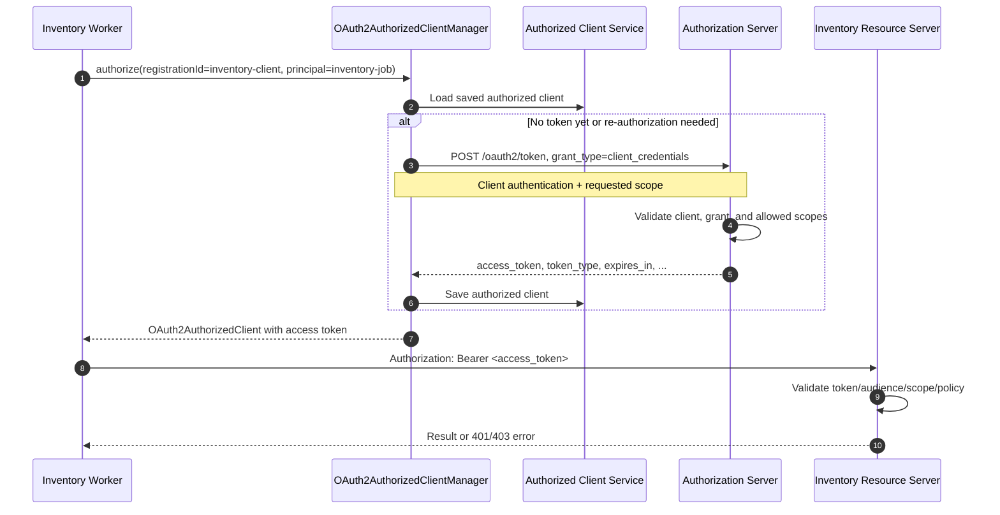

# 16.2. Configuring a Registration with the `client_credentials` Grant

## 1. Objective: Registering an OAuth2 Client So a Service Can Request Access Tokens on Its Own

In **Spring Security OAuth 2.0/OIDC Client**, the **`client_credentials`** grant is used when an application needs to request an **access token using the client's own identity and permissions** to call a protected API. Typical examples:

- `billing-worker` calls `invoice-api` on a schedule.
- `reporting-service` calls `analytics-api` with no logged-in user.
- A backend calls a partner API using a client ID and client secret issued by the partner.
- A background task needs the system-level `inventory.read` permission, not an individual employee's permissions.

In Spring Boot/Spring Security, the first step is defining a **client registration**: which client the application uses, which provider, which grant, which scopes, and how to prove the client's identity to the Token Endpoint.

Simple example:

```yaml
spring:
  security:
    oauth2:
      client:
        registration:
          inventory-client:
            provider: company-auth
            client-id: ${INVENTORY_CLIENT_ID}
            client-secret: ${INVENTORY_CLIENT_SECRET}
            authorization-grant-type: client_credentials
            client-authentication-method: client_secret_basic
            scope:
              - inventory.read
        provider:
          company-auth:
            token-uri: https://auth.example.com/oauth2/token
```

The snippet above **only declares the registration configuration**; actually obtaining and using the token happens when an **`OAuth2AuthorizedClientManager`** is invoked with the corresponding `registrationId`.

> **Core point:** `client_credentials` involves no browser redirect to a login page, no authorization code callback, no end-user authentication, and normally does not create an `OidcUser` or a user's ID Token. It still belongs to Spring Security's **OAuth2 Client** support, even though the broader module also supports OIDC Login.

### 1.1. Expected Outcomes

After completing the configuration, a backend should be able to:

1. Look up `ClientRegistration` by a stable `registrationId`.
2. Know the exact **Token Endpoint**, grant type, scopes, and client authentication method.
3. Request an access token from the Authorization Server over HTTPS without needing an `HttpServletRequest` or a user.
4. Store/reuse the authorized client and obtain a new token when needed.
5. Send the access token to the **right Resource Server** with allowed scopes/audience.
6. Avoid leaking client secrets, tokens, or sensitive data through source code and logs.

## 2. Distinguishing the Roles Before Configuring

Commonly confused terms:

| Component | Role in `client_credentials` | Example |
| --- | --- | --- |
| **OAuth2 Client** | Application wanting to obtain an access token | `inventory-worker` |
| **Authorization Server** | Authenticates the client and issues tokens per policy | `https://auth.example.com` |
| **Token Endpoint** | HTTP endpoint receiving token requests | `/oauth2/token` |
| **Resource Server** | API verifying tokens and permissions before returning data | `https://inventory-api.example.com` |
| **Client registration** | Spring Security-side configuration declaration of an OAuth2 client | `inventory-client` |
| **Client ID** | Client identifier issued by the Authorization Server | `inventory-worker-prod` |
| **Client secret** | One credential method for the client to prove its identity | Provisioned via secret manager |
| **Scope** | Permission the client requests and the Authorization Server may grant | `inventory.read` |
| **Access token** | Issued credential sent to the Resource Server | Bearer token/JWT or opaque token |

Sequence diagram:



**There is no browser in the diagram.** An `OAuth2 Client` can run inside a process that exposes no web UI, such as a command-line worker or a scheduled job.

### 2.1. Comparison with Authorization Code and OIDC Login

| Feature | `client_credentials` | `authorization_code` / OIDC Login |
| --- | --- | --- |
| Granting subject | Application/service client | User interacting via browser |
| Browser redirect | No | Yes |
| Authorization Endpoint | Not needed for this grant | Yes |
| Callback `redirect_uri` | Not used | Yes |
| `state`, PKCE verifier, OIDC nonce | Not part of this grant | Used by authorization/OIDC flow |
| Token Endpoint | **Required** to request an access token | Used to exchange authorization code for tokens |
| Client authentication | Yes, per registered method | Possible, depending on client type |
| Access token | **Present** upon successful issuance | Typically present |
| Refresh token | Normally **not issued** | May be issued, depending on provider |
| OIDC ID Token | Not a standard result of this grant | Present in OIDC Login |
| End-user principal | None | Present, such as `OidcUser` or `OAuth2User` |

Therefore, configuring `redirect-uri`, `authorization-uri`, `user-info-uri`, and `openid profile email` scopes out of OIDC Login habit is usually **unnecessary** for a pure `client_credentials` registration.

## 3. Exact Configuration in `application.yml`

### 3.1. Minimal Runnable Configuration

```yaml
spring:
  security:
    oauth2:
      client:
        registration:
          reporting:
            provider: corporate-auth
            client-id: ${REPORTING_CLIENT_ID}
            client-secret: ${REPORTING_CLIENT_SECRET}
            authorization-grant-type: client_credentials
            client-authentication-method: client_secret_basic
            scope:
              - reports.read
              - reports.export
        provider:
          corporate-auth:
            token-uri: https://sso.example.com/oauth2/token
```

**Requirement on the Authorization Server side:** client `REPORTING_CLIENT_ID` must be registered/allowed for the `client_credentials` grant, have matching client authentication configured, and be approved for the required scopes. Merely declaring scopes in YAML **does not grant permissions** on the Authorization Server.

Field-by-field explanation:

| Configuration Path | Meaning | Required/Recommended |
| --- | --- | --- |
| `registration.reporting` | **Registration ID** used to select the client in code | Must have a registration key |
| `registration.reporting.provider` | Points to the provider configuration key | Useful when a provider has multiple registrations |
| `registration.reporting.client-id` | OAuth client ID issued by the Authorization Server | Required |
| `registration.reporting.client-secret` | Confidential client secret, if using a client secret | Required if auth method demands it |
| `registration.reporting.authorization-grant-type` | Selects the `client_credentials` grant | **Must be exact** |
| `registration.reporting.client-authentication-method` | How client credentials are sent/proven | Must match provider |
| `registration.reporting.scope` | Scopes requested in the token request | Provider-dependent; usually best to declare explicitly |
| `provider.corporate-auth.token-uri` | Actual Token Endpoint of the Authorization Server | Must be specified accurately |
| `registration.reporting.client-name` | Descriptive display name for the registration | Optional |
| `provider.corporate-auth.issuer-uri` | Issuer for metadata discovery when supported by provider | Architecture-dependent; does not replace proper grant config |

A `registrationId` like `reporting` is an **internal Spring Security identifier**. It does not have to match `client-id`, the system name, the issuer, or the API name.

### 3.2. Why Separate `registration` and `provider`?

Suppose an organization provisions two OAuth2 clients on the same Authorization Server:

```yaml
spring:
  security:
    oauth2:
      client:
        registration:
          reporting-reader:
            provider: internal-auth
            client-id: ${REPORT_READER_CLIENT_ID}
            client-secret: ${REPORT_READER_CLIENT_SECRET}
            authorization-grant-type: client_credentials
            client-authentication-method: client_secret_basic
            scope: reports.read

          reporting-writer:
            provider: internal-auth
            client-id: ${REPORT_WRITER_CLIENT_ID}
            client-secret: ${REPORT_WRITER_CLIENT_SECRET}
            authorization-grant-type: client_credentials
            client-authentication-method: client_secret_basic
            scope: reports.write

        provider:
          internal-auth:
            token-uri: https://sso.example.com/oauth2/token
```

Here:

- `reporting-reader` and `reporting-writer` are **two separate client registrations**.
- Both share a **provider** configuration with Token Endpoint `https://sso.example.com/oauth2/token`.
- The two client IDs, secrets, and scopes are independent; **least privilege** should be followed.
- Application code picks the exact registration appropriate for the API and action being performed.

This is safer than creating a single client with a `reports.admin` scope for all tasks, provided the provider and architecture allow function-based permission separation.

### 3.3. Can You Omit Declaring a Separate `provider`?

In some cases, Spring Boot supports configuring provider properties directly via an appropriate key or using built-in providers. However, you should **explicitly declare `provider` when the Token Endpoint is not from a built-in provider**.

Using `registration.provider: corporate-auth` explicitly separates:

- **Client identity/configuration:** client ID, secret, grant, scopes.
- **Provider metadata:** Token Endpoint and other endpoints when used.

When the registration name matches the provider name and the framework's inference rules apply, `provider` can be omitted, but do not rely on inference rules without understanding them. In enterprise systems with multiple clients and internal providers, explicit configuration is generally easier to maintain.

## 4. Token Endpoint: `token-uri` or `issuer-uri`?

### 4.1. Static Configuration with `token-uri`

For a service-to-service client that only uses `client_credentials`, usually only the Authorization Server's **Token Endpoint** is needed:

```yaml
spring:
  security:
    oauth2:
      client:
        registration:
          sync-job:
            provider: sync-as
            client-id: ${SYNC_CLIENT_ID}
            client-secret: ${SYNC_CLIENT_SECRET}
            authorization-grant-type: client_credentials
        provider:
          sync-as:
            token-uri: https://auth.corp.internal/oauth2/token
```

Advantages:

- Simple; describes only the endpoint needed for the grant.
- Does not depend on OIDC discovery while creating the registration.
- Useful when the provider only exposes an OAuth 2.0 Token Endpoint and does not support OIDC discovery.
- Makes clear which network path the backend must route/proxy/TLS-connect to.

However, **do not guess the token path**. The URI must come from the Authorization Server's documentation or configuration. Different providers use different URL structures.

### 4.2. Using `issuer-uri` When Standard Metadata Is Available

Some Authorization Servers support OIDC or OAuth2 Authorization Server Metadata:

```yaml
spring:
  security:
    oauth2:
      client:
        registration:
          sync-job:
            provider: corporate
            client-id: ${SYNC_CLIENT_ID}
            client-secret: ${SYNC_CLIENT_SECRET}
            authorization-grant-type: client_credentials
            scope: sync.run
        provider:
          corporate:
            issuer-uri: https://login.example.com/realms/corporate
```

Depending on the Spring Boot/Spring Security version and the metadata endpoints published by the provider, the client registration can be constructed via **metadata discovery**, including the Token Endpoint.

Keep in mind:

1. `issuer-uri` must be the **official issuer** of the Authorization Server; do not arbitrarily change the hostname to work around network issues.
2. Discovery may require the backend to reach the provider **at application startup**, so DNS, routing, and CA trust can affect startup.
3. OAuth2 metadata lists various methods/grants; even if discovery succeeds, the client must still **be permitted by the provider** to use `client_credentials`.
4. Having issuer metadata does not mean the application is performing **OIDC Login**. The grant is determined by `authorization-grant-type`.
5. Do not assume every Authorization Server supports the same `.well-known` path or metadata schema.

In environments where startup network dependencies should be avoided, static `token-uri` configuration may be preferable. Either way, the Token Endpoint must be trusted and connected over TLS according to policy.

### 4.3. Do Not Use the Authorization Endpoint Instead of the Token Endpoint

Wrong:

```yaml
provider:
  internal:
    token-uri: https://auth.example.com/oauth2/authorize
```

`/authorize` is the interactive browser endpoint for users, **not** for receiving `POST grant_type=client_credentials`. Some providers return HTML or a redirect instead of a JSON token, causing developers to misdiagnose it as a JSON parsing or CSRF error.

Correct in principle:

```text
OAuth2 Client  --POST client_credentials-->  Token Endpoint
OAuth2 Client  --Bearer access token----->  Resource Server API
```

The exact endpoint must still be obtained from the provider.

## 5. `client-authentication-method`: How Does the Server Authenticate the Client?

`client_credentials` should not be misunderstood as “anyone with a client ID can get a token.” The Authorization Server must authenticate the client appropriately using the registered method.

### 5.1. `client_secret_basic`

```yaml
registration:
  reporting:
    client-id: ${REPORTING_CLIENT_ID}
    client-secret: ${REPORTING_CLIENT_SECRET}
    authorization-grant-type: client_credentials
    client-authentication-method: client_secret_basic
```

This is common for confidential clients with a secret: the OAuth2 Client authenticates at the Token Endpoint via **HTTP Basic Authorization**, following OAuth2 encoding and transport rules. Over an HTTPS connection, the token request carries headers similar to:

```http
POST /oauth2/token HTTP/1.1
Host: auth.example.com
Authorization: Basic <encoded-client-credentials>
Content-Type: application/x-www-form-urlencoded

grant_type=client_credentials&scope=reports.read
```

This is a structural example. Spring Security should handle encoding and attaching credentials to the request; **do not manually construct Base64 headers from raw input** when the library already handles it.

**TLS is mandatory** to protect client credentials. Base64 **is not secure encryption**.

### 5.2. `client_secret_post`

Some Authorization Servers require the client ID/secret to be sent in the **form body** of the Token Request:

```yaml
client-authentication-method: client_secret_post
```

Example:

```http
POST /oauth2/token HTTP/1.1
Host: auth.example.com
Content-Type: application/x-www-form-urlencoded

grant_type=client_credentials&client_id=<client-id>&client_secret=<secret>&scope=reports.read
```

HTTPS and request body log protection are still required. **Do not blindly switch to `client_secret_post` just because Basic was rejected**: the real cause might be a wrong client ID/secret, a disallowed grant, or a wrong endpoint. The provider must register/allow this method.

### 5.3. Private Key JWT, mTLS, and Other Methods

High-security systems may use **`private_key_jwt`**, **mutual TLS (mTLS)**, or other Authorization Server-supported methods instead of a shared secret.

| Mechanism | How Client Authenticates | Configuration Implications |
| --- | --- | --- |
| `client_secret_basic` | Shared secret via HTTP Basic | Configure client ID/secret and HTTPS |
| `client_secret_post` | Shared secret in form body | Configure provider to accept this method |
| `private_key_jwt` | Client signs a JWT assertion with a registered private key | Requires signer, key rotation, assertion, and supporting token client |
| mTLS | Client presents a certificate/private key at the TLS layer | Requires key material and matching HTTP client SSL context |
| `none` | No client authentication | **Not suitable by default for confidential clients using `client_credentials`**; check provider protocol/policy |

**Setting a `client-authentication-method` value in YAML does not automatically create a signer or configure mTLS.** For JWT assertions or mTLS, you must also provision keys/certificates, configure the HTTP token response client, manage secrets/rotation, and use extension points for your exact Spring Security version.

Never use `none` or an empty client secret as a “workaround” in production.

## 6. Scope, Audience, and Target Resource Server

### 6.1. `scope` Is Requested Permission, Not Guaranteed Permission

Example:

```yaml
scope:
  - invoices.read
  - invoices.export
```

When the Token Endpoint supports the scope parameter, the token request may send:

```text
grant_type=client_credentials
scope=invoices.read invoices.export
```

The Authorization Server checks which scopes the client is permitted and may:

- Issue the exact scopes.
- Issue a narrower scope per policy.
- Reject with an error such as `invalid_scope`.
- Apply provider defaults if the client sends no scope.

Do not assume a token has `invoices.export` permission just because it is listed in YAML. Verify the **token response / Resource Server policy** and design for least privilege.

### 6.2. Scope Does Not Replace Audience

An access token can be restricted to a specific Resource Server via audience (`aud`) or an equivalent provider-defined mechanism.

Suppose a company has two APIs:

```text
Inventory API: inventory.read
Billing API: billing.read
```

Do not send a token issued for the Inventory API to the Billing API hoping a matching scope or issuer will get it accepted. The Resource Server needs to verify the token is meant for the right audience/policy.

Some Authorization Servers require an extra **resource indicator** (RFC 8707) or a vendor-specific **`audience`** parameter to specify the target API. These parameters are **not standard universal Spring Boot registration properties across all providers**.

Conceptual example of an extended Token Request:

```text
grant_type=client_credentials
scope=inventory.read
resource=https://inventory-api.example.com
```

To add custom parameters, customize the **token request client/converter** appropriate for your Spring Security version and the Authorization Server's contract. **Simply adding arbitrary fields to `application.yml` will not make Spring send those parameters.**

### 6.3. When the API Requires Roles Instead of Scopes

A Resource Server can map scopes to authorities like `SCOPE_inventory.read` or enforce its own role policy. The OAuth2 Client only requests the token; **it does not decide which roles the API accepts**.

If the API returns `403`, inspect the granted scopes, audience, and authorization rules on the Resource Server—not just whether the Token Endpoint returned `200 OK`.

## 7. How Does Spring Security Create a `ClientRegistration` from YAML?

Through Spring Boot configuration binding and OAuth2 Client auto-configuration, entries under:

```text
spring.security.oauth2.client.registration.*
spring.security.oauth2.client.provider.*
```

are converted into `ClientRegistration` objects and an appropriate `ClientRegistrationRepository` / reactive counterpart when auto-configuration conditions are met.

Example of Servlet Spring Security reading a registration:

```java
@Service
class RegistrationInspector {

    private final ClientRegistrationRepository registrations;

    RegistrationInspector(ClientRegistrationRepository registrations) {
        this.registrations = registrations;
    }

    ClientRegistration reportingRegistration() {
        ClientRegistration registration =
            registrations.findByRegistrationId("reporting");

        if (registration == null) {
            throw new IllegalStateException(
                "OAuth2 registration 'reporting' is missing");
        }

        return registration;
    }
}
```

You can inspect its fields **without logging the secret**:

```java
ClientRegistration registration = reportingRegistration();

String registrationId = registration.getRegistrationId();
AuthorizationGrantType grant = registration.getAuthorizationGrantType();
ClientAuthenticationMethod authenticationMethod =
    registration.getClientAuthenticationMethod();
String tokenUri = registration.getProviderDetails().getTokenUri();
Set<String> scopes = registration.getScopes();
```

This information helps spot configuration errors (wrong grant, missing token URI, wrong method) before debugging the network or IdP.

### 7.1. Creating a Registration in Java Without YAML

For dynamic configuration or programmatic Java setup:

```java
@Configuration
class ClientRegistrationConfiguration {

    @Bean
    ClientRegistrationRepository clientRegistrations(
            @Value("${REPORTING_CLIENT_ID}") String clientId,
            @Value("${REPORTING_CLIENT_SECRET}") String clientSecret) {

        ClientRegistration reporting =
            ClientRegistration.withRegistrationId("reporting")
                .clientId(clientId)
                .clientSecret(clientSecret)
                .clientAuthenticationMethod(
                    ClientAuthenticationMethod.CLIENT_SECRET_BASIC)
                .authorizationGrantType(
                    AuthorizationGrantType.CLIENT_CREDENTIALS)
                .scope("reports.read")
                .tokenUri("https://auth.example.com/oauth2/token")
                .clientName("Reporting Service Client")
                .build();

        return new InMemoryClientRegistrationRepository(reporting);
    }
}
```

**Note on config variables:** `${REPORTING_CLIENT_ID}` and `${REPORTING_CLIENT_SECRET}` in the annotation above only show reading Spring Environment properties; if your project uses a secret manager library or typed configuration properties, source secrets according to your actual architecture.

Declaring your own `ClientRegistrationRepository` bean can affect Boot auto-configuration. Do not create multiple overlapping beans simultaneously without clearly deciding which bean is the source of truth.

### 7.2. `ClientRegistration` and `OAuth2AuthorizedClient` Are Two Different Objects

```text
ClientRegistration:
    registrationId = reporting
    clientId = reporting-prod
    grantType = client_credentials
    tokenUri = https://auth.example.com/oauth2/token
    scopes = reports.read

OAuth2AuthorizedClient:
    clientRegistration = reporting registration
    principalName = batch-reporter
    accessToken = issued token
    refreshToken = typically absent for client_credentials
```

**Having a valid registration configuration does not mean you already have a token.** You must call the manager to authorize and receive an `OAuth2AuthorizedClient`.

## 8. Configuring a Manager for Background Jobs (Servlet/Non-Reactive)

A service-to-service application typically has no `HttpServletRequest`. In Servlet/non-reactive Spring Security, you can use:

- `OAuth2AuthorizedClientService` to store authorized clients.
- `AuthorizedClientServiceOAuth2AuthorizedClientManager` to look up/obtain tokens.
- `OAuth2AuthorizedClientProviderBuilder` to enable only the `client_credentials` grant.

Example:

```java
@Configuration
class ReportingOAuth2ClientConfiguration {

    @Bean
    OAuth2AuthorizedClientService authorizedClientService(
            ClientRegistrationRepository registrations) {

        return new InMemoryOAuth2AuthorizedClientService(
            registrations);
    }

    @Bean
    OAuth2AuthorizedClientManager authorizedClientManager(
            ClientRegistrationRepository registrations,
            OAuth2AuthorizedClientService authorizedClients) {

        OAuth2AuthorizedClientProvider provider =
            OAuth2AuthorizedClientProviderBuilder.builder()
                .clientCredentials()
                .build();

        var manager =
            new AuthorizedClientServiceOAuth2AuthorizedClientManager(
                registrations, authorizedClients);

        manager.setAuthorizedClientProvider(provider);
        return manager;
    }
}
```

**Why use a service-based manager?** `DefaultOAuth2AuthorizedClientManager` is generally designed for contexts with an `HttpServletRequest` and `OAuth2AuthorizedClientRepository`. Batch jobs and schedulers lack user requests, making the service-based manager the natural choice.

### 8.1. Requesting a Token via the Manager

```java
@Service
class ReportingTokenProvider {

    private final OAuth2AuthorizedClientManager manager;

    ReportingTokenProvider(OAuth2AuthorizedClientManager manager) {
        this.manager = manager;
    }

    String accessTokenValue() {
        OAuth2AuthorizeRequest request =
            OAuth2AuthorizeRequest
                .withClientRegistrationId("reporting")
                .principal("reporting-worker")
                .build();

        OAuth2AuthorizedClient authorized = manager.authorize(request);

        if (authorized == null) {
            throw new IllegalStateException(
                "Unable to authorize reporting OAuth2 client");
        }

        return authorized.getAccessToken().getTokenValue();
    }
}
```

In practice, returning a raw token value from a service can widen exposure of sensitive credentials, so it is often better to let **HTTP client integration** fetch and attach the Bearer token at the gateway layer. The example's purpose is to clarify the `authorize` API.

`principal("reporting-worker")` **does not represent a logged-in user**; it is a stable name so the authorized-client store can distinguish authorization entries for the task.

### 8.2. Calling an API with `RestClient`

Spring Framework 6.1+ example:

```java
@Service
class ReportGateway {

    private final OAuth2AuthorizedClientManager authorizedClientManager;
    private final RestClient restClient;

    ReportGateway(
            OAuth2AuthorizedClientManager authorizedClientManager,
            RestClient.Builder builder) {

        this.authorizedClientManager = authorizedClientManager;
        this.restClient = builder
            .baseUrl("https://reports-api.example.com")
            .build();
    }

    String fetchSummary() {
        OAuth2AuthorizeRequest authorizeRequest =
            OAuth2AuthorizeRequest
                .withClientRegistrationId("reporting")
                .principal("reporting-worker")
                .build();

        OAuth2AuthorizedClient authorized =
            authorizedClientManager.authorize(authorizeRequest);

        if (authorized == null) {
            throw new IllegalStateException(
                "Reporting client authorization failed");
        }

        return restClient.get()
            .uri("/reports/summary")
            .headers(headers -> headers.setBearerAuth(
                authorized.getAccessToken().getTokenValue()))
            .retrieve()
            .body(String.class);
    }
}
```

The `ReportGateway` class sends the Bearer token only to the **fixed base URL** of the target API. Never accept an arbitrary target URL from user input and attach the token to any hostname; that can cause **token exfiltration/SSRF**.

Spring Security provides OAuth2 HTTP client integrations that automatically attach Bearer tokens via the authorized-client manager. When using them, configure registrations explicitly and avoid a **default client** that sends tokens to unrelated APIs.

### 8.3. Must Every API Call Request a New Token?

Not necessarily. If the manager finds a saved authorized client whose token is still usable according to policy, it can reuse it. When the token expires or needs re-issuance, the provider calls the Token Endpoint.

```text
Attempt 1:
  store does not have (reporting, reporting-worker)
  -> Token Endpoint: issues token A
  -> save A

Attempt 2:
  load A, token is still valid
  -> reuse A

Attempt 3 after expiration:
  load A, re-issuance needed
  -> Token Endpoint: issues token B
  -> save B
```

Access token `expiresAt` does not automatically remove the entry from `InMemoryOAuth2AuthorizedClientService`; the manager/provider decides to re-issue when requested. With multiple pods using the in-memory service, each pod has its own store and may request tokens independently.

## 9. Equivalent Configuration in WebFlux

WebFlux uses the same `spring.security.oauth2.client.registration.*` and `provider.*` properties conceptually, but uses **reactive interfaces**:

- `ReactiveClientRegistrationRepository`
- `ReactiveOAuth2AuthorizedClientService`
- `InMemoryReactiveOAuth2AuthorizedClientService`
- `ReactiveOAuth2AuthorizedClientManager`
- `AuthorizedClientServiceReactiveOAuth2AuthorizedClientManager`
- `ReactiveOAuth2AuthorizedClientProviderBuilder`

Example:

```java
@Configuration
class ReactiveReportingOAuth2Configuration {

    @Bean
    ReactiveOAuth2AuthorizedClientService reactiveAuthorizedClients(
            ReactiveClientRegistrationRepository registrations) {

        return new InMemoryReactiveOAuth2AuthorizedClientService(
            registrations);
    }

    @Bean
    ReactiveOAuth2AuthorizedClientManager reactiveAuthorizedClientManager(
            ReactiveClientRegistrationRepository registrations,
            ReactiveOAuth2AuthorizedClientService authorizedClients) {

        ReactiveOAuth2AuthorizedClientProvider provider =
            ReactiveOAuth2AuthorizedClientProviderBuilder.builder()
                .clientCredentials()
                .build();

        var manager =
            new AuthorizedClientServiceReactiveOAuth2AuthorizedClientManager(
                registrations, authorizedClients);

        manager.setAuthorizedClientProvider(provider);
        return manager;
    }
}
```

Example calling an API with `WebClient` and the reactive manager:

```java
@Service
class ReactiveReportGateway {

    private final ReactiveOAuth2AuthorizedClientManager manager;
    private final WebClient reports;

    ReactiveReportGateway(
            ReactiveOAuth2AuthorizedClientManager manager,
            WebClient.Builder builder) {

        this.manager = manager;
        this.reports = builder
            .baseUrl("https://reports-api.example.com")
            .build();
    }

    Mono<String> fetchSummary() {
        OAuth2AuthorizeRequest request =
            OAuth2AuthorizeRequest
                .withClientRegistrationId("reporting")
                .principal("reporting-worker")
                .build();

        return manager.authorize(request)
            .switchIfEmpty(Mono.error(
                new IllegalStateException("OAuth2 authorization unavailable")))
            .flatMap(client -> reports.get()
                .uri("/reports/summary")
                .headers(headers -> headers.setBearerAuth(
                    client.getAccessToken().getTokenValue()))
                .retrieve()
                .bodyToMono(String.class));
    }
}
```

**Do not call `.block()` on a Reactor event loop** just to retrieve the token synchronously. Reactive chains should be composed with `flatMap`, `map`, `WebClient`, timeouts, and proper error handling.

Also do not inject a Servlet `ClientRegistrationRepository` into reactive code when `ReactiveClientRegistrationRepository` is required; the two types are not directly interchangeable.

## 10. Actual HTTP Token Request Payload

Configuring the registration produces an OAuth2 Token Request. With `client_secret_basic`, the structure may look like:

```http
POST /oauth2/token HTTP/1.1
Host: auth.example.com
Authorization: Basic <credentials-encoded-according-to-OAuth2>
Content-Type: application/x-www-form-urlencoded
Accept: application/json

grant_type=client_credentials&scope=reports.read
```

An illustrative token response:

```json
{
  "access_token": "REDACTED_ACCESS_TOKEN",
  "token_type": "Bearer",
  "expires_in": 3600,
  "scope": "reports.read"
}
```

Points to remember:

- `grant_type=client_credentials` is a **form parameter** sent to the Token Endpoint.
- Client authentication may be in **HTTP Basic**, **form body**, mTLS, or JWT assertion depending on the contract.
- `scope` is a space-delimited list of scopes per OAuth2 standard, encoded by Spring Security.
- `access_token` is the credential used when calling the target API.
- `token_type` is usually `Bearer`, though the application must follow the supported scheme.
- `expires_in` describes token validity in seconds in the response; the library converts it into an expiration timestamp on the token object.
- Providers may return additional custom fields; do not assume every token is a JWT or includes a refresh token.
- The token response **is not an OIDC login ID Token** just because the provider also supports OIDC.

### 10.1. Testing the Token Endpoint Independently with `curl`

You can test the Token Endpoint in a development environment using protected test credentials:

```bash
curl --request POST \
  --url https://auth.example.com/oauth2/token \
  --user "$CLIENT_ID:$CLIENT_SECRET" \
  --header "Content-Type: application/x-www-form-urlencoded" \
  --data-urlencode "grant_type=client_credentials" \
  --data-urlencode "scope=reports.read"
```

**Caution:** passing credentials on the command line can expose them via shell history, process listings, or monitoring systems. Use appropriate secret management/testing practices and never copy real credentials into docs or tickets. Never log the token response body in production.

A successful `curl` call only proves the endpoint/credentials work from **the environment running `curl`**. A Java app may use a different proxy, truststore, DNS, and HTTP client; verify from inside the actual container/VM when diagnosing issues.

## 11. Secret Management: Secure Configuration via Environment

A client secret used in `client_credentials` has authority to obtain tokens for the application; therefore it must be treated as a **sensitive credential**.

### 11.1. Using Environment Variables or a Secret Store

Safer example than hard-coding:

```yaml
client-id: ${REPORTING_CLIENT_ID}
client-secret: ${REPORTING_CLIENT_SECRET}
```

In production, values should be supplied from a secret management system or a least-privilege deployment mechanism. Never commit real values into `application.yml`, Docker images, CI scripts, or READMEs.

When managing environments:

- Keep **separate** client credentials for dev/test/staging/production per policy.
- Grant only the scopes the service needs.
- Restrict secret read permissions to the relevant process/pod.
- Do not log the full Spring Environment or full config properties containing secrets.
- Plan for **client secret rotation**, including deployment timing and rollback.
- Understand whether the provider supports overlapping old/new secrets during a rotation window.
- If a client is compromised, coordinate credential revocation and evaluate still-valid tokens.

### 11.2. TLS and Proxy to the Token Endpoint

The backend must have network connectivity to the Token Endpoint:

```text
Application pod -> DNS / route / egress proxy -> Authorization Server
```

Check separately:

- Does the pod/VM DNS resolve the hostname?
- Do network policies/firewalls allow the HTTPS port?
- Does the egress HTTP proxy require proxy authentication?
- Does the JVM/HTTP client trust the CA that signed the Authorization Server's certificate?
- Does the TLS hostname match SAN and SNI?
- Is it accidentally connecting to a plain HTTP endpoint or a different internal hostname than the issuer?

**Never disable certificate verification** or fall back to unencrypted HTTP to bypass TLS errors. Configuring a proxy on a `WebClient` bean does not guarantee Spring Security's Token Response Client uses that bean automatically; when transport customization is required, use the proper extension point for your Spring version and stack.

## 12. Client Credentials and OIDC: Boundaries to Understand

The module is named **Spring Security OAuth 2.0 OIDC Client**, but **the `client_credentials` grant itself is not an OIDC user login flow**.

- No `openid` scope is needed just to request an access token for a machine-to-machine API.
- No `OidcUser`/`OAuth2User` is created from `client_credentials` the way OAuth2 Login creates a principal.
- No browser login, authorization request, PKCE verifier, `state`, `nonce`, or callback is needed.
- You can use the **same Authorization Server** as OIDC Login registrations, but the two grants are distinct.
- The Resource Server API must still **verify the access token** (JWT/JWKS or introspection) and check audience/scope.
- Do not confuse a client ID with an employee's subject. Machine-to-machine tokens typically represent the client/service.
- If the provider embeds custom claims/roles in a `client_credentials` token, interpretation depends on the provider and Resource Server contract.

Example using the same provider with two registrations:

```yaml
spring:
  security:
    oauth2:
      client:
        registration:
          employee-login:
            provider: company
            client-id: ${EMPLOYEE_PORTAL_CLIENT_ID}
            client-secret: ${EMPLOYEE_PORTAL_CLIENT_SECRET}
            authorization-grant-type: authorization_code
            redirect-uri: "{baseUrl}/login/oauth2/code/{registrationId}"
            scope: openid, profile, email

          reporting-service:
            provider: company
            client-id: ${REPORTING_CLIENT_ID}
            client-secret: ${REPORTING_CLIENT_SECRET}
            authorization-grant-type: client_credentials
            scope: reports.read

        provider:
          company:
            issuer-uri: https://login.example.com/realms/company
```

`employee-login` serves **users**; `reporting-service` serves **a service**. Each registration needs appropriate client configuration and Authorization Server policy; do not reuse a single over-privileged credential just because both share an issuer.

## 13. Common Registration Errors

### 13.1. `invalid_client`

The Token Endpoint returns:

```json
{
  "error": "invalid_client"
}
```

Possible causes:

- Wrong `client-id` or `client-secret`.
- Secret was rotated or disabled.
- `client-authentication-method` configuration does not match the provider.
- Client is not registered in the right environment/realm/tenant.
- Incorrect mTLS/private-key JWT credentials when using advanced mechanisms.

Resolution: verify client ID, authentication method, IdP configuration, and how secrets are passed from the environment. **Do not blindly switch to `client_secret_post` or disable TLS to try your luck.**

### 13.2. `unauthorized_client`

Example:

```json
{
  "error": "unauthorized_client"
}
```

Usually indicates the client is not permitted to use the requested grant/flow—for example, the client is only registered for `authorization_code`, yet the app sends `client_credentials`.

Check **allowed grant types** and client permissions at the Authorization Server.

### 13.3. `unsupported_grant_type`

The provider does not understand or support `grant_type=client_credentials` at the called Token Endpoint. This may be due to a wrong endpoint URL or the provider not having this grant enabled.

Do not change YAML to `authorization_code` just to bypass the error; the two grants are completely different flows.

### 13.4. `invalid_scope`

The requested scope does not exist, is misspelled, or has not been approved for the client.

Misconfiguration example:

```yaml
scope:
  - reports.admin
```

when the client is only allowed `reports.read`. The fix is to align scopes with granted permissions or request official approval—never assume the API will accept arbitrary permissions.

### 13.5. 401/403 When Calling the Resource Server

The Token Endpoint issued a token, yet the API returns:

```text
401 Unauthorized
403 Forbidden
```

Check **which stage returned the error**:

- `401` at the Token Endpoint relates to client authentication.
- `401` at the API may be due to an expired access token, wrong audience/issuer, invalid signature, or missing token.
- `403` at the API may be due to missing scopes/roles/business permissions.
- A token with a valid signature meant for another API can still be rejected by audience checks.

**Do not conflate the Authorization Server with the Resource Server** when diagnosing.

### 13.6. Spring Reports a Missing `ClientRegistration`

For example, code calls:

```java
OAuth2AuthorizeRequest
    .withClientRegistrationId("reporting")
    .principal("reporting-worker")
    .build();
```

but YAML only defines `registration.report-client`. Then the manager cannot find a registration named `reporting`.

Solution: pass the **exact `registrationId`**; do not pass the `client-id` or `provider` key as if it were the registration ID.

### 13.7. Wrong `token-uri`

Pointing to the Authorization Endpoint, UserInfo Endpoint, or another domain can yield HTML/302/404 responses, TLS failures, or JSON parse errors instead of a token response. Verify the Token Endpoint URL against official documentation or metadata.

## 14. Layer-by-Layer Troubleshooting Table

| Symptom | Layer | Probable Cause | How to Check |
| --- | --- | --- | --- |
| Application has no registration | Spring config | Wrong name/indentation/properties, auto-config condition unmet | Inspect `ClientRegistrationRepository` and bean wiring |
| Grant is not `client_credentials` | Registration | Mistakenly set to `authorization_code` | `getAuthorizationGrantType()` |
| Token client is never called | Manager | Wrong manager/provider, `authorize()` not invoked | `OAuth2AuthorizedClientManager` bean, grant provider |
| Token request lacks client auth | Token client | Wrong authentication method | Provider and client auth config |
| Token Endpoint returns `invalid_client` | Authorization Server | Wrong secret/method/tenant | Credentials, client policy |
| Token Endpoint returns `unauthorized_client` | Authorization Server | Client not allowed to use grant | Allowed grants |
| Token Endpoint returns `invalid_scope` | Authorization Server | Scope not approved | Client scopes, provider policy |
| Connect timeout | Network | Wrong egress/firewall/proxy | Route, proxy, HTTPS port |
| PKIX/SSL error | TLS | Untrusted CA, hostname mismatch | Truststore/JVM SSL client |
| Has access token but API returns `401` | Resource Server | Wrong audience/issuer/expiry on token | API auth config, issued token |
| API returns `403` | Resource Server | Insufficient permissions/scopes | API authorization policy |
| Job requests a token every run | Token storage | Principal name changes, store/manager not shared | `OAuth2AuthorizedClientService` and storage key |
| Multiple pods request tokens simultaneously | Deployment | Per-pod in-memory store | Rate limits, shared vs independent token strategy |
| Token issued but leaked in logs | Security/observability | Logging HTTP body/headers | Redaction, log levels, and APM |
| Infinite retries on `invalid_client` | Error handling | Misclassifying config error as transient network error | Fix config, remove inappropriate retries |

### 14.1. Inspecting a Registration Without Leaking Secrets

Safe diagnostic data to inspect:

```text
registrationId=reporting
grantType=client_credentials
clientAuthMethod=client_secret_basic
tokenUriHost=auth.example.com
requestedScopes=[reports.read]
```

Avoid logging:

```text
clientSecret=...
Authorization: Basic ...
Authorization: Bearer ...
access_token=...
refresh_token=...
```

If you need to inspect HTTP requests/responses in development, ensure your logging tool **masks credentials** and never paste tokens into unprotected tickets or chats.

## 15. Architectural Scenarios

### Scenario A — Cron Job Without a Logged-In User

A scheduled job needs to call the Reporting API every 30 minutes. A developer tries to fetch `SecurityContextHolder.getContext().getAuthentication()` to use as the principal.

**Analysis:** `client_credentials` represents service permissions and needs no end-user. Use a **stable principal name** in `OAuth2AuthorizeRequest`, such as `reporting-worker`, and `AuthorizedClientServiceOAuth2AuthorizedClientManager`.

### Scenario B — Two APIs with Different Permissions

A service needs both to read Inventory and write Billing. The team wants to use a single token with broad scopes for both.

**Analysis:** Consider separating registrations/client identities and scopes per least privilege. If the Authorization Server issues audience-scoped tokens, request the specific audience for each API. Never send an Inventory access token to Billing if the token is not intended for Billing.

### Scenario C — Works in Staging, Production Returns `invalid_client`

The YAML is identical, but the client secret comes from a different secret manager; the production IdP expects `client_secret_basic`, while config was set to `client_secret_post`.

**Resolution:** cross-check the actual client registration in production, auth method/secret rotation, Token Endpoint/realm, and config binding. Never hard-code secrets into YAML for “quick debugging.”

### Scenario D — Token Endpoint Does Not Support OIDC Discovery

The provider only documents a `/oauth2/token` endpoint and offers no standard issuer discovery.

**Resolution:** configure `provider.token-uri` directly for the `client_credentials` grant; do not require `issuer-uri` if the provider does not support it and no other flow needs discovery metadata.

### Scenario E — Resource Server Returns 403 After Access Token Issuance

The client successfully receives a token, but calling `/api/export` is rejected.

**Resolution:** check which scopes were actually granted on the access token, the API audience, endpoint policies, and client permissions in the IdP. Do not confuse successful token issuance with successful authorization at the API.

### Scenario F — Running the Same Service Across 12 Pods

Each pod uses `InMemoryOAuth2AuthorizedClientService`, so each pod requests its own token.

**Analysis:** That is normal behavior for in-memory storage. If the provider enforces strict rate limits or requires token consistency, consider a shared store/coordination; do not assume a valid `registration` configuration alone solves synchronization concerns.

### Scenario G — Provider Uses mTLS Instead of a Shared Secret

The IdP requires a client certificate, but a developer only set `client-secret` and changed the method name.

**Resolution:** you must supply the client certificate/private key, configure the HTTP client's SSL context, and wire OAuth2 mTLS per provider requirements. The `client-authentication-method` property alone does not configure TLS key material.

## 16. Hands-On Exercises

### Exercise 1 — Configure Two Clients Sharing a Token Endpoint

Requirements:

- Registration `product-reader` uses its own client ID/secret and requests `products.read`.
- Registration `product-writer` uses its own credentials and requests `products.write`.
- Both use Token Endpoint `https://login.example.com/oauth2/token`.
- Grant `client_credentials`, authentication method `client_secret_basic`.

Suggested YAML:

```yaml
spring:
  security:
    oauth2:
      client:
        registration:
          product-reader:
            provider: product-auth
            client-id: ${PRODUCT_READER_ID}
            client-secret: ${PRODUCT_READER_SECRET}
            authorization-grant-type: client_credentials
            client-authentication-method: client_secret_basic
            scope: products.read

          product-writer:
            provider: product-auth
            client-id: ${PRODUCT_WRITER_ID}
            client-secret: ${PRODUCT_WRITER_SECRET}
            authorization-grant-type: client_credentials
            client-authentication-method: client_secret_basic
            scope: products.write

        provider:
          product-auth:
            token-uri: https://login.example.com/oauth2/token
```

At runtime, invoke the manager with the appropriate registration; never pass the reader client's token to writer endpoints.

### Exercise 2 — Token Request Returns `invalid_scope`

The client registration declares scope `finance.admin`, while the Authorization Server only permits `finance.read`. Investigate:

1. Which scope is actually being sent.
2. Which scopes/permissions the client is granted at the IdP.
3. Which scope the target API actually requires.
4. Whether official permission should be granted or the scope should be narrowed to least privilege.

Do not resolve this by disabling authorization at the API.

### Exercise 3 — Write a Gateway for a Background Job

Create:

- A `ClientRegistration` in YAML.
- An in-memory `OAuth2AuthorizedClientService`.
- An `AuthorizedClientServiceOAuth2AuthorizedClientManager` enabling only `clientCredentials()`.
- A method calling the manager with `.principal("batch-worker")`, retrieving the access token, and calling a fixed API.

Be careful not to log the token value or client secret.

### Exercise 4 — Migrate to WebFlux

Use the same registration in YAML, but replace the Servlet service/manager classes with:

- `ReactiveClientRegistrationRepository`
- `ReactiveOAuth2AuthorizedClientService`
- `AuthorizedClientServiceReactiveOAuth2AuthorizedClientManager`

Combine `Mono<OAuth2AuthorizedClient>` and `WebClient` using `flatMap`, without `.block()`.

## 17. Review Questions

**1. Why is `authorization-grant-type: client_credentials` important?**  
It tells Spring Security OAuth2 Client which grant to use to request a token—not the Authorization Code/browser flow.

**2. Is `registrationId` the same as the `client-id` issued by the IdP?**  
No. Registration ID is an internal Spring Security key; client ID is the identifier at the Authorization Server.

**3. Is `redirect-uri` needed for `client_credentials`?**  
No. This grant has no browser callback.

**4. Is the `openid` scope needed to call machine-to-machine APIs?**  
Not by default. `openid` is for OIDC authentication requests, whereas `client_credentials` obtains an access token for a service/API with provider-allowed scopes.

**5. When should `provider.token-uri` be declared?**  
When specifying the Authorization Server's Token Endpoint directly, especially helpful for providers without discovery.

**6. How does `client_secret_basic` differ from `client_secret_post`?**  
One uses HTTP Basic client authentication; the other sends credentials in the form body. Both must be allowed by the IdP and run over TLS.

**7. Does configuring `scope: reports.read` automatically grant permission?**  
No. The Authorization Server decides what scopes to issue; the Resource Server enforces permissions when the API is called.

**8. If the manager returns `null`, should you fabricate an access token?**  
No. Diagnose the provider/manager/registration instead of fabricating tokens.

**9. Why should a batch job use a service-based manager?**  
Because there is no Servlet request or user principal, and a service-based manager works with authorized-client storage keyed by a stable principal name.

**10. Is a newly issued token guaranteed to be accepted by the API?**  
No. The API also checks audience, issuer, expiry, scopes, and business policies.

**11. Does `client_credentials` create an `OidcUser`?**  
Not in the standard flow. It does not log a user in via OIDC.

**12. Can an in-memory authorized client be shared across multiple pods?**  
Not automatically. Each JVM has its own memory.

**13. How do you send a `resource` or `audience` parameter to the Token Endpoint?**  
Rely on the provider contract and customize the token request client/converter at the appropriate extension point, rather than adding arbitrary YAML properties and expecting the framework to send them.

**14. Where can an `invalid_client` error come from?**  
Wrong client ID/secret, wrong client authentication method, wrong tenant/realm, or invalid credentials/certificate.

**15. When using mTLS, is declaring `client-authentication-method` alone enough?**  
No. You also need to configure the certificate/private key and the HTTP client's TLS transport appropriately.

## 18. Official References

- [Spring Security Reference — OAuth 2.0 Client (Servlet)](https://docs.spring.io/spring-security/reference/servlet/oauth2/client/index.html)
- [Spring Security Reference — OAuth2 Authorized Clients](https://docs.spring.io/spring-security/reference/servlet/oauth2/client/authorized-clients.html)
- [Spring Security Reference — OAuth 2.0 Client (Reactive)](https://docs.spring.io/spring-security/reference/reactive/oauth2/client/index.html)
- [Spring Security API — ClientRegistration](https://docs.spring.io/spring-security/site/docs/current/api/org/springframework/security/oauth2/client/registration/ClientRegistration.html)
- [Spring Security API — AuthorizationGrantType](https://docs.spring.io/spring-security/site/docs/current/api/org/springframework/security/oauth2/core/AuthorizationGrantType.html)
- [Spring Security API — ClientAuthenticationMethod](https://docs.spring.io/spring-security/site/docs/current/api/org/springframework/security/oauth2/core/ClientAuthenticationMethod.html)
- [Spring Security API — AuthorizedClientServiceOAuth2AuthorizedClientManager](https://docs.spring.io/spring-security/site/docs/current/api/org/springframework/security/oauth2/client/AuthorizedClientServiceOAuth2AuthorizedClientManager.html)
- [RFC 6749 — OAuth 2.0 Authorization Framework, Client Credentials Grant](https://www.rfc-editor.org/rfc/rfc6749#section-4.4)
- [RFC 6750 — Bearer Token Usage](https://www.rfc-editor.org/rfc/rfc6750)
- [RFC 8705 — OAuth 2.0 Mutual-TLS Client Authentication](https://www.rfc-editor.org/rfc/rfc8705)
- [RFC 8707 — Resource Indicators for OAuth 2.0](https://www.rfc-editor.org/rfc/rfc8707)

**Remember:** With `client_credentials`, Spring Security configuration requires a **client registration with the right grant, client ID and authentication method, appropriate scopes, and a trusted Token Endpoint**. The registration only describes how to request tokens; the **authorized-client manager** obtains/re-issues tokens and the HTTP client must send the access token to the **right Resource Server**. Never mix browser/OIDC Login into a machine-to-machine grant, never put secrets in source code or logs, and never confuse receiving a token with guaranteed API authorization.
