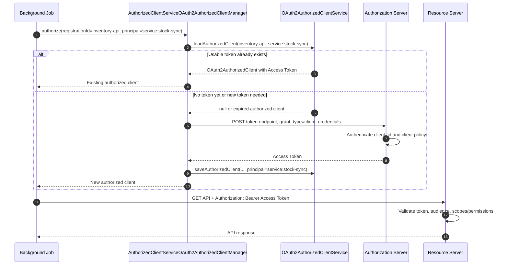

# 16.3. Principal Identity for Application-Owned Tokens

In **Spring Security OAuth 2.0 / OIDC Client**, not every Access Token represents a recently logged-in user. With the **Client Credentials Grant**, a backend application uses the identity and credentials of **the OAuth2 client itself** to request an Access Token for a *machine-to-machine (M2M)* task. There is no browser, authorization code, OIDC ID Token, or user login flow in this grant.

However, when using Spring Security, developers still encounter the `principal` parameter:

```java
OAuth2AuthorizeRequest request = OAuth2AuthorizeRequest
    .withClientRegistrationId("inventory-api")
    .principal("service:stock-sync")
    .build();
```

Why does a flow **without an end user** still have a principal? Is this value the `client_id`, a technical account on the Authorization Server, or the `sub` claim in a JWT? When should multiple jobs share a principal, and when should they be separated? What are the risks of taking the principal from a user's HTTP request?

This lesson explains the role of the **service principal / technical principal** in **`OAuth2AuthorizedClientManager`**, how Spring Security uses `principalName` to save and load `OAuth2AuthorizedClient`, how to design stable keys for backends, and the security boundaries when multiple workloads, tenants, or instances use Client Credentials.

## 1. Context: `client_credentials` Is Not User Login

A backend application may need to call another system's API to synchronize inventory:

```text
inventory-worker application
    |
    |  POST /oauth2/token
    |  grant_type=client_credentials
    |  client authentication: inventory-worker-client
    v
Authorization Server
    |
    |  Access Token
    v
inventory-worker application
    |
    |  Authorization: Bearer <access-token>
    v
Inventory API
```

Here:

- The backend is the **OAuth2 Client**.
- The Authorization Server authenticates the **client** using a secret, private key, mTLS, or another registered method.
- The Authorization Server decides which scopes/audience are granted to the **client**.
- The Resource Server validates the Access Token and allows or denies the action per policy.
- **There is no user logging in via a browser** in this grant.

A protocol-level token request example:

```http
POST /oauth2/token HTTP/1.1
Host: auth.example.org
Authorization: Basic <encoded-client-credentials>
Content-Type: application/x-www-form-urlencoded

grant_type=client_credentials&scope=inventory.read
```

The Authorization Server may return:

```json
{
  "access_token": "<opaque-or-jwt-access-token>",
  "token_type": "Bearer",
  "expires_in": 300,
  "scope": "inventory.read"
}
```

This is illustrative data. Responses can vary by provider and extensions. Under OAuth 2.0, a Refresh Token **is typically not issued** for the Client Credentials Grant; when the Access Token expires, the backend normally requests a new token using the same grant if still permitted.

### 1.1. Principal Here Does Not Mean End User

In application programming, *principal* usually refers to the authenticated human user. In Spring Security OAuth2 Client, however, this term appears at **two different layers**:

1. **Principal in `SecurityContext`**: the object representing the authenticated caller of an application request, which may be an OIDC user.
2. **Principal supplied to `OAuth2AuthorizeRequest`**: the object/string used as the **authorized client context** when the manager issues, loads, and saves tokens.

The two layers can coincide when an application calls an API *on behalf of* a user, but with `client_credentials` you **do not need and usually should not** take the current user's principal. A stable technical name like `service:stock-sync` is enough for Spring Security to manage tokens for a background task.

**Core principle:** `principal("service:stock-sync")` in Spring Security **does not turn** the issued token into a token belonging to a user named `stock-sync`. The Authorization Server relies on the **OAuth client registration and client authentication** to grant permissions to the client.

## 2. Distinguishing Four Easily Confused Identifiers

To configure this accurately, separate these concepts:

| Identifier | Example | Where Does It Appear? | Meaning |
|---|---|---|---|
| **`registrationId`** | `inventory-api` | `spring.security.oauth2.client.registration` config and `OAuth2AuthorizeRequest` | Internal key selecting a `ClientRegistration` in Spring Security. |
| **`client_id`** | `inventory-worker-prod` | Authorization Server client registration and token request | The OAuth2 client identity known and authenticated by the Authorization Server. |
| **Spring-side `principalName`** | `service:stock-sync` | `OAuth2AuthorizeRequest`, `OAuth2AuthorizedClient`, and authorized client service | Context key used to save/load an authorized client; **not automatically sent to the token endpoint**. |
| **`sub` or equivalent Access Token claim** | `inventory-worker-prod`, or another value | Token issued by the Authorization Server, if the token exposes that claim | Semantics depend on the Authorization Server, token format, profile, and Resource Server policy. |

Configuration example:

```yaml
spring:
  security:
    oauth2:
      client:
        registration:
          inventory-api:
            provider: internal-iam
            client-id: ${INVENTORY_CLIENT_ID}
            client-secret: ${INVENTORY_CLIENT_SECRET}
            client-authentication-method: client_secret_basic
            authorization-grant-type: client_credentials
            scope:
              - inventory.read
        provider:
          internal-iam:
            token-uri: https://auth.example.org/oauth2/token
```

Here:

- `inventory-api` **does not have to** equal `client-id`.
- `provider: internal-iam` is a configuration alias name, not a principal.
- `client-id` is the identifier registered on the Authorization Server.
- `service:stock-sync` can be a **technical name chosen intentionally by the backend**, not a required property in the YAML above.
- The issued Access Token may contain claims such as `sub`, `client_id`, `azp`, or others depending on the Authorization Server; do not assume `sub` always equals the Spring-side principal string.

### 2.1. Does the Spring Principal Go into the Token Request?

In the standard Client Credentials Grant, the token request sends data such as:

```text
grant_type = client_credentials
client_id / client authentication = per client registration
scope = per request and allowed policy
```

The `principal("service:stock-sync")` value is used by the manager as the context for storing/reusing the authorized client; **it is not a standard OAuth 2.0 parameter automatically sent to the token endpoint**.

Therefore, changing:

```java
.principal("service:stock-sync")
```

to:

```java
.principal("alice@example.org")
```

**does not cause the Authorization Server to authenticate Alice and does not create a delegated user token**. It primarily changes the lookup/write key for the authorized client on the application side. If business logic genuinely needs to call an API on Alice's behalf, an appropriate delegation flow such as Authorization Code or a provider-supported token exchange/on-behalf-of extension is required—not arbitrarily changing the principal name.

## 3. Role of Principal in `OAuth2AuthorizedClient`

Spring Security uses `OAuth2AuthorizedClient` to represent a client that has obtained an Access Token and optionally a Refresh Token.

An authorized client typically consists of:

```text
OAuth2AuthorizedClient
  ├── ClientRegistration
  │    ├── registrationId = inventory-api
  │    ├── clientId = inventory-worker-prod
  │    └── tokenUri = https://auth.example.org/oauth2/token
  ├── principalName = service:stock-sync
  ├── accessToken
  │    ├── value = <sensitive>
  │    ├── issuedAt
  │    ├── expiresAt
  │    └── scopes
  └── refreshToken = null (typical for client_credentials)
```

Each authorized client is bound to **one client registration** and **one principal name**.

In the default service and many implementations, the lookup key pair at the API level is:

```text
(clientRegistrationId, principalName)
```

Example:

| Registration | Principal name | Record Meaning |
|---|---|---|
| `inventory-api` | `service:stock-sync` | Token obtained for the stock synchronization worker. |
| `billing-api` | `service:invoice-sync` | Token for the invoice synchronization job. |
| `inventory-api` | `service:nightly-audit` | A different entry, even though it may use the same `client_id` and scopes. |
| `inventory-api` | `service:stock-sync` | Same key as row 1; can reuse the saved record. |

**Same registration + same principal** lets the manager look up that context's authorized client again. **Same registration + different principal** typically creates separate entries in the store, which can lead to more token requests. That **does not** give those entries different OAuth2 policies at the Authorization Server.

### 3.1. Why Does the Framework Need a Principal When the Grant Has No User?

`OAuth2AuthorizedClientManager` is an abstraction used across multiple grant types, not just Client Credentials:

- With Authorization Code, a token can be tied to the logged-in user.
- With Client Credentials, the token belongs to the client, yet the manager still needs a **stable key** to manage the authorized client's state.
- With other grants, the principal context may relate to previously stored authorizations.

Thus, Spring Security keeps a uniform invocation model: `OAuth2AuthorizeRequest` always carries a principal context. With Client Credentials, the application can supply **a fixed technical principal** representing the workload or integration purpose.

### 3.2. Principal Is Not a Scope Container

If two jobs use the same registration `inventory-api` with different principals:

```text
service:stock-sync
service:inventory-report
```

do not assume each principal receives different permissions from the Authorization Server. The scopes a token can obtain remain constrained by **the client registration, valid grant parameters, and Authorization Server policy**.

To actually have two distinct permission levels, you may need two separate client registrations or client identities, with distinct scopes/audiences/policies at the Authorization Server. The Spring-side `principal` name **is only a token management factor**, not an independent authorization mechanism.

## 4. Sequence Diagram of One Authorization Call with a Service Principal



The actual timing of when a token is re-requested depends on `OAuth2AuthorizedClientProvider`, token expiry, clock skew, and manager/service configuration. The diagram shows the **conceptual flow**: lookup by registration + principal, authorize via the grant, save the result, and use the Access Token for the API.

No HTTP session or user `SecurityContext` is needed for a background job. Client Credentials is an independent workflow from OIDC browser login.

## 5. Choosing the Right `OAuth2AuthorizedClientManager`

Spring Security provides managers for different contexts.

| Component | Common Context | Associated Store |
|---|---|---|
| `DefaultOAuth2AuthorizedClientManager` | Servlet applications, browser requests, or MVC controllers | `OAuth2AuthorizedClientRepository` bound to HTTP request/response. |
| `AuthorizedClientServiceOAuth2AuthorizedClientManager` | Background jobs, scheduled tasks, service-to-service without Servlet requests | `OAuth2AuthorizedClientService`. |

For Client Credentials running in a backend worker/service, **`AuthorizedClientServiceOAuth2AuthorizedClientManager`** is usually the clear choice because you do not need to mock an `HttpServletRequest`.

### 5.1. Spring Boot Dependencies

Gradle example:

```gradle
dependencies {
    implementation("org.springframework.boot:spring-boot-starter-oauth2-client")
    implementation("org.springframework.boot:spring-boot-starter-web")
}
```

The Web starter is only needed if the application actually exposes web endpoints or uses the platform's HTTP client by design. A background worker is not required to run a servlet web server; the essential component for the flow is **OAuth2 Client**.

### 5.2. Registration for Client Credentials

```yaml
spring:
  security:
    oauth2:
      client:
        registration:
          inventory-api:
            provider: internal-iam
            client-id: ${INVENTORY_CLIENT_ID}
            client-secret: ${INVENTORY_CLIENT_SECRET}
            client-authentication-method: client_secret_basic
            authorization-grant-type: client_credentials
            scope:
              - inventory.read
        provider:
          internal-iam:
            token-uri: https://auth.example.org/oauth2/token
```

With `client_credentials`:

- There is no `redirect-uri` or `/login/oauth2/code/{registrationId}`.
- There is no `authorization-endpoint` redirecting users in this grant.
- `openid` is not needed to create an OIDC user principal.
- `client-secret`/credentials must stay on the backend and be protected.
- `scope` must match provider policy; declaring a scope does not guarantee it is granted.
- `token-uri` is the endpoint the backend connects to directly.

Configuring the registration alone **is not enough** to automatically attach a Bearer token to every HTTP call; you still need a manager and a properly integrated HTTP client.

## 6. Configuring a Manager for Userless Applications

An illustrative configuration in modern Spring Security:

```java
import org.springframework.context.annotation.Bean;
import org.springframework.context.annotation.Configuration;
import org.springframework.security.oauth2.client.AuthorizedClientServiceOAuth2AuthorizedClientManager;
import org.springframework.security.oauth2.client.OAuth2AuthorizedClientManager;
import org.springframework.security.oauth2.client.OAuth2AuthorizedClientProvider;
import org.springframework.security.oauth2.client.OAuth2AuthorizedClientProviderBuilder;
import org.springframework.security.oauth2.client.OAuth2AuthorizedClientService;
import org.springframework.security.oauth2.client.registration.ClientRegistrationRepository;

@Configuration
public class MachineTokenConfiguration {

    @Bean
    OAuth2AuthorizedClientManager machineAuthorizedClientManager(
            ClientRegistrationRepository registrations,
            OAuth2AuthorizedClientService authorizedClients) {

        OAuth2AuthorizedClientProvider provider =
            OAuth2AuthorizedClientProviderBuilder.builder()
                .clientCredentials()
                .build();

        AuthorizedClientServiceOAuth2AuthorizedClientManager manager =
            new AuthorizedClientServiceOAuth2AuthorizedClientManager(
                registrations,
                authorizedClients
            );

        manager.setAuthorizedClientProvider(provider);
        return manager;
    }
}
```

Responsibilities:

1. `ClientRegistrationRepository` looks up the `inventory-api` configuration.
2. `OAuth2AuthorizedClientService` loads/saves Access Tokens by registration and principal.
3. `OAuth2AuthorizedClientProvider` supports only Client Credentials in this example.
4. The manager coordinates lookup, requesting tokens when needed, and saving the authorized client.

If the application also runs `oauth2Login()`, do not default to using the Servlet-bound manager in background jobs. You can configure two separate managers with clear bean names / `@Qualifier`.

### 6.1. Why Explicitly Specify `clientCredentials()`?

A manager uses a provider chain to know which grants it supports. Configuring:

```java
OAuth2AuthorizedClientProviderBuilder.builder()
    .clientCredentials()
    .build();
```

clearly expresses the intent to use a **machine token**, avoiding accidentally mixing in `authorization_code`, user refresh token flows, or other grants when unnecessary. If the system has multiple client types, you can configure the provider chain according to a specific strategy; each grant must still adhere to protocol requirements.

## 7. Specifying a Technical Principal in `OAuth2AuthorizeRequest`

A common pattern:

```java
import org.springframework.security.oauth2.client.OAuth2AuthorizeRequest;
import org.springframework.security.oauth2.client.OAuth2AuthorizedClient;
import org.springframework.security.oauth2.client.OAuth2AuthorizedClientManager;

public final class InventoryTokenProvider {

    private static final String REGISTRATION_ID = "inventory-api";
    private static final String SERVICE_PRINCIPAL = "service:stock-sync";

    private final OAuth2AuthorizedClientManager manager;

    public InventoryTokenProvider(OAuth2AuthorizedClientManager manager) {
        this.manager = manager;
    }

    public String getAccessTokenValue() {
        OAuth2AuthorizeRequest request = OAuth2AuthorizeRequest
            .withClientRegistrationId(REGISTRATION_ID)
            .principal(SERVICE_PRINCIPAL)
            .build();

        OAuth2AuthorizedClient authorizedClient = manager.authorize(request);

        if (authorizedClient == null) {
            throw new IllegalStateException(
                "Unable to obtain inventory API authorized client"
            );
        }

        return authorizedClient.getAccessToken().getTokenValue();
    }
}
```

`getAccessTokenValue()` returns the token value **inside the backend** for a trusted HTTP client to use. **Never expose this method via a controller returning raw tokens to a browser**, never write tokens to logs, and never append tokens to URLs.

The two strings serve different purposes:

- `REGISTRATION_ID`: points to the `ClientRegistration` holding `client_id`, secret, token endpoint, and scopes.
- `SERVICE_PRINCIPAL`: stable name used to store and look up the token in the authorized client service.

### 7.1. Why Use a Stable Constant?

If every authorization call used a new principal:

```java
// Unsuitable if the goal is to reuse the same authorized client:
.principal("service:stock-sync:" + java.util.UUID.randomUUID())
```

then Spring Security would treat each call as a different key pair, preventing the authorized client service from finding the previously saved token. The result is continuous token requests, unnecessary load on the Authorization Server, and growing entries in storage.

A stable principal scoped to **the workload and desired sharing boundary** is the simplest way to maximize reuse.

### 7.2. Why Not Use a Timestamp, Request ID, or Session ID?

Values like:

```text
service:stock-sync:2026-11-16T09:00:00Z
request:9ad3...
session:JSESSIONID-...
```

are unsuitable as an application token's principal if the intent is to share tokens per service. They change frequently or depend on browser sessions, fragmenting the cache and potentially leaking session data into storage keys.

Using a principal like:

```text
service:stock-sync
```

or:

```text
workload:inventory-worker
```

is enough to indicate the backend token-management purpose. This name should not contain credentials or user data.

### 7.3. Must the Principal Name Match the Kubernetes Service Name?

No. `principalName` is a Spring Security-side string/identity context. It can match the workload name for operational convenience, but that is an **internal convention**, not an OAuth2 requirement.

If multiple instances of the same workload need to share a token, use **the same stable principal** and an appropriate shared store. If workloads must isolate tokens, evaluate separate client registrations/credentials or provider policies rather than just renaming the principal.

## 8. When to Share a Principal vs. Separate It?

This is an important design decision because multiple jobs can use the same registration.

### 8.1. Two Jobs with the Same Client Identity, Scope, and Purpose

Example:

```text
Job A: sync orders
Job B: update sync status
Same OAuth2 Client Registration: order-api
Same credential, audience, scope, and policy
```

If both jobs are permitted to share the **same application-level** token, you can choose one principal:

```text
principal = service:order-integration
```

Benefits: a single authorized client entry for the registration/principal pair, fewer unnecessary token requests, and unified observability.

Condition: both jobs must genuinely be allowed to share the same **client privileges**; this must be a security decision, not merely a performance optimization.

### 8.2. Two Jobs with Different Purposes Wanting Independent Token Lifecycles

If two jobs should not share storage lifecycles:

```text
registration = order-api, principal = service:order-sync
registration = order-api, principal = service:order-audit
```

Spring Security can store two separate authorized clients, depending on when tokens are requested. However, if the registration uses the same `client_id`/secret/scopes, the Authorization Server is still authenticating **the same OAuth2 client**.

**Separating principals is not equivalent to separating permissions.** It only separates **client-side token management objects**. True permission separation requires controls at the Authorization Server and Resource Server.

### 8.3. Two Services Needing Different Permissions

For instance, an inventory reader may only read stock, while an inventory writer may update it:

| Workload | Required Permission | Design to Consider |
|---|---|---|
| `stock-reader` | `inventory.read` | Registration `inventory-read` with a read-only client/policy. |
| `stock-writer` | `inventory.write` | Registration `inventory-write` with separate allowed credentials and scopes. |

Do not just write:

```java
.principal("service:stock-writer")
```

and expect the token to be issued with `inventory.write` if the registration only permits `inventory.read`. Permissions must be granted through Authorization Server registration, grants, and policies; the Resource Server must also validate the token.

### 8.4. Strategy Selection Table

| Scenario | Principal name | Registration/credential |
|---|---|---|
| Single simple worker | One stable string per workload. | One client registration. |
| Multiple replicas of the same worker | Same principal if sharing token storage is desired. | Same registration if it is one client identity. |
| Two jobs using the same API and privileges | May share a principal per integration. | May share a registration. |
| Two jobs needing separate token lifecycles but same permissions | May use two principals. | May share a registration; not security isolation. |
| Two services needing different scopes/audiences | Separate names help management but do not grant permissions. | Consider separate registrations/client identities/policies. |
| Job acting on behalf of a specific end user | Do not use a technical principal to impersonate a user. | Use an appropriate grant/delegation, not plain `client_credentials`. |
| Tenants needing separate permissions | Must have tenant boundaries in identity/storage. | Needs distinct policies/credentials/scopes/audiences if tenant permissions are truly isolated. |

## 9. How Spring Security Uses `principalName` When Storing Tokens

With `OAuth2AuthorizedClientService`, the basic API signatures are:

```java
<T extends OAuth2AuthorizedClient> T loadAuthorizedClient(
    String clientRegistrationId,
    String principalName
);

void saveAuthorizedClient(
    OAuth2AuthorizedClient authorizedClient,
    Authentication principal
);

void removeAuthorizedClient(
    String clientRegistrationId,
    String principalName
);
```

When the manager uses:

```java
OAuth2AuthorizeRequest request = OAuth2AuthorizeRequest
    .withClientRegistrationId("inventory-api")
    .principal("service:stock-sync")
    .build();
```

the principal value is used to look up and write the authorized client for the **supplied context**. The service principal name must remain consistent from save to load/remove.

Example key pairs:

```text
inventory-api | service:stock-sync     -> access token A
inventory-api | service:nightly-report -> access token B
billing-api   | service:stock-sync     -> access token C
```

`service:stock-sync` can appear across multiple registrations; it is the **registration + principal pair** that distinguishes an authorized client in the service API.

### 9.1. Performing a Direct Lookup to Understand the Mechanism

Illustrative code example:

```java
import org.springframework.security.oauth2.client.OAuth2AuthorizedClient;
import org.springframework.security.oauth2.client.OAuth2AuthorizedClientService;

public class AuthorizedClientInspector {

    private final OAuth2AuthorizedClientService authorizedClients;

    public AuthorizedClientInspector(
            OAuth2AuthorizedClientService authorizedClients) {
        this.authorizedClients = authorizedClients;
    }

    public boolean hasStoredClient() {
        OAuth2AuthorizedClient client = authorizedClients
            .loadAuthorizedClient(
                "inventory-api",
                "service:stock-sync"
            );

        return client != null;
    }
}
```

This method only checks **whether a stored record exists**; it does not guarantee the Access Token is unexpired, unrevoked, or has the right audience/scope. In real systems, call **`OAuth2AuthorizedClientManager.authorize(...)`** before using a token so the manager/provider has a chance to handle expired tokens per the grant.

### 9.2. Principal Name Must Match When Removing

To delete a local authorized client:

```java
authorizedClients.removeAuthorizedClient(
    "inventory-api",
    "service:stock-sync"
);
```

You must pass the **exact key pair**. Calling remove with a different principal will not delete the token for `service:stock-sync`.

Removing an authorized client from the **Spring Security Client store** does not mean the Authorization Server has revoked the Access Token. If remote revocation is required, implement a separate token revocation policy and mechanism when supported by the provider.

## 10. Which `OAuth2AuthorizedClientService` Should You Choose?

Common implementations:

| Service | Characteristics | Use Cases |
|---|---|---|
| `InMemoryOAuth2AuthorizedClientService` | Stores authorized clients in process memory. | Demos, single-instance apps, simple workers not needing durability. |
| `JdbcOAuth2AuthorizedClientService` | Persists to a database via JDBC using the framework schema. | Across restarts or multiple nodes needing a shared store. |
| Custom `OAuth2AuthorizedClientService` | Persists to app storage/KMS/encrypted DB/Redis per policy. | Multi-tenant, token encryption, retention, custom audit/concurrency. |

**Important:** the service is only a data store. It does not solve every token refresh scenario on its own, nor does it prove a token is valid for a Resource Server.

### 10.1. In-Memory Storage

Within a single process:

```text
registrationId = inventory-api
principalName  = service:stock-sync
cached Access Token = ...
```

Each time the job calls the manager in the same process, the manager can reuse the authorized client until a new token must be requested.

Drawback: process restarts lose the record; multiple instances have separate caches. This may be acceptable if the Client Credentials Grant allows requesting a new token easily and the system does not require sharing.

### 10.2. JDBC Storage

If persistence is needed:

```java
import org.springframework.context.annotation.Bean;
import org.springframework.context.annotation.Configuration;
import org.springframework.jdbc.core.JdbcOperations;
import org.springframework.security.oauth2.client.JdbcOAuth2AuthorizedClientService;
import org.springframework.security.oauth2.client.OAuth2AuthorizedClientService;
import org.springframework.security.oauth2.client.registration.ClientRegistrationRepository;

@Configuration
public class TokenStorageConfiguration {

    @Bean
    OAuth2AuthorizedClientService authorizedClientService(
            JdbcOperations jdbc,
            ClientRegistrationRepository registrations) {

        return new JdbcOAuth2AuthorizedClientService(jdbc, registrations);
    }
}
```

Prepare the database schema matching **the exact Spring Security version in use** and protect credentials stored in the DB. Do not assume the default JDBC service encrypts Access Tokens with an application key or handles all multi-tenant requirements.

If multiple workers share `registrationId` and `principalName` in a JDBC store, they can see the same record; when a token expires, concurrency handling still needs evaluation.

### 10.3. Custom Service for Multi-Tenancy

A custom service can use a tenant-partitioned schema:

```text
tenant_id | registration_id | principal_key        | token_ciphertext
alpha     | inventory-api   | service:stock-sync   | <encrypted-token>
beta      | inventory-api   | service:stock-sync   | <encrypted-token>
```

However, the `OAuth2AuthorizedClientService` interface accepts `(registrationId, principalName)` without a separate tenant parameter. Therefore, the implementation needs **a reliable tenant context mechanism** or a standardized principal/registration key convention.

Never add a `tenant_id` column to the table and ignore that column in the SQL lookup query; doing so could retrieve the wrong tenant's token.

## 11. Combining the Manager with an HTTP Client to Call the Resource Server

A backend service generally prefers not to call a method returning a raw token and pass that value through many layers. Still, to understand the mechanism, you can integrate the token provider with Spring `RestClient` in a straightforward way.

Assuming `InventoryTokenProvider` from the previous section:

```java
import org.springframework.web.client.RestClient;

public final class InventoryApiClient {

    private final RestClient restClient;
    private final InventoryTokenProvider tokens;

    public InventoryApiClient(InventoryTokenProvider tokens) {
        this.tokens = tokens;
        this.restClient = RestClient.builder()
            .baseUrl("https://inventory.example.org")
            .build();
    }

    public String loadStockSnapshot() {
        String accessToken = tokens.getAccessTokenValue();

        return restClient.get()
            .uri("/api/stock/snapshot")
            .headers(headers -> headers.setBearerAuth(accessToken))
            .retrieve()
            .body(String.class);
    }
}
```

This is a simple example emphasizing that **the token is obtained on the backend** and used in the Bearer header. In production, you can use Spring Security's HTTP client integration for your running version, handling timeouts, retries, observability, and centralized error mapping.

Ensure that:

- `https://inventory.example.org` is an API **authorized to receive tokens** for registration `inventory-api`.
- The Access Token has an audience/scope accepted by the Resource Server.
- Redirects to untrusted hosts do not forward the Authorization header.
- Raw tokens are not logged via interceptors, APM, or HTTP debug logging.
- Token values are not returned to a frontend just so the frontend can call an API when architecture requires keeping credentials on the backend.

### 11.1. Call the Manager Every Time a Token Is Needed or Store the Token in a Field?

In `InventoryTokenProvider`, calling:

```java
manager.authorize(request)
```

before making an API call allows the manager to inspect the stored authorized client and token state.

Do not save an Access Token once at startup in a static field and reuse it forever, because the token can expire or be revoked while the process keeps running.

Nor should you scatter manual “if 5 seconds left, refresh” logic across every service; use `OAuth2AuthorizedClientManager` with properly configured providers and clock skew.

### 11.2. The Receiving API Does Not Rely on the Spring Principal Name

The Resource Server only sees the Access Token and API request authentication details. It **does not automatically know** that the token on the client side was stored under `service:stock-sync`.

Therefore, the API must verify issuer/signature or introspection, audience, scopes, policy, and possibly a client identity claim per the Authorization Server profile. If you need traceability for “which job called the API,” use a reliable attribution/audit mechanism rather than expecting an internal principal string to appear to the Resource Server.

## 12. Distinguishing Web User `Authentication` from an M2M Service Principal

Suppose an application both provides a web portal where employees log in with OIDC and runs a background inventory sync job.

During an HTTP request, Spring Security may hold:

```text
SecurityContext.Authentication.getName() = employee-sub-123
```

Yet the M2M job should use:

```text
OAuth2AuthorizeRequest.principal = service:stock-sync
```

If code takes the principal of the user browsing the page and passes it to the Client Credentials manager:

```java
// Unsuitable if the goal is a shared application-level token:
OAuth2AuthorizeRequest.withClientRegistrationId("inventory-api")
    .principal(authentication.getName())
    .build();
```

it can result in **each web user getting a separate authorized client entry** even though all tokens are requested using the same OAuth2 client identity. Consequences:

- Wasted token requests and storage.
- Cache logic unnecessarily coupled to users.
- Confusion that the Access Token represents a user.
- Potential context leakage if downstream layers treat `principalName` as proof of authorization.

For a machine token shared by workload, use a fixed principal and clearly separate M2M managers/services.

### 12.1. Conversely, When Should a User Principal Be Used?

If the application genuinely uses the **Authorization Code Grant** to call an API on a user's behalf, each authorized client can be bound to that user's `Authentication`. Then the principal name separates different users' Access/Refresh Tokens in storage.

That is a different flow from `client_credentials`:

| Factor | Authorization Code (user delegated) | Client Credentials (application) |
|---|---|---|
| Browser user login? | Typically yes. | No. |
| Authorization code/callback? | Yes. | No. |
| Who does the token represent? | Permissions granted in user + client context, per provider. | The OAuth client / application itself. |
| Principal key in authorized client | Typically tied to the user. | Should be tied to workload/service context. |
| Can API infer end user? | Per verified token claims/delegation. | Should not infer an end user. |
| Scenario | App reads a user's work calendar. | Nightly warehouse inventory sync job. |

If a requirement says “the service updates Alice's data with Alice's permissions,” do not solve it by passing `principal("alice")` in a Client Credentials request. You need a grant or delegation mechanism accepted by the Authorization Server.

## 13. Principal String vs. `Authentication` Object

The `OAuth2AuthorizeRequest` builder can accept a `String` principal name or an `Authentication` object depending on the Spring Security version's API.

For background jobs, the simplest and clearest form is:

```java
OAuth2AuthorizeRequest.withClientRegistrationId("inventory-api")
    .principal("service:stock-sync")
    .build();
```

There is no need to fabricate a `UsernamePasswordAuthenticationToken` with a dummy password or user authorities. A string value is enough to give the framework a principal context for managing the authorized client.

### 13.1. Principal Name Is an **Internal** Name, Not a Credential

Sensible principals might be:

```text
service:stock-sync
workload:inventory-importer
integration:crm-export
```

It should never contain:

```text
client_secret=...
access_token=...
user_email=...
JSESSIONID=...
api_key=...
```

The principal name may appear in database keys, logs, metrics, or error messages if not carefully masked. Do not embed credentials or unnecessary personal data into this name.

### 13.2. Principal Name Must Remain Stable Across the Application Lifecycle

If you rename `service:stock-sync` to `service:inventory-sync`, the existing authorized client store may still hold a record under the previous key. The manager will look up under the new key and request a new token if needed.

This is usually not a protocol error, but you should plan:

- Should old records be migrated or deleted?
- Should old tokens be revoked at the Authorization Server?
- Is the service rename accounted for in logging/monitoring?
- Will multiple instances use both the old and new names concurrently?

Do not change the principal by hostname/pod ID if your goal is to share tokens across replicas.

## 14. Multiple Instances, Shared Stores, and Concurrency

An application runs two replicas:

```text
Replica A -> principal=service:stock-sync
Replica B -> principal=service:stock-sync
```

If each replica uses `InMemoryOAuth2AuthorizedClientService`, they maintain **two separate caches**, even though the principal string is identical. Sharing a principal string does not automatically create shared state.

If using `JdbcOAuth2AuthorizedClientService` with a shared database, both replicas can use the same key pair:

```text
(inventory-api, service:stock-sync)
```

Yet you must still consider **race conditions**.

### 14.1. Two Nodes Requesting a New Token Simultaneously

Scenario:

```text
T0: database has no authorized client
T1: replica A loads -> null
T2: replica B loads -> null
T3: A calls token endpoint, gets token A
T4: B calls token endpoint, gets token B
T5: A saves token A
T6: B saves token B (overwriting the same key entry)
```

With Client Credentials, two concurrent requests asking for new tokens may be valid per the provider, but it causes waste or impacts quotas/rate limits. With some providers, token/session limit rules can introduce side effects.

Under heavy load, consider:

- Single-flight within a process to coalesce concurrent token requests.
- Distributed locking or coordination for shared stores when truly needed.
- Proper cache TTL and clock skew settings.
- Rate limiting/backoff when the token endpoint returns errors.
- Avoiding holding distributed locks too long if the network/provider is slow.
- Distinguishing a few harmless duplicate token requests from severe refresh/revocation issues.

**A fixed principal value points nodes to the same key, but it does not solve concurrency by itself.**

### 14.2. Client Credentials and Refresh Tokens

The standard Client Credentials Grant **does not include a Refresh Token**. When the Access Token expires, `ClientCredentialsOAuth2AuthorizedClientProvider` can request a new Access Token using the same grant. Do not design around a default refresh-token rotation flow for Client Credentials if the provider does not offer one.

If a provider has a custom extension issuing Refresh Tokens to machine clients, read its exact contract and configure an appropriate provider chain; do not assume Spring automatically handles every extension.

## 15. How to Isolate Tenants Properly

Suppose a SaaS system has two tenants, `alpha` and `beta`. The backend calls each tenant's API.

One naming option:

```text
principal = service:stock-sync:tenant-alpha
principal = service:stock-sync:tenant-beta
```

With the same registration, these two names create **two authorized client entries**, yet **they do not guarantee alpha's Access Token cannot be used on beta**. If the client registration uses the same `client_id` and scopes at the Authorization Server, the tokens may carry identical permissions under provider policy.

### 15.1. Separating Cache Keys Is Not Separating Privileges

| Requirement | Is Adding Tenant to Principal Alone Enough? |
|---|---|
| Avoid overwriting two entries in the authorized client store | May be sufficient when keys are properly designed. |
| Easier tracking of token acquisition per workload/tenant | Can help, provided logging is safe. |
| Force Authorization Server to issue tenant-specific audience | **No.** Requires corresponding grant/client/provider configuration. |
| Ensure API only allows tenant alpha data | **No.** Resource Server must verify tenant/authorization. |
| Separate client secrets, revoke credentials per tenant | **No.** Requires separate client identities/credentials if needed. |
| Prevent a tenant beta caller from loading alpha's token | **Not automatically.** Storage/API must enforce tenant context. |

### 15.2. Approaches Worth Considering

**Option A — Separate registration per tenant or integration:**

```text
inventory-alpha -> client_id alpha-worker, scope alpha.inventory.read
inventory-beta  -> client_id beta-worker,  scope beta.inventory.read
```

Advantage: Authorization Server policies and credentials are cleanly isolated. Cost: more registrations/secrets and operational overhead.

**Option B — Single registration with tenant-aware API authorization:**

Tokens are issued to a shared client; the Resource Server determines the tenant from the request and checks whether the client is permitted in that tenant. In this model, tenant-separated principals in Spring only aid caching/observability—they do not replace API policy.

**Option C — Custom store with tenant partitioning:**

The store uses a trusted tenant context and tenant-scoped keys to prevent mixing records. Permissions/tokens must still be enforced at the Authorization Server and Resource Server.

Never use an unverified `tenantId` from a query parameter to decide the principal/registration and call sensitive APIs. Tenant boundaries must come from policy and an authenticated/authorized caller context.

## 16. Do Not Rely on `principalName` as the Sole Audit Data at the API

An audit task may ask: “Who executed the inventory change request at 02:00?”

With Client Credentials, the Resource Server can tell which **client application** called, but it does not automatically know which user triggered the job (if any). The Spring principal `service:stock-sync` is only a local name and is not transmitted by default inside the token.

For meaningful auditing:

1. Use the client identity/claim from the **Resource Server-verified token** as the source identifying the machine caller.
2. Record an internal transaction/correlation ID for the job.
3. If the job was triggered by a user, record **the trigger source** separately in controlled audit records rather than stuffing a fake user name into the `client_credentials` principal.
4. When true delegation is needed, use an OAuth2 mechanism supported and verified by the Authorization Server—not an untrusted custom `X-User` header.
5. Avoid writing Access Tokens into logs for tracing.

### 16.1. Does the Token Have a `sub` Claim Matching the Client Name?

Some Authorization Servers represent a Client Credentials Access Token as a JWT with `sub` or a similar claim pointing to the client ID. Other providers represent it differently; the Access Token may also be opaque.

Therefore:

- **Do not assume** the Access Token's `sub` always equals `principal("service:...")`.
- **Do not assume** the `sub` claim of a machine token has human user semantics.
- The Resource Server must validate tokens according to provider/profile, audience/scope, and API policy.
- If a standardized machine identity is needed for authorization, define the claim and contract explicitly with the Authorization Server.

## 17. Access Control on the Resource Server

A Client Credentials Access Token is only meaningful when the Resource Server validates it properly.

Checks the Resource Server should perform:

- Token was issued by a trusted issuer or introspection returns active.
- Valid JWT signature/metadata or appropriate introspection mechanism.
- Audience matches the Inventory API.
- Scopes/permissions such as `inventory.read` or `inventory.write`.
- Whether this client identity is allowed to call this endpoint.
- Tenant/resource boundaries if the API is multi-tenant.
- Token is not expired and not revoked per provider/API mechanism.

An API policy can be expressed conceptually as:

```text
request GET /inventory/items:
    require valid machine access token
    require audience == inventory-api
    require scope includes inventory.read
    require tenant-specific permission if applicable
```

Never merely check that a token exists or has a valid JWT signature and then open every API endpoint. **The caller-side Spring Security store's principal name does not replace Resource Server authorization.**

### 17.1. Distinguishing `SCOPE_inventory.read` from the Service Principal

In a Spring Security Resource Server, a JWT's scope may be mapped to an authority like `SCOPE_inventory.read` depending on configuration.

However, `service:stock-sync` used by the OAuth2 Client to store the token **is not** a `GrantedAuthority` automatically recognized by the Resource Server. If the API needs to authorize by client identity, configure an appropriate decoder/introspection/authority mapping.

## 18. Configuring Matching Secrets and Client Authentication

Examples above used `client_secret_basic`. Depending on the provider, Client Credentials can use:

- `client_secret_basic`: HTTP Basic header.
- `client_secret_post`: credentials in the form body.
- `private_key_jwt`: JWT assertion signed with a private key.
- mTLS: client authentication using certificates, when supported.
- Other methods/extensions per specific contract.

The Spring-side `principal` does not affect the client authentication method. You must configure **the proper client registration and credentials**.

### 18.1. Do Not Put Credentials into the Principal

Wrong:

```java
// Never do this:
.principal("client-secret:" + actualClientSecret)
```

The principal can be used as a DB key or appear in logs, scattering credentials into places never designed to protect secrets.

Better:

```java
.principal("service:stock-sync")
```

and keep `client-secret` in environment variables / a secret manager. When using mTLS or `private_key_jwt`, private keys/certificates must be protected separately from the principal name.

### 18.2. HTTPS and Token Protection

- Call the token endpoint over HTTPS with proper TLS verification.
- Never disable certificate verification to bypass environment issues.
- Never place Access Tokens in query strings.
- Never log HTTP Basic headers, client secrets, client assertions, or raw tokens.
- Protect the database/cache holding authorized clients, especially in multi-instance setups.
- Configure appropriate timeouts and circuit breakers/backoff when the provider is slow.
- Maintain a client credential rotation/revocation process per organizational policy.

## 19. Common Principal-Related Errors and Troubleshooting

| Symptom | Possible Cause | How to Investigate |
|---|---|---|
| Token endpoint is called on every request. | `principal` keeps changing or authorized client is not saved/reused. | Check registration/principal stability, service instance, and authorize flow. |
| Many entries for the same registration in DB. | Many different principal names from user/request/job. | Review key strategy without logging token values. |
| Job cannot find token after restart. | Using in-memory store or principal was renamed. | Check storage and key; Client Credentials can request a new token. |
| Replica A has token, replica B does not. | Separate in-memory stores or no shared persistence. | Check authorized client service type. |
| `loadAuthorizedClient` returns `null`. | Wrong `registrationId`/`principalName`, record missing or deleted. | Check key pair and whether the manager saves the token. |
| `manager.authorize(...)` returns `null`. | Provider chain does not support grant or cannot authorize per config. | Check `clientCredentials()`, registration, and sanitized exceptions/logs. |
| Token request returns `invalid_client`. | Wrong Client ID, secret, auth method, or provider policy. | Check token endpoint/client registration, not just the principal. |
| Token request returns `invalid_scope`. | Scope not granted to the client. | Check scopes and Authorization Server policy. |
| API returns 401. | Token expired/wrong issuer/audience or rejected by API. | Separate token acquisition from Resource Server validation. |
| API returns 403. | Insufficient scope/permission/tenant policy. | Check actual client permissions at the Resource Server. |
| Used user's principal, yet API doesn't know that user. | `client_credentials` has no user delegation. | Choose the right grant; do not expect the principal string to enter the token. |
| Tenant alpha accidentally uses beta's permissions. | Only separated principal cache keys without policy/tenant isolation. | Check registration, token claims, and API authorization. |
| Multiple nodes request and overwrite tokens simultaneously. | Race condition on cache miss/expiry. | Consider single-flight / distributed coordination. |
| Renaming service “loses” authorized client. | Principal name changed. | Use a stable key and deliberately migrate/clean up. |

### 19.1. `manager.authorize(...)` Returning Null vs. Token Endpoint Returning an Error

`OAuth2AuthorizedClientManager.authorize(request)` may return `null` when it cannot authorize according to the provider chain/configuration in certain cases. An exception can also be thrown when the token endpoint or client authentication fails.

Never catch all exceptions and fall back to a fake token or an expired/other cached token:

```java
// WRONG in principle
try {
    return manager.authorize(request);
} catch (Exception ignored) {
    return tokenFromAnotherPrincipal;
}
```

If no valid authorized client is available, handle the failure cleanly, retry according to policy, and never substitute another principal's or tenant's token.

### 19.2. Right Scope, Yet API Still Rejects

An Access Token with scope `inventory.read` can still be rejected if the audience is wrong, the issuer is untrusted, the token is expired, or the client is blocked by policy. A local principal name does not override those checks.

### 19.3. Not Finding a Token After Renaming Principal Is Not an OAuth2 Error

If you rename `service:stock-sync` to `service:stock-sync-v2`, the manager looks up under a different key and may obtain a new token. This is merely an internal storage key change, not an Authorization Server rejection. Still, clean up stale records and avoid accidentally running both names in parallel.

## 20. Logging, Observability, and Cardinality Management

The principal name is a useful label for identifying which workload is requesting tokens, but its use in logs and metrics must be controlled.

Safe to log:

- Configured `registrationId` name.
- **Principal category** such as `service` or an allowlisted technical alias.
- Load/authorize outcome: cache hit, token issued, token renewed, failure.
- HTTP status and standardized OAuth2 error code from the token endpoint.
- Request duration, latency, and retry count.
- Instance ID, diagnostic correlation ID, and storage type.
- Remaining token validity as a numeric duration, never the token value.

Never log:

- Raw Access Token / Refresh Token or raw `OAuth2AuthorizedClient`.
- Client secret, private key, client assertion.
- `Authorization` header or full token request body.
- Session cookies or unnecessary user-identifying data.
- Principal names built from free-form input, which could contain personal data or cause unbounded metric cardinality.

### 20.1. Why Not Use a Request UUID as a Metric Label?

If every request gets a new principal:

```text
service:stock-sync:req-1
service:stock-sync:req-2
service:stock-sync:req-3
...
```

metrics accumulate unbounded distinct labels while fragmenting the authorized client service. Use a fixed alias like `service:stock-sync` and a separate correlation ID strictly for tracing under retention rules.

### 20.2. Do Not Log Access Tokens to Identify Which Token Was Used

To observe rotation/expiry, record bounded metadata such as expiration timestamps or a separate correlation ID. Never use raw tokens or unvetted JWT headers/payloads as metric labels. An Access Token is a bearer credential usable by whoever possesses it.

## 21. Testing Scenarios for Principal Identity

When integrating, you can verify the following functional scenarios:

| Scenario | Expected Outcome |
|---|---|
| Same `registrationId` and same service principal | Manager can locate the saved authorized client and reuse it while valid. |
| Same registration with different principal | Store distinguishes entries; may request a separate token. |
| Same principal with different registration | Selects a different client registration/token endpoint. |
| Principal generated with a UUID every call | Exhibits abnormal token acquisition/store growth; unsuitable for reusable M2M clients. |
| Job without HTTP request or web `SecurityContext` | Service-backed manager still works. |
| Access Token expired | Manager/provider requests a new token via Client Credentials per config. |
| Wrong client secret | Token endpoint rejects; no fake token created. |
| Disallowed scope | Authorization Server rejects or grants per policy; app cannot self-elevate scope. |
| Two replicas using in-memory service | Token caches are isolated per process, matching the storage type. |
| Two replicas using shared JDBC service | Can access the same key; evaluate concurrent token acquisition behavior. |
| Tenants alpha/beta have separate cache keys but shared client | Still must verify policy/API tenant boundaries; do not infer isolated privileges. |
| API receives token and returns 403 | Distinguish authorization denial from client-side Spring principal errors. |
| Fixed principal renamed | Old records may become orphaned; clean up/migrate. |
| HTTP controller asked for raw token | Do not return credentials to browsers without explicit authorization design. |
| No Refresh Token | Client Credentials can still request a new Access Token via the grant without crashing on null refresh. |

These scenarios help developers understand principal and token storage behavior; concrete test implementation in an application repository depends on the Spring Security version and system requirements.

## 22. Anti-Patterns to Avoid

### 22.1. Using a Web User's Principal for a Machine Token

```java
// Unsuitable when wanting an Access Token representing the application:
.principal(SecurityContextHolder.getContext()
    .getAuthentication().getName())
```

This can create a cache entry per user and mislead developers into thinking the token is issued on behalf of the user. For a shared service token, choose a dedicated technical principal.

### 22.2. Letting the Client Set the Principal via Query Parameter

```java
// WRONG: taking principalName directly from an untrusted HTTP query
String principal = request.getParameter("principal");
```

A caller could trick the application into loading a token stored under another key or flooding cache entries. The principal must come from **trusted configuration/authorization context**, never free-form browser input.

### 22.3. Treating `principalName` as a Client Credential

`principalName` does not replace `client-id`, secret, JWT assertion, or mTLS certificate. The Authorization Server does not authenticate clients using Spring's cache key name.

### 22.4. Using the Same Registration for Two Roles Needing Different Permissions

If one service should read and another should write, merely changing the principal name does not enforce least privilege. Truly separate client identities/scopes/policies are needed when required.

### 22.5. Using an M2M Token to Impersonate an End User

Do not pass `principal("alice")` and send a Client Credentials token to an API expecting Alice's permissions. This flow carries no user delegation. Use an appropriate grant or clear service-level permissions.

### 22.6. Generating a Random Principal on Every API Call

That breaks token reuse and increases load on the token endpoint. An authorized client's principal context should be stable for its intended sharing scope.

### 22.7. Confusing a Shared Principal with a Shared Store

Two replicas using the same principal name while storing tokens in each replica's local memory still have two separate caches. Shared persistence requires a shared store and proper concurrency management.

### 22.8. Returning a Machine Token to the Frontend

An application Bearer token may carry broader permissions than any single user. Never expose it to the browser, logs, or URLs just because the backend successfully obtained it.

## 23. Reference Architecture for Client Credentials in Production

A clear organization:

```text
                       Spring Boot Background Worker
                                  |
                                  v
                     InventoryIntegrationService
                                  |
                                  v
                       InventoryApiClient
                                  |
                                  v
                OAuth2AuthorizedClientManager
                (service-backed, client_credentials)
                                  |
                     +------------+-------------+
                     |                          |
                     v                          v
                ClientRegistration         AuthorizedClientService
                     |                          |
             client_id / auth method            |
             token endpoint / scopes             v
                     |                      Token Store
                     |                 (memory / JDBC / encrypted)
                     |                          |
                     +------------+-------------+
                                  |
                                  v
                          Authorization Server
                        POST grant_type=client_credentials
                                  |
                                  v
                          Client Access Token
                                  |
                                  v
                          Resource Server API
                      checks issuer, audience, scope
```

Division of responsibilities:

- **Application configuration** determines the OAuth2 client registration, credentials, and scopes.
- **Service principal name** determines the backend authorized client management context.
- **Authorized client manager/provider** decides when to request or reuse an Access Token.
- **Authorized client service** saves and retrieves tokens by registration/principal.
- **Token endpoint** authenticates the client and issues tokens per allowed permissions.
- **Resource Server** validates tokens and enforces API authorization.
- **Domain service** decides which business operations the job may perform, per tenant/resource where applicable.

Each layer must have clear boundaries so an internal principal string is never treated as proof of privileges the Authorization Server never granted.

## 24. Step-by-Step Design Checklist for an Appropriate Service Principal

When implementing a new Client Credentials integration:

1. **Identify the machine call's purpose:** which job, which API, and is user delegation needed?
2. **Register the OAuth2 client at the Authorization Server:** client ID, credentials, allowed grants, scopes/audience.
3. **Declare `ClientRegistration` in Spring Boot:** pick a clear registration ID and avoid mechanically conflating it with client ID.
4. **Choose a stable technical principal:** e.g., `service:stock-sync`, with no credentials or browser data.
5. **Select manager/service for background context:** `AuthorizedClientServiceOAuth2AuthorizedClientManager` and `clientCredentials()`.
6. **Define token sharing scope:** across which jobs/replicas; choose one or multiple principal keys.
7. **Decide persistence:** memory/JDBC/custom store, encryption, and token read permissions.
8. **Control multi-tenancy and least privilege:** never treat principal name as real permission isolation.
9. **Handle expiry and concurrency:** call the manager before using a token, rate-limit token endpoint calls if needed.
10. **Protect the HTTP client:** HTTPS, Bearer header, no token leaks via redirects or logs.
11. **Monitor operations:** cache misses, token acquisition failures, 401/403 from Resource Server, and credential rotation.
12. **Plan cleanup:** renaming principals, deleting registrations, disabling services, or revoking client credentials.

These points clarify how the principal supports token management without creating false expectations about user authentication or permissions.

## 25. References

- [Spring Security Reference — OAuth2 Client Core (Servlet)](https://docs.spring.io/spring-security/reference/servlet/oauth2/client/core.html)
- [Spring Security Reference — Authorized Client Manager](https://docs.spring.io/spring-security/reference/servlet/oauth2/client/authorized-clients.html)
- [Spring Security API — OAuth2AuthorizeRequest](https://docs.spring.io/spring-security/site/docs/current/api/org/springframework/security/oauth2/client/OAuth2AuthorizeRequest.html)
- [Spring Security API — OAuth2AuthorizedClient](https://docs.spring.io/spring-security/site/docs/current/api/org/springframework/security/oauth2/client/OAuth2AuthorizedClient.html)
- [Spring Security API — OAuth2AuthorizedClientService](https://docs.spring.io/spring-security/site/docs/current/api/org/springframework/security/oauth2/client/OAuth2AuthorizedClientService.html)
- [Spring Security API — AuthorizedClientServiceOAuth2AuthorizedClientManager](https://docs.spring.io/spring-security/site/docs/current/api/org/springframework/security/oauth2/client/AuthorizedClientServiceOAuth2AuthorizedClientManager.html)
- [Spring Security API — ClientCredentialsOAuth2AuthorizedClientProvider](https://docs.spring.io/spring-security/site/docs/current/api/org/springframework/security/oauth2/client/ClientCredentialsOAuth2AuthorizedClientProvider.html)
- [OAuth 2.0 RFC 6749 — Client Credentials Grant](https://www.rfc-editor.org/rfc/rfc6749#section-4.4)
- [OAuth 2.0 RFC 6750 — Bearer Token Usage](https://www.rfc-editor.org/rfc/rfc6750)
- [OAuth 2.0 Security Best Current Practice — RFC 9700](https://www.rfc-editor.org/rfc/rfc9700)

**Conclusion:** in Client Credentials, the `principal` of `OAuth2AuthorizeRequest` is a **Spring Security-side context identifier for managing authorized clients**, typically a stable workload/service name. It helps Spring Security locate, save, and reuse tokens by the `(registrationId, principalName)` pair. It is **not** a logged-in user, does not replace `client_id`, is not automatically sent to the token endpoint as proof of identity, and does not isolate permissions between tenants. Machine client identity and privileges remain determined by **client registration, client authentication, the Authorization Server, and the Resource Server**; the principal string simply supports accurate, consistent, and secure token management on the application side.
