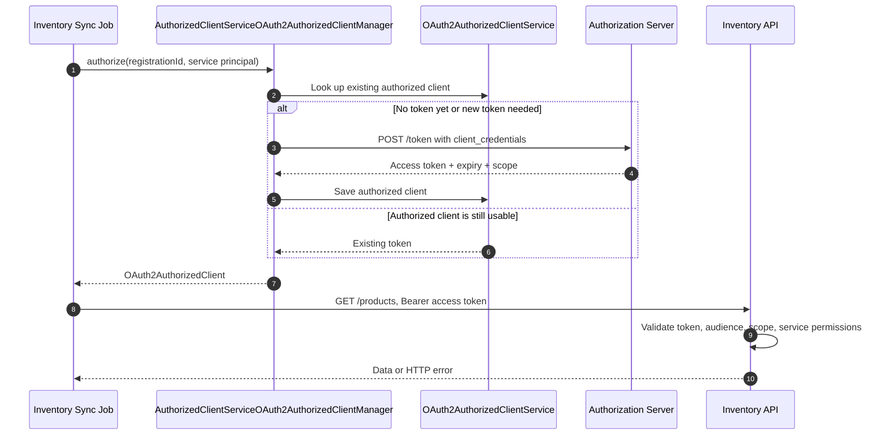

# 16.4. Obtaining an Authorized Client for a Backend Service

In **Spring Security OAuth 2.0/OIDC Client**, not every application serves a user logging in through a browser. A data sync task, queue worker, scheduled job, or backend service may need to call another API **using the identity and permissions of the service itself**.

For **machine-to-machine (M2M)** scenarios, OAuth 2.0 provides the **Client Credentials Grant**. The service authenticates with the Authorization Server (AS) using registered credentials, requests an access token with appropriate scopes, and uses that token when calling a Resource Server.

In Spring Security, the robust approach is not manually sending `POST /token` before every API call, but typically using:

- `ClientRegistrationRepository` to look up the OAuth client configuration.
- `OAuth2AuthorizedClientService` to store `OAuth2AuthorizedClient` by registration and technical principal.
- `OAuth2AuthorizedClientProvider` supporting `client_credentials`.
- **`AuthorizedClientServiceOAuth2AuthorizedClientManager`** to obtain new tokens when needed and reuse valid authorized clients.

Then the service calls:

```java
OAuth2AuthorizedClient authorizedClient =
    authorizedClientManager.authorize(authorizeRequest);
```

and uses `authorizedClient.getAccessToken()` to call the API.

**Key point:** the principal used for the Client Credentials Grant in `OAuth2AuthorizeRequest` is a **client-side context key**, not an OIDC logged-in user. Do not fabricate an `OidcUser` or use an ID Token for M2M calls.

## 1. Context: A Backend Service Needs an Access Token

Suppose a system consists of:

- `inventory-sync`: a Spring Boot scheduled worker that syncs products.
- `https://auth.example.org`: the Authorization Server.
- `https://inventory-api.example.org`: the Resource Server.
- The worker's OAuth client has `client_id=inventory-sync-prod` and a securely managed secret.
- The AS allows the client to request scope `inventory.read`.

The worker runs every few minutes to synchronize the catalog. It has no browser and no End-User signing in.



The diagram shows the conceptual logic; the actual implementation may check token conditions and storage in its own order. **There is no authorization redirect, callback, or interactive user consent step in each token request** of the Client Credentials Grant.

### 1.1. Appropriate Use Cases

| Scenario | End-User Present? | Typically Suitable Grant |
|---|---|---|
| Scheduled job calling Inventory API | No | `client_credentials` |
| Consumer fetching data from another service | No | `client_credentials` |
| Microservice calling an API using workload identity | No | `client_credentials` or an AS-supported workload identity mechanism |
| Spring MVC calling an API on behalf of a logged-in user | Yes | Authorization Code + user's access token |
| Offline batch processing needing a specific user's permissions | Design-dependent | Do not switch arbitrarily to `client_credentials`; requires valid delegation/on-behalf-of |
| Pure browser SPA | Yes | Authorization Code + PKCE, without embedding a client secret |

Client Credentials is only appropriate when the API allows a **client/workload** to perform the operation. It is not a way to bypass user authentication to access data that rightfully requires individual user authorization.

## 2. Access Token, `ClientRegistration`, and `OAuth2AuthorizedClient`

Three commonly confused objects:

### 2.1. `ClientRegistration`

`ClientRegistration` describes the client registered with the AS:

```text
registrationId         = inventory-worker
clientId               = inventory-sync-prod
clientSecret           = <server-side secret>
authorizationGrantType = client_credentials
tokenUri               = https://auth.example.org/oauth2/token
scopes                 = [inventory.read]
```

`registrationId` is the local name in Spring. `clientId` is the identifier issued by the AS to the application. The repository uses `registrationId` to look up configuration; do not mix up the two values.

### 2.2. `OAuth2AccessToken`

`OAuth2AccessToken` represents the token issued by the AS, with:

- `tokenValue`: sensitive bearer token.
- `tokenType`: typically `Bearer`.
- `issuedAt`: issuance timestamp.
- `expiresAt`: expiration timestamp.
- `scopes`: the set of scopes actually attached to the access token from the token response.

The scope declared in the registration is the **requested scope**, while `getScopes()` on the token reflects the **granted scopes** received by Spring. Do not assume they are always identical.

### 2.3. `OAuth2AuthorizedClient`

`OAuth2AuthorizedClient` binds a **`ClientRegistration`** to a **principal name** and the current **access token** (plus refresh token if present).

```text
OAuth2AuthorizedClient
  ClientRegistration: inventory-worker
  principalName: inventory-sync-service
  AccessToken:
    scopes: inventory.read
    expiresAt: ...
```

For `client_credentials`, there is typically **no refresh token**. When the access token is no longer usable, the manager uses the client credentials to request a **new access token** instead of relying on an End-User login session.

### 2.4. `OAuth2AuthorizedClientManager`

`OAuth2AuthorizedClientManager` coordinates:

1. Looking up the registration and saved authorized client.
2. Deciding whether authorization/re-authorization is needed and possible.
3. Calling the `clientCredentials()` provider to obtain a token when appropriate.
4. Saving the successful result.
5. Returning the current authorized client or signaling that authorization failed.

Not every call to `authorize(...)` sends a request to the AS. **Reusing a still-valid token** is one of the primary benefits of using the manager.

## 3. Why Should a Backend Service Use `AuthorizedClientServiceOAuth2AuthorizedClientManager`?

Spring Security provides multiple manager types.

| Component | Designed For | Authorized Client Storage Mechanism |
|---|---|---|
| `DefaultOAuth2AuthorizedClientManager` | Servlet request/response, e.g., MVC web app/BFF | `OAuth2AuthorizedClientRepository` |
| **`AuthorizedClientServiceOAuth2AuthorizedClientManager`** | Contexts outside requests: services, jobs, schedulers, message consumers | `OAuth2AuthorizedClientService` |
| `OAuth2AuthorizedClientManager` | Interface used by OAuth-calling code | Depends on implementation |

Scheduled jobs usually execute on threads without:

```java
HttpServletRequest
HttpServletResponse
SecurityContext containing a web-logged-in user
```

Therefore, using `DefaultOAuth2AuthorizedClientManager` and trying to look up an HTTP request inside a scheduler can fail or force unnecessary fake requests.

`AuthorizedClientServiceOAuth2AuthorizedClientManager` is designed to work with a **technical principal name** and a **Servlet-independent `OAuth2AuthorizedClientService`**.

### 3.1. No Need to Create a Fake User

You do not need to construct:

```java
UsernamePasswordAuthenticationToken("admin", ...)
```

to “impersonate” an employee. With the Client Credentials Grant, you can supply a stable principal name directly to `OAuth2AuthorizeRequest`:

```java
OAuth2AuthorizeRequest request =
    OAuth2AuthorizeRequest
        .withClientRegistrationId("inventory-worker")
        .principal("inventory-sync-service")
        .build();
```

The string `inventory-sync-service` is used by the manager/service to associate and look up the authorized client. **It is not used by the AS as an End-User identity just because you passed that string in Java.**

The AS performs client authentication using the client ID and credentials configured in the registration.

## 4. Building a Spring Boot Application Using Client Credentials

End-to-end example: a backend worker needs to obtain a token to call the Inventory API.

### 4.1. Dependencies

Gradle Groovy DSL:

```groovy
dependencies {
    implementation 'org.springframework.boot:spring-boot-starter'
    implementation 'org.springframework.boot:spring-boot-starter-oauth2-client'
    implementation 'org.springframework.boot:spring-boot-starter-web'
}
```

`spring-boot-starter-web` in this example provides the `RestClient` HTTP client integration and can support HTTP APIs if needed; **a pure background worker does not have to expose web endpoints** to use the Client Credentials Grant. Choose non-web dependencies as appropriate for your system.

If you only need a Scheduled Job, enable scheduling via `@EnableScheduling`. You do not need `oauth2Login()` or a browser-login `SecurityFilterChain` just to request tokens for a service.

### 4.2. `application.yml`

```yaml
spring:
  security:
    oauth2:
      client:
        registration:
          inventory-worker:
            provider: internal-as
            client-id: ${INVENTORY_CLIENT_ID}
            client-secret: ${INVENTORY_CLIENT_SECRET}
            client-authentication-method: client_secret_basic
            authorization-grant-type: client_credentials
            scope:
              - inventory.read
        provider:
          internal-as:
            token-uri: https://auth.example.org/oauth2/token
```

Explanation:

- `registration.inventory-worker`: name passed in code to `withClientRegistrationId("inventory-worker")`.
- `provider: internal-as`: links the registration to `provider.internal-as`.
- `client-id`, `client-secret`: **backend client** credentials, which must be stored securely.
- `client-authentication-method: client_secret_basic`: client authenticates at the Token Endpoint with HTTP Basic per AS policy.
- `authorization-grant-type: client_credentials`: no browser redirect or authorization code.
- `scope: inventory.read`: **requested** token scope, which the AS may restrict.
- `token-uri`: the AS endpoint receiving token requests.

This configuration **has no `redirect-uri`, `authorization-uri`, or `scope: openid`** because this is not user OIDC login. No ID token is needed to run scheduled synchronization.

### 4.3. Request to the Token Endpoint

When the manager needs to issue a token, the client sends a request such as:

```http
POST /oauth2/token HTTP/1.1
Host: auth.example.org
Authorization: Basic <client-credentials>
Content-Type: application/x-www-form-urlencoded
Accept: application/json

grant_type=client_credentials&scope=inventory.read
```

The Basic part contains the client ID/secret per HTTP Basic (properly encoded and protected by **TLS**), not a JWT access token. Another AS may require `client_secret_post`, `private_key_jwt`, or mTLS; the registration and token request client must be compatible.

Example token response:

```json
{
  "access_token": "<opaque-or-jwt-access-token>",
  "token_type": "Bearer",
  "expires_in": 1800,
  "scope": "inventory.read"
}
```

The access token may be an opaque string or a JWT. The OAuth client **does not need to decode a JWT itself to use the token**; it attaches the bearer credential to the request sent to the Resource Server. The API is responsible for verifying the token's issuer, audience, scope, and policy.

## 5. Creating an `OAuth2AuthorizedClientService`

`OAuth2AuthorizedClientService` manages authorized clients by client registration and principal name. Core operations:

```java
OAuth2AuthorizedClient loadAuthorizedClient(
    String clientRegistrationId,
    String principalName
);

void saveAuthorizedClient(
    OAuth2AuthorizedClient authorizedClient,
    Authentication principal
);

void removeAuthorizedClient(
    String clientRegistrationId,
    String principalName
);
```

You do not need to access the service directly every time you want a token; the manager uses the service internally.

### 5.1. In-Memory Example for Learning and Simple Environments

```java
import org.springframework.context.annotation.Bean;
import org.springframework.context.annotation.Configuration;
import org.springframework.security.oauth2.client.InMemoryOAuth2AuthorizedClientService;
import org.springframework.security.oauth2.client.OAuth2AuthorizedClientService;
import org.springframework.security.oauth2.client.registration.ClientRegistrationRepository;

@Configuration
public class AuthorizedClientStoreConfig {

    @Bean
    OAuth2AuthorizedClientService authorizedClientService(
            ClientRegistrationRepository registrations) {
        return new InMemoryOAuth2AuthorizedClientService(registrations);
    }
}
```

**Note:** Spring Boot/Spring Security may auto-configure an `OAuth2AuthorizedClientService` bean depending on your version and auto-configuration conditions. When a suitable service already exists, you do not have to create the bean above. If creating one manually, avoid duplicate beans and be clear which implementation the manager uses.

Advantage of in-memory: simple, well-suited for demos or a single small instance.

Limitations:

- Token cache is lost after a process restart.
- Each instance maintains its own cache and may call the Token Endpoint repeatedly.
- Provides no token persistence or synchronization across a cluster.
- Compliance requirements regarding encryption, access control, and token storage must be considered when moving to other storage backends.

### 5.2. When Persistence Is Required

You can use `JdbcOAuth2AuthorizedClientService` or a custom implementation backed by a DB/distributed store, depending on your Spring Security version and system requirements.

What must be protected:

- Stored access tokens and credentials.
- Principal keys, registration IDs, and their mapping.
- Token deletion/expiration cleanup policies.
- DB read/write permissions.
- Encryption at rest and TLS in transit.
- Concurrency when multiple instances fetch/issue tokens simultaneously.

Never dump the entire `OAuth2AuthorizedClient` into logs or expose it in a JSON response because it may contain sensitive tokens.

## 6. Configuring `AuthorizedClientServiceOAuth2AuthorizedClientManager`

This is the most important class in this lesson.

```java
import org.springframework.context.annotation.Bean;
import org.springframework.context.annotation.Configuration;
import org.springframework.security.oauth2.client.AuthorizedClientServiceOAuth2AuthorizedClientManager;
import org.springframework.security.oauth2.client.OAuth2AuthorizedClientManager;
import org.springframework.security.oauth2.client.OAuth2AuthorizedClientProvider;
import org.springframework.security.oauth2.client.OAuth2AuthorizedClientProviderBuilder;
import org.springframework.security.oauth2.client.OAuth2AuthorizedClientService;
import org.springframework.security.oauth2.client.registration.ClientRegistrationRepository;

@Configuration
public class BackendOAuthManagerConfig {

    @Bean
    OAuth2AuthorizedClientManager backendAuthorizedClientManager(
            ClientRegistrationRepository registrations,
            OAuth2AuthorizedClientService authorizedClientService) {

        OAuth2AuthorizedClientProvider provider =
            OAuth2AuthorizedClientProviderBuilder.builder()
                .clientCredentials()
                .build();

        var manager = new AuthorizedClientServiceOAuth2AuthorizedClientManager(
            registrations,
            authorizedClientService
        );

        manager.setAuthorizedClientProvider(provider);
        return manager;
    }
}
```

Main collaborators:

| Component | Source | Role |
|---|---|---|
| `registrations` | Spring Boot client registration or custom repository | Knows `client_id`, `token_uri`, grant, and scope |
| `authorizedClientService` | InMemory/JDBC/custom | Stores tokens by registration and principal |
| `provider` | `OAuth2AuthorizedClientProviderBuilder` | Executes the `client_credentials` grant when needed |
| `manager` | `AuthorizedClientServiceOAuth2AuthorizedClientManager` | Coordinates obtaining and reusing tokens |

**Because only backend Client Credentials are needed, the provider chain enables only `clientCredentials()`.** There is no need to configure `authorizationCode()`, `refreshToken()`, or `password()` to obtain worker tokens.

A registration with grant type `authorization_code` will not automatically turn into `client_credentials` just because the provider chain supports it. The grant type must match the client configuration and AS permissions.

### 6.1. Bean Names and Multiple Managers

If a system has both MVC web login and background jobs, **two `OAuth2AuthorizedClientManager` beans** may coexist:

- A Servlet manager for user requests/sessions.
- A service manager for scheduled workers.

When injecting, specify a clear bean name:

```java
@Qualifier("backendAuthorizedClientManager")
OAuth2AuthorizedClientManager manager
```

Do not let a scheduler accidentally inject `DefaultOAuth2AuthorizedClientManager`, as it expects a Servlet request context. And do not use a service manager with a shared principal to manage tokens representing individual human users without proper identity isolation.

## 7. Obtaining an Authorized Client from a Backend Service

### 7.1. Building an `OAuth2AuthorizeRequest`

In the service, use the exact `registrationId` and a stable technical principal name.

```java
import org.springframework.security.oauth2.client.OAuth2AuthorizeRequest;

OAuth2AuthorizeRequest authorizeRequest =
    OAuth2AuthorizeRequest
        .withClientRegistrationId("inventory-worker")
        .principal("inventory-sync-service")
        .build();
```

- `inventory-worker`: looks up the registration declared in YAML.
- `inventory-sync-service`: principal key used to store/retrieve the authorized client.
- No `HttpServletRequest` or End-User.
- No manual construction of HTTP Basic headers; the default token response client handles it per `ClientRegistration`.

### 7.2. Calling `manager.authorize()`

```java
import org.springframework.security.oauth2.client.OAuth2AuthorizedClient;

OAuth2AuthorizedClient authorizedClient =
    backendAuthorizedClientManager.authorize(authorizeRequest);

if (authorizedClient == null) {
    throw new IllegalStateException(
        "Cannot authorize OAuth client inventory-worker");
}
```

A `null` result can occur when the provider cannot authorize within the current context/grant type; depending on the failure, the manager may also throw `ClientAuthorizationException` or another appropriate exception. Never assume every call returns a token.

**Never print `authorizedClient.getAccessToken().getTokenValue()` to logs** for debugging. That value is a bearer credential; anyone holding the token can use it until it expires or is revoked, within whatever scope the AS/API allows.

### 7.3. Wrapping It in an Injectable Service

```java
import org.springframework.beans.factory.annotation.Qualifier;
import org.springframework.security.oauth2.client.OAuth2AuthorizeRequest;
import org.springframework.security.oauth2.client.OAuth2AuthorizedClient;
import org.springframework.security.oauth2.client.OAuth2AuthorizedClientManager;
import org.springframework.stereotype.Service;

@Service
public class InventoryAccessTokenService {

    private static final String REGISTRATION_ID = "inventory-worker";
    private static final String SERVICE_PRINCIPAL = "inventory-sync-service";

    private final OAuth2AuthorizedClientManager manager;

    public InventoryAccessTokenService(
            @Qualifier("backendAuthorizedClientManager")
            OAuth2AuthorizedClientManager manager) {
        this.manager = manager;
    }

    public OAuth2AuthorizedClient currentAuthorizedClient() {
        OAuth2AuthorizeRequest request =
            OAuth2AuthorizeRequest
                .withClientRegistrationId(REGISTRATION_ID)
                .principal(SERVICE_PRINCIPAL)
                .build();

        OAuth2AuthorizedClient authorizedClient =
            manager.authorize(request);

        if (authorizedClient == null) {
            throw new IllegalStateException(
                "No authorized client for " + REGISTRATION_ID
            );
        }

        return authorizedClient;
    }

    public String currentAccessTokenValue() {
        return currentAuthorizedClient()
            .getAccessToken()
            .getTokenValue();
    }
}
```

The `currentAccessTokenValue()` method is used **only inside the backend** to set the header of outgoing HTTP requests. Never expose this method through a public controller or include its value in logs/traces.

Another design option is returning the `OAuth2AuthorizedClient` itself so callers can inspect scopes/expiry and decide how to use the token; this still requires callers to protect the token like a secret.

## 8. Using the Token to Call a Resource Server

### 8.1. Simple HTTP Client Service Using `RestClient`

Suppose the target API is `https://inventory-api.example.org`.

```java
import org.springframework.stereotype.Service;
import org.springframework.web.client.RestClient;

@Service
public class InventoryApiClient {

    private final InventoryAccessTokenService tokens;
    private final RestClient restClient;

    public InventoryApiClient(InventoryAccessTokenService tokens) {
        this.tokens = tokens;
        this.restClient = RestClient.builder()
            .baseUrl("https://inventory-api.example.org")
            .build();
    }

    public String fetchProducts() {
        String accessToken = tokens.currentAccessTokenValue();

        return restClient.get()
            .uri("/api/products")
            .headers(headers -> headers.setBearerAuth(accessToken))
            .retrieve()
            .body(String.class);
    }
}
```

Benefits of this pattern for learning:

- The manager handles the token lifecycle.
- The service simply calls the target API and sends the bearer credential.
- The API URL is fixed in the backend, not taken from user input.
- The token is never returned to the frontend.

**Version note:** `RestClient` is a Spring Framework 6.1+ API in the corresponding Spring Boot ecosystem. Projects on older versions can use `WebClient` or `RestTemplate` with suitable integration while applying the exact same manager/authorized client principles.

### 8.2. The API Is Responsible for Validating the Token

The Inventory API must verify:

- The access token is valid (JWT signature or introspection for opaque tokens).
- `iss` matches a trusted Authorization Server.
- `aud` or resource binding matches the Inventory API when required by the token/profile.
- The token is unexpired and unrevoked per policy.
- Scope `inventory.read` is present for read operations.
- Workload or tenant permissions/policies if the API further restricts data.

The manager **does not guarantee the API must accept the token**. Token acquisition can succeed while the API still returns `401` (invalid token/wrong audience) or `403` (missing permission/scope).

### 8.3. Do Not Send an ID Token to an API

The Client Credentials Grant normally issues only an access token, not an OIDC ID token for an End-User.

Wrong example:

```http
Authorization: Bearer <some-oidc-id-token>
```

APIs must receive an **access token intended for the Resource Server**; never substitute an ID token as a credential just because it happens to be a JWT.

## 9. Running in a Scheduled Job or Message Consumer

### 9.1. Scheduled Job

```java
import org.springframework.scheduling.annotation.Scheduled;
import org.springframework.stereotype.Component;

@Component
public class InventorySyncJob {

    private final InventoryApiClient inventoryApi;

    public InventorySyncJob(InventoryApiClient inventoryApi) {
        this.inventoryApi = inventoryApi;
    }

    @Scheduled(fixedDelayString = "PT5M")
    public void synchronize() {
        String payload = inventoryApi.fetchProducts();
        // Parse payload and sync data per business logic.
        // Never log the access token or full sensitive payload.
    }
}
```

Enable scheduling:

```java
import org.springframework.context.annotation.Configuration;
import org.springframework.scheduling.annotation.EnableScheduling;

@Configuration
@EnableScheduling
public class SchedulingConfig {
}
```

`fixedDelayString = "PT5M"` illustrates a 5-minute delay between runs using Duration parsing supported by the corresponding Spring version. You can use a property placeholder or millisecond `fixedDelay` depending on version and needs.

The job **does not need** a browser session or an End-User to obtain an access token. When it runs, `InventoryApiClient` calls `InventoryAccessTokenService`, and the manager reuses an existing token or requests a new one.

### 9.2. Message Consumer

A Kafka/RabbitMQ listener processing messages can also use the same `InventoryApiClient`. However:

- Never take the OAuth principal from an arbitrary field in the message.
- Never let the message decide `tokenUri` or `clientSecret`.
- Select the registration from trusted configuration.
- When processing multiple tenants, define workload/tenant policies and isolate tokens when necessary.

If a message represents an operation requiring individual user authorization, a Client Credentials token **does not carry that user's permissions**. An appropriate delegation or business authorization check is needed.

## 10. How Is the Authorized Client Reused and Renewed?

The `clientCredentials()` provider manages token retrieval on demand. Conceptually:

```text
authorize(request)
  |
  +-- Authorized client exists and token does not need re-issuance?
  |       |
  |       +-- Yes -> continue using that authorized client
  |
  +-- No token yet, or token expired/about to expire?
          |
          +-- Send client_credentials token request
          +-- Receive new access token
          +-- Save new authorized client
          +-- Return client to caller
```

There is no requirement that **every API request must call the Token Endpoint**. Caching/reusing tokens reduces latency, limits load on the AS, and avoids exceeding token issuance rate limits.

### 10.1. Do Not Require a Refresh Token

In the standard Client Credentials Grant, the AS normally does not issue a refresh token; the backend already holds the OAuth client's own credentials to request a new access token. **Do not configure `refreshToken()` expecting it to be the sole renewal mechanism for `client_credentials` tokens.**

If a specialized AS issues refresh tokens for this grant, inspect the AS contract and policy rather than assuming it is standard behavior.

### 10.2. Clock Skew

Tokens carry `expiresAt`, yet clocks across the app, AS, and API can drift, or a token may be close to expiring when a request reaches the API. Spring Security's client credentials provider includes a **clock skew** mechanism to proactively treat near-expiry tokens as needing re-issuance.

API example for compatible Spring Security versions:

```java
import java.time.Duration;
import org.springframework.security.oauth2.client.OAuth2AuthorizedClientProviderBuilder;

var provider = OAuth2AuthorizedClientProviderBuilder.builder()
    .clientCredentials(config -> config
        .clockSkew(Duration.ofSeconds(60)))
    .build();
```

This configuration is illustrative and must match your dependency version. Clock skew does not replace NTP/clock synchronization, and setting too large a value can increase token requests.

### 10.3. If a Token Expires Between Retrieval and Calling the API

The manager may return a token considered valid at authorize time, yet it could expire just as the API receives the request if the call is delayed. Therefore:

- Configure a reasonable clock skew.
- Bound request timeouts and batch durations.
- Handle `401` responses from the API according to a safe policy.
- Never retry infinitely with the same bearer token.
- When appropriate, allow fetching a fresh token via the manager and performing a **single bounded retry** for idempotent/safe operations.

Never parse the JWT to alter `exp` or extend the token lifetime yourself. Expiration is an assertion signed by the AS, not mutable client data.

## 11. Technical Principal Name and Caching

### 11.1. Why Does the Authorize Request Still Have a Principal?

Even without an End-User, `OAuth2AuthorizedClientService` still uses the principal name to store and look up the authorized client.

Example:

```text
(registrationId="inventory-worker", principalName="inventory-sync-service")
    -> authorized client with token A

(registrationId="billing-worker", principalName="billing-service")
    -> authorized client with token B
```

The principal name is a **logical storage key**, not the `sub` of an OIDC ID token. It does not determine whether the AS issues a token. Client authentication remains based on `client_id` and the registered authentication method.

### 11.2. Use a Stable Principal to Reuse Tokens

If each call creates:

```java
.principal("sync-" + UUID.randomUUID())
```

the authorized client service treats each call as a new principal, failing to find the previous token and requesting unnecessary new tokens.

Using a stable principal name per workload/registration allows the manager to locate and reuse the authorized client.

However, **do not share the same principal across contexts that need isolation** if a registration/token has different boundaries across tenants or jobs. In multi-tenant systems, design keys and client registrations/credentials so tokens are never mixed up.

### 11.3. Never Take Principal Name from Untrusted Input

An API request or message might contain:

```json
{"principal": "admin-service"}
```

Never pass that value straight into `OAuth2AuthorizeRequest.principal(...)`, letting an external source pick the storage token key. The technical principal must be determined by trusted configuration and policy.

If multiple workloads exist, map from a validated task code to an authorized principal/registration. Never let an incoming message choose a higher-privileged workload's token.

## 12. Multiple Registrations for Multiple Backend APIs

One service may call two Resource Servers with distinct scopes and client identities:

```yaml
spring:
  security:
    oauth2:
      client:
        registration:
          inventory-worker:
            provider: internal-as
            client-id: ${INVENTORY_CLIENT_ID}
            client-secret: ${INVENTORY_CLIENT_SECRET}
            client-authentication-method: client_secret_basic
            authorization-grant-type: client_credentials
            scope:
              - inventory.read

          billing-worker:
            provider: internal-as
            client-id: ${BILLING_CLIENT_ID}
            client-secret: ${BILLING_CLIENT_SECRET}
            client-authentication-method: client_secret_basic
            authorization-grant-type: client_credentials
            scope:
              - billing.write

        provider:
          internal-as:
            token-uri: https://auth.example.org/oauth2/token
```

In code:

```java
OAuth2AuthorizeRequest inventoryRequest =
    OAuth2AuthorizeRequest.withClientRegistrationId("inventory-worker")
        .principal("inventory-sync-service")
        .build();

OAuth2AuthorizeRequest billingRequest =
    OAuth2AuthorizeRequest.withClientRegistrationId("billing-worker")
        .principal("billing-settlement-service")
        .build();
```

Benefits of separating registrations:

- Separate credentials per task.
- Minimum required scopes per API.
- Ability to rotate/revoke one client without disrupting others.
- Easier differentiation of metrics and errors.
- Reduced risk of sending API A's token to API B.

Do not use a single client with `*.*` scopes for every function just to reduce configuration lines. **Least privilege** fits M2M systems especially well because workers run continuously and execute many automated requests.

### 12.1. Resource Indicator and Audience

Some AS implementations use `resource` per RFC 8707 or a custom `audience` extension to identify the target API. In those cases, scope alone may not be enough.

For example, the Token Endpoint expects:

```text
grant_type=client_credentials
scope=inventory.read
resource=https://inventory-api.example.org
```

This extension parameter must be configured on the **token request client**, not arbitrarily appended to API URLs or taken from a browser. In Spring Security versions supporting `RestClientClientCredentialsTokenResponseClient`, you can add parameters per registration:

```java
import org.springframework.security.oauth2.client.endpoint.RestClientClientCredentialsTokenResponseClient;
import org.springframework.util.LinkedMultiValueMap;

var tokenClient = new RestClientClientCredentialsTokenResponseClient();

tokenClient.addParametersConverter(grantRequest -> {
    var extra = new LinkedMultiValueMap<String, String>();

    if ("inventory-worker".equals(
            grantRequest.getClientRegistration().getRegistrationId())) {
        extra.add("resource", "https://inventory-api.example.org");
    }

    return extra;
});
```

Then attach the token client to the `clientCredentials(...)` provider:

```java
var provider = OAuth2AuthorizedClientProviderBuilder.builder()
    .clientCredentials(config -> config
        .accessTokenResponseClient(tokenClient))
    .build();
```

**Compatibility note:** These `RestClient...` APIs and token response client customizations depend on the Spring Security version (6.4+ introduced the new RestClient APIs). Older versions have corresponding alternative implementations. Do not send `resource` if the AS does not support it; follow the actual integration contract.

### 12.2. Do Not Use Scope to Infer User Permissions

The `billing.write` scope granted to a worker only indicates the token may ask the Billing API to perform the corresponding action within policy. It does not prove a human employee is authorized to approve invoices. For tasks on behalf of a user, a separate user authorization system or proper delegation mechanism is required.

## 13. Handling Cases When `authorize()` Does Not Return an Authorized Client

### 13.1. `null` Return Value

`OAuth2AuthorizedClientManager.authorize(...)` can return `null` if the provider cannot authorize for the current registration/authorization context.

For example:

- No matching registration or grant configuration mismatch.
- The provider chain does not include `clientCredentials()` for that registration.
- Another grant requires data absent from the current request.

Check explicitly from the start:

```java
OAuth2AuthorizedClient client = manager.authorize(request);

if (client == null) {
    throw new IllegalStateException(
        "Authorized client unavailable for inventory-worker");
}
```

In production applications, throw a clear operational/business exception so the caller knows **it cannot call the API**. Never call the API with an empty token.

### 13.2. Authorization Exceptions

If the Token Endpoint returns an error, the manager may propagate exceptions such as `ClientAuthorizationException` or OAuth2 authorization errors. Common errors:

| Error | Possible Cause | Resolution |
|---|---|---|
| `invalid_client` | Wrong Client ID/secret, wrong auth method, client disabled | Check AS registration and secret rotation |
| `unauthorized_client` | Client is not permitted to use `client_credentials` grant | Enable grant permission at the AS |
| `invalid_scope` | Scope disallowed or misspelled | Check allowed scopes and API contract |
| `unsupported_grant_type` | AS does not support the grant | Check token endpoint and AS configuration |
| `invalid_request` | Token request form missing/invalid parameters | Review token request customization |
| HTTP `429` | AS rate limit hit | Optimize token reuse, apply bounded backoff |
| HTTP `5xx` | Temporary AS failure | Careful retry, circuit breaker if appropriate |
| TLS/DNS timeout | Backend cannot reach Token Endpoint | Check egress, DNS, proxy, truststore |

Do not catch all exceptions and continue with a stale expired token. Establish an explicit policy on whether an unexpired cached token may be used. Never log client secrets or raw HTTP Basic headers during investigation.

### 13.3. API Errors Differ from Token Endpoint Errors

Two distinct situations:

```text
Case A:
  manager.authorize(...) -> error invalid_client
  => Token Endpoint rejected the OAuth client.

Case B:
  manager.authorize(...) -> OAuth2AuthorizedClient
  GET inventory API -> 403
  => Token was issued, but the API rejected it due to scope/policy.
```

If you get `403` from the API, do not blindly rotate the client secret. Inspect the audience, granted scopes, and API permissions.

## 14. Token Caching, Multiple Instances, and Concurrency

### 14.1. Single Instance

With `InMemoryOAuth2AuthorizedClientService`:

```text
Worker instance A:
  (inventory-worker, inventory-sync-service)
     -> access token A
```

The same instance reuses the token, reducing calls to the AS. After a restart, the cache is cleared and the worker requests a new token as needed.

### 14.2. Multiple Instances

With three replicas:

```text
Instance A -> caches token A
Instance B -> caches token B
Instance C -> caches token C
```

This may be acceptable if the AS permits multiple tokens and load is modest. If you need to share tokens or limit token issuance, use a persistent/distributed authorized client service.

However, sharing tokens introduces security and concurrency requirements: two instances noticing a nearly expired token may both send token requests simultaneously. The `Client Credentials Grant` generally allows issuing new tokens repeatedly, though rate limits and operational costs still apply.

### 14.3. Do Not Assume the Manager Solves Every Race Condition

The manager executes its lifecycle per its contract, but it does not necessarily provide a cluster-wide **distributed lock**. Under high load, consider:

- Appropriate token TTL and clock skew.
- Suitable caching/persistence.
- Rate limiting and backoff.
- Strategies to prevent cache stampedes.
- Avoiding excessive concurrent retries when the AS is failing.
- Metrics on token re-issuance count and errors.

Never cache a bearer token in an eternal `static String` variable and ignore `expiresAt`. The whole point of using the manager is to avoid homegrown, error-prone access token lifecycle management.

## 15. Difference Between Client Credentials and Refresh Tokens

A common misconception: “For a backend to use tokens continuously over a long period, it must have a refresh token.”

With the **Client Credentials Grant**, the backend already possesses the OAuth client's own credentials to request a new token:

```text
Token expired
   |
   v
Client authenticates again at /token
   |
   v
AS issues new access token
```

By contrast, the **Authorization Code Grant** may issue a refresh token so the app can obtain new access tokens without prompting the user to interact again, per OP policy.

| Criterion | Client Credentials | Authorization Code + Refresh |
|---|---|---|
| Primary subject | Workload/client | User-delegated authorization |
| Browser/End-User in token flow? | No | Yes, during the initial authorization step |
| How token is re-obtained on expiry | Perform a new `client_credentials` request | Use the refresh token if issued and still valid |
| Is refresh token usually present? | No | May be present |
| Has OIDC ID Token to identify End-User? | No | Yes, if using OIDC Login |
| Suitable manager outside requests | Service manager | Context- and storage-dependent; not a workload default |

Do not use `client_credentials` to claim a user's identity simply because the client has data access. If the API requires user delegation, use a proper flow or token exchange/OBO supported by both the AS and the API.

## 16. Protecting Client Secrets and Access Tokens

### 16.1. Client Secrets Are Only for Trusted Backends

In the YAML example:

```yaml
client-secret: ${INVENTORY_CLIENT_SECRET}
```

Real secrets should be injected via a secret manager, controlled environment injection, or secured configuration mechanism. Never hard-code production secrets in source code or commit them to a repository.

If an application is packaged as a desktop, mobile, or browser client, never treat secrets embedded in binaries or JavaScript as confidential. Those clients need appropriate public client flows, not `client_secret_basic` in frontend code.

### 16.2. Do Not Output Tokens to Logs or Responses

Values to avoid exposing:

```text
client_secret=<secret>
Authorization: Basic <base64-credentials>
Authorization: Bearer <access-token>
access_token=<token>
refresh_token=<token>
```

Safer telemetry example:

```text
event=client_credentials_authorization
registrationId=inventory-worker
principalKey=inventory-sync-service
grantType=client_credentials
outcome=success
grantedScopes=[inventory.read]
expiresInSeconds=<duration>
```

Even principal keys and scopes can be internal metadata; apply appropriate retention and logging policies. Do not log `OAuth2AuthorizedClient.toString()` unless you know for certain it does not expose credentials.

### 16.3. Never Send Bearer Tokens to Externally Controlled URLs

Dangerous example:

```java
// UNSAFE if apiUrl is controlled by a browser or message
restClient.get()
    .uri(apiUrl)
    .headers(h -> h.setBearerAuth(accessToken))
    .retrieve();
```

If `apiUrl` points to an attacker's server, the credential is exfiltrated. Use dedicated clients with fixed base URLs and strict redirect/host controls.

If an HTTP client follows redirects automatically, check whether it forwards the `Authorization` header to another hostname. Never rely on assuming “the library probably strips the header” without verifying configuration.

### 16.4. HTTPS and Outbound Trust Boundaries

Both the Token Endpoint and Resource Server must be called over properly secured connections:

- TLS with certificate and hostname validation.
- Strict DNS and egress policies.
- Trusted proxies when required.
- Bounded timeouts and retries.
- Never allow user-supplied data to determine `token-uri`.

An OAuth client holding a client secret that gets steered toward an untrusted token endpoint can leak its credentials. Thus `ClientRegistration` and `provider.token-uri` belong strictly inside the server's trust boundary.

## 17. API Authorization When Tokens Represent a Workload

In M2M calls, the API receives a token representing a **client/workload identity**. It may contain JWT claims such as:

```json
{
  "iss": "https://auth.example.org",
  "aud": "inventory-api",
  "client_id": "inventory-sync-prod",
  "scope": "inventory.read",
  "exp": 1924999999
}
```

This is an **example access token profile**; not every AS uses the `client_id` claim name or issues JWTs.

The Inventory API must decide:

- Was the token issued by a trusted AS?
- Is the token intended for the Inventory API?
- Are the scopes sufficient for the endpoint?
- Which client is calling?
- Which tenant/organizational unit's data may that client access?
- Can the service read all products or only a subset?

In a Spring JWT Resource Server, the default `JwtGrantedAuthoritiesConverter` typically maps scopes to `SCOPE_...` authorities. For example:

```java
http.authorizeHttpRequests(auth -> auth
    .requestMatchers(HttpMethod.GET, "/api/products/**")
        .hasAuthority("SCOPE_inventory.read")
    .anyRequest().authenticated()
).oauth2ResourceServer(resource -> resource.jwt(
    org.springframework.security.config.Customizer.withDefaults()
));
```

This is an illustrative API snippet assuming `HttpSecurity`/`HttpMethod` are imported and the API has configured its JWT decoder/issuer. **Beyond scopes**, the Resource Server must verify audience and appropriate workload authorization.

Never treat the scopes on a Client Credentials token as permissions of a logged-in human user. They are permissions/scopes granted by the AS to the **client** within this grant context.

## 18. Customizing the Token Response Client for Client Credentials

Some Authorization Servers require custom form parameters when issuing M2M tokens, such as `resource` per RFC 8707.

In Spring Security versions supporting `RestClientClientCredentialsTokenResponseClient`:

```java
import org.springframework.security.oauth2.client.endpoint.RestClientClientCredentialsTokenResponseClient;
import org.springframework.util.LinkedMultiValueMap;

var tokenClient = new RestClientClientCredentialsTokenResponseClient();

tokenClient.addParametersConverter(grantRequest -> {
    var parameters = new LinkedMultiValueMap<String, String>();
    parameters.add("resource", "https://inventory-api.example.org");
    return parameters;
});
```

Attach it to the provider:

```java
var provider = OAuth2AuthorizedClientProviderBuilder.builder()
    .clientCredentials(config ->
        config.accessTokenResponseClient(tokenClient))
    .build();

manager.setAuthorizedClientProvider(provider);
```

Keep the standard fields intact:

```text
grant_type=client_credentials
client authentication
optional scope
```

Do not replace the entire converter just to add `resource`. When calling an AS with multiple registrations, scope custom parameters to the specific registration/AS rather than applying them indiscriminately to every provider.

**Difference between parameters and scopes:** a token with scope `inventory.read` does not automatically carry audience `inventory-api`. Depending on the AS, sending `resource` at the Token Endpoint establishes the audience binding; the API must still validate it independently.

## 19. Testing and Operational Observability

STEP 4 focuses on authoring the content; when building a real system, design functional test scenarios before deployment.

### 19.1. Scenarios to Consider

| Scenario | Expectation for the Manager |
|---|---|
| No authorized client yet | Provider sends `client_credentials` grant to fetch a token |
| Access token still valid | Reuses token; avoids unnecessary requests |
| Token near expiration | May request a new token per expiration/clock skew |
| Wrong client secret | Receives client authentication error; no usable token |
| AS rejects scope | Receives OAuth error; never pretends the scope was granted |
| AS temporarily down | Returns controlled error; no infinite retries |
| API returns 401 | Distinguish token/audience/revocation failure from AS issuance failure |
| API returns 403 | Insufficient scope or workload/resource permissions |
| Multiple jobs calling concurrently | Do not mix principals/registrations and control concurrency |
| Multiple instances | Evaluate caching, rate limits, and persistence |
| Credential rotation | Roll out new secret consistently across instances |
| Token response missing required fields | Do not accept an invalid token as success |

### 19.2. Tracking Issuance Separately from API Calls

Two helpful metrics:

```text
oauth_client_token_authorizations_total{
  registrationId="inventory-worker",
  outcome="success"
}

inventory_api_requests_total{
  operation="fetch-products",
  status="200"
}
```

Obtaining a token successfully does not guarantee the API call succeeds. If the API returns 403, look at audience/scope or API permissions; if the token request returns `invalid_client`, inspect the client registration and AS.

### 19.3. Token Reuse and Latency Measurement

If every API request triggers a token request, check whether:

- The principal key changes randomly.
- `OAuth2AuthorizedClientService` is being recreated on every call.
- The manager bean is a stably injected singleton.
- Token TTL is too short or clock skew is set too high.
- Multiple registrations are being swapped across calls.
- Multiple instances maintain separate local caches.

Optimize caching only after understanding the security boundaries. Reusing tokens must never lead to sharing tokens across unauthorized workloads or tenants.

## 20. Common Anti-Patterns

### 20.1. Manually Calling the Token Endpoint Before Every API Request

```java
// Bad idea: manually POSTing /token and parsing the response every time
String token = requestNewTokenByHand();
callInventoryApi(token);
```

Problems: duplicated code, poor expiry/caching management, higher risk of secret exposure, potential rate-limit breaches, and awkward standard OAuth error handling. Unless there is a compelling reason, the manager simplifies the token lifecycle.

### 20.2. Using the Servlet Manager in a Scheduled Job

```java
// Unsuitable when the scheduled job has no HttpServletRequest
DefaultOAuth2AuthorizedClientManager manager = ...;
```

Replace it with `AuthorizedClientServiceOAuth2AuthorizedClientManager` backed by `OAuth2AuthorizedClientService` when running outside a Servlet request.

### 20.3. Using a User Session Token for a Shared Workload

A scheduled worker must never grab the most recently logged-in employee's access token and reuse it to call APIs. That couples the job to that user's permissions/session and can result in unauthorized subject access.

Use a dedicated `client_credentials` registration with least-privilege workload permissions.

### 20.4. Using a Random Principal Name

```java
.principal(java.util.UUID.randomUUID().toString())
```

A different key on every call prevents authorized client reuse and creates unnecessary token records. Use a stable technical principal per policy.

### 20.5. Caching Tokens in a Permanent Static Variable

```java
private static String ACCESS_TOKEN;
```

Using a static field as a “cache” without managing expiry, rotation, and isolation leads to failures. The authorized client manager/service is the proper abstraction.

### 20.6. Accepting Any Scope Because the Token Has a Valid Signature

Signature/issuer validation proves the token came from a trusted source, yet the API still needs audience, expiry, scope, and client/resource authorization checks. Never disable validation just to make M2M “work easily.”

### 20.7. Attaching Tokens to URLs Supplied by Messages

A queue message containing `destination=https://external.example` must never become a target URL receiving an internal service's access token. Keep host policies enforced on the backend.

### 20.8. Assuming Client Credentials Has an ID Token and Refresh Token

Do not use `OidcUser`, `openid`, authorization code callbacks, or user refresh-token lifecycles to model M2M. The Client Credentials Grant has a different protocol and subject.

## 21. Advanced Scenario: A Single Service Handling Both Web Requests and Background Jobs

A Spring Boot application may both:

- Serve a web UI where users sign in via OIDC.
- Run scheduled jobs that call APIs using workload credentials.

In that case, **clearly separate the two groups of authorized clients**:

```text
Web user login:
  ClientRegistration = company-oidc
  OAuth2 Login = Authorization Code + OIDC
  Principal = authenticated user
  Authorized client = user-delegated access token
  Manager = Servlet manager during request handling

Background worker:
  ClientRegistration = inventory-worker
  Grant = client_credentials
  Principal = service identity key
  Authorized client = workload access token
  Manager = service manager outside requests
```

Example of explicit manager injection:

```java
public InventorySyncJob(
        @Qualifier("backendAuthorizedClientManager")
        OAuth2AuthorizedClientManager manager) {
    this.manager = manager;
}
```

For the MVC web flow, a separate manager bean can be `DefaultOAuth2AuthorizedClientManager`. Avoid configuring a single shared manager and letting a scheduled job try to extract a principal from `SecurityContextHolder`: schedulers have no user login context by default.

Each registration needs least-privilege scopes/credentials matching its purpose. Do not reuse the web app's `company-oidc` client for M2M tasks just because it also happens to have a client secret.

## 22. Intentional Implementation Workflow

When building a backend service using Client Credentials with Spring Security:

1. **Confirm it is truly workload access.** If the API requires End-User permissions, do not arbitrarily switch to Client Credentials.
2. **Register a confidential client at the AS** with the `client_credentials` grant, appropriate scopes, and resource/audience.
3. **Store client credentials securely**, separated by environment and service.
4. **Declare `ClientRegistration`** under `spring.security.oauth2.client.registration.*` with the right `token-uri`/provider and auth method.
5. **Choose `OAuth2AuthorizedClientService`** according to runtime scope: in-memory, JDBC, or an appropriate custom store.
6. **Create `AuthorizedClientServiceOAuth2AuthorizedClientManager`** for tasks without a Servlet request.
7. **Configure `OAuth2AuthorizedClientProviderBuilder.builder().clientCredentials()`**; add custom token clients/parameters only when required by the AS.
8. **Use a stable technical principal name** and the exact registration ID in `OAuth2AuthorizeRequest`.
9. **Call `authorize(...)`** before obtaining the token, handling `null` and exceptions intentionally.
10. **Send bearer tokens only to trusted Resource Servers**, avoiding dynamic hosts and token logging.
11. **Validate the access token at the API** (issuer, audience, expiry, scope, and workload permissions).
12. **Manage expiration, concurrency, and rotation** when running multiple instances or persisting tokens long-term.
13. **Separate AS errors from API errors** for accurate handling and observability.

**Remember:** With the **Client Credentials Grant**, a backend service does not need a logged-in user to obtain an access token. In Spring Security, **`AuthorizedClientServiceOAuth2AuthorizedClientManager`** coordinates the registration, the authorized client service, and the client-credentials provider to obtain and reuse tokens. The caller supplies the **registration ID** and a **stable technical principal**, then uses the access token to call trusted APIs. Token validation and resource access enforcement remain the responsibility of the **Resource Server**.

## 23. References

- [RFC 6749 — OAuth 2.0 Authorization Framework](https://www.rfc-editor.org/rfc/rfc6749): Client Credentials Grant, token endpoint, scopes, and access tokens.
- [RFC 9700 — Best Current Practice for OAuth 2.0 Security](https://www.rfc-editor.org/rfc/rfc9700): recommendations for protecting tokens and client credentials.
- [RFC 8707 — Resource Indicators for OAuth 2.0](https://www.rfc-editor.org/rfc/rfc8707): resource and audience binding.
- [RFC 9068 — JWT Profile for OAuth 2.0 Access Tokens](https://www.rfc-editor.org/rfc/rfc9068): JWT access token profile, claims, and validation.
- [Spring Security — OAuth 2.0 Client](https://docs.spring.io/spring-security/reference/servlet/oauth2/client/index.html): `OAuth2AuthorizedClientManager`, `OAuth2AuthorizedClientService`, and Client Credentials.
- [Spring Security — Servlet OAuth 2.0 Client Core Interfaces](https://docs.spring.io/spring-security/reference/servlet/oauth2/client/core.html): components and authorized client lifecycle.
- [Spring Security — OAuth 2.0 Resource Server](https://docs.spring.io/spring-security/reference/servlet/oauth2/resource-server/index.html): bearer token validation and API authorization.
