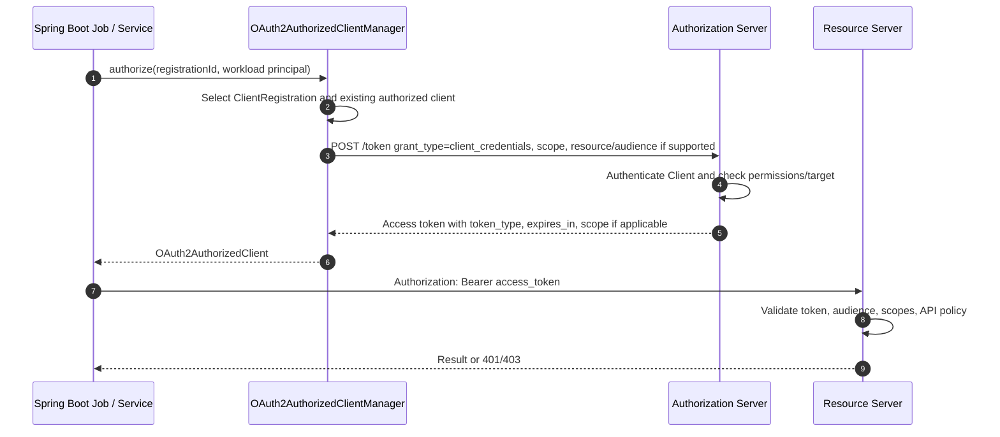

# 16.6. Requesting `scope`, `audience`, or `resource` by Provider

> **Module:** Spring Security OAuth 2.0 OIDC Client  
> **Chapter:** 16. Client Credentials  
> **Focus:** How a Spring Security OAuth 2.0 Client application requests permissions (`scope`) and token targets (`audience` or `resource`) in the **Client Credentials Grant**, when Authorization Servers have different contracts.

When a Spring Boot backend automatically calls an API without an interactive user sign-in, the application typically uses the OAuth 2.0 **Client Credentials Grant**. The client authenticates with the Authorization Server (AS) using a registered method—such as `client_secret_basic` or `private_key_jwt`—and receives an access token to call a Resource Server.

However, obtaining an access token **does not guarantee** the target API can be called successfully. A token may lack the required scope, be issued for a different resource, contain an audience rejected by the API, or represent a Client not authorized at the AS. Therefore, beyond `grant_type=client_credentials`, the application often needs to specify:

- **`scope`:** which permissions is the Client requesting?
- **`resource`:** which resource/API is the token intended for, per **RFC 8707 Resource Indicators** if supported by the AS?
- **`audience`:** which recipient is the token intended for, **per provider-specific extensions**; not a universal standard token request parameter in RFC 6749.

These three concepts are related but **not synonymous**. What matters is determining the **actual contract of the AS and Resource Server**, configuring the Client appropriately, and verifying the issued access token rather than blindly trusting the parameters the application sent.

## 1. Learning Objectives

After this lesson, you will be able to:

1. Describe the Client Credentials Grant and standard Token Endpoint request.
2. Distinguish requested scopes, granted scopes, and actual permissions at the Resource Server.
3. Distinguish the RFC 8707 `resource` parameter from the `aud` claim in an access token.
4. Explain why the `audience` parameter at the Token Endpoint is a **provider-dependent** convention.
5. Design Client registrations for APIs with different scopes and resources/audiences.
6. Configure `scope` in `spring.security.oauth2.client.registration.<registrationId>.scope`.
7. Use the `OAuth2AccessTokenResponseClient<OAuth2ClientCredentialsGrantRequest>` extension point to add token request parameters when required by the provider.
8. Configure `OAuth2AuthorizedClientManager` with the appropriate Client Credentials provider.
9. Avoid mistakenly reusing an access token when the same registration dynamically changes resource/audience.
10. Analyze how Auth0, Microsoft Entra ID, Keycloak, and RFC 8707-capable AS implementations differ.
11. Diagnose `invalid_scope`, `invalid_target`, `invalid_client`, `unauthorized_client`, or API 401/403 errors.
12. Protect Client credentials, access tokens, and machine-to-machine authorization boundaries.

## 2. Where `scope`, `audience`, and `resource` Fit in the Flow

The Client Credentials Grant has no browser redirect or user Authorization Code step. The Client contacts the Token Endpoint directly:



A well-designed system distinguishes the two decision points:

**The Authorization Server** decides whether to issue a token for the requested Client, scopes, and resource.

**The Resource Server** decides whether to accept the token on that API and permit the specific operation. An HTTP 200 from the Token Endpoint does not replace this second verification step.

### 2.1. Client Credentials Is Not User OIDC Login

Client Credentials issues tokens in a **Client/workload** context. It typically has no:

- end-user logging in via browser;
- authorization code or redirect URI;
- user `OidcUser`;
- OIDC ID token for authenticating an end-user;
- web session created by `oauth2Login()`.

Some AS implementations include claims like `sub`, `client_id`, or `azp` representing the service principal; read their meaning from the AS token profile and **do not infer an end-user**.

## 3. Basic `client_credentials` Token Request

Per RFC 6749, a Client Credentials token request is typically an HTTP POST with an `application/x-www-form-urlencoded` body:

```http
POST /oauth2/token HTTP/1.1
Host: login.example.test
Authorization: Basic <redacted-client-credentials>
Content-Type: application/x-www-form-urlencoded

grant_type=client_credentials&scope=reports.read
```

In the example, the Client authenticates via HTTP Basic. Real credentials must travel over HTTPS and never appear in documentation, logs, or shared test sessions.

**Key fields:**

| Field | Meaning | General Rule |
|---|---|---|
| `grant_type=client_credentials` | Selects the machine-to-machine grant | Required for this grant |
| `scope` | List of requested scopes | Optional in RFC 6749, though AS may require it by policy |
| Client authentication | Proves the Client is registered | Client Credentials is for confidential clients under OAuth 2.0 |
| `resource` | Identifier of the resource the token is requested for | Standard RFC 8707 extension; **use only if supported by the AS** |
| `audience` | Audience target per custom contract | **No universal standard meaning** in RFC 6749 token requests |

The AS may grant or reject requested scopes/resources. It is not required to issue a token with every scope the Client asks for. The application must know the policy of both the AS and the target Resource Server.

## 4. What Is `scope`?

`scope` describes the access scope the Client asks the AS to grant for the access token. Examples:

```text
scope=reports.read
scope=reports.read reports.export
scope=inventory.read inventory.write
```

On the wire, multiple scopes form a **space-separated string of names**. In an HTTP form body, spaces must be properly form URL-encoded:

```text
grant_type=client_credentials
&scope=reports.read%20reports.export
```

Scope naming is a **contract between the AS, Client, and API**. OAuth 2.0 does not define that `reports.read` grants the same permissions across every product.

### 4.1. Requested Scope Differs from Granted Scope

For example, the Client asks for:

```text
scope=reports.read reports.export
```

The AS may grant both, grant a subset per policy, or reject the request. Per RFC 6749, if the granted scope differs from the requested scope, the token response should indicate the actual scope:

```json
{
  "access_token": "<redacted>",
  "token_type": "Bearer",
  "expires_in": 3600,
  "scope": "reports.read"
}
```

This is an illustrative response, not a real token. The Client **must not assume** it received `reports.export` merely because it requested it.

In Spring Security, the access token's scopes can be retrieved via:

```java
Set<String> grantedScopes = authorizedClient
    .getAccessToken()
    .getScopes();
```

Actual permissions still depend on the Resource Server. An API may enforce additional conditions beyond a scope, such as tenant, Client type, resource entity, network policy, or application roles.

### 4.2. `scope` in `ClientRegistration`

In Spring Boot:

```yaml
spring:
  security:
    oauth2:
      client:
        registration:
          reports-m2m:
            provider: internal-as
            client-id: report-worker
            client-secret: ${REPORTS_CLIENT_SECRET}
            client-authentication-method: client_secret_basic
            authorization-grant-type: client_credentials
            scope:
              - reports.read
              - reports.export

        provider:
          internal-as:
            token-uri: https://login.example.test/oauth2/token
```

When Spring Security executes the Client Credentials Grant for this registration, the configured scopes form the basis of the token request.

**Note:** `scope` in the registration is not the entire AS policy. The corresponding Client must also **be permitted** to request those scopes at the Authorization Server. If the AS only permits `reports.read`, adding `reports.export` in YAML creates no new permission.

### 4.3. Scope Does Not Definitively Identify Audience

A scope like `reports.read` may be mapped by an AS to the reporting API, yet there is no universal OAuth 2.0 rule that scopes automatically determine audience. That depends on the AS. Many AS implementations require explicitly specifying **`resource`** or **`audience`**, even when the Client already supplies scopes.

## 5. Audience: The Target the Token Is Intended For

In OAuth 2.0 deployments using JWT access tokens, the `aud` claim typically identifies the Resource Servers or recipients the token was issued for. Illustrative JWT payload:

```json
{
  "iss": "https://login.example.test",
  "sub": "service-account-42",
  "aud": "https://api.example.test/reports",
  "client_id": "report-worker",
  "scope": "reports.read",
  "iat": 1893452400,
  "exp": 1893456000
}
```

**Do not treat this example payload as a verified JWT.** The Resource Server must validate signature or introspection/token validity per AS profile, issuer, expiry, audience, scopes, and other security conditions.

### 5.1. Distinguishing Audience from Client ID

| Term | Example | Question Answered |
|---|---|---|
| `client_id` | `report-worker` | Which Client requested the token? |
| Registration ID | `reports-m2m` | Which Spring Security Client configuration is used? |
| Token audience `aud` | `https://api.example.test/reports` | Which API/target was the access token issued for? |
| Requested scope | `reports.read` | What does the Client want to do? |
| Granted scope | `reports.read` | Which permissions did the AS grant? |
| Issuer `iss` | `https://login.example.test` | Which AS issued the token? |

Do not conflate the token audience with the machine Client's `client_id`. Some providers express audiences as URIs, API identifiers, or custom resource names. The Resource Server must know and accept the exact value per the **token contract**, rather than guessing from hostnames.

### 5.2. Audience Is a Token Protection Boundary

Suppose a Client holds a valid access token for `inventory-api` but sends it to `billing-api`. The Billing API must reject it if the audience does not include an identifier trusted by that API.

Accepting a token simply because its signature/issuer is valid while `aud` is wrong is a form of **token redirect / audience confusion**. Even an identical `read` scope across two APIs never authorizes cross-API token reuse.

**Audience must be validated by the Resource Server**, not merely sent by the Client in the token request. Tokens may be opaque (not JWT); in that case, the API must use validation/introspection designed by the AS instead of assuming it can decode a JWT `aud` claim.

## 6. The `resource` Parameter per RFC 8707

RFC 8707 **Resource Indicators for OAuth 2.0** defines the `resource` parameter so a Client can indicate where it intends to use the access token.

Example extended Token Endpoint request:

```http
POST /oauth2/token HTTP/1.1
Host: login.example.test
Authorization: Basic <redacted-client-credentials>
Content-Type: application/x-www-form-urlencoded

grant_type=client_credentials&scope=inventory.read&resource=https%3A%2F%2Fapi.example.test%2Finventory
```

In a more readable form:

```text
grant_type = client_credentials
scope      = inventory.read
resource   = https://api.example.test/inventory
```

Meaning: “I am a registered Client requesting a token with `inventory.read` permission **for the resource** `https://api.example.test/inventory`.”

### 6.1. Is the Resource Indicator Always the Exact Endpoint URL?

Not necessarily. `resource` is a **resource identifier**, typically an absolute URI defined by the AS/API. It may match the Resource Server's base URL or be a logical identifier URI. The Client must use the value **published by the provider**, rather than combining the API host and an endpoint path and assuming it is valid.

Example actual API call:

```text
GET https://api.example.test/inventory/items
```

may require the resource identifier:

```text
https://api.example.test/inventory
```

rather than the full `/inventory/items` URI. Never pick a resource indicator arbitrarily.

### 6.2. Multiple Resource Indicators

RFC 8707 allows multiple `resource` parameters if the protocol and AS support it. In a form body, these are **repeated parameters with the same name**, not a comma-separated string:

```text
grant_type=client_credentials
&scope=read
&resource=https%3A%2F%2Fapi.example.test%2Finventory
&resource=https%3A%2F%2Fapi.example.test%2Freports
```

However, not every AS allows multiple resources in a single token. Requesting multiple resources widens the blast radius if a token leaks, so **prefer separate tokens per API/resource** unless the product genuinely requires multi-resource tokens.

### 6.3. When `resource` Is Invalid

RFC 8707 defines the `invalid_target` error when the requested resource is invalid or disallowed under AS rules. Some providers may also return `invalid_scope` or `invalid_request` depending on their contract.

Do not treat `invalid_target` as an OAuth2 Client secret problem; first check the resource value, registration, scopes, AS policies, and the Client's permission for that resource.

### 6.4. How Does `resource` Differ from Token `audience`?

- **`resource`** is a request parameter stating where the Client wants to use the access token.
- **`aud`** is a value in the token/validation result showing the actual audience issued by the AS per its token profile.

In an RFC 8707 deployment, the AS may use the resource indicator to set the access token's audience. However, **do not assume** every AS maps `resource` to `aud` mechanically, especially when tokens are opaque or use custom formats.

## 7. `audience` at the Token Endpoint: A Provider-Dependent Extension

Some Authorization Servers (such as Auth0 for registered APIs) use an `audience` parameter in the token request:

```http
POST /oauth/token HTTP/1.1
Host: tenant.example.auth0.com
Content-Type: application/x-www-form-urlencoded

grant_type=client_credentials&client_id=<redacted>&client_secret=<redacted>&audience=https%3A%2F%2Fapi.example.test%2Freports
```

This is a **conceptual example of a provider-specific contract**, not a requirement to choose `client_secret_post` as the authentication method in Spring. The actual client authentication method must match the AS configuration for that Client, whether HTTP Basic or another method.

### 7.1. `audience` Is Not a Standard Synonym for `resource`

Both can indicate the intended recipient, yet:

- `resource` is standardized by RFC 8707.
- `audience` is not a universal OAuth2 token request parameter in RFC 6749/8707; it has **provider-defined semantics**.
- One AS may require `audience` and reject `resource`.
- Another AS may accept `resource` and ignore or reject `audience`.
- A third AS determines audience via Client registration, scopes, or an audience mapper without accepting either parameter.

**Implementation rule:** only send `audience` if the Token Endpoint documentation **for your specific provider** specifies it or the AS supports that extension. Never make it a global parameter across all OAuth2 Client registrations.

### 7.2. Do Not Trust the Request You Sent More Than the Token You Received

The Client sending:

```text
audience=https://api.example.test/reports
```

does not prove the issued token carries that audience. The AS decides the actual granted target. When using JWT access tokens, the API must verify `aud` per contract. With opaque tokens, the API must use appropriate validation/introspection.

## 8. `scope`, `audience`, and `resource` Must Be Designed Together

A properly functioning setup usually needs all layers aligned:

| Layer | Question to Answer | Example |
|---|---|---|
| Client registration | Which Client is allowed to request tokens? | `report-worker` |
| Resource/audience targeting | Which API is the token issued for? | `https://api.example.test/reports` |
| Scopes | Which operations are permitted? | `reports.read` |
| Resource Server authorization | Is the current request permitted? | `GET` report only when token is valid and scope matches |

Common design mistakes:

**Scope present, audience missing:** the AS issues a token for a default resource while the target API requires a different audience.

**Audience present, scope missing:** the Resource Server accepts the token's audience but rejects the operation for lacking `reports.read`.

**Scope and audience present, wrong Client:** the AS rejects with `unauthorized_client` or `invalid_scope` because the machine Client is not allowed to request those permissions/resources.

**Valid token, yet API still returns 403:** the API also enforces permissions/tenant/record-level policies; an access token does not replace all authorization rules.

## 9. Configuring Multiple Client Registrations per API

For Client Credentials, a clean and controllable operational pattern is **one Client registration per fixed target/permission set**, especially when resources use different audiences or scopes.

Example:

```yaml
spring:
  security:
    oauth2:
      client:
        registration:
          reports-m2m:
            provider: internal-as
            client-id: report-worker
            client-secret: ${REPORTS_CLIENT_SECRET}
            client-authentication-method: client_secret_basic
            authorization-grant-type: client_credentials
            scope:
              - reports.read

          inventory-m2m:
            provider: internal-as
            client-id: inventory-worker
            client-secret: ${INVENTORY_CLIENT_SECRET}
            client-authentication-method: client_secret_basic
            authorization-grant-type: client_credentials
            scope:
              - inventory.read

        provider:
          internal-as:
            token-uri: https://login.example.test/oauth2/token
```

| Registration | Scope | Assumed Resource Indicator | API |
|---|---|---|---|
| `reports-m2m` | `reports.read` | `https://api.example.test/reports` | Reports |
| `inventory-m2m` | `inventory.read` | `https://api.example.test/inventory` | Inventory |

The two registrations can share the same AS/token endpoint while keeping distinct Client IDs, scopes, permissions, and resources. If an AS allows sharing one Client ID across multiple registrations with different scopes, still verify how the AS binds grants and permissions. Using separate Client IDs in the example simply makes the boundaries clear.

### 9.1. Why Not Use One Registration and Swap Audience per Request?

`OAuth2AuthorizedClientManager` typically looks up saved authorized clients by **registration ID + principal name**. If one key is reused while token requests alternate between Reports and Inventory, the following can happen:

1. The first call requests a token for Reports and stores it under `(shared-client, job-worker)`.
2. The next call wants Inventory, yet the manager finds the still-valid Reports token.
3. The manager reuses the existing authorized client per policy instead of sending a new request with the changed resource.
4. The app accidentally sends the Reports token to the Inventory API, causing 401/403 errors or violating token targeting boundaries.

The same registration/principal does not automatically distinguish dynamic audiences/resources. **Do not treat differing `additionalParameters` as distinct cache keys.** If dynamic targets are needed, design partitioned authorized clients/registrations/keys or a dedicated custom manager with safeguards against token mixing.

### 9.2. Keep Permission Sets Minimal

If a job only reads reports, request `reports.read`—do not request `reports.*` or `admin` “to avoid errors.” Overly broad permissions magnify the impact of leaked credentials or tokens.

In multi-microservice architectures, one token valid for every API may seem convenient, but it weakens least privilege. Prefer per-resource tokens with minimal sufficient scopes.

## 10. How Does Spring Security Obtain Client Credentials Access Tokens?

In Spring Security Servlet, the typical components are:

- `ClientRegistrationRepository`: defines registrations and scopes.
- `OAuth2AuthorizedClientService`: stores authorized clients/tokens by registration and principal.
- `AuthorizedClientServiceOAuth2AuthorizedClientManager`: executes outside HTTP requests.
- `OAuth2AuthorizedClientProvider`: the `client_credentials` provider.
- `OAuth2AccessTokenResponseClient<OAuth2ClientCredentialsGrantRequest>`: calls the Token Endpoint to obtain access tokens.

The extension point for sending **custom parameters in the token request** lies in the **token response client/converter**, not in `oauth2Login()`'s authorization request resolver.

### 10.1. Do Not Put Parameters on the Wrong Endpoint

`prompt`, `login_hint`, `nonce`, or `state` belong to other login contexts. In the Client Credentials Grant:

- There is no browser authorization request.
- There is no authorization code.
- The token request sends `grant_type=client_credentials` directly.
- `scope` goes in the token request.
- `resource` or `audience`, if supported, must be added to the **token request form body**.

Customizing only OAuth2 Login's `DefaultOAuth2AuthorizationRequestResolver` **will not** add `resource` to Client Credentials Token Endpoint requests.

## 11. Spring Boot Example: Manager for `client_credentials`

A manager bean outside HTTP requests:

```java
package example.security;

import org.springframework.context.annotation.Bean;
import org.springframework.context.annotation.Configuration;
import org.springframework.security.oauth2.client.AuthorizedClientServiceOAuth2AuthorizedClientManager;
import org.springframework.security.oauth2.client.OAuth2AuthorizedClientManager;
import org.springframework.security.oauth2.client.OAuth2AuthorizedClientProvider;
import org.springframework.security.oauth2.client.OAuth2AuthorizedClientProviderBuilder;
import org.springframework.security.oauth2.client.OAuth2AuthorizedClientService;
import org.springframework.security.oauth2.client.registration.ClientRegistrationRepository;

@Configuration
class MachineClientConfig {

    @Bean("machineAuthorizedClientManager")
    OAuth2AuthorizedClientManager machineAuthorizedClientManager(
            ClientRegistrationRepository registrations,
            OAuth2AuthorizedClientService authorizedClients) {

        OAuth2AuthorizedClientProvider provider =
            OAuth2AuthorizedClientProviderBuilder.builder()
                .clientCredentials()
                .build();

        AuthorizedClientServiceOAuth2AuthorizedClientManager manager =
            new AuthorizedClientServiceOAuth2AuthorizedClientManager(
                registrations,
                authorizedClients
            );

        manager.setAuthorizedClientProvider(provider);
        return manager;
    }
}
```

This configuration is conceptually sufficient for obtaining tokens via Client Credentials when the AS accepts standard requests without extra parameters. When `resource` or `audience` is required, attach a **custom token response client** as shown in the next section.

### 11.1. The Service Does Not Auto-Refresh or Auto-Update Scopes

`OAuth2AuthorizedClientService.loadAuthorizedClient(...)` only reads the saved record. The manager/provider performs authorization/re-authorization when needed.

When you change scopes in YAML, a previously stored authorized client may still hold an old token with old scopes. Depending on AS/manager/lifecycle, perform controlled invalidation or re-authorization. Do not assume changing a registration at runtime guarantees newly issued scopes appear immediately.

## 12. Adding `resource`/`audience` to the Token Request in Spring Security

Spring Security 6.4+ includes `RestClient`-based token response clients such as `RestClientClientCredentialsTokenResponseClient`, which supports customizing request parameters via converters. In projects on other versions, the API may be `DefaultClientCredentialsTokenResponseClient` with `setRequestEntityConverter(...)` or the corresponding extension point. **Always choose the exact API for your Spring Security version.**

The example below illustrates adding **static parameters by registration ID** without writing a token HTTP client from scratch.

### 12.1. Creating a Token Response Client with Custom Parameters

```java
package example.security;

import org.springframework.context.annotation.Bean;
import org.springframework.context.annotation.Configuration;
import org.springframework.security.oauth2.client.endpoint.OAuth2ClientCredentialsGrantRequest;
import org.springframework.security.oauth2.client.endpoint.RestClientClientCredentialsTokenResponseClient;
import org.springframework.security.oauth2.core.endpoint.OAuth2AccessTokenResponse;
import org.springframework.security.oauth2.client.endpoint.OAuth2AccessTokenResponseClient;
import org.springframework.util.LinkedMultiValueMap;
import org.springframework.util.MultiValueMap;

@Configuration
class MachineTokenRequestConfig {

    @Bean
    OAuth2AccessTokenResponseClient<OAuth2ClientCredentialsGrantRequest>
            clientCredentialsTokenResponseClient() {

        RestClientClientCredentialsTokenResponseClient client =
            new RestClientClientCredentialsTokenResponseClient();

        client.addParametersConverter(grantRequest -> {
            MultiValueMap<String, String> parameters =
                new LinkedMultiValueMap<>();

            String registrationId = grantRequest
                .getClientRegistration()
                .getRegistrationId();

            if ("reports-m2m".equals(registrationId)) {
                // Only when the Authorization Server supports RFC 8707.
                parameters.add(
                    "resource",
                    "https://api.example.test/reports"
                );
            }

            if ("inventory-m2m".equals(registrationId)) {
                // Another resource indicator for another Client.
                parameters.add(
                    "resource",
                    "https://api.example.test/inventory"
                );
            }

            if ("auth0-reports".equals(registrationId)) {
                // Provider-specific: only when required by the AS contract.
                parameters.add(
                    "audience",
                    "https://api.example.test/reports"
                );
            }

            return parameters;
        });

        return client;
    }
}
```

Imports in this sample can be trimmed as needed by your IDE. Key points:

- Read `registrationId` from `grantRequest.getClientRegistration()`, **never from a user-submitted HTTP request**.
- Use `MultiValueMap` so repeated `resource` parameters are supported when necessary.
- Add only parameters supported by the target AS.
- Let `RestClientClientCredentialsTokenResponseClient` retain responsibility for standard request construction, form encoding, and Client authentication methods.
- Never overwrite `grant_type`, `client_id`, `scope`, or confidential client credentials with arbitrary values.

**Version note:** `RestClientClientCredentialsTokenResponseClient` and `addParametersConverter(...)` apply to Spring Security branches providing that API; do not assume this snippet compiles verbatim across every Spring Security 6.x/7.x release.

### 12.2. Wiring the Token Client into `OAuth2AuthorizedClientProvider`

Replace the client credentials builder with a configuration using the token response client above:

```java
import org.springframework.beans.factory.annotation.Qualifier;
import org.springframework.context.annotation.Bean;
import org.springframework.security.oauth2.client.AuthorizedClientServiceOAuth2AuthorizedClientManager;
import org.springframework.security.oauth2.client.OAuth2AuthorizedClientManager;
import org.springframework.security.oauth2.client.OAuth2AuthorizedClientProvider;
import org.springframework.security.oauth2.client.OAuth2AuthorizedClientProviderBuilder;
import org.springframework.security.oauth2.client.OAuth2AuthorizedClientService;
import org.springframework.security.oauth2.client.endpoint.OAuth2AccessTokenResponseClient;
import org.springframework.security.oauth2.client.endpoint.OAuth2ClientCredentialsGrantRequest;
import org.springframework.security.oauth2.client.registration.ClientRegistrationRepository;

@Bean("machineAuthorizedClientManager")
OAuth2AuthorizedClientManager machineAuthorizedClientManager(
        ClientRegistrationRepository registrations,
        OAuth2AuthorizedClientService authorizedClients,
        OAuth2AccessTokenResponseClient<OAuth2ClientCredentialsGrantRequest>
            tokenResponseClient) {

    OAuth2AuthorizedClientProvider provider =
        OAuth2AuthorizedClientProviderBuilder.builder()
            .clientCredentials(configurer ->
                configurer.accessTokenResponseClient(tokenResponseClient))
            .build();

    AuthorizedClientServiceOAuth2AuthorizedClientManager manager =
        new AuthorizedClientServiceOAuth2AuthorizedClientManager(
            registrations,
            authorizedClients
        );

    manager.setAuthorizedClientProvider(provider);
    return manager;
}
```

The `@Bean` in this section is an **alternative replacement** for the manager bean in Section 11; do not declare both managers with the same name in a single Spring configuration. If the application has multiple `OAuth2AccessTokenResponseClient` beans or managers, use matching bean names / `@Qualifier` to avoid ambiguous injection.

### 12.3. Why Not Send a Manual HTTP POST?

You could write `RestClient.post()` to submit a form, yet you would have to implement yourself:

- The right Client authentication method per registration.
- HTTP Basic and contract-compliant encoding of Client credentials.
- Token Endpoint errors and OAuth2 error responses.
- Token response parsing (`access_token`, `token_type`, `expires_in`, `scope`).
- Clock skew/expiry and authorized client persistence.
- Retry policies, logging, and secret protection.

Using the built-in `OAuth2AccessTokenResponseClient` with a custom converter **reduces the risk of accidentally dropping standard protocol behavior**. For an AS with deeper extensions, inspect the exact extension points in your Spring Security version.

## 13. Alternative Approach: Request Entity Converter for Older Versions

In Spring Security branches using `DefaultClientCredentialsTokenResponseClient`, you can customize `RequestEntity` with a converter that extends/wraps the default logic.

Conceptual model:

```java
// Pseudocode illustrating design for older versions.
// Check exact APIs and customization support in your project's version.

OAuth2ClientCredentialsGrantRequestEntityConverter baseConverter = ...;

Converter<OAuth2ClientCredentialsGrantRequest, RequestEntity<?>>
    customConverter = grantRequest -> {
        RequestEntity<?> original = baseConverter.convert(grantRequest);

        // Copy form parameters body from original,
        // add resource or audience based on registrationId,
        // PRESERVE headers, method, URL, and client authentication.
        // Return the updated RequestEntity.
        return updatedRequestEntity;
    };

DefaultClientCredentialsTokenResponseClient client =
    new DefaultClientCredentialsTokenResponseClient();

client.setRequestEntityConverter(customConverter);
```

**Do not copy pseudocode as runnable code.** It illustrates the principle of preserving the full standard request and only appending parameters. Exact classes/methods, generic types, and active token clients must come from your Spring Security version's API.

The biggest hazard when replacing a converter yourself is losing `Authorization: Basic ...` or overwriting `Content-Type`, triggering `invalid_client` errors unrelated to resource or audience.

## 14. Using the Manager to Request Tokens per Registration

Use a service that selects registration IDs from an application **allowlist**:

```java
package example.machine;

import org.springframework.beans.factory.annotation.Qualifier;
import org.springframework.security.oauth2.client.OAuth2AuthorizeRequest;
import org.springframework.security.oauth2.client.OAuth2AuthorizedClient;
import org.springframework.security.oauth2.client.OAuth2AuthorizedClientManager;
import org.springframework.stereotype.Service;

@Service
public class MachineTokenService {

    private final OAuth2AuthorizedClientManager manager;

    public MachineTokenService(
            @Qualifier("machineAuthorizedClientManager")
            OAuth2AuthorizedClientManager manager) {
        this.manager = manager;
    }

    public OAuth2AuthorizedClient forReports() {
        return authorize("reports-m2m", "reports-worker");
    }

    public OAuth2AuthorizedClient forInventory() {
        return authorize("inventory-m2m", "inventory-worker");
    }

    private OAuth2AuthorizedClient authorize(
            String registrationId, String principalKey) {

        OAuth2AuthorizeRequest request = OAuth2AuthorizeRequest
            .withClientRegistrationId(registrationId)
            .principal(principalKey)
            .build();

        OAuth2AuthorizedClient authorized = manager.authorize(request);

        if (authorized == null) {
            throw new IllegalStateException(
                "OAuth2 authorization unavailable: " + registrationId
            );
        }

        return authorized;
    }
}
```

`forReports()` and `forInventory()` choose **preconfigured application registration IDs**. Never expose an HTTP endpoint like:

```text
GET /machine-token?registrationId=...&audience=...&principal=...
```

letting callers freely dictate which API the Client requests access tokens for. Such an endpoint easily becomes a **token vending machine** without strict authorization controls.

### 14.1. Principal in Client Credentials Is a Storage Key

`principal("reports-worker")` does not mean a user named `reports-worker` logged in. It only represents a stable identifier context for the manager/service to store the authorized client.

If you change the principal key on every call, the manager cannot reuse stored tokens. If you share one principal key across multiple tenants when Client registrations/scopes are not cleanly separated, you risk mixing tokens.

## 15. Calling the API with the Properly Issued Token

After obtaining an authorized client for Reports:

```java
OAuth2AuthorizedClient client = machineTokenService.forReports();

String accessToken = client.getAccessToken().getTokenValue();

// Use accessToken as a Bearer token for the right Reports API over HTTPS.
// Never return it to a browser or write it to logs.
```

With Spring `RestClient` (Spring Framework 6.1+ / Spring Boot 3.2+):

```java
import org.springframework.stereotype.Component;
import org.springframework.web.client.RestClient;
import org.springframework.security.oauth2.client.OAuth2AuthorizedClient;

@Component
class ReportsApiClient {

    private final MachineTokenService tokens;
    private final RestClient restClient;

    ReportsApiClient(
            MachineTokenService tokens,
            RestClient.Builder builder) {
        this.tokens = tokens;
        this.restClient = builder
            .baseUrl("https://api.example.test/reports")
            .build();
    }

    String fetchSummary() {
        OAuth2AuthorizedClient authorized = tokens.forReports();

        return restClient.get()
            .uri("/summary")
            .headers(headers -> headers.setBearerAuth(
                authorized.getAccessToken().getTokenValue()))
            .retrieve()
            .body(String.class);
    }
}
```

This example shows the token for registration `reports-m2m` being sent to the **Reports API**, not the Inventory API. In production, prefer OAuth2-capable HTTP client integrations and token-management patterns matching your project version rather than passing raw tokens through many layers.

### 15.1. Scopes and Audience Are Verified by the API

Even when `manager.authorize(...)` succeeds, the Resource Server must still:

1. Verify token/issuer/signature or perform introspection per contract.
2. Check token expiration and status.
3. Verify the audience/resource is accepted by the API.
4. Check scopes and corresponding authorization policies.
5. Check tenant/resource permissions if applicable.

The `/reports/summary` API may require `reports.read`. A token with the right audience that lacks this scope must still be rejected.

## 16. Token Response: What Should You Check?

A typical OAuth 2.0 Token Endpoint response:

```json
{
  "access_token": "<redacted>",
  "token_type": "Bearer",
  "expires_in": 3600,
  "scope": "reports.read"
}
```

Some AS implementations return JWT access tokens containing an `aud` claim. Some return opaque tokens; the Client does not necessarily need to know or decode the token contents to call APIs properly.

### 16.1. Granted Scopes

If Spring Security receives `scope` in the token response, the authorized client's `OAuth2AccessToken` exposes the granted scopes:

```java
var granted = authorized.getAccessToken().getScopes();
boolean canRequestReportApi = granted.contains("reports.read");
```

However, `canRequestReportApi` here **is not the final authority**: the Resource Server decides whether to accept the token. Also, if the AS omits `scope` in the response when granted scopes match the requested scopes, the token client may populate scopes from the request per library/protocol rules.

### 16.2. Audience in the Access Token

For JWT access tokens, the Resource Server typically verifies `aud` per AS/token profile, for example:

```json
{
  "aud": ["https://api.example.test/reports"]
}
```

If the target API expects `https://api.example.test/inventory`, this token is unsuitable.

Do not parse the JWT yourself inside the Spring Client and assume you have “sufficiently validated” the audience. The API must perform independent validation; if the application needs to classify tokens before sending, follow the AS contract and proper libraries rather than trusting unverified decoded payloads.

## 17. The Resource Server Must Validate Audience

This is a mandatory boundary for resource/audience targeting to provide real security value.

Example with a Spring Security Resource Server using JWT:

```yaml
spring:
  security:
    oauth2:
      resourceserver:
        jwt:
          issuer-uri: https://login.example.test
```

Configuring `issuer-uri` sets up issuer/key verification in Spring Security. However, **never assume configuring the issuer alone checks the API's specific audience**. The application needs an audience validator tailored to its deployment.

Example of a simple audience validator for a JWT whose baseline checks are already performed by the decoder:

```java
import org.springframework.security.oauth2.core.OAuth2Error;
import org.springframework.security.oauth2.core.OAuth2TokenValidator;
import org.springframework.security.oauth2.core.OAuth2TokenValidatorResult;
import org.springframework.security.oauth2.jwt.Jwt;

OAuth2TokenValidator<Jwt> reportsAudienceValidator = jwt -> {
    if (jwt.getAudience().contains(
            "https://api.example.test/reports")) {
        return OAuth2TokenValidatorResult.success();
    }

    return OAuth2TokenValidatorResult.failure(
        new OAuth2Error(
            "invalid_token",
            "Token audience not accepted by Reports API",
            null
        )
    );
};
```

This validator is an **addition** to issuer, signature, and timestamp validation; never replace the default checks with only an `aud` check. In a custom decoder configuration, **combine** it with `JwtValidators.createDefaultWithIssuer(...)` or validators appropriate for your version and token profile.

If the token is opaque, the Resource Server needs corresponding introspection/validation and audience policies matching the returned data. Never apply a JWT-only example blindly to every system.

## 18. Different Providers: Corresponding Strategies

### 18.1. Authorization Server Supporting RFC 8707

An AS supporting Resource Indicators can accept:

```text
grant_type=client_credentials
scope=reports.read
resource=https://api.example.test/reports
```

Strategy:

- Configure scopes in `ClientRegistration`.
- Add `resource` in the token request converter.
- Verify the resource identifier and AS policy for the Client.
- Have the API check token audience/scopes per token profile.
- Use separate registrations/authorized client keys per resource if needed.

### 18.2. Auth0 — API `audience`

In Auth0's Machine-to-Machine model, the Client typically needs to specify the **`audience`** of the API registered in Auth0, for example:

```text
grant_type=client_credentials
audience=https://api.example.test/reports
```

Scopes can be configured per the permissions published by the API and granted to the Client.

Strategy:

- Register the Machine-to-Machine application and API/audience accurately in the Auth0 tenant.
- Authorize the Client for the required API/scopes.
- Configure proper Client authentication.
- Add `audience` via a token request converter **only for the specific Auth0 registration**.
- Validate audience/scopes when the API receives the access token.
- Do not send `resource` instead of `audience` if that endpoint's contract does not support it.

The documentation and policies of the Auth0 tenant in use—not the example URIs in this lesson—determine the real audience value.

### 18.3. Microsoft Entra ID — `/.default` Scope Format on v2 Endpoints

For the Microsoft identity platform v2.0, the Client Credentials Grant typically requires a scope formatted as **resource application ID URI + `/.default`**, for example:

```text
grant_type=client_credentials
scope=api://reports-service-app/.default
```

Or an equivalent resource identifier configured in the tenant. The value `api://reports-service-app` is illustrative only; use the actual Application ID URI.

Meaning:

- `/.default` requests the **application permissions already configured and consented** for the resource under the Microsoft identity platform model.
- Do not assemble `scope=reports.read reports.write` as a generic Client Credentials request for Entra v2 when the provider requires `/.default`.
- Ensure the permission type is **application permissions / app roles**, rather than confusing it with delegated user scopes.
- The token audience is the resource Entra issues the token for; the API must validate the exact audience, issuer, and app roles/scopes per token profile.
- Working with a v1 endpoint/legacy protocol using `resource` is a different contract; do not mix v1 and v2 request styles.

Registration example:

```yaml
spring:
  security:
    oauth2:
      client:
        registration:
          entra-reports:
            provider: entra-tenant
            client-id: ${ENTRA_CLIENT_ID}
            client-secret: ${ENTRA_CLIENT_SECRET}
            client-authentication-method: client_secret_post
            authorization-grant-type: client_credentials
            scope:
              - api://reports-service-app/.default
        provider:
          entra-tenant:
            token-uri: https://login.microsoftonline.com/example-tenant-id/oauth2/v2.0/token
```

Tenant values, Application ID URI, and client authentication method must **match the actual Client**; `client_secret_post` here illustrates one provider-supported credential transport, not a mandatory recommendation for every Entra Client.

Specifically: tokens issued via Client Credentials may use a `roles` claim instead of `scp`, since these are app-only permissions rather than delegated user scopes. The Resource Server must apply the right token contract rather than mechanically demanding `scp`.

### 18.4. Keycloak — Client Scopes and Audience Mappers

With Keycloak, the access token audience is typically controlled via Client scopes, audience mappers, or Keycloak policies, depending on version and realm configuration.

Strategy:

- Register a confidential Client with service accounts / Client Credentials enabled.
- Configure Client scopes and audience mappings matching the Resource Server.
- Request appropriate scopes per Keycloak mechanics.
- Verify issued tokens contain the audience required by the API.
- Do not assume Keycloak always accepts `audience` in the token request with Auth0-like semantics.

A configuration such as:

```yaml
registration:
  keycloak-inventory:
    provider: keycloak
    client-id: inventory-worker
    client-secret: ${KEYCLOAK_CLIENT_SECRET}
    authorization-grant-type: client_credentials
    scope: [inventory.read]

provider:
  keycloak:
    token-uri: https://id.example.test/realms/operations/protocol/openid-connect/token
```

only illustrates the relevant YAML structure. Whether `aud` appears in the access token depends on realm policies/mappers. When discrepancies occur, fix the Keycloak configuration rather than trying to inject an `aud` claim on the client side.

### 18.5. Strategy Comparison

| Provider / AS Type | Common Way to Specify Target | Notes |
|---|---|---|
| AS supporting RFC 8707 | Token request `resource=<URI>` | May support multiple resource indicators; check policy |
| Auth0 M2M | Token request `audience=<API identifier>` | Auth0 extension; Client must be authorized for the API |
| Microsoft Entra v2 | `scope=<resource>/.default` | App-only permissions/admin consent and exact resource |
| Keycloak | Client scopes / audience mapper; token endpoint per contract | Does not default to an Auth0-style `audience` parameter |
| Custom AS | May use `resource`, `audience`, scope mapping, or registration policy | Read current deployment documentation |

These models are common examples, **not universal guarantees across every tenant, version, or provider configuration**.

## 19. Do Not Mix Client Credentials with OIDC Login

In the OAuth2/OIDC Client module, both flows may share `ClientRegistrationRepository` or an Authorized Client Manager, yet their purposes differ:

| Criterion | OIDC Login (Authorization Code) | Client Credentials |
|---|---|---|
| Primary subject | User authenticated by the OP | Client/service workload |
| Browser redirect | Yes | No |
| ID Token | Present per OIDC Code Flow | Not a required part of OAuth2 Client Credentials |
| `openid` scope | Means an OIDC authentication request | Not used as a “user login” |
| Storage principal | Logged-in user | Stable workload key |
| Token target | Can serve user-delegated APIs | APIs accepting app-only/machine permissions |
| Audience/resource | Per API token contract | Per AS/Resource Server contract |

A dangerous mistake is **falling back from a rejected user token to a broadly privileged machine token** just so the API keeps returning data. That changes the security model—it is not an equivalent technical fallback.

## 20. Common Errors When Requesting `scope`, `audience`, or `resource`

| Symptom | Possible Cause | What to Check |
|---|---|---|
| `invalid_scope` at Token Endpoint | Scope does not exist, is not granted to Client, or syntax mismatches | Registration scopes, AS Client permissions, provider format |
| `invalid_target` | Invalid resource indicator or Client not allowed to use it | RFC 8707 support, resource URI, AS policy |
| `invalid_request` when adding `audience` | Provider does not support parameter or syntax is wrong | Token Endpoint docs for that specific Client |
| `unauthorized_client` | Client Credentials grant disallowed | Client type, enabled grants at the AS |
| `invalid_client` | Wrong Client ID/secret/authentication method | Credentials and Client authentication config |
| Token returned but API gives 401 | Wrong audience/issuer/signature/expiry; token rejected by API | Resource Server validation and token profile |
| Token returned but API gives 403 | Missing scope/app roles/permissions | Granted scopes, app roles, API authorization |
| Manager returns token for another API | Same registration+principal cache shared across dynamic targets | Separate registrations/keys or partition cache by target |
| Added `resource` yet expected `aud` is missing | AS mapping differs from expectation | Token issuance policy, token profile, AS docs |
| `/.default` fails on another provider | Entra v2-specific syntax | Use the scope format supported by that provider |
| Client updated YAML scopes yet still sees old permissions | Previously saved authorized client is still reused | Token lifecycle / invalidation / re-authorization |
| Pods issue many unnecessary tokens | Separate in-memory stores, unstable principal key | Shared service and concurrency strategy |
| Token request missing custom parameter | Token response client not wired into provider/manager | Check bean wiring and API version |
| Token request lost Client Basic auth | Custom converter rebuilt request without keeping headers | Preserve standard Client authentication from library |
| Opaque token fails JWT decoding | Access token is not a JWT | Use introspection / AS contract instead of guessing token format |

### 20.1. Distinguishing Token Endpoint Errors from Resource Server Errors

**Token Endpoint error:** the Client did not receive a suitable access token. Fix the AS/Client configuration, grant, scope, resource, or credentials.

**Resource Server error:** the Client has a token, yet the API rejects or denies it. Inspect the token issuer, audience, expiry, scopes/app roles, and business authorization.

Do not apply the same “request a new token” reflex to every 403 error. An API returning 403 due to missing permissions will never be fixed by endless retries.

## 21. Caching Notes When Changing Token Targets Per Call

Some applications want to pass audience/resource as a runtime parameter:

```java
getTokenFor("https://api.example.test/reports");
getTokenFor("https://api.example.test/inventory");
```

This is not just a matter of adding a query/form parameter. It is also a **token partitioning** problem.

### 21.1. Why Token Reuse Can Go Wrong

Suppose the manager is set up to store authorized clients by:

```text
registrationId = shared-m2m
principalName  = nightly-worker
```

Even if requests attach `resource=reports` or `resource=inventory`, default storage does not automatically keep the two tokens separate. When the manager sees an unexpired token, it may skip calling the Token Endpoint to update the resource.

### 21.2. Design Options

- **Separate registrations per resource/API** with fixed scopes; simple and easy to operate.
- Use **stably namespaced principal keys** when the same Client registration is split across distinct authorized-client contexts and ensure the provider/manager token request matches that key.
- For complex dynamic resource needs, build a custom authorized client manager/service or cache whose key genuinely includes registration, resource/audience, scopes, and principal/tenant, and test re-authorization/concurrency.
- Never pass untrusted caller-supplied URLs/API targets into token requests without an allowlist/policy.
- Never send a token with audience A to API B just because both share the same Client ID.

**Important:** changing the principal key alone does not automatically change the extra `resource` parameter if the converter remains static by registration ID. Design both **token request derivation and token storage keys** consistently.

### 21.3. Revoking/Invalidating When Scopes or Resources Change

When rolling out a new policy:

1. Identify previously issued authorized clients/tokens.
2. Decide whether to clear local storage to force new token acquisition.
3. If revocation is required, use the AS's Token Revocation Endpoint where appropriate.
4. Verify the API receives the expected audience/permissions.
5. Monitor 401/403 responses after deployment; never drop validators just to stay compatible with old tokens.

## 22. Security for Client Credentials and Token Targeting

### 22.1. Protecting Client Credentials

- Never commit Client secrets to repositories.
- Use environment/secret managers or organization-approved credential mechanisms.
- Protect token requests with TLS/HTTPS.
- If the AS supports `private_key_jwt` or mTLS, evaluate them based on threat model and rotation plans.
- Never log request forms or Basic Authorization headers containing secrets.
- Never let frontends hold machine Client credentials.

### 22.2. Protecting Access Tokens

- An access token is a bearer credential; never return it to a browser unless the architecture explicitly permits and secures it.
- Never print tokens, store them in URLs, or send them via email/tickets.
- If using `JdbcOAuth2AuthorizedClientService`, protect the database, backups, and encryption keys.
- Use minimal appropriate lifetimes and scopes.
- Never share tokens across APIs with different audiences.
- For critical APIs, evaluate sender-constrained access tokens if supported by the AS and Resource Server.

### 22.3. Authorization at the Resource Server

The Resource Server must independently validate bearer tokens: issuer/keys/introspection, audience, expiry, scopes or app roles, and business policies. Client-side `scope`/`audience` requests carry no enforcement power at the API unless the API validates the issued token.

### 22.4. Avoid Turning an API into a Token Vending Machine

An internal endpoint accepting arbitrary `scope` and `audience` from any caller and requesting machine tokens can enable **privilege escalation**. If such a capability must exist, enforce a service-identity allowlist, quotas, auditing, resource restrictions, and never return raw tokens outside the intended design.

## 23. Safe Logging and Observability

When diagnosing token targeting, log **metadata**, never credentials:

```text
event=client_credentials_authorization
registrationId=reports-m2m
requestedScopes=reports.read
requestedResource=https://api.example.test/reports
tokenEndpoint=https://login.example.test/oauth2/token
result=success
grantedScopes=reports.read
tokenValue=[never-log]
clientSecret=[never-log]
```

In systems where resource URIs contain sensitive tenant/user identifiers, mask or hash them before logging.

**Never log:** full access/refresh tokens, Basic auth headers, client assertion JWTs, client secrets, raw token response bodies, or full network traces containing credentials.

You can enable Spring Security DEBUG logging in development, provided you control HTTP client interceptors, request/response bodies, and obfuscation. Never rely on DEBUG logs as proof of permissions: **actual permissions are issued by the AS and enforced by the API**.

## 24. Lab A — Adding Scope for Client Credentials

**Goal:** distinguish requested scopes, AS-granted scopes, and API permissions.

**Preparation:** test AS, confidential Client with `client_credentials` grant, Resource Server requiring `reports.read`, Spring Boot registration `reports-m2m`.

**Steps:**

1. Configure `scope: [reports.read]`.
2. Create a `clientCredentials()` manager and authorize with principal `reports-worker`.
3. Inspect masked token response metadata and granted scopes.
4. Call the report-reading API; record the HTTP status.
5. Add `reports.export` to the request without granting the permission at the AS yet.
6. Retry the flow after clearing the test authorized client to observe the AS rejecting or granting only permitted scopes.
7. Grant the permission properly on the test AS and retry per policy.

**Expected outcome:** declaring scopes in YAML does not create permissions. The AS decides what token is issued; the API enforces permissions independently.

**Question:** why is `requestedScopes.contains("reports.export")` insufficient to allow exporting?

## 25. Lab B — RFC 8707 Resource Indicator

**Goal:** send `resource` to an RFC 8707-capable AS.

**Preparation:** test AS supporting Resource Indicators and two registered resources.

**Steps:**

1. Select registration `inventory-m2m`.
2. Use a custom token request converter to append `resource=https://api.example.test/inventory`.
3. Ensure the request still carries `grant_type=client_credentials`, client authentication, and scope.
4. In safe test logs, verify the **presence** of the URL-encoded `resource` parameter.
5. Call the Inventory API using the new access token.
6. In a **test**, replace `resource` with a URI the Client is not allowed to use; observe an error such as `invalid_target` from the AS.
7. Restore the valid configuration.

**Expected outcome:** the AS recognizes the resource identifier and issues or rejects tokens based on target. Do not infer the result from the request URL: check the token/API response.

## 26. Lab C — `audience` per Auth0 Contract or Mock AS

**Goal:** see that `audience` cannot be treated as a universal parameter across all AS implementations.

**Preparation:** an authorized Auth0 test tenant or a mock AS supporting the `audience` extension; an API identifier and an authorized M2M Client.

**Steps:**

1. Register the API identifier in the test AS.
2. Grant permission for Client Credentials to use the API.
3. Add `audience=<API identifier>` via the converter strictly for the corresponding registration.
4. Execute `authorize()` and inspect the result.
5. Against a mock AS that does not support `audience`, try the same parameter to observe it being rejected or ignored.
6. Do not blindly switch to `resource` if the provider has not documented support for it.
7. Cross-check the audience in the access token / API validation against the test contract.

**Expected outcome:** `audience` is a provider-specific extension; acceptance and target representation are decided by the AS.

## 27. Lab D — Microsoft Entra v2 and `/.default`

**Goal:** distinguish Entra Client Credentials' permission model from arbitrary scopes.

**Preparation:** test tenant, Client App registration, Resource API with application permissions and appropriate admin consent.

**Steps:**

1. Configure a resource Application ID URI for the test API.
2. Grant application permissions on the Client and perform consent per tenant workflow.
3. Set the registration scope to `api://<app-id-uri>/.default` per Entra v2 documentation.
4. Authorize the Client using the `client_credentials` grant.
5. Inspect the API/resource audience and the app roles/claims expected by the API.
6. Test an invalid scope format in a test and observe the Token Endpoint error.
7. Do not use an app-only token as a substitute for a delegated user token if the API requires user context.

**Expected outcome:** Entra v2 app-only permissions differ from delegated scopes in user logins. The `/.default` suffix is a provider convention, not a universal scope format across all AS implementations.

## 28. Lab E — Detecting Wrong-Audience Reuse

**Goal:** understand the risk of using one authorized client cache key across multiple API targets.

**Preparation:** two test APIs/Resource Servers with different audiences, and a mock AS issuing target-specific tokens.

**Steps:**

1. Create registration `shared-m2m` and principal `nightly-worker`.
2. First request a token for Reports; save the authorized client.
3. While the token is still valid, switch the runtime target to Inventory while keeping the same registration and principal.
4. Observe that the manager may reuse the Reports token.
5. Try calling the Inventory API: the API must reject the wrong-audience token.
6. Fix the design using separate registrations or storage/request keys properly partitioned by target.
7. Re-run both API requests with matching tokens.

**Expected outcome:** token targeting must align with authorized client caching/storage. An extra token request parameter does not automatically change the storage key.

## 29. Lab F — Testing Scope and Resource Rejection

**Goal:** separate protocol errors from authorization errors.

| Case | Test Data | Outcome to Observe |
|---|---|---|
| Wrong client secret | Invalid client authentication | AS may return `invalid_client` |
| Ungranted scope | Request `reports.admin` not permitted by AS | `invalid_scope` or grant policy rejection |
| Disallowed resource | Request an invalid resource URI | `invalid_target` on an RFC 8707 AS |
| Grant not enabled | Client not permitted to use `client_credentials` | `unauthorized_client` |
| Wrong audience at API | Properly signed token, yet `aud` belongs to another API | API 401 / invalid token per policy |
| Missing scope at API | Token has right audience, yet lacks `reports.read` | API 403 per policy |
| Expired token | Hold token past expiration | API rejects; manager re-issues when appropriate |
| Manager reuses wrong target | Same registration/principal, target changed | Detect and fix authorized client partitioning |

Execute only with test credentials and controlled Resource Servers. Never paste raw tokens or secrets into notes.

## 30. Common Misconceptions to Avoid

| Misconception | Accurate Understanding |
|---|---|
| “Scope and audience are the same thing.” | Scope describes permissions; audience describes the token's intended recipient. |
| “`resource` is just an arbitrary field like `audience`.” | `resource` is defined by RFC 8707; `audience` in token requests is provider-dependent. |
| “Sending a scope means the AS must grant all of it.” | The AS may restrict or reject it; verify granted permissions. |
| “Having an access token means the API will accept it.” | The API must validate the token, audience, and permissions. |
| “Access tokens are always JWTs with `aud`.” | They can be opaque; validation depends on the AS/API. |
| “Auth0 uses `audience`, so every AS supports `audience`.” | False; use it only when defined by the provider. |
| “Entra v2 Client Credentials accepts arbitrary scopes like user-delegated OAuth.” | Typically uses `resource/.default` and application permissions. |
| “With Keycloak, just send `audience` and you're done.” | Audience usually depends on mappers/client scopes and realm config. |
| “Adding `resource` to the OAuth2 Login authorization request covers `client_credentials`.” | Client Credentials calls the Token Endpoint directly, requiring a custom token client there. |
| “Changing YAML scopes updates existing tokens automatically.” | Stored authorized clients may still hold old tokens; manage the lifecycle explicitly. |
| “One registration/principal cache key distinguishes every resource.” | No; dynamic targets require proper partitioning. |
| “Client Credentials creates a user's `OidcUser`.” | It is machine authorization, not OIDC user login. |
| “To avoid `invalid_scope`, just request every permission.” | Violates least privilege and increases blast radius if a token leaks. |
| “Skipping an `aud` validator is safe as long as the issuer is right.” | The API must verify the token was issued for the right audience per contract. |
| “If the API returns 403, just request another token.” | Usually indicates genuinely missing permissions; retrying never creates permissions. |

## 31. Self-Check Questions

**Question 1.** In the Client Credentials Grant, is `scope` sent to the Authorization Endpoint or the Token Endpoint?

*Hint:* this grant has no browser Authorization Endpoint flow.

**Question 2.** Why is `scope=reports.read` insufficient to prove a token was issued for the Reports API?

*Hint:* scope and audience/resource are two different dimensions.

**Question 3.** Which RFC standardizes the `resource` parameter?

*Hint:* Resource Indicators for OAuth 2.0.

**Question 4.** Can `audience` be sent to every RFC 6749-compliant Token Endpoint?

*Hint:* no; it is a provider-defined parameter when supported.

**Question 5.** A JWT access token has `aud=reports-api`; what should the Inventory API do?

*Hint:* reject it if the audience does not satisfy the Inventory API's policy.

**Question 6.** If the Spring Client requested `reports.export` yet the token was only granted `reports.read`, does the application have export permission?

*Hint:* no; check granted scopes and API authorization.

**Question 7.** When customizing a token request, why must you preserve HTTP Basic / client authentication handled by Spring Security?

*Hint:* if credentials are lost, the AS may return `invalid_client` even when scope/resource are correct.

**Question 8.** Should the token response client customizer be attached to the OAuth2 Login Authorization Request branch or the Client Credentials provider?

*Hint:* the Client Credentials Token Endpoint.

**Question 9.** Why can caching authorized clients by registration/principal mistakenly reuse a token when the target changes?

*Hint:* extra resource/audience parameters are not automatically part of the storage key.

**Question 10.** Why should `/.default` only be used in the AS context that defines it?

*Hint:* it is a Microsoft identity platform v2 convention for resource permissions, not a universal scope syntax.

**Question 11.** For opaque tokens, where does the Resource Server obtain audience/permission information?

*Hint:* validation/introspection or the AS contract, rather than assuming JWT parsing.

**Question 12.** If an API returns 403 due to missing permissions, should you loop token requests infinitely with the same Client credentials?

*Hint:* no; fix the AS permissions/scopes/API policy instead of treating retries as permission elevation.

## 32. References

- [RFC 6749 — OAuth 2.0 Authorization Framework, Client Credentials Grant](https://www.rfc-editor.org/rfc/rfc6749#section-4.4): `grant_type=client_credentials` and `scope`.
- [RFC 8707 — Resource Indicators for OAuth 2.0](https://www.rfc-editor.org/rfc/rfc8707): `resource` parameter and token target identification.
- [RFC 9068 — JWT Profile for OAuth 2.0 Access Tokens](https://www.rfc-editor.org/rfc/rfc9068): claims in JWT access tokens, including profile-based audience.
- [RFC 9700 — OAuth 2.0 Security Best Current Practice](https://www.rfc-editor.org/rfc/rfc9700): token security, resource targeting, and modern recommendations.
- [Spring Security Reference — OAuth 2.0 Client](https://docs.spring.io/spring-security/reference/servlet/oauth2/client/index.html): configuring Client registrations and authorized clients on Servlet.
- [Spring Security Reference — Core OAuth2 Client Classes](https://docs.spring.io/spring-security/reference/servlet/oauth2/client/core.html): authorized client manager, `ClientRegistration`, service.
- [Spring Security Reference — Authorized Clients](https://docs.spring.io/spring-security/reference/servlet/oauth2/client/authorized-clients.html): token management and authorized client behavior.
- [Spring Security API — RestClientClientCredentialsTokenResponseClient](https://docs.spring.io/spring-security/reference/api/java/org/springframework/security/oauth2/client/endpoint/RestClientClientCredentialsTokenResponseClient.html): Token Endpoint client and parameter customization in supported versions.
- [Spring Security API — OAuth2AuthorizedClientProviderBuilder](https://docs.spring.io/spring-security/reference/api/java/org/springframework/security/oauth2/client/OAuth2AuthorizedClientProviderBuilder.html): `clientCredentials` grant provider.
- [Spring Security API — AuthorizedClientServiceOAuth2AuthorizedClientManager](https://docs.spring.io/spring-security/reference/api/java/org/springframework/security/oauth2/client/AuthorizedClientServiceOAuth2AuthorizedClientManager.html): manager for machine jobs outside HTTP.
- [Auth0 — Call Your API Using the Client Credentials Flow](https://auth0.com/docs/get-started/authentication-and-authorization-flow/client-credentials-flow/call-your-api-using-the-client-credentials-flow): audience-specific Machine-to-Machine examples.
- [Microsoft identity platform — OAuth 2.0 Client Credentials Grant](https://learn.microsoft.com/en-us/entra/identity-platform/v2-oauth2-client-creds-grant-flow): `resource/.default` scope and application permissions.
- [Keycloak Server Administration Guide](https://www.keycloak.org/docs/latest/server_admin/): configuring Client scopes, audience mapping, and service accounts.
- [RFC 7662 — OAuth 2.0 Token Introspection](https://www.rfc-editor.org/rfc/rfc7662): validating opaque token details per AS contract.

**Remember:** with Spring Security Client Credentials, `scope` is a request for permissions; `resource` per RFC 8707 or `audience` per provider extension is a request for the **token target**. Set scopes in `ClientRegistration`, add resource/audience on the **Token Endpoint request** via the proper extension point and only for registrations that need it. Always verify that the issued token matches the expected Resource Server and permissions; design authorized-client storage/caching by registration, principal, and target to avoid sending the wrong token across APIs.
