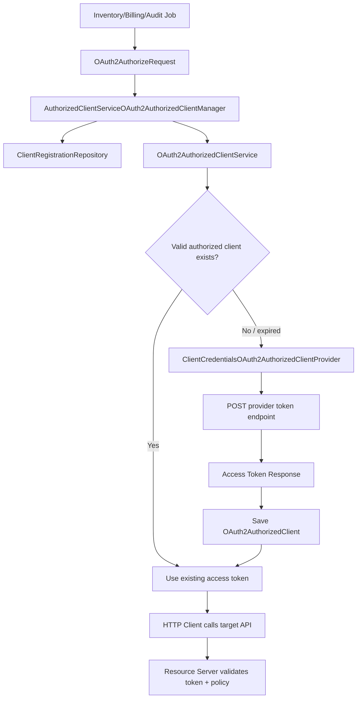
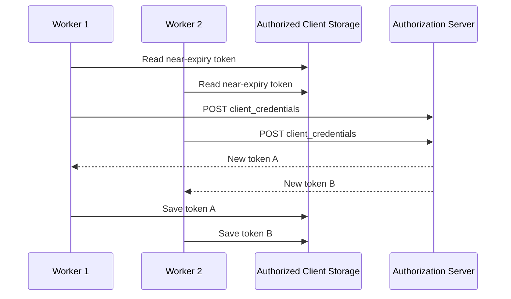
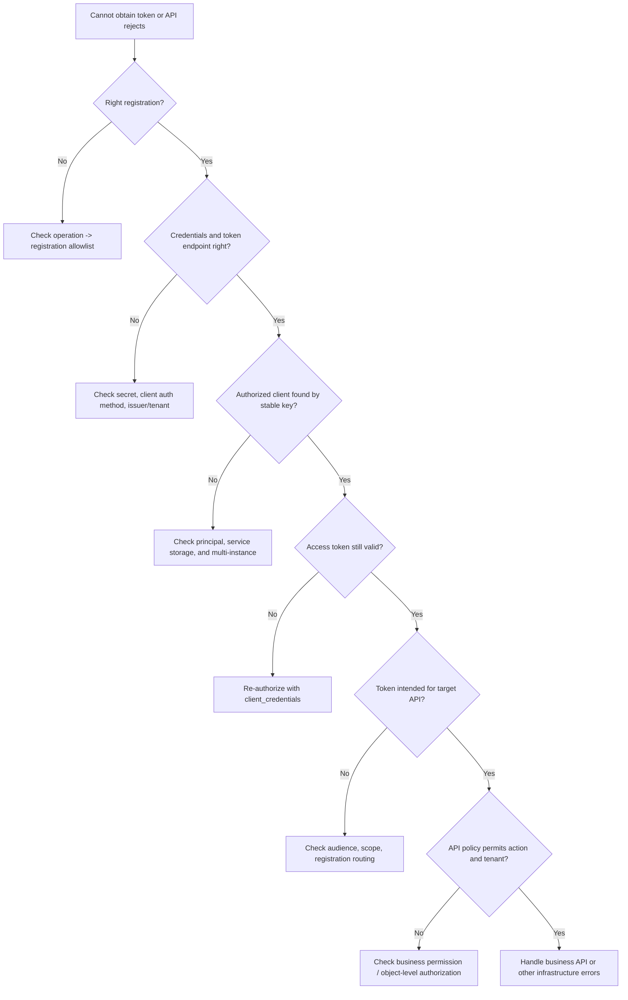
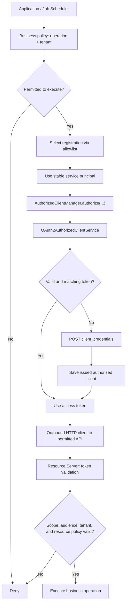

# 16.8. Managing Tokens for Multiple Applications or Service Accounts

In a small system, a backend might use just one OAuth2 client to call one API. However, enterprise systems typically have **multiple applications, multiple background tasks, and multiple service accounts**: an inventory sync service calling the Inventory API, an invoicing system calling the Billing API, an audit job calling the Audit API, and different environments or tenants with their own policies. Each integration may have its own `client_id`, authentication method, scopes, audience, and token lifecycle.

With **Spring Security OAuth 2.0 Client**, the `client_credentials` grant allows an application to authenticate with the Authorization Server using **the client's own** credentials to obtain an access token. There is no end-user sign-in in this grant. To operate safely at the scale of multiple applications or service accounts, all three layers must be managed properly:

1. **Client identity and configuration**: which application/service account is registered with the Authorization Server?
2. **Obtaining and storing authorized clients**: which registration and principal does `OAuth2AuthorizedClientManager` select, and does it reuse an existing token or request a new one?
3. **Permission isolation and token protection**: which token is sent to which API, who may read the token store, and what happens when credentials are revoked or rotated?

This lesson covers the multi-`ClientRegistration` model, how to use `AuthorizedClientServiceOAuth2AuthorizedClientManager`, the `(registrationId, principalName)` lookup key, storage/caching design, multi-tenant handling, Java/YAML configuration examples, operational strategies, and real-world pitfalls.

## 1. Recapping the Nature of the Client Credentials Grant

Per OAuth 2.0, `client_credentials` applies when a client accesses resources it owns or acts under permissions granted to the client itself. The client sends a token request directly from the backend to the **token endpoint**:

```http
POST /oauth2/token HTTP/1.1
Host: idp.example.org
Authorization: Basic <CLIENT_CREDENTIALS_REDACTED>
Content-Type: application/x-www-form-urlencoded
Accept: application/json

grant_type=client_credentials&scope=inventory.read
```

The Authorization Server may return:

```http
HTTP/1.1 200 OK
Content-Type: application/json
Cache-Control: no-store

{
  "access_token": "<ACCESS_TOKEN_REDACTED>",
  "token_type": "Bearer",
  "expires_in": 1800,
  "scope": "inventory.read"
}
```

This is an illustrative example. The client authentication method may differ from HTTP Basic if the provider supports `private_key_jwt`, mTLS, or another registered method. Scopes, lifetime, and token format are decided by the Authorization Server.

**The following steps do not exist in a standard `client_credentials` flow:** browser redirect to a login page, authorization code callback, end-user authentication via OIDC, ID Token, or an `OidcUser` session. The access token represents a **client/service identity**, not an employee automatically.

### 1.1. When Should This Grant Be Used?

| Scenario | Is `client_credentials` Appropriate? | Reason |
|---|---|---|
| Periodic job reading inventory from a partner API | Yes, if the API grants permissions to the service | No user interaction needed. |
| Backend writing invoice data using a service account | Yes, when the service is granted corresponding permissions | Application permissions are managed separately. |
| User logging in with Google/Corporate IdP | No, use OIDC Login / authorization code instead | Must authenticate the user's identity. |
| Backend calling an API *on behalf of Alice*, needing Alice's permissions | Usually no | A service token does not automatically carry Alice's identity; requires delegated user authorization / token exchange when architecture demands it. |
| Each SaaS customer has its own service credentials | Possibly | Must design isolation by client/tenant, issuer, and API policy. |

Never use a broadly privileged `client_credentials` token to silently bypass per-user or per-tenant authorization checks.

## 2. Three Identity Layers When Running Multiple Applications

The following concepts are easily confused:

| Concept | Example | Role |
|---|---|---|
| **`registrationId`** | `inventory-reader` | **Spring-internal** key used to look up a `ClientRegistration`. |
| **`clientId`** | `svc-inventory-ro-prod` | The OAuth2 client identity registered at the Authorization Server. |
| **Service account** | `inventory-sync-service` | Service identity managed by the IdP/organization; may map to one or more clients depending on the product. |
| **`principalName`** | `service:inventory-sync` | Principal key used to save/look up `OAuth2AuthorizedClient` on the Spring side. |
| **Issuer / Authorization Server** | `https://idp.example.org/realms/services` | Token issuer defining the trust domain. |
| **Audience / resource** | `https://inventory-api.example.org` | Target API where the token must be accepted; depends on provider contract. |
| **Scope** | `inventory.read` | Scope of permissions requested and granted by the provider. |

In many cases, organizations manage **one service account per application/integration**, though this is not a mandatory 1:1 relationship in OAuth2. One service account may own multiple OAuth2 clients, or an IdP may model it differently. Spring Security deals with `ClientRegistration` and authorized clients; map clearly to your provider's service account model.

### 2.1. One Application Can Manage Multiple Clients

For example, `reporting-gateway` may simultaneously use:

```text
reporting-gateway
  |
  +-- registrationId = inventory-reader
  |       clientId = svc-inventory-ro-prod
  |       scope = inventory.read
  |       API = Inventory API
  |
  +-- registrationId = billing-writer
  |       clientId = svc-billing-write-prod
  |       scope = invoices.write
  |       API = Billing API
  |
  +-- registrationId = audit-exporter
          clientId = svc-audit-export-prod
          scope = audit.export
          API = Audit API
```

These are three **separate client registrations**, not three scopes always bundled into a single access token. Separating registrations keeps credentials, target APIs, permission boundaries, and auditing distinct.

### 2.2. One API Can Accept Multiple Clients

The Inventory API may accept tokens from both `inventory-reader` and `inventory-reconciler` with different permissions:

| Client | Grantable Scope | API Policy |
|---|---|---|
| `inventory-reader` | `inventory.read` | Allowed to read permitted inventory data. |
| `inventory-reconciler` | `inventory.read inventory.adjust` | May adjust inventory if business conditions hold. |
| `billing-writer` | `invoices.write` | Must not be allowed to call the Inventory API merely because the token has a valid signature. |

The Resource Server must verify issuer, audience, expiration, scopes, and application constraints. **A valid signature does not mean a token fits every API.**

## 3. Configuring Multiple `ClientRegistration`s in Spring Boot

For a Spring Boot Servlet application, add the OAuth2 Client starter and required web dependencies:

```xml
<dependencies>
    <dependency>
        <groupId>org.springframework.boot</groupId>
        <artifactId>spring-boot-starter-web</artifactId>
    </dependency>
    <dependency>
        <groupId>org.springframework.boot</groupId>
        <artifactId>spring-boot-starter-security</artifactId>
    </dependency>
    <dependency>
        <groupId>org.springframework.boot</groupId>
        <artifactId>spring-boot-starter-oauth2-client</artifactId>
    </dependency>
</dependencies>
```

Example `application.yml` with three clients sharing one provider:

```yaml
spring:
  security:
    oauth2:
      client:
        registration:
          inventory-reader:
            provider: corporate-services
            client-id: "${INVENTORY_READ_CLIENT_ID}"
            client-secret: "${INVENTORY_READ_CLIENT_SECRET}"
            authorization-grant-type: client_credentials
            client-authentication-method: client_secret_basic
            scope:
              - inventory.read

          billing-writer:
            provider: corporate-services
            client-id: "${BILLING_WRITE_CLIENT_ID}"
            client-secret: "${BILLING_WRITE_CLIENT_SECRET}"
            authorization-grant-type: client_credentials
            client-authentication-method: client_secret_basic
            scope:
              - invoices.write

          audit-exporter:
            provider: corporate-services
            client-id: "${AUDIT_EXPORT_CLIENT_ID}"
            client-secret: "${AUDIT_EXPORT_CLIENT_SECRET}"
            authorization-grant-type: client_credentials
            client-authentication-method: client_secret_basic
            scope:
              - audit.export

        provider:
          corporate-services:
            token-uri: "https://idp.example.org/realms/services/protocol/openid-connect/token"
```

In this configuration:

- **`registrationId`** corresponds to the three keys `inventory-reader`, `billing-writer`, and `audit-exporter` under `registration`.
- Each registration has its own **separate client ID/secret** and minimal required scope.
- All three share the same token endpoint because the IdP supports it, though that is not mandatory.
- `client_secret_basic` fits when the provider registers the client as confidential and accepts HTTP Basic.
- Secrets come from the environment / secret manager; never put real values in repositories or logs.

If using `issuer-uri` and the IdP exposes compatible metadata/discovery, Spring can derive the token endpoint from metadata. With `client_credentials`, no browser authorization endpoint is needed, yet the token URI must still point to the right realm/tenant and be accessed securely over HTTPS.

### 3.1. When Clients Belong to Multiple Providers

An application might call both a Corporate IdP and a Partner IdP:

```yaml
spring:
  security:
    oauth2:
      client:
        registration:
          internal-inventory:
            provider: internal-idp
            client-id: "${INTERNAL_CLIENT_ID}"
            client-secret: "${INTERNAL_CLIENT_SECRET}"
            authorization-grant-type: client_credentials
            scope: [inventory.read]
          partner-orders:
            provider: partner-idp
            client-id: "${PARTNER_CLIENT_ID}"
            client-secret: "${PARTNER_CLIENT_SECRET}"
            authorization-grant-type: client_credentials
            scope: [orders.read]
        provider:
          internal-idp:
            token-uri: "https://idp.example.org/oauth2/token"
          partner-idp:
            token-uri: "https://identity.partner.example.org/oauth/token"
```

Each client must use its registered token endpoint, credentials, audience, and trust domain. Never send an `internal-inventory` token to a partner API just because both are OAuth2 bearer tokens.

## 4. Spring Security Components Managing Tokens

For background workers or services calling APIs independently of HTTP requests, the architecture typically includes:



The diagram shows the typical lifecycle. Exact re-authorization details, expiration thresholds, error handling, and manager/provider branching depend on your Spring Security version and configuration.

Core APIs:

| Component | Responsibility |
|---|---|
| `ClientRegistrationRepository` | Looks up the configuration for the chosen `registrationId`. |
| `OAuth2AuthorizeRequest` | Encapsulates registration/principal and attributes for one authorize call. |
| `OAuth2AuthorizedClientManager` | Coordinates finding existing clients and issuing/re-issuing tokens. |
| `AuthorizedClientServiceOAuth2AuthorizedClientManager` | Manager for contexts **not dependent on a Servlet request**. |
| `OAuth2AuthorizedClientProvider` | Handles grants, such as `client_credentials`. |
| `OAuth2AuthorizedClientService` | Saves/retrieves/removes authorized clients by key. |
| `OAuth2AuthorizedClient` | Result holding registration, principal name, access token, and optional refresh token. |

With `client_credentials`, a normal token response has no refresh token; when the access token expires, the client requests a **new access token using client credentials**. Do not design a refresh token flow for client credentials unless the provider explicitly supports an extension for it.

## 5. Configuring `AuthorizedClientManager` for Multiple Service Accounts

A single manager can serve multiple `client_credentials` registrations. You do not have to create one manager per client if they share the same token storage strategy and grant provider.

```java
import org.springframework.context.annotation.Bean;
import org.springframework.context.annotation.Configuration;
import org.springframework.security.oauth2.client.AuthorizedClientServiceOAuth2AuthorizedClientManager;
import org.springframework.security.oauth2.client.OAuth2AuthorizedClientManager;
import org.springframework.security.oauth2.client.OAuth2AuthorizedClientProvider;
import org.springframework.security.oauth2.client.OAuth2AuthorizedClientProviderBuilder;
import org.springframework.security.oauth2.client.OAuth2AuthorizedClientService;
import org.springframework.security.oauth2.client.registration.ClientRegistrationRepository;

@Configuration
class ServiceOAuth2Configuration {

    @Bean
    OAuth2AuthorizedClientManager serviceAuthorizedClientManager(
            ClientRegistrationRepository registrations,
            OAuth2AuthorizedClientService authorizedClients) {

        OAuth2AuthorizedClientProvider provider =
                OAuth2AuthorizedClientProviderBuilder.builder()
                        .clientCredentials()
                        .build();

        var manager =
                new AuthorizedClientServiceOAuth2AuthorizedClientManager(
                        registrations, authorizedClients);
        manager.setAuthorizedClientProvider(provider);

        return manager;
    }
}
```

Meaning:

1. `ClientRegistrationRepository` holds the three registrations from YAML.
2. `OAuth2AuthorizedClientService` stores the token records.
3. `clientCredentials()` declares that the manager uses only the provider for the appropriate grant.
4. When the app calls `authorize(...)`, the manager resolves the registration from the request and checks the stored authorized client.

Do not enable `authorizationCode()` or `refreshToken()` in a background manager simply because the app also uses OIDC Login elsewhere. Those grants have different requirements and may be inappropriate for service identities.

### 5.1. Creating an Authorize Request for One Service

```java
import org.springframework.security.oauth2.client.OAuth2AuthorizeRequest;
import org.springframework.security.oauth2.client.OAuth2AuthorizedClient;
import org.springframework.security.oauth2.client.OAuth2AuthorizedClientManager;

public final class ServiceTokenProvider {

    private final OAuth2AuthorizedClientManager manager;

    public ServiceTokenProvider(OAuth2AuthorizedClientManager manager) {
        this.manager = manager;
    }

    public OAuth2AuthorizedClient inventoryClient() {
        OAuth2AuthorizeRequest request =
                OAuth2AuthorizeRequest
                        .withClientRegistrationId("inventory-reader")
                        .principal("service:reporting-gateway")
                        .build();

        OAuth2AuthorizedClient authorized = manager.authorize(request);
        if (authorized == null) {
            throw new IllegalStateException(
                    "Unable to authorize inventory-reader");
        }
        return authorized;
    }
}
```

Here `principal("service:reporting-gateway")` is the **Spring-side logical principal name** used to store/look up the authorized client, not an employee's OIDC `sub`. It is neither a secret nor proof of client authentication sent to the Authorization Server.

If the code runs periodically, use a **stable** logical principal rather than generating a new UUID or timestamp on every call.

### 5.2. Creating an Allowlisted Registration Dispatcher

A common operational mistake is passing a raw `registrationId` straight from the frontend into the manager. That can let a user trigger a highly privileged client or obtain tokens intended for an unrelated integration.

Instead, map business operations to a server-side registration allowlist:

```java
import java.util.Map;
import org.springframework.security.oauth2.client.OAuth2AuthorizeRequest;
import org.springframework.security.oauth2.client.OAuth2AuthorizedClient;
import org.springframework.security.oauth2.client.OAuth2AuthorizedClientManager;

public final class OutboundServiceTokenProvider {

    private static final Map<String, String> REGISTRATIONS = Map.of(
            "INVENTORY_READ", "inventory-reader",
            "BILLING_WRITE", "billing-writer",
            "AUDIT_EXPORT", "audit-exporter");

    private final OAuth2AuthorizedClientManager manager;

    public OutboundServiceTokenProvider(
            OAuth2AuthorizedClientManager manager) {
        this.manager = manager;
    }

    public OAuth2AuthorizedClient forOperation(String operation) {
        String registrationId = REGISTRATIONS.get(operation);
        if (registrationId == null) {
            throw new IllegalArgumentException("Unknown service operation");
        }

        OAuth2AuthorizeRequest request =
                OAuth2AuthorizeRequest
                        .withClientRegistrationId(registrationId)
                        .principal("service:reporting-gateway")
                        .build();

        OAuth2AuthorizedClient client = manager.authorize(request);
        if (client == null) {
            throw new IllegalStateException(
                    "No authorized client: " + registrationId);
        }
        return client;
    }
}
```

This is an illustrative dispatcher. In a real system, **permission to perform the operation** must be verified before calling this method; allowlisting operation names does not replace authorization. Returning the full `OAuth2AuthorizedClient` should also stay confined to the backend and never be exposed via a public API.

### 5.3. Calling the API with the Right Token

Once `inventory-reader`'s token is obtained, the backend can use Spring `RestClient`:

```java
import org.springframework.web.client.RestClient;

public final class InventoryGateway {

    private final RestClient restClient =
            RestClient.builder()
                    .baseUrl("https://inventory-api.example.org")
                    .build();

    private final OutboundServiceTokenProvider tokens;

    public InventoryGateway(OutboundServiceTokenProvider tokens) {
        this.tokens = tokens;
    }

    public String loadItems() {
        String accessToken = tokens.forOperation("INVENTORY_READ")
                .getAccessToken()
                .getTokenValue();

        return restClient.get()
                .uri("/v1/items")
                .headers(headers -> headers.setBearerAuth(accessToken))
                .retrieve()
                .body(String.class);
    }
}
```

The example uses a fixed, server-controlled API URL. Never take an arbitrary base URL from a browser request and send a bearer token there—that can leak tokens via **server-side request forgery (SSRF)** or route tokens to the wrong recipient.

In production apps, you can use Spring Security's OAuth2 integration for `RestClient`/`WebClient` to select the authorized client and attach the bearer token automatically per configuration rather than manipulating headers manually. Either way, ensure each registration maps strictly to its target API.

## 6. Token Lookup Keys: Registration ID and Principal Name

`OAuth2AuthorizedClientService` typically stores authorized clients by the pair:

```text
(clientRegistrationId, principalName)
```

With three registrations:

```text
("inventory-reader", "service:reporting-gateway") -> access token A
("billing-writer",   "service:reporting-gateway") -> access token B
("audit-exporter",   "service:reporting-gateway") -> access token C
```

Three different clients can share a logical principal because **their registrations differ**. Conversely, the same registration with two different principals is treated as two separate authorized clients in service storage:

```text
("inventory-reader", "service:nightly-import")
("inventory-reader", "service:manual-reconciliation")
```

**Subtle point:** with the same client ID/secret and same scopes, creating two records under different principals **does not cause the Authorization Server to issue two distinct identities**. The key pair only separates where Spring stores tokens—it does not determine the subject, audience, or permissions issued by the provider.

### 6.1. When to Use the Same Principal?

If multiple workers of **the same trusted application** request tokens for the same registration and permissions, using a stable logical principal enables reusing the authorized client. Do this only intentionally:

- Workers belong to the same trust boundary.
- Credentials, scopes, audience, and token policies are identical.
- Sharing tokens does not expose permissions to another application.
- Storage has appropriate concurrency/synchronization when multiple instances update it.

Do not share a principal and storage across independent applications just to “save tokens.” Tokens are security credentials; sharing them must be evaluated like sharing service privileges.

### 6.2. When to Separate Principals?

Separating principals can be appropriate when partitioning authorized clients for **genuinely distinct logical actors** within the same registration, such as workflows with different ownership or verified tenants. However:

- If **OAuth2 client ID/secret** differs, use a separate `ClientRegistration`.
- If **scope/audience** differs, separate registrations/authorizations are usually needed, not just renaming the principal.
- If **tenant** differs, the provider/API must genuinely bind tokens to the tenant or enforce equivalent API policies.
- If only **job run ID** differs, do not create a new principal on every run.

### 6.3. Do Not Merge Tokens by Client ID Manually

An organization may have two registrations pointing to **the same `clientId`** under different registration names or application configurations. Spring still treats them as two distinct keys. Never merge authorized clients by `clientId` alone, as tokens may differ in grant, scope, provider, tenant, or intended use.

Additionally, client ID is not a secret and is not an API authentication mechanism by itself. Client authentication and token verification are what enforce security.

## 7. Multiple Service Accounts: Choosing an Isolation Model

Distinguish three deployment models.

### 7.1. Model A: Each Application Uses Its Own Client

```text
Inventory Worker   -> client-id inventory-worker-prod   -> inventory.read
Billing Worker     -> client-id billing-worker-prod     -> invoices.write
Audit Worker       -> client-id audit-worker-prod       -> audit.export
```

Advantages:

- **Least privilege:** each client requests only the permissions it needs.
- **Independent secret rotation:** errors or revocation in one service have minimal impact on others.
- **Clear auditing:** the Authorization Server knows which client requested each token.
- **Blast-radius containment:** client A's tokens/credentials cannot implicitly call API B.

In return, you must manage more client registrations, secrets, expiration cycles, and automated service-account provisioning.

### 7.2. Model B: One Application Has Multiple Clients per API

`reporting-gateway` is a single application yet needs three separate registrations. This fits when permissions are separated per API within one deployable unit.

Still map operations explicitly:

```text
operation INVOICE_WRITE -> registration billing-writer -> Billing API
operation AUDIT_EXPORT  -> registration audit-exporter -> Audit API
```

Never create a `super-client` registration holding every scope unless truly unavoidable. Concentrating excessive permissions under one secret magnifies the damage if that credential leaks.

### 7.3. Model C: Multiple Tenants with Separate Credentials

Suppose a SaaS integrates with a partner API for three customers:

```text
Tenant A -> partner-client-A -> token for A
Tenant B -> partner-client-B -> token for B
Tenant C -> partner-client-C -> token for C
```

Each tenant may have its own `clientId`, secret, and permitted data boundary. The system must:

1. **Determine the trusted tenant** from server-managed account/workspace/job state.
2. Map the tenant to the **registration provisioned for that tenant**.
3. Restrict secret and authorized-client read access per tenant.
4. Ensure tokens genuinely bind to the tenant per provider contract; the Resource Server enforces resource permissions.
5. Prevent callers from picking another tenant's registration via arbitrary query/body inputs.

With very large tenant counts, you do not have to hand-write a YAML block per tenant. You can use a custom `ClientRegistrationRepository`, secure provisioning data, or another credential management mechanism to resolve registrations dynamically—adding caching, rotation, tenant isolation, and config synchronization. **Never take untrusted client configuration from a browser and feed it directly into a token request.**

## 8. Isolating Tokens by Tenant: What Does Not Happen Automatically?

An anti-pattern:

```java
OAuth2AuthorizeRequest request =
        OAuth2AuthorizeRequest
                .withClientRegistrationId("shared-service-client")
                .principal("service:" + tenantId)
                .attributes(attributes ->
                        attributes.put("tenant", tenantId))
                .build();
```

This snippet may create separate storage keys per tenant, yet **the Authorization Server still receives the exact same client ID/secret and scopes** if the registration is unchanged. It can issue access tokens with identical permissions, enforcing no tenant isolation whatsoever.

Separate the two layers:

| Layer | Can `principalName` or a Context Attribute Achieve It? | What Must Be Done? |
|---|---|---|
| **Storage isolation** between authorized client records | Possibly, depending on repository and key strategy | Choose stable keys and restrict storage access. |
| **OAuth2 client identity** | No | Use a registration with the matching client ID and auth method. |
| **Audience/resource** of the access token | Not automatically | Configure Authorization Server / provider extension / matching registration. |
| **Granted scopes** | Not automatically | Client may request scopes and provider decides what to grant; inspect response. |
| **Tenant data access rights** | No | Resource Server validates the token and enforces tenant/object-level authorization. |

Tenant ID can be useful routing metadata, but it must never be treated as proof of access rights when coming from an untrusted source.

### 8.1. Controlled Tenant Mapping Rules

A design pattern:

```java
public final class TenantClientSelector {

    private final Map<String, String> registrationByTenant =
            Map.of(
                    "tenant-north", "partner-north-client",
                    "tenant-south", "partner-south-client");

    public String registrationFor(
            String tenantId,
            TenantAccessPolicy policy) {

        String approvedTenant = policy.requireApprovedTenant(tenantId);
        String registrationId = registrationByTenant.get(approvedTenant);

        if (registrationId == null) {
            throw new IllegalStateException(
                    "No registered service client for tenant");
        }
        return registrationId;
    }
}
```

`TenantAccessPolicy` is a **hypothetical** business component; it must verify which tenants the current actor is permitted to access. The map above is only for a small example; larger multi-tenant systems can use a protected registry, while the rule preventing cross-tenant client lookup stays the same.

## 9. Storing Tokens: InMemory, JDBC, and Multiple Instances

Spring Security provides the `OAuth2AuthorizedClientService` abstraction, with common implementations:

| Implementation | Where Data Lives | Best Suited For |
|---|---|---|
| `InMemoryOAuth2AuthorizedClientService` | Process RAM | Development, simple apps, tokens that do not need to survive restarts. |
| `JdbcOAuth2AuthorizedClientService` | Relational database | Multiple instances needing shared storage, persistence, or manageability. |
| Custom service | App-chosen storage | Encryption, vault-backed storage, tenant partitioning, specialized policies. |

Key properties:

- **Key** is typically `(clientRegistrationId, principalName)`; the service retrieves tokens by that pair.
- **Token value is a secret**. If stored in a DB, enforce access controls, backup protection, encryption-at-rest, and retention limits.
- **Multi-instance does not automatically mean synchronized refreshes.** Multiple instances may notice a token is near expiry and request new tokens simultaneously.
- **Token state is not human user identity.** Never use claims from a service token JWT to construct an `OidcUser` for a browser.

### 9.1. Visualizing Keys in JDBC

```text
oauth2_authorized_client

client_registration_id    principal_name              token
------------------------------------------------------------------
inventory-reader          service:reporting-gateway   access A
billing-writer            service:reporting-gateway   access B
audit-exporter            service:reporting-gateway   access C
partner-north-client      service:tenant-north        access D
partner-south-client      service:tenant-south        access E
```

This is a conceptual diagram; the actual schema and token columns depend on your Spring Security version and database. A row in the table does not mean the access token in that row is still valid. `OAuth2AuthorizedClientManager` is the proper place to manage re-fetching tokens per grant and lifecycle.

### 9.2. When Should Tokens Be Persisted Long-Term?

Not every system needs JDBC. With `client_credentials`, an application can request a new token when needed; after a restart, a cache miss merely triggers a new token request. However, with many instances or strict provider token-issuance rate limits, shared persistence/caching can be helpful.

Decide based on:

1. API call frequency and access token lifetime.
2. Rate limits / token issuance quotas at the Authorization Server.
3. Number of instances, jobs, and tenants.
4. Tolerance for increased token endpoint requests after restarts.
5. Sensitivity of persisting tokens across backups/DBs.
6. Resilience needs during brief provider interruptions.

**Do not retain tokens indefinitely just because storage permits it.** Expired or revoked tokens must be handled and purged according to policy.

## 10. Reauthorization, Expiration, and Concurrency

A service token has a finite lifetime. When the manager receives `authorize(...)`:

- If the authorized client remains valid and the token has not reached the expiration threshold, it can reuse the token.
- If the access token is expired or near expiry per provider logic, `client_credentials` can request a new token.
- If no authorized client exists yet, the manager can initiate a new grant.
- If the token endpoint rejects with `invalid_client` or `invalid_scope`, the manager cannot fix client registrations or permissions on its own.

Never read a token directly from the service and cache it forever in a `static` variable, since token lifetimes and re-issuance conditions change. Call the manager before using a token or use a properly configured OAuth2 HTTP client integration.

### 10.1. The “Thundering Herd” Phenomenon

When multiple instances share one registration/principal:



Both requests may be valid, yet they generate redundant token traffic and overwrites. At high scale, consider:

- Reusing tokens via authorized client storage when permissions match.
- Synchronizing token re-issuance per key pair with proper concurrency controls.
- Distributed locks or single-flight mechanisms in multi-instance deployments, with timeouts and safe lock-failure handling.
- Concurrency limits and backoff/jitter when rate-limited by the provider.
- Handling cases where an instance crashes mid-request.

Avoid a global lock across all registrations/tenants if it creates unnecessary contention. Synchronization should match how tokens are actually partitioned.

### 10.2. Clock Skew and Token Lifetime

When a token nears expiration, allow buffer time for request transit and clock drift between the application, Authorization Server, and Resource Server. Spring Security checks expiration inside the authorized client provider; exact timing configuration varies by version.

Never base expiration thresholds on browser-supplied timestamps. Synchronize system clocks via a trusted mechanism and account for network latency when designing job behavior.

### 10.3. Do Not Assume a Refresh Token Exists

`client_credentials` normally does not issue a refresh token. When the access token expires, the backend reuses its client credentials to request a new token. If a provider offers a custom extension issuing refresh tokens to services, verify the contract and configure accordingly rather than assuming it applies to every OAuth2 server.

## 11. Rotation and Service Account Lifecycle

Each registration needs an ownership and credential governance process:

| Lifecycle Stage | Actions |
|---|---|
| **Provisioning** | Create client/service account in IdP, grant necessary scopes/audience, assign owner and environment. |
| **Deployment** | Inject client ID/secret or keys/certificates from a secret manager; never hardcode. |
| **Operations** | Monitor token issuance failures and API authorization denials via sanitized logs. |
| **Rotation** | Generate new credentials per provider capabilities, roll out safely, then revoke old credentials. |
| **Revocation** | Remove scopes / disable client in IdP, handle existing tokens per provider policy. |
| **Decommissioning** | Remove registration/config, revoke credentials/tokens where possible, clean up authorized client storage, and audit. |

### 11.1. Rotating Client Secrets

Suppose `billing-writer` uses secret S1. Operational steps may include:

1. Provision new credential S2 in the IdP if the provider supports overlapping credentials during a transition window.
2. Place S2 into the secret manager; roll out the updated application cleanly.
3. Confirm the token endpoint accepts requests using S2 and the Billing API accepts the new tokens.
4. Revoke S1 and purge stale authorized client records if policy requires.
5. Monitor `invalid_client`, timeouts, and token issuance rates after the change.

Never write S1/S2 to logs or send them over chat/tickets. When using private-key JWT or mTLS, rotation applies to the corresponding keys/certificates rather than plain secrets.

**Important note:** the authorized client cache may still hold an unexpired access token even after changing the secret. The application continuing to call APIs briefly **does not prove the new secret works**; run a controlled token-issuance check when verifying rotation.

### 11.2. Disabling a Service Account

Disabling a client does not always invalidate every already-issued access token immediately, especially self-contained JWTs accepted by Resource Servers until expiration. Revocation behavior depends on the Authorization Server, Resource Server, introspection, revocation lists, and token lifetimes.

When decommissioning a service account:

- Disable/revoke in the IdP per provider capabilities.
- Restrict or remove API access permissions on the Resource Server.
- Remove the authorized client from local storage.
- Revoke tokens if supported by the provider.
- Audit logs and remaining request traffic.

Deleting an `OAuth2AuthorizedClient` row in JDBC **does not automatically revoke** the token at the Authorization Server.

## 12. Authorization and Per-API Permission Boundaries

Service tokens should follow **least privilege**:

```text
inventory-reader -> Inventory API -> inventory.read
billing-writer   -> Billing API   -> invoices.write
audit-exporter   -> Audit API     -> audit.export
```

An access token meant for client A must never be used implicitly against API B. The Resource Server must check:

- Token **issuer** is approved.
- **Audience/resource** matches the receiving API.
- **Expiration/not-before**, signature, or introspection matches the token type.
- **Scope/authority** allows the action.
- **Tenant, organization, object ownership**, and other business constraints if required by the API.

If a token carries only `inventory.read`, a `POST /inventory/adjust` endpoint must reject it even though the client authenticated legitimately.

### 12.1. Holding a Token Does Not Authorize Everything

A backend may hold an access token with `audit.export`, yet that does not mean every backend endpoint should let web users trigger exports freely. The application must authorize the **business initiator** before using a service credential.

For example, a frontend user requests exporting all audit data:

```text
Browser/User -> Portal API -> Business authorization
                                  |
                                  | allowed?
                                  v
                              audit-exporter token
                                  |
                                  v
                              Audit API
```

Never grant end-users permissions merely because the backend holds a powerful credential. A service credential is a system privilege that must be guarded at every call layer.

### 12.2. Preventing Misrouted Bearer Tokens

When using one HTTP client for multiple APIs, enforce strictly:

- Target URLs come from trusted configuration, never arbitrary user input.
- Registration selection follows an operation/API allowlist.
- Never use a default registration for all outbound requests when multiple APIs exist.
- Never automatically forward a browser's `Authorization` header to another API.
- Never log request headers containing bearer tokens.
- Avoid following redirects to other hosts with bearer credentials unless the HTTP stack guarantees stripping the header.

This boundary is just as important as storing authorized clients correctly.

## 13. When Does Each Client Group Need a Separate Manager?

One `OAuth2AuthorizedClientManager` can serve multiple registrations, yet you should not force everything into a single manager when isolation is needed:

| Case | Single Shared Manager | Separate Manager / Storage |
|---|---|---|
| Multiple registrations in the same trust domain and storage policy | Usually suitable | Optional |
| One group uses `client_credentials`, another uses `authorization_code` with web sessions | Can get messy | Separate service manager and web manager |
| Credentials belong to separate security zones with different audit/retention needs | Needs careful evaluation | Often easier to protect |
| Tenants have strict data/key isolation policies | May require custom routing | Can isolate token stores and configs |
| One group uses mTLS/`private_key_jwt`, another uses client secret | Possible if each client is configured right | Separate manager/token client when transport/policy differs |
| Different retry, timeout, proxy, or network routes | Configurable per client if API supports | Separate HTTP client/provider when needed |

Specifically, `DefaultOAuth2AuthorizedClientManager` serves Servlet web requests and `AuthorizedClientServiceOAuth2AuthorizedClientManager` fits service/background tasks. They may access different stores; never assume a client saved in an HTTP session will appear in service storage.

### 13.1. Do Not Use OIDC Login for Service Authentication

`oauth2Login()` creates a user principal after redirect/callback and ID Token validation. `client_credentials` does not create an `OidcUser`; therefore a batch job does not need:

```text
/oauth2/authorization/{registrationId}
/login/oauth2/code/{registrationId}
```

Those two endpoints belong to interactive browser flows. Jobs obtain tokens directly from `AuthorizedClientManager` using the corresponding `client_credentials` registration.

## 14. Observability, Alerting, and Troubleshooting

### 14.1. Signals to Monitor

| Signal | Operational Meaning |
|---|---|
| Token endpoint latency | Slow token issuance can impact jobs or APIs. |
| Token issuance rate per registration | Detects unstable principals, cache misses, or thundering herds. |
| `invalid_client` | Wrong/expired credentials, botched rotation, or mismatched client auth method. |
| `invalid_scope` | Scope not granted to client, misconfiguration, or provider policy change. |
| HTTP 429 from token endpoint | Rate limit hit; reduce token requests or apply provider-compliant backoff. |
| HTTP 401 from API | Invalid/expired/rejected token, or mismatched issuer/audience. |
| HTTP 403 from API | Token accepted, yet insufficient scope or business permissions. |
| Authorized client count in storage | Can grow abnormally if principals embed UUIDs, job IDs, or uncontrolled tenants. |
| Remaining token validity | Helps anticipate expiry, clock skew, and job continuity. |

In logs, record only `registrationId`, controlled task/correlation IDs, error codes, response times, and environment. Never log client secrets, tokens, Authorization headers, or sensitive user details.

### 14.2. Common Errors Table

| Symptom | Possible Cause | Resolution |
|---|---|---|
| `manager.authorize(...)` returns `null` | Registration mismatches provider/grant, provider chain lacks handler, or contract skips re-auth | Inspect `registrationId`, configured provider, and manager behavior. |
| `invalid_client` | Wrong Client ID/secret, wrong tenant/token endpoint, mismatched `basic`/`post`/`private_key_jwt` method | Verify client registration and credentials at the IdP. |
| `invalid_scope` | Requested scope not granted by provider or malformed scope | Verify registration scopes and Authorization Server grant policy. |
| Job mints a new token on every run | Principal changes per run ID or store is not shared | Use a stable principal name and check storage/caching. |
| Two tenants accidentally share a token | Shared registration/principal or token lacks tenant binding | Separate clients/registrations and enforce tenant checks at API. |
| API A accepts token yet API B rejects it | Different audience/scope or token issued for API A | Use the right registration and verify the audience/resource contract. |
| Token remains in DB yet API returns 401 | Token expired/revoked or provider rotated keys/policies | Let manager re-issue when needed and diagnose the Resource Server. |
| App restart spikes token requests | InMemory service loses cache | Consider persistence/shared cache if operational needs justify it. |
| App still runs after secret rotation, then fails later | Unexpired cached access token masked a bad new secret | Run a controlled token-issuance check and update credentials. |
| Instances overwrite with different tokens | Unshared storage or concurrent refresh/issuance | Evaluate shared storage and per-key locking/single-flight. |
| `client_credentials` has no `OidcUser` | Grant does not authenticate end-users | Never use an OIDC Login principal for background jobs. |
| Removed authorized client yet token still works | Deleting local storage does not revoke at the provider | Implement explicit token revocation/disabling. |
| Regular users can call admin APIs via backend's powerful token | Missing business permission check before outbound call | Enforce authorization at ingress/service and Resource Server. |

### 14.3. Diagnostic Flowchart



Separate **failure to obtain a token** from **token obtained but rejected by the API**. These two phases sit on different boundaries; rotating a secret will never fix a 403 caused by missing resource permissions.

## 15. Testing Client Isolation and Token Lifecycle Behavior

Before deploying to production, verify these scenarios:

1. **Registration routing:** operation `INVENTORY_READ` selects `inventory-reader`, and inputs outside the allowlist cannot trigger `audit-exporter`.
2. **Isolated credentials:** Billing's secret never appears in Inventory's token request.
3. **Granted scopes:** issued tokens reflect permissions actually allowed by the provider, not assumptions from YAML.
4. **Token reuse:** the same registration/principal reuses a valid authorized client per manager contract.
5. **Expiry:** once a token expires, the manager requests a new token via `client_credentials`.
6. **Principal stability:** two runs of the same job do not create extra records just because run IDs differ.
7. **Tenant boundary:** users/jobs for tenant A cannot select tenant B's registration or credentials.
8. **HTTP destination:** Inventory's access token is never sent to Billing or a browser-supplied URL.
9. **Rotation:** a revoked credential produces a clear error without leaking secrets in logs.
10. **Concurrency:** multiple workers requesting tokens concurrently do not corrupt storage or flood the Authorization Server.

Unit tests for a selector can verify operation mapping independently of the token endpoint. Integration tests for `OAuth2AuthorizedClientManager` should use a fake/mock token endpoint or dedicated test Authorization Server—never real client secrets.

### 15.1. Testing That the Application Calls the Right API

Suppose you have two test client IDs:

```text
inventory-reader -> test-inventory-client
billing-writer   -> test-billing-client
```

In the test, configure a mock HTTP token endpoint to return distinct tokens:

```text
token-inventory-test
token-billing-test
```

Verify that `InventoryGateway` sends only `token-inventory-test` to the Inventory API and `BillingGateway` sends only `token-billing-test` to the Billing API. These tokens are **fake test strings**, not real JWTs. This test catches registration-to-API routing bugs before granting production permissions.

## 16. Recommended Design Workflow for Multi-Application Systems

Before deploying a suite of applications or multiple service accounts, align on:

| Decision | Questions to Answer |
|---|---|
| Service account inventory | Who is the owner? Which clients exist per environment/tenant? |
| Registration strategy | Split by application, API, scope, tenant, or trust domain? |
| Provider contract | Token URI, client authentication, audience, scopes, token lifetime, rate limits? |
| Principal strategy | Which logical principal name is stable for authorized client storage? |
| Token storage | InMemory, JDBC, or custom store? Do multiple instances need to share? |
| Isolation | Can one app/tenant read another app/tenant's credentials? |
| HTTP routing | Which clients/operations may send tokens to which API URLs? |
| Secrets lifecycle | Who provisions, rotates, revokes, and audits credentials? |
| Failure handling | How to respond to `invalid_client`, 429, timeouts, and API 401/403? |
| Business authorization | Who verifies initiator permissions and target resource authorization? |

### 16.1. Example Architectural Mapping

A service suite might agree on:

```text
Operation                 Registration           Principal
----------------------------------------------------------------
inventory.read            inventory-reader       service:reporting-gateway
invoice.create            billing-writer         service:billing-processor
audit.export              audit-exporter         service:audit-scheduler
partner.north.orders      partner-north-client   service:tenant-north
partner.south.orders      partner-south-client   service:tenant-south
```

Each row must also document its **target API, scope/audience, credential ownership, and tenant policy**. Looking solely at registration and principal names cannot prove complete authorization.

### 16.2. Combined Execution Flow



The key principle is never forcing a single component to carry all responsibility: **the manager** handles token lifecycle, **client registration** defines the OAuth2 client, **secret manager/storage** protects credentials, **the gateway** targets the right API, and **the Resource Server and business policy** enforce access rights.

## 17. Mistakes to Avoid

1. Using a single `client_id`/secret with every scope for all applications when least privilege is possible.
2. Generating a UUID `principalName` on every run and causing unbounded token cache growth.
3. Letting a browser pick an arbitrary `registrationId` to receive powerful access tokens.
4. Changing `principalName` per tenant while forgetting that token privileges remain controlled by the provider.
5. Sending API A's token to API B merely because both accept bearer tokens.
6. Treating a `client_credentials` token as the identity of a logged-in OIDC user.
7. Storing client secrets or tokens in source code, logs, frontends, or unprotected monitoring tools.
8. Using an expired access token directly from the database without calling the manager or checking expiration.
9. Assuming `removeAuthorizedClient` revokes the token at the IdP.
10. Treating a rotation that “causes no immediate API errors” as proof the new secret works.
11. Letting multiple instances request new tokens continuously with no concurrency or rate-limit controls.
12. Using a service token's authority to bypass authorization for the human user who triggered the action.

## 18. Review Questions

1. Who does `client_credentials` authenticate, and how does it differ from Authorization Code / OIDC Login?
2. When one backend calls three APIs with different scopes, why prefer multiple `ClientRegistration`s over one broadly scoped token?
3. How do `registrationId`, `clientId`, service account, and `principalName` differ?
4. Which environments does `AuthorizedClientServiceOAuth2AuthorizedClientManager` fit, and what are its main collaborators?
5. If two jobs share the same registration and principal, what is shared in authorized client storage?
6. Why does changing `principalName` per tenant not automatically produce a provider-bound tenant token?
7. With the `client_credentials` grant, what normally happens when an access token expires? Is a refresh token required?
8. When multiple instances request new tokens simultaneously, what impact does the thundering herd phenomenon cause?
9. Why might a wrongly rotated client secret not fail immediately while the app still caches an old access token?
10. What must the Resource Server check beyond a valid token signature?
11. When a web user triggers a job using a privileged service credential, at which layers must the system check permissions?
12. Why might an HTTP 403 error from an API be unrelated to token acquisition at the token endpoint?

## References

- [Spring Security Reference — OAuth2 Client (Servlet)](https://docs.spring.io/spring-security/reference/servlet/oauth2/client/index.html)
- [Spring Security Reference — OAuth2 Client Core Model](https://docs.spring.io/spring-security/reference/servlet/oauth2/client/core.html)
- [Spring Security Reference — OAuth2 Client (Reactive)](https://docs.spring.io/spring-security/reference/reactive/oauth2/client/index.html)
- [Spring Security API — AuthorizedClientServiceOAuth2AuthorizedClientManager](https://docs.spring.io/spring-security/reference/api/java/org/springframework/security/oauth2/client/AuthorizedClientServiceOAuth2AuthorizedClientManager.html)
- [Spring Security API — OAuth2AuthorizedClientService](https://docs.spring.io/spring-security/reference/api/java/org/springframework/security/oauth2/client/OAuth2AuthorizedClientService.html)
- [Spring Security API — OAuth2AuthorizeRequest](https://docs.spring.io/spring-security/reference/api/java/org/springframework/security/oauth2/client/OAuth2AuthorizeRequest.html)
- [Spring Security API — OAuth2AuthorizedClient](https://docs.spring.io/spring-security/reference/api/java/org/springframework/security/oauth2/client/OAuth2AuthorizedClient.html)
- [Spring Security API — ClientRegistration](https://docs.spring.io/spring-security/reference/api/java/org/springframework/security/oauth2/client/registration/ClientRegistration.html)
- [RFC 6749 — OAuth 2.0 Client Credentials Grant](https://datatracker.ietf.org/doc/html/rfc6749#section-4.4)
- [RFC 6749 — OAuth 2.0 Scope](https://datatracker.ietf.org/doc/html/rfc6749#section-3.3)
- [OAuth 2.0 Security Best Current Practice (RFC 9700)](https://www.rfc-editor.org/rfc/rfc9700.html)
