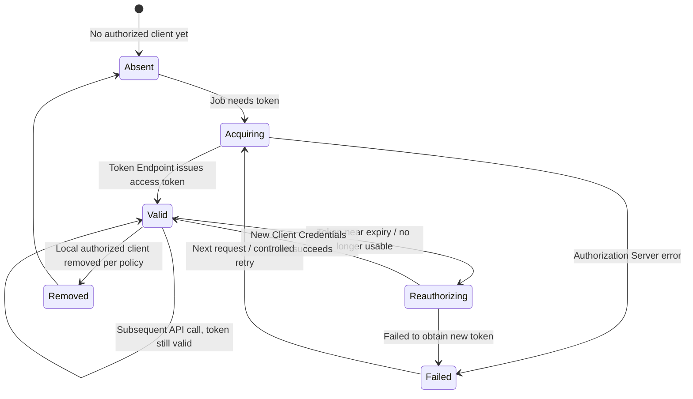
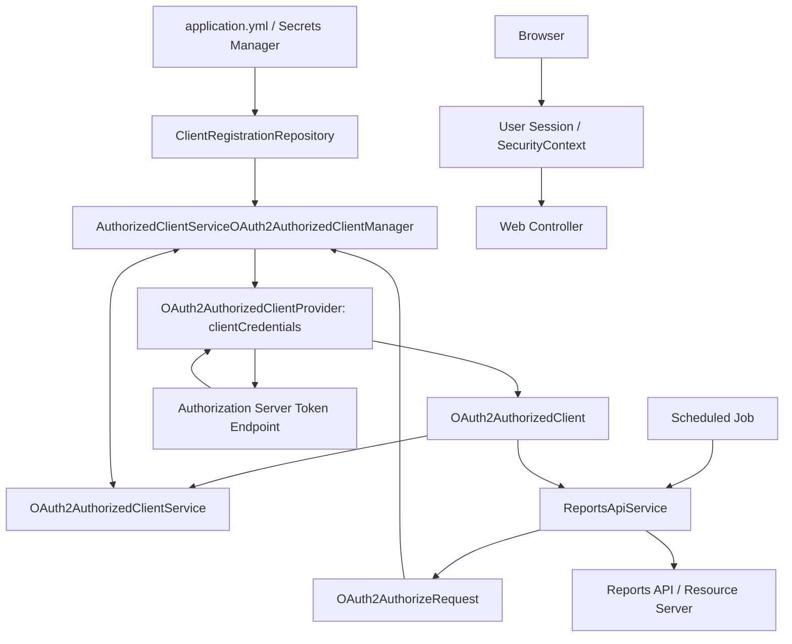
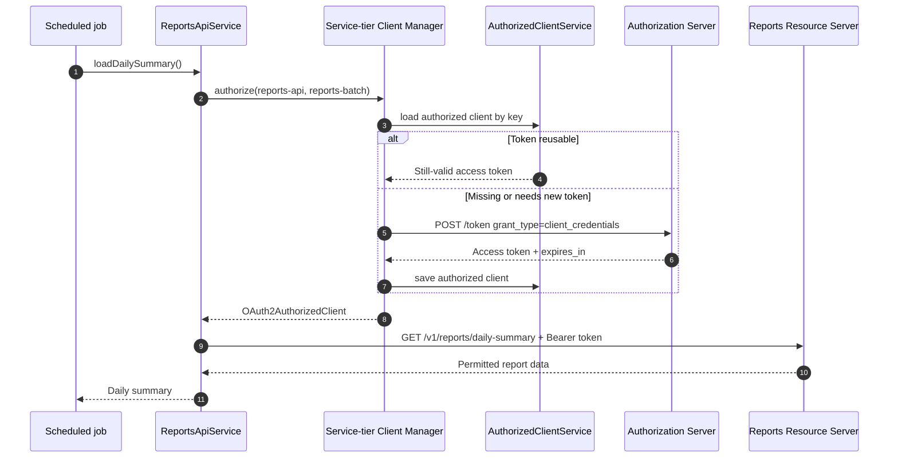
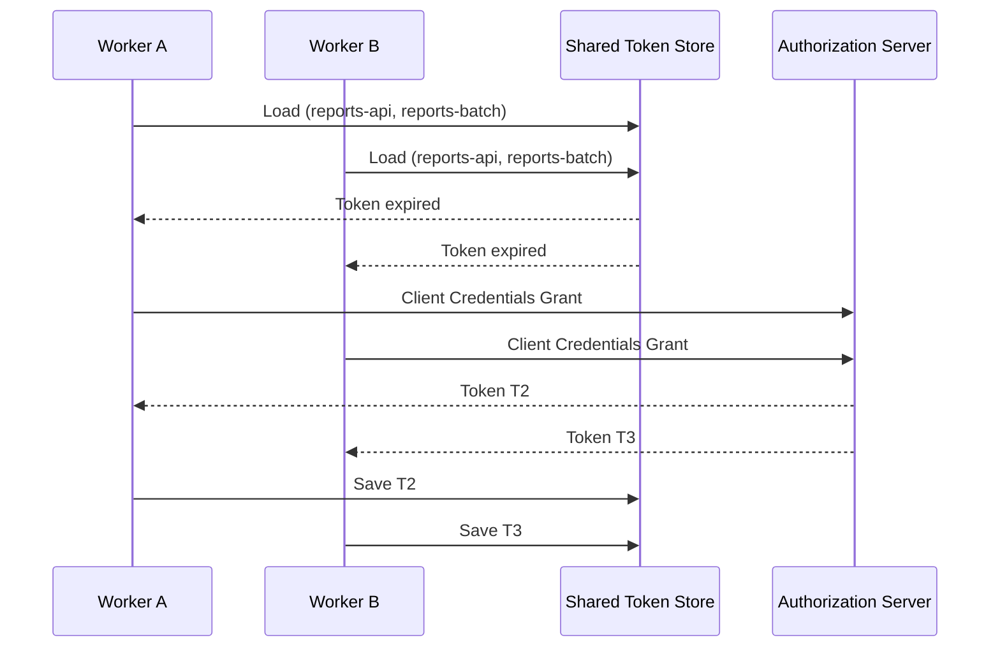
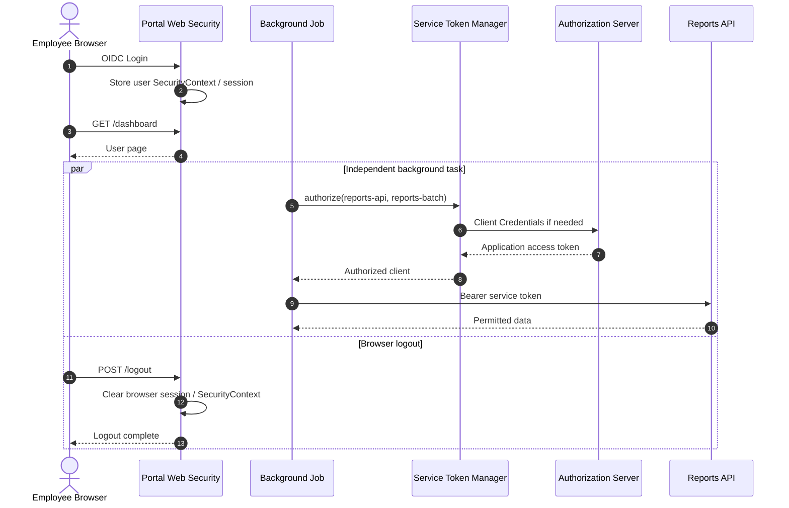

# 16.10. Separating Application Token Lifecycle from User Sessions

## 1. Context: The User Logs Out, Yet Backend Work Must Keep Running

Suppose **Employee Portal** is a Spring Boot application using **Spring Security OAuth 2.0 / OIDC Client**. The application has two completely different needs:

1. Employees log in with OpenID Connect (OIDC), view reports per their personal permissions, and log out when finished.
2. The backend runs a **scheduled job** every 15 minutes to sync data from the **Reports API**, even at night when nobody is logged in.

If a developer takes the access token received when an employee logged in and reuses it inside the scheduled job, the system runs into multiple problems:

- An employee **logging out** or a session expiring can leave the background job without a token.
- A token representing a **human user** is used for **application-level** work, violating authorization boundaries.
- A single employee with broad permissions can accidentally become the entire system's “service account.”
- The job does not know which employee's token to pick when multiple sessions are active simultaneously.
- An employee's account being locked or leaving the organization disrupts system jobs.
- The Resource Server's audit log records actions under a user's identity when the action was actually scheduled by the backend.

For **machine-to-machine (M2M)** tasks like this, OAuth 2.0 provides the **Client Credentials Grant**. The application authenticates itself to the Authorization Server to obtain an access token representing the **OAuth2 Client / service identity**, without an authorization code, browser login, cookies, or user HTTP session.

> **Lesson goal:** Design and use `client_credentials` tokens whose lifecycle is **independent of user sessions**, while maintaining proper authorization boundaries: application tokens must never automatically elevate the privileges of a user browsing the website.

This lesson belongs to Chapter **16. Client Credentials**, in the **Spring Security OAuth 2.0 OIDC Client** module. Examples use **Spring Boot 3.x, Spring Security 6.x, Java 17+, and Servlet/MVC**, though the Client Credentials logic executes in the service tier without depending on an HTTP Servlet request.

## 2. Two Token Models and Two Distinct Lifecycles

### 2.1. OIDC Login / Authorization Code Represents the User

When an employee logs in:

```text
Browser
   |
   | GET /oauth2/authorization/company
   v
Employee Portal
   |
   | Redirect to OP; user interacts to log in
   v
OpenID Provider
   |
   | Callback code + state
   v
Employee Portal
   |
   | Exchange code for tokens; verify ID Token
   v
Authentication / SecurityContext / HTTP Session
   |
   | May store user's OAuth2AuthorizedClient
   v
User is logged in, calling APIs with granted permissions
```

Components to distinguish:

- **`Authentication`** represents the authenticated user in Spring Security.
- **`SecurityContext`** holds the `Authentication`.
- **HTTP session / cookie** helps the browser maintain login state.
- **`OAuth2AuthorizedClient`** can hold the access token and refresh token issued to the client when the user completes the authorization flow.
- **ID Token** conveys the user's authentication info to the OIDC Client, not an access token for calling arbitrary APIs.

When a user logs out, the local `SecurityContext`/session is typically cleared per configuration. However, **clearing a session does not automatically revoke all access/refresh tokens at the OP**, nor should the session be confused with the `OAuth2AuthorizedClient` store.

### 2.2. Client Credentials Represents the Application

With Client Credentials:

```text
Scheduled job / Queue consumer / Internal service
   |
   | Needs to call Reports API
   v
OAuth2AuthorizedClientManager (service tier)
   |
   | Looks up token for registration "reports-api"
   | and technical principal "reports-batch"
   |
   +-- Token still valid --> use it
   |
   +-- Missing/expired --> POST Token Endpoint
                             grant_type=client_credentials
                             client authentication
                                   |
                                   v
                           Authorization Server
                                   |
                                   v
                             Access token
                                   |
                                   v
                               Reports API
```

This flow:

- Has no redirect to a login page.
- Has no `authorization_code`, callback `code`, or browser `state`.
- Needs no ID Token to authenticate an employee.
- Does not depend on `HttpServletRequest`, `HttpSession`, or a browser `SecurityContextHolder`.
- Usually involves only an **access token**; Refresh Tokens **are normally not issued** for Client Credentials under OAuth 2.0.
- The access token carries the **client's** permissions and must be validated by the Resource Server for issuer, audience, expiry, scopes, and relevant policies.

### 2.3. Comparison Table

| Criterion | User-bound Authorization Code / OIDC Login | App-bound Client Credentials |
| --- | --- | --- |
| Represented party | Authenticated/authorizing user | Application, service, or workload |
| Starts with | Browser authorization request | Backend calling Token Endpoint |
| `grant_type` | `authorization_code` | `client_credentials` |
| User login involved? | Yes | No |
| Browser callback? | Yes | No |
| ID Token present? | Yes in OIDC Login | Not part of standard Client Credentials |
| HTTP session involved? | Typically yes in Servlet web apps | Not needed |
| Principal for token store | Authenticated user / `Authentication` | Stable technical principal |
| Access token used for | APIs callable on behalf of the user | APIs callable on behalf of the client |
| Refresh token | May exist depending on provider/consent/policy | Usually **not** issued |
| New token after expiry | Refresh or re-authorize depending on flow | Typically execute a **new Client Credentials Grant** |
| Direct impact of user logout? | May affect session/token usability per policy | **No**, when M2M tokens are managed properly |
| Core security concerns | State, PKCE, nonce/ID Token validation, and session | Client authentication, secret/key management, token scope/audience, and workload authorization |

**Never treat Client Credentials as a way to “log in as a user without a password.”** This grant conveys neither consent nor identity for a specific user. If an API must be called on behalf of a user, choose an appropriate delegated authorization or supported token-exchange architecture designed for that purpose.

## 3. What Does “Separating Lifecycles” Actually Separate?

Keeping application tokens independent from user sessions means more than calling a different endpoint. You must separate at least **five kinds of state**.

| State Type | Belongs To | Typical Lifecycle |
| --- | --- | --- |
| **User HTTP session** | Logged-in browser/user | Login → active → expiry/logout |
| **User `Authentication` / `SecurityContext`** | An authenticated request/session | Restored per session/request; cleared on logout |
| **User-bound `OAuth2AuthorizedClient`** | Registration + user principal | Issued after consent/login; refreshed/revoked per policy |
| **App-bound `OAuth2AuthorizedClient`** | M2M registration + technical principal | Issued when backend first needs it; reused; re-requested on expiry |
| **Client credentials** | Workload/application registration | Rotated per ops policy, independent of individual access tokens and user sessions |

The application token lifecycle typically looks like:



This is a **logical lifecycle** diagram for an authorized client requested via the manager. `OAuth2AuthorizedClientManager` does not run a background timer to refresh tokens automatically by default; normally it checks and fetches tokens **when the application calls `authorize(...)`**.

### 3.1. Decoupling from Logout Events

Suppose user A clicks “Logout” at 17:00:

```text
17:00:00  User A logs out
          -> local user SecurityContext/session is cleared

17:00:05  Scheduled job runs
          -> manager selects reports-api + reports-batch
          -> M2M token still valid: used to call Reports API

17:15:00  Scheduled job runs again
          -> M2M token expired: backend requests new token
          -> no browser redirect, no dependency on user A
```

The prerequisite is that the job **never uses user A's `Authentication`**, never stores the token in user A's session, and never relies on a user principal that can vanish.

### 3.2. Decoupling from Restarts or Scaling Events

- With an **in-memory authorized client service**, cached tokens are lost on process restart. When the job resumes, the manager requests a new Client Credentials token using valid client credentials. That is usually acceptable for M2M.
- With **JDBC / shared persistence**, tokens can be reloaded across instances and restarts, though a database adds credential protection, synchronization, and operational requirements.
- Whether stored in memory or a database, **a user session is never the source of truth for application tokens**.

**Separating lifecycles does not mean tokens must be stored forever.** Access tokens should remain short-lived per OP policy, with the app able to request fresh tokens when needed.

## 4. Spring Security Architecture for Service-to-Service Tokens

### 4.1. Key Classes

| Class / Interface | Role |
| --- | --- |
| `ClientRegistration` | Describes client ID/secret, grant type, scopes, and Token Endpoint |
| `ClientRegistrationRepository` | Looks up registration `reports-api` |
| `OAuth2AuthorizedClient` | Holds issued access token, registration, and principal name |
| `OAuth2AuthorizedClientService` | Saves/reads/deletes authorized clients by registration/principal |
| `InMemoryOAuth2AuthorizedClientService` | In-JVM token store implementation |
| `JdbcOAuth2AuthorizedClientService` | JDBC-backed token store implementation when persistence is needed |
| **`AuthorizedClientServiceOAuth2AuthorizedClientManager`** | Manager for **service tier / background** use |
| `OAuth2AuthorizedClientProvider` | Selects and executes the matching grant—here `clientCredentials()` |
| `OAuth2AuthorizeRequest` | Requests manager authorization by registration ID and principal |
| `OAuth2AccessTokenResponseClient` | Exchanges credentials for tokens at the Token Endpoint when needed |
| `RestClient` / `WebClient` | Calls the Resource Server using a Bearer access token |

### 4.2. Bean and Data-Flow Diagram



The browser/session branch **does not connect** to the Client Credentials service-tier manager. In a product supporting both flows, both can coexist inside one Spring Boot process, provided each is governed by **appropriate registrations, principals, managers, and policies**.

### 4.3. Why Not Use `DefaultOAuth2AuthorizedClientManager` in a Scheduler?

`DefaultOAuth2AuthorizedClientManager` is built for Servlet HTTP request/response contexts and uses `OAuth2AuthorizedClientRepository`. When a job runs from `@Scheduled` or a message listener without an `HttpServletRequest`, the Servlet manager lacks the required request/response context and behaves improperly.

For the service tier, use:

```java
new AuthorizedClientServiceOAuth2AuthorizedClientManager(
        clientRegistrationRepository,
        oauth2AuthorizedClientService);
```

This manager tracks tokens through a **service**, requiring no browser cookies or sessions on each call.

**Never fabricate a `MockHttpServletRequest` in production just to run a scheduled job.** The right solution is choosing a manager suited to the execution context.

## 5. Spring Boot 3.x and Spring Security 6.x Configuration

### 5.1. Dependencies

Maven example for a Servlet application with both web/API endpoints and background jobs:

```xml
<dependencies>
    <dependency>
        <groupId>org.springframework.boot</groupId>
        <artifactId>spring-boot-starter-web</artifactId>
    </dependency>
    <dependency>
        <groupId>org.springframework.boot</groupId>
        <artifactId>spring-boot-starter-security</artifactId>
    </dependency>
    <dependency>
        <groupId>org.springframework.boot</groupId>
        <artifactId>spring-boot-starter-oauth2-client</artifactId>
    </dependency>
</dependencies>
```

Gradle Kotlin DSL equivalent:

```kotlin
dependencies {
    implementation("org.springframework.boot:spring-boot-starter-web")
    implementation("org.springframework.boot:spring-boot-starter-security")
    implementation("org.springframework.boot:spring-boot-starter-oauth2-client")
}
```

A **pure backend worker** does not need `spring-boot-starter-web` merely to run Client Credentials. The web starter in this example supports demonstrating a system with both a website and a scheduled job—it is not a requirement of the grant.

### 5.2. Separating User OIDC and Client Credentials Registrations

```yaml
spring:
  security:
    oauth2:
      client:
        registration:
          # Registration for interactive OIDC login
          employee-login:
            provider: company-oidc
            client-id: ${OIDC_WEB_CLIENT_ID}
            client-secret: ${OIDC_WEB_CLIENT_SECRET}
            authorization-grant-type: authorization_code
            client-authentication-method: client_secret_basic
            redirect-uri: "{baseUrl}/login/oauth2/code/{registrationId}"
            scope:
              - openid
              - profile

          # Dedicated registration for backend workload
          reports-api:
            provider: reports-as
            client-id: ${REPORTS_SERVICE_CLIENT_ID}
            client-secret: ${REPORTS_SERVICE_CLIENT_SECRET}
            client-authentication-method: client_secret_basic
            authorization-grant-type: client_credentials
            scope:
              - reports.read

        provider:
          company-oidc:
            issuer-uri: https://id.example.com/realms/employees
          reports-as:
            token-uri: https://auth.example.com/oauth2/token

jobs:
  reports:
    delay-ms: 900000
```

These URLs/credentials are examples only, not live reachable endpoints. In a real system:

- The Authorization Server must provision a client ID/secret or appropriate client authentication method dedicated to the backend workload.
- The Token URI must use HTTPS and come from trusted configuration.
- Registration `reports-api` must have the `client_credentials` grant permitted at the provider.
- Scope `reports.read` must be recognized by both the provider and the Resource Server.
- Client secrets must be injected from a secret manager or runtime environment variables—**never commit plaintext secrets to source**.

### 5.3. Why Maintain Two Registrations Instead of Sharing One?

| Property | `employee-login` | `reports-api` |
| --- | --- | --- |
| Purpose | User sign-in | Backend job calling Reports API |
| OAuth grant | `authorization_code` | `client_credentials` |
| Token subject | User / delegated authorization | Service / client identity |
| Scopes | `openid profile` and required user scopes | `reports.read` |
| Redirect URI? | Yes, OIDC callback | No |
| Browser involved? | Yes | No |
| Token storage principal | Authenticated user | `reports-batch` |
| User logout event | Clears user session per policy | Must not automatically destroy workload token |
| Secret policy | Web login client | Dedicated workload credentials |

Separating registrations simplifies auditing, scope restriction, secret rotation, and prevents M2M tokens from being misused in UI code.

**The same Authorization Server can issue both token types**, yet that does not mean you should share one client registration and principal for both purposes.

## 6. Creating a Client Manager Independent of HTTP Sessions

### 6.1. Using `InMemoryOAuth2AuthorizedClientService` for Local Examples

```java
package com.example.portal.security;

import org.springframework.context.annotation.Bean;
import org.springframework.context.annotation.Configuration;
import org.springframework.security.oauth2.client.InMemoryOAuth2AuthorizedClientService;
import org.springframework.security.oauth2.client.OAuth2AuthorizedClientService;
import org.springframework.security.oauth2.client.registration.ClientRegistrationRepository;

@Configuration
public class ServiceTokenStorageConfig {

    @Bean("serviceTokenStore")
    OAuth2AuthorizedClientService serviceTokenStore(
            ClientRegistrationRepository registrations) {

        return new InMemoryOAuth2AuthorizedClientService(registrations);
    }
}
```

This code creates **a token store dedicated to the M2M workload**. If the application configures `oauth2Login`, it can use a different service/repository for user tokens. Control bean names and injection with `@Qualifier` so a custom bean never unintentionally alters application-wide OAuth2 Login behavior.

When an application uses only M2M Client Credentials, a default `OAuth2AuthorizedClientService` auto-configured by Spring Boot/Spring Security (if present in your version) may suffice. Here the bean is declared explicitly so learners can clearly see the token store boundary.

### 6.2. Creating `AuthorizedClientServiceOAuth2AuthorizedClientManager`

```java
package com.example.portal.security;

import java.time.Duration;

import org.springframework.beans.factory.annotation.Qualifier;
import org.springframework.context.annotation.Bean;
import org.springframework.context.annotation.Configuration;
import org.springframework.security.oauth2.client.AuthorizedClientServiceOAuth2AuthorizedClientManager;
import org.springframework.security.oauth2.client.OAuth2AuthorizedClientManager;
import org.springframework.security.oauth2.client.OAuth2AuthorizedClientProvider;
import org.springframework.security.oauth2.client.OAuth2AuthorizedClientProviderBuilder;
import org.springframework.security.oauth2.client.OAuth2AuthorizedClientService;
import org.springframework.security.oauth2.client.registration.ClientRegistrationRepository;

@Configuration
public class ServiceTokenManagerConfig {

    @Bean("serviceTokenManager")
    OAuth2AuthorizedClientManager serviceTokenManager(
            ClientRegistrationRepository registrations,
            @Qualifier("serviceTokenStore")
            OAuth2AuthorizedClientService serviceTokenStore) {

        OAuth2AuthorizedClientProvider provider =
                OAuth2AuthorizedClientProviderBuilder.builder()
                    .clientCredentials(configurer -> configurer
                            .clockSkew(Duration.ofSeconds(60)))
                    .build();

        var manager =
                new AuthorizedClientServiceOAuth2AuthorizedClientManager(
                        registrations,
                        serviceTokenStore);

        manager.setAuthorizedClientProvider(provider);

        return manager;
    }
}
```

How to read this configuration:

1. **`ClientRegistrationRepository`** locates `reports-api`.
2. **`OAuth2AuthorizedClientService`** saves/retrieves tokens by registration and principal pair.
3. **`clientCredentials()`** specifies the provider handling the `client_credentials` grant.
4. **`clockSkew(60s)`** is an example policy proactively treating near-expiry tokens as needing re-issuance to prevent races between sending and API receipt.
5. **`AuthorizedClientServiceOAuth2AuthorizedClientManager`** works in services/jobs without an HTTP session.
6. **`@Qualifier`** prevents confusing the workload's manager/token store with beans serving interactive user login.

You are not forced to enable only `clientCredentials()` in every application. If a service-tier manager handles other grants, configuration should clearly express the allowed grants and corresponding principal boundaries.

### 6.3. Does the Manager Run Scheduled Refreshes Automatically?

**Not automatically in the sense of running its own background scheduler.** Typically, each time the application calls:

```java
OAuth2AuthorizedClient client = manager.authorize(authorizeRequest);
```

the manager inspects the stored token and the provider re-issues it if needed. With Client Credentials, when the old token expires or nears expiry, the provider usually runs **a new Client Credentials Token Request** rather than using a refresh token.

If you want to pre-warm the token cache before a job runs, you can design separate prefetch/scheduling, weighing efficiency, token request counts, rate limits, and whether a token is truly needed when no API call occurs.

## 7. Choosing a Registration ID and a Stable Technical Principal

### 7.1. `OAuth2AuthorizeRequest` for Client Credentials

```java
import org.springframework.security.oauth2.client.OAuth2AuthorizeRequest;
import org.springframework.security.oauth2.client.OAuth2AuthorizedClient;

OAuth2AuthorizeRequest request = OAuth2AuthorizeRequest
        .withClientRegistrationId("reports-api")
        .principal("reports-batch")
        .build();

OAuth2AuthorizedClient client =
        serviceTokenManager.authorize(request);
```

Meaning of the two fields:

- **`reports-api`** is the registration ID, **not the client ID** at the Authorization Server.
- **`reports-batch`** is a stable technical principal name so the authorized client store can look up tokens across calls.
- `principal(String)` does not create a browser session or authenticate a human user.
- Each manager call attempts to reuse/authorize the client within this exact context.

With `OAuth2AuthorizedClientService`, the storage key is usually:

```text
(clientRegistrationId, principalName)

(reports-api, reports-batch)
```

### 7.2. Why Not Use the Logged-In User's Principal?

Suppose code uses:

```java
OAuth2AuthorizeRequest.withClientRegistrationId("reports-api")
        .principal(authenticationOfCurrentUser)
        .build();
```

while `reports-api` is Client Credentials.

The token issued by the Authorization Server still represents **the client identity**, not automatically becoming a user token. Yet the store will create separate entries for every user principal:

```text
(reports-api, employee-4821)
(reports-api, employee-9274)
(reports-api, employee-3928)
```

Consequences:

- The exact same workload token gets stored repeatedly under many keys.
- Token lifecycle becomes needlessly coupled to user context in application code.
- User logout or session expiration leaves code unable to construct the same principal as before.
- Token requests and token store size grow unnecessarily.
- Code readers may mistakenly think Client Credentials tokens represent human users.

For a unified service identity, use a stable technical principal. If you genuinely need **distinct tokens per tenant/workload**, design explicit policies and ensure the Authorization Server issues corresponding tokens—do not merely swap the principal string.

### 7.3. Why Not Generate a New Principal on Every Job Run?

Avoid:

```java
// Anti-pattern: same workload, yet generating a new principal each run.
String principal = "reports-batch-" + System.nanoTime();
```

Because each principal creates a new authorized client key, defeating token reuse and bloating storage. Use a managed backend constant:

```java
private static final String SERVICE_PRINCIPAL = "reports-batch";
```

When renaming a principal or registration ID, old token rows will no longer be found under the new key. That is a **storage key** change requiring migration/cleanup policies when using persistence.

## 8. A Browser-Independent Service That Obtains Tokens

### 8.1. `ReportsApiService` Callable from Jobs or Internal Workflows

```java
package com.example.portal.reports;

import org.springframework.beans.factory.annotation.Qualifier;
import org.springframework.security.oauth2.client.OAuth2AuthorizeRequest;
import org.springframework.security.oauth2.client.OAuth2AuthorizedClient;
import org.springframework.security.oauth2.client.OAuth2AuthorizedClientManager;
import org.springframework.stereotype.Service;

@Service
public class ReportsAccessTokenService {

    private static final String REGISTRATION_ID = "reports-api";
    private static final String SERVICE_PRINCIPAL = "reports-batch";

    private final OAuth2AuthorizedClientManager manager;

    public ReportsAccessTokenService(
            @Qualifier("serviceTokenManager")
            OAuth2AuthorizedClientManager manager) {

        this.manager = manager;
    }

    public String getAccessTokenValue() {
        OAuth2AuthorizeRequest request = OAuth2AuthorizeRequest
                .withClientRegistrationId(REGISTRATION_ID)
                .principal(SERVICE_PRINCIPAL)
                .build();

        OAuth2AuthorizedClient client = manager.authorize(request);

        if (client == null) {
            throw new IllegalStateException(
                    "Cannot authorize OAuth2 Client Credentials");
        }

        return client.getAccessToken().getTokenValue();
    }
}
```

This is a complete class illustrating token retrieval in the service tier. In real applications, you can return `OAuth2AuthorizedClient` or integrate the manager directly with your HTTP client instead of passing raw token Strings across layers unnecessarily. Returning a String here clarifies the mechanism; **never log, persist, or return this value to a browser**.

### 8.2. HTTP Client Using the Token to Call the Resource Server

`RestClient` is available in Spring Framework 6.1+ (compatible with Spring Boot 3.2+) and works in Servlet/service-tier code without an HTTP session:

```java
package com.example.portal.reports;

import org.springframework.context.annotation.Bean;
import org.springframework.context.annotation.Configuration;
import org.springframework.web.client.RestClient;

@Configuration
public class ReportsHttpClientConfig {

    @Bean
    RestClient reportsRestClient(RestClient.Builder builder) {
        return builder
                .baseUrl("https://reports-api.example.com")
                .build();
    }
}
```

A service calling the API:

```java
package com.example.portal.reports;

import org.springframework.beans.factory.annotation.Qualifier;
import org.springframework.stereotype.Service;
import org.springframework.web.client.RestClient;

@Service
public class ReportsApiService {

    private final RestClient http;
    private final ReportsAccessTokenService tokens;

    public ReportsApiService(
            @Qualifier("reportsRestClient") RestClient http,
            ReportsAccessTokenService tokens) {

        this.http = http;
        this.tokens = tokens;
    }

    public String loadDailySummary() {
        String accessToken = tokens.getAccessTokenValue();

        return http.get()
                .uri("/v1/reports/daily-summary")
                .headers(headers -> headers.setBearerAuth(accessToken))
                .retrieve()
                .body(String.class);
    }
}
```

Key points:

- `reportsRestClient` points only to an **application-managed API host**.
- `getAccessTokenValue()` uses the service-tier manager, needing no current `Authentication`.
- The Bearer token is attached only to outbound requests targeting the appropriate Resource Server.
- Never accept an arbitrary URL from a browser to call with a service token: doing so can send the token to an attacker-controlled host.
- The example omits DTO parsing and HTTP error handling to focus on token lifecycle.

**Never design a REST endpoint that returns the application access token to a browser.** The backend should use the token to perform a permitted operation and return **appropriate business data** to the user after verifying user permissions separately.

### 8.3. The Flow Works Even with No Users



There is no browser or HTTP session in this diagram. Another user logging out **does not appear at any step** and has no bearing on the M2M manager's operation.

## 9. Creating a Scheduled Job Independent of User `SecurityContext`

### 9.1. Enabling Scheduling

```java
package com.example.portal;

import org.springframework.boot.SpringApplication;
import org.springframework.boot.autoconfigure.SpringBootApplication;
import org.springframework.scheduling.annotation.EnableScheduling;

@SpringBootApplication
@EnableScheduling
public class EmployeePortalApplication {

    public static void main(String[] args) {
        SpringApplication.run(EmployeePortalApplication.class, args);
    }
}
```

### 9.2. Running a Job That Calls the API with a Service Token

```java
package com.example.portal.reports;

import org.slf4j.Logger;
import org.slf4j.LoggerFactory;
import org.springframework.scheduling.annotation.Scheduled;
import org.springframework.stereotype.Component;

@Component
public class ReportsSyncJob {

    private static final Logger log =
            LoggerFactory.getLogger(ReportsSyncJob.class);

    private final ReportsApiService reports;

    public ReportsSyncJob(ReportsApiService reports) {
        this.reports = reports;
    }

    @Scheduled(fixedDelayString = "${jobs.reports.delay-ms:900000}")
    public void synchronize() {
        try {
            String summary = reports.loadDailySummary();

            // Illustration: process data received from Reports API.
            // Never log access tokens or sensitive responses.
            processSummary(summary);

            log.info("Reports sync completed");
        } catch (Exception ex) {
            // Safe logging uses only exception type; detailed classification
            // should happen in exception mapping/metrics.
            log.warn("Reports sync failed; exceptionType={}",
                    ex.getClass().getSimpleName());
        }
    }

    private void processSummary(String summary) {
        // Replace with idempotent sync business logic.
    }
}
```

This example illustrates how a job uses an M2M token independently of login. In real production apps, **never swallow all exceptions and treat the job as successful**. Include error classification, metrics/alerts, retry budgets, and failure state reporting matching your scheduler/orchestrator. The snippet simply demonstrates that calling `SecurityContextHolder.getContext().getAuthentication()` is unnecessary for issuing tokens.

### 9.3. Why Not Read `SecurityContextHolder` in a Job?

A scheduled thread typically has no user HTTP request. `SecurityContextHolder` by default contains no `Authentication`, or holds stale context if custom code manually propagates state across threads.

Anti-pattern:

```java
// Wrong direction for a Client Credentials background job:
Authentication user =
        SecurityContextHolder.getContext().getAuthentication();

OAuth2AuthorizeRequest request = OAuth2AuthorizeRequest
        .withClientRegistrationId("reports-api")
        .principal(user)
        .build();
```

If `user` is null, the code fails. Even if a user `Authentication` is present, storing an M2M token under a user identity tangles lifecycles. For client credentials, always use a **stable technical principal**.

### 9.4. The Job Runs Even When Nobody Is Visiting the Website

Expected behavior:

```text
00:00  No users are logged in.
00:15  ReportsSyncJob runs, obtains service token as needed, calls API.
00:30  Job runs, reuses still-valid token.
00:45  User A logs into website, has separate OIDC session.
01:00  User A logs out, A's session ends.
01:15  Job keeps running, M2M token managed independently.
01:30  M2M token nears expiry, manager requests a new token.
```

This is a conceptual timeline, not actual execution output. Separating lifecycles properly lets the backend operate as a **workload with its own identity**, instead of “borrowing a user session” to reach APIs.

## 10. Separating Tokens Does Not Mean Bypassing User Permissions

### 10.1. A Service Token May Be More Powerful Than Any Single User's Permissions

Suppose the Reports API accepts the `reports-api` service access token with scope `reports.read`. Inside Employee Portal, User A may only view their own department's reports, while User B has no report-viewing permission at all.

If a controller writes:

```java
@GetMapping("/api/reports/all")
public String allReports() {
    // Anyone reaching this controller invokes reports-api permissions.
    return reportsApiService.loadDailySummary();
}
```

without protecting the endpoint, the backend could use its broad service token to access data **on behalf of an unauthorized caller**. That is a **confused deputy** vulnerability: an application with M2M privileges gets exploited by a user to perform privileged actions.

**Separating token lifecycles from sessions does not separate website APIs from user authorization.**

### 10.2. Protecting Controllers Before Calling APIs with a Service Token

Example of a dedicated `SecurityFilterChain` for the OIDC-authenticated website:

```java
package com.example.portal.security;

import org.springframework.context.annotation.Bean;
import org.springframework.context.annotation.Configuration;
import org.springframework.security.config.Customizer;
import org.springframework.security.config.annotation.web.builders.HttpSecurity;
import org.springframework.security.web.SecurityFilterChain;

@Configuration
public class WebUserSecurityConfig {

    @Bean
    SecurityFilterChain webSecurityFilterChain(HttpSecurity http)
            throws Exception {

        http.authorizeHttpRequests(authorize -> authorize
                .requestMatchers("/", "/css/**", "/error").permitAll()
                .requestMatchers("/api/reports/**")
                    .hasAuthority("ROLE_REPORT_VIEWER")
                .anyRequest().authenticated()
            )
            .oauth2Login(Customizer.withDefaults());

        return http.build();
    }
}
```

Here:

- Users must authenticate via OAuth2/OIDC Login to call web APIs.
- Requests to `/api/reports/**` must possess the `ROLE_REPORT_VIEWER` authority per application policy.
- Only after the user is authorized does the backend **use its own Client Credentials token** to perform the corresponding call on the Reports API.
- `ROLE_REPORT_VIEWER` is an **illustrative** authority. Real apps must map roles/permissions from trusted sources (verified OIDC claims, internal permission database, etc.) and may need record/row-level authorization.
- The backend's Client Credentials token **does not grant `ROLE_REPORT_VIEWER` to users**.

If `/api/reports/**` is an API called with Bearer access tokens instead of browser sessions, configure a separate **Resource Server security chain** with matching JWT/opaque token rules. Never disable CSRF across the entire website just because the backend internally calls the Reports API.

### 10.3. Enforcing Permissions on Returned Data

Even when a controller requires `ROLE_REPORT_VIEWER`, the Reports API might return broader data than the user is permitted to see. In that case:

- Constrain queries/filters by verified tenant or department.
- Enforce record-level permission checks on multi-user data.
- Never accept unauthorized `tenantId`/`accountId` query parameters and use the service token to query arbitrarily.
- Never hand the raw access token to users so they can “call the API themselves.”
- Audit both the **Employee Portal caller's** identity and the **workload action** when business rules require it.

**The service token represents the backend to the Reports API; user authorization belongs to Employee Portal.** Both decisions can—and usually must—be enforced independently.

## 11. Handling Token Expiration Without Involving Session Expiry

### 11.1. Tokens Are Issued with Authorization Server Lifetimes

A Token Endpoint response for Client Credentials may look like:

```http
HTTP/1.1 200 OK
Content-Type: application/json
Cache-Control: no-store
Pragma: no-cache

{
  "access_token": "<opaque-or-jwt-access-token>",
  "token_type": "Bearer",
  "expires_in": 3600,
  "scope": "reports.read"
}
```

The example has no `refresh_token`. Access tokens can be JWT or opaque; the OAuth2 Client **does not need to parse JWTs by default** to learn expiration, because the token response normally provides `expires_in` and Spring records `expiresAt` in `OAuth2AccessToken`.

A token may also be revoked/disabled by the Authorization Server before `expiresAt`; time-based expiration is not the sole factor determining API acceptance.

### 11.2. Token Re-Issuance Sequence

```text
T0    Job calls authorize(reports-api, reports-batch)
      -> store has no token yet
      -> Token Endpoint issues token T1, expires_in=3600

T1    Job calls authorize(...) again
      -> T1 is valid and outside clock skew window
      -> reuses T1

T2    Token T1 nears expiry / expires per provider policy
      -> authorize(...) triggers a new Client Credentials Grant
      -> receives T2
      -> saves/updates authorized client

T3    Users log in/out between those steps
      -> does not touch key (reports-api, reports-batch)
      -> does not alter lifetimes of T1/T2
```

With Spring Security, the Client Credentials provider determines whether a token needs re-issuance using `expiresAt` and configured clock skew. **Do not write an extra periodic refresh scheduler merely out of fear of expiration** if the manager is called before each request and meets your needs.

### 11.3. Why Is a Refresh Token Usually Unnecessary?

Per OAuth 2.0, for the **Client Credentials Grant**, the Authorization Server **SHOULD NOT** issue a refresh token. Because the client can always re-authenticate with its own credentials at the Token Endpoint, it simply requests a new access token via another `grant_type=client_credentials` call.

Diagram:

```text
Client Credentials T1 expires
       |
       v
POST /token
  grant_type=client_credentials
  client authentication using registered credentials
       |
       v
New access token T2
```

**Do not configure `refreshToken()` assuming it is mandatory for M2M.** Some extensions/providers behave differently, yet this lesson designs around standard Client Credentials.

### 11.4. Clock Skew and When the API Checks the Token

Suppose a token expires at 14:00:00. The app prepares a request at 13:59:59, yet network transit and API processing take a couple of seconds; the API may deem the token expired upon arrival.

Hence the provider offers `clockSkew` to proactively obtain a new token before expiry. Tune it appropriately for:

- Network latency and API p95/p99 latency.
- Clock synchronization across systems.
- Access token lifetime granted by the provider.
- Risk of requesting new tokens too frequently.

Never set clock skew larger than nearly the entire token lifetime, which would mint a new token on every call; nor use tokens right up against expiry when the Resource Server enforces strict checks.

## 12. When the Resource Server Returns 401 or 403

### 12.1. Distinguishing Token Acquisition Failure from Token Usage Failure

| Stage | Example Error | Where to Inspect |
| --- | --- | --- |
| Token Endpoint | `invalid_client` | Client ID/secret/auth method, app registration |
| Token Endpoint | `unauthorized_client` | Is `client_credentials` grant permitted? |
| Token Endpoint | `invalid_scope` | Is scope `reports.read` permitted? |
| Token Endpoint | Timeout/429/5xx | Network, rate limits, Authorization Server |
| Reports API | `401 invalid_token` | Wrong, expired/revoked access token, or mismatched audience/issuer |
| Reports API | `403 insufficient_scope` | Valid token, yet missing permission/scope |
| Employee Portal | 403 due to missing user role | **User's** web authorization before calling the API |

**A `401` from the Reports API does not mean you should redirect the user to OIDC login.** It likely means the M2M token is no longer valid; handle it on the backend per service token policy.

### 12.2. Why Not Retry Infinitely with the Same Token?

If the Reports API returns `401 invalid_token`:

1. Confirm the token was sent to the right audience/issuer/Resource Server.
2. Determine whether it expired or was revoked.
3. If policy allows, **invalidate/remove** the local authorized client under the exact key and request a new Client Credentials token.
4. Bound retry attempts. Never loop infinitely if the client secret is wrong or the provider refuses to issue tokens.
5. If the business request mutates data, assess **idempotency** before re-sending.

For a read-only GET, a bounded retry after obtaining a fresh token may be safe. For a resource-creating or payment POST, a lost response or rejected token carries duplicate-execution risks. Never rely on the Client Manager as an exactly-once guarantee.

### 12.3. Deleting a Local Token Differs from Revoking at the OP

Yes:

```java
serviceTokenStore.removeAuthorizedClient(
        "reports-api",
        "reports-batch");
```

This deletes the authorized client record **in the application**, without revoking the issued token at the Authorization Server. When revocation is needed, call the provider-supported revocation API/endpoint per policy.

Deleting the local token on 401 is merely one step in a **recovery strategy**, not a security measure replacing revocation or credential rotation. If the API returns 403 due to a missing scope, deleting the token and requesting the same scope again will still return 403.

### 12.4. Do Not Force Users to Re-Login When the M2M Token Fails

If the backend receives `invalid_client` for `reports-api`, having users log in via OIDC repeatedly will never fix the workload's client secret. This situation requires:

- Checking service credentials and app registration status.
- Investigating the Token Endpoint and network.
- Showing a “feature temporarily unavailable” notice if a user is waiting.
- Logging an operational error / alerting the responsible team.

An M2M failure **never implies the user's session expired or the user entered a wrong password**.

## 13. In-Memory or JDBC for Application Tokens?

### 13.1. In-Memory Is Often Sensible for Simple M2M

With Client Credentials, the application can request new tokens whenever needed. An `InMemoryOAuth2AuthorizedClientService`:

- Avoids a database dependency solely to cache one token.
- Avoids storing access tokens in SQL needlessly.
- Reuses tokens across requests **within the same JVM instance**.
- Simplifies management in development or low-instance-count workloads.

Drawbacks:

- Each instance keeps its own cache.
- Restarts clear the token cache, requiring a new token request.
- Scaling out can produce multiple initial token requests.
- Provides no cluster-wide shared management via this service.

**Losing the token cache on restart is not losing user sessions**, and for M2M it is usually an acceptable trade-off if the Authorization Server handles the load.

### 13.2. When Is JDBC / Shared Store Useful?

Consider `JdbcOAuth2AuthorizedClientService` if:

- Token issuance is expensive or the OP enforces tight token-issuance limits.
- Multiple instances need to share the authorized client under one key.
- You require token state persistence/recovery across restarts.
- Your organization already maintains proper DB security, backups, encryption, and incident response.
- Other OAuth flows also use `OAuth2AuthorizedClientService` and require controlled persistence.

Conceptual wiring example:

```java
@Bean("serviceTokenStore")
OAuth2AuthorizedClientService serviceTokenStore(
        JdbcOperations jdbcOperations,
        ClientRegistrationRepository registrations) {

    return new JdbcOAuth2AuthorizedClientService(
            jdbcOperations,
            registrations);
}
```

Required imports: `JdbcOperations` from Spring JDBC and `JdbcOAuth2AuthorizedClientService` from Spring Security OAuth2 Client. You also need the Spring JDBC dependency, a `DataSource`, and the **`oauth2_authorized_client` schema matching your exact version/dialect**. This **replaces** the InMemory bean in Section 6.1 rather than creating two beans with the same name.

### 13.3. JDBC Still Does Not Turn Tokens into User Sessions

Even with tokens stored in a shared DB:

- Browser login state still depends on the website's `SecurityContext`/session.
- M2M tokens use a stable technical principal.
- No logged-in browser is required to load the token.
- Jobs can run when every browser session has expired.

**Token persistence and session persistence are two separate concerns.** Do not enable Spring Session just to “keep a Client Credentials token”; nor should a JDBC authorized client store replace Spring Session if the website needs shared user sessions.

### 13.4. Concurrent Token Refresh / Issuance Across Instances

Suppose three nodes run the job simultaneously:



With Client Credentials, issuing two new access tokens may still be valid at the OP, yet it increases token requests and can cause errors if the provider limits active tokens or enforces a single-active-token policy.

**Shared storage does not automatically turn `authorize(...)` into a cluster-wide single-flight operation.** At large scale, consider:

- Distributed locking keyed by `(registrationId, principalName)`.
- Double-checking the token after acquiring the lock.
- Limiting how many jobs run concurrently (leader election / scheduler coordination).
- Shared caches with appropriate TTLs.
- Rate-limiting/backoff/jitter on retries.
- Metrics by grant/registration and token request count.

Do not create one global distributed lock across all services when multiple independent registrations exist; lock granularity should match the token scope being protected.

## 14. Managing Client Secrets and Workload Identity

### 14.1. Access Tokens and Client Credentials Have Different Lifecycles

For M2M, at least two secrets/credentials require management:

| Credential | Role | Lifecycle |
| --- | --- | --- |
| **Client secret / private key / mTLS credential** | Authenticates the **OAuth2 Client** when calling the Token Endpoint | Rotated per deployment policy; typically outlives access tokens |
| **Access token** | Calls the Resource Server per scopes/audience and expiry | Usually short-lived; re-issued as needed |

When an access token expires, the backend uses its valid client credentials to request a new one. Once a **client secret is revoked** or misconfigured, the ability to obtain new tokens stops; an existing access token may still be accepted by APIs until expiration or policy revocation.

### 14.2. Secret Rotation Does Not Mean User Logout

Operational timeline example:

```text
09:00  reports-api is using client secret version S1.
09:30  Operator adds secret S2 on the Authorization Server.
09:45  Deployment rolls out runtime secret S2.
10:00  Token T1 expires; manager requests token T2 using S2.
10:30  Operator disables S1 after confirming rollout.
```

This is an idealized scenario; supporting overlapping secrets depends on the provider. Some OPs enforce hard cutover rotation or use private keys with distinct `kid`s.

Requirements:

- Separate `reports-api`'s secret from the secret used for OIDC web login.
- Use a secret manager, least-privilege read access, and policy-driven rotation.
- Never place secrets in logs, URLs, repos, or HTTP responses.
- Keep a runbook ready for `invalid_client` after rotation.
- Ensure all nodes receive the new config before disabling the old secret if the provider supports overlapping credentials.
- If using `private_key_jwt` or mTLS instead of a secret, configure client authentication matching your OP and Spring Security version.

### 14.3. Using Workload Identity Instead of Static Shared Secrets When Appropriate

In some infrastructure environments, the Authorization Server and client support:

- `private_key_jwt` with private keys protected by KMS/HSM.
- Mutual TLS client authentication.
- Workload identity federation or supported workload identity attestation profiles.

These options reduce reliance on static shared client secrets, yet **do not change the nature** of Client Credentials: the backend still requests tokens under a **client identity**, without user sessions.

Never set the client authentication method to `private_key_jwt` in YAML without wiring the signing/assertion mechanism and registering the corresponding public key at the Authorization Server.

## 15. Token Scope, Audience, and Sending Tokens to the Right Resource Server

### 15.1. One Registration for One Clear Purpose

If the Reports API only needs `reports.read`, never request `reports.admin` or `write.all` under least privilege.

```yaml
spring:
  security:
    oauth2:
      client:
        registration:
          reports-api:
            authorization-grant-type: client_credentials
            scope:
              - reports.read
```

With some Authorization Servers, the client may need an `audience`/`resource` parameter at the Token Endpoint to request a token for the target API. That is a **provider-/profile-specific configuration** or Resource Indicators convention, not a field every OP supports by default.

`OAuth2AuthorizedClientManager` coordinates the grant; the **Resource Server** must validate the access token for issuer, audience, expiry, and API-appropriate scopes/authorities. A token with a valid signature meant for another API must be rejected.

### 15.2. Never Reuse the Same Token Across Every API

| Target API | Suggested Registration | Scope |
| --- | --- | --- |
| Reports API | `reports-api` | `reports.read` |
| Billing API | `billing-api` | `billing.invoice.read` |
| Notifications API | `notify-api` | `notifications.send` |

These names/scopes are design examples that must align with your real Authorization Server. If a client calls another API with a different scope/audience, use a **separate registration** or explicit policy-driven token separation.

The `(registrationId, principalName)` key pair in the service **does not automatically include dynamic audience/scope** as part of the key. If the same registration/principal requests access tokens for multiple audiences and overwrites one authorized client entry, **token mix-up** can happen. Design token stores/registrations/providers per resource rather than stuffing arbitrary `scope` values into attributes assuming the manager tracks separate tokens.

### 15.3. Outbound URLs Must Be Controlled

A backend using application Bearer tokens should only call permitted endpoints. Risks:

- A user supplies an arbitrary URL for the backend to call, sending the token to an attacker's server.
- An HTTP client follows redirects to a non-allowlisted host, leaking headers/tokens if behavior is unchecked.
- Proxy/HTTP client logs record raw `Authorization: Bearer ...`.
- Misconfiguration points `reports-api` to a staging host or wrong environment.
- TLS verification is disabled to bypass certificate errors.

To mitigate risks, use fixed/allowlisted base URLs, HTTPS, proper outbound proxy/egress policies, and prevent automatically forwarding credentials across untrusted redirects.

## 16. OAuth2 Client Credentials and the User Interface: Integration Boundaries

### 16.1. Website and Worker Can Share One Codebase with Different Policies

A single Spring Boot application may contain:

- A `SecurityFilterChain` for browsers handling OIDC Login, `Authentication`, CSRF, and sessions.
- `AuthorizedClientServiceOAuth2AuthorizedClientManager` for backend M2M jobs.
- API controllers calling M2M services **only after** verifying user/tenant permissions.
- Scheduled jobs calling M2M services **without a browser**.

Separate logic into focused services such as:

```text
WebSecurityConfig
  -> manages user authentication/authorization

ServiceTokenManagerConfig
  -> manages reports-api client_credentials

ReportsAccessTokenService
  -> authorizes using service registration + technical principal

ReportsApiService
  -> attaches M2M Bearer token to outbound HTTP calls

ReportsSyncJob
  -> runs periodically without user sessions

ReportsController
  -> enforces user permissions before calling ReportsApiService
```

Never build a `lastLoggedInUserAccessToken` singleton shared by UI and workers. That risks token leaks, couples background work to login timing, and breaks identity boundaries.

### 16.2. Example of Two Independent Flows Running Concurrently



Both flows run in parallel. **Browser logout emits no default event revoking application tokens**, and **a job acquiring an M2M token creates no browser `SecurityContext`**.

### 16.3. Do Not Use an M2M Token as a Credential to Log In a User

A REST controller must never do:

```java
// Anti-pattern: NEVER use a service token to prove user identity.
String serviceToken = tokenService.getAccessTokenValue();
Authentication userAuthentication =
        createUserAuthenticationFromServiceToken(serviceToken);
```

A Client Credentials token authenticates a **client/workload** to an API—it does not prove a specific user logged in. To authenticate users, use OIDC Login or a proper user authentication mechanism; to have an API accept a machine identity, configure the Resource Server and authorization rules for machines.

### 16.4. Acting on Behalf of a User Is a Different Use Case

Suppose an employee clicks “Export personal data,” and the backend must run a long queued job on behalf of that employee. There are at least two distinct designs:

1. **The backend acts with system privileges**, after verifying the user is allowed to request the task, recording the user, and filtering exported data per user permissions. The M2M token is solely a service credential; data authorization is enforced by the backend.
2. **The backend genuinely needs the user's delegated access token** at the Resource Server. That requires user-bound authorization/tokens, supported refresh/delegation, or token exchange—never use Client Credentials to forge user identity.

Choosing a model depends on API contracts, user permissions, audit requirements, and security boundaries. Never blend the two approaches without an explicit design.

## 17. Multi-Node Jobs: Rate Limits, Retries, and Avoiding a “Token Storm”

### 17.1. Token Storm After Deployment/Restart

When 50 workers boot simultaneously, each JVM starts with an empty in-memory token store. They can all concurrently send:

```text
50 x POST /oauth2/token (grant_type=client_credentials)
```

Although protocol-valid, the Authorization Server may suffer:

- `429 Too Many Requests`.
- Token issuance quota exhaustion.
- Increased latency.
- Retry storms making the incident worse.

Mitigations:

- Add jitter / stagger job schedules to avoid simultaneous spikes.
- Rate-limit token acquisition per workload/registration.
- Reuse authorized clients within each instance.
- Use a shared cache/token store when benefits are clear.
- Avoid startup policies that eagerly “warm up” every registration before it is needed.
- Monitor token request volume and error rates per registration.

### 17.2. Distinguishing Which Errors to Retry

| Error | Should You Retry the Same Operation? | Notes |
| --- | --- | --- |
| Token Endpoint `invalid_client` | No | Wrong/revoked credentials; fix config/rotation |
| Token Endpoint `unauthorized_client` | No | Grant not allowed |
| Token Endpoint `invalid_scope` | No | Invalid scope requested |
| Token Endpoint HTTP 429 | Possibly, bounded | Follow `Retry-After` and backoff |
| Token Endpoint 502/503/504 | Possibly, bounded | Exponential backoff + jitter, timeout budget |
| Connection/read timeout | Cautiously | Consider idempotency and load limits |
| Reports API 401 | Do not retry infinitely with old token | May refresh/invalidate local token per policy |
| Reports API 403 | Usually no | Mismatched scope/role/audience/policy |
| Reports API 5xx | Depends on HTTP method | For POST/side effects, require idempotency key and duplicate assessment |
| Database token store error | Do not fall back unconditionally | Define continuity vs. security policy |

With Client Credentials, issuing a new token request is easier than a single-use Authorization Code, yet **still does not justify unlimited retries**. The OP enforces rate limits and issuance policies.

### 17.3. Timeouts and Circuit Breakers

Each HTTP leg needs its own timeout:

```text
Background Job
   |
   +-- (A) Service Token Manager
   |       -> Token Endpoint HTTP timeout
   |
   +-- (B) ReportsApiService
           -> Reports API HTTP timeout
```

The two timeouts are independent. If the Token Endpoint fails while a stored token remains valid, the manager can reuse that token without calling the OP. If the API fails, requesting a new token is not necessarily required.

Circuit breakers should be scoped by destination/capability. **Opening the Reports API circuit does not mean the Authorization Server is down**, and vice versa. Avoid mapping every exception to a generic “expired login session” error code.

## 18. When Credentials Are Revoked or a Workload Is Decommissioned

### 18.1. An Employee Leaving Does Not Revoke Service Tokens

If an M2M token belongs to `reports-api`, User A leaving the organization **does not automatically revoke** the backend's client credentials. That is both a benefit (jobs keep running) and a security responsibility (ensuring services do not outlive their purpose).

Control over service tokens belongs to the **service owner/operator**, independent of whichever end-user initiated a login session.

### 18.2. Events Affecting the App Token Lifecycle

| Event | Impact to Manage |
| --- | --- |
| Access token expires | Request a new access token when needed |
| Client secret rotation | Update credentials the backend uses at the Token Endpoint |
| Client disabled at OP | Cannot obtain new tokens; old tokens may be revoked per policy |
| Scopes narrowed | New tokens carry narrower permissions; API must enforce actual permissions |
| Resource Server changes audience policy | Old tokens may no longer be accepted |
| Registration ID changed | Token store key changes; migrate/clean up if needed |
| Technical principal changed | Token store key changes |
| Workload permanently stopped | Revoke client registration/credentials and clear caches/token stores per policy |
| User logout | Affects only user sessions/tokens per login policy; **never automatically** affects M2M tokens |
| Host/JVM restart | In-memory cache cleared; backend requests new token if needed |

### 18.3. Proper Decommissioning

When the Reports API integration is no longer needed:

1. Stop jobs/workers and prevent further API calls.
2. Revoke or disable the client registration/credentials at the Authorization Server per process.
3. Clear local authorized clients and caches for the corresponding keys.
4. Remove unused secrets from runtime/secret managers per retention policy.
5. Handle backups/logs/monitoring containing metadata or credentials per policy.
6. Verify no remaining workload still depends on the old token.

**Never treat clearing a user's logout cookie as disabling a workload identity.**

## 19. Observing M2M Tokens Without Leaking Secrets

### 19.1. Useful Metrics

| Illustrative Metric | Meaning |
| --- | --- |
| `oauth2.m2m.authorize.requests` | Number of times services call the manager |
| `oauth2.m2m.token.acquisitions` | Number of actual token requests sent to the OP |
| `oauth2.m2m.token.acquisition.duration` | Token Endpoint latency |
| `oauth2.m2m.token.acquisition.errors` | Token endpoint errors by registration/error |
| `oauth2.m2m.token.cache.hits` | Authorized client reuse count |
| `oauth2.m2m.token.near_expiry` | Tokens near expiry when used |
| `oauth2.m2m.api.401` / `403` | Token rejection errors at the Resource Server |
| `jobs.reports.success` / `failure` | Actual workload status |
| `jobs.reports.duration` | Total job duration |

These metric names are **design suggestions**, not a claim that Spring Security emits all of them out of the box. Instrument using Micrometer, OpenTelemetry, or your existing observability stack.

### 19.2. Safe Logging

Safe to log:

```text
INFO  reports-sync completed
      registration_id=reports-api
      principal_type=service
      result=success

WARN  oauth2 client credentials request failed
      registration_id=reports-api
      oauth_error=invalid_client

WARN  reports-api rejected service token
      registration_id=reports-api
      http_status=401
```

Never log:

- `access_token` or `refresh_token`.
- `client_secret`, private keys, client assertions.
- Basic Authorization headers.
- Full Token Endpoint request/response bodies.
- JWT claims containing sensitive data without policy and masking.
- User session cookies or serialized `SecurityContext`.
- Raw exception messages/stack traces in public logs if they could contain URLs or tokens.

Use a dedicated correlation ID per job/request and low-cardinality labels like registration ID, grant type, result, and error category. Never use token values as correlation IDs.

### 19.3. Observe Login and M2M Separately

Dashboards should distinguish:

```text
Interactive OIDC Login:
   login_success_rate
   login_failure_rate
   session_active_count
   callback_latency

M2M Client Credentials:
   token_acquisition_success_rate
   token_request_rate
   service_api_401_rate
   reports_job_success_rate
```

If the M2M Token Endpoint returns `invalid_client`, user login success metrics can stay normal. Conversely, if the user session store fails, background `ReportsSyncJob` can keep running. That is the intended payoff of **lifecycle separation**.

## 20. Practice Scenarios Demonstrating Independence

These scenarios illustrate **expected behavior**, not test runs executed against a live system.

### 20.1. Case A — No Sessions Exist, Yet the Job Obtains a Token

```text
Input:
  No user sessions exist.
  reports-api: grant_type=client_credentials
  principal: reports-batch

Action:
  Scheduled job calls ReportsApiService.loadDailySummary().

Expected:
  Service-tier manager authorizes using registration reports-api.
  Token Endpoint issues an access token when needed.
  API call does not require browser Authentication.
```

If the code complains about a missing `HttpServletRequest`, it likely injected the Servlet manager or a session-dependent integration by mistake.

### 20.2. Case B — User A Logs Out, Yet the Job Is Unaffected

```text
Before:
  User A logged in via OIDC using employee-login.
  reports-api token is valid under (reports-api, reports-batch).

Action:
  User A logs out.
  ReportsSyncJob runs.

Expected:
  User A's session/SecurityContext ends per policy.
  Job continues retrieving/reusing the reports-api token.
  No need for User A to log in again.
```

If logging out wipes the service token, check whether code stored the M2M token inside the user session or a logout hook cleared all authorized clients indiscriminately.

### 20.3. Case C — Access Token Expires

```text
Before:
  Store holds access token T1 with expiresAt past / within clock skew.

Action:
  Job calls authorize(reports-api, reports-batch).

Expected:
  Client Credentials provider executes a new grant.
  Store updates authorized client to T2.
  Reports API receives T2.
```

No user session refresh or OIDC browser re-login is needed.

### 20.4. Case D — Backend Restarts with In-Memory Store

```text
Before:
  reports-api token T1 lives only in JVM memory.

Action:
  Application restarts.

Expected:
  Store is empty.
  Job runs again; manager requests a new token T2.
  No browser user required.
```

This is normal provided the Authorization Server has capacity and client credentials remain valid.

### 20.5. Case E — Fresh Token Yet User Lacks Permission

```text
User:
  Authenticated with ROLE_EMPLOYEE, lacking ROLE_REPORT_VIEWER.

Backend:
  Holds reports-api token with scope=reports.read.

Action:
  User calls /api/reports/private.

Expected:
  Employee Portal denies per web authorization policy.
  M2M token does not override user permissions.
```

### 20.6. Case F — Token Endpoint Rejects Client Secret

```text
Token Endpoint:
  401 / invalid_client

User:
  An employee still logs in via OIDC normally.

Expected:
  ReportsSyncJob fails cleanly in a controlled manner.
  User sessions are not cleared due to client credential errors.
  Operator checks secret rotation / client registration.
```

### 20.7. Case G — Two Nodes Request Tokens Simultaneously

```text
Node A/B:
  Both lack a cached token or hold a near-expiry token.

Action:
  Both jobs run at the same time.

Expected:
  Two token requests may occur if no coordination exists.
  Do not treat JDBC/in-memory as an automatic distributed lock.
  Tune scheduling, rate limits, and caching if needed.
```

### 20.8. Case H — API Returns 403 Due to Scope

```text
Token:
  scope=reports.read

Resource Server:
  endpoint requires reports.write

Expected:
  API returns 403/insufficient_scope per policy.
  Do not assume re-logging in as a user will fix it.
  Review workload client scopes and permissions.
```

### 20.9. Case I — Worker Running per Tenant

```text
Workload:
  Sync data for tenants north and south.

Requirement:
  Tokens must isolate permissions by tenant.

Expected:
  Choose consistent registration / principal / storage namespaces.
  Authorization Server issues tokens with matching audience/scope/tenant.
  Never just change the principal string and assume tenant isolation exists.
```

## 21. Quick Troubleshooting Table

| Symptom | Common Cause | Resolution |
| --- | --- | --- |
| Scheduler runs with no `Authentication` | Code reads principal from `SecurityContextHolder` | Use a technical principal and service-tier manager |
| Manager requires a Servlet request | Using `DefaultOAuth2AuthorizedClientManager` in background | Use `AuthorizedClientServiceOAuth2AuthorizedClientManager` |
| Token disappears on user logout | Storing M2M token in session/user store or logout hook wipes everything | Separate stores/principals and cleanup policies |
| Job refuses to run without user login | Logic depends on OIDC callback/session | Remove browser dependencies from Client Credentials path |
| `authorize(...)` returns `null` | Provider does not support grant or cannot authorize context | Check `clientCredentials()` and registration |
| `invalid_client` | Wrong Client ID/secret/auth method | Check app registration and secret rotation |
| `unauthorized_client` | Client not permitted to use Client Credentials | Enable grant per Authorization Server policy |
| `invalid_scope` | Scope not granted | Verify allowed scopes at OP and Resource Server |
| `client_credentials` still forces browser login | Registration accidentally set to `authorization_code` | Use `reports-api` registration with the right grant |
| Has token yet Reports API returns 401 | Wrong audience/issuer/expiry/revoked | Check access token contract with API |
| Has token yet Reports API returns 403 | Insufficient scope/permissions | Check least privilege; do not retry infinitely |
| Every request requests a new token | Unstable principal; clock skew too large; store not reusing | Check key pair and expiration config |
| Restart clears token cache | Using in-memory store | Normal if M2M can fetch new tokens; consider persistence if needed |
| 50 workers hit 429 simultaneously | Token storm / rate limiting | Add jitter, bounded retries, shared cache/coordination |
| Wrong tenant's token used | Registration, principal, or cache key not isolated | Redesign tenant boundaries/registrations |
| Unauthorized user views reports | Backend uses service token bypassing web authorization | Check user permissions before calling API |
| API request redirected to another host | Unbounded HTTP client/URL | Allowlist destinations and control credential forwarding |
| Token still works after deleting local row | Local removal is not OP revocation | Revoke/disable client per policy |
| Expired M2M token breaks website login | Two flows share manager/store/error handling | Separate configurations and failure boundaries |

### 21.1. Bottleneck Diagnostic Flow

```text
Scheduled job needs to call Reports API
       |
       v
Does registration reports-api (client_credentials) exist?
       |
       +-- No -> fix ClientRegistration
       |
       v
Is manager service-tier, independent of HTTP session?
       |
       +-- No -> switch to background-appropriate manager
       |
       v
Is principal stable (reports-batch)?
       |
       +-- No -> fix key and token store lifecycle
       |
       v
Load authorized client by key
       |
       +-- Token still valid -> call API
       |
       +-- Missing/expired -> POST Token Endpoint
                                 |
                                 +-- invalid_client -> secret / client auth
                                 +-- invalid_scope -> scopes
                                 +-- 429/5xx -> rate limit / upstream
                                 |
                                 v
                            New access token
       |
       v
Resource Server validates token
       |
       +-- 401 -> expiry / issuer / audience / token validity
       |
       +-- 403 -> scope / authorization policy
       |
       v
Job succeeds
```

If a request originates from a browser rather than a scheduled job, there is an **extra user permission check step** before the backend is allowed to use the service token. Never skip this step.

## 22. Common Misconceptions

### 22.1. Does Client Credentials Log a User Into the Website?

**No.** This grant issues an access token to a client/workload; it creates no user OIDC `Authentication`, no standard login ID Token, and no browser session.

### 22.2. Does Using `principal("reports-batch")` Create a `reports-batch` User in Spring Security?

No. That value is an **authorized client identifier context** for the manager/token store, not an authenticated user session, and it grants no access to website controllers.

### 22.3. Why Does Client Manager Still Need a Principal If the Grant Has No User?

Because `OAuth2AuthorizedClientService` stores and retrieves tokens by **registration ID + principal name**. Client Credentials still needs a stable namespace for the authorized client, even though this principal is technical rather than human.

### 22.4. When a User Logs Out, Should You Revoke Every Token in the Application?

No. Distinguish user tokens, app tokens, OIDC sessions, and revocation policies. User logout is not a default signal to revoke scheduled job credentials. Conversely, do not assume a user-bound token was revoked merely because the local session was cleared.

### 22.5. Does an App-Bound Access Token Have a Refresh Token?

Normally **no** under standard Client Credentials. When needed, the backend authenticates as the client and executes a new grant to get a new access token.

### 22.6. Must M2M Tokens Be Acquired Before Application Startup Finishes?

No. Fetching tokens **on demand** when API calls happen is simpler and avoids unnecessary token requests. Prefetching can be designed if a workload has special readiness needs, provided you avoid token storms and hard startup dependencies on the Authorization Server.

### 22.7. Is a JDBC Token Store Always Better Than In-Memory?

No. For Client Credentials, in-memory can be sufficient and operationally safer when tokens are cheap to re-issue. JDBC helps when persistence/sharing is genuinely needed, yet adds DB security, schema, concurrency, and recovery obligations.

### 22.8. If the Access Token Has an Admin Scope, Can Every User Call Admin Features?

No. An M2M access token represents the backend to the Resource Server, while user permissions in Employee Portal must be checked separately. Never grant user permissions simply because the backend *is capable of* performing an action.

### 22.9. Can Client Credentials Call the UserInfo Endpoint to Fetch User Profiles?

UserInfo in OIDC provides details about an **end-user** tied to a user-authorized access token. A Client Credentials access token does not inherently represent an end-user or authorize calling UserInfo for an arbitrary user. To fetch user profiles, use a valid flow/permission per provider and policy.

### 22.10. Can the Same Client ID Be Used for Both Authorization Code and Client Credentials?

Some Authorization Servers permit one client to use multiple grants. However, when a website and a workload have different trust boundaries, **separating registrations, credentials, and policies** is clearer and safer. If sharing is unavoidable, tightly control scopes, audience, lifecycles, and confused-deputy risks.

### 22.11. When Nodes A and B Request Tokens Together, Does Node B's Token Invalidate Node A's Token?

There is no universal rule. Many Authorization Servers allow multiple concurrently valid access tokens; some providers enforce limits on active token counts, rotation, or revocation. Check your OP's contract rather than assuming shared JDBC automatically serializes token requests.

### 22.12. Do You Need to Create a `SecurityFilterChain` Just to Run a Client Credentials Job?

**Not required.** `SecurityFilterChain` protects inbound HTTP requests to your application. A backend-only workload can use `ClientRegistrationRepository`, a service-tier Client Manager, and an HTTP client to call APIs with no browser web security. If the app also exposes HTTP endpoints, protect those endpoints appropriately.

## 23. Summary

**Separating the application token lifecycle from user sessions** is a core design principle when using the OAuth 2.0 **Client Credentials Grant** in Spring Security:

1. **Dedicated registration:** create a `ClientRegistration` using `authorization-grant-type: client_credentials` with backend-appropriate scopes/audience.
2. **Technical principal:** use a stable name like `reports-batch`; never rely on a browser user's `Authentication`.
3. **Right manager:** use **`AuthorizedClientServiceOAuth2AuthorizedClientManager`** with `OAuth2AuthorizedClientService` to operate inside scheduled jobs, message consumers, and the service tier.
4. **On-demand tokens:** call `authorize(...)` before outbound API calls, reuse valid tokens, and obtain new tokens upon expiration per policy. Refresh tokens are usually unnecessary for Client Credentials.
5. **Independent storage:** in-memory or JDBC stores application tokens; never store M2M tokens inside a user's HTTP session.
6. **Independent logout:** user login/logout affects only sessions/user-bound tokens per policy; it never automatically controls workload tokens.
7. **Separate authorization:** before the backend uses an M2M token on behalf of a browser user, verify user permissions and restrict data per policy. Never use service privileges to elevate a user's privileges.
8. **Sound operations:** manage secret rotation, expiration, retry/backoff, token storms, concurrency, revocation, destination allowlists, and credential-free logging.

The most important code pattern:

```java
OAuth2AuthorizeRequest request = OAuth2AuthorizeRequest
        .withClientRegistrationId("reports-api")
        .principal("reports-batch")
        .build();

OAuth2AuthorizedClient authorized = serviceTokenManager.authorize(request);

if (authorized == null) {
    throw new IllegalStateException("M2M authorization unavailable");
}

// Use authorized.getAccessToken() to call permitted APIs.
// Never return token to browser, never depend on user SecurityContext.
```

**Takeaway:** A Client Credentials token is a security asset belonging to the **workload**, governed by the application's and Authorization Server's lifecycles. An OIDC Login session is a security asset belonging to the **user/browser**. Only by cleanly separating these two lifecycles can an application run background jobs reliably while avoiding identity confusion and over-privileged access.

### References

- [Spring Security — OAuth2 Client Authorization Grants (Servlet)](https://docs.spring.io/spring-security/reference/servlet/oauth2/client/authorization-grants.html)
- [Spring Security — Authorized Client Manager (Servlet)](https://docs.spring.io/spring-security/reference/servlet/oauth2/client/authorized-clients.html)
- [Spring Security — OAuth2 Client Core Interfaces and Classes](https://docs.spring.io/spring-security/reference/servlet/oauth2/client/core.html)
- [Spring Security API — AuthorizedClientServiceOAuth2AuthorizedClientManager](https://docs.spring.io/spring-security/reference/api/java/org/springframework/security/oauth2/client/AuthorizedClientServiceOAuth2AuthorizedClientManager.html)
- [Spring Security API — OAuth2AuthorizeRequest](https://docs.spring.io/spring-security/reference/api/java/org/springframework/security/oauth2/client/OAuth2AuthorizeRequest.html)
- [OAuth 2.0 RFC 6749 — Client Credentials Grant](https://www.rfc-editor.org/rfc/rfc6749#section-4.4)
- [OAuth 2.0 RFC 6749 — Client Credentials Access Token Request](https://www.rfc-editor.org/rfc/rfc6749#section-4.4.2)
- [OAuth 2.0 RFC 9700 — Security Best Current Practice](https://www.rfc-editor.org/rfc/rfc9700)
- [OAuth 2.0 RFC 8707 — Resource Indicators](https://www.rfc-editor.org/rfc/rfc8707)
- [OAuth 2.0 RFC 7009 — Token Revocation](https://www.rfc-editor.org/rfc/rfc7009)
