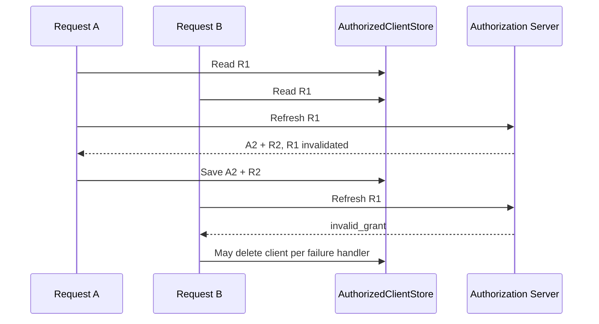

# 17.1. Provider Conditions for Issuing Refresh Tokens and Related Scopes

In **Spring Security OAuth 2.0 / OIDC Client**, a successful login typically yields an **access token** so the application can access resources. However, an access token has a limited lifetime; after a period of time, the application must obtain a new token. One way to do this is by using a **refresh token** previously issued by the Authorization Server or OpenID Provider (OP).

A common misconception is that **every OAuth2/OIDC login receives a refresh token**. Configuring `authorization_code` in the application, enabling `refreshToken()` in Spring Security, adding `openid` to the scope, or requesting `offline_access` **does not automatically guarantee** that the token response will contain `refresh_token`. The decision to issue the token lies with the **Authorization Server/OP** and depends on the grant, client type, consent, scope, provider configuration, and security policy.

This lesson focuses on three questions:

1. **What conditions does a provider check before issuing a refresh token?**
2. **What do `offline_access`, `openid`, and provider-specific scopes mean?**
3. **How does Spring Security receive, store, use, and verify the presence of a refresh token?**

> Scope: OAuth 2.0 Authorization Code Flow, OIDC Login, and OAuth2 Client on **Spring Boot 3.x / Spring Security 6.x Servlet**. Provider examples and configuration names are illustrative; during implementation, always verify the policies and documentation for the current version of the Authorization Server in use.

## 1. Distinguishing Access Tokens and Refresh Tokens

### 1.1. What is an access token used for?

An **access token** is a credential that an OAuth2 Client presents to a **Resource Server** when calling an API, typically via an HTTP header:

```http
GET /v1/reports HTTP/1.1
Host: api.example.test
Authorization: Bearer <access-token>
```

The Resource Server decides whether the token is valid for that API based on the issuer, audience/resource, scope, expiration, and applicable policies.

An access token usually has a shorter lifetime than a refresh token. When it expires or is revoked, the client must not alter `expiresAt` on its own to treat the old token as valid.

### 1.2. What is a refresh token used for?

A **refresh token** is a credential sent **to the Authorization Server's token endpoint** to request a new access token without sending the user through a browser login every time the access token expires.

```http
POST /oauth2/token HTTP/1.1
Host: id.example.test
Content-Type: application/x-www-form-urlencoded

grant_type=refresh_token&refresh_token=<redacted>
```

For a confidential client, the request must also use the registered client authentication method (for example, HTTP Basic or `private_key_jwt`, depending on the provider). Do not put real client secrets into examples, URLs, or logs.

**A refresh token is not a token for calling a Resource Server**, is not an ID Token, and is not an indicator that the user still has an active browser session at the OP.

### 1.3. Quick comparison

| Criterion | Access token | Refresh token |
| --- | --- | --- |
| Where used | Resource Server/API | Authorization Server token endpoint |
| Purpose | Access resources with granted permissions | Request a new access token |
| Lifetime | Usually short | Usually longer, though it can be limited or revoked |
| Always present? | A successful OAuth token response normally contains an access token | **No; issuance is optional per provider** |
| Permission boundaries | Scope/audience/resource of the API | Bound to the client and granted permissions/scopes; cannot self-escalate scopes |
| Sensitivity | High | Very high because it can mint multiple access tokens within valid permissions |
| Should it appear in browser UI/logs? | No, unless a browser client architecture is specifically designed for it | No in typical web backends |

## 2. OAuth Standard Core: Refresh Tokens Are Optional

RFC 6749 specifies that the Authorization Server **decides whether** to issue a refresh token. In the token endpoint response for the Authorization Code Flow, the `refresh_token` field is **optional**.

For example, both token responses below can be valid results of an Authorization Code Flow, depending on server policy.

**Response with a refresh token:**

```json
{
  "access_token": "REDACTED_ACCESS_TOKEN",
  "token_type": "Bearer",
  "expires_in": 3600,
  "refresh_token": "REDACTED_REFRESH_TOKEN",
  "scope": "openid profile reports.read",
  "id_token": "REDACTED_ID_TOKEN"
}
```

**Response without a refresh token:**

```json
{
  "access_token": "REDACTED_ACCESS_TOKEN",
  "token_type": "Bearer",
  "expires_in": 3600,
  "scope": "openid profile reports.read",
  "id_token": "REDACTED_ID_TOKEN"
}
```

In the OIDC example, `id_token` is present because this is an OIDC login; for plain OAuth2 without `openid`, the token response does not necessarily contain an ID Token.

**The absence of `refresh_token` does not automatically mean the request failed or Spring Security dropped the token.** First, determine whether the Authorization Server actually issued that credential.

### 2.1. What OAuth does not guarantee

Core OAuth 2.0 **does not guarantee** that:

- An authorization code will always exchange for a refresh token.
- A refresh token has an immutable lifetime or never expires.
- A refresh token can always be used multiple times.
- Each refresh call will return a new refresh token.
- A refresh token remains valid if the user logs out or has permissions revoked.
- A refresh grant can request additional scopes that the user did not grant.
- Spring Security can synthesize a refresh token when the provider does not return one.

Each of these conditions must be evaluated according to the **specification, OP configuration, and the client's token policy**.

## 3. What Conditions Do Providers Typically Evaluate Before Issuing a Refresh Token?

The deciding factors can be grouped into seven categories:

| Condition group | Question to check | If not met |
| --- | --- | --- |
| **Grant / response type** | Is the client using the Authorization Code Flow or a grant that the OP allows for issuing refresh tokens? | The OP may not issue a refresh token |
| **Client type** | Is the client a confidential web client, a public SPA/native app, or a machine-to-machine service? | The OP may reject the request or apply stricter policies |
| **Scopes and offline access parameters** | Are `offline_access` or provider-specific parameters like `access_type=offline` included when required by the OP? | The server may only issue an access token |
| **Consent** | Has the user consented to long-lived/offline access, or are other consent conditions recognized by the OP met? | The OP may ignore the offline access request |
| **Registration and provider policy** | Does the application have refresh tokens, offline access, rotation, or the required grants enabled? | Even with the right scopes, the token response may still lack a refresh token |
| **Session, account, and risk policy** | Is the account/client restricted by MFA, tenant policy, session limits, risk scoring, or admin policy? | The OP may shorten the lifetime, withhold, or revoke the refresh token |
| **Authorization history** | Has the user already authorized the client previously? Does the provider only return the token on initial consent? | Repeat logins might not receive a new `refresh_token` |

**There is no universal "enable refresh token" parameter across all providers.** The application must understand the integration contract of the specific OP.

### 3.1. Does the client actually need a token when the user is absent?

A browser app that only needs to call UserInfo while the user is signed in may not need a long-lived refresh token. Conversely, a background sync running hours or days later may require offline access.

However, **a business need for long-lived tokens does not override consent and provider policy**. If the OP decides not to issue a refresh token, the client must accept that and redesign the UX or authorization approach.

### 3.2. Confidential clients vs. public clients

A **confidential client** (for example, a Spring Boot backend holding a client secret or using `private_key_jwt`) can authenticate itself at the token endpoint. It is typically well suited for server-side Authorization Code Flow, though it still has no absolute right to receive a refresh token.

A **public client** (SPA/native application) cannot store a client secret securely. OPs typically enforce additional conditions when issuing refresh tokens, such as rotation, lifetime limits, and sender-constraining. Never copy a backend client secret into JavaScript or mobile code just to bypass refresh policies.

RFC 9700 (OAuth 2.0 Security Best Current Practice) specifies that refresh tokens for public clients must be **sender-constrained or use refresh token rotation**. The Authorization Server must also base refresh token issuance on risk assessment and bind them to the granted scopes/resources.

## 4. Impact of Grant Type

Different grants have different relationships with refresh tokens.

| Grant / flow | Can it receive a refresh token? | Notes |
| --- | --- | --- |
| **Authorization Code** | Possible | Common for web backends and modern native/SPA apps; the provider still decides |
| **Authorization Code + PKCE** | Possible | PKCE protects the authorization code; **it does not by itself cause a refresh token to be issued** |
| **OIDC Authorization Code** | Possible | Usually includes `openid` and optionally `offline_access` depending on the OP |
| **Client Credentials** | Typically **no** | RFC 6749 states a refresh token **SHOULD NOT** be included; the client can request a new access token using its own credentials |
| **Implicit Grant** | No in the traditional implicit flow | Does not receive a refresh token from the front-channel implicit token response; this flow is no longer recommended for new integrations |
| **Resource Owner Password Credentials** | Some legacy implementations may issue one | Should not be used for new integrations; OAuth 2.0 Security BCP recommends against using the password grant |
| **Extension / device flows** | Depends on the spec and provider | Must check the specific contract and client configuration |

### 4.1. Why is Authorization Code suitable?

In the Authorization Code Flow, the browser receives the authorization code via the callback, while the backend exchanges the code for tokens through a back-channel call to the token endpoint. The refresh token (if issued) **only appears in the token response**, without ever passing through the browser redirect URL.

```mermaid
sequenceDiagram
    autonumber
    actor User as User
    participant Browser as Browser
    participant Client as Spring Boot OAuth2/OIDC Client
    participant OP as Authorization Server / OP

    Browser->>Client: GET /oauth2/authorization/company
    Client-->>Browser: 302 to authorization endpoint
    Browser->>OP: response_type=code, scope, state, PKCE if used
    OP->>User: Login and consent per policy
    OP-->>Browser: Redirect callback?code=...&state=...
    Browser->>Client: GET /login/oauth2/code/company
    Client->>OP: POST /token grant_type=authorization_code
    alt Provider allows refresh token
        OP-->>Client: access_token + id_token if OIDC + refresh_token
    else Provider does not allow
        OP-->>Client: access_token + id_token if OIDC
    end
    Client->>Client: Authenticate; store OAuth2AuthorizedClient
    Client-->>Browser: Complete login
```

From this diagram, one key point stands out: **the refresh token is data issued by the token endpoint after the Authorization Code Flow; the callback URL does not contain `refresh_token`**.

### 4.2. PKCE does not mean offline access

**PKCE** uses `code_verifier` and `code_challenge` to prevent an attacker from exchanging a stolen authorization code. It is **not consent**, **not a scope**, and **does not guarantee a refresh token**.

A provider may simultaneously require:
- Authorization Code + PKCE;
- `offline_access` or a provider-specific parameter;
- User consent;
- Client configuration allowing refresh tokens.

Missing any one of these conditions can still result in no `refresh_token`.

## 5. Properly Understanding `openid`, `profile`, `email`, and `offline_access`

In OIDC, commonly encountered scopes include:

| Scope | Meaning | Automatically requests a refresh token? |
| --- | --- | --- |
| **`openid`** | Requests an OIDC authentication session / ID Token | **No** |
| **`profile`** | Requests the standard profile claims group | **No** |
| **`email`** | Requests email-related claims | **No** |
| **`address`** | Requests address claims if supported by the OP | **No** |
| **`phone`** | Requests phone number claims if supported by the OP | **No** |
| **`offline_access`** | Requests the ability to obtain access tokens when the End-User is not present | **Only a request; the OP must approve** |
| **Custom API scopes** (e.g., `reports.read`) | API read permission defined by the Resource Server/AS | No universal refresh token semantics |

**`openid` signals an OIDC Login, not a switch to turn on refresh tokens.** Conversely, if the scope only has `openid profile email` and the OP still issues a refresh token, that can also be valid provider policy.

### 5.1. `offline_access` in OpenID Connect Core

OIDC Core defines the **`offline_access`** scope so a client can **request** a Refresh Token usable to obtain Access Tokens even when the End-User is not present / no longer logged in at the OP.

Key rules from the *Offline Access* section:

1. When requesting offline access, `prompt=consent` is typically required, **unless other conditions allow processing the offline access request**.
2. The OP must ensure consent is obtained for issuing a refresh token supporting offline access; prior consent is not always sufficient.
3. The OP must **ignore `offline_access`** if `response_type` does not result in returning an authorization code.
4. For web applications, the OP must obtain explicit consent or satisfy equivalent conditions per the specification.
5. Refresh token usage is **not strictly limited** to `offline_access`; an OP may issue refresh tokens for online access under its own policy.

Therefore:

```text
scope=openid profile offline_access
```

is a **request** to be considered for offline access, not a guarantee that the token response will contain a `refresh_token` field.

### 5.2. `prompt=consent` is not a scope

`prompt` is an **authorization request parameter**, not an OAuth scope:

```text
scope=openid%20profile%20offline_access
prompt=consent
```

- `scope` describes permissions / OIDC requests.
- `prompt=consent` asks the OP to display or process consent according to the behavior supported by the OP.

**Do not write `scope: openid, profile, prompt=consent`** in `application.yml`. That string does not produce the `prompt` authorization parameter in the right place.

### 5.3. It does not mean the user will stay "logged in forever"

Offline access does not mean a session never ends:

- The OP may enforce an absolute lifetime and an idle lifetime for the refresh token.
- The refresh token can be revoked by the user/admin or by a risk policy.
- Rotation can invalidate the old refresh token.
- The OP may require re-authentication or fresh consent.
- The client may have removed the token from its repository or lost the application session.

A refresh token represents **the ability to reissue access tokens within allowed lifetimes and policies**, not proof that the user is currently online.

## 6. Inconsistent Provider Policies: Three Typical Examples

### 6.1. Google OAuth2: `access_type=offline`

According to Google's documentation for web server applications, to request a refresh token for use when the user is not present, the authorization request uses:

```text
access_type=offline
```

This is a **Google-specific authorization parameter**, **not a standard OAuth/OIDC scope**.

Illustrative authorize request example:

```text
https://accounts.google.com/o/oauth2/v2/auth?
  response_type=code
  &client_id=<google-client-id>
  &redirect_uri=https%3A%2F%2Fapp.example.test%2Flogin%2Foauth2%2Fcode%2Fgoogle
  &scope=openid%20profile%20email
  &access_type=offline
  &state=<state>
  &code_challenge=<challenge>
  &code_challenge_method=S256
```

The real URL must be generated and properly encoded by Spring Security; line breaks in the example are for readability only. If the user previously granted access, a refresh token may only be returned on the **initial offline access grant** or under re-consent conditions. Google's documentation also permits using `prompt=consent` when the user needs to be re-prompted for consent; avoid forcing consent on every login without good reason.

**Do not assume adding `scope=offline_access` is enough when working with Google.** Use the parameters Google documents for the specific flow.

### 6.2. Microsoft identity platform / Entra ID: `offline_access`

With the Microsoft identity platform **v2.0 endpoint**, the application must **explicitly request the `offline_access` scope** if it wants to receive a refresh token in the Authorization Code Flow.

Example:

```text
scope=openid profile email offline_access User.Read
```

When calling specific APIs, delegated permission namespaces must match the authorized API and client registration; `User.Read` here is an example Microsoft Graph permission.

Points to distinguish:

- Granting delegated permissions does not automatically guarantee every grant returns a refresh token.
- The Authorization Code Flow is the typical context for receiving an application refresh token.
- Client type, token lifetime, SPA/browser policies, and tenant configuration can affect the outcome.
- Refresh tokens can still be revoked/expired and must be protected.

Even if `offline_access` appears on the consent screen, **do not conclude that the Implicit Flow will also issue a refresh token**.

### 6.3. Keycloak: normal refresh token vs. offline token

Keycloak has the concept of an **offline token**. When a client is granted offline permissions, it can request the token using:

```text
scope=openid offline_access
```

However, **Keycloak's offline token has distinct semantics** compared to a refresh token tied to an online SSO session. It is used at the token endpoint under the refresh grant to obtain new access tokens when the user is no longer online; its lifecycle is governed by offline session settings, idle/max limits, role mappings, and rotation/revocation policies.

In Keycloak, check:

- Whether the realm/client allows **offline access**.
- Whether the user has the appropriate `offline_access` permission/role.
- Whether the client has the corresponding scope/role mappings.
- Whether consent and client policies permit it.
- How `Offline Session Idle`, `Offline Session Max`, and `Revoke Refresh Token` are configured.

**Do not interpret "offline token" as "cannot expire or cannot be revoked".** Keycloak enforces idle/max limits, rotation, and admin/user revocation mechanisms.

### 6.4. Comparison table based on public documentation

| Provider / standard | Typical way to request | Points to note |
| --- | --- | --- |
| **OIDC Core** | `scope=offline_access`, often requiring `prompt=consent` per spec conditions | OP evaluates consent and policy; issuance is not guaranteed |
| **Google web server OAuth2** | `access_type=offline` (authorization parameter) | Refresh token may only be returned on initial authorize/offline consent as applicable |
| **Microsoft v2** | `scope=offline_access` alongside required permissions | Must be requested explicitly to receive a refresh token in the code flow; client policies may apply |
| **Keycloak** | `offline_access` to request an **offline token** | Role/client scope and offline-session policies decide; normal refresh tokens may exist under online-session rules |

Product policies vary by version, tenant, client type, and administrative settings. This table serves only as an **orientation guide**, not a token-issuance contract for every environment.

## 7. Refresh Token Issuance Flow at the Token Endpoint

An Authorization Code Flow typically goes through these steps:

1. The application builds an authorization request containing the client ID, response type, scope, redirect URI, state, and PKCE if used.
2. The OP authenticates the user and processes consent, including offline access if requested.
3. The OP redirects the browser back to the callback with `code` and `state`.
4. The backend exchanges the `authorization_code` at the token endpoint.
5. The OP evaluates policy and returns an access token, an ID Token if OIDC, and an **optional** refresh token.
6. Spring Security creates an `OAuth2AuthorizedClient` with the refresh token when that field is present.
7. When the access token needs refreshing, the client uses the refresh token to request a new token.

### 7.1. Initial token request example

```http
POST /oauth2/token HTTP/1.1
Host: id.example.test
Content-Type: application/x-www-form-urlencoded
Authorization: Basic <redacted-client-authentication>

grant_type=authorization_code&
code=<redacted-code>&
redirect_uri=https%3A%2F%2Fapp.example.test%2Flogin%2Foauth2%2Fcode%2Fcompany&
code_verifier=<redacted-verifier>
```

This request is for a **confidential client using PKCE and Basic client authentication**. For a public client, client authentication differs; never copy a Basic client secret into an SPA or mobile app. The OP must support the corresponding authentication method and PKCE.

### 7.2. Token response with a refresh token

```http
HTTP/1.1 200 OK
Content-Type: application/json
Cache-Control: no-store
Pragma: no-cache

{
  "access_token": "REDACTED_ACCESS_TOKEN",
  "token_type": "Bearer",
  "expires_in": 3600,
  "refresh_token": "REDACTED_REFRESH_TOKEN",
  "scope": "openid profile offline_access"
}
```

In a standard OIDC login, the token response also includes `id_token`; the HTTP example above focuses only on fields relevant to refreshing. Never write real tokens into documentation or logs.

### 7.3. Token response without a refresh token

```json
{
  "access_token": "REDACTED_ACCESS_TOKEN",
  "token_type": "Bearer",
  "expires_in": 3600,
  "scope": "openid profile"
}
```

If the Authorization Server does not issue a refresh token, the client still has a valid access token for the granted lifetime. **Spring Security does not generate a refresh token from `access_token`.**

## 8. Token Refresh: `grant_type=refresh_token` and Granted Permissions

When a refresh token is present, the application can call the token endpoint:

```http
POST /oauth2/token HTTP/1.1
Host: id.example.test
Content-Type: application/x-www-form-urlencoded
Authorization: Basic <redacted-client-authentication>

grant_type=refresh_token&refresh_token=<redacted-refresh-token>
```

Successful response:

```json
{
  "access_token": "NEW_ACCESS_TOKEN_REDACTED",
  "token_type": "Bearer",
  "expires_in": 3600,
  "refresh_token": "NEW_REFRESH_TOKEN_IF_ROTATED"
}
```

**The `refresh_token` field in the refresh response can also be optional**, depending on provider policy and token rotation. If the server returns a new token, the client must store the new one according to rotation rules and not attempt to reuse the revoked refresh token.

### 8.1. Can scopes be escalated during a refresh grant?

No. According to RFC 6749, the `scope` parameter in a refresh token request is optional and **must not include any scope not originally granted**. If omitted, it is treated as the originally granted scopes under the specification's rules. The server may reject invalid scopes or return a narrower scope set.

Example:

```text
Already granted: reports.read

Valid refresh per policy:
  scope=reports.read

Cannot self-escalate using:
  scope=reports.read reports.write
```

To obtain a new `reports.write` scope, the client must perform **additional authorization/consent** following the appropriate flow and provider rules, not alter the refresh token request to escalate privileges.

### 8.2. Requested scopes vs. actually granted scopes

These two sets can differ:

- **Requested scopes:** `ClientRegistration.getScopes()` and the authorization request sent to the OP.
- **Granted access token scopes:** `OAuth2AuthorizedClient.getAccessToken().getScopes()` when the provider supplies the corresponding information.

Inspect the actually granted scopes whenever a Resource Server rejects a request. Adding `reports.write` to `application.yml` does not guarantee that the user approved it or that the OP is allowed to grant it.

## 9. Configuring an OIDC Client in Spring Boot

Suppose the application needs to log in via `company` and wants to request offline access per OIDC Core.

### 9.1. Maven dependencies

```xml
<dependencies>
    <dependency>
        <groupId>org.springframework.boot</groupId>
        <artifactId>spring-boot-starter-web</artifactId>
    </dependency>
    <dependency>
        <groupId>org.springframework.boot</groupId>
        <artifactId>spring-boot-starter-security</artifactId>
    </dependency>
    <dependency>
        <groupId>org.springframework.boot</groupId>
        <artifactId>spring-boot-starter-oauth2-client</artifactId>
    </dependency>
</dependencies>
```

### 9.2. ClientRegistration with `offline_access`

```yaml
spring:
  security:
    oauth2:
      client:
        registration:
          company:
            provider: company
            client-id: ${OIDC_CLIENT_ID}
            client-secret: ${OIDC_CLIENT_SECRET}
            authorization-grant-type: authorization_code
            redirect-uri: "{baseUrl}/login/oauth2/code/{registrationId}"
            scope:
              - openid
              - profile
              - email
              - offline_access
              - reports.read

        provider:
          company:
            issuer-uri: https://id.example.test/realms/company
```

This is an **illustrative registration**, assuming the OP actually supports `offline_access` and `reports.read`. For Google or providers with custom parameters, simply adding the scope in configuration may not satisfy refresh token issuance policies.

### 9.3. SecurityFilterChain

```java
import org.springframework.context.annotation.Bean;
import org.springframework.context.annotation.Configuration;
import org.springframework.security.config.Customizer;
import org.springframework.security.config.annotation.web.builders.HttpSecurity;
import org.springframework.security.web.SecurityFilterChain;

@Configuration
class SecurityConfig {

    @Bean
    SecurityFilterChain securityFilterChain(HttpSecurity http) throws Exception {
        return http
            .authorizeHttpRequests(auth -> auth
                .requestMatchers("/", "/error", "/public/**").permitAll()
                .anyRequest().authenticated())
            .oauth2Login(Customizer.withDefaults())
            .oauth2Client(Customizer.withDefaults())
            .build();
    }
}
```

Users can start OIDC Login at:

```text
GET /oauth2/authorization/company
```

Spring Security generates the authorization request from the registration. After the callback and token exchange, the provider may return a refresh token; Spring Security stores it in `OAuth2AuthorizedClient` if present.

### 9.4. Adding the scope alone may not be enough

With OIDC Core, if `prompt=consent` is needed, you must add it to the **authorization request sent to the OP**. This is a request parameter, not a `scope` property.

In Spring Security Servlet, you can customize the request using **`DefaultOAuth2AuthorizationRequestResolver`**.

## 10. Adding `prompt=consent` via an Authorization Request Resolver

An example configuration for an OIDC registration requiring consent:

```java
import org.springframework.context.annotation.Bean;
import org.springframework.context.annotation.Configuration;
import org.springframework.security.config.annotation.web.builders.HttpSecurity;
import org.springframework.security.oauth2.client.registration.ClientRegistrationRepository;
import org.springframework.security.oauth2.client.web.DefaultOAuth2AuthorizationRequestResolver;
import org.springframework.security.oauth2.client.web.OAuth2AuthorizationRequestRedirectFilter;
import org.springframework.security.web.SecurityFilterChain;

@Configuration
class OfflineConsentConfig {

    @Bean
    SecurityFilterChain securityFilterChain(
            HttpSecurity http,
            ClientRegistrationRepository registrations) throws Exception {

        DefaultOAuth2AuthorizationRequestResolver resolver =
            new DefaultOAuth2AuthorizationRequestResolver(
                registrations,
                OAuth2AuthorizationRequestRedirectFilter
                    .DEFAULT_AUTHORIZATION_REQUEST_BASE_URI);

        resolver.setAuthorizationRequestCustomizer(builder ->
            builder.additionalParameters(params ->
                params.put("prompt", "consent")));

        return http
            .authorizeHttpRequests(auth -> auth
                .requestMatchers("/", "/error").permitAll()
                .anyRequest().authenticated())
            .oauth2Login(oauth2 -> oauth2
                .authorizationEndpoint(endpoint ->
                    endpoint.authorizationRequestResolver(resolver)))
            .build();
    }
}
```

This configuration is **for illustrative purposes**, and it adds `prompt=consent` to every authorization request handled by this resolver. When using multiple providers/registrations, do not force every provider to receive the same parameter. Implement a conditional resolver/delegate based on registration and integration contract.

**A technical note:** the resolver's customizer may interact with other customizations such as PKCE. When replacing the request customizer, preserve any customization steps required for your client type and Spring Security version; do not accidentally overwrite or drop PKCE.

### 10.1. Why not put `prompt` inside `scope`?

Wrong:

```yaml
scope: openid, profile, offline_access, prompt=consent
```

Correct distinction:

```text
scope = "openid profile offline_access"
prompt = "consent"
```

`scope` is a list of scopes. `prompt` is a separate parameter on the authorize URL, added by the Spring Security resolver.

### 10.2. When should you avoid forcing `prompt=consent`?

Avoid forcing the user through consent on **every login** if:
- The OP has already stored valid consent and has another mechanism for offline access.
- Not all registrations support `prompt`.
- UX requirements call for avoiding repeated consent popups and admin policy allows reusing consent.
- The provider uses a different parameter, such as Google with `access_type=offline`.

Check the OP's requirements and only enable re-consent where genuinely needed.

## 11. Google-Specific Example: `access_type=offline`

For a Google OAuth2 Client, the `access_type=offline` requirement is a parameter **different** from the `offline_access` scope. In a Spring Security application, you can add this parameter using `DefaultOAuth2AuthorizationRequestResolver`.

```java
DefaultOAuth2AuthorizationRequestResolver googleResolver =
    new DefaultOAuth2AuthorizationRequestResolver(
        clientRegistrationRepository,
        OAuth2AuthorizationRequestRedirectFilter
            .DEFAULT_AUTHORIZATION_REQUEST_BASE_URI);

googleResolver.setAuthorizationRequestCustomizer(builder ->
    builder.additionalParameters(params ->
        params.put("access_type", "offline")));
```

Then register the resolver under `oauth2Login().authorizationEndpoint().authorizationRequestResolver(googleResolver)` as in the previous section. This example assumes the resolver serves only Google; if applied across multiple providers, add branching logic so Google-specific parameters are not sent to other OPs.

If the user has previously authorized the app, a post-login token response will not always include a new refresh token. You may need an explicit re-consent flow under conditions supported by Google, such as intentionally adding `prompt=consent`.

**Do not endlessly force full re-consent** to "force" the server to issue tokens; doing so degrades user experience, causes connection churn, and may hit provider policy limits.

## 12. Where Does Spring Security Obtain the Refresh Token?

With Servlet OAuth2/OIDC Login:

1. The browser completes the authorization code callback.
2. Spring Security exchanges the code at the token endpoint.
3. If the response includes `refresh_token`, the OAuth2 Client infrastructure represents it with **`OAuth2RefreshToken`**.
4. **`OAuth2AuthorizedClient`** can hold both the access token and the refresh token.
5. The repository/service persists the authorized client according to configuration.

Relevant classes:

| Component | Role |
| --- | --- |
| **`ClientRegistration`** | Configures client/provider/grant/scope |
| **`OAuth2AuthorizedClient`** | Holds the access token and optional refresh token for a registration/principal |
| **`OAuth2RefreshToken`** | The issued refresh credential |
| **`OAuth2AuthorizedClientRepository`** | Saves/loads authorized clients bound to the Servlet request/principal |
| **`OAuth2AuthorizedClientService`** | Saves/loads authorized clients by registration ID + principal name |
| **`OAuth2AuthorizedClientManager`** | Coordinates authorization/re-authorization |
| **`RefreshTokenOAuth2AuthorizedClientProvider`** | Executes the refresh token grant when conditions are met |

**You cannot create a refresh token via `@Bean OAuth2AuthorizedClientManager`** if the Authorization Server did not issue one. The manager only uses already-issued data and grants supported by the provider.

## 13. Observing Whether a Refresh Token Exists

An application-level check without printing the token:

```java
import java.util.Map;

import org.springframework.security.oauth2.client.OAuth2AuthorizedClient;
import org.springframework.security.oauth2.client.annotation.RegisteredOAuth2AuthorizedClient;
import org.springframework.web.bind.annotation.GetMapping;
import org.springframework.web.bind.annotation.RestController;

@RestController
class OAuth2TokenStatusController {

    @GetMapping("/internal/oauth2/status")
    Map<String, Object> status(
            @RegisteredOAuth2AuthorizedClient("company")
            OAuth2AuthorizedClient authorizedClient) {

        return Map.of(
            "registrationId",
                authorizedClient.getClientRegistration().getRegistrationId(),
            "accessTokenPresent",
                authorizedClient.getAccessToken() != null,
            "refreshTokenPresent",
                authorizedClient.getRefreshToken() != null
        );
    }
}
```

This is an **illustrative diagnostic endpoint**. In production, protect access appropriately and carefully consider whether exposing token metadata is appropriate. Never return `getRefreshToken().getTokenValue()` or the entire `OAuth2AuthorizedClient` in JSON.

### 13.1. Interpreting the result

```json
{
  "registrationId": "company",
  "accessTokenPresent": true,
  "refreshTokenPresent": false
}
```

This means **the current authorized client does not hold a refresh token**. At least two possibilities should be distinguished:

- The provider never returned `refresh_token` in the token response.
- The provider did return it, but the token was lost during mapping, persistence, caching, or incorrect overwriting of the authorized client record.

Therefore, to find the root cause, compare **the presence of the field in the token response in a secured test environment** against the data remaining after Spring Security saves the authorized client. Do not log raw tokens to do this; observe only presence/absence and sanitized metadata.

### 13.2. If a refresh token is present, is it guaranteed to still work?

No. `authorizedClient.getRefreshToken() != null` only proves that a credential was stored. It does not confirm that the OP has not revoked the token, exceeded its idle/max lifetime, or rotated it. That can only be determined when executing a refresh grant or via an appropriate token status/revocation mechanism.

## 14. Configuring `RefreshTokenOAuth2AuthorizedClientProvider`

When an access token needs refreshing and the authorized client has a refresh token, **`RefreshTokenOAuth2AuthorizedClientProvider`** can execute the refresh token grant.

Example manager configuration:

```java
import org.springframework.context.annotation.Bean;
import org.springframework.context.annotation.Configuration;
import org.springframework.security.oauth2.client.OAuth2AuthorizedClientManager;
import org.springframework.security.oauth2.client.OAuth2AuthorizedClientProvider;
import org.springframework.security.oauth2.client.OAuth2AuthorizedClientProviderBuilder;
import org.springframework.security.oauth2.client.registration.ClientRegistrationRepository;
import org.springframework.security.oauth2.client.web.DefaultOAuth2AuthorizedClientManager;
import org.springframework.security.oauth2.client.web.OAuth2AuthorizedClientRepository;

@Configuration
class OAuth2ClientManagerConfig {

    @Bean
    OAuth2AuthorizedClientManager authorizedClientManager(
            ClientRegistrationRepository registrations,
            OAuth2AuthorizedClientRepository authorizedClients) {

        OAuth2AuthorizedClientProvider provider =
            OAuth2AuthorizedClientProviderBuilder.builder()
                .authorizationCode()
                .refreshToken()
                .build();

        DefaultOAuth2AuthorizedClientManager manager =
            new DefaultOAuth2AuthorizedClientManager(
                registrations, authorizedClients);

        manager.setAuthorizedClientProvider(provider);

        return manager;
    }
}
```

Practical conditions required for refreshing:

- The authorization client already has an `OAuth2AuthorizedClient` matching the registration/principal.
- `getRefreshToken()` is non-null.
- The access token has expired or is close to expiring according to clock skew/provider rules.
- The manager has `refreshToken()` configured.
- The Authorization Server accepts the refresh grant and the applicable client authentication.
- The refresh token is still valid per lifetime, rotation, and policy.

**`builder.refreshToken()` only enables using an already-issued refresh token**; it does not instruct the OP to issue one. If the token is missing, the provider cannot perform a refresh grant.

### 14.1. Successful refresh outcome

The manager receives a new access token and updates the `OAuth2AuthorizedClient`, including a new refresh token if the OP rotates it. Ensure the repository/service persists the updated version so subsequent calls do not use the old token.

### 14.2. The `invalid_grant` error

If the refresh token has been revoked, expired, or otherwise invalidated, the token endpoint typically returns:

```json
{
  "error": "invalid_grant",
  "error_description": "The refresh token is invalid"
}
```

This is a signal **not to retry infinitely with the same refresh token**. Spring Security has authorization failure handling, including removing the failing authorized client under appropriate conditions. Afterward, the user may need to perform a fresh authorization.

## 15. Can an SSO Session Be Used Without a Refresh Token?

**Yes.** A web application can maintain an internal login session or rely on the OP still holding an SSO browser session, then send the user through a new Authorization Code Flow to obtain another access token when needed.

However, this is not a **refresh token grant**:

```text
Without refresh token:
  Browser -> authorization endpoint
          -> OP SSO cookie/consent
          -> new authorization code
          -> token endpoint
          -> new access token

With refresh token:
  Backend -> token endpoint grant_type=refresh_token
          -> new access token
```

In the first scenario, the user may or may not have to re-enter a password depending on the OP session and risk policy; browser interaction may still be required. In the second scenario, the client can request a new token even when the user no longer has the browser open, provided the refresh token and client authorization remain valid.

**Do not refer to redirecting through the OP for a new code as a "refresh token".** The two flows have different security boundaries, UX, and requirements.

### 15.1. A web session that does not need a long-lived refresh token

If the application only needs tokens while the user is actively interacting and is ready to initiate a new authorization when needed, you can accept a token response without a refresh token. That is a valid design depending on product policy.

### 15.2. Background sync usually requires a different suitable mechanism

If the product must sync data while the user is offline, the options are:

- Request offline access per the OP and obtain valid consent.
- Store the refresh token securely and manage its lifecycle/rotation.
- Use token exchange or appropriate delegation if supported by the OP/API.
- Switch to a service identity when the business operation does not need to act on behalf of a user, using the `client_credentials` grant and dedicated permissions.

You cannot use an application's **`client_credentials` token** to impersonate user permissions when the API requires delegated user consent.

## 16. `scope` State at Different Points in Time

To diagnose "why there is no refresh token", you need to know which scopes were requested, which were approved, and which appear on the token.

```text
ClientRegistration scopes
        |
        v
Authorization request scope
        |
        v
OP processes login + consent + policy
        |
        v
Authorization grant issued
        |
        v
Token response scope, access_token, optional refresh_token
        |
        v
OAuth2AuthorizedClient
```

### 16.1. Scopes in YAML are only requested scopes

```yaml
scope: openid, profile, offline_access, reports.read
```

This is not proof that the OP granted offline access. You must inspect the actual authorize request and the token response/consent state.

### 16.2. The provider may narrow scopes

RFC 6749 allows the Authorization Server to issue an access token with **narrower** permissions than requested. The client must not assume every scope requested in YAML was granted.

### 16.3. Do not use a refresh token to escalate scopes

Suppose the user granted `reports.read`, and the app later needs `reports.write`. Do not try to solve this by adding the new scope to the refresh request. Use incremental authorization/consent per the provider and verify the granted result.

### 16.4. `offline_access` does not replace API scopes

`offline_access` is meant for requesting long-lived refresh capability. It **does not by itself grant permissions** to read emails, edit calendars, or access reports. The client still needs appropriate API scopes such as `reports.read`.

## 17. Refresh Token Rotation and Expiration

An issued refresh token is not an immutable credential.

### 17.1. Rotation

Some OPs return a new token on every refresh and invalidate the old one:

```text
Initial:
  Access token A1
  Refresh token R1

Refresh R1:
  Access token A2
  Refresh token R2

Refresh R2:
  Access token A3
  Refresh token R3

R1 and R2 can no longer be used after rotation.
```

If the client only saves the new `access_token` and forgets to save the new refresh token, the next refresh may fail with `invalid_grant`.

### 17.2. Absolute and idle lifetimes

A provider may enforce:

- **Absolute lifetime:** the token/grant expires after a fixed deadline even with frequent refreshes.
- **Idle lifetime:** the token/grant expires if unused for a specified duration.
- **Session-linked lifetime:** the refresh token depends on the OP's SSO session or offline session.
- **Policy-based revocation:** the user/admin revokes consent or the account is locked.
- **Token reuse detection:** reusing a rotated token is treated as suspicious and the entire token family may be revoked.

Do not describe a refresh token as "never expiring" without checking the OP's configuration.

### 17.3. Concurrent refreshes across multiple instances

When two requests use R1 at the same time:



If B deletes the record that A just updated, the application may lose the new token even though A's refresh succeeded. For high-load systems with rotation, design locking/single-flight, versioning, compare-and-delete, and shared persistence appropriate to system constraints.

## 18. How Should Refresh Tokens Be Protected?

RFC 9700 recommends strict governance over refresh token issuance and requires replay prevention for public clients. For web backends, protecting credentials server-side and restricting access are top priorities.

Principles:

1. **Never send refresh tokens to a Resource Server** or in frontend URL query strings.
2. **Never write refresh tokens to logs**, telemetry, or error reports.
3. **Never store them in browser `localStorage`** for typical backend applications.
4. **Encrypt/protect storage** per policy, restricting read access for services and personnel.
5. **Bind tokens to the client and principal**; never use user A's token for user B.
6. **Separate environments** (local/staging/production) with distinct client IDs and secrets where appropriate.
7. **Handle rotation and revocation**; save new tokens, remove invalid ones, and stop retrying on `invalid_grant`.
8. **Verify HTTPS and the token endpoint** before sending a refresh token; never send it to a user-specified host.
9. **Request offline access only when genuinely needed**, as long-lived token minting increases risk if credentials are exposed.
10. **Design reconnect/re-consent prompts** when tokens can no longer be refreshed.

### 18.1. A refresh token is not display data

Wrong example:

```java
// DO NOT DO THIS: exposes credential in HTTP response.
@GetMapping("/debug/tokens")
String debug(
        @RegisteredOAuth2AuthorizedClient("company")
        OAuth2AuthorizedClient client) {
    return client.getRefreshToken().getTokenValue();
}
```

Beyond leaking the token, this code risks a `NullPointerException` when the OP does not issue a refresh token. Observe only **presence/absence**, never return the credential.

### 18.2. Token errors must remain confidential

`error_description` from the token endpoint may contain sensitive diagnostic details or external content. Do not echo the raw description onto login pages or into metric labels. Use controlled error categories and internal trace IDs.

## 19. Distinguishing Refresh Tokens from OP Session Permissions

Three states can coexist:

| State | Where managed | Meaning |
| --- | --- | --- |
| Application HTTP session | Spring Boot / session store | The user is logged into the web application |
| SSO browser session | OP/Identity Provider | The browser is still recognized by the OP for interactive authorization |
| Refresh token | Authorization Server and client token store | The client holds a credential to request new access tokens per policy |

**Logging out of Spring Boot does not necessarily revoke the refresh token at the OP.** Conversely, expiration of the OP SSO session does not necessarily invalidate all offline refresh tokens immediately, depending on token policy.

If the application has a "disconnect account" feature, consider:
- Removing the authorized client from the local repository/service.
- Calling the token revocation endpoint if supported by the OP and required by policy.
- Handling OIDC/SSO logout as a separate flow.
- Ensuring the UI accurately reflects whether the connection is still valid.

Do not confuse `OAuth2AuthorizedClientRepository.removeAuthorizedClient(...)` with revocation performed on the Authorization Server.

## 20. Why Might a Correctly Configured App Still Lack a Refresh Token?

A diagnostic workflow should proceed in order:

### Step 1 — Check the grant type

```text
registration.authorization-grant-type = authorization_code
authorize request response_type = code
```

If using `client_credentials`, refresh tokens are normally not issued; if using an unsuitable legacy flow, redesign it rather than trying to force refresh support.

### Step 2 — Check the client type and OP configuration

Verify the registration on the provider:
- Correct client ID, client secret/authentication method.
- Allowed grant type/response type.
- Offline access or refresh token policy enabled if required by the OP.
- Matching redirect URI and PKCE settings.
- Public/confidential client profile matches the application.

### Step 3 — Check the scopes/parameters actually sent

Browser Network tools can show whether the authorize URL includes:
- `scope=openid%20offline_access` (for OPs using the OIDC offline scope).
- `prompt=consent` if required by OP conditions.
- `access_type=offline` if using the Google web server flow.
- `response_type=code` and the right registration ID.

Inspect only **parameter names and non-sensitive values**; do not share `state`, `code`, `code_verifier`, or tokens.

### Step 4 — Check consent and authorization history

Did the user already grant permissions previously? Does the provider return a refresh token only on the initial offline access grant? Did an admin revoke consent or restrict the client?

Do not repeatedly force `prompt=consent` to test in production; use authorized test clients and test accounts.

### Step 5 — Determine whether the token response contains `refresh_token`

In a secured test environment, observe the presence of the field without logging its value. If the provider does not return the field, investigate OP configuration/consent/policy. If it is present in the response but not saved in the authorized client, inspect the Spring Security pipeline and repository/service.

### Step 6 — Check that the authorized client is bound to the right principal/registration

If the app has `company-login` and `reports-api`, inspecting the wrong authorized client can make it look like the token is missing. Verify the exact `registrationId` and authenticated principal.

### Step 7 — Check persistence and lifecycle

The token may have been issued, only for the record to disappear after a restart, logout, session expiry, or when a failure handler deletes a failing client. In distributed deployments, ensure instances use a compatible shared store.

### Step 8 — When a refresh token exists but refreshing fails

Focus on the error code:
- `invalid_grant`: refresh token expired, revoked, rotated, or invalid.
- `invalid_client`: incorrect client authentication or changed client configuration.
- `invalid_scope`: invalid scope requested during refresh.
- `temporarily_unavailable`/timeout: transient OP error, not necessarily a revoked token.

Do not "fix" everything by increasing timeouts or disabling token validation.

## 21. Symptom-Based Troubleshooting Table

| Symptom | What to verify | Resolution approach |
| --- | --- | --- |
| OIDC login succeeds but `getRefreshToken()==null` | Did the OP return `refresh_token` in the token response? | Check provider policy and scope/consent first |
| Added `openid` but no refresh token | `openid` only requests OIDC | Request offline access per provider documentation when needed |
| Added `offline_access` but OP still doesn't issue one | Consent, grant, client type, OP policy | Check against OIDC rules; do not treat the scope as a guarantee |
| Google does not return a refresh token | Is `access_type=offline` present? Prior authorization? | Customize authorization parameters; check re-consent policy |
| Microsoft v2 has no refresh token | Was `offline_access` explicitly requested in the code flow? | Add the scope and inspect app registration/token policies |
| Keycloak does not issue an offline token | Role mapping, optional client scope, offline session policy | Configure offline access the Keycloak way |
| `client_credentials` has no refresh token | Flow is designed to obtain access tokens via credentials | Request a new token when needed; do not expect a refresh token by default |
| Access token expires, manager does not refresh | Is there a refresh token? Is the `refreshToken()` provider enabled? | Check both server token issuance and client manager setup |
| Refresh returns `invalid_grant` | Token expired/revoked/rotated/reused | Remove stale authorized client, re-authorize when allowed |
| Refresh succeeds only once | Provider rotates refresh tokens | Save the new refresh token after each refresh |
| Refresh fails when running multiple pods | Two requests used the old refresh token concurrently | Locking/versioning/CAS and shared token storage |
| Requesting `reports.write` on refresh is rejected | New scope was never granted | Additional authorization/consent, do not escalate scopes via refresh grant |
| User logs out but refresh still works | Offline token does not depend on online SSO session per provider | Design an appropriate revocation/connection policy |
| Refresh token disappears after app restart | Token store is only volatile session memory | Use secure persistence if long-lived access is required |
| No refresh token, yet browser login does not prompt for password | OP SSO session is still valid | Distinguish getting a new authorization code from a refresh token grant |

## 22. Common Mistakes

### Mistake 1 — "Having the `offline_access` scope guarantees receiving a refresh token"

False, because `offline_access` is a **request**, while the OP evaluates consent, grant, and policy. For some providers, separate parameters or additional client settings may be required.

### Mistake 2 — "Spring Security didn't enable `refreshToken()`, so the OP didn't issue one"

The provider decides token issuance at the **token endpoint during the Authorization Code Flow**. Enabling `refreshToken()` on the manager controls **how the client uses an existing token** to refresh later. Those are two separate stages.

### Mistake 3 — "`client_credentials` also needs a refresh token"

Not per standard OAuth2 expectations. Client Credentials can request a new access token using the application's own client authentication. RFC 6749 states a refresh token **SHOULD NOT** be included in responses for this grant.

### Mistake 4 — "A refresh token is a long-lived ID Token"

False. An ID Token provides user authentication claims; a refresh token is a credential sent to the token endpoint. Never send a refresh token as `Authorization: Bearer` to UserInfo or a Resource Server.

### Mistake 5 — "Having a refresh token means consent is no longer needed"

False. The OP may require consent when initiating offline access, limit lifetimes, or revoke the token. Refreshing also cannot expand scopes beyond what the user granted.

### Mistake 6 — "No refresh token is a Spring Boot bug"

Insufficient basis. Verify the response from the provider before concluding there is a framework mapping/persistence bug.

### Mistake 7 — "A stored token will always keep working"

False. Refresh tokens can expire, rotate, be revoked, and trigger reuse detection. The client must manage their lifecycle and handle fallback reauthorization.

### Mistake 8 — "I can pass the refresh token to the frontend because it's just a string"

False. It is a high-value credential. For server-side apps, keep it on the backend. For public clients, only use an appropriate OAuth2 design and follow the provider's Security BCP.

## 23. Scenario Exercises

### Scenario A — OIDC login with `openid profile email`

The application uses:

```yaml
scope: openid, profile, email
```

An ID Token and access token are issued, but there is no refresh token.

**Question:** Is this an OAuth2/OIDC specification error?

> **No.** Refresh tokens are optional. These scopes are for OIDC and profile claims; if offline access is needed, you must check the provider's specific request mechanism and policy.

### Scenario B — Adding `offline_access` without consent

The application sends:

```text
response_type=code
scope=openid profile offline_access
```

The OP does not issue a refresh token.

**Question:** What should be checked next?

> Per OIDC Core, verify consent and `prompt=consent` or equivalent conditions accepted by the OP; also check client type, registration, and offline access policy.

### Scenario C — Google OAuth2 web application

The application added `offline_access` to its scopes, yet Google does not return a refresh token.

**Question:** What is missing?

> Per Google's web server flow documentation, you need to request `access_type=offline`. If the user consented previously, receiving a refresh token again also depends on authorization history and re-consent policy.

### Scenario D — Microsoft identity platform v2

The application uses the Authorization Code Flow, but the scope only includes `openid profile User.Read`.

**Question:** What should be considered to request a refresh token?

> Explicitly request `offline_access` per Microsoft v2 policy, then verify client/app settings and the token response. The scope alone does not guarantee the server will always issue one.

### Scenario E — Client Credentials for a background job

A job runs with `client_credentials`, receives a 1-hour access token, and gets no refresh token.

**Question:** How does it obtain a new token?

> When the token expires, the client can reuse its client credentials at the token endpoint, with securely managed secret/private-key authentication. Do not assume a refresh token is needed for this grant.

### Scenario F — Refresh token exists, but the next request returns `invalid_grant`

The application receives R1 from the token endpoint; refreshing with R1 succeeds and the server returns R2, yet the cache still holds R1.

**Question:** Where is the bug?

> Likely **refresh token rotation**. When the OP returns R2, the application must persist the updated authorized client. Reusing the revoked R1 leads to `invalid_grant`.

### Scenario G — Current access token only has `reports.read`

The application needs `reports.write` and plans to add it to the refresh request.

**Question:** Is that approach valid?

> No. A refresh token grant cannot request permissions beyond the scopes granted by the user. Perform an appropriate Authorization Code Flow / incremental consent instead.

### Scenario H — Refresh token disappears after restart

The initial login had a refresh token, but after a restart `getRefreshToken()` is null or the authorized client is gone.

**Question:** How does this differ from the provider not issuing the token?

> The provider may have issued the token, while the application only stored it in a volatile HTTP session or a repository that is not properly shared/persisted. Diagnose persistence separately, not just scopes and consent.

### Scenario I — User logged out of OP, yet background sync still runs

**Question:** Is this abnormal?

> It depends on policy. With an offline token validly issued by the OP, the token can allow access even when the user is no longer online until it expires or is revoked per policy. If the product needs to cut off access upon logout, design an explicit revocation/connection lifecycle.

### Scenario J — Public browser client with a refresh token

**Question:** Can it be permanently stored in `localStorage`?

> You should not do so by default. Public clients cannot keep secrets like a confidential backend; OAuth 2.0 Security BCP requires sender-constrained refresh tokens or rotation, and tokens must be protected according to an appropriate browser-based client architecture. Whenever possible, use a backend-for-frontend or server-side token storage to reduce the credential exposure surface.

## 24. Key Takeaways Summary

```text
Does the app need long-lived access tokens?
           |
           v
Is user-delegated offline access actually needed?
           |
           +-- No -> Short-lived access tokens / reauthorization when needed
           |
           +-- Yes
               |
               v
       Choose appropriate grant (usually Authorization Code + PKCE)
               |
               v
       Check provider policies and client type
               |
               v
       Request OP-specific scopes/parameters
       - OIDC: offline_access, consent when needed
       - Google: access_type=offline
       - Microsoft v2: explicit offline_access
       - Keycloak: offline_access + offline token policy
               |
               v
       OP authenticates user / consent / applies risk policy
               |
               v
       Token endpoint
               |
               +-- Has refresh_token
               |      |
               |      v
               |  Spring Security OAuth2AuthorizedClient
               |      |
               |      v
               |  RefreshTokenOAuth2AuthorizedClientProvider
               |      |
               |      v
               |  Save new token on rotation
               |
               +-- No refresh_token
                      |
                      v
               Cannot refresh via refresh_token grant
               Design re-authorization or a different flow
```

**Four most important points:**

- **The provider decides whether to issue a refresh token.** Authorization Code Flow and PKCE provide the right foundation, not a guarantee.
- **Scopes and parameters must match the provider.** `offline_access` in OIDC differs from Google's `access_type=offline`; some OPs also require consent or separate offline configuration.
- **Spring Security only uses tokens that have been issued.** `OAuth2AuthorizedClient.getRefreshToken()` can be null; enabling `refreshToken()` on the manager does not make the OP issue a token.
- **Refresh tokens must be managed as sensitive credentials**: never expose them to browsers/logs, store them securely, and handle rotation, expiration, revocation, and controlled re-authorization.

### Official Reference Documentation

- [RFC 6749 — OAuth 2.0, Section 1.5 Refresh Token](https://www.rfc-editor.org/rfc/rfc6749#section-1.5)
- [RFC 6749 — Refreshing an Access Token](https://www.rfc-editor.org/rfc/rfc6749#section-6)
- [RFC 9700 — OAuth 2.0 Security Best Current Practice](https://www.rfc-editor.org/rfc/rfc9700)
- [OpenID Connect Core 1.0 — Offline Access, Section 11](https://openid.net/specs/openid-connect-core-1_0.html#OfflineAccess)
- [Spring Security — OAuth 2.0 Client Authorization Grants](https://docs.spring.io/spring-security/reference/servlet/oauth2/client/authorization-grants.html)
- [Spring Security — OAuth 2.0 Client Core Interfaces and Classes](https://docs.spring.io/spring-security/reference/servlet/oauth2/client/core.html)
- [Google Developers — Using OAuth 2.0 for Web Server Applications](https://developers.google.com/identity/protocols/oauth2/web-server)
- [Microsoft Learn — Scopes and Permissions: offline_access](https://learn.microsoft.com/en-us/entra/identity-platform/scopes-oidc)
- [Keycloak — Server Administration Guide: Offline Access](https://www.keycloak.org/docs/latest/server_admin/#_offline-access)
