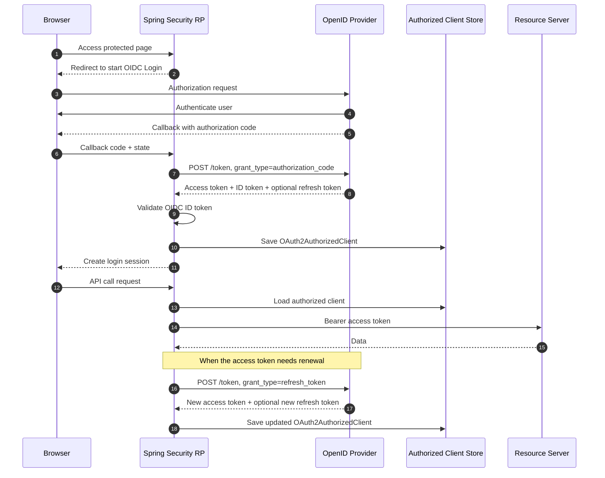
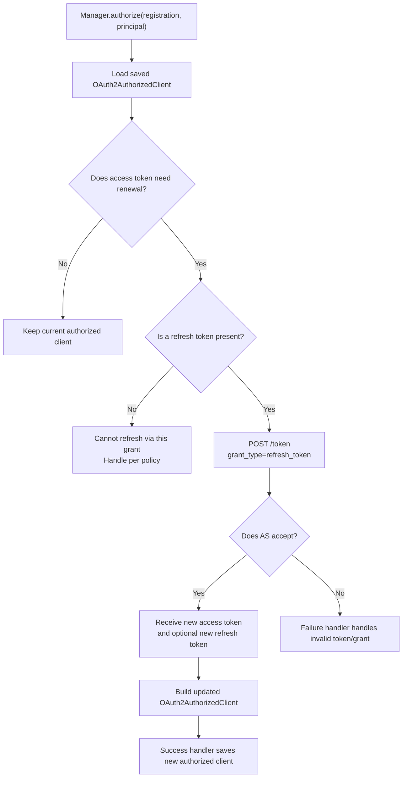
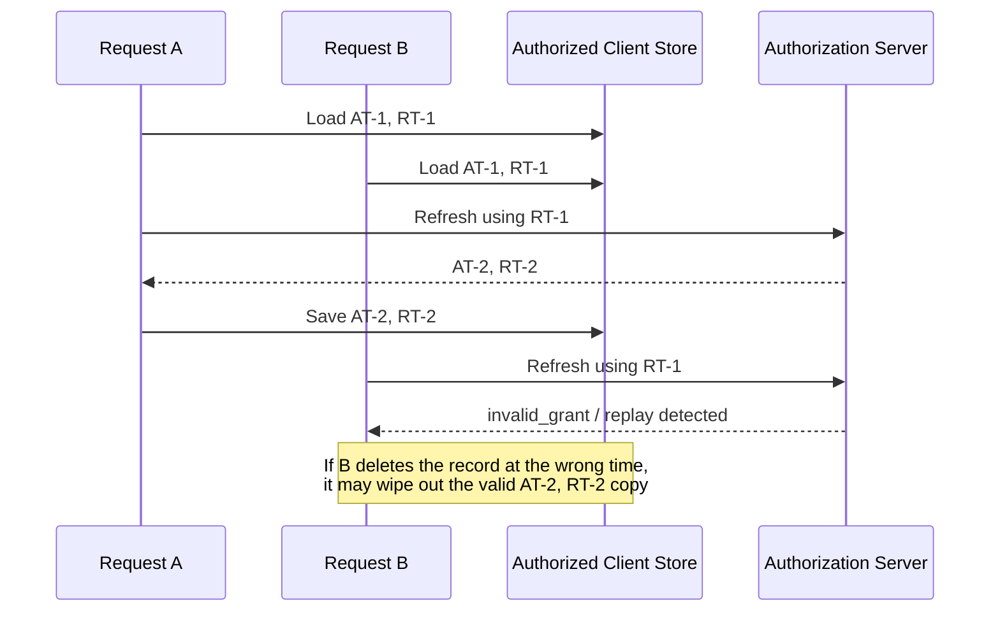
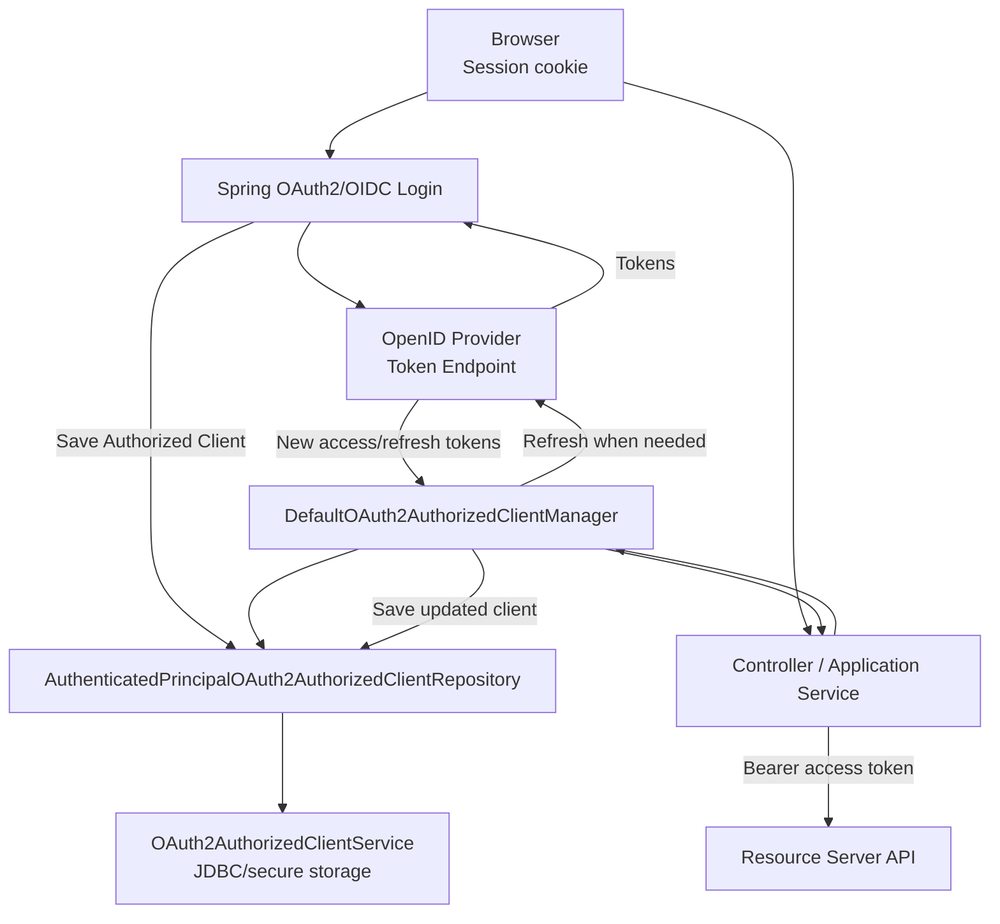

# 17.2. Storing Refresh Tokens Alongside the Authorized Client

In a **Spring Security OAuth 2.0/OIDC Client** application, a user may sign in successfully, use features for many minutes or hours, and then the application needs to call an API when **the old access token has expired**. If the Authorization Server (AS) issued a **refresh token**, the OAuth client can request a new access token without necessarily sending the user back to the login screen.

The practical question is not only "how do we send a refresh token?", but also:

- **Where is the refresh token stored**, and **which user/client registration** is it bound to?
- When the access token is renewed, how do we **persist the new access token and the new refresh token (if any)**?
- If the refresh token is revoked or expires, how do we **prevent continuing to use the stale copy**?
- When deploying **multiple instances**, how do we prevent two requests from simultaneously using a refresh token that has already been rotated?
- What measures are needed to protect the token in HTTP sessions, databases, logs, backups, and during logout?

In Spring Security, the central object is **`OAuth2AuthorizedClient`**. It holds the `ClientRegistration`, `principalName`, access token, and **optional refresh token**. The abstractions `OAuth2AuthorizedClientRepository`, `OAuth2AuthorizedClientService`, and `OAuth2AuthorizedClientManager` coordinate to load, use, update, and remove the authorized client.

**Key principle:** Never store a refresh token as a detached string divorced from its corresponding client, principal, and access token. When the token response changes, update the **authorized client atomically and consistently** per the Spring Security contract while keeping the refresh token inside a protected backend boundary.

## 1. At Which Step Does the Refresh Token Appear?

### 1.1. Authorization Code / OIDC Login flow

A Spring MVC app can act as an **OAuth client / Relying Party (RP)**, while the OP handles login and issues tokens.



Points to distinguish:

1. **Authorization code** is used for the initial token exchange, not as a reusable credential.
2. **ID token** (in OIDC) proves the authentication result to the RP; never use it in place of a refresh token.
3. **Access token** is used when the OAuth client calls a Resource Server.
4. **Refresh token** is sent only to the **AS Token Endpoint** to request new tokens.
5. **The RP's HTTP session** maintains the login session; this does not automatically mean the refresh token is always stored directly in the session.

### 1.2. Refresh tokens are not issued in every case

A token response can look like:

```json
{
  "access_token": "<access-token>",
  "token_type": "Bearer",
  "expires_in": 3600,
  "refresh_token": "<refresh-token>",
  "scope": "openid profile orders.read",
  "id_token": "<id-token>"
}
```

Or it can have **no `refresh_token`**:

```json
{
  "access_token": "<access-token>",
  "token_type": "Bearer",
  "expires_in": 3600,
  "scope": "openid profile orders.read",
  "id_token": "<id-token>"
}
```

Whether a refresh token is present depends on the grant type, client, scopes, consent, and AS/OP policy. A registration with the `offline_access` scope **does not guarantee** that the OP will always issue a refresh token. If there is no refresh token, the application must never fabricate a dummy value or assume it can refresh.

## 2. What Does `OAuth2AuthorizedClient` Store?

`OAuth2AuthorizedClient` is a core class of Spring Security OAuth2 Client.

Structurally:

```text
OAuth2AuthorizedClient
├── ClientRegistration
│   ├── registrationId
│   ├── clientId
│   ├── authorizationGrantType
│   └── ProviderDetails / tokenUri / ...
├── principalName
├── OAuth2AccessToken
│   ├── tokenValue
│   ├── issuedAt
│   ├── expiresAt
│   └── scopes
└── OAuth2RefreshToken  (nullable)
    ├── tokenValue
    └── issuedAt
```

How to read this:

| Component | Source | Role |
|---|---|---|
| `ClientRegistration` | Spring Boot / AS configuration | Which OAuth client receives the token |
| `principalName` | Authorization principal | Whose context the token belongs to |
| `accessToken` | AS token response | Credential for calling APIs |
| `refreshToken` | AS token response, if issued | Credential for requesting new access tokens |
| `registrationId` | Spring local name | Key for looking up client registration |

**The refresh token does not live inside `ClientRegistration`.** The registration contains **client configuration** and client authentication, whereas the authorized client holds **the concrete authorization result** and the managed tokens.

### 2.1. Example with two users on the same client registration

```text
registrationId = company

principalName = user-A
  -> accessToken-A
  -> refreshToken-A

principalName = user-B
  -> accessToken-B
  -> refreshToken-B
```

Sharing the same client ID/secret does not make two users share the same refresh token. Mixing up user A's authorized client with user B's request can lead to **cross-user access**.

In many implementations, the repository/service looks up an authorized client by the logical pair:

```text
(clientRegistrationId, principalName)
```

Session-based repositories also carry their own HTTP context. Never build a cache keyed solely by `registrationId` when tokens belong to a specific user.

### 2.2. Refresh token is nullable

`OAuth2AuthorizedClient#getRefreshToken()` can return `null`. Therefore:

```java
import org.springframework.security.oauth2.client.OAuth2AuthorizedClient;
import org.springframework.security.oauth2.core.OAuth2RefreshToken;

OAuth2RefreshToken refreshToken = authorizedClient.getRefreshToken();

if (refreshToken == null) {
    // The AS did not issue a refresh token for this authorized client.
    // Cannot execute a refresh_token grant with a null value.
}
```

Do not write:

```java
// Unsafe against null.
String value = authorizedClient.getRefreshToken().getTokenValue();
```

assuming every OAuth2 Login produces a refresh token.

## 3. Three Related Storage Abstractions

Spring Security separates **token orchestration** from the **token storage mechanism**.

### 3.1. `ClientRegistrationRepository`

`ClientRegistrationRepository` returns client configuration by registration ID, such as `company`.

It is **not** where user access tokens or refresh tokens are stored.

### 3.2. `OAuth2AuthorizedClientRepository` — Servlet-bound

`OAuth2AuthorizedClientRepository` supports loading/saving/removing authorized clients within the context of:

- The principal's `Authentication`.
- `HttpServletRequest`.
- `HttpServletResponse`.

Common operations:

```java
OAuth2AuthorizedClient loadAuthorizedClient(
    String clientRegistrationId,
    Authentication principal,
    HttpServletRequest request
);

void saveAuthorizedClient(
    OAuth2AuthorizedClient authorizedClient,
    Authentication principal,
    HttpServletRequest request,
    HttpServletResponse response
);

void removeAuthorizedClient(
    String clientRegistrationId,
    Authentication principal,
    HttpServletRequest request,
    HttpServletResponse response
);
```

The key point is that the repository has an **HTTP context**: it can store in the session, delegate to a service, or use a custom strategy.

### 3.3. `OAuth2AuthorizedClientService` — request-independent

`OAuth2AuthorizedClientService` provides storage based on registration/principal without needing a Servlet request:

```java
OAuth2AuthorizedClient loadAuthorizedClient(
    String clientRegistrationId,
    String principalName
);

void saveAuthorizedClient(
    OAuth2AuthorizedClient authorizedClient,
    Authentication principal
);

void removeAuthorizedClient(
    String clientRegistrationId,
    String principalName
);
```

An application can have a repository that delegates persistence to an authorized client service. Consequently:

- **Repository** and **service** are not two separate copies that you must synchronize manually.
- Know which repository `oauth2Login()` is using to save tokens.
- Know which repository/service the manager and controllers load tokens from.
- If two parts use different storage backends, the application may log in successfully yet the manager will fail to find the authorized client.

## 4. Options for Storing Refresh Tokens

| Mechanism | Best suited for | Advantages | What needs protection |
|---|---|---|---|
| `HttpSessionOAuth2AuthorizedClientRepository` | Simple Servlet apps, session-based | Ties token lifetime to the HTTP session | Session hijacking, TTL, clustering, serialization |
| `InMemoryOAuth2AuthorizedClientService` | Demos/tests, small single instance | Simple setup | Lost on restart, not shared across nodes |
| `JdbcOAuth2AuthorizedClientService` | Services needing persistence | DB storage keyed by principal + registration | DB access control, encryption, backups, cleanup |
| Distributed/custom store | Multiple nodes, specialized lifecycles | Shared state and TTL | Isolation, concurrency, network/TLS, rotation |
| Browser storage (`localStorage`/JS) | **Not a default choice for confidential Spring backends** | — | XSS/token theft and breaking backend boundary |

No single storage option fits every product. Choose storage based on **session lifetime**, instance count, logout policy, long-lived refresh needs, and token sensitivity.

**Recommendation:** With Spring MVC/BFF acting as a confidential OAuth client, keep the refresh token on the backend—do not expose it in JavaScript or API responses. The browser should only hold a securely configured session cookie if the architecture uses sessions.

## 5. Configuring an OIDC Client That Can Receive Refresh Tokens

Spring Boot example:

```yaml
spring:
  security:
    oauth2:
      client:
        registration:
          company:
            provider: company
            client-id: ${OIDC_CLIENT_ID}
            client-secret: ${OIDC_CLIENT_SECRET}
            client-authentication-method: client_secret_basic
            authorization-grant-type: authorization_code
            redirect-uri: "{baseUrl}/login/oauth2/code/{registrationId}"
            scope:
              - openid
              - profile
              - orders.read
              - offline_access
        provider:
          company:
            issuer-uri: ${OIDC_ISSUER_URI}
```

Explanation:

- `registrationId=company` is the local name of the registration.
- `client-id` and `client-secret` are the OAuth client's credentials, **distinct from a user's refresh token**.
- `authorization-grant-type=authorization_code` specifies the initial login flow.
- `openid` requests OIDC.
- `offline_access` is the OIDC scope commonly used when the RP needs offline access, **though it depends on the OP and consent conditions**.
- `issuer-uri` allows Spring to fetch metadata from the OP if discovery is supported.
- `redirect-uri` is the callback from the OP back to the RP, **not the Token Endpoint**.

For the AS to actually issue a refresh token, you may also need to enable the refresh token grant in the OP's client registration, allow the appropriate client type, and satisfy consent/prompt or provider policies.

### 5.1. Checking the difference between requested and granted scopes

`scope` in YAML represents the requested scopes. After the token exchange, rely on the token response / `OAuth2AccessToken#getScopes()` to see the granted scopes.

Do not conclude "we configured `offline_access`, so we definitely have a refresh token". Checking `authorizedClient.getRefreshToken() != null` on the server side observes the presence of a refresh token without exposing its value.

### 5.2. Confidential vs. public clients

A Spring Boot server-side app can protect a client secret, so it is typically a **confidential client**. An SPA or mobile app cannot keep a client secret in the same way; some AS implementations support refresh tokens for public clients, but require dedicated policies such as rotation, sender constraints, and client-side protection.

This lesson focuses on **server-side Spring Security OAuth2 Client**. Never copy a backend HTTP session/DB refresh token storage pattern into an SPA's `localStorage`.

## 6. Is the Refresh Token Saved Automatically After `oauth2Login()`?

In Spring Security's `oauth2Login()` flow, after a successful token exchange, the framework creates an `OAuth2AuthorizedClient` from the `ClientRegistration`, access token, and refresh token (if issued by the AS), and then persists the authorized client via the configured repository/service.

Minimal Servlet configuration:

```java
import org.springframework.context.annotation.Bean;
import org.springframework.context.annotation.Configuration;
import org.springframework.security.config.Customizer;
import org.springframework.security.config.annotation.web.builders.HttpSecurity;
import org.springframework.security.web.SecurityFilterChain;

@Configuration
public class SecurityConfig {

    @Bean
    SecurityFilterChain webSecurity(HttpSecurity http) throws Exception {
        http
            .authorizeHttpRequests(auth -> auth
                .requestMatchers("/", "/error").permitAll()
                .anyRequest().authenticated())
            .oauth2Login(Customizer.withDefaults());

        return http.build();
    }
}
```

The application does not need to manually extract `refresh_token` from the JSON response and write it into a session attribute to benefit from standard authorized client persistence.

**However**, pay attention to:

1. Did the AS actually issue a refresh token?
2. Did the flow use the right `ClientRegistration`?
3. Which `OAuth2AuthorizedClientRepository` bean is in use?
4. Was the authorized client saved under the right principal name?
5. Does the manager used for refreshing load from **the same storage logic**?
6. Should the token survive session expiration or restarts according to product requirements?

The answers depend on application configuration and cannot be inferred solely from `oauth2Login()` succeeding.

## 7. Safely Reading Refresh Token Metadata

To check whether the authorized client has a refresh token, you can use Spring MVC's argument resolver:

```java
import java.time.Instant;
import java.util.Set;

import org.springframework.security.oauth2.client.OAuth2AuthorizedClient;
import org.springframework.security.oauth2.client.annotation.RegisteredOAuth2AuthorizedClient;
import org.springframework.web.bind.annotation.GetMapping;
import org.springframework.web.bind.annotation.RestController;

@RestController
public class AuthorizedClientMetadataController {

    public record TokenMetadata(
        String registrationId,
        boolean refreshTokenPresent,
        Instant accessTokenExpiresAt,
        Set<String> grantedScopes
    ) {}

    @GetMapping("/internal/token-metadata")
    public TokenMetadata metadata(
            @RegisteredOAuth2AuthorizedClient("company")
            OAuth2AuthorizedClient authorizedClient) {

        return new TokenMetadata(
            authorizedClient.getClientRegistration().getRegistrationId(),
            authorizedClient.getRefreshToken() != null,
            authorizedClient.getAccessToken().getExpiresAt(),
            authorizedClient.getAccessToken().getScopes()
        );
    }
}
```

Key points:

- Never return the token value.
- Never call `getRefreshToken().getTokenValue()` to render into HTML.
- Only expose the boolean `refreshTokenPresent`, expiry, and scopes when appropriate for the endpoint's visibility level.
- The endpoint should sit in a protected admin/diagnostic area; token configuration metadata can also be sensitive.
- `@RegisteredOAuth2AuthorizedClient` may invoke resolution/authorization mechanisms depending on configuration and version; the snippet assumes the appropriate client can be resolved.

If there is no authorized client, handle the missing/null case per your application contract; avoid wiring metadata retrieval to a public endpoint that could inadvertently trigger an unwanted OAuth flow.

## 8. Loading an Authorized Client with `OAuth2AuthorizedClientService`

An application can load an authorized client by principal and registration, especially when using service-based storage.

```java
import org.springframework.security.oauth2.client.OAuth2AuthorizedClient;
import org.springframework.security.oauth2.client.OAuth2AuthorizedClientService;

public final class AuthorizedClientInspector {

    private final OAuth2AuthorizedClientService clients;

    public AuthorizedClientInspector(OAuth2AuthorizedClientService clients) {
        this.clients = clients;
    }

    public boolean hasRefreshToken(
            String registrationId,
            String principalName) {

        OAuth2AuthorizedClient client =
            clients.loadAuthorizedClient(registrationId, principalName);

        return client != null && client.getRefreshToken() != null;
    }
}
```

**Limitation:** this code only works if the authorized client was actually stored through that `OAuth2AuthorizedClientService`. If the application only uses `HttpSessionOAuth2AuthorizedClientRepository`, calling the service may not find the token.

Do not probe multiple storage backends indiscriminately. Establish a single **source of truth** for authorized clients in your architecture, and ensure login, refresh, and logout components all interact with that same source.

## 9. Storing Refresh Tokens in the HTTP Session

### 9.1. `HttpSessionOAuth2AuthorizedClientRepository`

`HttpSessionOAuth2AuthorizedClientRepository` stores the authorized client in the browser's session. The tokens reside in **server-side session state**, while the browser typically only holds a session identifier via cookie.

```text
Browser
  Cookie: JSESSIONID=<session-id>
          |
          v
Spring App / Session Store
  Session:
    SecurityContext
    OAuth2AuthorizedClient
      accessToken
      refreshToken (if present)
```

From the browser's perspective, the session cookie **is not the refresh token**. Never serialize the entire authorized client into a custom cookie, as that could expose tokens to client-side storage without intended protection.

### 9.2. Suitable scenarios

A session-based repository fits when:

- The refresh token only needs to live for the duration of the application session.
- Logout or session expiry can legitimately require the user to sign in again.
- The application does not need to call APIs on the user's behalf after the session ends.
- The system properly manages the HTTP session lifecycle.

However, evaluate:

- Is session storage in memory or a distributed store?
- Are session attributes serialized to a DB/cache?
- Which node behind the load balancer will handle subsequent requests?
- Are session timeout and refresh token TTL compatible?
- Does logout clear both the session and the authorized client in the repository?

### 9.3. When sessions are distributed

With Spring Session/Redis or similar systems, sessions are stored outside the JVM process. In that case, the refresh token does not stay only inside the JVM; it can appear in **Redis, backups, replicas, or monitoring**. Apply encryption, network access controls, and corresponding token deletion lifecycles.

Do not assume a browser logout immediately erases token copies from backups or session stores.

## 10. Storing Authorized Clients by Principal with `AuthenticatedPrincipalOAuth2AuthorizedClientRepository`

A common implementation is `AuthenticatedPrincipalOAuth2AuthorizedClientRepository`. For an authenticated principal, it delegates authorized client storage to an `OAuth2AuthorizedClientService`.

Illustrative wiring example:

```java
import org.springframework.context.annotation.Bean;
import org.springframework.context.annotation.Configuration;
import org.springframework.security.oauth2.client.OAuth2AuthorizedClientService;
import org.springframework.security.oauth2.client.web.AuthenticatedPrincipalOAuth2AuthorizedClientRepository;
import org.springframework.security.oauth2.client.web.OAuth2AuthorizedClientRepository;

@Configuration
public class AuthorizedClientRepositoryConfig {

    @Bean
    OAuth2AuthorizedClientRepository authorizedClientRepository(
            OAuth2AuthorizedClientService authorizedClientService) {

        return new AuthenticatedPrincipalOAuth2AuthorizedClientRepository(
            authorizedClientService
        );
    }
}
```

This example shows how the repository can use a service as its storage backend. You do not necessarily need to declare this bean if Spring Boot already auto-configures it appropriately. Ensure both `oauth2Login()` and `OAuth2AuthorizedClientManager` use the intended repository/service to avoid ending up with two separate token sources.

### 10.1. Why is the principal name so important?

A repository/service looks up authorized clients by:

```text
(registrationId="company", principalName="user-725")
```

If the application changes `Authentication.getName()` from `sub` to an email/nickname or from an email to an internal user ID, previously stored tokens may no longer be found under the new principal name.

Beyond "disappearing" tokens, mutable username policies can also cause **identity mixing** if the same principal name string is ever reused for a different account.

With OIDC, a stable external identity usually relies on **`(iss, sub)`**; choosing `principalName` for storing authorized clients must be consistent with identity mapping and client registration. Never change the principal key arbitrarily just to display a friendlier name or email.

## 11. `InMemoryOAuth2AuthorizedClientService`: Using It in the Right Scope

For learning and testing, Spring Security provides `InMemoryOAuth2AuthorizedClientService`:

```java
import org.springframework.context.annotation.Bean;
import org.springframework.context.annotation.Configuration;
import org.springframework.security.oauth2.client.InMemoryOAuth2AuthorizedClientService;
import org.springframework.security.oauth2.client.OAuth2AuthorizedClientService;
import org.springframework.security.oauth2.client.registration.ClientRegistrationRepository;

@Configuration
public class AuthorizedClientServiceConfig {

    @Bean
    OAuth2AuthorizedClientService authorizedClientService(
            ClientRegistrationRepository registrations) {

        return new InMemoryOAuth2AuthorizedClientService(registrations);
    }
}
```

If Spring Boot already creates an appropriate service, do not add a bean just to instantiate this implementation.

**Advantages:**

- Easy to configure.
- Supports reading/saving authorized clients by principal and registration.
- Suitable for demos, learning, or a single instance that does not need persistence.

**Limitations:**

- Process restarts lose all authorized clients.
- Each instance has its own isolated memory.
- Does not solve session or distributed storage on its own.
- Lacks encryption-at-rest, backup, and retention characteristics of production storage.
- Does not resolve refresh token rotation races across multiple threads/nodes.

When an authorized client is lost, the app may need the user to re-authorize/log in again. You cannot reconstruct a lost refresh token using only the client ID and secret.

## 12. `JdbcOAuth2AuthorizedClientService`: Persisting Tokens in a Database

When the application must preserve authorized clients across restarts or use a shared persistent store, you can use `JdbcOAuth2AuthorizedClientService`, provided the Spring Security version and corresponding schema are supported.

Wiring example:

```java
import org.springframework.context.annotation.Bean;
import org.springframework.context.annotation.Configuration;
import org.springframework.jdbc.core.JdbcOperations;
import org.springframework.security.oauth2.client.JdbcOAuth2AuthorizedClientService;
import org.springframework.security.oauth2.client.OAuth2AuthorizedClientService;
import org.springframework.security.oauth2.client.registration.ClientRegistrationRepository;

@Configuration
public class PersistentAuthorizedClientConfig {

    @Bean
    OAuth2AuthorizedClientService authorizedClientService(
            JdbcOperations jdbcOperations,
            ClientRegistrationRepository registrations) {

        return new JdbcOAuth2AuthorizedClientService(
            jdbcOperations, registrations
        );
    }
}
```

This snippet assumes:

- The application has `spring-jdbc`, a `DataSource`, and `JdbcOperations`.
- The database already has an **OAuth2 authorized client schema compatible** with the Spring Security class/version.
- The service bean does not conflict with another implementation.
- Token read/write permissions are controlled at both infrastructure and application levels.

**Important:** creating `JdbcOAuth2AuthorizedClientService` does not automatically create database tables. Use managed schema migrations (Flyway/Liquibase or equivalent) following the official schema definition for your version.

### 12.1. Data that must be governed

An authorized client record may include:

| Data group | Purpose | Sensitivity |
|---|---|---|
| Client registration ID | Configuration lookup key | Internal |
| Principal name | Subject tied to the token | May be identifying data |
| Access token value | Calling APIs | **Sensitive credential** |
| Access token expiry/issued at | Token lifecycle | Metadata |
| Granted scopes | Permissions granted to the token | Potentially sensitive |
| Refresh token value | Renewing access tokens | **Highly sensitive credential** |
| Refresh token issued at | Lifecycle/auditing | Metadata |

A leaked refresh token can allow an attacker to request new access tokens if client authentication or token binding requirements are met. Impact depends on client type and AS, yet it remains a credential requiring strict protection.

### 12.2. Encryption when storing in the DB

TLS for DB connections and disk encryption-at-rest are important, though they may not suffice for your organization's threat model. If an attacker gains `SELECT` access to the token table, they can still read plaintext tokens unless storage encrypts them at the application layer.

You may need to:

1. Encrypt token values before persisting and decrypt them in a trusted storage layer.
2. Keep encryption keys in a separate KMS/HSM/secret manager, not inside the same DB.
3. Manage key rotation and re-encryption.
4. Restrict DB roles strictly to the services that need them.
5. Prohibit exporting the token table to analytics or logs.
6. Control backups/snapshots and retention durations.

Default `JdbcOAuth2AuthorizedClientService` should not be assumed to satisfy all enterprise custom encryption requirements out of the box. If application-level encryption is needed, design a well-tested wrapper or custom service with clear policies rather than logging tokens and encrypting "later".

## 13. The Manager Coordinating Access Token and Refresh Token Persistence

After login, the Authorized Client Manager helps the application **retrieve the existing authorized client, check whether renewal is needed, and save the updated result**.

For Servlet requests, you can use:

```java
import org.springframework.context.annotation.Bean;
import org.springframework.context.annotation.Configuration;
import org.springframework.security.oauth2.client.OAuth2AuthorizedClientManager;
import org.springframework.security.oauth2.client.OAuth2AuthorizedClientProvider;
import org.springframework.security.oauth2.client.OAuth2AuthorizedClientProviderBuilder;
import org.springframework.security.oauth2.client.registration.ClientRegistrationRepository;
import org.springframework.security.oauth2.client.web.DefaultOAuth2AuthorizedClientManager;
import org.springframework.security.oauth2.client.web.OAuth2AuthorizedClientRepository;

@Configuration
public class OAuth2AuthorizedClientManagerConfig {

    @Bean
    OAuth2AuthorizedClientManager authorizedClientManager(
            ClientRegistrationRepository registrations,
            OAuth2AuthorizedClientRepository authorizedClients) {

        OAuth2AuthorizedClientProvider provider =
            OAuth2AuthorizedClientProviderBuilder.builder()
                .authorizationCode()
                .refreshToken()
                .build();

        var manager = new DefaultOAuth2AuthorizedClientManager(
            registrations,
            authorizedClients
        );

        manager.setAuthorizedClientProvider(provider);
        return manager;
    }
}
```

Usage:

```java
OAuth2AuthorizeRequest request =
    OAuth2AuthorizeRequest
        .withClientRegistrationId("company")
        .principal(authentication)
        .build();

OAuth2AuthorizedClient authorizedClient = manager.authorize(request);
```

This example assumes the code runs inside a **Servlet request context with a valid authentication**, and that `authentication` and `manager` are already provided. When running inside a scheduled job without an HTTP request, use a manager backed by `OAuth2AuthorizedClientService`, not the Servlet manager.

**Not every `authorize(...)` call triggers a refresh.** The manager/provider determines when the current token is still usable, when the refresh token can be used, and when a token cannot be reissued under current conditions.

## 14. Refresh Token Flow and How the Updated Record Is Saved

A successful refresh typically follows this sequence:



The most critical step is **saving the updated version**, not merely grabbing the new access token for a single request.

### 14.1. Refresh token request

Illustrative request for a confidential client:

```http
POST /oauth2/token HTTP/1.1
Host: login.example.org
Content-Type: application/x-www-form-urlencoded
Authorization: Basic <client-credentials>

grant_type=refresh_token&refresh_token=<existing-refresh-token>
```

The AS verifies the refresh token and client authentication per policy. `scope` can be specified to narrow permissions per AS rules; it is not a way to arbitrarily request broader scopes than the original grant.

### 14.2. Token response during refresh

**When the AS issues only a new access token:**

```json
{
  "access_token": "<new-access-token>",
  "token_type": "Bearer",
  "expires_in": 3600,
  "scope": "orders.read"
}
```

**When the AS rotates the refresh token:**

```json
{
  "access_token": "<new-access-token>",
  "token_type": "Bearer",
  "expires_in": 3600,
  "refresh_token": "<new-refresh-token>",
  "scope": "orders.read"
}
```

Per OAuth 2.0, when the token response returns a new refresh token, the client **must replace the old refresh token with the new one** and stop using the old copy. If the response does not contain a new refresh token, continuing to use the previous refresh token must align with protocol/AS policy and is handled by the token response client/provider.

Spring Security provides abstractions for the refresh grant; you should generally let the manager/provider construct and persist the updated `OAuth2AuthorizedClient` rather than manually parsing the AS JSON.

### 14.3. Why must the authorized client be updated as a unit?

Suppose after a refresh:

```text
Before:
  accessToken = AT-1 (expired)
  refreshToken = RT-1

After:
  accessToken = AT-2 (new)
  refreshToken = RT-2 (rotated)
```

If the application only saves `AT-2` while keeping `RT-1`, the next refresh request may be rejected by the AS. If it saves `RT-2` while losing access token metadata, the manager may misjudge validity.

Therefore, treat the authorized client as an **atomic, consistent record of the current authorization state**. When using custom persistence, updates should be atomic or properly synchronized.

## 15. `RefreshTokenOAuth2AuthorizedClientProvider` in Practice

`OAuth2AuthorizedClientProviderBuilder` lets you configure the refresh token provider:

```java
import java.time.Duration;
import org.springframework.security.oauth2.client.OAuth2AuthorizedClientProviderBuilder;

var provider = OAuth2AuthorizedClientProviderBuilder.builder()
    .authorizationCode()
    .refreshToken(config -> config
        .clockSkew(Duration.ofSeconds(60)))
    .build();
```

This snippet shows how to set clock skew if supported by your Spring Security version's API. Clock skew lets the provider proactively treat a soon-to-expire token as needing renewal; it does not replace clock synchronization across the AS, RP, and Resource Server.

### 15.1. Having a refresh token does not always trigger an immediate refresh

The manager returns the existing authorized client if the access token still has sufficient remaining validity. This avoids calling the AS unnecessarily.

### 15.2. Token expired with no refresh token

When the access token expires and `refreshToken == null`, the refresh provider has no credential to execute a refresh grant. Depending on the flow, the user may need to re-authorize/log in again.

Never try to use `client_secret` as a "substitute refresh token". The client secret authenticates the OAuth client; it does not bypass the End-User's grant/authorization.

### 15.3. Not every grant type needs a refresh token

With `client_credentials`, the backend normally requests a **new access token** using its own client credentials when the token expires. Never use a user refresh-token store to manage tokens for a background workload that does not need user permissions.

## 16. Refresh Token Rotation: Risks Under Concurrent Requests

### 16.1. Race condition model

Suppose two requests A and B arrive simultaneously and both load the authorized client holding `RT-1`.



This is a real risk when the AS uses refresh token rotation and multiple requests or nodes share one store. **The default Authorized Client Manager should not be assumed to act as a distributed lock** for all applications.

### 16.2. Ways to mitigate the risk

Depending on traffic and policy, you may need to:

- Synchronize refreshes by **(registrationId, principal identity)**.
- Use a per-key lock in a single JVM; across multiple nodes, use appropriate coordination or distributed locking.
- Use optimistic locking/versioning/CAS when updating the authorized client, if supported by the store.
- When a refresh is rejected, reload the latest record before deciding to delete or force re-login.
- Only delete an authorized client if you have sufficient basis that the failing token is still the one currently stored.
- Limit retries; never retry an `RT-1` that has already been rotated.
- Ensure lock lifetimes and failure recovery cannot deadlock or hang all incoming requests.

Avoid turning every API call into a refresh token round-trip via an excessively large clock skew or a broken cache between requests.

### 16.3. Why must the failure handler be designed carefully?

Spring Security provides `OAuth2AuthorizationFailureHandler` to handle authorization errors. A helpful default behavior on `invalid_grant` is **removing the invalid authorized client** so subsequent requests do not keep trying the stale refresh token.

However, in a race condition, one request failing with an old RT **does not prove** that the latest record in the DB is invalid. If you are building a custom service or failure handler for a multi-node setup with strict rotation, consider compare-and-delete or version checks before deleting.

For small/single-instance apps, defaults may suffice. For high-availability systems, token rotation and concurrency must be designed into the persistence/lifecycle layer.

## 17. Handling `invalid_grant` and Common Refresh Errors

| Error / symptom | Possible cause | Suggested handling |
|---|---|---|
| `invalid_grant` | Refresh token expired, revoked, already used/rotated, or failed binding checks | Remove stale token in a controlled way, prompt user to re-authorize when needed |
| `invalid_client` | Client ID/secret/auth method is wrong or rotated | Check backend client configuration; do not blame the user |
| `invalid_request` | Missing refresh token or malformed form data | Check token response client/grant setup |
| `unauthorized_client` | Client is not permitted to use the refresh token grant | Check AS policy |
| HTTP 429/5xx | AS overloaded or transient failure | Bounded retry; do not blindly delete a valid token |
| Timeout/TLS error | Backend cannot reach the Token Endpoint | Check network, TLS, proxy |
| Refresh succeeds, yet next call still uses old token | Success handler failed to save or saved under wrong key | Inspect repository/service, principal, and transactions |
| New refresh token disappears after restart | In-memory session/store | Choose persistent storage |
| Fails on only one node | Unshared storage or stale cache | Session clustering, DB, concurrency |
| Refresh token returned, yet `getRefreshToken()==null` | Token response not parsed/persisted as expected, or different flow | Check token response contract/wiring |
| Refresh token still in DB after logout | Authorized client not removed or not revoked at OP | Design logout/token revocation/retention |
| No refresh token from OP | Scope, consent, client type policy | Check AS settings; do not fabricate tokens |

### 17.1. Do not use expired refresh tokens indefinitely

Unlike access tokens, refresh tokens may or may not include an `expires_in` value via protocol or AS extensions. `OAuth2RefreshToken` in Spring may not know the token's full server-side expiration rules.

Therefore, a refresh token "still existing in the DB" **does not prove** the AS will still accept it. The AS may enforce absolute lifetimes, idle timeouts, revocation, reuse detection, or session bindings.

The application must handle grant errors properly rather than guessing validity solely from `issuedAt`.

### 17.2. Do not build naive retry loops

Anti-pattern example:

```java
while (true) {
    try {
        return tryRefresh();
    } catch (Exception ignored) {
        // Infinite loop, easily overloads the AS and hides credential errors.
    }
}
```

With `invalid_grant`, retrying the same refresh token is usually futile and may trigger reuse detection. For timeouts/5xx errors, apply bounded backoff and circuit breakers as needed, distinguishing transient errors from credential errors.

## 18. Session Timeout, Logout, and Refresh Tokens Are Not Synonymous

### 18.1. Three separate lifecycles

| Lifecycle | Managed by | When expired / closed |
|---|---|---|
| **RP HTTP session** | Spring app / Session Store | Browser loses the application session |
| **Access token** | AS / Resource Server | API no longer accepts the token |
| **Refresh token** | AS and OAuth client storage | Cannot request new access tokens with that refresh grant |

An RP session can expire before the refresh token. A refresh token can be revoked while the browser still has a session. An access token may remain valid after logout if the AS/RS has not revoked it.

Do not use "session is still active" to conclude the refresh token is valid, or "logged out of RP" to assume the AS has revoked the token.

### 18.2. Logging out of the RP

Example:

```java
http.logout(logout -> logout
    .logoutSuccessUrl("/")
);
```

This configuration primarily controls logout inside the web application. It **does not by default** perform all of the following:

- Delete every authorized client stored in the DB.
- Call the AS token revocation endpoint.
- Terminate the SSO session at the OP.
- Revoke all access tokens already issued for APIs.
- Purge data from backups.

If the product requires strict logout/token revocation, design it explicitly: delete the authorized client from storage, consider `RFC 7009` if the AS supports revocation, and integrate with OIDC RP-Initiated Logout where appropriate.

### 18.3. OIDC Logout and refresh token persistence

**OIDC logout at the OP** and **the RP's refresh token storage** are two distinct responsibilities. An OP may clear the SSO session without necessarily revoking the client's refresh token immediately if policy does not mandate it.

Do not rely solely on redirecting the user to the OP logout endpoint to assume the backend has cleared all credentials. Verify the OP contract and local persistence policy.

## 19. Removing Authorized Clients in Service and Repository

### 19.1. Removing by principal name in `OAuth2AuthorizedClientService`

Example:

```java
import org.springframework.security.oauth2.client.OAuth2AuthorizedClientService;

public final class AuthorizedClientCleanup {

    private final OAuth2AuthorizedClientService service;

    public AuthorizedClientCleanup(OAuth2AuthorizedClientService service) {
        this.service = service;
    }

    public void removeCompanyAuthorization(String principalName) {
        service.removeAuthorizedClient("company", principalName);
    }
}
```

This operation removes the record managed by the service, including any access/refresh tokens stored within it. **It does not automatically send a token revocation request to the AS.**

Ensure `principalName` comes from the authenticated identity and proper mapping, never from an arbitrary query parameter that would let one user delete another user's tokens.

### 19.2. Removing by request in `OAuth2AuthorizedClientRepository`

With a Servlet repository:

```java
authorizedClientRepository.removeAuthorizedClient(
    "company",
    authentication,
    request,
    response
);
```

The `authentication` variable must represent the principal owning the authorized client; `request`/`response` provide the Servlet context. Do not swap a service API for a repository API when there is no HTTP context.

### 19.3. Local removal does not mean revocation at the OP

If security requirements call for revocation, the sequence is typically:

1. Identify the authorized client belonging to the appropriate user/registration.
2. If the OP/AS supports `token revocation`, send a revocation request following the contract and proper client authentication.
3. Remove the authorized client from local storage.
4. Clean up session and related data per policy.
5. Handle transient AS unavailability without leaving tokens in logs.

Detailed workflows and retry choices depend on transactional needs; do not promise an atomic transaction spanning the RP DB and AS without a dedicated coordination mechanism.

## 20. Encryption, Access Control, and Refresh Token Governance

A refresh token is a credential with a potentially longer lifetime than an access token. If compromised, an attacker can attempt to mint new tokens within the boundaries permitted by the AS. Important safeguards:

### 20.1. Secret handling

- Store refresh tokens on the backend; never expose them in HTML, JavaScript, `localStorage`, or JSON responses.
- Never put tokens into URL query strings, paths, browser history, or analytics.
- Never log HTTP `Authorization` headers, refresh token request bodies, or raw token responses.
- Never print raw `OAuth2AuthorizedClient` instances in exceptions/debuggers without controlled serialization.
- Restrict access to the DB/Redis holding tokens.
- Encrypt at rest per threat model requirements; use TLS for storage connections.

### 20.2. Token rotation and replay detection

If the AS uses rotation, a new refresh token replaces the old one. The client must:

- Save the new refresh token immediately after a successful response.
- Never keep the old copy around as a "fallback".
- Handle reuse errors according to AS policy.
- Prevent concurrency from firing two refreshes with the same token.
- Never blindly retry the old token after `invalid_grant`.

Rotation does not replace storage security. If an attacker steals a token and races ahead of the legitimate client, they can still cause disruption or unauthorized access in some situations; sender-constrained tokens or AS policies can mitigate this risk.

### 20.3. Access tokens and refresh tokens carry different risk profiles

Access tokens are used to call APIs and usually have shorter lifetimes. Refresh tokens can extend the ability to mint new access tokens, making DB/backup storage of refresh tokens a risk worth analyzing carefully.

However, do not assume every refresh token is always "stronger" than every access token: impact also depends on scopes, client binding, lifetime, resource types, and revocation mechanisms. Both must be treated as secrets.

### 20.4. Retention policy

Storage should have a cleanup policy for records when:

- The user unlinks the provider.
- The local user account is disabled/locked.
- The client registration is deleted or rotated.
- The token is revoked by the AS or repeatedly returns `invalid_grant`.
- The authorized client goes unused past a configured duration.
- The session/consent is revoked, per the OP contract.

Never retain refresh tokens indefinitely in the DB just because the application lacks a cleanup job. Every retention decision should align with session policies and business requirements.

## 21. Multi-Instance and Database Consistency

When deploying multiple Spring Boot instances sharing an authorized client DB:

```text
              +----------------------+
Browser ----> | Load Balancer        |
              +-----------+----------+
                          |
                   +------+------+
                   |             |
              Spring A       Spring B
                   |             |
                   +------+------+
                          |
                   Authorized Client DB
                          |
                   Refresh Token State
```

Two consistency layers require attention:

1. **Session/Authentication context**: every request must resolve the right logged-in principal.
2. **Authorized client state**: access/refresh tokens are saved and updated consistently.

A shared DB alone does not solve race conditions when two instances refresh a token simultaneously. You may need optimistic concurrency, locking by principal/registration, or another product-appropriate mechanism.

### 21.1. Session affinity does not solve everything

Sticky sessions can reduce requests from the same browser hitting different nodes, yet:

- A user can open multiple tabs.
- Background tasks may run for the same user.
- Failover or node restarts can occur.
- Multiple HTTP requests can arrive concurrently.
- Tokens may be shared by other repositories/services.

Therefore, control concurrency at the proper layer rather than relying solely on the load balancer.

### 21.2. Principal names must be consistent

If Spring A uses `authentication.getName() = user-725` and Spring B uses the email `user@example.org` as the principal key, the two nodes may look up different authorized clients for the same user.

Keep identity mapping and principal naming consistent across nodes and versions. When changing identification strategies, perform proper migration and cleanup rather than leaving orphaned refresh tokens with unclear ownership.

## 22. When a Backend Job Uses a User's Refresh Token

A scheduled job running outside a Servlet request may need to use **a user-granted authorization** to call an API over a period of time. This is a sensitive pattern and differs from `client_credentials`.

If the product genuinely requires offline delegated access:

- The AS/OP must issue a refresh token permitted for use in that context.
- The application must have appropriate consent and processing purpose.
- The token must be bound to the **exact external identity** and client registration.
- The job must know the trustworthy principal name to load the authorized client.
- Consent revocation, account locks, tenant boundaries, and API permissions must be respected.
- Persistent storage and cleanup policies must be enforced.

When running outside a request, `AuthorizedClientServiceOAuth2AuthorizedClientManager` can use service-based authorized client storage and the `refreshToken()` provider to renew **an existing authorized client**.

Illustrative wiring example:

```java
import org.springframework.context.annotation.Bean;
import org.springframework.context.annotation.Configuration;
import org.springframework.security.oauth2.client.AuthorizedClientServiceOAuth2AuthorizedClientManager;
import org.springframework.security.oauth2.client.OAuth2AuthorizedClientManager;
import org.springframework.security.oauth2.client.OAuth2AuthorizedClientProviderBuilder;
import org.springframework.security.oauth2.client.OAuth2AuthorizedClientService;
import org.springframework.security.oauth2.client.registration.ClientRegistrationRepository;

@Configuration
public class OfflineAuthorizedClientConfig {

    @Bean
    OAuth2AuthorizedClientManager offlineAuthorizedClientManager(
            ClientRegistrationRepository registrations,
            OAuth2AuthorizedClientService clients) {

        var manager = new AuthorizedClientServiceOAuth2AuthorizedClientManager(
            registrations, clients
        );

        manager.setAuthorizedClientProvider(
            OAuth2AuthorizedClientProviderBuilder.builder()
                .refreshToken()
                .build()
        );

        return manager;
    }
}
```

**Core limitation:** this manager cannot run a browser authorization-code flow to ask for fresh consent. It can only refresh an **already saved** authorized client that has a valid refresh token. If the token is revoked or absent, a user re-authorization workflow is required—never impersonate the user.

Never run a scheduled job using the token of "the most recently logged-in user". You must identify the exact user who authorized the job, its intended purpose, and its data permissions.

## 23. Anti-Patterns to Avoid

### 23.1. Storing the refresh token in a global string variable

```java
// Unsafe for a multi-user application.
static String refreshToken;
```

Problems: loses binding to principal/registration, causes cross-user leaks, lost on restart, lacks metadata and cleanup policies.

**Alternative:** keep tokens inside `OAuth2AuthorizedClient` and appropriate storage.

### 23.2. Saving only the access token after a refresh

```text
Refresh response:
  AT-2
  RT-2

App updates only AT-2, keeps RT-1
```

This breaks rotation. Persist the updated authorized client, including the new refresh token if the AS issued one.

### 23.3. Keeping the old refresh token as a "backup"

With refresh token rotation, the old token can be invalidated immediately and reusing it may be flagged as suspicious activity. Never retain the old RT for infinite retries.

### 23.4. Caching by `registrationId` without the principal

```text
company -> refresh-token-of-user-A
```

If user B also logs in with `company` and the cache entry is reused, the application could send requests on behalf of user A.

**Alternative:** key storage properly by principal + registration or corresponding repository/session isolation.

### 23.5. Logging raw refresh tokens during debugging

```java
// Do not do this:
log.debug("refreshToken={}", client.getRefreshToken().getTokenValue());
```

Tokens can end up in log aggregators, traces, backups, and operator accounts. Log a boolean indicating presence, the registration ID, and error codes when needed.

### 23.6. Assuming logout revoked every token

Clearing the RP session and redirecting the browser to the OP logout endpoint does not mean credentials in the DB were deleted or revoked.

### 23.7. Using a refresh token to call APIs

```http
Authorization: Bearer <refresh-token>
```

Wrong role. Refresh tokens are for the Token Endpoint; a Resource Server requires an **access token** issued with the right audience and scopes.

### 23.8. Using the client secret instead of a refresh token

The client secret authenticates the confidential OAuth client; it does not replace a refresh token tied to a user's authorization grant.

### 23.9. Manually editing expiration timestamps in the DB

Never alter `expiresAt` metadata to "extend" the validity of an access or refresh token at the AS. The AS/Resource Server determines whether a token is valid; editing an internal DB does not make the AS accept the token.

### 23.10. Using the same principal for every tenant

If tokens are scoped by tenant/user and the app uses a single generic technical principal, the wrong authorized client could be loaded. Design storage keys around exact identity and client/tenant boundaries.

## 24. Diagnostic Workflow When Refresh Tokens Are Not Persisted

A common scenario: login succeeds and an access token exists, yet `getRefreshToken()` returns null or the token vanishes after some time.

### 24.1. Check in order

1. **Did the OP issue a refresh token?** Verify the token endpoint contract and client settings through controlled observation without logging secrets.
2. **Did the client request the right scopes/policies?** `offline_access`, consent, and OP policies are common factors.
3. **Did the flow use the right registration?** Avoid using another registration with different scopes/grants.
4. **Did login save the `OAuth2AuthorizedClient`?** Inspect repository/service wiring.
5. **Does the manager load from the same source?** A session repository separate from a DB service can cause "missing" tokens.
6. **Did the principal name change?** Changes across email/nickname/user ID can break storage lookups.
7. **Did the session expire or did the app restart?** In-memory/session storage is not automatically persistent.
8. **Is refresh token rotation enabled?** Did the AS issue a new RT that the app failed to persist?
9. **Are multiple concurrent refresh requests happening?** Races can cause `invalid_grant` or stale record deletion.
10. **Did a logout/cleanup/failure handler delete the record?** Do not inspect only the initial token exchange while ignoring subsequent lifecycle events.
11. **Were there DB/Redis transaction errors?** Did the success handler's save actually commit?
12. **Did a custom token response converter drop the refresh token field?** This happens only with custom converters; verify the contract.

### 24.2. Distinguishing the cases

| Symptom | Likely meaning |
|---|---|
| Immediately after login `refreshToken == null` | OP did not issue one, or converter/storage dropped it |
| Present after login, gone after restart | Storage is not persistent |
| Refresh token exists, Token Endpoint returns `invalid_grant` | Token expired/revoked/rotated or grant mismatch |
| Refresh succeeds, next call still uses old RT | Token rotation was not persisted |
| Request A succeeds, Request B reports `invalid_grant` | Concurrent use of an old refresh token |
| DB record remains after logout | Cleanup did not remove the authorized client |
| Service load returns null while HTTP session has token | Two different authorized client sources in use |
| API returns 403 even though refresh succeeded | Separate API scope/authorization issue, not a storage error |

### 24.3. Logging metadata instead of token values

```text
event=oauth2_authorized_client_refresh
registrationId=company
principalKey=<internal-id-or-hash>
refreshTokenPresent=true
accessTokenExpiresAt=<timestamp>
outcome=success
newRefreshTokenIssued=true
correlationId=<non-secret-id>
```

Never log:

```text
refresh_token=<value>
access_token=<value>
Authorization: Basic <credentials>
Authorization: Bearer <token>
id_token=<value>
```

Even user-identifying metadata must be protected according to your organization's data policies.

## 25. Complete Design: Web Login, Persistent Store, and Refresh

A typical architecture for Spring MVC/BFF:



Assumptions:

- The OP supports Authorization Code/OIDC and can issue refresh tokens.
- Both login and the manager are wired to the same authorized client storage.
- Each user's tokens have a stable principal key.
- When the AS rotates refresh tokens, storage updates the record accurately.
- APIs independently verify the access token and resource permissions.
- The browser never directly receives access or refresh tokens.

### 25.1. Designing storage alongside session policy

Two common options:

**A. Tokens only need to live with the session**

```text
HTTP session
  -> OAuth2AuthorizedClient
  -> access token + optional refresh token
```

Suitable when offline access is not needed after session expiry. A persistent authorized client DB may be unnecessary.

**B. Tokens must survive restarts / across multiple nodes**

```text
Persistent OAuth2AuthorizedClientService
  key: registrationId + principalName
  value: access token + optional refresh token + metadata
```

Requires consent/offline access policies, secret storage, cleanup, rotation concurrency, and token revocation. Never retain tokens long-term simply because "JDBC can store them".

### 25.2. A decision that must be finalized with the product team

**When a user logs out, may the application continue using the refresh token to call APIs on their behalf?**

- If **no**, delete/revoke the authorized client per policy on logout and forbid offline usage.
- If **yes** (for example, a user-authorized job running offline), require explicit consent/scope, dedicated grant management, revocation capability, retention limits, and identity binding. Never treat a browser logout as permanent permission to keep using tokens.

This is a **product and security decision**, not just a Java class choice.

## 26. Checklist for Deploying Refresh Token Persistence

Before taking Spring Security OAuth2 Client to production, clarify:

1. **Does the AS issue a refresh token for this flow?** Do not assume `offline_access` is always enough.
2. **Which registration/principal owns the token?** Store under the exact key pair without mixing users or tenants.
3. **Is the storage choice settled?** HTTP session, in-memory, JDBC, or distributed store.
4. **Do login and manager use the same repository/service?** Avoid two disconnected token sources.
5. **Is the authorized client saved after token exchange?** Store the access token along with the optional refresh token.
6. **Is the right refresh provider configured?** `refreshToken()` for grants needing refresh, with the proper context and registration.
7. **Is refresh token rotation persisted consistently?** When the AS returns a new RT, the old one must be replaced.
8. **Is concurrency handled?** Multiple tabs, threads, nodes, and RT race conditions.
9. **Is `invalid_grant` handling safe?** No infinite retries of old RTs, and avoid accidentally deleting newer records.
10. **Are session/logout/revocation boundaries defined?** Do not conflate their lifecycles.
11. **Is the token store protected?** Secrets, encryption, DB ACLs, backups, and TTLs.
12. **Are token values prevented from leaking via controllers/logs/monitoring?** Never output refresh tokens to browsers or HTTP debug endpoints.
13. **Do APIs independently validate access tokens?** Issuer, audience, scope, expiry, and resource-level policies.
14. **Are lost tokens after restarts or cleanup handled?** Trigger re-login/re-authorization when required.
15. **Is there a clear offline delegated access policy?** Never use a user's refresh token outside their session merely because the backend still holds it.

**Remember:** In Spring Security, refresh tokens **are stored as an optional component of `OAuth2AuthorizedClient`**, alongside the access token, client registration, and principal name. `OAuth2AuthorizedClientRepository` or `OAuth2AuthorizedClientService` determines where they live; `OAuth2AuthorizedClientManager` and the `refreshToken()` provider coordinate obtaining new tokens and updating the authorized client. Proper design not only lets your application renew access tokens automatically, it also preserves identity boundaries, protects credentials, and handles refresh token rotation safely.

## 27. References

- [RFC 6749 — The OAuth 2.0 Authorization Framework](https://www.rfc-editor.org/rfc/rfc6749): refresh tokens, token endpoint, refresh token request/response, and client authentication.
- [RFC 7009 — OAuth 2.0 Token Revocation](https://www.rfc-editor.org/rfc/rfc7009): revoking tokens at the Authorization Server.
- [RFC 9700 — Best Current Practice for OAuth 2.0 Security](https://www.rfc-editor.org/rfc/rfc9700): refresh token rotation, replay protection, and OAuth security.
- [OpenID Connect Core 1.0](https://openid.net/specs/openid-connect-core-1_0.html): OIDC token responses and refresh token considerations.
- [Spring Security — OAuth 2.0 Client](https://docs.spring.io/spring-security/reference/servlet/oauth2/client/index.html): `OAuth2AuthorizedClient`, manager, repository/service, and refresh token provider.
- [Spring Security — OAuth 2.0 Login](https://docs.spring.io/spring-security/reference/servlet/oauth2/login/index.html): Servlet login flow and how authorized clients are saved.
- [Spring Security — OAuth 2.0 Client API: `OAuth2AuthorizedClient`](https://docs.spring.io/spring-security/site/docs/current/api/org/springframework/security/oauth2/client/OAuth2AuthorizedClient.html): authorized client structure and access/refresh tokens.
- [Spring Security — `OAuth2AuthorizedClientService` API](https://docs.spring.io/spring-security/site/docs/current/api/org/springframework/security/oauth2/client/OAuth2AuthorizedClientService.html): saving, loading, and removing authorized clients by principal/registration.
- [Spring Security — `OAuth2AuthorizedClientRepository` API](https://docs.spring.io/spring-security/site/docs/current/api/org/springframework/security/oauth2/client/web/OAuth2AuthorizedClientRepository.html): storing authorized clients in Servlet requests.
