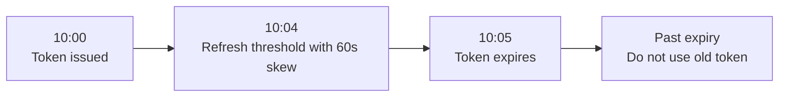
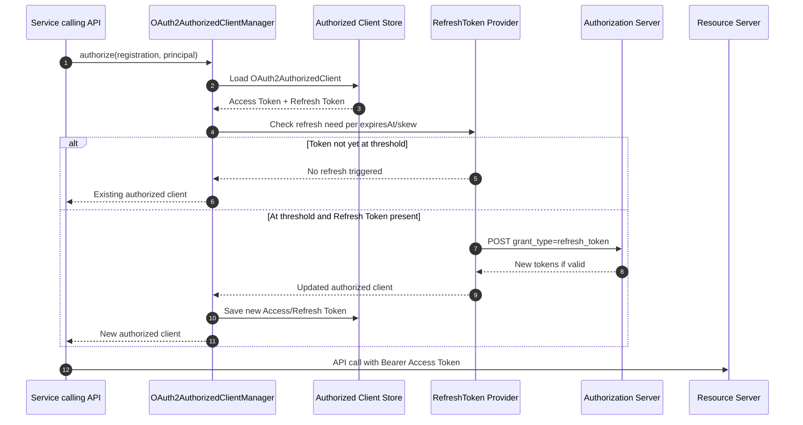

# 17.5. Determining Refresh Timing and Configuring Clock Skew

In **Spring Security OAuth 2.0 / OpenID Connect (OIDC) Client**, Access Tokens are typically short-lived. When an application calls an API using a token issued by an Authorization Server, it needs to know **when to reuse the token, when to request a new token, and when to reject using the old token**.

If the application waits until the exact second of `expiresAt` to start refreshing, the Access Token can expire while the request is in transit over the network. Conversely, refreshing too early increases token endpoint calls, wastes resources, and can trigger contention when the provider uses **Refresh Token Rotation**.

Spring Security addresses part of this problem via the **`clockSkew`** property on `OAuth2AuthorizedClientProvider` implementations. This is a time buffer that makes the client treat an Access Token as **expiring soon before its actual expiration timestamp**. It is not a background scheduler running on its own.

This lesson focuses on **token lifecycle, how refresh thresholds are calculated, configuring `clockSkew` in Spring Security Servlet and background workers, when the manager actually calls the token endpoint, multi-node scenarios, clock drift, Refresh Token Rotation, and safe error handling**.

## 1. Context: Access Tokens and Refresh Tokens Have Different Roles

Suppose a user logs into OIDC with the Authorization Code Flow. After Spring Boot sends the authorization code to the token endpoint, the Authorization Server returns an illustrative response:

```json
{
  "access_token": "<access-token>",
  "token_type": "Bearer",
  "expires_in": 300,
  "refresh_token": "<refresh-token>",
  "scope": "openid profile orders.read"
}
```

`expires_in=300` represents an Access Token validity window of about 300 seconds per the Authorization Server's response. Spring Security builds an `OAuth2AccessToken` and stores metadata such as `issuedAt`, `expiresAt`, and scopes inside `OAuth2AuthorizedClient`.

An authorized client can be pictured as:

```text
OAuth2AuthorizedClient
  ├── ClientRegistration
  │     └── registrationId = company
  ├── principalName = oidc-user-123
  ├── OAuth2AccessToken
  │     ├── tokenValue = <sensitive>
  │     ├── issuedAt   = 10:00:00
  │     ├── expiresAt  = 10:05:00
  │     └── scopes     = [openid, profile, orders.read]
  └── OAuth2RefreshToken
        ├── tokenValue = <sensitive>
        └── issuedAt   = 10:00:00
```

This is a conceptual example. Not every response contains a Refresh Token; providers may also include an ID Token in OIDC and other additional fields.

| Component | Role | Lifecycle |
|---|---|---|
| **Access Token** | Sent to the Resource Server, usually via `Authorization: Bearer ...`. | Usually short-lived; can expire or be revoked. |
| **Refresh Token** | Sent to the token endpoint with `grant_type=refresh_token` to obtain a new Access Token. | May live longer, though it can still expire, be revoked, or rotate. |
| **ID Token** | OIDC Client verifies user identity at login. | Has `exp` and OIDC-specific constraints. |
| **HTTP session** | Helps the browser restore the application's `SecurityContext`. | Follows application policy; not automatically tied to token lifetime. |

### 1.1. Refresh Tokens are not issued in every flow

- The Authorization Code Flow may receive a Refresh Token depending on provider policy, grant, consent, and client registration.
- Some providers require `offline_access` or specific permissions to issue a Refresh Token; not every provider follows the same rules.
- Public clients have distinct Refresh Token protection requirements; never embed a client secret in JavaScript just to "obtain" a Refresh Token.
- **The Client Credentials Grant normally does not issue a Refresh Token.** When the Access Token expires, the backend requests a new token using `client_credentials`.
- Providers can revoke Refresh Tokens on logout, password change, consent withdrawal, account lock, or replay detection.

Therefore, deciding when to refresh must be based on **how much validity remains on the Access Token and whether a usable Refresh Token exists**, rather than relying solely on `scope=openid`.

## 2. What Is `clockSkew`?

`clockSkew` is a **time buffer** that Spring Security uses when deciding whether an Access Token is still far enough from expiration or has entered the renewal window.

Common interpretation:

\[
\text{refreshThreshold} = \text{accessToken.expiresAt} - \text{clockSkew}
\]

Given:

```text
Access Token issuedAt = 10:00:00
Access Token expiresAt = 10:05:00
clockSkew             = 60 seconds
```

then:

```text
refreshThreshold = 10:05:00 - 00:01:00
                 = 10:04:00
```

From around 10:04 onward, the token is in the **about-to-expire** window. When a suitable `authorize` call occurs and a valid Refresh Token exists, the provider can send a refresh request.



**Important:** no timer automatically triggers a refresh right at 10:04 simply because `clockSkew=60s` is set. The provider evaluates this threshold only when invoked by `OAuth2AuthorizedClientManager`.

### 2.1. Timeline example

Given `expiresAt=10:05:00`, `clockSkew=60s`:

| Time service needs a token | Remaining time | Behavior relative to threshold |
|---|---|---|
| 10:01:00 | 240 seconds | Normally reuses the Access Token. |
| 10:03:59 | 61 seconds | Normally does not need expiry-based refresh yet. |
| Around 10:04:00 | 60 seconds | Enters the window where the token is considered soon to expire. |
| 10:04:20 | 40 seconds | If a Refresh Token and suitable manager exist, refresh can run. |
| 10:05:10 | 10 seconds past expiry | Must not continue treating the old token as valid. |

Exact boundary equality at the exact millisecond depends on the comparison operator in the implementation, though the design principle is **applying a buffer before expiration**.

### 2.2. `clockSkew` does not mean letting a token live longer

A common mistake is thinking `clockSkew=60s` means you can keep sending an Access Token to an API for 60 extra seconds past `expiresAt`. That is **not** how skew works in the refresh provider.

- **OAuth2 Client clock skew:** shifts the renewal-detection threshold **earlier**.
- **JWT validation clock skew on a Resource Server:** can act as leeway when checking `exp`/`nbf` of incoming bearer tokens.

These two settings sit in **two different roles** and do not synchronize automatically. Never inflate the Resource Server's tolerance for expired tokens just to avoid fixing client refresh behavior.

### 2.3. Why is a buffer needed?

An Access Token with 5 seconds left can become invalid before reaching the API due to:

- A few seconds of clock drift between the client and Resource Server.
- Requests waiting in connection pools, proxies, or gateways.
- DNS/TLS/network latency.
- The Resource Server validating the token slightly later than when the client acquired it.
- Multiple instances having slightly different clocks.

Clock skew creates a safety margin for these variances. However, it **cannot fix servers whose clocks are off by minutes**, chronically slow connections, or a broken token endpoint.

## 3. How Much Skew Is Reasonable?

Suppose an Access Token lives for 300 seconds and `expiresAt=10:05`:

| Clock skew | Refresh threshold | Reuse window before refresh zone |
|---|---|---|
| 0s | 10:05:00 | Almost full 300s; risky right at the deadline. |
| 15s | 10:04:45 | ~285s. |
| 30s | 10:04:30 | ~270s. |
| 60s | 10:04:00 | ~240s. |
| 120s | 10:03:00 | ~180s. |
| 300s | 10:00:00 | May be treated as expiring immediately after issuance. |

### 3.1. Skew larger than TTL is a problem

Example:

```text
Token issuedAt = 12:00:00
Token expiresAt = 12:01:00
Clock skew = 90 seconds

Refresh threshold = 11:59:30
```

Immediately upon issuance, the current time is already past the threshold. If the service keeps calling the manager, it can attempt to refresh continuously, overloading the token endpoint and risking races when Refresh Token Rotation is active.

**Skew must be chosen relative to TTL.** Never copy a hardcoded skew from an app using 30-minute tokens to a provider issuing 45-second tokens.

### 3.2. One configuration does not fit every provider

A single system might integrate:

```text
Provider A: Access Token TTL = 60 minutes
Provider B: Access Token TTL = 2 minutes
Provider C: Access Token TTL = 30 seconds
```

Applying the same 60-second skew to all three might be fine for A, questionable for B, and completely unsuitable for C.

Consider:

- Actual TTL from token responses.
- Measured clock drift across machines.
- p95/p99 network latency and request queuing times.
- API call frequency.
- Provider rate limits and Refresh Token Rotation.
- Latency SLAs and tolerance for 401 responses.

A rule of thumb (not a mandatory framework formula):

\[
\text{skew} \approx \text{clockDriftAllowance}
+ \text{networkDelayAllowance}
+ \text{processingAllowance}
+ \text{safetyMargin}
\]

For example, 30–60 seconds can be a starting point for multi-minute tokens in normal environments, though you should measure in practice and never let skew approach or exceed TTL.

## 4. Which Spring Security Components Handle Refreshing?

| Component | Responsibility |
|---|---|
| `OAuth2AuthorizedClient` | Holds client registration, principal name, Access Token, and optional Refresh Token. |
| `OAuth2AuthorizedClientManager` | Coordinates finding the authorized client, re-authorizing, and saving the result. |
| `OAuth2AuthorizedClientProvider` | Executes grant-specific logic as configured. |
| `RefreshTokenOAuth2AuthorizedClientProvider` | When a Refresh Token exists, decides whether to refresh based on expiry and `clockSkew`. |
| `ClientCredentialsOAuth2AuthorizedClientProvider` | When a machine client's token nears expiration, obtains a new token via Client Credentials. |
| `OAuth2AuthorizedClientService` | Persists authorized clients independent of HTTP requests. |
| `OAuth2AuthorizedClientRepository` | Persists authorized clients within an HTTP Servlet context. |
| `OAuth2AccessTokenResponseClient<OAuth2RefreshTokenGrantRequest>` | Executes the HTTP refresh token request to the token endpoint per configuration. |

A token usage flow can be depicted as:



This is a conceptual diagram for a successful refresh. If no Refresh Token exists or the provider does not support the grant, the refresh provider skips it. If the token endpoint returns an error, the manager/failure handler reacts according to configuration.

### 4.1. `manager.authorize(...)` does not always call the token endpoint

A single manager call:

```java
OAuth2AuthorizedClient authorizedClient = manager.authorize(request);
```

can:

1. Find a token with plenty of lifetime remaining and return the existing one.
2. Find a token inside the threshold with a Refresh Token and send a refresh request.
3. Find no token and use another provider to authorize if the grant matches.
4. Be unable to handle the request and return `null` or throw an exception depending on provider/context.

Therefore, do not write manual token endpoint calls across services just to anticipate expiration. Use the manager and provider chain appropriate to the context.

### 4.2. Clock skew does not create a scheduler

`RefreshTokenOAuth2AuthorizedClientProvider#setClockSkew` only affects the token-check condition. It **does not spawn background threads, cron jobs, or timers**.

If a token goes unused for hours, the application may not send a single refresh request during that period. Only the next API call triggers a refresh attempt.

## 5. Prerequisites for Executing the Refresh Token Grant

`RefreshTokenOAuth2AuthorizedClientProvider` can only execute the Refresh Token Grant when required conditions hold:

1. An `OAuth2AuthorizedClient` exists for the registration and principal.
2. The authorized client holds a **Refresh Token**.
3. The Access Token falls within the refresh window based on `expiresAt` and `clockSkew`.
4. The client registration has a supported token endpoint and client authentication.
5. The Authorization Server still accepts the Refresh Token and client policy.

If there is no Refresh Token, you cannot manufacture one from an Access Token or ID Token.

### 5.1. Practical refresh request

For a confidential client using HTTP Basic:

```http
POST /oauth2/token HTTP/1.1
Host: id.example.org
Authorization: Basic <encoded-client-credentials>
Content-Type: application/x-www-form-urlencoded

grant_type=refresh_token&
refresh_token=<sensitive-refresh-token>
```

The token endpoint may return:

```json
{
  "access_token": "<new-access-token>",
  "token_type": "Bearer",
  "expires_in": 300,
  "refresh_token": "<rotated-refresh-token>",
  "scope": "orders.read"
}
```

A provider may not issue a new Refresh Token on every refresh or may have its own rotation policy. The application must store the latest token state based on the actual response; never assume the Refresh Token is always replaced or always unchanged.

### 5.2. Tokens and scopes can change

The Authorization Server may alter granted scopes or reject a refresh due to account/consent policy. A successful refresh is not proof that the user retains every business permission the app previously saw.

The Resource Server must still verify the token, audience, scopes, and authorization policy. The OAuth2 Client must use the new token's metadata rather than carrying over claims from the old token.

### 5.3. Refresh Tokens can be revoked at any time

Even if a Refresh Token's expiration timestamp has not arrived, the provider can revoke it upon logout, password change, reuse detection, account deactivation, or security rules.

Never treat `refreshToken.getExpiresAt()` as a guarantee that the provider will accept that token; some providers do not even publish Refresh Token expiry metadata.

## 6. Configuring Clock Skew Directly on the Provider

In modern Spring Security versions, `RefreshTokenOAuth2AuthorizedClientProvider` provides a setter:

```java
import java.time.Duration;
import org.springframework.security.oauth2.client.RefreshTokenOAuth2AuthorizedClientProvider;

RefreshTokenOAuth2AuthorizedClientProvider refresh =
    new RefreshTokenOAuth2AuthorizedClientProvider();

refresh.setClockSkew(Duration.ofSeconds(90));
```

Meaning:

- `90s` is the buffer before Access Token expiration.
- Larger skew causes refreshes to be considered earlier.
- Smaller skew lets tokens be reused closer to `expiresAt`.
- This skew controls **only this refresh provider instance**; it does not automatically change other managers or JWT decoders in the app.

In common Spring Security versions, the default clock skew of the refresh provider is **60 seconds**; if behavior depends on a specific value, declare it explicitly and check the Javadoc for your library version.

Do not assume Spring Boot has a generic property like:

```properties
# Do not treat this as a standard auto-configured refresh property:
spring.security.oauth2.client.registration.company.clock-skew=90s
```

The reliable, explicit way to configure it is creating/customizing the provider or manager in Java using the API supported by your project's version.

## 7. Spring Boot OIDC Servlet Example with Refresh Token

### 7.1. Declaring the client registration

```yaml
spring:
  security:
    oauth2:
      client:
        registration:
          company:
            provider: company-oidc
            client-id: ${OIDC_CLIENT_ID}
            client-secret: ${OIDC_CLIENT_SECRET}
            client-authentication-method: client_secret_basic
            authorization-grant-type: authorization_code
            redirect-uri: "{baseUrl}/login/oauth2/code/{registrationId}"
            scope:
              - openid
              - profile
              - orders.read
        provider:
          company-oidc:
            issuer-uri: https://id.example.org/realms/company
```

This registration describes an **Authorization Code Flow** for a Servlet application. Whether the OP issues a Refresh Token depends on provider policy, client registration, and consent.

### 7.2. Configuring the manager with a refresh provider and 90-second skew

```java
import java.time.Duration;

import org.springframework.context.annotation.Bean;
import org.springframework.context.annotation.Configuration;
import org.springframework.security.oauth2.client.AuthorizationCodeOAuth2AuthorizedClientProvider;
import org.springframework.security.oauth2.client.DefaultOAuth2AuthorizedClientManager;
import org.springframework.security.oauth2.client.DelegatingOAuth2AuthorizedClientProvider;
import org.springframework.security.oauth2.client.OAuth2AuthorizedClientManager;
import org.springframework.security.oauth2.client.OAuth2AuthorizedClientProvider;
import org.springframework.security.oauth2.client.RefreshTokenOAuth2AuthorizedClientProvider;
import org.springframework.security.oauth2.client.registration.ClientRegistrationRepository;
import org.springframework.security.oauth2.client.web.OAuth2AuthorizedClientRepository;

@Configuration
public class WebOAuth2ClientConfiguration {

    @Bean
    OAuth2AuthorizedClientManager authorizedClientManager(
            ClientRegistrationRepository registrations,
            OAuth2AuthorizedClientRepository authorizedClients) {

        RefreshTokenOAuth2AuthorizedClientProvider refresh =
            new RefreshTokenOAuth2AuthorizedClientProvider();
        refresh.setClockSkew(Duration.ofSeconds(90));

        OAuth2AuthorizedClientProvider provider =
            new DelegatingOAuth2AuthorizedClientProvider(
                new AuthorizationCodeOAuth2AuthorizedClientProvider(),
                refresh
            );

        DefaultOAuth2AuthorizedClientManager manager =
            new DefaultOAuth2AuthorizedClientManager(
                registrations,
                authorizedClients
            );
        manager.setAuthorizedClientProvider(provider);

        return manager;
    }
}
```

This configures a manager operating in an **HTTP Servlet context**. It does not add a scheduler, does not replace the `oauth2Login()` filter, and will not refresh tokens if HTTP clients do not actually invoke this manager.

### 7.3. Enabling OAuth2 Login and OAuth2 Client

```java
import org.springframework.context.annotation.Bean;
import org.springframework.context.annotation.Configuration;
import org.springframework.security.config.Customizer;
import org.springframework.security.config.annotation.web.builders.HttpSecurity;
import org.springframework.security.web.SecurityFilterChain;

@Configuration
public class SecurityConfiguration {

    @Bean
    SecurityFilterChain webSecurityFilterChain(HttpSecurity http)
            throws Exception {
        http
            .authorizeHttpRequests(auth -> auth
                .requestMatchers("/", "/public/**").permitAll()
                .anyRequest().authenticated()
            )
            .oauth2Login(Customizer.withDefaults())
            .oauth2Client(Customizer.withDefaults());

        return http.build();
    }
}
```

These two configurations can work together when bean wiring aligns. The authorized client store used by `oauth2Login()` and the store loaded by the manager must match; if login writes tokens to one repository while the manager reads from another, a "missing authorized client" error cannot be fixed by increasing clock skew.

### 7.4. Calling the manager before making an API request

```java
import org.springframework.security.core.Authentication;
import org.springframework.security.oauth2.client.OAuth2AuthorizeRequest;
import org.springframework.security.oauth2.client.OAuth2AuthorizedClient;
import org.springframework.security.oauth2.client.OAuth2AuthorizedClientManager;

public final class OrdersTokenService {

    private final OAuth2AuthorizedClientManager manager;

    public OrdersTokenService(OAuth2AuthorizedClientManager manager) {
        this.manager = manager;
    }

    public String accessTokenForCurrentUser(Authentication principal) {
        OAuth2AuthorizeRequest request =
            OAuth2AuthorizeRequest
                .withClientRegistrationId("company")
                .principal(principal)
                .build();

        OAuth2AuthorizedClient client = manager.authorize(request);

        if (client == null) {
            throw new IllegalStateException(
                "OAuth2 authorization is unavailable"
            );
        }

        return client.getAccessToken().getTokenValue();
    }
}
```

The token value is returned only **inside the backend** so a trusted HTTP client can attach the Bearer header to the proper API. Never expose a public endpoint returning raw Access Tokens or log tokens.

Each time the backend needs a token, calling `manager.authorize(...)` gives the manager a chance to **reuse or refresh the token** based on the threshold, rather than using a manually cached token from startup.

## 8. Configuring with `OAuth2AuthorizedClientProviderBuilder`

Spring Security also provides a builder for composing providers:

```java
import java.time.Duration;
import org.springframework.security.oauth2.client.OAuth2AuthorizedClientProvider;
import org.springframework.security.oauth2.client.OAuth2AuthorizedClientProviderBuilder;

OAuth2AuthorizedClientProvider provider =
    OAuth2AuthorizedClientProviderBuilder.builder()
        .authorizationCode()
        .refreshToken(refresh -> refresh
            .clockSkew(Duration.ofSeconds(90))
        )
        .build();
```

This example uses the builder API in versions that support configuration callbacks for the refresh provider. When signatures differ in your project's library version, instantiate the provider directly and call `setClockSkew`.

A chain supporting multiple grant types can be declared as:

```java
OAuth2AuthorizedClientProvider provider =
    OAuth2AuthorizedClientProviderBuilder.builder()
        .authorizationCode()
        .refreshToken(refresh -> refresh
            .clockSkew(Duration.ofSeconds(90))
        )
        .clientCredentials(client -> client
            .clockSkew(Duration.ofSeconds(30))
        )
        .build();
```

Here there are **two independent buffers**:

- Refresh provider: uses `grant_type=refresh_token` if a valid Refresh Token is present.
- Client Credentials provider: requests a new token via `grant_type=client_credentials` when the Access Token reaches its threshold.

Do not think `refreshToken(...)` handles every client registration. A machine client normally has no Refresh Token and needs `clientCredentials()`.

## 9. Clock Skew for Client Credentials

Client Credentials does not involve the Authorization Code Flow or browser logins:

```text
No token yet
  -> POST grant_type=client_credentials
  -> Access Token A
  -> Reuse A while sufficient validity remains
  -> Reach expiresAt - clockSkew
  -> Request Access Token B via client_credentials
```

Example manager for a background worker:

```java
import java.time.Duration;

import org.springframework.context.annotation.Bean;
import org.springframework.context.annotation.Configuration;
import org.springframework.security.oauth2.client.AuthorizedClientServiceOAuth2AuthorizedClientManager;
import org.springframework.security.oauth2.client.OAuth2AuthorizedClientManager;
import org.springframework.security.oauth2.client.OAuth2AuthorizedClientProvider;
import org.springframework.security.oauth2.client.OAuth2AuthorizedClientProviderBuilder;
import org.springframework.security.oauth2.client.OAuth2AuthorizedClientService;
import org.springframework.security.oauth2.client.registration.ClientRegistrationRepository;

@Configuration
public class MachineClientConfiguration {

    @Bean
    OAuth2AuthorizedClientManager machineClientManager(
            ClientRegistrationRepository registrations,
            OAuth2AuthorizedClientService authorizedClients) {

        OAuth2AuthorizedClientProvider provider =
            OAuth2AuthorizedClientProviderBuilder.builder()
                .clientCredentials(client -> client
                    .clockSkew(Duration.ofSeconds(45))
                )
                .build();

        AuthorizedClientServiceOAuth2AuthorizedClientManager manager =
            new AuthorizedClientServiceOAuth2AuthorizedClientManager(
                registrations,
                authorizedClients
            );
        manager.setAuthorizedClientProvider(provider);

        return manager;
    }
}
```

Example manager invocation:

```java
OAuth2AuthorizeRequest request = OAuth2AuthorizeRequest
    .withClientRegistrationId("inventory-api")
    .principal("service:inventory-sync")
    .build();

OAuth2AuthorizedClient client = machineClientManager.authorize(request);
```

The principal here is a **technical principal** used as the storage key for the authorized client; it does not turn the Access Token into a user token. This requires an `inventory-api` client registration with `authorization-grant-type=client_credentials` and appropriate token endpoint details.

| Criterion | OIDC Authorization Code + Refresh | Client Credentials |
|---|---|---|
| Browser user login involved? | Yes. | No. |
| Refresh Token present? | Possible, depending on provider. | Typically no. |
| When token reaches threshold | Sends Refresh Token Grant if eligible. | Requests new token via Client Credentials. |
| Provider | `RefreshTokenOAuth2AuthorizedClientProvider`. | `ClientCredentialsOAuth2AuthorizedClientProvider`. |
| Principal storage | Usually tied to a user. | Usually a stable service/workload name. |
| Clock skew | Configured on refresh provider. | Configured on client credentials provider. |

## 10. `Instant`, System Clocks, and Time Synchronization

`OAuth2AccessToken.getExpiresAt()` returns an `Instant`, representing an absolute point in time. Never compare local times as strings or drop time zones.

Unsuitable example:

```java
// Do not compare timestamps as strings:
if (formattedExpiresAt.compareTo(formattedNow) < 0) {
    // ...
}
```

Let the Spring Security provider handle it, or use `Instant`/`Duration` in any custom logic where needed.

If node A has an accurate clock, node B runs 40 seconds fast, and node C runs 25 seconds slow, the same `clockSkew=60s` will cause nodes to **evaluate refresh timing differently**. You should:

- Synchronize clocks via reliable time infrastructure.
- Monitor clock drift on VMs/containers.
- Store timestamps/expiries in data stores with proper time zone and precision.
- Never add multi-minute skew to mask drifted clocks.
- Track clock drift and token age in metrics.

### 10.1. Simulating time with `Clock`

In versions supporting `setClock(Clock)` on the refresh provider, you can inject a fixed clock to understand threshold behavior:

```java
import java.time.Clock;
import java.time.Duration;
import java.time.Instant;
import java.time.ZoneOffset;
import org.springframework.security.oauth2.client.RefreshTokenOAuth2AuthorizedClientProvider;

Clock fixed = Clock.fixed(
    Instant.parse("2026-11-16T10:04:20Z"),
    ZoneOffset.UTC
);

RefreshTokenOAuth2AuthorizedClientProvider refresh =
    new RefreshTokenOAuth2AuthorizedClientProvider();

refresh.setClock(fixed);
refresh.setClockSkew(Duration.ofSeconds(60));
```

With a token expiring at `10:05:00Z`, the fixed clock `10:04:20Z` falls inside the 60-second pre-expiry window. Actually issuing a refresh request still requires the authorized client to hold a Refresh Token and the remaining components to be configured.

This is a simulation technique—never use a fixed clock in production, and never alter the OS clock just to test an application.

## 11. Lazy Refresh vs. Proactive Refresh

### 11.1. Lazy refresh

Typically:

```text
API call needed
    -> manager.authorize(...)
    -> If token still has enough lifetime: reuse
    -> If nearing expiry and Refresh Token present: refresh
    -> Call API with appropriate token
```

**Advantages:** refreshes only when used, easy to implement, avoids background traffic for inactive users.

**Disadvantages:** the first request after an idle period must wait on the token endpoint; if multiple requests arrive together, contention can arise.

This pattern fits many Servlet/BFF applications that call APIs when users actively interact.

### 11.2. Proactive refresh

A low-latency system or fixed-schedule batch job may want to renew tokens **before a business request arrives**. This must be explicitly designed, not handled via `clockSkew` alone.

Determine:

1. Which authorized clients genuinely need to stay active?
2. Is it permitted to retain and use Refresh Tokens while the user is inactive?
3. When should refreshes run to avoid spiking the token endpoint?
4. How are concurrency, retries, and backoff bounded?
5. When the provider rotates Refresh Tokens, how are updates saved atomically?
6. If the user logs out or revokes consent, how quickly does the scheduler stop using the token?
7. If the token endpoint is unavailable, how does the application react?

Avoid running a cron job every minute to refresh **every** Refresh Token in the database regardless of demand, consent, and policy. That increases load and risk of token reuse/races.

## 12. Refresh Token Rotation and Concurrency

A dangerous scenario:

```text
Session/user = user-123
Access Token = A1 (about to expire)
Refresh Token = R1

Request X: reads A1/R1, sees refresh needed
Request Y: reads A1/R1, also sees refresh needed

X sends R1 -> provider issues A2/R2, R1 invalidated
Y sends R1 -> provider may return invalid_grant or detect reuse
```

If the provider enforces Refresh Token Rotation and reuse detection, request Y can trigger consequences beyond a single failure—such as revoking the entire token family.

### 12.1. A JDBC store does not serialize refreshes by itself

Even when two nodes share `JdbcOAuth2AuthorizedClientService`, both can still load the same authorized client before either persists the new token. Design for:

- Per-process single-flight keyed by authorized client key.
- A distributed lock or appropriate coordination across multiple instances.
- Optimistic locking/versioning when writing to the store.
- After acquiring the lock, **re-reading the record** to avoid refreshing a token already replaced by another node.
- Saving the new Access Token and Refresh Token in one consistent transaction.
- Handling cases where provider refresh succeeded yet DB commit failed.
- Never holding a single global lock across all users or registrations.

A large skew can push more requests into the refresh zone sooner, though **even 0 skew does not eliminate races**. This is fundamentally a concurrency problem in the authorized client store/provider layer.

### 12.2. Principals and tenants must stay isolated

Authorized clients are stored by registration and principal/context. Never use user A's or tenant A's Refresh Token to recover from an error for B.

When designing storage keys, ensure users, client registrations, issuers, and tenants cannot be mixed. Using an unstable principal name can cause the manager to miss an existing Refresh Token and unexpectedly start a new flow.

### 12.3. Never log Refresh Tokens when investigating races

Log only diagnostic metadata such as version, error type, refresh count, registration alias, and timestamps; never log raw Refresh Tokens, Access Tokens, HTTP `Authorization` headers, or token request bodies containing `refresh_token`.

## 13. Refresh Fails with `invalid_grant`

The token endpoint may return:

```json
{
  "error": "invalid_grant",
  "error_description": "Refresh token is invalid or expired"
}
```

`error_description` is illustrative only. Real causes include:

- The Refresh Token expired or was revoked.
- The user withdrew consent, the account was locked, or the provider changed policy.
- The Refresh Token was already used and invalidated by rotation.
- Two nodes reused an old Refresh Token simultaneously.
- The authorized client store overwrote the record with a stale token version.
- Client registration, issuer, or token endpoint no longer matches.

Clock skew **cannot make an invalidated Refresh Token valid again**. Resolution steps:

1. Distinguish token endpoint errors from API 401/403 responses.
2. Never retry the same Refresh Token infinitely.
3. Remove or mark the authorized client invalid per failure handler and policy.
4. For browser OIDC, initiate a fresh Authorization Code Flow when appropriate.
5. For machine clients, use a provider-supported grant to obtain a new token.
6. Log sanitized error codes without secrets or tokens.

### 13.1. Authorization success/failure handlers

Authorized client managers provide extension points to save or remove authorized clients on authorization success or failure. In typical configurations, the manager saves new tokens after refresh and removes the authorized client on `invalid_grant`; check exact behavior for your framework version and customizations.

When writing custom handlers:

- Do not drop newly issued Refresh Tokens.
- Do not save new tokens under the wrong `principalName`/registration.
- Do not accidentally keep a revoked old record.
- Do not bypass store concurrency controls.
- Do not print raw `OAuth2AuthorizedClient` instances to logs.

If no valid token is available, fail in a controlled manner. Never fall back to another user's token or an expired Access Token.

## 14. OIDC Sessions and Refresh Tokens Are Two Distinct Lifecycles

A common misconception:

> "Access Token refresh succeeded, so the user's login session was also extended."

Not necessarily.

`OAuth2AuthorizedClient` and token refreshing live on the OAuth2 Client side. `SecurityContext`/HTTP session determines whether the user is still logged into the application. The OP SSO session is yet another separate session.

Example:

```text
10:00  User logs into OIDC -> HTTP session + Access/Refresh Token
10:04  Backend refreshes Access Token
10:20  HTTP session expires per application policy
10:21  Browser must log in again per configuration
```

A successful refresh at 10:04 does not guarantee the HTTP session still exists at 10:21.

### 14.1. Do ID Tokens and principals update automatically after refresh?

OIDC defines specific rules if a refresh response returns a new ID Token. However, **refreshing an Access Token via the authorized client manager does not automatically update the OIDC principal, roles, authorities, or browser session `SecurityContext`**.

If the application needs timely synchronization of account status or roles, design dedicated authority sources and session invalidation/authorization refresh flows. Clock skew does not fix stale permission data inside a session.

### 14.2. Does logout automatically revoke the Refresh Token?

Not automatically. Clearing the HTTP session may not revoke Access or Refresh Tokens on the Authorization Server. Depending on the product, you may need to remove the local authorized client, call the revocation endpoint, trigger OIDC logout, and invalidate sessions per policy.

Do not allow a background task to keep using a logged-out user's Refresh Token if business policy requires stopping access on their behalf.

## 15. HTTP Latency and Resource Server Errors

If a Resource Server returns:

```http
HTTP/1.1 401 Unauthorized
WWW-Authenticate: Bearer error="invalid_token"
```

it is not guaranteed that the token just expired. Causes can include revocation, wrong issuer/audience, invalid signature, introspection failure, malformed header, or Resource Server clock drift.

Clock skew reduces the chance of sending a token right on the brink of expiry, **not every cause of 401**.

### 15.1. Why can a token with 45 seconds left still cause a 401?

Suppose skew is 30s and the token has 45s left, so the manager reuses it. Yet:

1. The request waits 10s for a connection pool.
2. A proxy queues/retries for 15s.
3. The Resource Server authenticates it another 15s later.
4. Only a few seconds remain, or the token has already expired.

Measure network/p95/p99 latency, set proper timeouts, reduce queuing, and pick a buffer appropriate for the TTL. Never push skew so high that every call refreshes.

### 15.2. Retries after 401 must be bounded

You can consider retrying when a token was rejected and the client can obtain a valid new token. However:

- Never retry endlessly.
- Never auto-retry side-effecting POST requests without an idempotency policy.
- Never use another principal's token.
- Never treat every 403 as an expiry error; 403 typically indicates a policy/permission issue.
- Never automatically forward tokens to another host across redirects.

An application must also configure proper timeouts and TLS verification on the HTTP token client; skew will not fix a hung token endpoint.

## 16. Operational Observability and Diagnostics

Categories to monitor:

| Category | What to verify |
|---|---|
| Registration/grant | `authorization_code` with Refresh Token, or `client_credentials`? |
| Token metadata | Are `issuedAt`, `expiresAt`, and TTL reasonable? |
| Clock | Are node clocks synchronized? |
| Config | What is the skew, and which provider/manager is actually active? |
| Trigger | Does the HTTP client/service call `manager.authorize(...)` before the API? |
| Storage | Is the authorized client loaded under the right principal/registration? |
| Refresh Token | Does it exist and is it still accepted by the provider? |
| Token endpoint | Was a refresh request sent? What HTTP status and OAuth2 error occurred? |
| Persistence | Were both new Access and Refresh Tokens saved? Any overwrite race? |
| Resource Server | 401 due to expiry/issuer/audience, or 403 due to permissions? |
| Session | Does the user session still exist? |

### 16.1. Common symptoms

| Symptom | Possible cause | Resolution approach |
|---|---|---|
| Token expired and API returns 401. | Manager not invoked, skew too small, clock drift, or high API latency. | Wire manager before API calls and measure timing. |
| Refresh runs on every request. | Skew >= TTL, very short token response TTL, token save failure, or wrong storage key. | Check TTL vs. skew and save/load logic. |
| No refresh request despite reaching threshold. | `authorize` not called, missing Refresh Token, wrong provider chain, or another manager active. | Inspect trigger, provider, and repository. |
| `invalid_grant` on refresh. | Refresh Token expired, revoked, or rotation/reuse issue. | Do not retry infinitely; cleanup and reauthorize. |
| Errors appear only in a cluster. | Node clock drift or uncoordinated shared store/race. | Time sync, coordination, and persistence. |
| Refresh succeeds, yet API returns 403. | Insufficient scope/role/tenant permissions. | Investigate Resource Server authorization. |
| Refresh succeeds, yet user is asked to log in again. | HTTP session expired or `SecurityContext` lost. | Investigate session independently. |
| Slow token endpoint slows down API calls. | Lazy refresh waits on the network. | Timeouts, backoff, lower latency, or controlled proactive refresh. |
| DB still holds the old Refresh Token. | Save handler failed to persist new token, race, or transaction rollback. | Inspect atomic persistence/versioning. |
| Client Credentials has no Refresh Token. | Normal behavior for the grant. | Use the client credentials provider. |
| Changing skew has no effect. | A different manager/provider is actually used. | Check bean wiring and which HTTP client uses it. |

### 16.2. Logging without exposing credentials

Log:

- Registration alias, grant type, and provider name.
- Configured clock skew value.
- Remaining time until `expiresAt`, never the token value.
- Reuse/refresh attempt/success/failure outcomes.
- HTTP status and sanitized OAuth2 error code.
- Instance ID, diagnostic correlation ID, and duration.

Never log:

- Raw Access Token / Refresh Token / ID Token.
- Client secret, private key, or client assertion.
- `Authorization` headers, session cookies, or token request bodies containing `refresh_token`.
- Full `OAuth2AuthorizedClient` objects or sensitive user profiles.
- Raw subject/email/token as metric labels.

A metric like `oauth2.refresh.attempts{registration="company",result="failure"}` is far more useful than logging raw tokens.

## 17. Anti-Patterns to Avoid

### 17.1. Comparing `expiresAt` manually in every layer

```java
// Do not duplicate expiry-check and refresh logic across the project:
if (accessToken.getExpiresAt().isBefore(Instant.now())) {
    // manually call token endpoint...
}
```

This creates inconsistent skew values, race conditions, and drifting authorized client state. Centralize through the manager/provider.

### 17.2. Setting skew larger than TTL

```text
Access Token TTL = 60s
clockSkew        = 5m
```

The token is immediately treated as about to expire upon issuance, causing excessive refreshes, extra load, and Refresh Token Rotation collisions.

### 17.3. Treating skew as a cron job

`setClockSkew` only changes the threshold. Without calling the manager or running a dedicated scheduler, no automatic background refresh happens.

### 17.4. Using an expired Access Token when refresh fails

If the token has expired or the provider revoked the Refresh Token, fail closed and trigger reauthorization. Never substitute another user's/tenant's token or keep reusing the old token indefinitely.

### 17.5. Assuming refresh means the user still has a session

Refresh Tokens and HTTP sessions are independent mechanisms. An application session can expire even if an API token was just refreshed.

### 17.6. Ignoring concurrency

Multiple nodes using an old Refresh Token simultaneously can hit `invalid_grant` or token family revocation. Coordinate refreshes and save new tokens consistently.

### 17.7. Configuring skew on the wrong provider

Configuring the refresh provider does not adjust the Client Credentials provider or the JWT Resource Server validator. Each role has its own timing configuration.

## 18. Reference Architecture

```text
                       Spring Boot Application
                                |
                                v
                         Business API Client
                                |
                                v
                   OAuth2AuthorizedClientManager
                  (invoked when a token is needed)
                                |
                 +--------------+-------------+
                 |                            |
                 v                            v
          Authorized Client             Provider Chain
          Repository/Service            +-- Refresh Token
                 |                      |     clockSkew=90s
                 |                      +-- Client Credentials
                 |                            clockSkew=45s
                 v                            |
            Token Store                       |
          (memory/JDBC)                       v
                                    Token Endpoint if needed
                 |                            |
                 +-------------+--------------+
                               |
                               v
                         Access Token
                               |
                               v
                         Resource Server
                    verifies issuer/audience/scope

Operational factors:
  - Time synchronization
  - HTTP timeouts and TLS
  - Refresh Token Rotation management
  - Multi-instance coordination
  - Separate session / account authorization
  - Credential-free auditing/metrics
```

## 19. Summary

- `expiresAt` is the Access Token's expiration. `clockSkew` sets a threshold to treat the token as about to expire **before** that deadline.
- The conceptual threshold is **`expiresAt - clockSkew`**, not `expiresAt + clockSkew`.
- `RefreshTokenOAuth2AuthorizedClientProvider` executes the Refresh Token Grant when a token needs renewal and a suitable Refresh Token exists.
- `ClientCredentialsOAuth2AuthorizedClientProvider` requests new Access Tokens via Client Credentials, typically without Refresh Tokens.
- **`OAuth2AuthorizedClientManager` must be invoked**; configuring skew alone creates no automatic refresh schedule.
- Skew should be reasonable relative to TTL, clock drift, and network latency. Too large causes overly early refreshes; too small risks sending tokens right at expiration.
- In a cluster, Refresh Token Rotation requires concurrency control and atomic persistence of updated tokens.
- `invalid_grant`, revoked tokens, and removed permissions **cannot be fixed simply by changing skew**.
- Refreshing an Access Token does not extend an HTTP session or refresh user authorities.
- Never log tokens or secrets; observe expiration margins, refresh frequency, and error codes per registration.

### References

- [Spring Security Reference — OAuth2 Client Core](https://docs.spring.io/spring-security/reference/servlet/oauth2/client/core.html)
- [Spring Security Reference — Authorized Clients](https://docs.spring.io/spring-security/reference/servlet/oauth2/client/authorized-clients.html)
- [Spring Security API — `RefreshTokenOAuth2AuthorizedClientProvider`](https://docs.spring.io/spring-security/site/docs/current/api/org/springframework/security/oauth2/client/RefreshTokenOAuth2AuthorizedClientProvider.html)
- [Spring Security API — `ClientCredentialsOAuth2AuthorizedClientProvider`](https://docs.spring.io/spring-security/site/docs/current/api/org/springframework/security/oauth2/client/ClientCredentialsOAuth2AuthorizedClientProvider.html)
- [Spring Security API — `OAuth2AuthorizedClientManager`](https://docs.spring.io/spring-security/site/docs/current/api/org/springframework/security/oauth2/client/OAuth2AuthorizedClientManager.html)
- [Spring Security API — `OAuth2AuthorizedClientProviderBuilder`](https://docs.spring.io/spring-security/site/docs/current/api/org/springframework/security/oauth2/client/OAuth2AuthorizedClientProviderBuilder.html)
- [OAuth 2.0 RFC 6749 — Refreshing an Access Token](https://www.rfc-editor.org/rfc/rfc6749#section-6)
- [OAuth 2.0 RFC 6749 — Client Credentials Grant](https://www.rfc-editor.org/rfc/rfc6749#section-4.4)
- [OAuth 2.0 Security Best Current Practice — RFC 9700](https://www.rfc-editor.org/rfc/rfc9700)
- [OpenID Connect Core 1.0](https://openid.net/specs/openid-connect-core-1_0.html)

**Conclusion:** choosing the right refresh timing in Spring Security OAuth2/OIDC Client requires understanding **`expiresAt`, `clockSkew`, the active grant type/provider, and when `OAuth2AuthorizedClientManager.authorize(...)` actually runs**. Treat skew as a measured, explicitly configured safety buffer rather than a scheduler or a way to keep expired tokens alive against policy; combine token governance, clock sync, concurrency control, storage, and Resource Server authorization so the system obtains fresh tokens on time without compromising security.
