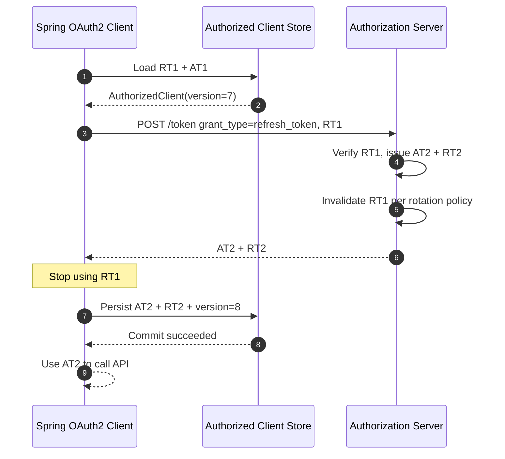
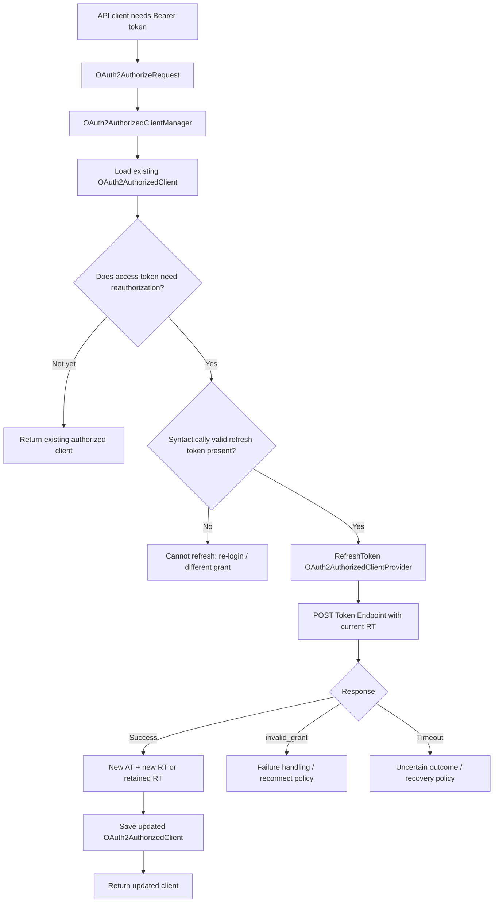
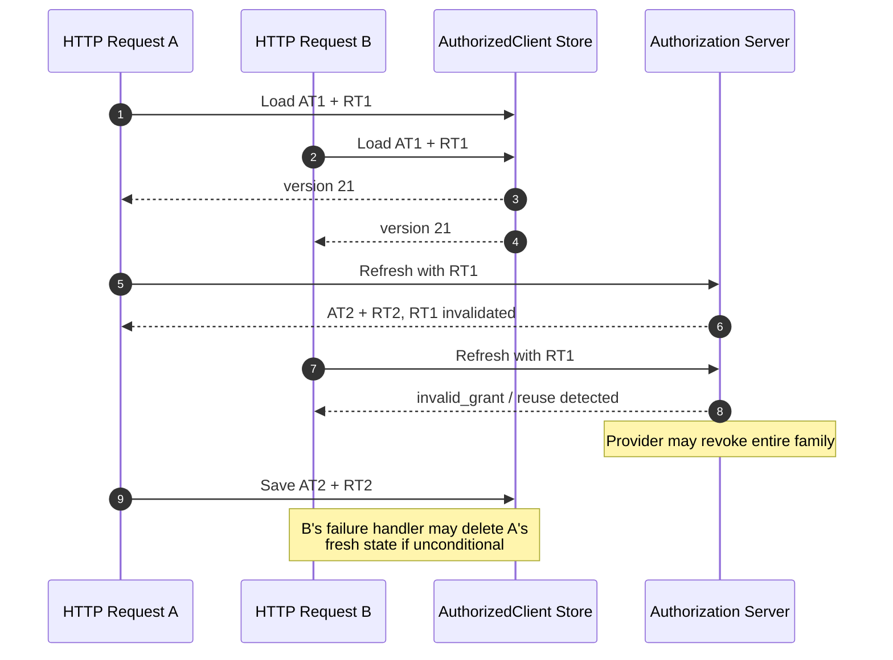
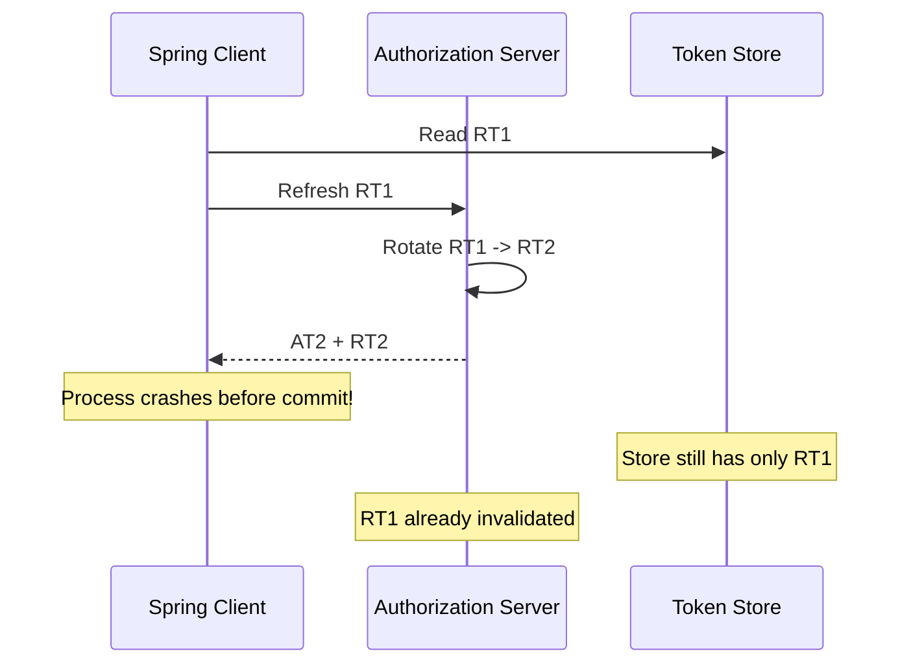

# 17.6. Refresh Token Rotation and Safely Persisting New Tokens

In **Spring Security OAuth 2.0 / OpenID Connect (OIDC) Client**, access tokens used to call APIs are usually short-lived. Once a user has logged in and granted authorization, the application can receive a **refresh token** to request new access tokens without forcing the browser through the entire login flow every time.

With some Authorization Servers, refreshing does more than issue a new access token: the server also **issues a new refresh token and invalidates the old refresh token**. This mechanism is called **refresh token rotation**. If the client fails to save the new token in time, or if two HTTP requests refresh concurrently or a background worker sends the old refresh token again, the user can lose their authorization session or—under a provider's reuse-detection policy—an entire **token family** may be revoked.

This lesson explains how to manage rotation properly in **Spring Boot 3.x, Spring Security 6.x**, covering `OAuth2AuthorizedClientManager`, `OAuth2AuthorizedClientProvider`, `OAuth2AuthorizedClientService`, and `OAuth2AuthorizedClientRepository`; it also distinguishes what **the framework handles** from the guarantees around **concurrency, transactions, and distributed storage** that the application must design itself.

Token values, issuers, and hostnames in the examples are illustrative. Never insert real access or refresh tokens into documentation, source code, or logs.

## 1. Expected Outcomes After This Lesson

You will be able to explain and apply:

1. What **refresh token rotation** is and how it differs from issuing only a new access token.
2. How **refresh token reuse detection** can cause the Authorization Server to revoke a token or an entire token family.
3. When a token response includes a new refresh token, the client must **replace the old copy** and save the access token and refresh token as one consistent state.
4. When a token response **does not** contain a new refresh token, understand the provider's contract rather than assuming the server always rotates.
5. How Spring Security coordinates the `refreshToken()` provider and authorized client storage.
6. Why two requests or two instances using the same refresh token concurrently can cause a race condition.
7. How to structure **single-flight refresh, per-key locks/leases, optimistic concurrency, and versioning/fencing** without assuming distributed transactions with the Authorization Server.
8. How to handle `invalid_grant`, network timeouts, revoked refresh tokens, and the crash window after the server has already rotated.
9. How to protect credentials in sessions, databases, backups, metrics, tracing, and during logout/account disconnect workflows.
10. How to design tests covering rotation, concurrent refreshes, and storage failures.

One point to keep in mind from the start:

> **Rotation only works safely when the client durably replaces the old refresh token and never accidentally reuses it.** The framework's automatic refresh mechanism does not equal atomic multi-server update guarantees.

## 2. What Is a Refresh Token and Where Does It Live?

An initial OAuth2 token response after the Authorization Code Flow might contain:

```json
{
  "access_token": "ACCESS_TOKEN_A",
  "token_type": "Bearer",
  "expires_in": 3600,
  "refresh_token": "REFRESH_TOKEN_1",
  "scope": "calendar.read"
}
```

The values above are placeholders. In practice, `access_token` and `refresh_token` are security-sensitive strings, either opaque tokens or a format chosen by the Authorization Server.

| Data type | Function | Where used |
| --- | --- | --- |
| Access token | Lets the client call an API/resource server per granted audience, scope, and policy | `Authorization: Bearer ...` to authorized APIs |
| Refresh token | Lets the client request a new access token at the Token Endpoint via `grant_type=refresh_token` | **Sent only to a trusted Token Endpoint** |
| ID Token | Proof of user authentication per OIDC | OIDC Client verifies `iss`, `aud`, signature, expiry, `nonce`, etc. |
| HTTP session cookie | Maintains the website's login session | Browser ↔ Spring web application |
| Client secret | Credential authenticating a confidential client with the Authorization Server | Backend/Token Endpoint; never exposed to the browser |

**A refresh token is not an access token.** Never send a refresh token as a Bearer token to a Resource Server. Nor should you pass a refresh token to the browser in a server-side application just so the frontend can refresh on its own.

### 2.1. Does every OIDC login receive a refresh token?

No. Issuance depends on client type, grant, provider policy, scopes, consent, and other factors. `offline_access` is commonly associated with refresh token issuance in OIDC, yet there is no simple rule that adding this scope always yields a token.

With the **Authorization Code Flow**, a refresh token may be issued. With `client_credentials`, the Authorization Server normally **does not issue a refresh token**; the client simply requests a new access token using `client_credentials` when needed.

### 2.2. Access token expiry and session lifetime are two separate concerns

A Spring web session can still be active after the access token expires, or the session can expire while the token in the authorized client service remains valid. Refreshing a token does not re-authenticate the browser, does not re-verify every OIDC policy, and does not prove the user's permissions have not been revoked.

Do not infer that "session is alive" means "refresh token is still valid".

## 3. Rotation: Progression from RT1 to RT2

A standard OAuth 2.0 refresh request sends:

```http
POST /oauth2/token HTTP/1.1
Host: auth.example.com
Content-Type: application/x-www-form-urlencoded
Authorization: Basic <client-credential>

grant_type=refresh_token&refresh_token=REFRESH_TOKEN_1
```

When the Authorization Server supports **rotation**, the token response may be:

```json
{
  "access_token": "ACCESS_TOKEN_B",
  "token_type": "Bearer",
  "expires_in": 3600,
  "refresh_token": "REFRESH_TOKEN_2",
  "scope": "calendar.read"
}
```

The server may invalidate `REFRESH_TOKEN_1` as soon as it issues `REFRESH_TOKEN_2`, according to its policy.



### 3.1. Rotation can form a token family

A typical issuance chain:

```text
At login/consent: RT1
           |
           | valid refresh
           v
          RT2  (RT1 is no longer usable)
           |
           | valid refresh
           v
          RT3  (RT2 is no longer usable)
           |
           | valid refresh
           v
          RT4  (RT3 is no longer usable)
```

Some Authorization Servers track tokens belonging to the same **token family / grant chain**. If an old refresh token is presented again, the server may treat it as evidence of token theft and revoke the current refresh token in the family as well. Severity, grace periods, and error messages **depend on the provider**; never assume every provider behaves identically.

### 3.2. Rotation vs. reuse detection

- **Rotation:** each successful refresh may issue a new refresh token, replacing the old one.
- **Reuse detection:** the server detects a previously used/invalidated refresh token being presented again; actions may include rejecting the request, flagging a security incident, or revoking the family.
- **Revocation:** the server invalidates one or more tokens due to user logout/disconnect, admin action, risk detection, or policy.
- **Expiration:** tokens expire based on time, inactivity, or absolute lifetime.

Rotation does not automatically guarantee reuse detection; and reuse detection is not triggered only by real attacks—**a client with a race condition can produce the exact same stale-token reuse pattern**.

### 3.3. Sender-constrained refresh tokens are another approach

According to **OAuth 2.0 Security Best Current Practice (RFC 9700)**, for **public clients**, the Authorization Server must detect replay via refresh-token rotation or use **sender-constrained refresh tokens** (e.g., key binding). Confidential clients can be constrained via dedicated client authentication/policies.

Sender-constrained tokens reduce the value of a leaked token if an attacker lacks the bound key. However, they **do not eliminate** the need to manage token state, expiration, storage, and concurrency. This lesson focuses on rotation; do not assume every OP supports DPoP or mTLS-bound refresh tokens.

## 4. A Token Response Might Not Issue a New Refresh Token

Not every refresh response contains a `refresh_token` field. For example:

```json
{
  "access_token": "ACCESS_TOKEN_B",
  "token_type": "Bearer",
  "expires_in": 3600,
  "scope": "calendar.read"
}
```

With **non-rotating** configurations and per provider contract, the existing refresh token can continue to be used. Under RFC 6749, the Authorization Server **may** issue a new refresh token; when a new token is returned, the client **must discard the old one and replace it with the new one**.

Therefore:

| Token response | Behavior to understand |
| --- | --- |
| New `access_token` and new `refresh_token` | Save the new tokens; stop using the old refresh token |
| New `access_token` without `refresh_token` | Per RFC/provider semantics, usually retain the existing refresh token if still allowed; never synthesize a fake token |
| Returns `invalid_grant` | Refresh failed; the old token may be expired, revoked, wrong client, or already rotated |
| HTTP/network timeout before receiving response | **Uncertain** whether the server already processed/rotated the token |
| Invalid body/format | Must not save partial data or treat the refresh as successful |

If a provider mandates rotation yet fails to return a new refresh token, that is a contract/protocol issue to investigate—not something the client can patch by inventing an "RT2".

### 4.1. Do not overwrite the existing RT with null

An anti-pattern:

```java
// WRONG EXAMPLE: response without refresh_token wipes out the old RT
String refreshTokenToSave = tokenResponse.getRefreshToken();
store.updateAccessAndRefresh(accessToken, refreshTokenToSave);
```

Depending on the API and representation, `getRefreshToken()` can be `null` when the server does not issue a new refresh token. Blindly persisting `null` destroys the client's ability to refresh again.

The right logic **must follow the verified contract**: if a new refresh token is returned, replace it; if omitted and the old refresh token remains valid, retain the old one. When using standard Spring Security providers, prefer letting the framework construct the authorized client per standard semantics rather than manually rebuilding responses.

### 4.2. Do not update only the access token

Another anti-pattern:

```text
Store before:
  AT1 + RT1

Refresh response:
  AT2 + RT2

App saves only:
  AT2 + RT1  <-- WRONG when RT1 has been rotated
```

As a result, the next refresh still sends the invalidated `RT1`. With reuse detection, the server may treat that reuse as a compromised credential.

**Access token and refresh token must be updated as one consistent authorized client state**, rather than writing the two fields into two unsynchronized stores.

## 5. Where Does Spring Security Store Refresh Tokens?

In Spring OAuth2 Client, state is typically represented by:

```text
OAuth2AuthorizedClient
  |
  +-- ClientRegistration
  +-- principalName
  +-- OAuth2AccessToken
  |     +-- tokenValue
  |     +-- issuedAt, expiresAt, scopes
  |
  +-- OAuth2RefreshToken (nullable)
        +-- tokenValue
        +-- issuedAt, expiresAt if present
```

Related APIs:

| API | Role |
| --- | --- |
| `OAuth2AuthorizedClient` | Bundles registration, principal, and issued tokens |
| `OAuth2AuthorizedClientManager` | Coordinates authorization/reauthorization |
| `OAuth2AuthorizeRequest` | Identifies registration and principal for an authorization attempt |
| `OAuth2AuthorizedClientProviderBuilder.refreshToken()` | Enables the provider that uses refresh tokens when conditions are met |
| `OAuth2AuthorizedClientRepository` | Saves/finds authorized clients in a Servlet request context |
| `OAuth2AuthorizedClientService` | Saves/finds authorized clients independent of HTTP requests |
| `DefaultOAuth2AuthorizedClientManager` | Manager typically used when a Servlet request is present |
| `AuthorizedClientServiceOAuth2AuthorizedClientManager` | Manager typically used for jobs/backends without a Servlet request |
| `OAuth2AuthorizationSuccessHandler` | Handles saving state on successful authorization/reauthorization |
| `OAuth2AuthorizationFailureHandler` | Handles errors and can remove invalid state per policy |

**Where tokens actually live depends on the implementation.** Some apps tie authorized client storage to the session; others use an in-memory service, JDBC, or a custom store. Do not assume refresh tokens are stored in a database merely because the website uses Spring Session.

### 5.1. How the components work together



On the happy path, Spring Security handles parsing the token response and persisting the updated authorized client after refresh. However, **the manager API does not promise transactional CAS or distributed locking for whichever store your application chooses**.

## 6. Configuring an OIDC Client Capable of Receiving Refresh Tokens

Suppose a Spring MVC app calls a Calendar API after the user logs in via OIDC.

### 6.1. Dependencies

With Spring Boot:

```xml
<dependency>
    <groupId>org.springframework.boot</groupId>
    <artifactId>spring-boot-starter-web</artifactId>
</dependency>
<dependency>
    <groupId>org.springframework.boot</groupId>
    <artifactId>spring-boot-starter-oauth2-client</artifactId>
</dependency>
```

Or Gradle:

```groovy
dependencies {
    implementation 'org.springframework.boot:spring-boot-starter-web'
    implementation 'org.springframework.boot:spring-boot-starter-oauth2-client'
}
```

### 6.2. `application.yml`

```yaml
spring:
  security:
    oauth2:
      client:
        registration:
          calendar-user:
            provider: calendar-oidc
            client-id: ${CALENDAR_CLIENT_ID}
            client-secret: ${CALENDAR_CLIENT_SECRET}
            client-authentication-method: client_secret_basic
            authorization-grant-type: authorization_code
            scope:
              - openid
              - profile
              - calendar.read
              - offline_access
            redirect-uri: "{baseUrl}/login/oauth2/code/{registrationId}"
        provider:
          calendar-oidc:
            issuer-uri: ${CALENDAR_ISSUER_URI}
```

`calendar.read` is an illustrative scope, while `offline_access` is standard OIDC for requesting access when the user is absent. **It does not guarantee the OP will always issue a refresh token or always rotate.** Configure client/consent settings and verify token responses against your real OP's documentation.

Secrets must be injected via environment variables or a secret manager. Never commit a real `client-secret` to Git.

### 6.3. Equivalent `application.properties`

```properties
spring.security.oauth2.client.registration.calendar-user.provider=calendar-oidc
spring.security.oauth2.client.registration.calendar-user.client-id=${CALENDAR_CLIENT_ID}
spring.security.oauth2.client.registration.calendar-user.client-secret=${CALENDAR_CLIENT_SECRET}
spring.security.oauth2.client.registration.calendar-user.client-authentication-method=client_secret_basic
spring.security.oauth2.client.registration.calendar-user.authorization-grant-type=authorization_code
spring.security.oauth2.client.registration.calendar-user.scope=openid,profile,calendar.read,offline_access
spring.security.oauth2.client.registration.calendar-user.redirect-uri={baseUrl}/login/oauth2/code/{registrationId}
spring.security.oauth2.client.provider.calendar-oidc.issuer-uri=${CALENDAR_ISSUER_URI}
```

Pick one configuration format per project convention. Do not hardcode the token endpoint URI manually if reliable OP issuer discovery already supplies accurate metadata.

### 6.4. There is no generic "enable rotation" property in Spring Client

Rotation is a **refresh token issuance and invalidation policy on the Authorization Server**. Adding `.refreshToken()` to the client manager enables Spring to **use issued refresh tokens**; it **does not force the Authorization Server to rotate**.

Examples of OP-side decisions:

- Whether to issue a refresh token at all.
- Rotate on every refresh vs. reuse the old token.
- Whether there is a grace period/overlap between old RT and new RT.
- Whether to revoke the entire family upon reuse detection.
- Absolute lifetime, inactivity timeout, consent scope, and revocation policy.

The client must follow the contract and implement sufficiently safe persistence, rather than guessing server behavior from a single token response.

## 7. Configuring `OAuth2AuthorizedClientManager` for Refreshing

### 7.1. Manager for Servlet requests

Example where the user signed in with `oauth2Login()` and a controller/service calls an API within the same Servlet request:

```java
import org.springframework.context.annotation.Bean;
import org.springframework.context.annotation.Configuration;
import org.springframework.security.oauth2.client.DefaultOAuth2AuthorizedClientManager;
import org.springframework.security.oauth2.client.OAuth2AuthorizedClientManager;
import org.springframework.security.oauth2.client.OAuth2AuthorizedClientProvider;
import org.springframework.security.oauth2.client.OAuth2AuthorizedClientProviderBuilder;
import org.springframework.security.oauth2.client.registration.ClientRegistrationRepository;
import org.springframework.security.oauth2.client.web.OAuth2AuthorizedClientRepository;

@Configuration
public class WebOAuth2ClientManagerConfig {

    @Bean
    OAuth2AuthorizedClientManager userAuthorizedClientManager(
            ClientRegistrationRepository registrations,
            OAuth2AuthorizedClientRepository authorizedClients) {

        OAuth2AuthorizedClientProvider provider =
                OAuth2AuthorizedClientProviderBuilder.builder()
                        .authorizationCode()
                        .refreshToken()
                        .build();

        DefaultOAuth2AuthorizedClientManager manager =
                new DefaultOAuth2AuthorizedClientManager(
                        registrations, authorizedClients);
        manager.setAuthorizedClientProvider(provider);
        return manager;
    }
}
```

`DefaultOAuth2AuthorizedClientManager` works with `OAuth2AuthorizedClientRepository` and the Servlet context. Spring locates the authorized client from the request/session/store, detects when refresh is needed, calls the Token Endpoint, and persists the new state via success handling.

**Note:** if the refresh token is missing or revoked, the manager cannot generate a browser authorization code on its own. The user may need to re-run `/oauth2/authorization/calendar-user` or an appropriate reconnect flow.

### 7.2. Manager for background tasks using service-stored user tokens

If a background worker is explicitly designed to use **a user's delegated token**, you can use a request-independent manager:

```java
import org.springframework.context.annotation.Bean;
import org.springframework.context.annotation.Configuration;
import org.springframework.security.oauth2.client.AuthorizedClientServiceOAuth2AuthorizedClientManager;
import org.springframework.security.oauth2.client.OAuth2AuthorizedClientManager;
import org.springframework.security.oauth2.client.OAuth2AuthorizedClientProvider;
import org.springframework.security.oauth2.client.OAuth2AuthorizedClientProviderBuilder;
import org.springframework.security.oauth2.client.OAuth2AuthorizedClientService;
import org.springframework.security.oauth2.client.registration.ClientRegistrationRepository;

@Configuration
public class BackgroundRefreshManagerConfig {

    @Bean("delegatedBackgroundManager")
    OAuth2AuthorizedClientManager delegatedBackgroundManager(
            ClientRegistrationRepository registrations,
            OAuth2AuthorizedClientService authorizedClientService) {

        OAuth2AuthorizedClientProvider provider =
                OAuth2AuthorizedClientProviderBuilder.builder()
                        .refreshToken()
                        .build();

        AuthorizedClientServiceOAuth2AuthorizedClientManager manager =
                new AuthorizedClientServiceOAuth2AuthorizedClientManager(
                        registrations, authorizedClientService);
        manager.setAuthorizedClientProvider(provider);

        return manager;
    }
}
```

Configured with only `refreshToken()`, the manager **cannot initiate an Authorization Code Flow from a job**. It requires an already-issued user `OAuth2AuthorizedClient` stored in **the same authorized client service accessible to the worker**.

Do not assume that because `oauth2Login()` saved tokens in a web session, a background job can find them via the service. Supporting background delegated access requires explicitly designing the repository/service, internal identity key, consent, retention, and access controls.

### 7.3. `client_credentials` does not use user-style refresh token rotation

An app-only job typically declares:

```java
OAuth2AuthorizedClientProviderBuilder.builder()
        .clientCredentials()
        .build();
```

When the access token expires, the provider obtains a new access token via client credentials. In this grant **there is usually no refresh token** to rotate; do not attach `refreshToken()` just to "make it more secure".

## 8. Calling the Manager Inside a User Request

Example service accepting the logged-in user's `Authentication`:

```java
import org.springframework.beans.factory.annotation.Qualifier;
import org.springframework.security.core.Authentication;
import org.springframework.security.oauth2.client.OAuth2AuthorizeRequest;
import org.springframework.security.oauth2.client.OAuth2AuthorizedClient;
import org.springframework.security.oauth2.client.OAuth2AuthorizedClientManager;
import org.springframework.stereotype.Service;

@Service
public class CalendarTokenProvider {

    private final OAuth2AuthorizedClientManager manager;

    public CalendarTokenProvider(
            @Qualifier("userAuthorizedClientManager")
            OAuth2AuthorizedClientManager manager) {
        this.manager = manager;
    }

    public OAuth2AuthorizedClient currentClient(Authentication user) {
        OAuth2AuthorizeRequest request =
                OAuth2AuthorizeRequest
                        .withClientRegistrationId("calendar-user")
                        .principal(user)
                        .build();

        OAuth2AuthorizedClient client = manager.authorize(request);
        if (client == null) {
            throw new IllegalStateException(
                    "Calendar authorization is missing; user must reconnect");
        }
        return client;
    }
}
```

API-calling code uses only the access token:

```java
OAuth2AuthorizedClient client =
        calendarTokenProvider.currentClient(authentication);

String bearerToken = client.getAccessToken().getTokenValue();

// Pass bearerToken only to the configured, trusted Calendar API.
// Do not log it or send the token to the browser.
```

At `manager.authorize(...)`, the provider detects when the access token needs reauthorization and uses the refresh token as appropriate. **Do not manually trigger a refresh on every HTTP request** with a handwritten `POST /token` when the manager already supports the lifecycle.

### 8.1. Observing expiration without exposing tokens

You can read metadata:

```java
OAuth2AuthorizedClient client =
        calendarTokenProvider.currentClient(authentication);

System.out.println(
        "access token expires at: "
                + client.getAccessToken().getExpiresAt());

System.out.println(
        "has refresh token: "
                + (client.getRefreshToken() != null));
```

In production, use structured logging and avoid logging user data unnecessarily. **Never print `getTokenValue()`** for access or refresh tokens.

### 8.2. Why is the principal key important?

In persistence, an authorized client is usually keyed by **client registration ID and principal name**. If every user passes `.principal("shared-user")`, a misconfigured store could hand one user's token to another user.

Use a trustworthy `Authentication` from the request and a consistent identity mapping. In multi-issuer/multi-tenant apps, prevent principal name collisions across OPs; never use email alone as a global key.

## 9. Persisting New Tokens: State Must Be Atomic

Suppose storage currently holds:

```text
key:
  registration = calendar-user
  principal    = internal-account-42

version = 12
access_token = AT12
refresh_token = RT12
```

After a successful refresh, the OP returns:

```text
access_token = AT13
refresh_token = RT13
```

The application must commit one new state:

```text
version = 13
access_token = AT13
refresh_token = RT13
```

**Never write the access token first and the refresh token later** across two independent transactions or persistence paths if a crash or concurrent reader could intervene. The post-commit state must consistently represent **one authorization/reauthorization event**.

### 9.1. Invalid states to avoid

| Saved access token | Saved refresh token | Meaning |
| --- | --- | --- |
| AT12 | RT12 | Old state before refresh |
| **AT13** | **RT13** | **Correct new state when the server rotates** |
| AT13 | RT12 | Broken after rotation; next refresh uses stale RT |
| AT12 | RT13 | Generation mismatch; complicates API/token lifetime tracking |
| AT13 | null | Loss of refresh capability if response actually had RT13 and client dropped it |
| AT13 | RT12 after RT13 existed | Stale writer overwrote the newer refresh token |

If your storage only updates individual fields separately, add transactions/record versioning or switch to a unified persistence model.

### 9.2. Conditional updates by version

A common database strategy is **optimistic concurrency control**:

```sql
-- Illustrative SQL model, not the default Spring schema.
UPDATE oauth2_authorized_client_secure
SET
    encrypted_access_token  = :new_access_token_ciphertext,
    encrypted_refresh_token = :new_refresh_token_ciphertext,
    access_expires_at       = :new_access_expires_at,
    version                 = version + 1,
    updated_at              = CURRENT_TIMESTAMP
WHERE
    registration_id         = :registration_id
    AND principal_key       = :principal_key
    AND version             = :expected_version;
```

Only when **exactly one row** is updated is the commit considered successful. If **0 rows updated**, the state changed or no longer exists: **re-read storage**, inspect the new state, and never unconditionally overwrite it with a slower request's token response.

Ensure all token fields update within a single transaction and remain securely encrypted. The `encrypted_*` columns emphasize token protection; actual encryption and key management depend on your architecture.

### 9.3. Version/CAS alone does not prevent token reuse

CAS after calling the Token Endpoint prevents stale writes, yet **it does not stop two requests from having already sent the same RT12 to the OP** beforehand.

```text
Request A loads RT12, version 12
Request B loads RT12, version 12

A sends RT12 -> OP issues RT13, invalidates RT12
B sends RT12 -> OP detects reuse or returns invalid_grant

A CAS version 12 -> 13 succeeds
B has no new RT or fails to update
```

If the OP's reuse detection revokes the token family when B presents RT12, A's RT13 may also be revoked. **Therefore, optimistic locking after refresh is not enough** if you need to prevent replay from your own application workers.

Consider **coordinating before calling the Token Endpoint**.

## 10. Race Condition When Two HTTP Requests Refresh Simultaneously

A very realistic scenario: a browser has two tabs open, the access token is about to expire, and both tabs call Spring APIs almost simultaneously.



There are two independent bugs:

1. **Reuse at the OP:** B sent an already-invalidated RT1.
2. **Race at storage:** B handles `invalid_grant` and deletes the authorized client A just saved, or another stale update overwrites RT2.

Protection is needed at **both** stages:

- Coordination to reduce/prevent multiple refreshes using the same RT.
- Versioned/conditional writes and conditional deletes so fresh state is never corrupted.

### 10.1. What does an in-JVM lock solve?

If the application runs a single instance and **every refresh path for the same authorized client acquires the same lock**, a per-key lock prevents two threads from refreshing simultaneously:

```text
Lock key = (registrationId, principalKey)
Request A acquires lock:
   - re-read authorized client
   - refresh if still needed
   - save updated record
   - release lock
Request B waits:
   - acquires lock
   - re-reads saved record
   - uses new token; never sends stale RT
```

However, `synchronized(this)` or `ReentrantLock` inside one JVM **does not protect** across 2–10 application replicas or separate background workers. A global lock across all users also creates needless bottlenecks; locks should be **partitioned by authorized client key**.

### 10.2. Remember to "re-read after acquiring the lock"

If B already loaded RT1 **before waiting for the lock**, holding a lock does not help if B proceeds to use the stale RT1 object once its turn arrives. Rule:

> **After acquiring permission to refresh, reload the latest authorized client state from the store**, rather than relying on a snapshot loaded before waiting.

That re-read determines whether the access token still needs refreshing and which refresh token is currently active.

## 11. Single-Flight Refresh for Multiple Requests

A strategy known as **single-flight**: when multiple callers need the same expiring token, only one refresh executes; the others wait for its outcome or re-read the new token.

```text
Call A: authorize(reg=calendar-user, user=42)
        |
        +--> becomes refresh leader

Call B: authorize(reg=calendar-user, user=42)
        |
        +--> waits for leader or re-reads after refresh

Call C: authorize(reg=calendar-user, user=99)
        |
        +--> different key, not blocked by A

Leader:
  - re-read store RT_current
  - refresh
  - persist AT_new + RT_new
  - complete

Followers:
  - re-read store
  - obtain persisted token
```

This pattern must wrap **before the manager/provider code actually sends the refresh request**, not merely around the database write.

### 11.1. An orchestrator layer wrapping the manager

The pseudo-Java below highlights where the lock sits:

```java
// PSEUDOCODE: ScopedTokenRefreshCoordinator and withKeyLock(...)
// are contracts to implement with an appropriate lock/store.
OAuth2AuthorizedClient authorizeSafely(
        String registrationId,
        Authentication user) {

    String principalKey = verifiedInternalUserKey(user);
    String lockKey = registrationId + ":" + principalKey;

    return coordinator.withKeyLock(lockKey, () -> {

        // Important: manager/load must re-read state inside the lock.
        OAuth2AuthorizeRequest request =
                OAuth2AuthorizeRequest
                        .withClientRegistrationId(registrationId)
                        .principal(user)
                        .build();

        OAuth2AuthorizedClient result = manager.authorize(request);

        if (result == null) {
            throw new AuthorizationRequiredException();
        }

        return result;
    });
}
```

This is **architectural pseudocode**, not copy-paste runnable code: `ScopedTokenRefreshCoordinator` and `verifiedInternalUserKey` must be designed around real identity/storage, exception handling, lock lifetimes, and request contexts. `manager.authorize` must read and write **the same store** guarded by the coordinator.

In multi-instance environments, the per-key lock must use distributed coordination or an equivalent storage algorithm. For workloads with many users and registrations, keys must never collide across users or tenants.

### 11.2. Avoid holding a database transaction open across network calls if possible

A naive approach is holding a database transaction/row lock while calling the Token Endpoint. That can cause:

- Holding connections and locks open during slow network calls.
- Deadlocks/contention with other requests.
- Degraded throughput when the OP has an outage.
- Tricky recovery if the process dies between the request and commit.

Advanced designs may use a **bounded lease + fencing token/version + CAS** instead of keeping a DB transaction open across the HTTP call. Even so, that adds complexity and must be tested thoroughly for lease expiry and worker pauses.

There is no single "always best" option for every system; consistency needs, scale, and OP policies dictate the right level of coordination.

## 12. Distributed Locks, Leases, and Fencing Across Multiple Instances

Suppose two replicas serve the same user:

```text
Instance A                        Instance B
   |                                  |
   | -- acquire lock(user42) -->      |
   |                                  | waiting
   | -- call OP with RT1 -->          |
   | <-- AT2 + RT2 --                 |
   | -- commit state -->              |
   | -- release lock -->              |
   |                                  | acquire lock
   |                                  | re-read AT2 + RT2
   |                                  | no duplicate RT1
```

### 12.1. Lock keys must be sufficiently specific

A conceptual key:

```text
oauth2-refresh-lock:{tenantOrNamespace}:{registrationId}:{principalKey}
```

`principalKey` should be a stable internal identifier not arbitrarily controlled by the user. In multi-issuer/multi-tenant stores, the key must partition strictly by **trust context**.

Avoid putting raw refresh tokens into lock keys, logs, or Redis key names. Do not use email as a key unnecessarily, as it is easily exposed personal data.

### 12.2. Leases can expire while the OP is processing

In a distributed system, worker A acquires a 10-second lease, yet the network call takes 15 seconds. Worker B sees the lease expire, acquires a new lock, and may send the same RT1 if the store has not yet been updated.

```text
A acquires lease generation=101, calls OP
  | ... A stalls / slow network ...
B acquires lease generation=102, reads RT1, calls OP
  | ... reuse can occur ...
A wakes up, attempts to write RT2
```

A **fencing token** lets storage reject writes from an outdated holder (`generation=101`), yet it **cannot recall the HTTP refresh request A/B already sent to the OP**. Lease timeouts and retry policies must therefore be conservative; if you are unsure whether the previous token request succeeded, never "immediately retry with the old RT" just because a lease expired.

### 12.3. A usable state model

```text
ACTIVE(version=10, RT10)
   |
   | claim refresh ownership (leaseId, fencing generation)
   v
REFRESHING(version=10, owner=A, deadline=...)
   |
   | OP returns RT11
   v
ACTIVE(version=11, RT11, AT11)
```

If the process crashes while `REFRESHING`, recovery must distinguish **"request not yet sent"** from **"unknown whether OP already rotated"**. You cannot always recover safely just by resending RT10; you need provider-specific grace/recovery or reauthorization.

These states and leases represent **a custom design pattern**, not a schema built into Spring Security.

## 13. Crash Windows That Local Transactions Cannot Solve

The hardest edge case:

1. The client sends refresh token RT1 to the OP.
2. The OP accepts it, invalidates RT1, and issues RT2.
3. The client receives RT2 in memory.
4. The process crashes **before persisting RT2**.
5. Storage still holds only RT1.



There is no **ACID transaction spanning the application's database and the Authorization Server** in a standard OAuth2 refresh request. Opening a database transaction before the HTTP call does not create a distributed atomic commit with the OP.

### 13.1. Mitigations

Depending on OP capabilities and risk tolerance:

- **Persist the token response immediately** upon receipt, minimizing the gap between receive and durable commit.
- Use durable storage with atomic update semantics.
- **Do not run extra side work** before committing the new RT.
- Monitor save failures and transition the authorized client to a recovery/reconnect state rather than reusing the old RT.
- Check whether the OP offers a **rotation grace period/overlap** or protocol-specific recovery.
- When recovery is impossible, prompt the user to **reauthorize/re-consent**.
- For app-only workloads, prefer `client_credentials` where appropriate to avoid depending on user refresh tokens.

**No snippet of Java can guarantee "never losing a refresh token"** once the OP has rotated and the client has not yet persisted the result. This is a genuine distributed-systems boundary that must be factored into operational design.

### 13.2. Network timeouts create an "uncertain outcome"

A timeout does not prove the refresh request failed at the OP. The server may have accepted RT1, issued RT2, and the response was lost in transit.

Therefore, **never blindly retry immediately with RT1** after a timeout. With OPs enforcing strict reuse detection, that retry can get the family revoked. Establish an explicit recovery policy: re-read the token store, check whether another refresh succeeded, wait if another worker/lease is still running, or fall back to reconnecting when recovery is unavailable.

## 14. Storing Refresh Tokens Safely in Repository/Service

### 14.1. What should be considered for session storage?

With `oauth2Login()`, `DefaultOAuth2AuthorizedClientManager` operates on `OAuth2AuthorizedClientRepository` within the Servlet request. Depending on configuration, authorized clients may live in the session or in an underlying service.

If refresh tokens live only in the HTTP session:

- Browser logout or session timeout drops the token.
- Tabs sharing a session can refresh concurrently.
- Session replication can suffer update races if two nodes update a session attribute.
- Background jobs cannot read the token without an HTTP request.
- Session store backups may contain sensitive tokens.

Do not add a separate `"refresh_token"` session attribute just to "grab it more easily" alongside the authorized client repository.

### 14.2. What fields does a database token store need?

A conceptual schema:

```text
OAuth2AuthorizedClientRecord
  - registration_id
  - principal_key          (trusted account/service key)
  - tenant_key             (if multi-tenant application)
  - encrypted_access_token
  - encrypted_refresh_token
  - access_expires_at
  - refresh_expires_at     (if published/known by provider)
  - version
  - status                 (ACTIVE/REFRESHING/RECONNECT_REQUIRED)
  - updated_at
```

You do not have to use this exact schema; it is a model for reasoning about **state, durability, access control, and concurrency**. If using Spring Security's standard JDBC implementation, inspect its actual schema/API rather than assuming it already includes `version`, leases/fencing, or encryption.

### 14.3. Protecting token data in storage

Practical requirements:

1. Encrypt token data at rest per organizational policy; protect encryption keys separately.
2. Require TLS for connections between the application and the database/session store.
3. Restrict token read permissions by service account, tenant, and operations role.
4. Never use raw tokens as primary keys, lock keys, or correlation IDs.
5. Protect backups, replicas, snapshots, tracing, and support tooling.
6. Set TTL/retention aligned with consent, inactivity, and absolute lifetimes.
7. Clean up authorized clients when a user disconnects or authorization is revoked.
8. Manage data-encryption key rotation and incident response procedures.
9. Never return tokens in JSON responses or exception messages.
10. Audit data paths when migrating from session storage to a database.

A valid refresh token can mint **many access tokens**; its security sensitivity is therefore often higher than that of a short-lived access token.

## 15. Persisting Both Tokens via One `OAuth2AuthorizedClient` Record

In Spring Security, once the provider completes a refresh, the result is represented as an updated `OAuth2AuthorizedClient`. When implementing custom persistence, persist **the entire reissued state** instead of splitting access and refresh token updates asynchronously.

An example solely for observing the API:

```java
import org.springframework.security.oauth2.client.OAuth2AuthorizedClient;
import org.springframework.security.oauth2.core.OAuth2AccessToken;
import org.springframework.security.oauth2.core.OAuth2RefreshToken;

void inspectTokenMetadata(OAuth2AuthorizedClient client) {
    OAuth2AccessToken accessToken = client.getAccessToken();
    OAuth2RefreshToken refreshToken = client.getRefreshToken();

    System.out.println(
            "accessExpiresAt=" + accessToken.getExpiresAt());
    System.out.println(
            "hasRefreshToken=" + (refreshToken != null));

    // DO NOT call getTokenValue() to log it!
}
```

`OAuth2AccessToken` and `OAuth2RefreshToken` carry token data; constructing a new `OAuth2AuthorizedClient` just to "swap the access token" must preserve the exact registration, principal, scopes, and refresh token.

### 15.1. Why might a plain `saveAuthorizedClient(...)` not be enough?

APIs like:

```java
authorizedClientService.saveAuthorizedClient(
        authorizedClient,
        authentication);
```

or the corresponding repository save the authorized client. However, the general contract **does not promise** that your chosen implementation performs compare-and-swap on token generation, distributed locking, or conditional deletion on `invalid_grant`.

If the implementation is an in-memory map, an unversioned database row, or a last-write-wins session attribute, two requests can still overwrite each other. Therefore, evaluate **the atomicity and concurrency semantics of your actual storage**.

## 16. Protecting Delete Operations When Refresh Fails

Spring Security managers can use **`OAuth2AuthorizationFailureHandler`** to handle authorization failures; in some default configurations, errors like `invalid_grant` remove the old authorized client to avoid reusing an invalid token.

Yet in a race:

```text
Request A: refresh RT1 -> RT2, commit version=2
Request B: refresh RT1 -> invalid_grant
Request B: failure handler removeAuthorizedClient(reg, principal)
```

If deletion has no version condition, B can **delete the brand-new authorized client** A just saved.

### 16.1. Conditional delete

One strategy:

```sql
-- Only delete/transition state if the row still matches the version
-- used by the failing request.
UPDATE oauth2_authorized_client_secure
SET
    status = 'RECONNECT_REQUIRED',
    version = version + 1,
    updated_at = CURRENT_TIMESTAMP
WHERE
    registration_id = :registration_id
    AND principal_key = :principal_key
    AND version = :version_read_before_refresh;
```

If **0 rows updated**, another writer changed the state: **re-read** to see whether a new token exists or an administrative event altered authorization. Never delete unconditionally by registration/principal alone.

### 16.2. Do not treat every `invalid_grant` as an attack

An `invalid_grant` error can happen because:

- The refresh token expired.
- The refresh token was revoked after logout or consent revocation.
- The refresh token belongs to another client or is invalid.
- The Authorization Server enabled reuse detection.
- Two requests from your own app used the same stale token.
- Clock skew/provider policy issues or a data-flow bug occurred.

Do not conclude "an attacker struck" solely from `invalid_grant`. Nor should you **keep using the old refresh token** after the server rejects it; classify the error, protect storage, and choose appropriate reconnect or incident handling.

### 16.3. Avoid infinite retries

Refresh operations have **no general idempotency guarantee**. With a rotated token, retrying the same RT can trigger reuse detection.

Error policies should distinguish:

- **Transient** (e.g., OP unavailable): consider bounded backoff retries, though never reuse an RT if the prior attempt might have succeeded.
- **Authorization lost** (confirmed `invalid_grant`): stop retrying refreshes; prompt for re-login/re-consent.
- **Contended token state**: re-read storage or await coordination before deciding.
- **Misconfigured client** (`invalid_client`, wrong issuer): fix configuration; never substitute another user's token.

## 17. Distinguishing Refresh Errors from Resource Server Errors

An application can make two distinct HTTP calls:

```text
Client -> Authorization Server /token   (refresh token)
Client -> Calendar API /events          (access token)
```

They produce different errors:

| Hop | Common error | Meaning |
| --- | --- | --- |
| Token Endpoint | `invalid_grant` | Refresh token/grant rejected |
| Token Endpoint | `invalid_client` | Client authentication failed |
| Token Endpoint | `temporarily_unavailable` | OP/AS temporarily unavailable |
| Token Endpoint | Network timeout | Uncertain whether the OP already processed the request |
| Resource Server | `401 invalid_token` | Access token rejected |
| Resource Server | `403 insufficient_scope` | Token lacks required API scopes/permissions |
| Resource Server | `429` | Rate limit |
| Resource Server | `5xx` | API or infrastructure error |

**An API `401` does not prove the refresh token needs rotating.** The access token might have the wrong audience, wrong issuer, or have been revoked. Likewise, a `403` will not be fixed by refreshing if the new token still carries the same scopes.

When integrating an HTTP client with OAuth2 failure handling, ensure invalid-token responses are handled with restraint—do not delete the authorized client on every arbitrary API error.

### 17.1. Refreshing does not change OAuth scopes

A refresh token grant is not permitted to grant broader privileges than the original authorization grant per OAuth2 policy. Never append `calendar.write` to the HTTP body assuming the user consented to the new permission. When expanded scopes or fresh consent are required, initiate an appropriate authorization flow.

### 17.2. Refreshing does not guarantee the user's permissions are still valid

A new access token may be issued by the OP per the grant, yet the application must still enforce current website authorization and the Resource Server still checks permissions. If a user is disabled, revokes consent, or has their account locked, the provider may reject refreshes; never try to "work around" it with a higher-privileged service token.

## 18. Logout, Account Disconnect, and Rotation

### 18.1. Logging out of the Spring web session

Logout clears `SecurityContext` and invalidates the HTTP session. However:

- The refresh token in a database-backed `OAuth2AuthorizedClientService` may still remain.
- Logging out of the application does not necessarily revoke tokens at the OP.
- Logging out at the OP is a separate mechanism when supported by the OP.
- Whether the browser session lives or ends does not govern the refresh token's absolute lifetime.

**If business requirements dictate that logout must halt all background delegated access**, implement policies to purge/revoke authorized clients and cancel jobs, not just clear `JSESSIONID`.

### 18.2. Account disconnect

When the user clicks "Disconnect Calendar", the application should:

1. Authenticate the current user and verify their permission to disconnect their own account.
2. Stop/cancel queued jobs needing that token per policy.
3. Revoke refresh/access tokens at the OP if the revocation endpoint is supported.
4. Delete the authorized client using the exact registration/principal key with concurrency control.
5. Clear caches or copies no longer needed, per retention policy.
6. Record minimal audit metadata without raw tokens.

Disconnect can race with an in-flight refresh. Mark a **revoked/disconnected generation** so a late refresh response **cannot write tokens back into an authorization the user already terminated**.

### 18.3. Revocation must win over late refresh responses

A possible incident:

```text
T1: Worker A starts refreshing RT5.
T2: User clicks Disconnect.
T3: Storage deletes authorized client.
T4: Worker A receives RT6 and saves it.
```

If storage is merely last-write-wins, RT6 can be "resurrected" after the user disconnected. Production designs should use **versions/tombstones/revoked statuses** to reject stale refresh writes once an authorization has been terminated.

Similarly, never allow a refresh to automatically revive a grant that an admin revoked due to a security incident.

## 19. Multi-Tab and Multiple Providers

### 19.1. Two tabs for the same user

Two tabs in the same browser profile normally share a session cookie. When both tabs trigger API calls requiring a refresh around the same time, they share the same `OAuth2AuthorizedClient`.

Coordinate refreshes by **(client registration, principal)**, not by tab ID. If each tab hits the Token Endpoint independently with the same refresh token, rotation easily causes races.

### 19.2. Two different providers

Example:

```text
registrationId = corporate-calendar
issuer = https://sso.corp.example.com

registrationId = partner-calendar
issuer = https://login.partner.example.com
```

Each registration has independent token endpoints, client credentials, audiences/scopes, and refresh tokens. Never share refresh tokens across providers simply because the email or username matches.

A safe key in application storage typically combines the **approved registration + internal principal identity**, partitioned by tenant/issuer if needed. Never select a token endpoint or issuer from an unvalidated query parameter.

### 19.3. Sharing one principal key across multiple users is a security bug

Anti-pattern:

```java
// WRONG when every user shares a single storage key:
OAuth2AuthorizeRequest.withClientRegistrationId("calendar-user")
        .principal("default-user")
        .build();
```

User A's authorized client could be handed to user B. Always obtain a trusted principal from `Authentication` or map to an internal account identity while enforcing tenant boundaries.

## 20. Differences Between User Requests and Background Workers

| Criterion | Servlet user request | Background delegated worker |
| --- | --- | --- |
| HTTP request | Present | Absent |
| Principal | `Authentication` from `SecurityContext` | Verified internal user/service identity from the job |
| Typical manager | `DefaultOAuth2AuthorizedClientManager` | `AuthorizedClientServiceOAuth2AuthorizedClientManager` |
| Authorized client storage | `OAuth2AuthorizedClientRepository` or integrated service | Durable `OAuth2AuthorizedClientService` |
| Refresh token | Possible depending on OIDC grant | Can use a stored user token with active consent |
| Obtaining initial token | Browser Authorization Code / consent | Must already hold a delegated token; cannot open browser login |
| Concurrent refresh | Multiple tabs / HTTP requests | Multiple workers / instances |
| When authorization is missing | Prompt user to re-authorize / re-consent | Transition job to needing user reauthorization |
| Logout / disconnect | Session / authorized client policy | Must check whether the user revoked delegated authorization |

A background worker using a user's refresh token is bound by **scope limits, consent, and retention rules**—do not treat it like a `client_credentials` grant just because there is no browser request.

## 21. Observability and Logging Without Leaking Credentials

### 21.1. What should be logged?

Useful details for incident analysis:

```text
operation=oauth2_refresh
registrationId=calendar-user
authorizationKey=opaque-internal-reference
oldVersion=14
newVersion=15
outcome=success
durationMs=215
source=WebRequest
correlationId=non-sensitive-id
```

You do not even need to log versions/keys if your organization classifies them as sensitive; normalized metrics by registration and outcome may suffice.

**Never log**:

- Raw refresh tokens, access tokens, or full JWT payloads.
- Token Endpoint `Authorization` headers.
- Client secrets or `client_assertion` values.
- `Cookie: JSESSIONID`.
- HTTP request/response bodies from token refreshes.
- Callback URLs containing `code` or `state`.
- Raw user identifiers, emails, or phone numbers when unnecessary.

### 21.2. Metrics to track

Useful metrics:

| Metric | Purpose |
| --- | --- |
| Refresh attempts/success/failure per registration | Detect changes in OP behavior |
| `invalid_grant` count | Alert on revoked tokens, races, or policy shifts |
| Lock wait duration / lease expiry | Detect contention/concurrency bottlenecks |
| CAS conflicts / stale writes prevented | Evaluate storage consistency |
| Refresh response duration | Spot slow Token Endpoints |
| Reconnect-required count | Measure user impact |
| Duplicate token requests per authorized client | Detect when single-flight is not working |
| Refresh-token family revocations (if OP emits events) | Analyze security incidents |

Avoid high-cardinality metric labels or labels containing tokens/user identifiers. When events must be correlated, use a protected internal audit ID with appropriate retention.

### 21.3. Never enable raw HTTP body logging indiscriminately

Especially with `client_secret_post`, the form body contains both `client_secret` and `refresh_token`. With `client_secret_basic`, the `Authorization` header holds the Base64-encoded secret while the refresh token sits in the body. Both require redaction across:

- Application HTTP client interceptors.
- Reverse proxies / API gateways.
- Distributed tracing / APM.
- Debug logging.
- Support bundles and crash reports.

Basic auth's Base64 encoding **is not security encryption**.

## 22. Testing Rotation and Persistence

Test against a Token Endpoint test double or a real test OP that supports rotation. Never use production tokens; use fixtures generated by the test harness.

### 22.1. Core scenario matrix

| Scenario | OP response / behavior | Expected client outcome |
| --- | --- | --- |
| T1: First refresh | RT1 → AT2 + RT2 | Save AT2/RT2; never use RT1 again |
| T2: No new refresh token | RT1 → AT2, response omits RT field | Retain RT1 if OP contract permits; update AT2 |
| T3: Refresh token revoked | `invalid_grant` | No infinite retries; trigger reconnect/failure policy |
| T4: Access token still valid | No token endpoint request needed | Manager returns existing authorized client |
| T5: Two requests, same key | Nearly simultaneous requests | Do not send RT1 twice when single-flight is configured |
| T6: Two different users | Two principal keys | Independent refreshes; never mix tokens |
| T7: Two different registrations | Two providers/clients | Keep RTs, issuers, and token endpoints isolated |
| T8: Stale write | Older writer updates after newer version | CAS rejects; newer state is not overwritten |
| T9: Stale failure deletion | Request B gets `invalid_grant` after A commits RT2 | Failure handler does not delete new RT2 |
| T10: Crash before saving RT2 | OP rotates, then client dies | Recovery/reconnect policy activates |
| T11: Ambiguous HTTP timeout | OP may have rotated | No blind retry of old RT before checking state |
| T12: Disconnect mid-refresh | User revokes authorization before response | Late response does not resurrect token |
| T13: Refresh token logging | HTTP instrumentation enabled | Test verifies redaction; no raw credentials leaked |
| T14: Multi-instance | Two nodes, same key | Lease/atomic store protects rotation per policy |
| T15: Provider grace period | OP briefly accepts old RT | Client still prioritizes persisting new RT rather than relying on grace |

### 22.2. Testing optimistic concurrency with fixtures

Example service-level test:

```text
Given:
  key = (calendar-user, account-42)
  stored version = 5
  access = AT5
  refresh = RT5

When:
  Worker A updates with expectedVersion=5
  Worker B also updates with expectedVersion=5

Then:
  Exactly one update succeeds
  Stored version is 6
  Both access + refresh belong to the winning generation
  Loser re-reads the record and does not overwrite it
```

This test alone does not prove there were no **duplicate refresh requests** sent to the OP, so add integration tests for the single-flight/lease layer in front of the Token Endpoint.

### 22.3. Testing races with reuse detection enabled

Simulate the OP:

```text
POST refresh_token=RT1 (first request):
   -> 200 OK, AT2 + RT2; RT1 invalidated

POST refresh_token=RT1 (repeat request):
   -> 400 invalid_grant; may revoke token family
```

With single-flight implemented, the expectation is **only one request reaches the OP with RT1** for the authorized client needing refresh, assuming no crash/unhandled failure. Once the leader saves RT2, followers read the new state.

If a provider offers a grace period, **do not treat temporary acceptance of a second request as proof that your concurrency design is sound**. The goal remains avoiding unintended reuse of old RTs.

### 22.4. Integration tests with Spring Security

Tests can be organized into layers:

1. **Token provider test:** verify responses with/without a new refresh token, lifetimes, and OAuth2 errors.
2. **Manager test:** verify `authorize()` and success/failure persistence.
3. **Repository/service test:** verify atomic token records, CAS/versioning, and conditional removal.
4. **Concurrency test:** multiple callers targeting the same principal/registration.
5. **Fault injection:** network timeouts, simulated node crashes, database commit failures.
6. **Security test:** no token leakage/logging; logout/disconnect never resurrects authorization.
7. **Web integration test:** user OIDC login, API calls, refreshes when due, no cross-session/tab/tenant leakage.

These are recommended practice exercises and implementation verification strategies, **not test results from a current application**.

## 23. Symptom-Based Troubleshooting

| Symptom | Possible cause | Investigation path |
| --- | --- | --- |
| First refresh succeeds, next one returns `invalid_grant` | New RT was not saved; old RT reused | Compare token response behavior with persisted state using masked metadata/fixtures |
| Two tabs log in and occasionally lose Calendar authorization | Refresh race or stale delete in failure handler | Inspect per-key coordination and conditional deletion |
| After scaling to multiple nodes, `invalid_grant` spikes | Missing distributed single-flight or inconsistent storage | Check locks/leases, shared store, and session replication |
| Token response lacks `refresh_token` | OP does not rotate or uses a different policy | Do not blindly write null; check provider contract |
| Token store retains old RT despite OP reporting rotation | Updated only access token or commit failed | Persist authorized client atomically; monitor save failures |
| Network timeout, retry hits `invalid_grant` | OP rotated before timeout | Handle ambiguous outcomes; avoid blind retries |
| Access token not expired yet refreshes continuously | Excessively large clock skew, clock drift, or bad expiry | Check time sync, provider settings, and token metadata |
| Refresh token exists, yet manager returns null | Mismatched provider/manager/storage | Verify `refreshToken()`, principal/registration, and stored authorized client |
| `@Scheduled` fails to refresh | Using a manager requiring a Servlet request | Switch to `AuthorizedClientServiceOAuth2AuthorizedClientManager` |
| Web login has RT, yet background job cannot see it | Session repository differs from authorized client service | Design access-controlled shared storage |
| User disconnects, yet job keeps running | Token still in non-session service | Implement revocation/cleanup and job cancellation policies |
| After disconnect, token reappears | Late refresh response overwrote tombstone | Add fencing/versioned writes |
| Token family revoked after repeated errors | OP reuse detection | Stop retrying old RTs; reauthorize and investigate concurrency/compromise |
| Refresh succeeds, yet API returns 403 | API scope/permission issue, not necessarily token failure | Do not retry rotation; inspect authorization policies |
| API returns 401 despite manager holding new AT | Issuer/audience/expiry mismatch or revoked token | Investigate Resource Server contract |
| Storage/backup logs contain plaintext tokens | Insufficient data protection | Add encryption, access control, redaction, and retention |

### 23.1. Safe investigation workflow

1. Determine whether the error occurred at the **Token Endpoint** or **Resource Server**.
2. Verify registration ID, principal key, grant, token endpoint, and issuer against trusted configuration.
3. Check whether the OP enables rotation/reuse detection, grace periods, or absolute expiry.
4. Confirm whether the access token genuinely needs reauthorization.
5. Check whether concurrent requests for the same key are running.
6. Inspect the authorized client store and whether it uses versioning/atomic writes.
7. Check whether a failure handler could delete a newer authorized client saved by another request.
8. Check whether a timeout/crash occurred between the OP response and durable save.
9. When a valid refresh token cannot be recovered, use the reconnect/reauthorization flow.
10. Evaluate token-leak risk if reuse cannot be explained by concurrency.

Never troubleshoot by dumping raw Token Endpoint requests/responses into logs; refresh tokens are credentials that must stay protected.

## 24. Common Mistakes

### 24.1. Replacing only the access token after refresh

**Wrong:** AT2 is saved while RT1 stays intact even though the OP issued RT2.  
**Right:** atomically update the full authorized client state per the response.

### 24.2. Retrying every `invalid_grant` with the old RT

**Wrong:** reusing a refresh token that may have rotated, triggering reuse detection.  
**Right:** stop blind retries, re-read the store, check whether another writer refreshed, and apply reconnect/incident policies when needed.

### 24.3. Using an in-JVM lock to protect multiple instances

**Wrong:** `synchronized` does not coordinate across replicas.  
**Right:** use distributed coordination/locking or equivalent storage semantics with crash/lease/fencing handling.

### 24.4. Adding optimistic locking only after the OP responds

**Insufficient:** CAS blocks stale writes, not duplicate RT1 calls before writing.  
**Needed:** coordinate before the HTTP refresh + guard state writes and deletes.

### 24.5. Believing Spring Security's manager is a distributed transaction

**Wrong:** the manager does not coordinate transactions between the Authorization Server and the app database.  
**Right:** understand consistency/recovery limits, especially crashes between OP rotation and saving.

### 24.6. Losing tokens when responses omit a new refresh token

**Wrong:** writing `null` to the RT field regardless of provider contract.  
**Right:** retain the old RT when no new RT is returned and the OP permits continued use.

### 24.7. Using a user's refresh token in client-side JavaScript

**Wrong:** increases credential exposure risk and breaks the trust boundary of a server-side OIDC Client.  
**Right:** manage tokens in secure backend storage; if the app is a public client, follow the OAuth2 model for public clients and appropriate replay protections.

### 24.8. Logging refresh tokens for debugging

**Wrong:** anyone reading logs can use the credential to mint tokens.  
**Right:** log only non-sensitive metadata, error codes, registration, timestamps, and versions.

### 24.9. Assuming logout deletes every refresh token

**Wrong:** clearing a session does not automatically revoke tokens at the OP or purge service-backed databases.  
**Right:** design revocation, disconnect, and retention explicitly.

### 24.10. Letting an old worker save tokens after user revocation

**Wrong:** stale responses can resurrect a revoked grant.  
**Right:** tombstones/versions/fencing and conditional writes.

## 25. Thought Exercises

**Exercise 1 — Basic rotation.** Store has AT1 + RT1. OP returns AT2 + RT2. Which token should the next refresh use?

> RT2. RT1 must be replaced if the OP issued RT2 and rotation policy invalidates RT1.

**Exercise 2 — Response omits refresh token.** OP returns AT2 without a `refresh_token` field. Should RT automatically be set to null?

> Not automatically. Understand the OP's contract; per OAuth2, if no new token is issued and the current RT remains valid, keep the old RT. Never lose tokens simply because a parser returned null.

**Exercise 3 — Two requests.** A and B both load RT1; A refreshes successfully, B receives `invalid_grant`. Does B's error prove the token was stolen?

> No. The application itself can cause replay via concurrency. Still, investigate compromise possibilities and provider family-revocation rules.

**Exercise 4 — CAS.** A and B both use `expectedVersion=5`. CAS lets one writer win. Does that stop B from sending the old RT to the OP?

> No. Post-refresh CAS only prevents stale persistence. You need single-flight/coordination in front of the Token Endpoint.

**Exercise 5 — Crash.** The OP issued RT2, yet the process crashed before saving. DB still holds RT1. Can you reliably recover by retrying RT1?

> No. RT1 may already be invalidated; retrying can trigger reuse detection. Rely on the OP's recovery/grace policy or reauthorization.

**Exercise 6 — Leases.** Worker A is still calling the OP when its lease expires; Worker B acquires a new lease. Does fencing guarantee no reuse at the OP?

> No. Fencing protects the store against stale writes, not against already-sent HTTP refresh requests. Design leases, uncertain outcomes, and retries carefully.

**Exercise 7 — Conditional delete.** B receives `invalid_grant`, yet A just committed RT2/`version=9`. Should B delete the authorized client by registration/principal?

> No. B must check the version it used; never unconditionally delete A's fresh state.

**Exercise 8 — Background job.** A job needs to call the Calendar API on a user's behalf 8 hours later. Should it use `client_credentials` to bypass the user's refresh token?

> No, if the API requires user delegation. Store the user's authorized client securely with explicit consent and lifecycle, or use an Authorization Server-supported on-behalf-of/token-exchange mechanism.

**Exercise 9 — Logout.** User clicks Disconnect while a refresh is running, and the new token returns afterward. How do you prevent resurrecting authorization?

> Use a revoked/tombstone status and conditional writes/versioning so an older refresh response cannot overwrite the disconnect decision.

**Exercise 10 — API 403.** Calendar API returns 403 due to missing `calendar.write`. Should you refresh 10 more times?

> No. Refreshing does not grant new permissions beyond the authorization grant; inspect scopes/consent and API policy.

**Exercise 11 — OP error.** `invalid_grant` can result from expiry, revocation, or reuse. Should the app send an "account hacked" alert to every user seeing this error?

> No. Classify the error and corroborate evidence. Concurrency races and normal revocations also cause this error; handle incidents through proper triage.

**Exercise 12 — Multiple instances.** Two replicas share the same token store without locking before refresh. Why is sharing Redis/JDBC not enough?

> Replicas can still read RT1 simultaneously and hit the OP before either updates the record. Coordinate acquisition/refreshing and guard against stale writes/deletes.

## 26. Summary

```text
Have OAuth2AuthorizedClient (AT_old, RT_old)
               |
               v
Does access token need reauthorization?
               |
         +-----+------+
         |            |
        No           Yes
         |            |
         v            v
     Use AT       Acquire refresh ownership
                      |
                      v
                Re-read latest record
                      |
                      v
                Still needs refresh?
                      |
                +-----+------+
                |            |
               No           Yes
                |            |
                v            v
              Use AT       POST /token with RT_current
                               |
                       +-------+-------+
                       |               |
                   Success       Error/timeout
                       |               |
                       v               v
                  AT_new +         Distinguish
                  RT_new?          failure / uncertain
                       |               |
                       v               v
                  Atomic, versioned   Re-read state,
                  persistence         reconnect/recovery
                       |
                       v
                  Return new authorized client
```

Key points to remember:

1. **Refresh token rotation** replaces an old RT with a new RT; **reuse detection** can reject or revoke a token family if an old RT is presented again.
2. **When the OP issues a new RT, the client must replace the old RT.** When the OP omits a new RT, follow the contract rather than writing null or assuming rotation.
3. **`OAuth2AuthorizedClientManager` + `refreshToken()` provider** handle reauthorization; the actual authorized client store determines how safely state is persisted.
4. **Persist AT and RT in the same generation**, rather than splitting updates in ways that create inconsistent states.
5. **Post-refresh CAS/versioning is not enough**: you must also limit multiple callers from sending the same old RT to the Token Endpoint.
6. **Single-flight/per-key coordination, re-reading after locking, and conditional saves/deletes** are critical in concurrent systems.
7. **Distributed leases/fencing cannot create an atomic transaction with the OP.** Crashing after OP rotation before client save is a real boundary.
8. **`invalid_grant` alone does not prove compromise**; it can stem from expiry, revocation, or races. Never blindly retry old RTs.
9. **Refresh tokens are sensitive credentials**: store securely, keep out of browsers/logs, and control backups, retention, and revocation.
10. **Logout, disconnect, user authorization, and background delegation** have separate lifecycles; stale refresh responses must never resurrect revoked permissions.

### References

- [RFC 6749 — OAuth 2.0, Section 6: Refreshing an Access Token](https://www.rfc-editor.org/rfc/rfc6749#section-6).
- [RFC 6749 — OAuth 2.0, Section 10.4: Refresh Tokens](https://www.rfc-editor.org/rfc/rfc6749#section-10.4).
- [RFC 9700 — Best Current Practice for OAuth 2.0 Security](https://www.rfc-editor.org/rfc/rfc9700).
- [RFC 7009 — OAuth 2.0 Token Revocation](https://www.rfc-editor.org/rfc/rfc7009).
- [RFC 8693 — OAuth 2.0 Token Exchange](https://www.rfc-editor.org/rfc/rfc8693).
- [OpenID Connect Core 1.0 — Refresh Token and Offline Access](https://openid.net/specs/openid-connect-core-1_0.html#OfflineAccess).
- [Spring Security Reference — OAuth 2.0 Client](https://docs.spring.io/spring-security/reference/servlet/oauth2/client/index.html).
- [Spring Security Reference — OAuth 2.0 Client Core Interfaces](https://docs.spring.io/spring-security/reference/servlet/oauth2/client/core.html).
- [Spring Security Reference — Authorized Clients](https://docs.spring.io/spring-security/reference/servlet/oauth2/client/authorized-clients.html).
- [Spring Security API — `OAuth2AuthorizedClientManager`](https://docs.spring.io/spring-security/site/docs/current/api/org/springframework/security/oauth2/client/OAuth2AuthorizedClientManager.html).
- [Spring Security API — `OAuth2AuthorizedClientProviderBuilder`](https://docs.spring.io/spring-security/site/docs/current/api/org/springframework/security/oauth2/client/OAuth2AuthorizedClientProviderBuilder.html).
- [Spring Security API — `OAuth2AuthorizedClientService`](https://docs.spring.io/spring-security/site/docs/current/api/org/springframework/security/oauth2/client/OAuth2AuthorizedClientService.html).
- [OWASP OAuth 2.0 Cheat Sheet](https://cheatsheetseries.owasp.org/cheatsheets/OAuth2_Cheat_Sheet.html).
