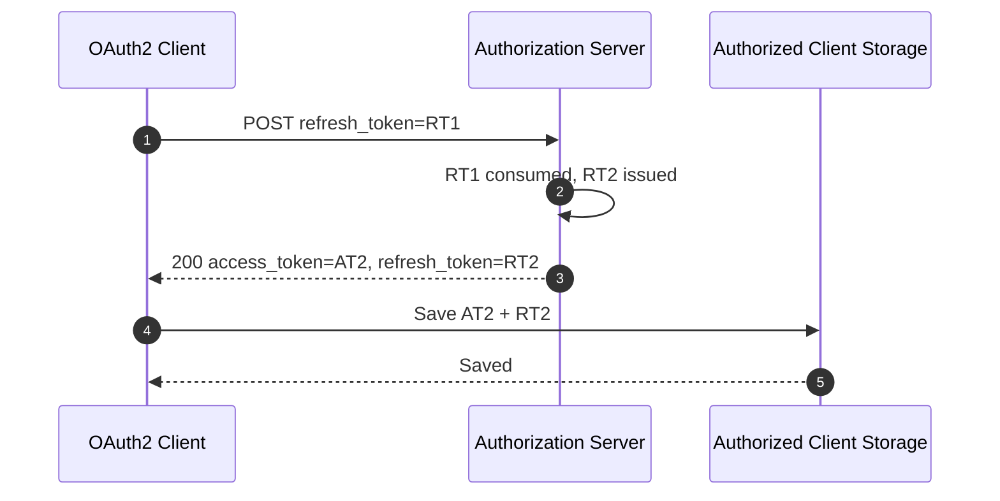
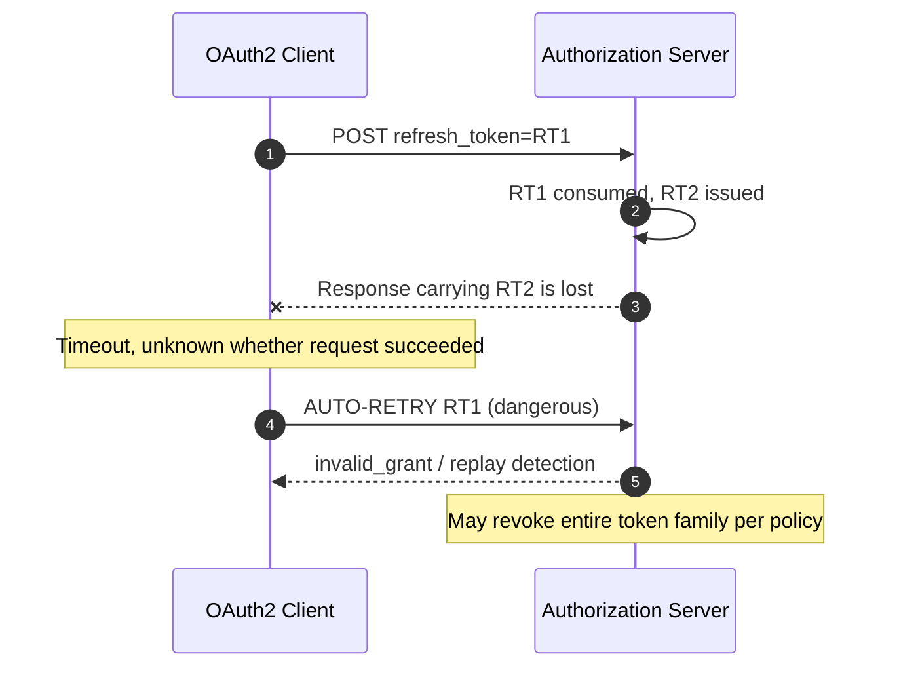
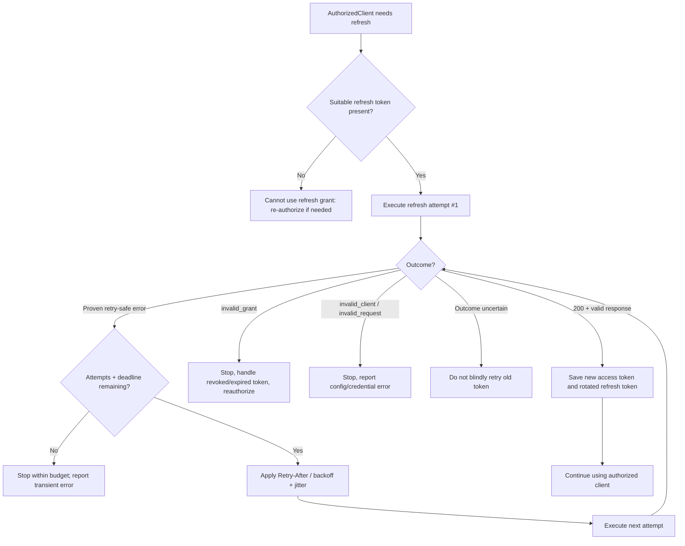
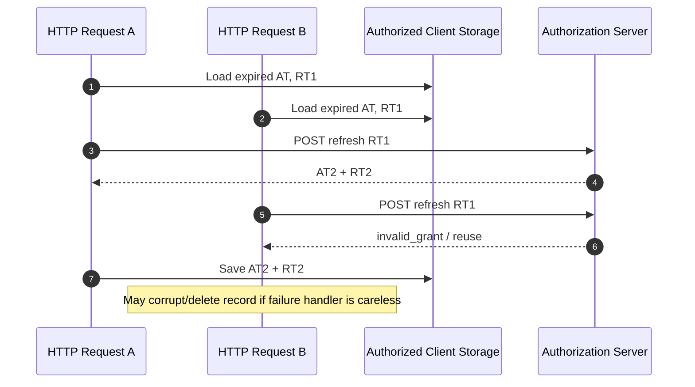

# 17.11. Defining Retries, Backoff, and Attempt Limits

In **Spring Security OAuth 2.0 / OpenID Connect (OIDC) Client**, an application can receive a **refresh token** after the Authorization Code Flow to request a new access token when the current access token is about to expire. This happens via an HTTP POST to the **token endpoint**. If the Authorization Server returns an error or the connection fails, the question is not just "should we retry?" but also **whether retrying is safe, how long to wait, how many attempts at most are allowed, and when to stop and prompt the user to sign in again**.

This is especially critical when the Authorization Server uses **refresh token rotation**: each successful refresh can consume the old refresh token and return a new refresh token. If the initial request was processed yet the response was lost, resending the old refresh token can be treated as **reuse/replay**, resulting in `invalid_grant` or revoking the entire token family per provider policy.

Lesson objectives:

1. Distinguish **refresh token failures**, **transient errors**, **permanent errors**, and **uncertain outcome states**.
2. Design retries with **attempt limits**, **exponential backoff**, **jitter**, **`Retry-After`**, and **deadlines**.
3. Understand why **you must not automatically retry every HTTP POST error** in the refresh-token grant.
4. Integrate a retry policy with Spring Security's `OAuth2AuthorizedClientManager`, `OAuth2AuthorizedClientProvider`, and token response client along clean boundaries.
5. Handle refresh contention, refresh token rotation, revocation, operational observability, and failure-case testing.

## 1. How Do Refresh Tokens Operate?

In the Authorization Code Flow, the Spring Security app receives an `OAuth2AuthorizedClient` containing an access token and optionally a refresh token. When the access token is no longer usable, the client can send a refresh-token grant to the token endpoint:

```http
POST /oauth2/token HTTP/1.1
Host: idp.example.org
Content-Type: application/x-www-form-urlencoded
Authorization: Basic <CLIENT_CREDENTIALS_REDACTED>

grant_type=refresh_token&refresh_token=<REFRESH_TOKEN_REDACTED>
```

With `client_secret_basic`, client credentials travel via HTTP Basic over TLS. The actual authentication method depends on the client registration and provider. A public client may omit a client secret; security profiles may also require sender-constrained tokens, mTLS, or other authentication methods.

Illustrative successful response:

```http
HTTP/1.1 200 OK
Content-Type: application/json
Cache-Control: no-store

{
  "access_token": "<NEW_ACCESS_TOKEN>",
  "token_type": "Bearer",
  "expires_in": 3600,
  "refresh_token": "<ROTATED_REFRESH_TOKEN>",
  "scope": "openid profile reports.read"
}
```

A new `refresh_token` may be returned when the provider rotates tokens; not every provider rotates the same way. If the token response contains no new refresh token, the client must follow provider semantics and the token response client implementation; never assume every provider is required to issue a new refresh token.

### 1.1. Access tokens vs. refresh tokens

| Property | Access token | Refresh token |
|---|---|---|
| Purpose | Sent to Resource Server to access APIs | Sent to token endpoint to obtain a new access token |
| Recipient | API / Resource Server matching audience | Authorization Server |
| Can be used for OIDC login? | Does not replace ID Token or OIDC authentication | Not an ID Token |
| Lifetime | Usually short | Per provider policy; may live longer, yet can be revoked/rotated |
| If lost/leaked | Risk of accessing resources permitted by the token | Risk of retaining token-minting capability, usually more severe |
| Safe to retry like GET? | Not an HTTP operation | Refresh-token POST has side effects; requires dedicated policy |

**Never use a refresh token as a Bearer token sent to an API**, and never push a refresh token into browser JavaScript just to "self-refresh" in a Spring MVC/BFF app that holds tokens server-side.

### 1.2. Spring Security's role

In Servlet OAuth2 Client, the common components are:

- `OAuth2AuthorizedClientManager`: coordinates finding the authorized client and re-authorizing when needed.
- `OAuth2AuthorizedClientProvider`: decides how to execute the grant; the refresh token provider is `RefreshTokenOAuth2AuthorizedClientProvider`.
- `OAuth2AccessTokenResponseClient<OAuth2RefreshTokenGrantRequest>`: sends the token request, receives, and parses the response.
- `OAuth2AuthorizedClientService` or `OAuth2AuthorizedClientRepository`: persists authorized clients and tokens per context.
- `ClientRegistration`: specifies client ID, client authentication method, token URI, and related settings.

When a refresh succeeds, the manager/provider constructs an authorized client holding the new access token and new refresh token (if present), then saves it via the configured store.

**Spring Security manages the OAuth2 lifecycle; it does not automatically provide a retry policy suitable for every provider, every refresh token rotation scheme, and every distributed system.** Before adding HTTP retries, decide when a request is genuinely safe to resend.

## 2. Retry, Backoff, Jitter, and Deadline Are Four Distinct Concepts

| Concept | Definition | Example |
|---|---|---|
| **Retry** | Re-executing an operation after an error | Resending a refresh-token request a second time after a verified safe error |
| **Backoff** | Waiting interval between attempts | Waiting 250 ms, 500 ms, 1,000 ms rather than firing back-to-back |
| **Jitter** | Randomized component added to wait time | Preventing two instances from retrying on the exact same millisecond |
| **Max attempts** | Maximum total executions, usually including **the initial attempt** | `maxAttempts=3` means 1 initial try + up to 2 retries |
| **Deadline / timeout budget** | Total time allowed for the entire operation, including timeouts and backoff | Finish or stop within a 3-second budget |
| **Circuit breaker** | Temporarily halting calls to a consistently failing system to shed load | Open circuit after repeated failures, allowing bounded probes |

Attempt counts and time budgets must be designed together. `maxAttempts=5` is pointless if each network timeout takes 10 seconds inside an HTTP request budgeted for 3 seconds total.

### 2.1. Retrying differs from reauthentication

When a refresh token is no longer valid, continuing to send it is usually futile. The system may need to:

1. Mark the current authorized client as unable to refresh.
2. Remove or update stored token state per policy.
3. For interactive user login, **restart the authorization/login flow** if the user needs to continue.
4. For background services, use a service-appropriate grant like `client_credentials` or surface the error for operator action.

Do not call sending the user through login again a "retry": that is a brand-new authorization cycle with different authentication requirements.

## 3. Classifying Errors Before Deciding to Retry

Never write an interceptor that "retries anything other than 200". The token endpoint may reject requests due to permanent misconfiguration, revoked tokens, or rotated tokens.

| Error / outcome | Common meaning | Default policy to consider |
|---|---|---|
| **`invalid_grant`** | Refresh token expired, revoked, reused, or invalid for client | **Do not retry the same refresh token**; handle re-authorization and delete/mark client per policy |
| **`invalid_client`** | Client authentication failed: wrong secret, rotated credentials, or disabled client | **Do not retry immediately**; fix credentials/config or alert operations |
| **`unauthorized_client`** | Client is not permitted to use this grant | Do not retry; check grant permissions at the provider |
| **`invalid_scope`** | Scope disallowed or malformed request | Do not retry the same request; fix configuration/flow |
| **`invalid_request`** | Missing or invalid parameters | Do not retry the malformed request |
| **HTTP 429** | Rate limit | Retry boundedly per `Retry-After` / provider policy only when there is basis that the request **was rejected before consuming the token** |
| **HTTP 503/502/504** | Provider/gateway transient failure | Backoff may help, yet **refresh outcome can be uncertain**; do not auto-retry when token rotation makes replay dangerous |
| **Connection refused before sending request** | Unable to connect, with evidence the request was never sent | May retry within caps and policy if certain the token was neither sent nor consumed |
| **Timeout after request was sent** | Unknown whether the provider processed the token | **Do not retry blindly**; handle uncertain outcome state |
| **Valid 200 response** | New tokens issued | Save response (including new refresh token if present) and stop retrying |
| **200 response with invalid body** | Unknown whether tokens were issued or rotated | Do not resend blindly; diagnose contract and state |

This is a **risk-based recommended policy**, not a blanket rule saying every 429 or 503 must be retried. An Authorization Server's contract may support deduplication/idempotency, a grace period for rotating refresh tokens, or finer-grained error codes. Only when a trustworthy contract exists can policy allow retries in additional scenarios.

### 3.1. `invalid_grant` does not mean a transient network error

Response:

```http
HTTP/1.1 400 Bad Request
Content-Type: application/json

{
  "error": "invalid_grant",
  "error_description": "Refresh token is invalid or expired"
}
```

Causes include an expired refresh token, user-revoked consent, token reuse, or a token belonging to a different client. Retrying 5 more times with the exact same refresh token will not make it valid. If the provider enforces replay detection, extra tries can damage the token family state.

Applications should inspect the exact `invalid_grant` error code rather than looking only at `HTTP 400`. A token endpoint error and an HTML 400 returned by a proxy are two different diagnostic situations.

### 3.2. `invalid_client` usually requires operational action

If a service's client secret expires or rotates out of sync, every refresh fails with `invalid_client`. Backoff lowers load yet **cannot fix the root cause**. Check client ID, secret/key, client authentication method, tenant/realm, and client status at the provider.

Do not let every user request retry 10 times when the secret is wrong: that amplifies the bug into thousands of POSTs hitting the IdP.

### 3.3. An API HTTP 401 is not a refresh token error by default

When a downstream API returns 401, causes can include:

- Access token expired.
- Wrong audience/resource on the token.
- Token revoked or rejected by API policy.
- Client mistakenly sent an ID Token or a token from another registration.

Only when policy permits should the client try to **acquire or refresh the access token** and resend the appropriate API request. Never assume every API 401 means the refresh token must be retried. In particular, never automatically **replay a non-idempotent business API POST** just because a new token was obtained: the initial business action may already have executed.

## 4. Why Does Refresh Token Rotation Make Retries Dangerous?

**Refresh token rotation** typically works like this:

1. Client holds refresh token `RT1`.
2. Client sends `RT1` to the token endpoint.
3. Authorization Server accepts it, invalidates `RT1`, and issues a new access token plus refresh token `RT2`.
4. Client must store `RT2` and use it on the next refresh.

Success flow:



Lost-response scenario:



**Key takeaway:** the token endpoint is not a read-only HTTP GET. A refresh request can trigger significant side effects even if the client never sees HTTP 200. Many HTTP libraries cannot guarantee whether side effects occurred from a `SocketTimeoutException` alone.

### 4.1. Distinguishing "failed to send" from "failed to receive response"

| Scenario | Do we know whether the provider consumed the refresh token? |
|---|---|
| Invalid token URI config; validation blocks before network | Good basis the request was never sent; this is a config bug, do not retry as-is |
| DNS resolution failed, or connection refused **before sending HTTP bytes** | Can know the request never reached the provider, depending on network/adapter layer |
| Connection closed while writing body | **Uncertain** whether the provider received the full request |
| Read timeout after sending body | **Uncertain**; the provider may already have issued a new RT |
| HTTP 502/504 via proxy | **Uncertain**; upstream may already have processed it |
| HTTP 429 with provider contract stating request was rejected pre-processing | Safe to retry per `Retry-After`, caps, and that contract |
| HTTP 400 `invalid_grant` | Provider rejected the grant; do not retry the same refresh token |

The safe default when the outcome cannot be proven is to **stop retrying the same refresh token**, record a state needing verification/reauthorization, and avoid breaking the token family.

### 4.2. Can you retry safely if the provider supports it?

Yes, provided it rests on an **explicit contract**. Some providers document a grace window, idempotency token, replay-tolerant rotation, or recovery mechanism. In that case:

- Only use mechanisms officially documented by the provider.
- Know where the idempotency key goes and what the provider guarantees.
- Bound attempts and deadlines like any network operation.
- Never invent an `Idempotency-Key` header assuming the token endpoint will honor it.
- Verify saving the new refresh token and concurrency handling thoroughly.

Without documented idempotency or a grace window, never assume `POST /token` is idempotent.

## 5. Building a Retry Policy by Error Group

An example policy for a Spring MVC/BFF app with rotating refresh tokens and **no idempotent-refresh contract**:

| Group | `maxAttempts` | Backoff? | Final action |
|---|---:|---|---|
| Success | 1 | No | Save new tokens |
| `invalid_grant`, `invalid_client`, config error | 1 | No | Stop and handle per error type |
| Timeout/read error **after sending** | 1 | No | Mark outcome uncertain; avoid replaying old RT |
| HTTP 5xx/504 where provider consumption is unknown | 1 | No | Stop, measure, resolve per provider contract |
| Connection refused **proven before sending** | Up to 3 | Exponential backoff + jitter | Stop when attempts/deadline exhausted |
| HTTP 429 where provider guarantees refresh was not processed | Up to 3 | `Retry-After` or exponential backoff + jitter | Stop when attempts/deadline exhausted; do not flood |
| Cases with an explicit idempotency contract | Per contract, e.g., 3 | Bounded backoff/jitter | Stop at threshold; preserve RT rotation |

Numbers in this table are **example values for policy discussion**, not Spring Security defaults or RFC rules. For providers with different policies, adjust based on evidence and latency requirements.

### 5.1. How many tries is "three attempts" exactly?

Define:

```text
maxAttempts = 3
attempt = 1  -> initial send
attempt = 2  -> first retry, only if eligible
attempt = 3  -> second retry, only if eligible
attempt = 4  -> DO NOT SEND
```

Be explicit in docs and APIs to avoid confusion:

- `maxAttempts` = total calls, including the initial try.
- `maxRetries` = **extra** calls after the initial try.

Thus `maxAttempts=3` equals at most `maxRetries=2`.

### 5.2. Three coexisting budgets

A policy should bound:

1. **Maximum attempts**: prevent infinite loops.
2. **Maximum duration**: avoid holding user requests too long.
3. **Aggregate rate/load**: prevent every instance retrying and overloading the IdP.

Example:

```text
maxAttempts         = 3
connectTimeout      = 500 ms
responseTimeout     = 1000 ms
totalDeadline       = 3000 ms
maxBackoff          = 1000 ms
perRegistrationQPS  = per capacity and provider quota
```

These are **illustrative values** to tune for your SLOs, network, IdP latency, and instance count. Even if attempts remain, stop if the remaining deadline cannot fit another network call and response.

## 6. Exponential Backoff and Jitter

When retries are allowed, the standard wait strategy is **exponential backoff**:

\[
d_n = \min(d_{\max},\ d_{\text{base}}\times 2^{n-1})
\]

Where:

- `n` is the **retry** index, starting at 1.
- `d_base` is the base delay, e.g., 250 ms.
- `d_max` is the backoff cap, e.g., 2,000 ms.

Example without jitter:

| Retry # | Formula delay |
|---|---:|
| 1 | 250 ms |
| 2 | 500 ms |
| 3 | 1,000 ms |
| 4 | 2,000 ms |
| 5 | 2,000 ms (capped) |

This is the wait schedule **when retries are allowed**, not a claim that five retries will run. `maxAttempts` and deadlines stop it earlier.

### 6.1. Why is jitter needed?

If hundreds of instances detect expired tokens or receive 503 from the IdP simultaneously, they may all retry after exactly 250 ms, then again after 500 ms. That synchronization creates a **thundering herd**.

**Full jitter** randomly picks a delay between 0 and the current exponential ceiling:

\[
\text{delay}_n\sim U(0,d_n)
\]

For example, with a 500 ms ceiling, one worker waits 91 ms, another 327 ms, and a third 450 ms, spreading load over time. Other jitter variants exist (equal, decorrelated), yet the core principle is having a **delay cap** and avoiding synchronized retry waves.

### 6.2. Java illustration for computing full-jitter delay

```java
import java.time.Duration;
import java.util.concurrent.ThreadLocalRandom;

final class BackoffPolicy {

    private static final long BASE_MS = 250;
    private static final long MAX_MS = 2_000;

    private BackoffPolicy() {}

    // retryNumber starts at 1; invoke only after policy permits retrying.
    static Duration fullJitter(int retryNumber) {
        if (retryNumber < 1) {
            throw new IllegalArgumentException("retryNumber must be >= 1");
        }

        long ceiling = BASE_MS;
        for (int i = 1; i < retryNumber && ceiling < MAX_MS; i++) {
            ceiling = Math.min(MAX_MS, ceiling * 2);
        }

        long delayMs = ThreadLocalRandom.current().nextLong(ceiling + 1);
        return Duration.ofMillis(delayMs);
    }
}
```

This is purely a **delay calculation helper**; it does not resend the HTTP POST. Never invoke it for `invalid_grant` or read timeouts with uncertain rotation state.

In Reactive WebFlux apps, never call `Thread.sleep(...)` on the event loop; use non-blocking schedulers/operators under your classified retry policy. In Servlet workers, blocking threads during backoff must also be weighed against pool size, SLOs, and cancellation.

## 7. Using `Retry-After` When a Provider Rate-Limits

If the Authorization Server returns HTTP 429 or 503 with a `Retry-After` header, it may specify when the client should try again. HTTP defines two main formats:

```http
HTTP/1.1 429 Too Many Requests
Retry-After: 4
```

`4` is the number of seconds to wait. Another format is an HTTP-date:

```http
Retry-After: Wed, 18 Nov 2026 10:00:00 GMT
```

When handling it:

1. Read `Retry-After` only from **a trusted endpoint's response** and when retrying is genuinely safe per grant semantics.
2. Parse both integer seconds and HTTP-date formats properly; do not assume every value is numeric.
3. If the header value is invalid, fall back to the backoff policy.
4. Enforce delay caps, deadlines, and attempt limits; never wait indefinitely.
5. If the server asks to wait longer than the current request's deadline, **stop** and let orchestration schedule a later try if appropriate instead of hanging web requests forever.
6. Never use `Retry-After` to ignore rotation risk: a POST with an uncertain outcome still requires a safety policy before resending.

### 7.1. Do not treat 429 as an idempotency guarantee

Usually 429 indicates rate limiting, yet request-processing behavior depends on the provider and proxy. Without solid basis that the refresh token was not consumed, never automatically resend a potentially rotated token merely because the status is 429.

In multi-instance systems, beyond `Retry-After`, you also need a **shared rate limiter or quota** so aggregate traffic stays within provider limits.

## 8. Deadlines and Cancellation: Stopping on Time

Suppose a web request to the BFF has a 3-second timeout:

```text
T = 0 ms      Start refresh
T = 700 ms    Network attempt #1 hits verified retry-safe transient error
T = 900 ms    Backoff ends
T = 1750 ms   Attempt #2 fails
T = 2300 ms   Second backoff ends
T = 3000 ms   Deadline reached
```

Even if `maxAttempts=3`, do not start attempt #3 if there is no longer enough time for a bounded network call. The remaining budget must cover:

- TCP/TLS connection and request transmission.
- Authorization Server processing time.
- Response transmission.
- Backoff between tries.
- Margin to return the response to the caller.

If the user closes the connection or the request is cancelled, the application layer may cancel the operation; however, **local cancellation does not prove the provider never processed the token**. Never turn cancellation into permission to retry the old refresh token.

### 8.1. Do not mask errors by falling back to expired tokens

When a refresh fails, reusing an expired access token normally just triggers 401s at downstream APIs. If the client has proof the old access token **is still valid** and no policy demands immediate replacement, continuing to use it per the manager and Resource Server contract may be acceptable. Never "extend" token validity by altering local metadata.

**Never alter `expiresAt`** to bypass errors or ignore token revocation. The Resource Server validates tokens independently of local metadata.

## 9. State Machine for Refreshing with Safe Retries



Desired properties of this state machine:

1. **Every loop is bounded** by attempts and deadline.
2. There is a dedicated branch for **outcome unknown**, rather than treating it as a default retryable network error.
3. `invalid_grant` never loops back to the same refresh token.
4. After a successful response, **persist the new refresh token before other flows can read the old copy**.
5. In multi-instance deployments, coordinate contention on the same authorized client.
6. Business and API authorization layers still enforce permissions independently of refresh state.

## 10. Integrating with Spring Security: Keeping Extension Points Clean

Spring Security provides built-in refresh components; normally an application does not need its own `POST /refresh-token` controller or manual token endpoint calls across services.

### 10.1. `ClientRegistration` for Authorization Code/OIDC

`application.yml` example:

```yaml
spring:
  security:
    oauth2:
      client:
        registration:
          company-login:
            provider: company
            client-id: "${OIDC_CLIENT_ID}"
            client-secret: "${OIDC_CLIENT_SECRET}"
            client-authentication-method: client_secret_basic
            authorization-grant-type: authorization_code
            redirect-uri: "{baseUrl}/login/oauth2/code/{registrationId}"
            scope:
              - openid
              - profile
              - offline_access
        provider:
          company:
            issuer-uri: "https://idp.example.org/realms/company"
```

`offline_access` is used by some OpenID Providers to issue refresh tokens for offline access, though support and consent requirements depend on the provider. **Do not assume having this scope guarantees the response will contain a refresh token.**

In a Servlet app with `oauth2Login()`, Spring Security uses the authorized client to refresh access tokens as needed for API calls. Client registrations live on the backend, and secrets must come from a secret manager/environment—never committed to Git.

### 10.2. Refresh token provider with clock skew

An example service-tier manager for already-authorized clients:

```java
import java.time.Duration;
import org.springframework.context.annotation.Bean;
import org.springframework.context.annotation.Configuration;
import org.springframework.security.oauth2.client.AuthorizedClientServiceOAuth2AuthorizedClientManager;
import org.springframework.security.oauth2.client.OAuth2AuthorizedClientManager;
import org.springframework.security.oauth2.client.OAuth2AuthorizedClientProvider;
import org.springframework.security.oauth2.client.OAuth2AuthorizedClientProviderBuilder;
import org.springframework.security.oauth2.client.OAuth2AuthorizedClientService;
import org.springframework.security.oauth2.client.registration.ClientRegistrationRepository;

@Configuration
class RefreshClientManagerConfig {

    @Bean
    OAuth2AuthorizedClientManager refreshClientManager(
            ClientRegistrationRepository registrations,
            OAuth2AuthorizedClientService authorizedClientService) {

        OAuth2AuthorizedClientProvider provider =
                OAuth2AuthorizedClientProviderBuilder.builder()
                        .refreshToken(configurer -> configurer
                                .clockSkew(Duration.ofSeconds(60)))
                        .build();

        var manager = new AuthorizedClientServiceOAuth2AuthorizedClientManager(
                registrations, authorizedClientService);
        manager.setAuthorizedClientProvider(provider);
        return manager;
    }
}
```

This snippet illustrates **a manager containing only the refresh token provider**, intended for already-authorized clients. It **does not initiate a new Authorization Code Flow** and does not create a refresh token if none was issued. Within web requests, `DefaultOAuth2AuthorizedClientManager` typically uses `OAuth2AuthorizedClientRepository`; pick the manager/storage matching your application's context.

`clockSkew` triggers refreshing before expiration gets too close, yet **it is not a retry policy**. It does not solve concurrent requests or token rotation effects.

### 10.3. `RestClientRefreshTokenTokenResponseClient` and where to place policy

In Spring Security versions that provide `RestClientRefreshTokenTokenResponseClient`, it is the token response client dedicated to sending refresh-token requests. Older versions have different implementations; match the exact API of your version when designing retries.

You can wrap it to **observe and classify errors** without blindly retrying inside the wrapper:

```java
import org.springframework.security.oauth2.client.endpoint.OAuth2AccessTokenResponseClient;
import org.springframework.security.oauth2.client.endpoint.OAuth2RefreshTokenGrantRequest;
import org.springframework.security.oauth2.core.OAuth2AccessTokenResponse;
import org.springframework.security.oauth2.core.OAuth2AuthorizationException;

final class ObservedRefreshTokenClient
        implements OAuth2AccessTokenResponseClient<OAuth2RefreshTokenGrantRequest> {

    private final OAuth2AccessTokenResponseClient<OAuth2RefreshTokenGrantRequest>
            delegate;

    ObservedRefreshTokenClient(
            OAuth2AccessTokenResponseClient<OAuth2RefreshTokenGrantRequest>
                    delegate) {
        this.delegate = delegate;
    }

    @Override
    public OAuth2AccessTokenResponse getTokenResponse(
            OAuth2RefreshTokenGrantRequest request) {
        try {
            return delegate.getTokenResponse(request);
        } catch (OAuth2AuthorizationException ex) {
            // Log only permitted error codes; NEVER log the refresh token.
            String errorCode = ex.getError().getErrorCode();
            recordSafeErrorCode(errorCode);
            throw ex;
        }
    }

    private void recordSafeErrorCode(String errorCode) {
        // Integrate sanitized metrics/logging without sensitive data.
    }
}
```

The wrapper accepts a configured delegate, such as Spring Security's default implementation. This is **an observability and exception-preserving example**, not automatic retry enablement. To plug a custom token response client into `RefreshTokenOAuth2AuthorizedClientProvider`, use the setter/DSL supported by your Spring Security version.

**Never attach `retryWhen(...)` or generic HTTP retries to all token endpoint POSTs** without accounting for rotating refresh tokens and delivery state. An interceptor placed too low in the HTTP stack loses OAuth2 context and can accidentally replay refresh tokens.

### 10.4. Failure handlers and `invalid_grant`

Spring Security managers support success/failure handlers to save or remove authorized clients depending on error and version. On `invalid_grant`, many default manager configurations remove the authorized client from storage to avoid reusing a rejected refresh token.

When replacing a failure handler, evaluate:

- Should the record be removed once `invalid_grant` is confirmed?
- Should the existing record stay intact on a transient network error if the old token might still work?
- How do you avoid deleting **a newer refresh token** just saved by another request when an older token errors?
- Are user login sessions kept distinct from authorized client storage?
- Should the user be routed back through authorization per policy, or receive an error message?

**Never replace the entire failure handler just to add metrics and accidentally disable safe cleanup.** When customizing, preserve the semantics expected by the manager and provider.

## 11. Example: Separating Retry Policy Logic from HTTP Execution

A clean, controllable design separates **deciding whether to retry** from **sending the refresh-token request**.

### 11.1. Classifying outcomes at the HTTP/OAuth2 boundary

```java
enum RefreshFailureKind {
    INVALID_GRANT,
    INVALID_CLIENT,
    INVALID_REQUEST,
    UNAUTHORIZED_CLIENT,
    INVALID_SCOPE,
    PROVIDER_RATE_LIMIT_REJECTED,
    NETWORK_PROVEN_NOT_SENT,
    PROVIDER_TEMPORARY_BUT_OUTCOME_UNKNOWN,
    NETWORK_OUTCOME_UNKNOWN,
    RESPONSE_UNUSABLE
}
```

These values are an **illustrative application enum**, not a built-in Spring Security enum. An adapter inspects the OAuth2 `error_code`, HTTP status, and network details to classify. Crucially, the adapter **must never label every `IOException` as `NETWORK_PROVEN_NOT_SENT`**.

### 11.2. Deciding whether to retry

```java
import java.time.Duration;

record RetryDecision(boolean retry, Duration delay, String reason) {
    static RetryDecision stop(String reason) {
        return new RetryDecision(false, Duration.ZERO, reason);
    }

    static RetryDecision again(Duration delay) {
        return new RetryDecision(true, delay, "safe-transient-failure");
    }
}

final class RefreshRetryPolicy {
    private static final int MAX_ATTEMPTS = 3;

    RetryDecision afterFailure(
            RefreshFailureKind failure,
            int attemptsAlreadyMade,
            Duration timeRemaining) {

        if (attemptsAlreadyMade >= MAX_ATTEMPTS) {
            return RetryDecision.stop("max-attempts");
        }

        boolean provenSafe =
                failure == RefreshFailureKind.NETWORK_PROVEN_NOT_SENT
                || failure == RefreshFailureKind.PROVIDER_RATE_LIMIT_REJECTED;

        if (!provenSafe) {
            return RetryDecision.stop("unsafe-or-permanent");
        }

        Duration delay = BackoffPolicy.fullJitter(attemptsAlreadyMade);

        // Reserve at least 500 ms for the next network attempt;
        // real value should come from the application's timeout budget.
        if (timeRemaining.minus(delay).compareTo(
                Duration.ofMillis(500)) < 0) {
            return RetryDecision.stop("deadline");
        }

        return RetryDecision.again(delay);
    }
}
```

`BackoffPolicy.fullJitter(...)` refers to the helper in section 6.2. `PROVIDER_RATE_LIMIT_REJECTED` **must only be assigned when the adapter has proof the request was rejected before consuming the refresh token** per provider contract. Without that guarantee, classify it as outcome unknown and stop.

This code expresses **policy only** and does not call the token endpoint. In production, add `Retry-After`, cancellation, timeout configuration, and provider-specific error handling; do not use this example as a blind request-replay tool.

### 11.3. Pseudocode retry loop

```text
attempt = 0
deadline = now + totalBudget

while attempt < maxAttempts and now < deadline:
    attempt = attempt + 1
    try:
        response = refreshOnce(existingRefreshToken)
        atomicallySave(response.accessToken, response.rotatedRefreshToken)
        return success
    catch failure:
        kind = classify(failure, providerContract, requestDeliveryEvidence)
        decision = retryPolicy(kind, attempt, deadline - now)
        if not decision.retry:
            return failSafely(kind)
        await delayWithCancellation(decision.delay)

return deadlineOrAttemptsExceeded
```

**This pseudocode only illustrates orchestration flow**; it cannot determine on its own whether a request reached the provider. Misclassifying a timeout as retry-safe still risks breaking the refresh token family despite nice backoff and attempt limits.

### 11.4. How should `Retry-After` and backoff be combined?

If the provider supplies a valid `Retry-After` and the request is retry-safe, a policy can honor the server's minimum wait and then enforce caps:

```text
candidateDelay = max(fullJitterBackoff, retryAfterDelay)
if candidateDelay > allowedWaitBudget:
    STOP / schedule later if safe
else:
    WAIT candidateDelay
```

Do not simply take `min(retryAfterDelay, backoffDelay)`, which could retry **sooner** than the provider asked. If `Retry-After` exceeds the user request's wait budget, stop or defer to a scheduled job rather than blocking web threads for minutes.

## 12. Preventing Concurrent Refreshes on the Same Authorized Client

Even **without retries**, two concurrent requests can use the same refresh token.

Example:



This is a **single-flight refresh** problem, not solely an HTTP retry problem. When Request B receives `invalid_grant`, the cause may simply be that Request A already rotated successfully rather than user revocation.

### 12.1. Locking by `(registrationId, principalName)`

An in-process strategy:

1. Derive the authorized client key from `registrationId` and `principalName`.
2. Allow only one active refresh per key.
3. Have other callers wait with a bounded deadline.
4. Once refresh completes, callers reload the updated authorized client from storage.
5. If tokens are still missing or rejected, handle the failure properly instead of immediately replaying the old refresh token.

```text
(company-login, employee-42)
      |
      +-- caller A: holds lock, refreshes RT1 -> RT2, saves
      +-- caller B: waits, reloads RT2/AT2 after A finishes
      +-- caller C: reloads fresh token, does not POST RT1
```

This reduces races within one instance. Across multiple instances, local `synchronized` or `ConcurrentHashMap` protects only **one JVM**, not the whole cluster.

### 12.2. What more is needed for multi-instance deployments?

Consider:

- Shared storage with concurrency controls.
- Distributed lock / single-flight with timeouts and lock-expiry handling.
- Optimistic compare-and-set when updating authorized clients if the store supports versioning.
- Checking the current record **before deleting** after an older request gets `invalid_grant`.
- Each instance reloading fresh tokens after another instance refreshes.
- Handling cases where the lock-holding instance crashes mid-flight.

Never add retries to Request B to "get past" `invalid_grant`. If A already saved RT2, B should **reload the current authorized client in a controlled way**, not keep sending RT1. Reloading storage and firing a new refresh request are two different actions.

### 12.3. Rotation succeeds yet saving to storage fails

A difficult case:

```text
Provider: RT1 -> RT2, HTTP 200
Application: receives AT2 + RT2
Database: save fails
```

From the provider's perspective, RT1 may already be invalidated; from the database's perspective, the record still holds RT1. **Retrying the token endpoint with RT1 will not fix the database.**

The application needs clear persistence/reconciliation policies, must avoid leaking RT2 into logs, and if safe persistence fails, must require reauthorization per policy. In multi-instance environments, pay attention to atomic token-version updates and failure-handler behavior.

## 13. Separating Retry Layers: Never Stack Retries

In an application, retries can live in multiple places:

```text
Business service
    |
    +-- Reports API call retries
    |
    v
OAuth2AuthorizedClientManager
    |
    +-- Refresh orchestration retries (if any)
    |
    v
HTTP token response client
    |
    +-- RestClient/WebClient/HTTP library retries (if enabled)
    |
    v
Proxy / service mesh
    |
    +-- Automatic retries to Authorization Server (if configured)
```

If each layer tries 3 times, a single failure can multiply into `3 × 3 × 3 = 27` calls—not counting the proxy. That spikes IdP load and increases refresh token replay risk.

**Designate one single layer to own the retry policy**, with clear visibility into attempts and deadlines. With refresh rotation, consider disabling generic POST retries in HTTP libraries and proxies so the OAuth2-aware layer decides when resending is actually safe.

### 13.1. Distinguishing refresh retries from business API retries

Two different operations:

| Operation | Side effects? | What to verify before retrying |
|---|---|---|
| `POST /token` with refresh token | Can rotate/consume refresh token | Token rotation, outcome, retry contract |
| `GET /reports` | Usually a read operation | HTTP semantics, rate limits, deadline, authentication |
| `POST /payments` | Can create financial transactions | Idempotency key / API contract; never replay blindly |

A successful refresh **does not make a failed business POST safe to resend**. Design downstream request retries separately.

## 14. Rate Limits, Circuit Breakers, and Service Recovery

Per-request backoff is not enough during a system-wide IdP outage. An app with 50 instances and 500 active sessions each can generate huge bursts of refresh traffic at once.

Additional safeguards:

1. **Rate limiters** per provider/client/registration to cap total traffic.
2. **Circuit breakers** to pause calls to a failing token endpoint for an appropriate cooldown.
3. **Bulkheads / concurrency limits** so threads/connections waiting on the IdP do not starve the app.
4. **Jitter and scheduling** to smooth traffic over time.
5. **Deadlines** so waiting requests do not hold resources forever.
6. **Graceful degradation** for non-critical features when no new token is available—never forge permissions or bypass security checks.

### 14.1. A circuit breaker does not make an invalid refresh token valid again

An open circuit means the client proactively **held back** new requests, not that the provider recovered. When the circuit allows probes again, use **the latest** authorized client state—never pull an old refresh token out of a queue created minutes earlier.

If a token hit `invalid_grant`, a circuit breaker must not schedule a timer to try that same token again. That is a grant-state error, not an infrastructure glitch that heals after 30 seconds.

### 14.2. Never let retries turn into an infinite login loop

If refresh fails, an OIDC BFF app may prompt the user to log in again. Prevent loops like:

```text
API 401 -> refresh invalid_grant
       -> redirect login
       -> login callback
       -> API 401
       -> redirect login
       -> ...
```

Cap reauthentication cycles per session, classify errors, and fix server-side misconfigurations. If the client lacks the required scope or audience, infinite logins will never fix it.

## 15. Observability: Measuring Accurately Without Leaking Tokens

Every refresh should emit enough operational data to answer:

- Which provider/registration is failing?
- Is the failure `invalid_grant`, `invalid_client`, rate limit, network, or outcome unknown?
- How many attempts ran and why did they stop?
- What were the total duration and backoff delays?
- Did refresh succeed yet fail to persist the new token?
- Are multiple requests racing to refresh the same key?
- What are the reauthorization and refresh failure rates?

Illustrative metric names:

```text
oauth2_refresh_attempt_total{registration="company-login", outcome="success"}
oauth2_refresh_attempt_total{registration="company-login", outcome="invalid_grant"}
oauth2_refresh_retry_total{registration="company-login", reason="rate_limit"}
oauth2_refresh_unknown_outcome_total{registration="company-login"}
oauth2_refresh_duration_seconds{registration="company-login"}
oauth2_refresh_singleflight_wait_seconds{registration="company-login"}
oauth2_refresh_storage_failure_total{registration="company-login"}
```

These metric names are not a built-in Spring Security API; they illustrate an observability model. Avoid high-cardinality labels such as `principalName`, `sub`, refresh token IDs, or correlation IDs in time-series metrics.

### 15.1. Data you must NEVER log

- Raw access tokens, refresh tokens, or ID Tokens.
- `client_secret`, private keys, or client assertion JWTs.
- Authorization codes, PKCE `code_verifier`, or session cookies.
- Full HTTP form bodies sent to the token endpoint.
- Client authentication `Authorization` headers.
- Full JWT claims or user details unneeded for diagnostics.

A safe log entry might record:

```text
phase=refresh
registration=company-login
attempt=1
result=invalid_grant
next_action=reauthorize
correlation=server-generated-id
```

Never return raw provider `error_description` strings to the browser: they can contain internal details or untrusted content. Users normally only need a brief message stating that the connection requires re-authentication.

## 16. Retry Policy Test Matrix

To validate your design, mock the token endpoint and storage instead of using production refresh tokens.

| Test scenario | Expected behavior |
|---|---|
| HTTP 200 returns AT2 + RT2 | Persist new tokens exactly once; no retry |
| `invalid_grant` on first try | 1 attempt; never retry RT1; trigger reauthorization |
| `invalid_client` | 1 attempt; signal config/credential failure |
| HTTP 429 with contract confirming RT unconsumed | Bounded retry respecting `Retry-After` and deadline |
| HTTP 429 with uncertain outcome | Do not retry same RT solely because status is 429 |
| Connection refused before sending request | Bounded retries within policy and time budget |
| Read timeout after sending refresh request | Do not retry blindly; uncertain outcome state |
| HTTP 502/504 after upstream may have processed | Do not assume atomic failure; avoid replay |
| 200 response yet saving RT2 to DB fails | Do not go back and retry RT1; handle persistence/reconciliation |
| Two requests read RT1 concurrently | Only one refresh per key when single-flight is implemented |
| Two instances refresh the same key | Coordination / version check prevents deleting fresh token |
| `Retry-After` exceeds deadline | Stop / defer per contract; never wait infinitely |
| HTTP client/proxy has auto-retry enabled | Does not exceed policy's intended request count |
| No refresh token | Do not attempt refresh grant; reauthorize when appropriate |
| Access token still valid | Manager reuses current token; no unnecessary refresh |

### 16.1. Testing attempt limits

With `maxAttempts=3`, test a persistent **retry-safe** failure:

```text
attempt #1 -> retry-safe transient failure
backoff #1
attempt #2 -> retry-safe transient failure
backoff #2
attempt #3 -> retry-safe transient failure
STOP (maxAttempts)
```

Test a non-retryable error:

```text
attempt #1 -> invalid_grant
STOP (no backoff or attempt #2)
```

In tests, count how many requests the HTTP client actually sends to the fake token endpoint—not just calls to your public service—since HTTP libraries or proxies may have lower-level retries.

### 16.2. Testing refresh rotation

A fake Authorization Server can simulate:

```text
RT1 first call: returns AT2 + RT2, yet client times out before reading response
RT1 second call: invalid_grant / replay detected
RT2 first call: valid
```

The goal of this test is **proving the client never sends RT1 a second time** when the first outcome is uncertain—not encouraging replay.

Another concurrency test should prove Request B reloads AT2/RT2 after A saves successfully rather than sending RT1 again.

## 17. Business Scenario: Reports Portal and Concurrent Requests

Suppose a user opens the company dashboard. The Portal uses OAuth2 Login to obtain access/refresh tokens from the Corporate OP. The dashboard loads three widgets:

```text
GET /api/dashboard/summary
GET /api/dashboard/reports
GET /api/dashboard/notifications
```

When the access token nears expiration, all three HTTP requests arrive at the backend almost simultaneously. If each request reads the same refresh token `RT1` and POSTs to the token endpoint:

- The first request gets AT2 + RT2.
- Subsequent requests may get `invalid_grant` because RT1 rotated.
- A version-unaware failure handler might delete the fresh AT2/RT2 record.
- The UI keeps receiving 401s or bouncing back to login even though one refresh actually succeeded.

Architectural solution:

1. All API call paths use a consistently configured authorized client manager/repository.
2. Enforce single-flight or synchronized refresh per `(registrationId, principalName)` when the provider rotates strictly.
3. Once one request saves RT2, waiting requests **reload the authorized client** and use AT2.
4. If the network drops the response after the provider issued RT2, **never blindly retry RT1**; handle via provider contract and reauthorization policy.
5. Retry only when classified as safe and within `maxAttempts`, backoff/jitter, and deadline.
6. Never serve expired tokens or assume HTTP 200 from the token endpoint means Reports API permits every report; the Resource Server still checks scopes, audience, and business permissions.

### 17.1. Pre-production policy decision checklist

| Question | Why does it matter? |
|---|---|
| Does the provider use refresh token rotation? | Governs whether replaying the same refresh token is safe |
| Does the provider offer a grace window or idempotency contract? | Determines which errors may be retried |
| Does the HTTP client or proxy auto-retry POSTs? | Prevents unintended duplicate retries |
| Does `maxAttempts` include the initial attempt? | Prevents misinterpreting retry budgets |
| What are connect/read timeouts and total deadline? | Prevents hanging user requests or workers indefinitely |
| Is `Retry-After` honored? | Avoids hammering the IdP during rate limits |
| Does backoff include jitter and a cap? | Prevents thundering herds |
| Is the authorized client in session, JDBC, or custom store? | Identifies where new refresh tokens must persist |
| Can multiple instances refresh the same key? | Prevents stale RT reuse and overwrites |
| How will `invalid_grant` delete/mark clients? | Prevents loops and deleting newer tokens |
| Does the user need to re-login or can a background job handle it? | Prevents poor UX policies |
| Do metrics/logs leak tokens or personal data? | Protects credentials and operations |

## 18. Common Mistakes

1. **Retrying every HTTP 5xx/timeout** on the token endpoint without considering rotating refresh tokens.
2. **Retrying `invalid_grant`** with the same refresh token, increasing replay-detection risk.
3. **Configuring backoff without max attempts**, creating infinite loops.
4. **Configuring max attempts without a deadline**, leaving web requests hung too long.
5. **Omitting jitter**, causing all instances to retry at the exact same instant.
6. **Ignoring `Retry-After`** or misparsing seconds vs. HTTP-date formats.
7. **Letting every layer retry independently**, multiplying actual HTTP POSTs.
8. **Failing to save RT2 and retrying RT1**, which cannot fix storage failures.
9. **Allowing concurrent requests to send the same RT1**, causing reuse/races even without network retries.
10. **Treating every API 401 as a reason for endless refresh retries** without checking audience/scopes.
11. **Assuming deleting the local authorized client revokes tokens at the IdP.**
12. **Logging the full token response**, exposing access/refresh tokens.
13. **Sending refresh tokens to APIs** or returning tokens to browsers in a BFF app.
14. **Forgetting that user sessions and authorized clients differ**: a failed refresh does not necessarily log out the web session.
15. **Failing to verify the exact Spring Security version's behavior** before swapping token response clients or failure handlers.

## 19. Review Questions

1. Why cannot the refresh-token grant be treated like an idempotent HTTP GET?
2. How many retries after the initial try does `maxAttempts=3` allow?
3. What distinct problems do exponential backoff and full jitter solve?
4. Why is a read timeout after sending a refresh POST an uncertain-outcome case?
5. In refresh token rotation, how do RT1 and RT2 relate?
6. Why must `invalid_grant`, `invalid_client`, HTTP 429, and HTTP 503 be classified differently?
7. When is `Retry-After` genuinely useful, and when is it still insufficient to permit retrying?
8. Why is a total deadline required even when attempt count is capped?
9. How do the responsibilities of `RefreshTokenOAuth2AuthorizedClientProvider` and the token response client differ?
10. Why can simply adding retries to `RestClient` break rotation logic?
11. What errors can two concurrent requests refreshing RT1 cause, and how does single-flight help?
12. After receiving RT2 yet failing to persist to the DB, why should you not resend RT1?
13. When the manager receives `invalid_grant`, why must you consider the failure handler and tokens just saved by another instance?
14. Can a failed business API POST be automatically retried after refreshing an access token? What conditions make replaying valid?
15. Which metrics distinguish provider outages, config errors, concurrency, and retry storms without exposing tokens?

## References

- [RFC 6749 — Refreshing an Access Token](https://datatracker.ietf.org/doc/html/rfc6749#section-6)
- [RFC 6749 — OAuth2 Token Endpoint Error Response](https://datatracker.ietf.org/doc/html/rfc6749#section-5.2)
- [RFC 6749 — Refresh Tokens](https://datatracker.ietf.org/doc/html/rfc6749#section-1.5)
- [RFC 9700 — OAuth 2.0 Security Best Current Practice](https://www.rfc-editor.org/rfc/rfc9700.html)
- [RFC 6585 — 429 Too Many Requests](https://www.rfc-editor.org/rfc/rfc6585#section-4)
- [RFC 9110 — Retry-After](https://www.rfc-editor.org/rfc/rfc9110#section-10.2.3)
- [Spring Security Reference — OAuth2 Client (Servlet)](https://docs.spring.io/spring-security/reference/servlet/oauth2/client/index.html)
- [Spring Security Reference — OAuth2 Client Core Model](https://docs.spring.io/spring-security/reference/servlet/oauth2/client/core.html)
- [Spring Security Reference — OAuth2 Client (Reactive)](https://docs.spring.io/spring-security/reference/reactive/oauth2/client/index.html)
- [Spring Security API — `OAuth2AuthorizedClientManager`](https://docs.spring.io/spring-security/reference/api/java/org/springframework/security/oauth2/client/OAuth2AuthorizedClientManager.html)
- [Spring Security API — `RefreshTokenOAuth2AuthorizedClientProvider`](https://docs.spring.io/spring-security/reference/api/java/org/springframework/security/oauth2/client/RefreshTokenOAuth2AuthorizedClientProvider.html)
- [Spring Security API — `OAuth2AccessTokenResponseClient`](https://docs.spring.io/spring-security/reference/api/java/org/springframework/security/oauth2/client/endpoint/OAuth2AccessTokenResponseClient.html)
- [Spring Security API — `OAuth2AuthorizedClientService`](https://docs.spring.io/spring-security/reference/api/java/org/springframework/security/oauth2/client/OAuth2AuthorizedClientService.html)
