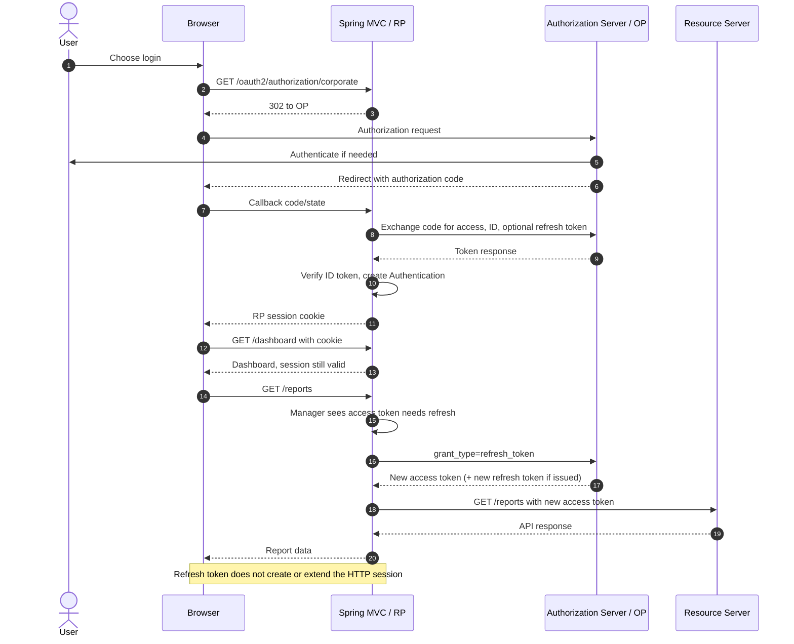

# 17.12. Distinguishing Refresh Tokens from Login Session Renewal

> **Module:** Spring Security OAuth 2.0 OIDC Client  
> **Chapter:** 17. Refresh Token  
> **Audience:** Developers building Spring Boot / Spring Security OAuth 2.0 / OIDC Client applications on the Servlet stack, especially apps logging in with `oauth2Login()` and subsequently calling APIs with access tokens.

A user logs into a web application via OpenID Connect (OIDC), sees the dashboard, and keeps working. About an hour later, the access token used to call APIs expires. The application uses a refresh token to obtain a new access token and the API request succeeds again. Does that mean the user **had their login session extended** by another hour?

**No.** These are two different mechanisms. A refresh token belongs to **OAuth 2.0 token authorization**; whereas the application login session is maintained by the application's **HTTP session, `SecurityContext`, and session cookie**. Furthermore, the OpenID Provider (OP) has its own **SSO session** on its own domain.

A successful token refresh lets the application keep calling APIs, yet on its own it **does not prove the user is still present**, **does not recreate an expired web session**, **does not re-authenticate the user at the OP**, and **does not advance the authentication timestamp represented by `auth_time`**.

Conversely, a still-valid HTTP session does not guarantee the access token is still unexpired; or the access/refresh tokens may remain valid even after the web login session has been destroyed.

This lesson places these concepts side by side, illustrates the Spring Security flows, and provides implementation guidance so keeping an API connection alive is never confused with maintaining a user's authenticated account session.

---

## 1. Learning Objectives

After this lesson, you will be able to:

1. Distinguish **access token expiration**, **refresh token validity**, **ID token expiration**, **HTTP session timeout**, and **SSO session**.
2. Explain the purpose of `grant_type=refresh_token` at the Token Endpoint.
3. Describe why refreshing an access token **is not equivalent** to re-authenticating a user or extending an HTTP session.
4. Distinguish `OAuth2AuthorizedClient` from `OAuth2AuthenticationToken` in Spring Security.
5. Understand when `OAuth2AuthorizedClientManager` uses a refresh token and when it is not invoked.
6. Configure session timeouts independently from token lifecycles.
7. Understand why an OIDC refresh response **may omit a new ID token**, and why `auth_time` does not become the refresh timestamp.
8. Analyze the effects of application logout, OP logout, token revocation, and account permission changes.
9. Determine when to require re-login or step-up authentication instead of merely refreshing.
10. Distinguish a refresh token `invalid_grant` error from an expired web session or an API rejecting an access token.
11. Choose token/session storage strategies for web apps, BFFs, and background workers.
12. Design targeted tests across distinct timelines and security boundaries.

## 2. Five "Clocks" Often Mistaken for One

When a user interacts with an OIDC Client application, there can be at least five independent timers/lifetimes.

| Clock | Component | Nature | What happens on expiration? |
|---|---|---|---|
| **Access token** | Authorization Server / Resource Server | Credential for calling APIs, usually short-lived | API may reject token; Client may refresh/reauthorize if eligible |
| **Refresh token** | Authorization Server | Credential for requesting new tokens without repeating the initial grant | Client can no longer use that refresh token to get access tokens if AS rejects it |
| **ID token** | OpenID Provider / Client | Identity assertion at issuance time, carrying `exp`/`iat`/OIDC claims | That ID token is past its expiry; this does not automatically delete a previously established HTTP session |
| **RP HTTP session** | Spring MVC application | Application-side web login state and `SecurityContext` | Subsequent requests lose authenticated state; normally requires re-authentication |
| **OP SSO session** | OpenID Provider | Authentication session at the OP for cross-app SSO | OP may require re-authentication on new authorization requests; token refreshing depends separately on AS policy |

**RP** (*Relying Party*) is the web application trusting the OP's authentication result.

Illustrative example:

```text
09:00  User logs into web app successfully
09:00  ID token issued; access token expires at 10:00
09:00  Refresh token issued per AS policy
09:00  Application HTTP session created
09:30  Valid web request arrives; session stays alive per idle timeout
10:05  App calls API; old access token has expired
10:05  Client refreshes access token if AS allows
10:05  Web session may still be active or may have expired: TWO SEPARATE THINGS
12:00  Refresh token may still be valid per policy
12:00  HTTP session may already have expired from inactivity
```

Timestamps, expirations, and sliding timeouts are illustrative. No universal OAuth2/OIDC rule requires HTTP session timeout to match access token lifetime or refresh token lifetime.

### 2.1. Why must they be separated?

If an application forces the HTTP session to stay alive merely because a refresh token still works, a user who walked away or logged out may remain logged in against policy.

If an application destroys the HTTP session the instant an access token expires, users may be forced to log in again every 10–60 minutes even though a valid refresh token exists and web session policy allows continuing. That is unnecessary for many products.

Better, define separate policies:

- **Session**: is the user still allowed to use the web application in this session?
- **Token**: does the Client currently hold a valid credential to call the target API?
- **Authentication freshness**: is the user's authentication at the OP recent enough / strong enough for a sensitive action?
- **Authorization**: is the user/task currently permitted to perform this action?

## 3. What Is a Refresh Token?

A refresh token is a credential the Authorization Server may issue to a Client to request **new access tokens** when needed. Under RFC 6749, the refresh grant uses the Token Endpoint, for example:

```http
POST /oauth2/token HTTP/1.1
Host: login.example.test
Authorization: Basic <redacted-client-credentials>
Content-Type: application/x-www-form-urlencoded

grant_type=refresh_token&refresh_token=<redacted>
```

For a confidential client, the Client must authenticate with its registered method. For a public client, refresh token protection and verification follow Client/AS policies; `none` does not mean skipping refresh token checks.

The AS checks that the refresh token belongs to the Client, is still valid, and has not been revoked, replayed, or restricted by policy. On success, the AS returns a new access token and **optionally** a new refresh token.

```json
{
  "access_token": "<new-redacted-access-token>",
  "token_type": "Bearer",
  "expires_in": 3600,
  "scope": "reports.read",
  "refresh_token": "<possibly-rotated-refresh-token>"
}
```

Optional fields such as `refresh_token` or `scope` depend on the response and AS policy; the example above illustrates rotation.

### 3.1. What does the refresh grant NOT do?

A standard `grant_type=refresh_token` request:

- Does not redirect the browser to the OP for the user to enter a password.
- Does not ask the user to pick an account.
- Does not perform MFA or interactive re-login.
- Does not create a new `HttpSession` in Spring Boot.
- Does not automatically swap `SecurityContextHolder` to a new `Authentication`.
- Does not confirm the user is still sitting in front of the screen.
- Does not extend the OP's SSO cookie under any universal OAuth2 rule.
- Does not advance the `auth_time` authentication timestamp.

**A successful refresh** only proves the Client satisfied AS policies to exchange a **refresh token** for a new token within an authorization that is still accepted.

### 3.2. Refresh tokens are not guaranteed to be issued

Authorization Code flows may receive refresh tokens, yet issuance depends on the AS, client type, consent, scopes, tenant, and provider policy. Simply adding `openid`, `offline_access`, or `prompt=consent` does not guarantee receiving a refresh token.

For `client_credentials`, there is normally no refresh token; when the access token expires, the Client executes a fresh `client_credentials` grant. Never confuse "getting a new token" in the manager with the "refresh token grant" across all Client types.

## 4. What Is a Servlet Application's Login Session?

A Spring MVC app using `oauth2Login()` receives the OIDC callback, validates tokens/claims, and creates an `Authentication` representing the user. Spring Security saves and restores the `SecurityContext` via its configured mechanism, commonly tied to `HttpSession`.

On subsequent requests, the browser sends the session cookie to the RP:

```http
GET /dashboard HTTP/1.1
Host: app.example.test
Cookie: JSESSIONID=<opaque-session-id>
```

The app uses the session ID to look up session state; if a valid `SecurityContext` exists, the request gets the corresponding `Authentication`.

**This cookie is not a refresh token.** The session ID belongs to the web app's session system; the refresh token belongs to OAuth2 token grants and must be stored/controlled on the appropriate side by the Client.

### 4.1. HTTP session timeout

Spring Boot example:

```yaml
server:
  servlet:
    session:
      timeout: 30m
      cookie:
        http-only: true
        secure: true
        same-site: lax
```

Setting `timeout: 30m` generally configures the session's **max inactive interval** managed by the Servlet container / Spring Session. The session stays alive while qualifying activity occurs and ends after enough inactivity. Organizations may also enforce an independent **absolute session lifetime** if policy requires it.

`http-only`, `secure`, and `same-site` protect cookies in appropriate contexts. During local plain-HTTP testing, `secure: true` may prevent cookies from working as they do over HTTPS; distinguish lab settings from production TLS.

### 4.2. "Extending a session" has at least three meanings

When product requirements say "extend login", clarify which is meant:

1. **Sliding idle timeout:** activity pushes back the inactivity expiration timestamp.
2. **Explicit reauthentication / session renewal:** the user authenticates again and the app creates/refreshes the session per policy.
3. **Persistent login / remember-me:** the app uses a dedicated mechanism to recreate `Authentication` after the old session ends, if permitted.

None of these three behaviors happen **by default** when an OAuth2 access token is refreshed.

A UI with a "Keep me signed in" checkbox must explicitly define its mechanism and assurance level; never secretly repurpose a refresh token as a "remember-me cookie" without complete security design.

## 5. The SSO Session at the OpenID Provider Is a Third Layer

The OP may maintain its own session cookie on its own domain, for example:

```text
RP application: https://app.example.test       -> application session cookie
OpenID Provider: https://login.example.test    -> OP SSO cookie
```

When the RP starts a new authorization request, the browser sends the OP's SSO cookie to the OP. If the OP session is still valid and policy permits, login can complete without prompting the user to re-enter credentials.

This is **completely different** from the refresh token grant:

- A refresh token request is sent by the Client to the Token Endpoint, typically server-to-server.
- The SSO session is used when the browser participates in a new OIDC authentication/authorization request.
- The OP may keep its SSO session alive after the RP logged out.
- The RP may keep its HTTP session alive even after the OP SSO session expired.
- The AS may reject a refresh token even while the OP SSO session still exists, or vice versa, depending on policy.

### 5.1. Why can "re-logging in" look like never logging in again?

If the RP's HTTP session expires while the OP SSO session remains active, the RP sends the browser to `/oauth2/authorization/corporate`. The OP uses its session to complete authorization without displaying a login form.

To the user, it feels like "the session extended itself", yet in reality **a brand-new OIDC Login transaction occurred**. Never guess the mechanism from UX alone; inspect the network/authorization callback and the RP's session lifecycle.

### 5.2. An SSO session is not a refresh token

Even when an OP supports silent SSO, it does not guarantee the Client received a refresh token. Conversely, a Client holding a refresh token can still refresh even after the browser loses its SSO cookie, if the AS allows it.

Modern browsers also restrict third-party cookies, affecting some silent-login techniques; never design session lifetimes solely around iframe SSO.

## 6. Four Independent Components in Spring Security

In a Servlet app, distinguish:

| Component | Primary data | Typical lifecycle |
|---|---|---|
| `OAuth2AuthenticationToken` | Principal/authorities and registration ID from login | Lives in `SecurityContext`/session after OAuth2 Login |
| `SecurityContextRepository` | Mechanism to save/restore `Authentication` | Tied to request/session and security config |
| `OAuth2AuthorizedClient` | `ClientRegistration`, access token, optional refresh token | Follows storage / authorized-client lifecycle |
| `OAuth2AuthorizedClientRepository` or `OAuth2AuthorizedClientService` | Persists/retrieves authorized clients | Can be session-based, in-memory service, JDBC, etc. |

Never substitute one object for another.

### 6.1. `OAuth2AuthenticationToken` does not directly hold the refresh token

Example:

```java
OAuth2AuthenticationToken loginAuthentication = ...;

String registrationId =
    loginAuthentication.getAuthorizedClientRegistrationId();

String principalName = loginAuthentication.getName();
```

These identify the login principal and registration, yet `OAuth2AuthenticationToken` has no `getRefreshToken()` method.

To access tokens, use authorized-client storage or the manager:

```java
OAuth2AuthorizedClient client = ...;

OAuth2AccessToken accessToken = client.getAccessToken();
OAuth2RefreshToken refreshToken = client.getRefreshToken();
```

These tokens must still be protected securely. Never serialize `OAuth2AuthorizedClient` to JSON and return it to the browser, as that exposes credentials.

### 6.2. An authorized client can outlive the session

If the authorized client is stored in a JDBC service keyed by principal, the record can remain after the browser session expires. Conversely, when using `HttpSessionOAuth2AuthorizedClientRepository`, the record is lost when the session is destroyed.

Therefore, never make blanket claims such as:

- "Logout always deletes the refresh token from the database."
- "Once the session expires, the refresh token is gone."
- "As long as the refresh token is valid, the session is still alive."

Everything depends on **independent storage and lifecycle policies**.

## 7. OIDC Login and Refresh Token Flow in One Diagram



In this diagram, `/reports` runs **while the web session is still valid**. If the session had expired, the browser would have to satisfy the RP's authentication policy before reaching the controller. Having a refresh token on the backend does not automatically restore the browser's session.

## 8. Easy-to-Remember Scenario Matrix

| RP HTTP session | Access token | Refresh token | Correct behavior |
|---|---|---|---|
| Valid | Unexpired | Present or absent | User uses web app; call API with current token if audience/scope match |
| Valid | Expired | Valid | Manager refreshes to call API; **no need to extend session due to refresh** |
| Valid | Expired | Absent or rejected | May need reauthorization/re-login to call API; handle UX and policy |
| Expired | Access token unexpired | Present | Browser has no web session `Authentication`; never grant access just because backend holds tokens |
| Expired | Expired | Valid in JDBC | Token may remain for authorized integrations; web user still must log in again per policy |
| Valid | Unexpired | Revoked | API calls may work until access token is rejected; later refresh fails |
| Valid | Valid token | Present | If sensitive action requires recent auth/MFA, still perform step-up rather than checking token alone |

**Takeaway from the table:** token lifetime and session lifetime are separate decisions. Never derive HTTP session timeout from the access token's `expires_in` as a universal formula.

## 9. OIDC: Is a New ID Token Required After Refresh?

Per OpenID Connect Core, on a successful refresh, the token response **does not have to contain an `id_token`**.

Example valid response:

```json
{
  "access_token": "<redacted>",
  "token_type": "Bearer",
  "expires_in": 1800
}
```

It may include a new refresh token, yet a new ID token is not required in every refresh response.

If the AS does return a new ID token, OIDC defines constraints tying it to the original authentication token, for example:

- `iss` and `sub` must match the original ID token.
- `aud` must match the original audience per OIDC rules.
- `iat` reflects **when the new ID token was issued**.
- If `auth_time` is present, it reflects **the original user authentication time**, not the refresh time.
- Other OIDC rules—including signature, expiration, and claim semantics—still apply.

### 9.1. A new ID token `iat` does not prove reauthentication

Suppose:

```text
09:00  User authenticates at OP
09:00  auth_time = 09:00
11:00  Client refreshes token
11:00  OP may issue a new ID token with iat = 11:00
11:00  auth_time still reflects 09:00 authentication if claim is present
```

Therefore:

- A fresh `iat` **does not prove** the user just entered a password, passkey, or MFA.
- A refresh token grant **is not** reauthentication.
- If business rules require "user authenticated within the last 5 minutes", evaluate `auth_time` and appropriate OIDC checks.

### 9.2. The principal in Spring Security is not replaced by default

After an OIDC Login, the `OidcUser` principal sits inside `OAuth2AuthenticationToken` in the `SecurityContext`. Refreshing an access token through the authorized client manager does not mean Spring Security:

- Replaces the current `Authentication`;
- Builds a new `OidcUser`;
- Re-reads roles/groups and remaps authorities;
- Triggers the session authentication strategy;
- Re-authenticates the user.

Even if a provider returns an ID token in the refresh response, the app/framework needs explicit logic to apply any principal updates; never assume refreshing updates identity or authorities automatically.

In particular, **a refresh token is not a mechanism for updating internal roles and permissions**. When user privileges are revoked, the application needs proper authorization checks, revalidation, and session invalidation rather than waiting for a refresh token.

## 10. "Extending a Session" Normally Happens via HTTP Activity

A Servlet session typically has a **max inactive interval**. When the browser sends a valid request recognized by the app as activity, the container/session store updates the last-accessed timestamp.

Example:

```text
Session idle timeout = 30 minutes
09:00 Login, session exists
09:20 User opens page; request reaches server
09:45 User opens another page; request arrives
10:10 User calls app API; session stays active if all gaps fit
10:45 No activity for over 30 minutes -> session expires
```

Token refreshes may happen at 09:30 or 10:05, yet **refresh events must not be designed as a "heartbeat" to keep web sessions alive**.

### 10.1. Background refreshes are not user activity

If the backend runs a scheduler refreshing tokens every 5 minutes, that event does not prove the user is using the browser. If it accidentally touches the HTTP session or updates `lastUserActivity`, a session may never expire.

Avoid this pattern:

```text
Token refresh job every 5 minutes
        ↓
App updates lastUserActivity
        ↓
Web session never expires even after user left the machine
```

Only activity recognized by your session policy should reset the idle timeout. Some products even separate user-driven UI requests from background polling to enforce inactivity accurately.

### 10.2. Browser session cookies vs. server-side session records

Cookie lifetime in the browser (session vs. persistent cookie) and server-side session record lifetime do not necessarily match. A cookie still sitting in the browser after the session store purged the record will not automatically authenticate the user.

Likewise, a session record still on the server after the browser lost its cookie generally cannot be resumed as that old session. Remember-me or SSO login may create a new flow, yet neither is an OAuth refresh token.

## 11. Spring Boot Servlet Config: Separate OIDC Login and Session

`application.yml` example:

```yaml
server:
  port: 8080
  servlet:
    session:
      timeout: 30m
      cookie:
        http-only: true
        secure: true
        same-site: lax

spring:
  security:
    oauth2:
      client:
        registration:
          corporate:
            provider: corporate-op
            client-id: employee-web
            client-secret: ${OIDC_CLIENT_SECRET}
            client-authentication-method: client_secret_basic
            authorization-grant-type: authorization_code
            redirect-uri: "{baseUrl}/login/oauth2/code/{registrationId}"
            scope:
              - openid
              - profile
              - email
        provider:
          corporate-op:
            issuer-uri: https://login.example.test/realms/employees
```

**Two independent configuration groups:**

- `server.servlet.session.timeout` governs HTTP session inactivity in the Servlet container / session store.
- `spring.security.oauth2.client.registration.*` describes the OAuth2 Client; it does not set "session TTL equals refresh token TTL".

The AS independently governs access token TTL, refresh token TTL/rotation, consent, and revocation policies. The Client **cannot** force the AS to issue a 30-day refresh token via a Spring Boot property.

### 11.1. `SecurityFilterChain`

```java
import org.springframework.context.annotation.Bean;
import org.springframework.context.annotation.Configuration;
import org.springframework.security.config.Customizer;
import org.springframework.security.config.annotation.web.builders.HttpSecurity;
import org.springframework.security.web.SecurityFilterChain;

@Configuration
class SecurityConfiguration {

    @Bean
    SecurityFilterChain securityFilterChain(HttpSecurity http)
            throws Exception {
        return http
            .authorizeHttpRequests(auth -> auth
                .requestMatchers("/", "/error").permitAll()
                .anyRequest().authenticated()
            )
            .oauth2Login(Customizer.withDefaults())
            .oauth2Client(Customizer.withDefaults())
            .build();
    }
}
```

This is an illustrative setup for an app using both login and OAuth2 Client API calls. It **has no** setting saying "every time an access token refreshes, extend the session"—because the two mechanisms are not coupled that way.

## 12. When Does Spring Security Refresh an Access Token?

Spring Security OAuth2 Client provides `OAuth2AuthorizedClientManager`. The manager delegates to one or more `OAuth2AuthorizedClientProvider` strategies such as `authorizationCode()`, `refreshToken()`, or `clientCredentials()`.

In Servlet requests, `DefaultOAuth2AuthorizedClientManager` is a common implementation. It uses `ClientRegistrationRepository` and `OAuth2AuthorizedClientRepository`, giving it access to client registrations, authorized clients, and the request context.

Example creating a manager with a refresh provider:

```java
import org.springframework.context.annotation.Bean;
import org.springframework.context.annotation.Configuration;
import org.springframework.security.oauth2.client.OAuth2AuthorizedClientManager;
import org.springframework.security.oauth2.client.OAuth2AuthorizedClientProvider;
import org.springframework.security.oauth2.client.OAuth2AuthorizedClientProviderBuilder;
import org.springframework.security.oauth2.client.registration.ClientRegistrationRepository;
import org.springframework.security.oauth2.client.web.DefaultOAuth2AuthorizedClientManager;
import org.springframework.security.oauth2.client.web.OAuth2AuthorizedClientRepository;

@Configuration
class AuthorizedClientConfiguration {

    @Bean
    OAuth2AuthorizedClientManager authorizedClientManager(
            ClientRegistrationRepository registrations,
            OAuth2AuthorizedClientRepository authorizedClients) {

        OAuth2AuthorizedClientProvider provider =
            OAuth2AuthorizedClientProviderBuilder.builder()
                .authorizationCode()
                .refreshToken()
                .build();

        DefaultOAuth2AuthorizedClientManager manager =
            new DefaultOAuth2AuthorizedClientManager(
                registrations,
                authorizedClients
            );

        manager.setAuthorizedClientProvider(provider);
        return manager;
    }
}
```

Prerequisites for refreshing:

1. A matching authorized client is already saved (usually from a successful Authorization Code grant).
2. A refresh token was issued by the AS.
3. The access token needs refreshing per provider logic, typically based on expiration and clock skew.
4. The manager has a provider supporting `refreshToken()`.
5. The Token Endpoint accepts the refresh token and Client authentication.
6. The token store/repository is updated properly.

**Not every user HTTP request automatically calls the Token Endpoint to refresh.** The manager is invoked when the app or an OAuth2-aware HTTP client needs an authorized client/token for an API call.

### 12.1. `loadAuthorizedClient()` does not refresh automatically

If code only calls:

```java
OAuth2AuthorizedClient stored =
    authorizedClientService.loadAuthorizedClient(
        "corporate",
        authentication.getName()
    );
```

it is **reading storage**, not requesting a new token. `stored.getAccessToken()` may already be expired.

Use an authorized client manager with appropriate grant providers when refresh/reauthorization is needed. Never handle refresh tokens manually in ad-hoc code when the library already provides token response clients and lifecycle management.

### 12.2. The manager cannot mint new refresh tokens on its own

`OAuth2AuthorizedClientProviderBuilder.builder().refreshToken()` only enables **using an existing refresh token**. It does not compel the AS to issue a refresh token if login did not receive one.

Scopes/consent like `offline_access` depend on the OP. Long-lived background access requires analyzing the AS contract, consent rules, and Client type—not just adding one builder call.

## 13. Example Calling the Manager Inside a Web Request

A service needing to call an API can obtain the current user's authorized client:

```java
import org.springframework.security.core.Authentication;
import org.springframework.security.oauth2.client.OAuth2AuthorizeRequest;
import org.springframework.security.oauth2.client.OAuth2AuthorizedClient;
import org.springframework.security.oauth2.client.OAuth2AuthorizedClientManager;
import org.springframework.stereotype.Service;

@Service
public class CorporateAuthorizedClientProvider {

    private final OAuth2AuthorizedClientManager manager;

    public CorporateAuthorizedClientProvider(
            OAuth2AuthorizedClientManager manager) {
        this.manager = manager;
    }

    public OAuth2AuthorizedClient current(Authentication authentication) {
        OAuth2AuthorizeRequest request =
            OAuth2AuthorizeRequest
                .withClientRegistrationId("corporate")
                .principal(authentication)
                .build();

        OAuth2AuthorizedClient authorizedClient =
            manager.authorize(request);

        if (authorizedClient == null) {
            throw new IllegalStateException(
                "No authorized client available for corporate"
            );
        }

        return authorizedClient;
    }
}
```

This example assumes it is called **inside a Servlet request** with an `Authentication` verified by Spring Security and a properly configured manager/repository. For use outside HTTP requests, use a dedicated service-based manager as shown in Section 16.

If the access token needs refreshing, the manager/provider refreshes and returns a new authorized client. **It does not simultaneously alter the session idle timeout, mint a new `Authentication`, or update `OidcUser` by default.**

### 13.1. Do not use the manager to "extend login" indefinitely

Avoid this design:

```java
// Design anti-pattern:
// Assuming a successful access token refresh means the user is still logged in.
if (canRefreshAccessToken()) {
    markUserSessionAsActiveForever();
    skipReauthenticationChecks();
}
```

This conflates API authorization proof with user presence/authentication proof. User sessions must obey an independent policy.

### 13.2. Do not accept registration IDs from untrusted input

Never expose a public HTTP endpoint accepting arbitrary `registrationId` and `principalName` parameters and calling the service/manager to fetch someone else's token. Registration and principal must come from a verified `Authentication` and application policy.

## 14. OAuth2-Aware HTTP Clients Can Trigger Refreshes

When using integrations like `OAuth2ClientHttpRequestInterceptor` for `RestClient` (on supported Spring Security versions) or the Servlet OAuth2 `WebClient` filter, the HTTP client asks `OAuth2AuthorizedClientManager` to obtain or reuse an appropriate access token before calling the Resource Server.

Overview:

```text
Controller/Service needs to call API
          |
          v
OAuth2-aware HTTP client
          |
          v
OAuth2AuthorizedClientManager
          |
          +--> Token still usable -> use current access token
          |
          +--> Needs refresh and refresh token present -> call Token Endpoint
          |
          +--> Cannot authorize -> handle error / re-authentication policy
          |
          v
Resource Server receives Bearer access token
```

**There is no hidden arrow** from "Token Endpoint refresh success" to "new Spring MVC session". The enclosing HTTP request may touch the session idle timeout simply because it is an HTTP request, yet that is **an effect of HTTP session activity**, not an inherent consequence of the token refresh grant.

### 14.1. Beware of default authorized clients

Some HTTP client integrations have an option to pick the current authorized client as a default for outbound requests. Do not enable this broadly if the HTTP client calls multiple APIs: a token could be sent to an unintended audience.

Select the matching registration/client for each Resource Server, guarding against token leakage and scope mismatches. Refresh tokens cannot fix sending a token to the wrong API.

## 15. When a Refresh Token Fails, Must the Web Session Log Out?

**There is no universal rule** requiring an HTTP session to be destroyed the moment the Token Endpoint returns a refresh error.

For example, an API call fails with:

```json
{
  "error": "invalid_grant"
}
```

This may result from refresh token expiration, revocation, a rotation conflict, or an invalid grant. Yet the RP's HTTP session may still validly hold the user's `Authentication`.

The application needs an **explicit product/security policy**:

- If API access is lost, show "Connection expired" or prompt to re-authorize.
- If the app cannot operate safely without that API authorization, force a new login/reauthorization.
- On severe security events (e.g., account revoked/locked), invalidate sessions based on signals from the IdP per policy.
- Do not automatically destroy every session over a temporary auxiliary API failure.
- Do not automatically **keep** every session when the upstream identity was revoked; enforce session revocation/authorization policies.

### 15.1. When is the authorized client deleted?

Some managers/failure handlers delete the authorized client when refreshing fails with specific OAuth errors. That affects **token storage only**—it does not directly destroy the HTTP session in all configurations.

The recovery path is usually starting a **new Authorization Code / OIDC Login flow**, depending on OP SSO state. If the user still has an SSO session, they may not need to re-enter credentials; if the AS requires fresh consent, the OP's UI appears.

### 15.2. When refresh token rotation errors occur

If the AS uses refresh token rotation, a successful refresh returns a new refresh token and invalidates the old one. Another job using the old token can receive `invalid_grant`.

In multi-instance apps, consider:

- Synchronizing refreshes by authorized client key;
- Shared storage and safe updates;
- Limiting retries with the same old refresh token;
- Handling suspected replay/compromise per AS policy.

Never try to recover by repeatedly resending a rejected refresh token.

## 16. Background Workers: Can Refresh, Cannot Run Browser Login for the User

`AuthorizedClientServiceOAuth2AuthorizedClientManager` can use `OAuth2AuthorizedClientService` outside HTTP requests.

Example configuration solely for refreshing **existing** authorized clients:

```java
import org.springframework.context.annotation.Bean;
import org.springframework.context.annotation.Configuration;
import org.springframework.security.oauth2.client.AuthorizedClientServiceOAuth2AuthorizedClientManager;
import org.springframework.security.oauth2.client.OAuth2AuthorizedClientManager;
import org.springframework.security.oauth2.client.OAuth2AuthorizedClientProvider;
import org.springframework.security.oauth2.client.OAuth2AuthorizedClientProviderBuilder;
import org.springframework.security.oauth2.client.OAuth2AuthorizedClientService;
import org.springframework.security.oauth2.client.registration.ClientRegistrationRepository;

@Configuration
class BackgroundRefreshConfiguration {

    @Bean("backgroundRefreshManager")
    OAuth2AuthorizedClientManager backgroundRefreshManager(
            ClientRegistrationRepository registrations,
            OAuth2AuthorizedClientService authorizedClientService) {

        OAuth2AuthorizedClientProvider provider =
            OAuth2AuthorizedClientProviderBuilder.builder()
                .refreshToken()
                .build();

        AuthorizedClientServiceOAuth2AuthorizedClientManager manager =
            new AuthorizedClientServiceOAuth2AuthorizedClientManager(
                registrations,
                authorizedClientService
            );
        manager.setAuthorizedClientProvider(provider);
        return manager;
    }
}
```

The prerequisite is that the service **already saved an authorized client with a refresh token** under the same registration and principal name used by the background worker.

If web login uses `HttpSessionOAuth2AuthorizedClientRepository` while the job uses a separate `JdbcOAuth2AuthorizedClientService`, the job will not see the record. Design storage alignment around real requirements rather than assuming tokens share automatically.

### 16.1. Security requirements for background access on a user's behalf

A worker must never pick arbitrarily:

```java
OAuth2AuthorizeRequest.withClientRegistrationId("calendar-api")
    .principal(requestBody.getUsername())
    .build();
```

if `requestBody.getUsername()` is unverified input. That opens a path to accessing another user's authorized client.

Instead, verify job authorization, tenant, target entity ownership, and stored consent. A refresh token outliving a web session does not turn it into a permanent license to do anything on the user's behalf.

### 16.2. Refresh tokens can keep working after the user closes the browser

Closing a tab or browser does not necessarily delete the server-side authorized client. If the user granted offline access and the AS still allows refreshing, workers can continue calling APIs within the granted consent policy.

However, the application must define clear **continued-access policies** when a user logs out or disables their account. Provide disconnect buttons, revocation, and retention rules—never hide offline access behind a "keep session alive" toggle.

## 17. Logout: Distinguishing Four Events

Logout can mean multiple distinct actions:

1. **Local application logout:** destroy/stop using the RP's HTTP session and `SecurityContext`.
2. **OIDC RP-Initiated Logout:** redirect to the OP end-session endpoint per supported mechanism to end the associated SSO session.
3. **Local authorized client deletion:** remove the token record from the repository/service.
4. **Token revocation:** ask the AS to revoke access/refresh tokens or authorization per provider protocol/contract.

These events **do not automatically trigger one another**.

| Action | Directly clears RP HTTP session? | Directly deletes JDBC token record? | Guarantees token revocation at AS? |
|---|---|---|---|
| Spring Security local logout | Yes, per config | Not by default in every config | No |
| OP end-session | Does not handle all RP records without explicit flow/policy | No | Not by default |
| `removeAuthorizedClient(...)` | No | Yes, for that exact service key | No |
| RFC 7009 revocation | No | Not automatically | AS handles per protocol/policy |
| Successful token refresh | No | May update authorized client | No |

### 17.1. Why shouldn't logout be "undone" by a refresh token?

Suppose a user clicks Logout, while a background service's API refresh token call still succeeds. If the app uses that event to recreate the user's HTTP session without proper authentication, logout becomes largely meaningless.

**Never use a refresh token to recreate web `Authentication`** merely because a token exists in JDBC. Supporting persistent login requires dedicated login/remember-me/SSO mechanisms with proper consent, expiry, revocation, and risk evaluation.

### 17.2. Logout and token storage must stay synchronized per policy

If a product advertises "Log out from all devices", it needs policies covering sessions, active tokens, the OP session, and linked devices/authorizations. Calling `SecurityContextLogoutHandler` on one web node alone cannot confirm every authorization across all systems was revoked.

For sensitive requirements, evaluate OIDC Back-Channel Logout, session revocation, token revocation, and event propagation to RPs according to OP/app capabilities. Never assume every OP supports every logout specification.

## 18. Does Remember-Me Session Extension Relate to Refresh Tokens?

Spring Security offers other authentication mechanisms such as remember-me. They recreate `Authentication` from a dedicated persistent-login credential after the old session expires.

However:

- A remember-me token/cookie is not an OAuth2 refresh token.
- An OIDC Login by default does not mean remember-me is configured.
- Persistent-login credentials have their own policies, storage, theft protections, and revocation.
- Recreating an RP session must rely on an approved authentication mechanism, never arbitrarily turning a refresh token into a "login ticket".
- For sensitive applications, remember-me may not meet required authentication assurance or freshness.

**Design practice:** if a product requirement states "keep users signed in for 30 days", clarify whether that means local persistent login, an OP SSO session, API refresh tokens, or an explicitly governed combination. Never merely set `refresh_token_ttl` at the AS and claim you solved 30-day login sessions.

## 19. Step-Up Authentication and Sensitive Actions

Suppose a user logged in this morning and in the afternoon wants to transfer funds or change security settings.

The application may have:

- An active HTTP session;
- An unexpired or freshly refreshed access token;
- A valid refresh token;
- Yet the user's authentication timestamp at the OP is hours old.

A sensitive action may require **recent reauthentication** or appropriate MFA. Relevant OIDC mechanisms:

- `prompt=login`: asks the OP to re-authenticate the user.
- `max_age=300`: maximum authentication age in seconds per OIDC.
- `max_age=0`: asks the OP to actively re-authenticate.
- `auth_time`: time of authentication at the OP, verified when `max_age` is used.
- `acr`/`amr`: evidence of authentication context/method when published by the OP and enforced by app policy.

**A refresh token cannot satisfy these requirements.**

### 19.1. Example showing the difference between `iat` and `auth_time`

```text
09:00 User authenticates at OP
09:00 auth_time = 09:00
14:00 Client refreshes access token
14:00 iat of a new ID token (if any) = 14:00
14:00 auth_time remains 09:00 per OIDC refresh rules
14:00 App requires sensitive transaction: auth within last 5 minutes
14:00 Freshness check fails despite 14:00 refresh
```

When `max_age` is sent in an OIDC Authentication Request, the OP must return `auth_time`. Verify your library version's freshness validation/policy logic. Never infer from `iat` or access token expiry that reauthentication occurred.

### 19.2. Sessions persist while permissions can change

Token refreshing does not automatically update `Authentication.getAuthorities()` in the `SecurityContext`. If an organization revokes a user's admin role, an existing session may still hold authorities computed at login time.

Build a strategy:

- Check authorization at the time of use commensurate with risk.
- Invalidate sessions and authorized clients when an account is locked or permissions change.
- Refresh/map authorities from an authoritative source when needed.
- Enforce step-up/reauthentication for critical actions.

Never treat refresh tokens as a role- or tenant-membership synchronization mechanism.

## 20. Real-World Incident: Why Did Refresh Succeed Yet the User Still Hit Login?

Possible causes:

1. The HTTP session expired due to inactivity.
2. The session cookie was lost or not sent by the browser.
3. The load balancer or session store failed to share sessions across instances as designed.
4. `SecurityContext` was not saved properly when using a custom authentication handler or filter.
5. The app enforces an absolute session lifetime or forced reauthentication policy.
6. The user logged out in another tab or the session was invalidated by security rules.
7. RP `Authentication` was discarded due to deployment, session serialization, or session policy.
8. Access token refresh occurred in the background while a new web request arrived without a session.

Never "fix" this by using a refresh token to rebuild `Authentication` from unverified data. Investigate the **session lifecycle**, not just the Token Endpoint.

### 20.1. The opposite: session alive yet API returns 401

Possible causes:

- Access token expired and code only called `loadAuthorizedClient`, bypassing the manager's refresh logic.
- Authorized client lacks a refresh token, or the manager lacks the `refreshToken()` provider.
- The AS revoked the token after the user logged out at the OP.
- Wrong audience or scope for the API.
- The Resource Server does not trust the right issuer or keys.
- The token was altered or invalid.

An active web session does not make an access token valid. Handle token and authorization checks separately.

## 21. Quick Diagnostic Table

| Symptom | Layer involved | What to do |
|---|---|---|
| User loses login after 30 minutes | HTTP session / `SecurityContext` | Check idle timeout, cookies, and session store |
| Browser bounces through OP and back without password prompt | OP SSO | SSO session may still be active; inspect the new authentication request |
| Access token expired yet API calls still succeed later | OAuth2 refresh or token reissuance | Check manager and token lifecycle; do not equate with session |
| Refresh succeeds yet `OidcUser`/roles stay unchanged | Stored `Authentication` | Expected behavior; principal updates require separate policy |
| `invalid_grant` at Token Endpoint | Refresh token / grant | Check expiry, revocation, rotation, and Client binding |
| `invalid_client` at Token Endpoint | Client authentication | Check secret, auth method, and registration |
| API 401 | Access token / validation | Check expiry, issuer, audience, signature, and revocation |
| API 403 | Authorization at Resource Server | Check scopes, roles, tenant, and permissions |
| Web logout yet background job keeps refreshing | Authorized client storage and AS policy | Review JDBC/token retention and logout/revocation policy |
| Refresh token expired yet UI stays logged in | Independent web session | Decide when API reauthorization is needed |
| `/me` returns stale user despite recent token refresh | Principal in `SecurityContext` | Do not expect refresh to update `Authentication` |
| Multiple nodes refreshing cause `invalid_grant` | Refresh token rotation / concurrency | Coordinate refreshes and ensure storage consistency |
| Token valid yet sensitive transaction is blocked | Authentication freshness / authorization | Check `auth_time`/MFA policy; trigger step-up |
| User logged out at OP yet RP stays logged in | SSO logout integration | Check RP-initiated/back-channel logout and session invalidation |

## 22. Practice A — Session Alive, Access Token Expired

**Objective:** clearly observe that a refresh token does not extend the login session.

**Setup:** a Spring MVC app with OIDC Login; a test AS with a short access token lifetime and policy-issued refresh tokens; a test API; session timeout longer than access token lifetime.

**Steps:**

1. Configure a session idle timeout, e.g., 30 minutes.
2. On the test AS, set a short access token lifetime, e.g., 2 minutes.
3. Log in via OIDC in the browser.
4. Confirm a web endpoint requiring `Authentication` is accessible.
5. Wait for the access token to expire while keeping the web session alive appropriately.
6. Call an API through `OAuth2AuthorizedClientManager` configured with `refreshToken()`.
7. Observe the manager obtaining a new access token and the API succeeding.
8. Record metadata: session alive, old access token expired, refresh occurred—without logging raw tokens.

**Expected result:** the web session does not have to end when the access token expires. The manager refreshes as needed, yet does not create or extend the HTTP session as an OAuth2 protocol step.

**Question:** if no API call occurs, must Spring Security automatically refresh the access token the instant it expires?

## 23. Practice B — Session Expired While Refresh Token Remains

**Objective:** avoid turning token storage into proof of browser login.

**Setup:** JDBC or test authorized-client service independent of HTTP session; short session timeout; test refresh token not yet revoked by the AS.

**Steps:**

1. Log in and persist the authorized client in the lab's service.
2. Verify the web session is active.
3. Remain idle long enough for the session to expire, or invalidate the session in the lab.
4. Request a protected endpoint from the browser; observe that it must go through authentication per policy.
5. Check that the authorized client in JDBC/service may still exist.
6. If permitted, run a background task using the stored authorized client to call the API; note it creates no browser session.
7. Log in again and observe interaction with the OP SSO session, if active.
8. Never use the stored refresh token to mark the browser as authenticated.

**Expected result:** token storage and login sessions can have separate lifecycles; holding a refresh token does not mean the browser is logged in.

## 24. Practice C — OP SSO Active While RP Session Expired

**Objective:** distinguish an "automatic login" experience from a refresh token.

**Steps:**

1. Log into both the RP and OP in a test environment.
2. Expire/invalidate the RP session while keeping the OP SSO session active if policy allows.
3. Open an RP page requiring authentication.
4. Observe the browser redirecting to the OP and returning via a new authorization callback.
5. Note the brand-new RP session created when login succeeds.
6. Contrast with token refresh: the refresh grant has no browser redirect or authorization code.

**Expected result:** re-login can feel fast thanks to OP SSO, yet it is still a **new authentication flow**, not RP session extension via refresh token.

## 25. Practice D — Refresh Fails While Session Remains Active

**Objective:** build Token Endpoint error-handling policies without confusing them with local logout.

**Setup:** test AS allowing refresh token revocation, active web session, and an auxiliary API called by the app.

**Steps:**

1. Log in and confirm the web session.
2. In the test AS, revoke the Client's refresh token.
3. Trigger a condition where the access token needs refreshing.
4. Call the API through the manager and observe `invalid_grant`/authorization failure.
5. Verify whether the RP session still holds `Authentication` or follows configured policy.
6. Display a clean reauthorize/connection-expired message instead of raw exceptions.
7. If the API is mandatory for operation, route through the designed re-login/reauthorization path.
8. Never repeatedly loop with the stale refresh token.

**Expected result:** refresh failure and HTTP session expiration are distinct error classes. The application explicitly decides whether to force re-login.

## 26. Practice E — Logout Does Not Equal Revocation

**Objective:** observe that local sessions, token storage, and the OP act independently.

**Steps:**

1. Log in with OIDC; verify the session and stored authorized client.
2. Perform local logout in Spring Security.
3. Confirm the browser is blocked from endpoints requiring `Authentication`.
4. Check whether the JDBC/service authorized client still exists, depending on configuration.
5. If the test AS permits, verify whether an unrevoked token still works at the Resource Server.
6. Also test RP-initiated logout with the OP if supported and compare.
7. Test the Token Revocation Endpoint in the lab and compare its effect against local deletion.
8. Document your desired policy: whether logout deletes records or revokes tokens, and why.

**Expected result:** web logout, SSO logout, local record deletion, and token revocation have distinct effects and must be coordinated per product policy.

## 27. Practice F — `auth_time` Does Not Change on Refresh

**Objective:** demonstrate that token refreshing does not satisfy freshness requirements for sensitive actions.

**Setup:** test OP supporting `auth_time` claims, OIDC flow supporting `max_age`, and non-sensitive test data.

**Steps:**

1. Log in at the OP and record the verified `auth_time`.
2. In the lab, use the refresh token to get a new access token; the OP may or may not return a new ID token.
3. If a new ID token is returned, inspect `iat` and `auth_time` after validation.
4. Confirm refreshing did not change `auth_time` to the refresh time.
5. Build a new authorization request with `max_age=0` or the required policy age.
6. Complete re-authentication at the OP.
7. Compare `auth_time` after reauthentication with the earlier timestamp.
8. Never accept a token merely because `iat` is recent when policy demands authentication freshness.

**Expected result:** only valid reauthentication at the OP provides the required freshness proof, never a token refresh.

## 28. Practice G — Never Refresh Continuously Just to Keep a Session Alive

**Objective:** avoid turning refresh tokens into a synthetic activity mechanism.

**Steps:**

1. Configure an RP session timeout and a refresh-capable Token Endpoint.
2. Add a scheduled job that refreshes tokens periodically in tests.
3. Close the browser / send no interactive requests to the RP.
4. Check whether the user's HTTP session expires per policy.
5. If the job keeps the session from ever timing out, locate where code is improperly updating the HTTP session or user activity.
6. Decouple the refresh token path (authorization lifecycle) from session activity tracking.
7. Re-test and verify inactivity policies are respected.

**Expected result:** background token refreshes may run for integration needs, yet must never extend the login session of an absent user.

## 29. Automated Tests Along Separate Boundaries

Tests should follow **system boundaries**, not just a single `expiresAt` field.

| Test | Simulation | Expectation |
|---|---|---|
| Access token expired, session valid | Old token expired, valid user session, refresh token present | Manager refreshes on API call; web `Authentication` is not swapped out |
| Session expired, refresh token valid | Session destroyed, authorized client stored outside session | Browser requires authentication per policy; session is not "resurrected" from token |
| Refresh token revoked, session valid | AS returns `invalid_grant` | API authorization fails; session policy acts independently |
| OP SSO expired, RP session valid | OP SSO gone, RP session active | User continues in RP per policy; reauth may prompt for credentials |
| RP session expired, OP SSO valid | RP context gone | New Authorization Code/OIDC Login can complete quickly via OP SSO |
| ID token expired, RP session valid | Original ID token past expiry | Do not assume RP session is deleted; policy may require separate reauth |
| Fresh token, stale `auth_time` | Refresh succeeded, authentication was hours ago | Step-up is not bypassed just because token `iat` is new |
| Local logout, JDBC token persists | Logout did not delete JDBC authorized client | Browser blocked from protected endpoints; evaluate background token policy |
| Refresh rotation concurrency | Two workers use old refresh token | Handle failures/serialization; never retry endlessly |
| User role revoked | Token/session holds stale claims | Enforce authorization via updated policy; do not rely on refresh to update roles |

### 29.1. Simulating time instead of waiting

Use mock clocks, token fixtures, test APIs, and short test session timeouts. Never wait for real production token lifetimes in tests. For integration tests verifying the full Token Endpoint and `SecurityContext`/session behavior, use a test OP/AS and isolated environment.

### 29.2. `MockMvc` does not replace real token refresh testing

Spring Security Test can inject mock `oauth2Login()`/`oidcLogin()` `Authentication` for controller tests. Yet that **does not** exercise authorization codes, token exchanges, refresh rotation, or SSO logout with a real OP.

Separate:

- Controller/unit tests: session access rules and status handling.
- Manager/provider tests: refreshing when due and failure handling.
- Integration tests: test AS, authorization flow, refresh, logout, and session persistence.

## 30. Common Misconceptions

| Misconception | Accurate understanding |
|---|---|
| "Refresh tokens keep users logged in forever." | They let the Client obtain new access tokens; login sessions have their own policies. |
| "When refresh succeeds, call `session.setMaxInactiveInterval(...)`." | No OAuth2 rule says this; never extend sessions just because a token refreshed. |
| "When an access token expires, Spring Security always forces re-login." | The manager can refresh if a valid refresh token exists and policy allows. |
| "If the HTTP session is alive, the access token definitely works." | Tokens can expire, be revoked, or mismatch audience/scope. |
| "Session expiry means the refresh token was revoked." | Not necessarily; storage/AS lifecycles are independent. |
| "OIDC refresh always returns a new ID token." | Refresh responses may omit an ID token. |
| "A new ID token with a fresh `iat` proves MFA just happened." | `iat` is token issuance time; check `auth_time` and assurance evidence. |
| "Refreshing automatically updates `OidcUser` and session roles." | Not by default; principal/authority updates are a separate flow. |
| "Local logout definitely revokes all tokens at the OP." | No; token revocation and SSO logout are separate mechanisms. |
| "Deleting the JDBC authorized client logs out the browser." | No; token storage is not `SecurityContext`/session. |
| "Sessions can be recreated from refresh tokens like login tickets." | Never treat refresh tokens as arbitrary browser authentication proof. |
| "Successful background job refresh means the user was active." | Refreshing does not prove user presence. |
| "OP SSO expiry immediately ends every RP session." | Not by default; requires logout/session coordination if desired. |
| "A refresh token can be retried forever even on `invalid_grant`." | Tokens can expire, be revoked, or rotate; define explicit failure policies. |
| "Refresh token lifetime = `server.servlet.session.timeout`." | The two lifetimes are governed by different systems. |

## 31. Self-Check Questions

**Q1.** The user is logged into the web app, the access token expired, yet the refresh token is valid. Must they log out?

*Hint:* no; the manager can refresh to call APIs while the session follows its own policy.

**Q2.** When a token refresh succeeds, does Spring Security automatically reset `HttpSession.maxInactiveInterval`?

*Hint:* there is no default mechanism equating refreshing with session extension.

**Q3.** The browser session expired, yet the backend still holds an authorized client in JDBC. Should the browser enter `/admin` without re-authenticating?

*Hint:* no; token authorization storage does not prove the user is currently logged in.

**Q4.** How do `OAuth2AuthenticationToken` and `OAuth2AuthorizedClient` differ?

*Hint:* authentication/principal/session versus Client registration and access/refresh tokens.

**Q5.** Must an OIDC refresh response always contain `id_token`?

*Hint:* no.

**Q6.** If a refreshed ID token is issued at 15:00, can `auth_time` be changed to 15:00 even though the user authenticated at 09:00?

*Hint:* per OIDC refresh rules, `auth_time` (if present) continues reflecting the original authentication.

**Q7.** Are the RP's HTTP session and the OP's SSO session managed by the same server?

*Hint:* no; they can be two separate domains/systems.

**Q8.** The user clicked Logout, yet a token remains in the database. Did the OP definitely revoke the token?

*Hint:* no; token revocation must be designed separately.

**Q9.** When an API returns 403, will a refresh token definitely fix access permissions?

*Hint:* no; it may be a missing role, scope, or permission.

**Q10.** To confirm the user authenticated within the last 5 minutes, check access token expiry or `auth_time`?

*Hint:* `auth_time` and OIDC authentication freshness policy.

**Q11.** If the browser is idle while a background job refreshes tokens every few minutes, should the user be marked active?

*Hint:* no; job activity is not user activity.

**Q12.** Why doesn't `loadAuthorizedClient(...)` refresh tokens automatically?

*Hint:* it is a storage abstraction; the manager/provider handles reauthorization.

## 32. Design Recommendations by Product Goal

| Product requirement | Appropriate mechanism to evaluate | What NOT to use as a substitute |
|---|---|---|
| Keep web session alive across short inactivity | Servlet / Spring Session timeout, `SecurityContext` persistence | Refresh token TTL |
| Intentional long-lived login | Evaluated remember-me / SSO / re-auth policy | Minting sessions from refresh tokens |
| Call APIs after access token expires | `OAuth2AuthorizedClientManager` + refresh token grant if present | Extending HTTP sessions |
| Call APIs offline after user consent | Authorized client service, refresh tokens, retention and consent policies | Keeping browser sessions open forever |
| Force re-login before sensitive actions | OIDC reauthentication, `max_age`, `auth_time`, MFA/assurance | Freshly refreshed access tokens |
| Revoke an API connection | Local token cleanup + revocation when AS supports it | Browser-only logout |
| Sign out of the OP | RP-Initiated Logout or OP-supported flow | Deleting only access tokens |
| Update user permissions | Authorization service/policy, session invalidation, or claims mapping | Waiting for refresh tokens to update roles |
| Reduce token exposure in the browser | BFF / server-side storage, cookie security | Putting refresh tokens in arbitrary cookies |

A clear separation of responsibilities:

```text
Web authentication / session
  -> SecurityFilterChain + oauth2Login()
  -> SecurityContextRepository / HttpSession / Spring Session
  -> timeout, reauthentication, logout policy

OAuth2 token lifecycle
  -> OAuth2AuthorizedClientManager
  -> OAuth2AuthorizedClientRepository / OAuth2AuthorizedClientService
  -> access token / refresh token / grant errors

Identity provider / SSO
  -> OP login session
  -> OIDC authentication request, max_age, auth_time, acr/amr
  -> RP-initiated / back-channel logout if supported

Business authorization
  -> account, roles, tenant, step-up requirements
  -> never use token lifetime as an authorization decision by default
```

Each layer can interact with the others according to designed policies, yet **none automatically equates its lifetimes or events with another**.

## 33. References

- [RFC 6749 — OAuth 2.0 Authorization Framework, Refreshing an Access Token](https://www.rfc-editor.org/rfc/rfc6749#section-6): Token Endpoint refresh grant, scopes, and token responses.
- [RFC 9700 — OAuth 2.0 Security Best Current Practice](https://www.rfc-editor.org/rfc/rfc9700): refresh token rotation, sender-constrained refresh tokens, replay prevention, and modern OAuth2 security.
- [RFC 7009 — OAuth 2.0 Token Revocation](https://www.rfc-editor.org/rfc/rfc7009): distinguishing local token deletion from AS revocation requests.
- [OpenID Connect Core 1.0 — Using Refresh Tokens](https://openid.net/specs/openid-connect-core-1_0.html#RefreshTokens): refresh requests, optional ID tokens, and `auth_time` constraints.
- [OpenID Connect Core 1.0 — Authentication Request](https://openid.net/specs/openid-connect-core-1_0.html#AuthRequest): `prompt`, `max_age`, and reauthentication.
- [OpenID Connect RP-Initiated Logout 1.0](https://openid.net/specs/openid-connect-rpinitiated-1_0.html): RP/OP logout.
- [OpenID Connect Back-Channel Logout 1.0](https://openid.net/specs/openid-connect-backchannel-1_0.html): logout notifications between OP and RP when supported.
- [Spring Security Reference — OAuth 2.0 Client](https://docs.spring.io/spring-security/reference/servlet/oauth2/client/index.html): `ClientRegistration`, authorized clients, and refresh token support.
- [Spring Security Reference — Authorized Clients](https://docs.spring.io/spring-security/reference/servlet/oauth2/client/authorized-clients.html): managers and HTTP clients using tokens, including refresh/reauthorize.
- [Spring Security Reference — Session Management](https://docs.spring.io/spring-security/reference/servlet/authentication/session-management.html): session persistence, timeouts, fixation, and security strategies.
- [Spring Security Reference — OAuth 2.0 Login](https://docs.spring.io/spring-security/reference/servlet/oauth2/login/index.html): login callbacks and user `Authentication`.
- [Spring Security API — `DefaultOAuth2AuthorizedClientManager`](https://docs.spring.io/spring-security/reference/api/java/org/springframework/security/oauth2/client/web/DefaultOAuth2AuthorizedClientManager.html): manager inside Servlet requests.
- [Spring Security API — `AuthorizedClientServiceOAuth2AuthorizedClientManager`](https://docs.spring.io/spring-security/reference/api/java/org/springframework/security/oauth2/client/AuthorizedClientServiceOAuth2AuthorizedClientManager.html): token manager outside HTTP requests.
- [Spring Security API — `OAuth2AuthorizedClientService`](https://docs.spring.io/spring-security/reference/api/java/org/springframework/security/oauth2/client/OAuth2AuthorizedClientService.html): loading, saving, and removing authorized clients.

**Key takeaway:** **A refresh token extends the Client's ability to obtain access tokens per Authorization Server policy; it does not extend the HTTP session, maintain the SSO session, or re-authenticate the user.** In Spring Security Servlet, treat session/`SecurityContext`, authorized client/token storage, and OP SSO as three separate lifecycles. Use the authorized client manager for API access, enforce session policies for continuing web sessions, and trigger OIDC reauthentication/step-up using `max_age` and `auth_time` whenever fresh user authentication proof is required rather than relying on token refreshes.
