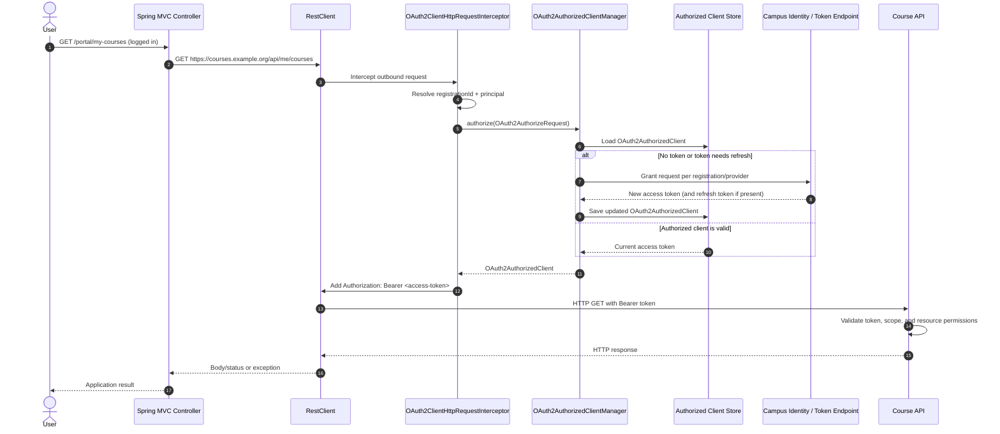
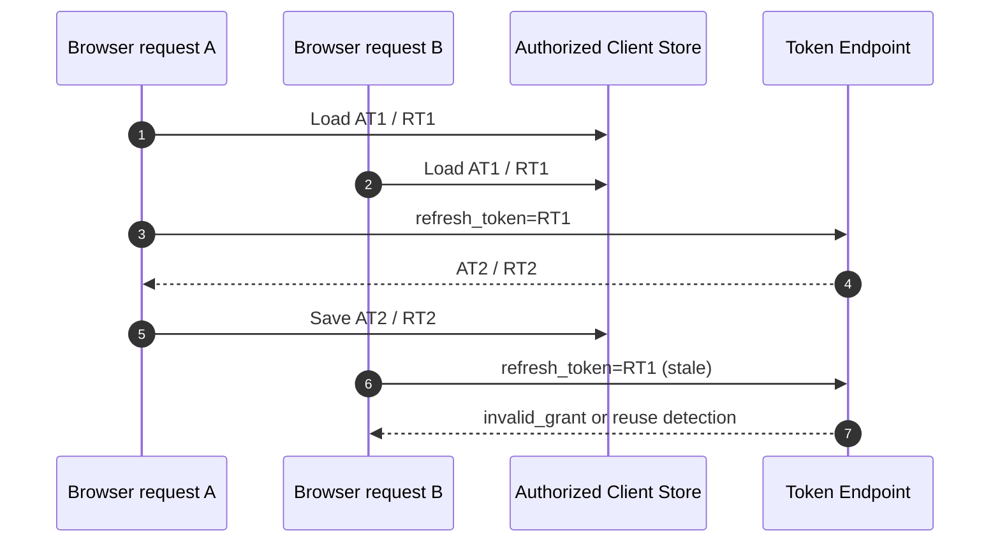

# 18.1. Integrating OAuth2 with RestClient and OAuth2ClientHttpRequestInterceptor

## Lesson Objectives

After this lesson, you will be able to:

- Explain the role of **`RestClient`** and **`OAuth2ClientHttpRequestInterceptor`** when a **Spring Security OAuth2/OIDC Client application on the Servlet stack** calls a protected API.
- Understand how the interceptor uses **`OAuth2AuthorizedClientManager`** to find, obtain, or renew an access token and automatically attach the `Authorization: Bearer ...` header to outbound HTTP requests.
- Configure `RestClient` using `RestClient.Builder`, `OAuth2AuthorizedClientManager`, `ClientRegistration`, and a `ClientHttpRequestInterceptor`.
- Select the right `clientRegistrationId` via `RequestAttributeClientRegistrationIdResolver.clientRegistrationId(...)`, or use a custom `ClientRegistrationIdResolver` when needed.
- Distinguish between a **Servlet user principal** and a **technical service principal**; use `SecurityContextHolderPrincipalResolver` and `RequestAttributePrincipalResolver` in the right context.
- Configure **`OAuth2AuthorizationFailureHandler`** to handle access tokens rejected by the Resource Server, while understanding the limits of the authorized client removal mechanism.
- Design API calls on behalf of a user after OIDC Login and machine-to-machine API calls using Client Credentials without leaking tokens.
- Diagnose common issues: missing registration ID, wrong principal, expired token, `401`, `403`, wrong audience/scope, missing Servlet request context, and tokens sent to the wrong host.

## 1. Context: Spring Boot Needs to Call a REST API Using an OAuth2 Access Token

Suppose the **Learning Portal** system consists of three components:

- **Learning Portal**: a Spring Boot MVC application where users log in via OIDC, acting as the **OAuth2/OIDC Client**.
- **Campus Identity**: the Authorization Server/OpenID Provider (OP), which authenticates users and issues tokens to the Client.
- **Course API**: the Resource Server that receives and validates access tokens to provide courses, grades, and learning progress.

A user logs into the Learning Portal via a browser. After completing the Authorization Code Flow, the backend wants to call:

```http
GET /api/me/courses HTTP/1.1
Host: courses.example.org
Authorization: Bearer <user-access-token>
```

The problem is that the controller should not have to manually repeat the following steps for every API call:

```text
1. Find the authorized client for the current user
2. Retrieve a valid access token
3. Refresh the token if needed and permitted
4. Assemble the Authorization header
5. Send the request to the Resource Server
6. Handle token errors returned by the Resource Server
```

Spring Framework provides **`RestClient`** for synchronous HTTP clients. Spring Security provides **`OAuth2ClientHttpRequestInterceptor`** to attach OAuth2 Client logic to outbound requests.

> **Core idea:** `RestClient` sends the HTTP request; `OAuth2ClientHttpRequestInterceptor` obtains the right **OAuth2 access token** through `OAuth2AuthorizedClientManager` and attaches it to the Bearer header. The interceptor **is not an Authorization Server**, does not log in the End-User itself, and does not determine business permissions at the Resource Server.

### 1.1. Overview Flow



The interceptor operates at the **outbound HTTP** step; it does not replace Spring Security's inbound request filters, nor does it automatically turn an ID Token into an access token.

## 2. Distinguishing Components Before Writing Code

| Component | Role | In the Example |
| --- | --- | --- |
| `RestClient` | **Synchronous** HTTP client of Spring Framework | Sends GET to Course API |
| `ClientHttpRequestInterceptor` | Hook for processing outbound HTTP requests/responses | Injects logic before/after request |
| `OAuth2ClientHttpRequestInterceptor` | Spring Security's OAuth2 interceptor | Resolves authorized client, attaches Bearer token |
| `ClientRegistration` | OAuth Client configuration with a provider | Client ID, grant type, scopes, Token Endpoint |
| `ClientRegistrationRepository` | Looks up a registration by `registrationId` | Selects `campus` or `course-sync` |
| `OAuth2AuthorizedClient` | State of a client authorized for a principal | Access token, optional refresh token |
| `OAuth2AuthorizedClientManager` | Coordinates issuing/re-issuing an authorized client | `authorize(...)` |
| `OAuth2AuthorizedClientRepository` | State store in the Servlet request context | Session or service delegate |
| `OAuth2AuthorizedClientService` | State store keyed by registration/principal name | JDBC/in-memory/custom |
| `OAuth2AuthorizedClientProvider` | Handles one or more grants | Authorization Code, Refresh Token, Client Credentials |
| Resource Server | Validates Bearer token and API permissions | Course API |

**Key distinctions:**

- **`RestClient`** does not inherently know about OAuth2 grants or token stores.
- **The Interceptor** does not save tokens to the database itself; it delegates to the **manager**.
- **The Manager** does not call Course API itself; it issues or looks up the authorized client.
- **The Resource Server** is what decides whether the access token is valid and permitted to perform the business operation.

### 2.1. How Does `RestClient` Differ from `RestTemplate` and `WebClient`?

- `RestTemplate`: Spring's previous-generation synchronous HTTP client, still used in many legacy applications.
- `RestClient`: Fluent synchronous API introduced in Spring Framework 6.1+, suitable for Servlet applications or synchronous backends.
- `WebClient`: reactive/non-blocking HTTP API, usable in various environments, though OAuth2 integration in Servlet uses a separate filter function.
- `OAuth2ClientHttpRequestInterceptor`: built for **`RestClient`** and the `ClientHttpRequestInterceptor` model, introduced in **Spring Security 6.4**.

Do not take an example of `ServletOAuth2AuthorizedClientExchangeFilterFunction` meant for WebClient and attach it directly to `RestClient`; those are two different interception mechanisms.

### 2.2. Distinguishing Two Types of RestClient Related to OAuth2

Within one application, two clients can exist simultaneously:

1. **RestClient calling a Resource Server:** uses `OAuth2ClientHttpRequestInterceptor` to attach a Bearer token.
2. **HTTP client calling the Token Endpoint:** used internally by Spring Security inside `OAuth2AccessTokenResponseClient` to exchange authorization codes, refresh tokens, or request Client Credentials tokens.

They have **different HTTP targets and responsibilities**.

```text
Outbound RestClient -> Course API
    Authorization: Bearer <access-token>

Token Endpoint client -> Campus Identity
    grant_type=refresh_token / client_credentials / authorization_code
    client authentication per registration
```

Do not arbitrarily attach the Course API's OAuth2 bearer interceptor to the internal HTTP client calling the Token Endpoint; this can easily create circular dependencies or send tokens to the wrong endpoint.

## 3. How Is the Flow Executed?

When the application calls:

```java
restClient.get()
    .uri("https://courses.example.org/api/me/courses")
    .attributes(clientRegistrationId("campus"))
    .retrieve()
    .body(String.class);
```

Key steps:

1. `RestClient` builds the outbound `HttpRequest`.
2. The interceptor resolves the **registration ID** from request attributes or a custom resolver.
3. The interceptor resolves the **principal** from `SecurityContextHolder` or a custom resolver.
4. The interceptor creates an OAuth2 authorize request and calls `OAuth2AuthorizedClientManager`.
5. The manager uses the repository/service and provider chain to find or re-issue the authorized client.
6. If a suitable access token exists, the interceptor adds the header:

   ```http
   Authorization: Bearer <access-token>
   ```

7. `RestClient` sends the request to the Course API URL.
8. The Resource Server validates the Bearer token, checking scope, audience, and data permissions.
9. If an OAuth2 authorization failure occurs from the Resource Server, the configured handler can process/remove the invalid authorized client.

The steps above assume the manager has the appropriate registration, principal, grant, and state. A request missing a registration ID or unable to authorize will **not magically become a valid request just because an interceptor is installed**.

### 3.1. Choosing a Registration vs. Choosing a Principal

In the example:

```text
clientRegistrationId = campus
principal            = student-9b71
```

- `campus` selects the **Client configuration** that the Portal uses with Campus Identity.
- `student-9b71` represents the **identity using the authorized client**.
- Both values combine with the repository/service to load the right token.
- The actual Client ID sent to the Token Endpoint lives inside `ClientRegistration`, and does not necessarily match `campus`.

A multi-provider application can use:

```text
Principal A + registration campus  -> token A/campus
Principal A + registration partner -> token A/partner
Principal B + registration campus  -> token B/campus
```

Mixing up principals or registrations can cause **the wrong account's token to be sent**, even if the HTTP request succeeds syntactically.

## 4. Version Dependencies and Maven

`RestClient` belongs to Spring Framework **6.1+**. `OAuth2ClientHttpRequestInterceptor` appeared in **Spring Security 6.4**. Therefore, if a project uses an older Spring Boot/Spring Security version, copying the code verbatim can cause import errors because the class does not exist yet.

With Spring Boot managing versions via its BOM, common dependencies are:

```xml
<dependencies>
    <dependency>
        <groupId>org.springframework.boot</groupId>
        <artifactId>spring-boot-starter-web</artifactId>
    </dependency>

    <dependency>
        <groupId>org.springframework.boot</groupId>
        <artifactId>spring-boot-starter-oauth2-client</artifactId>
    </dependency>

    <dependency>
        <groupId>org.springframework.boot</groupId>
        <artifactId>spring-boot-starter-security</artifactId>
    </dependency>
</dependencies>
```

If transitive dependencies already satisfy your needs, there is no need to add duplicates; check the actual dependency graph. Spring Framework, Spring Security, and Boot versions must be managed **compatibly**, without forcing an upgrade of a single standalone JAR that causes API mismatches.

An important group of Java imports:

```java
import org.springframework.web.client.RestClient;
import org.springframework.security.oauth2.client.OAuth2AuthorizedClientManager;
import org.springframework.security.oauth2.client.web.client.OAuth2ClientHttpRequestInterceptor;
```

And the helper for passing the registration ID:

```java
import static org.springframework.security.oauth2.client.web.client
    .RequestAttributeClientRegistrationIdResolver.clientRegistrationId;
```

In real Java source code, a static import must be written on **one continuous line**; the line break above is only to illustrate the full name. It can be written on a single line as:

```java
import static org.springframework.security.oauth2.client.web.client.RequestAttributeClientRegistrationIdResolver.clientRegistrationId;
```

## 5. Minimal Configuration of `RestClient` with the OAuth2 Interceptor

Assume Spring Boot already has an `OAuth2AuthorizedClientManager` bean suited to the flow in use. One way to configure it:

```java
@Configuration
class CourseApiRestClientConfig {

    @Bean
    RestClient courseApiRestClient(
            OAuth2AuthorizedClientManager authorizedClientManager) {

        OAuth2ClientHttpRequestInterceptor interceptor =
            new OAuth2ClientHttpRequestInterceptor(
                authorizedClientManager
            );

        return RestClient.builder()
            .baseUrl("https://courses.example.org")
            .requestInterceptor(interceptor)
            .build();
    }
}
```

Here:

- `RestClient.builder()` creates the HTTP client.
- `baseUrl(...)` fixes the default origin to help limit sending tokens to the wrong host.
- `.requestInterceptor(interceptor)` attaches OAuth2 handling to outbound requests.
- `OAuth2AuthorizedClientManager` determines how the token is obtained.

**Merely adding the interceptor is not enough to determine which registration to use.** Under the default configuration, `RequestAttributeClientRegistrationIdResolver` looks up the value from the outbound request's `HttpRequest.attributes()`.

### 5.1. Controller Using RestClient

```java
import static org.springframework.security.oauth2.client.web.client
    .RequestAttributeClientRegistrationIdResolver.clientRegistrationId;

@RestController
class MyCoursesController {

    private final RestClient courseApiRestClient;

    MyCoursesController(RestClient courseApiRestClient) {
        this.courseApiRestClient = courseApiRestClient;
    }

    @GetMapping("/api/me/courses")
    CourseSummary[] courses() {
        CourseSummary[] result = courseApiRestClient.get()
            .uri("/api/me/courses")
            .attributes(clientRegistrationId("campus"))
            .retrieve()
            .body(CourseSummary[].class);

        return result == null ? new CourseSummary[0] : result;
    }
}
```

Here `CourseSummary` is an application-specific DTO. You must add actual imports, API error handling, timeouts, and access checks appropriate for production. The controller assumes the endpoint is protected by Spring Security and the current request has an **OIDC authenticated principal**.

The key syntax to remember:

```java
.attributes(clientRegistrationId("campus"))
```

`clientRegistrationId(...)` is a static method belonging to:

```text
RequestAttributeClientRegistrationIdResolver
```

It is **not** the method of the same name from the WebClient filter function.

### 5.2. Rule to Avoid Mixing Up Method Names

For RestClient:

```java
import static org.springframework.security.oauth2.client.web.client.RequestAttributeClientRegistrationIdResolver.clientRegistrationId;
```

For WebClient in a Servlet environment, other documentation might use the static helper:

```text
ServletOAuth2AuthorizedClientExchangeFilterFunction.clientRegistrationId
```

The two helpers belong to two different outbound HTTP clients. When you see a compiler error saying the method does not match `Consumer<Map<String,Object>>` or the static import cannot be resolved, check **the exact package and API** first.

### 5.3. Why Not Manually Build the Bearer Header in the Controller?

A manual approach:

```java
String token = authorizedClient.getAccessToken().getTokenValue();

restClient.get()
    .uri("/api/me/courses")
    .headers(headers -> headers.setBearerAuth(token))
    .retrieve()
    .body(String.class);
```

can still work if the token is retrieved properly, but it easily leads to:

- Repeating authorized client resolution logic across many controllers.
- Forgetting to handle token expiration/refresh.
- Mixing up one user's token with another's.
- Attaching the header to the wrong host.
- Bugs with custom caching or refresh token rotation.

The interceptor centralizes **bearer token injection**, while the manager centralizes **authorized client lifecycle management**.

This does not mean the interceptor enforces all security policies on behalf of the backend. You still need to control outbound URLs, scopes, principals, and Resource Server authorization.

## 6. Configuring `ClientRegistration` in Spring Boot

For example, Learning Portal is a confidential OIDC Client:

```yaml
spring:
  security:
    oauth2:
      client:
        registration:
          campus:
            provider: campus
            client-id: ${CAMPUS_CLIENT_ID}
            client-secret: ${CAMPUS_CLIENT_SECRET}
            client-authentication-method: client_secret_basic
            authorization-grant-type: authorization_code
            redirect-uri: "{baseUrl}/login/oauth2/code/{registrationId}"
            scope:
              - openid
              - profile
              - courses.read
        provider:
          campus:
            issuer-uri: https://login.example.org/realms/campus
```

These values are illustrative; you must register the client and exact redirect URI at the Authorization Server, configure secrets securely, and confirm that Course API accepts tokens issued by the OP.

Note:

- `campus` is the **internal registration ID**.
- `${CAMPUS_CLIENT_ID}` is the actual OAuth Client ID.
- `authorization_code` is for browser-based login.
- `scope: openid` is for OIDC login; `courses.read` is for the API permission requested, if agreed upon by the OP and API.
- `issuer-uri` allows the client to discover OP metadata/endpoints when supported by the provider.

When calling:

```java
.attributes(clientRegistrationId("campus"))
```

the interceptor uses registration `campus` and the current principal to query the manager. If the user has already logged in via OIDC using this registration, the authorized client is usually already stored after the token exchange.

### 6.1. SecurityFilterChain for the Portal

```java
@Configuration
class WebSecurityConfiguration {

    @Bean
    SecurityFilterChain webSecurity(HttpSecurity http)
            throws Exception {

        http
            .authorizeHttpRequests(auth -> auth
                .requestMatchers("/", "/error", "/assets/**")
                    .permitAll()
                .requestMatchers("/api/me/**")
                    .authenticated()
                .anyRequest()
                    .authenticated()
            )
            .oauth2Login(Customizer.withDefaults())
            .oauth2Client(Customizer.withDefaults());

        return http.build();
    }
}
```

The snippet above enables OIDC/OAuth2 login alongside OAuth2 Client integration in a Servlet application. This is the **inbound security** part so that users have an `Authentication`; the outbound RestClient is configured separately.

**Do not misunderstand:** `.oauth2Client()` and `.oauth2Login()` do not automatically mean every `RestClient` in the application will attach a Bearer token. You must attach the interceptor to the specific `RestClient` (or use another appropriate HTTP client integration).

## 7. Configuring `OAuth2AuthorizedClientManager` for Servlet

`OAuth2ClientHttpRequestInterceptor` directly uses:

```java
OAuth2AuthorizedClientManager
```

A common implementation for HTTP Servlet requests is:

```java
DefaultOAuth2AuthorizedClientManager
```

It uses `ClientRegistrationRepository` and `OAuth2AuthorizedClientRepository`:

```java
@Configuration
class AuthorizedClientManagerConfiguration {

    @Bean
    OAuth2AuthorizedClientManager webAuthorizedClientManager(
            ClientRegistrationRepository registrations,
            OAuth2AuthorizedClientRepository authorizedClients) {

        OAuth2AuthorizedClientProvider provider =
            OAuth2AuthorizedClientProviderBuilder.builder()
                .authorizationCode()
                .refreshToken()
                .build();

        DefaultOAuth2AuthorizedClientManager manager =
            new DefaultOAuth2AuthorizedClientManager(
                registrations,
                authorizedClients
            );

        manager.setAuthorizedClientProvider(provider);

        return manager;
    }
}
```

The manager:

1. Resolves the `ClientRegistration` by registration ID.
2. Loads the stored authorized client for the principal/request.
3. Selects an appropriate provider to authorize or re-authorize.
4. Can refresh the token if the access token is expired/expiring and a valid refresh token exists.
5. Saves the new authorized client via the configured success handler/repository.
6. Returns the authorized client to the interceptor.

`DefaultOAuth2AuthorizedClientManager` is designed for a **Servlet request context**. For code in an MVC controller, request/response are normally available. For scheduled jobs or message consumers without a request, consider an **authorized-client-service-based manager** rather than fabricating a fake request.

### 7.1. When Do You Not Need to Write a Manager Bean Yourself?

Spring Boot/Spring Security can auto-configure an `OAuth2AuthorizedClientManager` in matching setups. If an existing bean already meets your needs, there is no need to redeclare it just to use the interceptor.

When multiple manager beans exist, make sure the right manager is injected:

```java
@Bean
RestClient courseApiRestClient(
        @Qualifier("webAuthorizedClientManager")
        OAuth2AuthorizedClientManager manager) {

    return RestClient.builder()
        .baseUrl("https://courses.example.org")
        .requestInterceptor(
            new OAuth2ClientHttpRequestInterceptor(manager)
        )
        .build();
}
```

If an M2M manager is attached to a RestClient meant for a user-delegated flow, or a Servlet manager is used in a background job, the token context can easily go wrong.

### 7.2. `authorizationCode()` Does Not Generate an Authorization Code by Itself

OIDC login usually already produces an authorized client after OAuth2 Login. If the user does not yet have an authorized client for that registration, the manager/authorization code flow **will not silently obtain a user token completely in the backend**.

The Authorization Code Grant requires a browser authorization step with `state`, redirect URI, PKCE where applicable, and callback. If a request needs new authorization, Spring Security can trigger the appropriate interactive orchestration; exact handling depends on the provider, request context, and OAuth2 Client configuration.

Do not treat a `RestClient` calling Course API as the right place to "log in on behalf of" an unauthenticated user.

## 8. Selecting Client Registration ID via Request Attributes

By default, the interceptor uses `RequestAttributeClientRegistrationIdResolver` to read the registration ID from the outbound `HttpRequest.attributes()`.

Example service receiving a single RestClient for two APIs:

```java
@Service
class MultiProviderCourseService {

    private final RestClient restClient;

    MultiProviderCourseService(RestClient restClient) {
        this.restClient = restClient;
    }

    String fetchCampusCourse() {
        return restClient.get()
            .uri("https://courses.example.org/api/me/courses")
            .attributes(clientRegistrationId("campus"))
            .retrieve()
            .body(String.class);
    }

    String fetchPartnerCourse() {
        return restClient.get()
            .uri("https://partner-courses.example.net/api/me/courses")
            .attributes(clientRegistrationId("partner"))
            .retrieve()
            .body(String.class);
    }
}
```

This is only a syntax example; in a real system, each host/registration pair must be bound together by backend policy. Sharing a single RestClient allowed to call multiple hosts can increase the risk of sending a token to the wrong destination if coded incorrectly.

**Usually a safer design:** create one `RestClient` per API or service integration, fix its `baseUrl`, control redirects, and specify the registration ID explicitly.

### 8.1. Why Should Registration Be Chosen Explicitly?

If the backend has two registrations:

```text
campus -> Campus Identity
partner -> Partner Identity
```

and code simply asks the interceptor to "use the current token", it may be unclear which registration fits. Specifying:

```java
.attributes(clientRegistrationId("campus"))
```

makes the relationship between OAuth Client and API visible during code review. However, **selecting a registration does not guarantee the access token has the audience for the host being called**; that must be verified against the AS/Resource Server contract.

### 8.2. Do Not Take an Arbitrary Registration ID from a Query Parameter

Example to avoid:

```java
@GetMapping("/proxy")
String proxy(@RequestParam String registrationId,
             @RequestParam String url) {
    return restClient.get()
        .uri(url)
        .attributes(clientRegistrationId(registrationId))
        .retrieve()
        .body(String.class);
}
```

If a user can control both the registration and the URL, the backend risks becoming a token-forwarding proxy, sending access tokens to untrusted endpoints or probing internal networks.

Enforce:

- A business-defined registration ID **allowlist**.
- Fixed host/base URL or server-side allowlist.
- Authorization checks verifying the user is allowed to call the corresponding API.
- Protection against SSRF, open redirects, and redirect forwarding that leaks tokens.
- Never using user input to select secrets or arbitrary token managers.

## 9. Customizing `ClientRegistrationIdResolver`

When you do not want to attach `.attributes(clientRegistrationId(...))` on every request, the interceptor allows replacing how the registration is resolved.

Example using the registration from the current OAuth2 Login:

```java
@Bean
RestClient courseApiRestClient(
        OAuth2AuthorizedClientManager manager) {

    OAuth2ClientHttpRequestInterceptor interceptor =
        new OAuth2ClientHttpRequestInterceptor(manager);

    interceptor.setClientRegistrationIdResolver(request -> {
        Authentication authentication =
            SecurityContextHolder.getContext()
                .getAuthentication();

        if (authentication instanceof OAuth2AuthenticationToken oauth) {
            return oauth.getAuthorizedClientRegistrationId();
        }

        return null;
    });

    return RestClient.builder()
        .baseUrl("https://courses.example.org")
        .requestInterceptor(interceptor)
        .build();
}
```

Here:

```text
ClientRegistrationIdResolver
  -> reads SecurityContext
  -> if Authentication is OAuth2AuthenticationToken
  -> returns authorizedClientRegistrationId
```

This approach is convenient for applications that only let users log in via a single provider whose tokens are permitted to call a fixed API.

### 9.1. Risks of Automatically Using the "Logged-In Registration"

Suppose a user logs in via `partner`, but Course API only accepts tokens from `campus`. The resolver above could pick `partner` and send an incompatible token, resulting in `401`/`403` or leaking the token to a host that should not receive it.

You should not use a resolver that picks "whichever registration the current user has" for a RestClient calling multiple Resource Servers unless there is a clear mapping policy between:

```text
API endpoint -> allowed client registration -> issuer/audience/scope
```

A safe design might only permit:

```text
Course API         -> campus
Partner Catalog API -> partner
```

and reject every other combination.

### 9.2. The Resolver Is Not an API Authorization Evaluator

The resolver returning `"campus"` only helps the manager choose a client. It does not prove the user is an instructor, can view another student's grades, or has write permissions. The Resource Server and business layer must still check scopes, authorities, and ownership.

## 10. How Is the Default Principal Resolved?

`OAuth2ClientHttpRequestInterceptor` uses a **`PrincipalResolver`** to determine the principal name associated with the authorized client.

By default, it uses:

```text
SecurityContextHolderPrincipalResolver
```

to obtain the current principal from `SecurityContextHolder`.

This works well inside web requests already authenticated by Spring Security:

```text
Browser session
  -> SecurityFilterChain
  -> SecurityContext(Authentication of student A)
  -> MVC controller
  -> RestClient
  -> Interceptor uses principal A
  -> Manager looks up A's token
```

If user B calls the same endpoint, principal B must be used to retrieve authorized client B. This is a critical boundary preventing tokens from being mixed across users.

### 10.1. The Principal Is Not the Access Token

An `Authentication` describes the identity and authorities; an `OAuth2AuthorizedClient` holds the token for a registration authorized for that principal.

```text
Authentication.getName() -> student A
OAuth2AuthorizedClient.getAccessToken() -> AT-A
```

The interceptor needs both the registration and the principal so the manager can find the right token. Do not use `@AuthenticationPrincipal OidcUser` as a way to automatically extract an access token from an ID Token.

### 10.2. What If the Request Has No Authentication?

In a background job or an unauthenticated request, `SecurityContextHolder` may not contain a suitable authenticated user. The interceptor cannot infer on its own which service principal or user should be used.

Options include:

- Using `RequestAttributePrincipalResolver` with a **fixed, trusted** technical principal for M2M.
- Using a service-based manager when no Servlet request is present.
- Never allowing an anonymous request to "borrow" the last user's token.

## 11. `RequestAttributePrincipalResolver`: Setting the Principal Per Outbound Request

Spring Security provides:

```java
RequestAttributePrincipalResolver
```

so the resolver reads the principal name from `HttpRequest.attributes()` instead of `SecurityContextHolder`.

A configuration:

```java
@Bean
RestClient machineToMachineRestClient(
        @Qualifier("serviceClientManager")
        OAuth2AuthorizedClientManager manager) {

    OAuth2ClientHttpRequestInterceptor interceptor =
        new OAuth2ClientHttpRequestInterceptor(manager);

    interceptor.setPrincipalResolver(
        new RequestAttributePrincipalResolver()
    );

    return RestClient.builder()
        .baseUrl("https://catalog.example.org")
        .requestInterceptor(interceptor)
        .build();
}
```

The call:

```java
import static org.springframework.security.oauth2.client.web.client.RequestAttributeClientRegistrationIdResolver.clientRegistrationId;
import static org.springframework.security.oauth2.client.web.client.RequestAttributePrincipalResolver.principal;

String result = machineToMachineRestClient.get()
    .uri("/api/catalog")
    .attributes(clientRegistrationId("catalog-sync"))
    .attributes(principal("catalog-sync-service"))
    .retrieve()
    .body(String.class);
```

In the example:

```text
registrationId = catalog-sync
principalName  = catalog-sync-service
```

The name `catalog-sync-service` is a **logical key** that helps the authorized client store identify the service token, not a logged-in End-User.

### 11.1. Why Should the Principal Name Stay Stable in M2M?

A service store typically keys authorized clients by:

```text
(registrationId, principalName)
```

If you generate a random principal on every call:

```java
.attributes(principal(UUID.randomUUID().toString()))
```

the manager may treat each call as a separate stored subject, fail to reuse the authorized client as intended, and continuously request new tokens from the AS.

Use a stable identifier per service/workload, and separate by tenant when needed.

### 11.2. Do Not Use a Service Principal for User-Delegated Tokens

If inside student A's controller you deliberately set:

```java
.attributes(principal("shared-service-principal"))
```

for a registration holding user-delegated tokens, multiple users can end up sharing the same authorized client key if the store is not isolated further. This creates a risk of **token A being used for request B**.

Keep these distinct:

| Scenario | Appropriate Principal |
| --- | --- |
| OIDC Login then calling API on behalf of user | Authentication of the **current user** |
| Client credentials job | Fixed service principal |
| Multi-tenant M2M | Controlled tenant-scoped principal/service key |
| Optional task acting as another user | Never switch principal from untrusted request input |

## 12. Complete Example: Calling Course API After OIDC Login

### 12.1. `application.yml`

```yaml
spring:
  security:
    oauth2:
      client:
        registration:
          campus:
            provider: campus
            client-id: ${CAMPUS_CLIENT_ID}
            client-secret: ${CAMPUS_CLIENT_SECRET}
            client-authentication-method: client_secret_basic
            authorization-grant-type: authorization_code
            redirect-uri: "{baseUrl}/login/oauth2/code/{registrationId}"
            scope:
              - openid
              - profile
              - courses.read
        provider:
          campus:
            issuer-uri: https://login.example.org/realms/campus
```

### 12.2. Manager and RestClient

```java
@Configuration
class CourseApiConfiguration {

    @Bean
    OAuth2AuthorizedClientManager webClientManager(
            ClientRegistrationRepository registrations,
            OAuth2AuthorizedClientRepository repository) {

        OAuth2AuthorizedClientProvider provider =
            OAuth2AuthorizedClientProviderBuilder.builder()
                .authorizationCode()
                .refreshToken()
                .build();

        DefaultOAuth2AuthorizedClientManager manager =
            new DefaultOAuth2AuthorizedClientManager(
                registrations,
                repository
            );

        manager.setAuthorizedClientProvider(provider);
        return manager;
    }

    @Bean
    RestClient courseApiRestClient(
            @Qualifier("webClientManager")
            OAuth2AuthorizedClientManager manager) {

        OAuth2ClientHttpRequestInterceptor interceptor =
            new OAuth2ClientHttpRequestInterceptor(manager);

        return RestClient.builder()
            .baseUrl("https://courses.example.org")
            .requestInterceptor(interceptor)
            .build();
    }
}
```

This assumes dependencies, imports, and repository beans are configured properly. If the project already auto-configures a manager, you can use the existing bean instead of defining a duplicate.

### 12.3. Controller Calling the API

```java
import static org.springframework.security.oauth2.client.web.client.RequestAttributeClientRegistrationIdResolver.clientRegistrationId;

@RestController
class StudentCourseController {

    private final RestClient courseApiRestClient;

    StudentCourseController(
            @Qualifier("courseApiRestClient")
            RestClient courseApiRestClient) {
        this.courseApiRestClient = courseApiRestClient;
    }

    @GetMapping("/api/my-courses")
    List<CourseDto> myCourses() {
        CourseDto[] courses = courseApiRestClient.get()
            .uri("/api/me/courses")
            .attributes(clientRegistrationId("campus"))
            .retrieve()
            .body(CourseDto[].class);

        return courses == null ? List.of() : Arrays.asList(courses);
    }
}
```

The Portal's `/api/my-courses` path must be protected with an authenticated requirement. `CourseDto` is an application-defined DTO. Course API is responsible for validating the token, the `courses.read` permission, and ownership of the returned results.

### 12.4. Logical Outcome

```text
Browser GET /api/my-courses
  ->
Spring Security identifies user A
  ->
RestClient GET /api/me/courses with registration campus
  ->
OAuth2 interceptor resolves user A and campus
  ->
manager looks up authorized client A/campus
  ->
access token AT-A is attached to Bearer header
  ->
Course API validates AT-A and returns A's courses
```

If the access token needs refreshing and a suitable refresh token is available, the manager/provider can obtain a new token and save it. The controller does not need to assemble HTTP requests to the Token Endpoint manually.

### 12.5. What If the User Is Logged In but Has No Access Token?

Some possible causes:

- The user logged in via a different registration.
- The authorized-client store is not shared with the OIDC login flow.
- The HTTP session or token state has expired.
- The registration ID in RestClient is wrong.
- The provider cannot perform authorization/refresh with the current grant.

The application should detect the error and direct the user through appropriate authorization. Never use a shared service account token to "patch over" a missing user token.

## 13. Client Credentials Example: RestClient Calling an API with Application Permissions

A system has a background job `catalog-sync` that needs to call the Course Catalog API using client credentials.

### 13.1. Registration Configuration

```yaml
spring:
  security:
    oauth2:
      client:
        registration:
          catalog-sync:
            provider: catalog-auth
            client-id: ${CATALOG_SYNC_CLIENT_ID}
            client-secret: ${CATALOG_SYNC_CLIENT_SECRET}
            client-authentication-method: client_secret_basic
            authorization-grant-type: client_credentials
            scope:
              - catalog.read

        provider:
          catalog-auth:
            token-uri: https://identity.example.org/oauth2/token
```

There is no browser callback and no OIDC user. The token represents the permissions of the `catalog-sync` application.

### 13.2. Service-Based Authorized Client Manager

```java
@Configuration
class CatalogSyncConfiguration {

    @Bean("serviceClientManager")
    OAuth2AuthorizedClientManager serviceClientManager(
            ClientRegistrationRepository registrations,
            OAuth2AuthorizedClientService service) {

        OAuth2AuthorizedClientProvider provider =
            OAuth2AuthorizedClientProviderBuilder.builder()
                .clientCredentials()
                .build();

        AuthorizedClientServiceOAuth2AuthorizedClientManager manager =
            new AuthorizedClientServiceOAuth2AuthorizedClientManager(
                registrations,
                service
            );

        manager.setAuthorizedClientProvider(provider);
        return manager;
    }

    @Bean
    RestClient catalogSyncRestClient(
            @Qualifier("serviceClientManager")
            OAuth2AuthorizedClientManager manager) {

        OAuth2ClientHttpRequestInterceptor interceptor =
            new OAuth2ClientHttpRequestInterceptor(manager);

        interceptor.setPrincipalResolver(
            new RequestAttributePrincipalResolver()
        );

        return RestClient.builder()
            .baseUrl("https://catalog.example.org")
            .requestInterceptor(interceptor)
            .build();
    }
}
```

Differences from the user-delegated flow:

- **`AuthorizedClientServiceOAuth2AuthorizedClientManager`** does not require an `HttpServletRequest`/`HttpServletResponse` from a browser.
- The provider uses `clientCredentials()`.
- `RequestAttributePrincipalResolver` identifies the **application's** principal, not a user.
- RestClient will attach the Bearer access token that the manager obtained from the Token Endpoint.

### 13.3. Scheduled Job

```java
@Component
class CatalogSyncJob {

    private final RestClient catalogSyncRestClient;

    CatalogSyncJob(
            @Qualifier("catalogSyncRestClient")
            RestClient catalogSyncRestClient) {
        this.catalogSyncRestClient = catalogSyncRestClient;
    }

    @Scheduled(fixedDelayString = "${catalog.sync.delay-ms:600000}")
    void run() {
        String catalogJson = catalogSyncRestClient.get()
            .uri("/api/catalog")
            .attributes(clientRegistrationId("catalog-sync"))
            .attributes(principal("catalog-sync-service"))
            .retrieve()
            .body(String.class);

        // Convert data to DTOs and handle synchronization.
        // Do not log raw tokens or client secrets.
    }
}
```

In a real project, enable scheduling, add imports/static imports, configure appropriate retries and timeouts, enforce data authorization on the API, and avoid logging unnecessary personal payloads.

### 13.4. Is a Refresh Token Needed?

The standard Client Credentials Grant does not issue a refresh token. When the access token expires, the provider reuses `grant_type=client_credentials` to request a new access token via Client Authentication.

Do not add the `refresh_token` grant to an M2M registration just because "every OAuth2 Client must refresh". Choose providers based on the grant and AS policy.

## 14. Handling Resource Server Failures: 401, 403, and the Handler

There are two distinct failure categories:

1. **Token issuance/renewal errors at the Authorization Server:** `invalid_client`, `invalid_grant`, `invalid_scope`, Token Endpoint network errors.
2. **Token usage errors at the Resource Server:** the API returns `401 Unauthorized`, `403 Forbidden`, possibly with a `WWW-Authenticate` Bearer error.

`OAuth2ClientHttpRequestInterceptor` can forward certain authentication/authorization errors from the Resource Server to an **`OAuth2AuthorizationFailureHandler`** to handle invalid authorized client state.

### 14.1. Why Remove a Stored Authorized Client?

Suppose the manager sees access token AT1 has not expired according to `expiresAt`, yet the Resource Server has revoked AT1. If AT1 remains in the store, subsequent requests will keep sending the rejected token.

A failure handler can remove the corresponding authorized client so that subsequent requests force the manager to request or re-issue a token if the grant allows.

**Do not assume every HTTP 403 means an expired token.** A 403 may simply be a missing scope, role, or resource permission; requesting a new token with the same scope will not fix the policy.

### 14.2. Handler with `OAuth2AuthorizedClientRepository`

For Servlet requests and repository-backed managers:

```java
@Bean
RestClient courseApiRestClient(
        OAuth2AuthorizedClientManager manager,
        OAuth2AuthorizedClientRepository repository) {

    OAuth2ClientHttpRequestInterceptor interceptor =
        new OAuth2ClientHttpRequestInterceptor(manager);

    OAuth2AuthorizationFailureHandler failureHandler =
        OAuth2ClientHttpRequestInterceptor
            .authorizationFailureHandler(repository);

    interceptor.setAuthorizationFailureHandler(failureHandler);

    return RestClient.builder()
        .baseUrl("https://courses.example.org")
        .requestInterceptor(interceptor)
        .build();
}
```

The static helper `authorizationFailureHandler(repository)` creates a failure handler suitable for **removing the authorized client** after recognized OAuth2 errors from the Resource Server. Removal depends on the type of OAuth2 error, rather than unconditionally deleting on every 401/403.

### 14.3. Handler with `OAuth2AuthorizedClientService`

When using an M2M/service manager:

```java
@Bean
RestClient catalogSyncRestClient(
        @Qualifier("serviceClientManager")
        OAuth2AuthorizedClientManager manager,
        OAuth2AuthorizedClientService authorizedClientService) {

    OAuth2ClientHttpRequestInterceptor interceptor =
        new OAuth2ClientHttpRequestInterceptor(manager);

    interceptor.setPrincipalResolver(
        new RequestAttributePrincipalResolver()
    );

    OAuth2AuthorizationFailureHandler failureHandler =
        OAuth2ClientHttpRequestInterceptor
            .authorizationFailureHandler(authorizedClientService);

    interceptor.setAuthorizationFailureHandler(failureHandler);

    return RestClient.builder()
        .baseUrl("https://catalog.example.org")
        .requestInterceptor(interceptor)
        .build();
}
```

Use the handler with the **same store type** used by the manager to avoid trying to delete from the wrong store.

### 14.4. Distinguishing `invalid_token` and `insufficient_scope`

A Resource Server conforming to Bearer Token Usage may respond with:

```http
HTTP/1.1 401 Unauthorized
WWW-Authenticate: Bearer error="invalid_token"
```

or:

```http
HTTP/1.1 403 Forbidden
WWW-Authenticate: Bearer error="insufficient_scope"
```

Meaning:

- `invalid_token`: the access token is no longer valid, has expired/been revoked, does not match the API, or is malformed; removal/re-authorization may be needed depending on the cause.
- `insufficient_scope`: the client lacks the required permission; requesting a new token with the **same scopes** will unlikely help.
- `403` without an OAuth2 Bearer challenge: may be a business authorization policy; diagnose against the API contract.

The interceptor/handler can only recognize errors based on response details and configuration. You should not infer all status codes mean the same thing.

### 14.5. Does the Handler Immediately Retry the HTTP Request?

**Do not assume the same request is automatically retried immediately.** The failure handler mechanism primarily removes the unusable authorized client from the store so **subsequent requests** can obtain a new token.

An HTTP POST creating an order might already have been executed by the Resource Server while the response failed mid-flight. Automatically retrying a non-idempotent request can cause duplicate data creation. Design retries around HTTP method, idempotency keys, error type, and system policy.

## 15. Controlling HTTP Errors via `RestClient`

`RestClient` is a synchronous HTTP client with a `retrieve()` API for handling responses. For HTTP error status codes, the application needs to handle them with exception mapping or status handlers depending on the version and configured behavior.

A simple example:

```java
try {
    CourseDto[] courses = restClient.get()
        .uri("/api/me/courses")
        .attributes(clientRegistrationId("campus"))
        .retrieve()
        .body(CourseDto[].class);

    return courses == null ? List.of() : Arrays.asList(courses);
} catch (RestClientResponseException ex) {
    // Handle status and sanitized error details.
    // Do not write the Authorization header or token value to logs.
    throw new CourseApiUnavailableException(
        "Course API returned HTTP " + ex.getStatusCode().value(),
        ex
    );
}
```

`CourseApiUnavailableException` is an application-defined exception. In production, distinguish between:

| Error Group | Handling Approach |
| --- | --- |
| Token Endpoint `invalid_client` | Verify client ID/secret or JWT client authentication method |
| Token Endpoint `invalid_grant` | Grant/refresh token is invalid; re-authorization required |
| Unable to resolve registration | Fix `registrationId` or bean configuration |
| No suitable authenticated principal | Require login or select a controlled M2M principal |
| Resource Server 401 invalid token | Check issuer/audience/expiry; failure handler can clear state |
| Resource Server 403 insufficient scope | Check granted permissions and API policy |
| Resource Server 404 | Wrong endpoint/path or policy hiding the resource |
| Resource Server 429 | Rate limiting; bounded retry/backoff |
| Resource Server 5xx/timeout | Infrastructure error; do not delete authorized client by default |
| SSL/TLS hostname mismatch | Fix truststore/certificate/URL; do not disable hostname verification |

Do not use `catch (Exception)` and turn every error into a login redirect: network outages, insufficient permissions, and invalid tokens are different problems.

## 16. Common Misconceptions About Grants and Principals

### 16.1. The Interceptor Does Not Log Users In Automatically

If a controller calls an API when the user has not completed OIDC Login, Spring cannot create a user-delegated access token using only the client secret. If the flow requires a user, there must be an authorization redirect and consent/authentication at the OP.

### 16.2. The Interceptor Does Not Always Know Which Registration to Use

The default configuration uses `RequestAttributeClientRegistrationIdResolver`. If you do not pass:

```java
.attributes(clientRegistrationId("campus"))
```

and do not provide another resolver, the interceptor may fail to determine the proper registration. Do not expect it to guess from the Resource Server hostname.

### 16.3. The Default Principal for M2M Is Not the Current User

If a scheduled job has no `SecurityContext`, the default `SecurityContextHolderPrincipalResolver` does not supply a service principal as you might expect. Use `RequestAttributePrincipalResolver` with `principal("catalog-sync-service")` or a trustworthy custom strategy.

### 16.4. `client_credentials` Is Not OIDC Login

An access token obtained via `client_credentials` does not create an `OidcUser` and has no browser session. Use `RestClient` to call system APIs; do not fabricate a fake session to impersonate a student.

### 16.5. Do Not Use the Same Technical Principal for All User-Delegated Tokens

A store keyed by principal and registration must properly isolate users. If a shared `"system"` principal is used for all delegated users, there is a risk of cross-user token leakage.

## 17. Securing the Outbound HTTP Client

### 17.1. Fix the Destination

Because the interceptor automatically attaches a Bearer token, every request passing through that RestClient must have its destination controlled.

**Safer example:**

```java
RestClient.builder()
    .baseUrl("https://courses.example.org")
    .requestInterceptor(oauth2Interceptor)
    .build();
```

Call server-determined paths:

```java
restClient.get()
    .uri("/api/me/courses")
    .attributes(clientRegistrationId("campus"))
    .retrieve()
    .body(String.class);
```

**Risky example:**

```java
String url = request.getParameter("url");

restClient.get()
    .uri(url)
    .attributes(clientRegistrationId("campus"))
    .retrieve()
    .body(String.class);
```

If the URL is user-controlled, SSRF or sending tokens to a spoofed domain can occur. Setting `baseUrl` alone is not enough to stop a caller from passing a different absolute URL or an HTTP redirect pointing outside the allowlist. You must control paths, schemes, hosts, redirect policies, and proxies.

### 17.2. Do Not Log the Authorization Header

Avoid logging:

```text
Authorization: Bearer eyJ...
Authorization: Basic ...
client_secret=...
refresh_token=...
```

In custom interceptors for metrics/tracing, redact the `Authorization` header and token bodies. A global HTTP logger can accidentally print data added by the OAuth2 interceptor, even when the controller never touches the token directly.

### 17.3. Scope and Audience Must Match the API

For example, an access token has:

```text
scope = courses.read
audience = course-api
```

Do not send that token to the Reporting API if it was not authorized for it. `clientRegistrationId("campus")` only picks the **OAuth Client**; it does not prove every token from that client has access to every API.

The Resource Server must validate the Bearer token against issuer, audience, expiration, scopes, and resource permissions.

### 17.4. Check Ownership in the Resource Server

If user A logs in and holds a token with scope `courses.read`, that does not mean user A may view user B's progress.

```text
GET /api/students/B/grades
```

Course API must verify the token and check whether the caller is authorized to access B's records. The interceptor is not responsible for that business authorization.

### 17.5. Managing Cookies/Sessions with OAuth2 Login

When the Portal uses a browser session:

- Session cookies need appropriate `Secure`, `HttpOnly`, and `SameSite` flags.
- State-changing requests need CSRF protection matching the architecture.
- Sessions need fixation protection and appropriate expiration.
- The authorized-client store must isolate token state per user/session.
- Logging out of the Portal and token revocation at the OP are two distinct lifecycles.

Do not remove CSRF protection or expose tokens to JavaScript just because the backend uses an OAuth2 interceptor.

## 18. Integration in Multi-Instance Systems and Refresh Token Rotation

A multi-instance application can store authorized clients via:

- `HttpSessionOAuth2AuthorizedClientRepository` with a shared/distributed session.
- `AuthenticatedPrincipalOAuth2AuthorizedClientRepository` combined with `OAuth2AuthorizedClientService`.
- `JdbcOAuth2AuthorizedClientService` or a custom shared store.

For web OIDC login, the repository choice must be consistent across OAuth2 Login, the manager, and the outbound RestClient.

### 18.1. Inconsistent Token Store Issue

Suppose:

```text
OAuth2 Login saves the authorized client in session A
RestClient manager uses service store B instead
```

The manager may fail to find the user's token, even though login succeeded. This is not `RestClient` dropping the access token on its own; the two components are querying inconsistent stores.

### 18.2. Two Requests Refreshing the Same Token Simultaneously



If the AS enables refresh-token rotation, request B may fail or trigger token family revocation. `OAuth2ClientHttpRequestInterceptor` and the manager **do not automatically provide a distributed lock** across multiple JVMs.

Consider:

- Single-flight refresh per registration/principal.
- Optimistic versioning or locking when updating tokens.
- A safe shared store.
- Not retrying indefinitely with a stale refresh token.
- Handling `invalid_grant` by distinguishing races from expired grants.
- Keeping principal keys stable while isolating tenants.

### 18.3. Client Credentials and Access Token Caching

An M2M client using a service manager can reuse a token while it is still valid. If multiple pods each use an in-memory service store, they may request tokens in parallel. This may be acceptable or may require rate limiting/shared caching depending on the environment.

Do not create a static field:

```java
private static String lastAccessToken;
```

for the entire application when there are multiple registrations, principals, or tenants; it loses TTL information and increases the risk of sending the wrong token.

## 19. Testing OAuth2 RestClient Integration

There are three layers to test.

### 19.1. Unit Test: Interceptor Attaches the Bearer Token

At the unit test level, you can:

1. Mock `OAuth2AuthorizedClientManager` to return an `OAuth2AuthorizedClient` with a dummy access token.
2. Use a mock HTTP request factory/server to capture the outbound request.
3. Call RestClient with `.attributes(clientRegistrationId("campus"))`.
4. Verify the Bearer header contains the exact **dummy token**.
5. Verify the manager receives the expected registration/principal for the context.

Pseudo-code:

```text
when(manager.authorize(request for campus))
    -> OAuth2AuthorizedClient(token="test-token")

RestClient GET /api/me/courses
  attributes(clientRegistrationId("campus"))

assert HTTP request contains:
  Authorization: Bearer test-token

assert test never logs real token
```

This example is intentionally shown as a test design rather than mocking every Java dependency in a snippet outside a project.

### 19.2. Mocking HTTP Error Responses

Test:

- `200 OK` with valid JSON.
- `401` and `WWW-Authenticate: Bearer error="invalid_token"`.
- `403` with `insufficient_scope`.
- `429` rate limit.
- `500` and timeouts.
- Redirect responses to disallowed domains.
- `invalid_grant` errors when the manager needs to refresh.

If a failure handler is configured to remove the authorized client, verify the store **changes only per the error policy**, rather than deleting on every HTTP exception.

### 19.3. Integration Test with a Mock Authorization Server or Test Environment

A full integration test:

```text
ClientRegistration -> Mock Token Endpoint
       |
       v
OAuth2AuthorizedClientManager -> access token
       |
       v
OAuth2ClientHttpRequestInterceptor -> Bearer header
       |
       v
Mock Course API -> verifies request
```

For user-delegated OIDC Login, also verify the authorization request/callback and that `SecurityContext` is populated properly. For Client Credentials, tests do not require browser login.

Never commit production client secrets or live access tokens into test snapshots.

### 19.4. Distinguishing MockMvc Tests from Outbound RestClient Tests

`MockMvc` tests inbound Spring MVC controllers and the `SecurityFilterChain`. It **does not by itself prove** that the interceptor actually sent an outbound HTTP request with the right header.

Complement it with a mock `RestClient`/HTTP server to verify outbound requests and token resolution. Some scenarios require combining both test layers.

### 19.5. Checking the Principal in Tests

If a controller expects an OIDC principal, `@WithMockUser` usually creates a `UserDetails`/mock `Authentication`, not an `OidcUser`. Use Spring Security Test's `oidcLogin()` when you need to simulate OIDC Authentication on an MVC request.

When testing M2M, you can directly use the `principal("catalog-sync-service")` request attribute; do not simulate an OIDC user for a scheduled job.

## 20. Diagnosing Common Errors

| Symptom | Possible Cause | Resolution |
| --- | --- | --- |
| Cannot import `OAuth2ClientHttpRequestInterceptor` | Spring Security older than 6.4 or missing dependency | Check dependencies/versions |
| `RestClient` does not exist | Spring Framework older than 6.1 | Upgrade versions via compatible BOM |
| Request lacks Bearer token | Missing registration ID, principal, or manager could not authorize client | Check `.attributes(clientRegistrationId(...))` and resolvers |
| Manager cannot find authorized client after login | Inconsistent repository/service or mismatched principal/registration | Check bean wiring and state store |
| Missing Servlet request context error | Using `DefaultOAuth2AuthorizedClientManager` in a background job | Use a service-based manager |
| `clientRegistrationId("campus")` does not resolve | Wrong helper imported or registration not configured | Use helper from `RequestAttributeClientRegistrationIdResolver` |
| User A's token used for user B | Misconfigured principal resolver or token store partitioning | Never use a shared technical principal for user-delegated flows |
| M2M continuously requests new tokens | Principal changes every request or store does not retain state | Use a stable service principal |
| Token Endpoint returns `invalid_client` | Wrong Client ID/secret or JWT client authentication | Check registration and secret/keys |
| Token Endpoint returns `invalid_grant` | Code/refresh token no longer valid or rotated | Re-authorize, handle concurrency |
| API returns `401 invalid_token` | Token expired, revoked, wrong issuer/audience | Check token, failure handler, API validation |
| API returns `403 insufficient_scope` | Token lacks required scope | Fix grant/scope/consent/authorization policy |
| API returns 403 even with right scope | Insufficient resource ownership or business role | Check service-level authorization |
| REST call times out | API or network error, not necessarily bad token | Configure appropriate timeouts/retries/circuit breakers |
| Authorization header appears in logs | HTTP logger/interceptor logging sensitive data | Redact headers and request bodies containing secrets |
| Token sent to unwanted domain | Caller uses dynamic URL or cross-host redirect | Use fixed baseUrl, host allowlist, redirect policy |
| Post-login requests fail randomly across pods | Session/authorized client store is not shared | Use shared persistence/session and consistent principals |
| OP's JWT rejected by API | ID Token used by mistake or wrong audience/scope | Use an access token targeted at the Resource Server |
| Failure handler does not produce a new token | Handler only removes state; flow cannot re-authorize | Check grant/provider and trigger new login if needed |

### 20.1. Step-by-Step Diagnosis

When an outbound RestClient call fails:

1. **Check dependencies**: are `RestClient` and the interceptor available at the required versions?
2. **Check destination**: is the called URI a valid Course API endpoint or overridden to another host?
3. **Check registration resolver**: does the outbound request have the right client registration ID?
4. **Check principal resolver**: is it using the user's `Authentication` or a service principal?
5. **Check manager**: web Servlet manager or background service manager? Which providers are enabled?
6. **Check store**: has an authorized client been saved for that principal/registration?
7. **Check Token Endpoint**: are there grant or client authentication errors?
8. **Check API response**: `401`, `403`, scope, audience, resource policy?
9. **Check failure handler**: does it remove rejected authorized clients and can a new token be issued?
10. **Check logs**: ensure all observations are redacted; never print tokens or secrets.

Never "fix" errors by disabling Bearer validation on the API or passing another account's access token.

## 21. Application Scenarios

### Scenario A — Controller Calling an API on Behalf of a Logged-In User

Student A logs in via OIDC through Campus Identity. The controller calls Course API using `RestClient` with `clientRegistrationId("campus")`. The interceptor reads principal A from SecurityContext, the manager loads authorized client A/campus, and attaches Bearer AT-A.

**Takeaway:** the controller does not manage tokens manually. Course API still needs to verify that A is allowed to read the requested courses.

### Scenario B — Token Recently Revoked

AT-A has not reached `expiresAt`, but the AS revoked it. Course API returns 401 with Bearer `invalid_token`. The configured failure handler can delete the saved authorized client so that **subsequent** requests attempt appropriate re-authorization.

**Do not assume:** the interceptor automatically re-runs the same HTTP POST immediately after deleting state.

### Scenario C — M2M Job Without a Servlet Request

A scheduled job needs the Catalog API. It uses `AuthorizedClientServiceOAuth2AuthorizedClientManager`, an interceptor with `RequestAttributePrincipalResolver`, `clientRegistrationId("catalog-sync")`, and principal `"catalog-sync-service"`.

**Outcome:** the service requests a token via `client_credentials` with no End-User or browser session.

### Scenario D — Two Resource Servers, One RestClient Using a Dynamic URL

The Portal has Course API and Finance API. A developer attaches the interceptor to a RestClient and lets the URL come from a query parameter.

**Risk:** a user could trigger calls to a disallowed domain or cause a Course API token to be sent to the wrong place. Split RestClients per API with fixed base URLs, URL allowlists, and registration mappings.

### Scenario E — OAuth2 Login Succeeds, Outbound Call Reports `null` Authorized Client

Login uses a session repository, while a new manager bean uses an unsynchronized service store. The issued token lives in a different place than where the interceptor looks.

**Fix:** align authorized-client storage and principal mapping between OAuth2 Login and the manager.

### Scenario F — API Returns 403 Even Though the Token Is Valid

The token has scope `courses.read`, but the user wants to edit grades. Course API requires `grades.write` along with instructor permission. There is nothing wrong with the interceptor, and the manager is still returning a valid access token.

**Fix:** check scopes/grants/roles and authorization policy; do not refresh tokens endlessly.

### Scenario G — Multi-Tab System with Refresh Token Rotation

Two requests both see RT1 and try to refresh. The first request receives RT2, while the other gets `invalid_grant`. The interceptor does not provide a distributed lock.

**Fix:** control concurrency in the token store, token rotation, and failure handling; do not label every refresh error as "user lost permissions" before analyzing races.

## 22. Practice Exercises

### Exercise 1 — Configuring the Interceptor

**Task:** create a `RestClient` calling `https://courses.example.org` that automatically attaches an access token using `OAuth2AuthorizedClientManager`.

**Hint:**

```java
@Bean
RestClient coursesRestClient(OAuth2AuthorizedClientManager manager) {
    return RestClient.builder()
        .baseUrl("https://courses.example.org")
        .requestInterceptor(
            new OAuth2ClientHttpRequestInterceptor(manager)
        )
        .build();
}
```

When calling it, remember to select the registration via `.attributes(clientRegistrationId("campus"))`.

### Exercise 2 — Why Does the Outbound Request Lack a Bearer Token?

RestClient has the interceptor configured, but the caller runs:

```java
restClient.get()
    .uri("/api/me/courses")
    .retrieve()
    .body(String.class);
```

**Question:** What is missing?

**Answer:** when using the default resolver, the request needs `.attributes(clientRegistrationId("campus"))`; the manager also needs a valid principal and registration.

### Exercise 3 — User-Delegated or M2M?

An endpoint `/api/me/courses` must use the token of the logged-in user; a job reading the catalog uses the service's token.

**Answer:**

```text
User API:
  DefaultOAuth2AuthorizedClientManager (Servlet context)
  Default SecurityContextHolderPrincipalResolver
  registrationId = campus

Background job:
  AuthorizedClientServiceOAuth2AuthorizedClientManager
  RequestAttributePrincipalResolver
  principal = catalog-sync-service
  registrationId = catalog-sync
```

### Exercise 4 — Handling `401 invalid_token`

Course API returns:

```http
HTTP/1.1 401 Unauthorized
WWW-Authenticate: Bearer error="invalid_token"
```

**Question:** How does the handler help?

**Answer:** the handler can remove the authorized client holding the invalid token from the store, causing subsequent requests to issue/re-issue a token. Verify the grant supports re-authorization and avoid unsafe non-idempotent retries.

### Exercise 5 — `403 insufficient_scope`

The API returns 403 because the token lacks `grades.write`.

**Question:** Should you configure it to delete the token and retry repeatedly?

**Answer:** No. You must address the scope/consent and permissions. A new token with the same ungranted scopes still will not have write permission.

### Exercise 6 — Fixed Service Principal

A job has:

```java
.attributes(principal(UUID.randomUUID().toString()))
```

**Question:** What is the problem?

**Answer:** a changing principal name prevents the manager/service store from reusing the authorized client under the same key, potentially requesting new tokens continuously. Use a stable technical identifier with tenant isolation if needed.

### Exercise 7 — SSRF and Token Forwarding

A controller lets callers input `https://example.net/collect` and uses a Bearer-enabled RestClient to call that URL.

**Question:** What is the risk?

**Answer:** the token may be forwarded to an unauthorized host, along with SSRF risk. Use a fixed base URL/allowlist and never let users arbitrarily choose hosts or registrations.

### Exercise 8 — Scope Checks Differ from OIDC Authentication

A user has a valid `OidcUser`, yet Course API rejects the request with 403.

**Answer:** OIDC Login authenticates the user with the Portal; the Resource Server still checks the access token, scopes, roles, and resource permissions. Having an `OidcUser` does not automatically grant API access.

### Exercise 9 — Choosing the Static Import

A project writes:

```java
.attributes(clientRegistrationId("campus"))
```

but imports the helper from `ServletOAuth2AuthorizedClientExchangeFilterFunction`.

**Question:** How should it be fixed?

**Answer:** for `RestClient`, import `RequestAttributeClientRegistrationIdResolver.clientRegistrationId`. The WebClient filter function has its own helper and is not a hook for the RestClient interceptor.

## 23. Self-Check Questions

**1. What is `OAuth2ClientHttpRequestInterceptor` used for?**

> Resolves an OAuth2 authorized client from the manager and attaches the access token to the `Authorization: Bearer ...` header of outbound RestClient requests.

**2. Does the interceptor maintain its own independent access-token cache?**

> No. The authorized client lifecycle is managed by `OAuth2AuthorizedClientManager` working with a repository/service and providers.

**3. How do you specify a registration ID for a RestClient request under the default configuration?**

> Use `.attributes(clientRegistrationId("campus"))` with the static helper from `RequestAttributeClientRegistrationIdResolver`.

**4. Where does the default principal come from?**

> From `SecurityContextHolderPrincipalResolver`, which typically reads the current `Authentication` in `SecurityContext`.

**5. When should `RequestAttributePrincipalResolver` be used?**

> When you need to set the principal per outbound request in a controlled manner, such as a fixed service principal in an M2M flow.

**6. Which manager suits user-facing MVC requests?**

> `DefaultOAuth2AuthorizedClientManager` with `OAuth2AuthorizedClientRepository` in a Servlet request context.

**7. Which manager suits scheduled jobs without an HTTP request?**

> `AuthorizedClientServiceOAuth2AuthorizedClientManager` with `OAuth2AuthorizedClientService`.

**8. What problem can a failure handler solve?**

> It can remove an invalid authorized client after OAuth2 Bearer errors from a Resource Server so subsequent requests can obtain an appropriate token, depending on the error code.

**9. When encountering a 403, do you always need to refresh the token?**

> No. 403 usually relates to permissions/scopes/ownership; refreshing a token does not automatically elevate permissions.

**10. Can an ID Token be passed in the Bearer header instead of an access token?**

> No. The ID Token serves End-User authentication with the OIDC Client; the access token is what is meant for the Resource Server.

**11. Once the interceptor is attached, do you still need to validate the target host when calling APIs?**

> Yes. The interceptor attaches the token to outbound requests; if the URL is user-controlled, the token can be sent to the wrong host or cause SSRF.

**12. Is `RestClient` a reactive client?**

> No. It is a synchronous fluent HTTP client; `WebClient` is the reactive HTTP API with a different OAuth2 filter mechanism.

**13. Does the interceptor create an OIDC session automatically for a background job?**

> No. M2M jobs need the `client_credentials` grant, a service manager, and a technical principal.

**14. If an access token is valid, can all API data be viewed?**

> No. The Resource Server must still check scope, audience, role, and resource access permissions.

---

## Key Takeaways

**`OAuth2ClientHttpRequestInterceptor`** is the way to integrate **Spring Security OAuth2 Client with `RestClient`** in Servlet applications: before sending a request, the interceptor selects **`clientRegistrationId`** and **principal**, uses **`OAuth2AuthorizedClientManager`** to obtain or renew an `OAuth2AuthorizedClient`, and attaches `Authorization: Bearer <access-token>`. With OIDC Login, you typically use `DefaultOAuth2AuthorizedClientManager` and the current principal in `SecurityContextHolder`; for M2M without a Servlet request, use `AuthorizedClientServiceOAuth2AuthorizedClientManager` and `RequestAttributePrincipalResolver`. Choose registrations explicitly, keep tokens in the backend, configure an appropriate `OAuth2AuthorizationFailureHandler`, protect token stores and target URLs, and let the Resource Server independently enforce scopes and business permissions.

## References

- [Spring Security — Authorized Client Features: RestClient Integration](https://docs.spring.io/spring-security/reference/servlet/oauth2/client/authorized-clients.html): interceptor, registration ID, principal resolver, and failure handler.
- [Spring Security — OAuth2 Client Servlet](https://docs.spring.io/spring-security/reference/servlet/oauth2/client/index.html): OAuth2 Client configuration, grants, and authorized client manager.
- [Spring Security API — OAuth2ClientHttpRequestInterceptor](https://docs.spring.io/spring-security/reference/api/java/org/springframework/security/oauth2/client/web/client/OAuth2ClientHttpRequestInterceptor.html): constructor, resolvers, and failure handler.
- [Spring Framework — RestClient](https://docs.spring.io/spring-framework/reference/integration/rest-clients.html): synchronous HTTP client and fluent API.
- [Spring Blog — RestClient Support for OAuth2 in Spring Security 6.4](https://spring.io/blog/2024/10/28/restclient-support-for-oauth2-in-spring-security-6-4/): version background and integration model.
- [RFC 6749 — OAuth 2.0 Authorization Framework](https://www.rfc-editor.org/rfc/rfc6749): grants, client authentication, and access tokens.
- [RFC 6750 — OAuth 2.0 Bearer Token Usage](https://www.rfc-editor.org/rfc/rfc6750): Bearer header, `invalid_token` and `insufficient_scope` errors.
