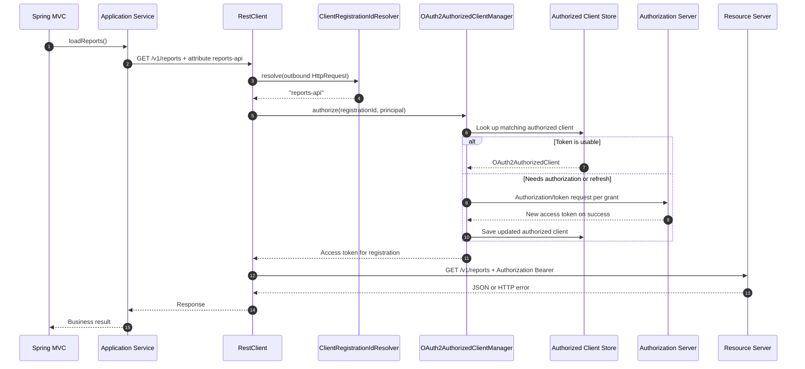
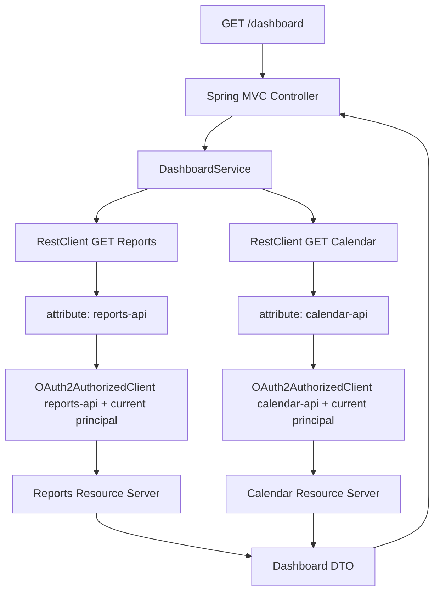

# 18.3. Selecting Client Registration Per Request

A **Spring Security OAuth 2.0 / OIDC Client** application can log users in with one identity provider while simultaneously calling multiple APIs protected by OAuth 2.0. Each API may require a **different client ID, scope, audience, token endpoint, or authorization mechanism**. Therefore, when the application makes an outbound HTTP request, the first question is: **which `ClientRegistration` should this request use?**

For example, the same Spring Boot portal might need:

- `company-login` to authenticate users via OpenID Connect;
- `reports-api` to read reports with an access token holding the `reports.read` scope;
- `calendar-api` to access calendars the user consented to;
- `billing-service` to call an internal service using `client_credentials`.

On the **Servlet stack**, Spring Security provides `OAuth2ClientHttpRequestInterceptor` to integrate OAuth2 with **Spring Framework `RestClient`**. The interceptor can resolve `clientRegistrationId` **directly from the attributes of each outbound request**:

```java
import static org.springframework.security.oauth2.client.web.client
    .RequestAttributeClientRegistrationIdResolver.clientRegistrationId;

// In Java, the static import above must be written on a single line.
String json = restClient.get()
    .uri("/v1/reports")
    .attributes(clientRegistrationId("reports-api"))
    .retrieve()
    .body(String.class);
```

The line `.attributes(clientRegistrationId("reports-api"))` is central: it selects the registration so Spring Security can look up or obtain a matching `OAuth2AuthorizedClient`, retrieve the access token, and attach `Authorization: Bearer ...` to the HTTP request.

This lesson explains **how to select a registration per request**, distinguishes it from the **principal** being used, covers ways to customize resolvers, behavior when an authorized client does not yet exist or has expired, and how to avoid sending tokens to the wrong API or for the wrong user.

> Scope: **Spring Boot 3.x, Spring Security 6.4+ / 6.5, Spring MVC Servlet**. `RestClient` has been available since Spring Framework 6.1; `OAuth2ClientHttpRequestInterceptor` and the request-attribute resolvers were introduced in Spring Security 6.4. If a project uses an older Spring Security version, check the corresponding APIs instead of copying this code verbatim.

## 1. Why Select a Registration at the Per-Request Level?

Suppose the portal calls three APIs:

```text
GET  https://reports.example.test/v1/reports
GET  https://calendar.example.test/v1/events
POST https://billing.example.test/v1/invoices
```

These APIs do not necessarily accept the same access token. The token used for Reports API may have its own audience and `reports.read` scope, while Calendar API requires `calendar.read`. Billing API might only accept machine-to-machine tokens.

| Outbound Request | Selected Registration | Typical Grant | Permission Context |
| --- | --- | --- | --- |
| Read reports | `reports-api` | `authorization_code` | User's permissions on Reports API |
| Read calendar | `calendar-api` | `authorization_code` | User's permissions on Calendar API |
| Send invoice | `billing-service` | `client_credentials` | Service permissions, not user permissions |
| Portal login | `company-login` | OIDC `authorization_code` | Identity authentication into the portal |

If you always use the token from `company-login` for every API, you may run into:

1. **`invalid_token`** because the token's audience does not match the Resource Server.
2. **`insufficient_scope`** because the token was not granted the required scope.
3. **Token leakage** if a Bearer token is sent to an endpoint outside its intended trust boundary.
4. **Identity confusion** if another service's or user's token is used.
5. **Broken authorization flows** when the right registration has not been authorized yet, but code mistakenly grabs another authorized client.

Choosing the right registration ensures Spring Security starts from a **valid client configuration**, though it **does not by itself guarantee the downstream API will allow the request**; the Resource Server still validates audience, scopes, and its own policies.

### 1.1. Registration ID Differs from Client ID and Provider ID

In:

```yaml
spring:
  security:
    oauth2:
      client:
        registration:
          reports-api:
            client-id: portal-reports-prod-123
            provider: company
```

there are three easily confused values:

- `reports-api` is Spring Security's internal **`registrationId`**.
- `portal-reports-prod-123` is the **`client_id`** known to the Authorization Server.
- `company` is the **provider key** sharing OP metadata.

With `clientRegistrationId("reports-api")`, you must pass the **registration ID**, not `client-id` or `provider`.

## 2. Components in Spring Security Servlet

Before writing code, distinguish four objects:

| Component | Role |
| --- | --- |
| **`ClientRegistration`** | Describes a registered client: ID, secret/auth method, grant, scopes, issuer/token endpoint |
| **`OAuth2AuthorizedClient`** | A client already issued an access token and optionally a refresh token, bound to a principal |
| **`OAuth2AuthorizedClientManager`** | Looks up, authorizes, or re-authorizes a client by registration and principal |
| **`OAuth2ClientHttpRequestInterceptor`** | Integrates the manager into `RestClient`; attaches the Bearer token to outbound HTTP requests |

An authorized client can be pictured as:

```text
OAuth2AuthorizedClient
  clientRegistration.registrationId = reports-api
  principalName                      = alice
  accessToken                        = <redacted>
  refreshToken                       = <optional>
```

Key takeaway: **the registration ID selects the *OAuth2 client*; the principal selects the *subject context* of the authorized client**.

When a user logs in via Company SSO and calls the Calendar API, you might have:

```text
Current Authentication:        alice (logged in with company-login)

Authorized client to use:      calendar-api + alice
                                |
                                +-- Calendar API access token
```

The login registration name and the registration name for calling an API **do not have to be the same**.

## 3. Default Mechanism: `RequestAttributeClientRegistrationIdResolver`

In Spring Security 6.4+, `OAuth2ClientHttpRequestInterceptor` uses a **`ClientRegistrationIdResolver`** to find the registration ID for an outbound request.

By default, the implementation is:

**`RequestAttributeClientRegistrationIdResolver`**.

It reads the value placed in **`HttpRequest` attributes** via the helper:

```java
RequestAttributeClientRegistrationIdResolver
    .clientRegistrationId("reports-api")
```

On `RestClient`, the usage syntax is:

```java
.attributes(clientRegistrationId("reports-api"))
```

These attributes are **internal metadata on Spring Framework's outbound request**, not query strings, cookies, or HTTP headers sent by the client to the Resource Server.

### 3.1. Processing Sequence



This is the logical flow of responsibilities—it does not mean every request calls the token endpoint. If a valid token is already stored, the manager usually reuses it; when it is about to expire, the provider can refresh/renew it as configured.

If an authorization code requires user interaction and no grant exists yet, the controller request may be redirected to an authorization flow or fail depending on `SecurityFilterChain` and the manager. **Do not assume the manager always issues a token immediately**.

### 3.2. What Happens If the Attribute Is Not Set?

When using the default resolver without setting `clientRegistrationId(...)`, the resolver has no registration ID specified by a request attribute. Do not assume it will automatically pick the logged-in client or the first client in configuration.

For APIs calling a specific provider, **explicitly specify the registration on each request** to avoid relying on undesigned fallback behavior.

## 4. Spring Boot Setup for Multiple Registrations

Suppose an application has one OIDC login and two OAuth2 clients for APIs. Example:

```yaml
spring:
  security:
    oauth2:
      client:
        registration:
          company-login:
            provider: company
            client-id: ${LOGIN_CLIENT_ID}
            client-secret: ${LOGIN_CLIENT_SECRET}
            authorization-grant-type: authorization_code
            redirect-uri: "{baseUrl}/login/oauth2/code/{registrationId}"
            scope:
              - openid
              - profile
              - email

          reports-api:
            provider: company
            client-id: ${REPORTS_CLIENT_ID}
            client-secret: ${REPORTS_CLIENT_SECRET}
            authorization-grant-type: authorization_code
            redirect-uri: "{baseUrl}/login/oauth2/code/{registrationId}"
            scope:
              - reports.read

          calendar-api:
            provider: partner
            client-id: ${CALENDAR_CLIENT_ID}
            client-secret: ${CALENDAR_CLIENT_SECRET}
            authorization-grant-type: authorization_code
            redirect-uri: "{baseUrl}/login/oauth2/code/{registrationId}"
            scope:
              - calendar.read

          billing-service:
            provider: company
            client-id: ${BILLING_CLIENT_ID}
            client-secret: ${BILLING_CLIENT_SECRET}
            authorization-grant-type: client_credentials
            scope:
              - billing.write

        provider:
          company:
            issuer-uri: https://id.example.test/realms/company
          partner:
            issuer-uri: https://login.partner.example.test/tenant
```

**Scopes like `reports.read`, `calendar.read`, and `billing.write` are examples**, valid only if the corresponding Authorization Server/Resource Server defines and grants them.

For `billing-service`, the Authorization Server comes from provider `company`, but the grant is `client_credentials`; it does not use a user's login session to issue a delegated token.

### 4.1. Maven Dependencies

```xml
<dependencies>
    <dependency>
        <groupId>org.springframework.boot</groupId>
        <artifactId>spring-boot-starter-web</artifactId>
    </dependency>
    <dependency>
        <groupId>org.springframework.boot</groupId>
        <artifactId>spring-boot-starter-security</artifactId>
    </dependency>
    <dependency>
        <groupId>org.springframework.boot</groupId>
        <artifactId>spring-boot-starter-oauth2-client</artifactId>
    </dependency>
</dependencies>
```

This example relies on the Spring Boot BOM managing compatible Spring Framework/Spring Security versions. If using Spring Security below 6.4, `OAuth2ClientHttpRequestInterceptor` may not exist; upgrade or use another suitable client integration.

### 4.2. `SecurityFilterChain`

```java
import org.springframework.context.annotation.Bean;
import org.springframework.context.annotation.Configuration;
import org.springframework.security.config.Customizer;
import org.springframework.security.config.annotation.web.builders.HttpSecurity;
import org.springframework.security.web.SecurityFilterChain;

@Configuration
class SecurityConfig {

    @Bean
    SecurityFilterChain filterChain(HttpSecurity http) throws Exception {
        return http
            .authorizeHttpRequests(auth -> auth
                .requestMatchers("/", "/error", "/public/**").permitAll()
                .anyRequest().authenticated())
            .oauth2Login(Customizer.withDefaults())
            .oauth2Client(Customizer.withDefaults())
            .build();
    }
}
```

`oauth2Login()` serves browser login; `oauth2Client()` provides OAuth2 Client capabilities in the `SecurityFilterChain`. Specific grant handling and client credentials also depend on `OAuth2AuthorizedClientManager` and registration configuration.

## 5. Configuring `RestClient` with `OAuth2ClientHttpRequestInterceptor`

The typical pattern is creating a `RestClient` bean with an interceptor using `OAuth2AuthorizedClientManager`:

```java
import org.springframework.context.annotation.Bean;
import org.springframework.context.annotation.Configuration;
import org.springframework.security.oauth2.client.OAuth2AuthorizedClientManager;
import org.springframework.security.oauth2.client.web.client.OAuth2ClientHttpRequestInterceptor;
import org.springframework.web.client.RestClient;

@Configuration
class OAuth2RestClientConfig {

    @Bean
    RestClient oauth2RestClient(
            RestClient.Builder builder,
            OAuth2AuthorizedClientManager authorizedClientManager) {

        OAuth2ClientHttpRequestInterceptor interceptor =
            new OAuth2ClientHttpRequestInterceptor(authorizedClientManager);

        return builder
            .requestInterceptor(interceptor)
            .build();
    }
}
```

By default, the interceptor uses `RequestAttributeClientRegistrationIdResolver` to locate the registration ID. Therefore, **there is no need to call `setClientRegistrationIdResolver(...)` yourself** just to support `.attributes(clientRegistrationId("..."))`.

Note that the bean above creates a RestClient that could be used to call multiple hosts. This is to demonstrate the mechanism; for production, **restrict allowed HTTP destinations** and consider splitting `RestClient` beans per API to prevent attaching tokens to the wrong host.

### 5.1. How Is the Token Attached to the Outbound Request?

Once the interceptor resolves the authorized client:

```http
GET /v1/reports HTTP/1.1
Host: reports.example.test
Authorization: Bearer <access-token-for-reports-api>
```

Spring Security places the Bearer access token into the header, not the ID Token. If the API expects a token with a different audience, choosing the right registration is only step one; the provider must issue a token suited for that Resource Server.

### 5.2. Never Serialize an Entire Authorized Client to JSON

An `OAuth2AuthorizedClient` object can hold access tokens and refresh tokens. Never return this object from an MVC controller, never log the entire object, and never place tokens in URLs.

## 6. Selecting Registration Per Request: The Most Basic Way

In a Java file, the static import must be on **one line**:

```java
import static org.springframework.security.oauth2.client.web.client.RequestAttributeClientRegistrationIdResolver.clientRegistrationId;
```

Example service sharing one `RestClient`, while selecting different registrations on two requests:

```java
import static org.springframework.security.oauth2.client.web.client.RequestAttributeClientRegistrationIdResolver.clientRegistrationId;

import org.springframework.stereotype.Service;
import org.springframework.web.client.RestClient;

@Service
class DashboardAggregator {

    private final RestClient oauth2RestClient;

    DashboardAggregator(RestClient oauth2RestClient) {
        this.oauth2RestClient = oauth2RestClient;
    }

    String readReports() {
        return oauth2RestClient.get()
            .uri("https://reports.example.test/v1/reports")
            .attributes(clientRegistrationId("reports-api"))
            .retrieve()
            .body(String.class);
    }

    String readCalendar() {
        return oauth2RestClient.get()
            .uri("https://calendar.example.test/v1/events")
            .attributes(clientRegistrationId("calendar-api"))
            .retrieve()
            .body(String.class);
    }
}
```

Even with the same RestClient bean, the two requests carry different attributes and the interceptor resolves the authorized client by the corresponding `registrationId`.

**Important:** API URLs should come from trusted configuration. In the example, URLs are hardcoded for illustration; never replace them with an arbitrary `userInputUrl` and attach a Bearer token.

### 6.1. Request-Scoped Nature of Attributes

```text
Outbound request A
  URI: https://reports.example.test/v1/reports
  attributes: clientRegistrationId = reports-api

Outbound request B
  URI: https://calendar.example.test/v1/events
  attributes: clientRegistrationId = calendar-api
```

This is **metadata for each individual HTTP request**, not a global configuration change on the interceptor. Concurrent requests do not compete over setting a global `defaultRegistrationId`.

### 6.2. Do Not Use Mutable Global Variables to Select a Client

Anti-pattern:

```java
// Wrong: client selection state shared across multiple requests.
static String CURRENT_REGISTRATION = "reports-api";

// One thread switches to calendar-api;
// another thread still wants to use reports-api.
```

This pattern causes race conditions and can leak tokens to the wrong API. **Specifying the registration in each request's attributes** keeps contexts cleanly isolated.

## 7. Splitting `RestClient` Per API to Reduce Token Leakage Risk

If the system calls multiple Resource Servers with different trust boundaries, a stronger structure is creating **one RestClient with a fixed base URL per API**, while still setting the registration ID on each request:

```java
import org.springframework.beans.factory.annotation.Qualifier;
import org.springframework.context.annotation.Bean;
import org.springframework.context.annotation.Configuration;
import org.springframework.security.oauth2.client.OAuth2AuthorizedClientManager;
import org.springframework.security.oauth2.client.web.client.OAuth2ClientHttpRequestInterceptor;
import org.springframework.web.client.RestClient;

@Configuration
class DownstreamClientConfig {

    @Bean
    RestClient reportsRestClient(
            RestClient.Builder builder,
            OAuth2AuthorizedClientManager manager) {

        return builder.clone()
            .baseUrl("https://reports.example.test")
            .requestInterceptor(
                new OAuth2ClientHttpRequestInterceptor(manager))
            .build();
    }

    @Bean
    RestClient calendarRestClient(
            RestClient.Builder builder,
            OAuth2AuthorizedClientManager manager) {

        return builder.clone()
            .baseUrl("https://calendar.example.test")
            .requestInterceptor(
                new OAuth2ClientHttpRequestInterceptor(manager))
            .build();
    }
}
```

Use `@Qualifier` when injecting:

```java
import static org.springframework.security.oauth2.client.web.client.RequestAttributeClientRegistrationIdResolver.clientRegistrationId;

import org.springframework.beans.factory.annotation.Qualifier;
import org.springframework.stereotype.Service;
import org.springframework.web.client.RestClient;

@Service
class ReportsApiClient {

    private final RestClient restClient;

    ReportsApiClient(@Qualifier("reportsRestClient") RestClient restClient) {
        this.restClient = restClient;
    }

    String mine() {
        return restClient.get()
            .uri("/v1/reports/mine")
            .attributes(clientRegistrationId("reports-api"))
            .retrieve()
            .body(String.class);
    }
}
```

`baseUrl` groups endpoint configuration per API, yet **does not automatically prevent token leakage** if the service still accepts arbitrary absolute URIs, unguarded redirects, or misuses the `RestClient`. Apply destination allowlists and outbound network policies when needed.

### 7.1. Why Still Keep the Attribute If There Is Only One API?

Because registration is a critical security dependency. The code:

```java
.attributes(clientRegistrationId("reports-api"))
```

tells readers which OAuth2 client the request needs. It prevents situations where the RestClient's default changes, new registrations are added, or the bean is reused in another service and accidentally sends the wrong token.

## 8. Selecting Client Registration Based on Business Logic via an Allowlist

Some applications receive a business parameter such as `dataSource=REPORTS` or `dataSource=CALENDAR`. You can map it to an **allowed set of registration IDs** instead of passing values directly from the HTTP request into `clientRegistrationId(...)`.

Define an enum:

```java
enum DataSource {
    REPORTS,
    CALENDAR
}
```

Explicit mapping:

```java
final class OAuth2ClientSelection {

    private OAuth2ClientSelection() {
    }

    static String registrationFor(DataSource source) {
        return switch (source) {
            case REPORTS -> "reports-api";
            case CALENDAR -> "calendar-api";
        };
    }
}
```

Use it in the service:

```java
String registrationId = OAuth2ClientSelection.registrationFor(source);

String result = restClient.get()
    .uri(trustedUriFor(source))
    .attributes(clientRegistrationId(registrationId))
    .retrieve()
    .body(String.class);
```

`trustedUriFor(source)` is an **application-implemented function** mapping the enum to a fixed/trusted endpoint. Do not let users submit an arbitrary URL and then pick a registration by substring matching on the hostname.

### 8.1. Why Not Take Registration ID Directly from a Query Parameter?

Wrong:

```java
@GetMapping("/proxy")
String proxy(
        @RequestParam String registrationId,
        @RequestParam String url) {

    return restClient.get()
        .uri(url)
        .attributes(clientRegistrationId(registrationId))
        .retrieve()
        .body(String.class);
}
```

This is an **unsafe** example. Callers can probe internal client registration names and specify a URL to receive the Bearer token. It introduces token exfiltration, SSRF, and unintended client authorization risks.

Proper design:

- Users can only select **business features** they are authorized to use.
- The backend maps the feature to an **allowlisted registration and destination**.
- The backend still enforces Authentication/role/tenant/resource authorization.
- Tokens are only sent to Resource Servers permitted to receive them.

### 8.2. Do Not Equate Registration Selection with User Authorization

Mapping `dataSource=CALENDAR` to `calendar-api` does not prove the user is allowed to read calendars. Before calling the API, the application must verify the request falls within the user's permissions, and the downstream API independently checks token scopes/audience.

## 9. Customizing `ClientRegistrationIdResolver`

Selecting registration via attributes by default is recommended for most systems. However, there are cases where you may want a **custom `ClientRegistrationIdResolver`**; for instance, when multiple call sites talk to one service and registration selection rules are centralized by internal endpoint.

The API takes the form:

```java
OAuth2ClientHttpRequestInterceptor.ClientRegistrationIdResolver
```

Logical functional contract:

```java
String resolve(HttpRequest request);
```

You can configure it via:

```java
interceptor.setClientRegistrationIdResolver(customResolver);
```

### 9.1. Example Resolver from a Trusted Host List

```java
import org.springframework.context.annotation.Bean;
import org.springframework.context.annotation.Configuration;
import org.springframework.security.oauth2.client.OAuth2AuthorizedClientManager;
import org.springframework.security.oauth2.client.web.client.OAuth2ClientHttpRequestInterceptor;
import org.springframework.security.oauth2.client.web.client.OAuth2ClientHttpRequestInterceptor.ClientRegistrationIdResolver;
import org.springframework.web.client.RestClient;

@Configuration
class HostMappedRestClientConfig {

    @Bean
    RestClient hostMappedRestClient(
            OAuth2AuthorizedClientManager manager) {

        ClientRegistrationIdResolver resolver = request -> {
            String scheme = request.getURI().getScheme();
            String host = request.getURI().getHost();

            if (!"https".equalsIgnoreCase(scheme)) {
                return null;
            }

            if ("reports.example.test".equalsIgnoreCase(host)) {
                return "reports-api";
            }
            if ("calendar.example.test".equalsIgnoreCase(host)) {
                return "calendar-api";
            }
            return null;
        };

        OAuth2ClientHttpRequestInterceptor interceptor =
            new OAuth2ClientHttpRequestInterceptor(manager);

        interceptor.setClientRegistrationIdResolver(resolver);

        return RestClient.builder()
            .requestInterceptor(interceptor)
            .build();
    }
}
```

This example shows how to use the extension point; **host matching alone is not a complete outbound security policy**. In production, also verify scheme, port, redirect behavior, DNS/network policy, endpoint paths, and whether request destinations can be influenced by user input.

If the resolver returns `null`, do not assume the HTTP client will still pick another token automatically. For requests requiring OAuth2, the application should explicitly handle the missing registration case or block unauthenticated requests from reaching sensitive APIs.

### 9.2. Should You Customize the Resolver to Read the Current Login Registration?

Spring Security shows an example resolver reading `OAuth2AuthenticationToken`:

```java
import org.springframework.security.core.Authentication;
import org.springframework.security.core.context.SecurityContextHolder;
import org.springframework.security.oauth2.client.authentication.OAuth2AuthenticationToken;
import org.springframework.security.oauth2.client.web.client.OAuth2ClientHttpRequestInterceptor.ClientRegistrationIdResolver;

ClientRegistrationIdResolver resolver = request -> {
    Authentication authentication =
        SecurityContextHolder.getContext().getAuthentication();

    return (authentication instanceof OAuth2AuthenticationToken oauth2)
        ? oauth2.getAuthorizedClientRegistrationId()
        : null;
};
```

This is a reasonable choice **only when the API genuinely needs the token from the provider used for login**. If you logged in with `company-login` yet need to call `reports-api`, this resolver may select the wrong client even though the session is valid.

Therefore, prefer an **explicit registration ID on each outbound request** for multi-API or multi-provider applications.

### 9.3. When Replacing the Resolver, Do Default Attributes Still Work?

Do not assume so. Calling `setClientRegistrationIdResolver(customResolver)` replaces the lookup strategy. If the custom resolver only inspects the host and ignores attributes, then:

```java
.attributes(clientRegistrationId("reports-api"))
```

may **no longer be the deciding source** for that interceptor.

If you need to combine both strategies, make the precedence explicit. For example:

```java
import org.springframework.security.oauth2.client.web.client.RequestAttributeClientRegistrationIdResolver;

RequestAttributeClientRegistrationIdResolver fromAttribute =
    new RequestAttributeClientRegistrationIdResolver();

ClientRegistrationIdResolver resolver = request -> {
    String explicit = fromAttribute.resolve(request);

    if (explicit != null) {
        return explicit;
    }

    // Only fall back when the request targets a trusted endpoint group.
    return null;
};
```

Here `ClientRegistrationIdResolver` is the nested interface imported from `OAuth2ClientHttpRequestInterceptor`. A real system might replace `return null` with an allowlisted fallback; never arbitrarily fall back to the login client or a high-privilege client.

## 10. Registration and Principal Are Two Distinct Selection Dimensions

One of the most serious mistakes when integrating multiple REST APIs is focusing only on `clientRegistrationId` while forgetting the **principal**.

Spring Security typically identifies an authorized client by **registration ID + principal name**. For example:

```text
(reports-api, alice) -> Alice's access token
(reports-api, bob)   -> Bob's access token

(billing-service, billing-worker) -> service's access token
```

You cannot take Alice's token to call an API on Bob's behalf simply because both use `reports-api`.

### 10.1. Default `PrincipalResolver`

In Servlet requests, `OAuth2ClientHttpRequestInterceptor` defaults to:

**`SecurityContextHolderPrincipalResolver`**.

It reads the current `Authentication` from `SecurityContextHolder`. In a login session, that is usually the `Authentication` of the user sending the request.

When you write:

```java
restClient.get()
    .uri("/v1/reports")
    .attributes(clientRegistrationId("reports-api"))
    .retrieve()
    .body(String.class);
```

and the code runs inside Alice's request, the authorized client is usually looked up under **`reports-api + Alice`**.

### 10.2. Service-Level Principal for `client_credentials`

For `billing-service` using `client_credentials`, the token represents the **application's** identity, not Alice. Depending on how authorized clients are managed, you may want to bind a stable technical principal such as `billing-worker`.

Spring Security supports:

```java
interceptor.setPrincipalResolver(new RequestAttributePrincipalResolver());
```

and in the outbound request:

```java
import static org.springframework.security.oauth2.client.web.client.RequestAttributeClientRegistrationIdResolver.clientRegistrationId;
import static org.springframework.security.oauth2.client.web.client.RequestAttributePrincipalResolver.principal;

String result = restClient.get()
    .uri("/v1/billing/status")
    .attributes(clientRegistrationId("billing-service"))
    .attributes(principal("billing-worker"))
    .retrieve()
    .body(String.class);
```

**Only use this pattern with a RestClient/interceptor that actually configures `RequestAttributePrincipalResolver`**. If the default `SecurityContextHolderPrincipalResolver` is still active, do not assume `principal("billing-worker")` will be read.

### 10.3. Why Not Let HTTP Callers Pass an Arbitrary Principal?

Wrong:

```java
// DO NOT DO THIS:
String principal = request.getParameter("principalName");
restClient.get()
    .attributes(clientRegistrationId("reports-api"))
    .attributes(principal(principal))
    .retrieve()
    .body(String.class);
```

An attacker could try to read an authorized client stored for another principal if storage and additional controls are weak.

**The principal must come from a trusted `Authentication` or a fixed service name managed by the backend**, never from raw user input.

## 11. Configuring a Dedicated `RestClient` for Machine-to-Machine

To avoid mixing up principals, you can create a RestClient dedicated to `client_credentials`:

```java
import org.springframework.context.annotation.Bean;
import org.springframework.context.annotation.Configuration;
import org.springframework.security.oauth2.client.OAuth2AuthorizedClientManager;
import org.springframework.security.oauth2.client.web.client.OAuth2ClientHttpRequestInterceptor;
import org.springframework.security.oauth2.client.web.client.RequestAttributePrincipalResolver;
import org.springframework.web.client.RestClient;

@Configuration
class BillingClientConfig {

    @Bean
    RestClient billingRestClient(
            OAuth2AuthorizedClientManager serviceManager) {

        OAuth2ClientHttpRequestInterceptor interceptor =
            new OAuth2ClientHttpRequestInterceptor(serviceManager);

        interceptor.setPrincipalResolver(
            new RequestAttributePrincipalResolver());

        return RestClient.builder()
            .baseUrl("https://billing.example.test")
            .requestInterceptor(interceptor)
            .build();
    }
}
```

Service calling the API:

```java
import static org.springframework.security.oauth2.client.web.client.RequestAttributeClientRegistrationIdResolver.clientRegistrationId;
import static org.springframework.security.oauth2.client.web.client.RequestAttributePrincipalResolver.principal;

import org.springframework.stereotype.Service;
import org.springframework.web.client.RestClient;

@Service
class BillingGateway {

    private final RestClient billingRestClient;

    BillingGateway(RestClient billingRestClient) {
        this.billingRestClient = billingRestClient;
    }

    String getStatus() {
        return billingRestClient.get()
            .uri("/v1/status")
            .attributes(clientRegistrationId("billing-service"))
            .attributes(principal("billing-worker"))
            .retrieve()
            .body(String.class);
    }
}
```

Here `serviceManager` must be an `OAuth2AuthorizedClientManager` configured for client credentials and suitable storage. If multiple manager beans exist, use `@Qualifier` to inject the right bean. The example does not automatically define that manager.

**Do not treat a user's `HttpServletRequest` as a prerequisite for a machine-to-machine token**. For background jobs, the right approach is `AuthorizedClientServiceOAuth2AuthorizedClientManager` and `OAuth2AuthorizedClientService`.

## 12. Choosing the Right Manager for Servlet vs. Background

In the Spring Security ecosystem, there are two common managers:

| Manager | Suitable Context | Authorized-Client Storage |
| --- | --- | --- |
| **`DefaultOAuth2AuthorizedClientManager`** | Servlet request/response | `OAuth2AuthorizedClientRepository` |
| **`AuthorizedClientServiceOAuth2AuthorizedClientManager`** | Service/background, independent of Servlet requests | `OAuth2AuthorizedClientService` |

If a controller is handling a browser request, the Servlet manager is typically used. If a job runs hourly without browser Authentication and uses `client_credentials`, the service-level manager is usually more appropriate.

### 12.1. Configuring the Servlet Manager

```java
import org.springframework.context.annotation.Bean;
import org.springframework.context.annotation.Configuration;
import org.springframework.security.oauth2.client.OAuth2AuthorizedClientManager;
import org.springframework.security.oauth2.client.OAuth2AuthorizedClientProvider;
import org.springframework.security.oauth2.client.OAuth2AuthorizedClientProviderBuilder;
import org.springframework.security.oauth2.client.registration.ClientRegistrationRepository;
import org.springframework.security.oauth2.client.web.DefaultOAuth2AuthorizedClientManager;
import org.springframework.security.oauth2.client.web.OAuth2AuthorizedClientRepository;

@Configuration
class ServletManagerConfig {

    @Bean
    OAuth2AuthorizedClientManager servletClientManager(
            ClientRegistrationRepository registrations,
            OAuth2AuthorizedClientRepository authorizedClients) {

        OAuth2AuthorizedClientProvider provider =
            OAuth2AuthorizedClientProviderBuilder.builder()
                .authorizationCode()
                .refreshToken()
                .build();

        DefaultOAuth2AuthorizedClientManager manager =
            new DefaultOAuth2AuthorizedClientManager(
                registrations, authorizedClients);

        manager.setAuthorizedClientProvider(provider);
        return manager;
    }
}
```

Do not define a custom manager bean merely to use `clientRegistrationId(...)`. In a typical Spring Boot application, the framework can auto-configure a suitable manager; this example is for when you want explicit control over grants and storage.

### 12.2. Configuring a Service Manager for `client_credentials`

```java
import org.springframework.context.annotation.Bean;
import org.springframework.context.annotation.Configuration;
import org.springframework.security.oauth2.client.AuthorizedClientServiceOAuth2AuthorizedClientManager;
import org.springframework.security.oauth2.client.OAuth2AuthorizedClientManager;
import org.springframework.security.oauth2.client.OAuth2AuthorizedClientProviderBuilder;
import org.springframework.security.oauth2.client.OAuth2AuthorizedClientService;
import org.springframework.security.oauth2.client.registration.ClientRegistrationRepository;

@Configuration
class MachineManagerConfig {

    @Bean
    OAuth2AuthorizedClientManager machineClientManager(
            ClientRegistrationRepository registrations,
            OAuth2AuthorizedClientService storage) {

        AuthorizedClientServiceOAuth2AuthorizedClientManager manager =
            new AuthorizedClientServiceOAuth2AuthorizedClientManager(
                registrations, storage);

        manager.setAuthorizedClientProvider(
            OAuth2AuthorizedClientProviderBuilder.builder()
                .clientCredentials()
                .build());

        return manager;
    }
}
```

In a real project, the two managers usually have distinct names/qualifiers. Never let user-delegated RestClients accidentally use a service principal, or vice versa.

## 13. Selecting Registrations Dynamically While Keeping Type Safety

In large applications with many integrations, repeating `"reports-api"` strings across the codebase invites typos. You can create a dedicated client-selection policy type:

```java
enum Downstream {
    REPORTS("reports-api", "https://reports.example.test"),
    CALENDAR("calendar-api", "https://calendar.example.test");

    private final String registrationId;
    private final String baseUrl;

    Downstream(String registrationId, String baseUrl) {
        this.registrationId = registrationId;
        this.baseUrl = baseUrl;
    }

    String registrationId() {
        return registrationId;
    }

    String baseUrl() {
        return baseUrl;
    }
}
```

An integration service can accept `Downstream` from authorized business logic and map the registration:

```java
String registrationId = downstream.registrationId();

String body = restClient.get()
    .uri(downstream.baseUrl() + "/v1/summary")
    .attributes(clientRegistrationId(registrationId))
    .retrieve()
    .body(String.class);
```

**This pattern is only safe when `Downstream` is a backend enum/allowlist and the caller has already been properly authorized.** If users can supply full URLs and the backend constructs enums arbitrarily from hostnames, the same risks remain.

### 13.1. Separating Routing and Authorization

There are three separate questions:

1. **Routing:** which host/path does the request go to?
2. **OAuth2 client selection:** which registration provides the access token?
3. **Authorization:** does the user/service have permission to call the API for that specific tenant/resource?

Answering the second question does not automatically answer the first or third.

## 14. Authorization Code Flow and Login Do Not Automatically Grant API Permissions

Suppose the browser logged into the portal via `company-login`. A controller calls:

```java
restClient.get()
    .uri("https://calendar.example.test/v1/events")
    .attributes(clientRegistrationId("calendar-api"))
    .retrieve()
    .body(String.class);
```

If the user **has not authorized `calendar-api` yet**, the manager may need to initiate an Authorization Code Flow for that client. In a Servlet context, redirecting to the OP may occur through the authorization redirect mechanism; the current request cannot receive an API response until the flow completes.

**Do not silently fall back to the `company-login` token** if `calendar-api` has no token yet. The login token may not be permitted to access the Calendar API.

### 14.1. Designing UX for Unconnected Integrations

Example:

```text
Portal dashboard
    |
    v
User opens Calendar section
    |
    v
Does OAuth2AuthorizedClient(calendar-api, user) exist?
    |
    +-- Yes --> call Calendar API
    |
    +-- No  --> "Connect Calendar" button
                    |
                    v
                Authorization Code Flow
                    |
                    v
                Consent at provider
                    |
                    v
                Authorized client saved
                    |
                    v
                Call Calendar API
```

The UX may benefit from an explicit connect step instead of having every dashboard request trigger a 302 redirect to the OP. If the user denies consent, display a disconnected state and avoid redirect loops.

### 14.2. Selecting the Right Registration Does Not Guarantee Scopes Are Granted

In YAML, you can request `scope=calendar.read`. Still, the OP must actually permit and issue that scope. When an API returns `insufficient_scope`, switching to another registration is not the default solution; inspect consent, client permissions, and resource policies.

## 15. Expired Tokens, Refresh, and Reauthorization Per Registration

Each `OAuth2AuthorizedClient` can hold:

```text
ClientRegistration
Principal name
Access token
Optional refresh token
```

When making an outbound API call, the manager/provider can:

- Reuse an unexpired access token;
- Refresh the access token if a valid refresh token exists and the provider supports it;
- Obtain a new token using `client_credentials` when applicable;
- Trigger an authorization code flow when user interaction is required;
- Report an error if client/grant/policy prevents completion.

### 15.1. Refresh Applies Only to the Matching Authorized Client

```text
(reports-api, alice)   -> A1 / R1
(calendar-api, alice)  -> A2 / R2
```

Reports API's refresh token R1 **must not be used to refresh Calendar API**. The manager must resolve the exact registration and principal.

### 15.2. When Refresh Fails with `invalid_grant`

If the Authorization Server returns `invalid_grant`, the refresh token may be expired, revoked, rotated, or otherwise invalid. The stale authorized client may need to be removed from the repository/service and the user prompted to re-authorize.

Do not retry indefinitely with the same refresh token. Distinguish refresh token errors from API 401 errors caused by wrong audiences or tokens belonging to another registration.

### 15.3. Concurrent Refreshes Across Multiple Requests

If two requests for the same principal/registration concurrently refresh a rotating refresh token, a race condition can occur. In multi-instance systems, persist authorized clients with proper versioning, consider locking/CAS, and prevent failed requests from deleting a newly saved token.

Setting registration per request does not by itself solve token storage concurrency; that is an additional responsibility of manager/store configuration.

## 16. Handling Resource Server Failures Properly

Spring Security allows configuring an `OAuth2AuthorizationFailureHandler` on `OAuth2ClientHttpRequestInterceptor`.

Example using a Servlet repository:

```java
import org.springframework.context.annotation.Bean;
import org.springframework.context.annotation.Configuration;
import org.springframework.security.oauth2.client.OAuth2AuthorizationFailureHandler;
import org.springframework.security.oauth2.client.OAuth2AuthorizedClientManager;
import org.springframework.security.oauth2.client.web.OAuth2AuthorizedClientRepository;
import org.springframework.security.oauth2.client.web.client.OAuth2ClientHttpRequestInterceptor;
import org.springframework.web.client.RestClient;

@Configuration
class RestClientFailureConfig {

    @Bean
    RestClient reportsRestClient(
            OAuth2AuthorizedClientManager manager,
            OAuth2AuthorizedClientRepository repository) {

        OAuth2ClientHttpRequestInterceptor interceptor =
            new OAuth2ClientHttpRequestInterceptor(manager);

        OAuth2AuthorizationFailureHandler failureHandler =
            OAuth2ClientHttpRequestInterceptor
                .authorizationFailureHandler(repository);

        interceptor.setAuthorizationFailureHandler(failureHandler);

        return RestClient.builder()
            .baseUrl("https://reports.example.test")
            .requestInterceptor(interceptor)
            .build();
    }
}
```

If clients/tokens are stored in `OAuth2AuthorizedClientService`, Spring Security also provides a factory method taking the service to create the corresponding handler. **The failure handler must delete from the same store the manager uses to save authorized clients**.

### 16.1. `401 invalid_token` vs. `403 insufficient_scope`

| Response | Common Meaning | Action to Consider |
| --- | --- | --- |
| 401 + Bearer `invalid_token` | Access token rejected | Remove faulty authorized client if handler applies; obtain a new token when allowed |
| 403 + Bearer `insufficient_scope` | Token may be valid but lacks permissions | Check scopes/consent; do not delete and retry infinitely |
| 401 without clear OAuth2 challenge | Could be an API gateway or other authentication | Locate error source; do not assume token revocation |
| 429, 503, timeout | Infrastructure/rate limit | Bounded retry with proper policy; do not swap registrations |
| `invalid_grant` on refresh | Token endpoint rejected refresh token | Stop using old refresh token; clean up and re-authorize when needed |

Do not treat `invalid_token` as a reason to automatically cycle through **every registration** looking for a token the API accepts. Doing so risks sending credentials with the wrong audience to untrusted places.

## 17. Restricting Destinations to Prevent Access Token Leakage

**This is the most critical risk when sharing a RestClient across multiple registrations.**

An outbound request involves two decisions:

```text
destination URL           = https://reports.example.test/v1/reports
registration ID           = reports-api
                                 |
                                 v
                   Authorization: Bearer <reports-access-token>
```

If the destination can be changed by a user to `https://untrusted.example.test/collect` while the registration stays `reports-api`, the token can be exfiltrated.

### 17.1. Never Send Bearer Tokens to Arbitrary URLs

Wrong:

```java
// Dangerous: caller controls both destination and client.
String target = request.getParameter("target");
String registration = request.getParameter("client");

String data = restClient.get()
    .uri(target)
    .attributes(clientRegistrationId(registration))
    .retrieve()
    .body(String.class);
```

Risks include **SSRF**, token exfiltration, unintended internal network access, and picking a higher-privilege client than intended.

### 17.2. Destination Allowlist

A secure design needs:

1. Permitted host, scheme, and port per integration.
2. API paths bound to controlled business features and policies.
3. Registration ID mapped exclusively by the backend from the chosen integration.
4. Never forwarding the `Authorization` header across untrusted redirects.
5. Proper TLS and DNS/network egress policies.
6. Never reusing the same token for APIs with different audiences.
7. Never letting callers pick an arbitrary `principalName` or service identity.

**A fixed base URL does not automatically block every absolute URI** a caller might pass. For strong guarantees, enforce controls at the service adapter and network layers, not just in a builder configuration.

### 17.3. Avoid Automatically Falling Back to Higher-Privilege Clients

Wrong:

```text
reports-api fails
    -> try calendar-api
    -> try billing-service
    -> try company-admin
    -> use whichever token succeeds first
```

This breaks the principle of least privilege and can send tokens to the wrong audience. Treat registration selection as a **configuration/authorization decision**, not a retry algorithm.

## 18. Multi-Tenancy and Registration Mapping

In a multi-tenant system, each tenant may have its own `ClientRegistration`, or tenants may share a registration depending on the Authorization Server model.

Example:

```text
tenant-west -> reports-west
tenant-east -> reports-east
```

Do not do:

```java
String registrationId = "reports-" + request.getParameter("tenant");
```

because an HTTP caller could guess another tenant's registration.

Instead:

1. Authenticate the user and determine tenant membership from a trusted internal source.
2. Select `tenantId` after authorization checks.
3. Look up an explicit configured mapping **`tenantId -> registrationId`**.
4. Select the API destination matching that tenant.
5. Use suitable principal/token storage keys to prevent mixing authorized clients across tenants.

### 18.1. Does the Same Registration Mean Shared Across All Users?

No. A single registration can be authorized by many users with different tokens:

```text
(reports-west, alice) -> Alice's token
(reports-west, bob)   -> Bob's token
```

Even when `registrationId` is identical, the manager must preserve the right principal. For app-only `client_credentials`, a technical principal may be shared per service policy, yet must never turn into a user-impersonation token when the API requires delegated authorization.

### 18.2. When Registration Changes by Tenant

If a user switches active tenants, select the registration/destination for the tenant **verified by the backend on that request**, not an unverified value sent by the client. Having access to tenant A does not grant access to tenant B.

## 19. Comparing Three Client-Selection Approaches in Spring Security

| Approach | Mechanism | When Appropriate | Risk If Misused |
| --- | --- | --- | --- |
| **Per-request attributes** | `.attributes(clientRegistrationId("reports-api"))` | Most RestClients integrating multiple APIs where the client should be explicit at call sites | Passing registration from unvalidated input |
| **Custom `ClientRegistrationIdResolver`** | `interceptor.setClientRegistrationIdResolver(...)` | One uniform policy across known outbound requests | Resolver reads untrusted URLs or falls back improperly |
| **Login registration from `Authentication`** | `OAuth2AuthenticationToken.getAuthorizedClientRegistrationId()` | API uses the exact authorized client from OP login | Login token accidentally sent to a different API registration |

Default request attributes are usually the **most maintainable choice** when both request URLs and registrations are decided by the backend.

### 19.1. Is `@RegisteredOAuth2AuthorizedClient` the Same as Attributes?

**Not quite**:

```java
@GetMapping("/my-reports")
String myReports(
    @RegisteredOAuth2AuthorizedClient("reports-api")
    OAuth2AuthorizedClient authorizedClient) {
    // ...
}
```

`@RegisteredOAuth2AuthorizedClient` resolves an **MVC method argument** into an authorized client. It fits when a controller needs the specific object/token.

By contrast:

```java
restClient.get()
    .uri("/v1/reports")
    .attributes(clientRegistrationId("reports-api"))
    .retrieve()
    .body(String.class);
```

is an **outbound RestClient request attribute**. It specifies the registration so the interceptor/manager handles token management automatically.

Both build on the OAuth2 Client infrastructure, yet live at **two different integration points**. Do not attach `@RegisteredOAuth2AuthorizedClient` to a plain service method expecting Spring to inject that parameter.

### 19.2. `WebClient` in Servlet Differs from `RestClient`

`ServletOAuth2AuthorizedClientExchangeFilterFunction` supports `WebClient` in Servlet environments, using **its own helper API and filter function**. Do not copy WebClient's static import onto `OAuth2ClientHttpRequestInterceptor`.

In this lesson, the right helper is:

```java
org.springframework.security.oauth2.client.web.client
    .RequestAttributeClientRegistrationIdResolver.clientRegistrationId
```

In real Java source files, the full package/class must be written on one line as shown in earlier examples.

## 20. Practical Scenario: One Request Aggregating Data from Two APIs

A dashboard page needs data from Reports and Calendar. The backend should call each API with its own registration, then aggregate the results.



Illustrative service:

```java
import static org.springframework.security.oauth2.client.web.client.RequestAttributeClientRegistrationIdResolver.clientRegistrationId;

import org.springframework.beans.factory.annotation.Qualifier;
import org.springframework.stereotype.Service;
import org.springframework.web.client.RestClient;

record DashboardData(String reportsJson, String calendarJson) {
}

@Service
class DashboardService {

    private final RestClient reportsRestClient;
    private final RestClient calendarRestClient;

    DashboardService(
            @Qualifier("reportsRestClient") RestClient reportsRestClient,
            @Qualifier("calendarRestClient") RestClient calendarRestClient) {
        this.reportsRestClient = reportsRestClient;
        this.calendarRestClient = calendarRestClient;
    }

    DashboardData load() {
        String reports = reportsRestClient.get()
            .uri("/v1/reports/mine")
            .attributes(clientRegistrationId("reports-api"))
            .retrieve()
            .body(String.class);

        String calendar = calendarRestClient.get()
            .uri("/v1/events/mine")
            .attributes(clientRegistrationId("calendar-api"))
            .retrieve()
            .body(String.class);

        return new DashboardData(reports, calendar);
    }
}
```

In production, replace raw JSON strings with well-defined DTOs, error handling, and corresponding resource authorization rules.

**Scenario to watch out for:** the user has authorized `reports-api` but not `calendar-api`. The second request may require reauthorization; the dashboard should handle the Calendar section as "not connected" instead of sending the entire screen into a redirect loop.

## 21. Designing Retry and Reconnect Policies

A service calling APIs must distinguish:

```text
No authorized client yet
    -> requires new authorization/consent

Access token expired, refresh token exists
    -> manager attempts refresh

Refresh token invalid_grant
    -> clean up broken authorized client, require re-authorization

Resource Server 401 invalid_token
    -> invalid / wrong audience / revoked token

Resource Server 403 insufficient_scope
    -> missing scope/permission, do not try another client

Network timeout / 503
    -> infrastructure failure, bounded retry when safe
```

**Do not replay sensitive POST/PUT requests** merely because a token was just refreshed. The transaction may have partially succeeded at the API; verify idempotency keys/transaction design before retrying.

### 21.1. Reconnecting Only the Specific Registration

If `calendar-api` is revoked, a `Reconnect Calendar` button should start the appropriate flow for `calendar-api`, without necessarily logging the user out of Company SSO or deleting every other authorized client.

### 21.2. Removing an Authorized Client Does Not Equal Revoking the Token at the OP

`OAuth2AuthorizedClientRepository.removeAuthorizedClient(...)` or its service equivalent primarily removes local state. Revocation at the Authorization Server and OIDC logout are separate flows.

## 22. Common Configuration Mistakes

| Symptom | Common Cause | Resolution |
| --- | --- | --- |
| Bearer token not sent | Interceptor missing or no registration attribute | Configure `OAuth2ClientHttpRequestInterceptor` and `clientRegistrationId(...)` |
| Passed `client-id` instead of `registrationId` | Configuration key mix-up | Use the exact `registration.<id>` key |
| `reports-api` receives `calendar-api` token | Resolver picks wrong registration or ambiguous fallback | Specify registration explicitly per API |
| API returns `401 invalid_token` | Wrong audience, issuer, revoked/expired token | Check AS/RS policy and exact registration |
| API returns `403 insufficient_scope` | Token lacks required permissions | Check scopes/consent; do not swap tokens to bypass |
| API login repeatedly prompts for user consent | Authorized client not saved or handler deletes too broadly | Check repository/service, callback, and failure policy |
| Missing principal in background job | Using `SecurityContextHolderPrincipalResolver` outside Servlet | Use service-level manager and technical principal |
| User A calls API with User B's token | Wrong principal cache key or principal taken from input | Bind tokens to trusted `Authentication` |
| Attributes stop working after setting custom resolver | New resolver ignores `RequestAttributeClientRegistrationIdResolver` | Delegate or adopt one consistent strategy |
| One RestClient used for user-supplied URLs | SSRF or token leakage | Fixed/allowlisted destinations and egress controls |
| 401 from API does not clear broken token | Interceptor failure handler not configured | Use `setAuthorizationFailureHandler(...)` with matching store |
| Calendar token lost after logging into Reports | Non-independent repository/session or code overwrite | Check registration + principal keys |
| Multi-instance login flaky | Session/token repository not shared | Shared session persistence or protected shared storage |
| `@RegisteredOAuth2AuthorizedClient` fails in a service | Annotation only resolves MVC handler arguments | Use RestClient attributes/manager in services |
| Client credentials call uses user session | Principal resolver does not separate app identity | Configure service-level manager and technical principal |
| HTTPS API redirects to external host | Uncontrolled redirects/egress | Never forward Bearer credentials to untrusted origins |

### 22.1. Wrong Static Import

```java
// Wrong: helper for WebClient or custom identically named helper.
import static some.other.package.clientRegistrationId;
```

Correct for Spring Security RestClient:

```java
import static org.springframework.security.oauth2.client.web.client.RequestAttributeClientRegistrationIdResolver.clientRegistrationId;
```

### 22.2. Choosing Registration in the Wrong Place

```java
// Wrong goal: set one global default so every API uses the same token.
String currentClient = "company-login";
```

In an application with two APIs:

```java
reportsRestClient.get()
    .uri("/v1/reports")
    .attributes(clientRegistrationId("reports-api"))
    .retrieve();

calendarRestClient.get()
    .uri("/v1/events")
    .attributes(clientRegistrationId("calendar-api"))
    .retrieve();
```

Both requests must use the registration designed for each Resource Server.

## 23. Observability Without Leaking Tokens

A reasonable log event could look like:

```json
{
  "event": "oauth2_outbound_request",
  "api": "reports",
  "registration_id": "reports-api",
  "result": "success",
  "environment": "staging",
  "trace_id": "internal-request-id"
}
```

This is an **application-designed schema**, not automatic Spring Security logging.

Permitted with controls:
- Allowlisted logical API name.
- Registration ID from trusted configuration.
- HTTP status/error code category.
- Internal trace ID and processing latency.

Never log:
- Access tokens, refresh tokens, ID Tokens, `Authorization` headers;
- Authorization codes, `code_verifier`, state, and client secrets;
- Raw callback URLs or queries containing sensitive data;
- JWT payloads or UserInfo containing personal information;
- Raw user-supplied destination URLs if they may contain secrets.

When debugging, you can enable bounded DEBUG logging for Spring Security OAuth2 Client, while verifying logging interceptors do not print token headers. Never enable broad TRACE request/response body logging in production.

## 24. Practice Exercises and Self-Check Questions

### Question 1. An application has registration `reports-api` with `client-id=reports-prod-123`. Which value should be passed to the helper?

> Use `clientRegistrationId("reports-api")` because the helper expects Spring Security's internal `registrationId`, not `client-id`.

### Question 2. The same RestClient bean calls two different APIs. Do you need to create two interceptors for each call?

> Not necessarily. The default interceptor can resolve the registration from **each outbound request's attributes**, such as `reports-api` and `calendar-api`. However, splitting RestClients per endpoint helps reduce destination mix-ups in larger systems.

### Question 3. A user logged in with `company-login`, yet the API needs a `calendar-api` token. Should you use a resolver reading `OAuth2AuthenticationToken.getAuthorizedClientRegistrationId()`?

> Not if the API genuinely requires a `calendar-api` token. The login-based resolver would pick `company-login`. Specify `clientRegistrationId("calendar-api")` and perform separate authorization when needed.

### Question 4. If the user has not authorized `calendar-api` yet, does the helper create an access token immediately?

> Not guaranteed. `OAuth2AuthorizedClientManager` must follow grant and provider policies; Authorization Code Flow may require browser redirects and consent.

### Question 5. Why should `registrationId` not be copied straight from an HTTP query parameter into an outbound request?

> Because callers could choose unauthorized client registrations, or even supply an untrusted URL to exfiltrate the token. The backend should map from authorized business functions to allowlisted registrations and destinations.

### Question 6. Can `clientRegistrationId` and `principal` be chosen independently?

> Yes. Registration identifies the client/provider; principal identifies the authorized client/token subject. For delegated tokens, use the current `Authentication`; for app-only tokens, use a properly configured technical principal.

### Question 7. What condition is required to set the principal with `.attributes(principal("billing-worker"))`?

> The interceptor must be configured with `setPrincipalResolver(new RequestAttributePrincipalResolver())`. If the default `SecurityContext` resolver is still active, do not assume this request attribute will be read.

### Question 8. The API returns `403 insufficient_scope`. Should you switch to registration `admin-api` to try again?

> No. Check actual scopes/consent and API permissions. Automatically trying a higher-privilege client violates the principle of least privilege.

### Question 9. You created a custom `ClientRegistrationIdResolver` that only reads the hostname. Afterward, `.attributes(clientRegistrationId(...))` stops working. Why?

> `setClientRegistrationIdResolver(...)` replaces the default strategy. If you want attributes to take precedence, delegate to `RequestAttributeClientRegistrationIdResolver` inside your custom resolver.

### Question 10. A request uses registration `reports-api`, yet the Bearer token belongs to another user. Where is the bug?

> Likely in principal resolution, token caching, storage keys, or custom code accepting arbitrary principals. Preserve the registration + principal correlation; never store tokens in a shared static variable across users.

### Question 11. A scheduled job without a `SecurityContext` must call an API using `client_credentials`. Can you use RestClient per-request attributes?

> Yes, provided the RestClient uses a service-level `OAuth2AuthorizedClientManager` and a matching principal resolver, e.g., `billing-worker`. Do not depend on a Servlet request/session for app-only tokens.

### Question 12. Why might the API still return 401 even when the right registration is chosen?

> The right registration is necessary but not sufficient. The access token must also have an issuer, audience, scope, lifetime, and policy matching the Resource Server. The token could be revoked or the API may expect a different audience.

### Question 13. Should access tokens be sent in `RestClient.uri(...)` or query strings?

> No. Bearer tokens should be sent by the interceptor in the `Authorization` header over trusted HTTPS endpoints. Avoid URL logs and never embed tokens in query parameters.

### Question 14. Can a user belonging to tenant A specify `reports-B` to access tenant B?

> No. The backend must verify tenant membership and select the right registration/destination. Registration names derived from unauthenticated input are not an authorization mechanism.

### Question 15. What is the difference between `@RegisteredOAuth2AuthorizedClient` and `.attributes(clientRegistrationId(...))`?

> The annotation resolves an MVC controller parameter to an `OAuth2AuthorizedClient`. The attribute is metadata on an outbound RestClient request telling the interceptor which registration to use for token propagation.

## 25. Architectural Takeaways

```text
Incoming Servlet Request
  |
  v
Current Spring Security Authentication
  |
  v
Business Service selects API per policy
  |
  +-- Reports API
  |      URI: https://reports.example.test/v1/...
  |      attribute: clientRegistrationId("reports-api")
  |
  +-- Calendar API
  |      URI: https://calendar.example.test/v1/...
  |      attribute: clientRegistrationId("calendar-api")
  |
  +-- Billing API
         URI: https://billing.example.test/v1/...
         attribute: clientRegistrationId("billing-service")
         principal: "billing-worker" (app-only when configured)
  |
  v
OAuth2ClientHttpRequestInterceptor
  |
  +-- ClientRegistrationIdResolver (defaults to reading request attributes)
  +-- PrincipalResolver (defaults to reading SecurityContextHolder)
  |
  v
OAuth2AuthorizedClientManager
  |
  +-- ClientRegistrationRepository
  +-- OAuth2AuthorizedClientRepository / Service
  +-- OAuth2AuthorizedClientProvider
  |
  v
Access token matching registration + principal
  |
  v
Authorization: Bearer <access token>
  |
  v
Allowlisted Resource Server
```

Key principles:

- **Selecting registration per outbound request** with `.attributes(clientRegistrationId("..."))` is clear and explicit when a Spring MVC/Servlet application calls multiple OAuth2 APIs.
- **`RequestAttributeClientRegistrationIdResolver` is the default strategy** of `OAuth2ClientHttpRequestInterceptor`; custom resolvers are only needed when a different policy applies.
- **`registrationId` differs from `client-id`**; a login registration is not necessarily an API registration.
- **The principal still has to be right**: user-delegated tokens bind to the current user; app-only tokens use an appropriate service identity.
- **Never select registrations or destinations from untrusted input**. Mappings must belong to backend allowlists and authorization policies.
- **The manager handles token lifecycle**, but does not replace Resource Server scope/audience and policy validation.
- **401, 403, `invalid_grant`, and network outages are not the same**; never cycle through all clients or retry indefinitely.
- **Never expose tokens in logs, URLs, or browsers** unless architecturally required with proper safeguards.

### Official Documentation

- [Spring Security 6.5 — Authorized Client Features (RestClient Integration)](https://docs.spring.io/spring-security/reference/6.5/servlet/oauth2/client/authorized-clients.html)
- [Spring Security API — OAuth2ClientHttpRequestInterceptor](https://docs.spring.io/spring-security/reference/6.5/api/java/org/springframework/security/oauth2/client/web/client/OAuth2ClientHttpRequestInterceptor.html)
- [Spring Security API — RequestAttributeClientRegistrationIdResolver](https://docs.spring.io/spring-security/reference/6.5/api/java/org/springframework/security/oauth2/client/web/client/RequestAttributeClientRegistrationIdResolver.html)
- [Spring Security API — RequestAttributePrincipalResolver](https://docs.spring.io/spring-security/reference/6.5/api/java/org/springframework/security/oauth2/client/web/client/RequestAttributePrincipalResolver.html)
- [Spring Security — OAuth2 Client Core Interfaces and Classes](https://docs.spring.io/spring-security/reference/6.5/servlet/oauth2/client/core.html)
- [RFC 6749 — OAuth 2.0 Authorization Framework](https://www.rfc-editor.org/rfc/rfc6749)
- [RFC 6750 — OAuth 2.0 Bearer Token Usage](https://www.rfc-editor.org/rfc/rfc6750)
